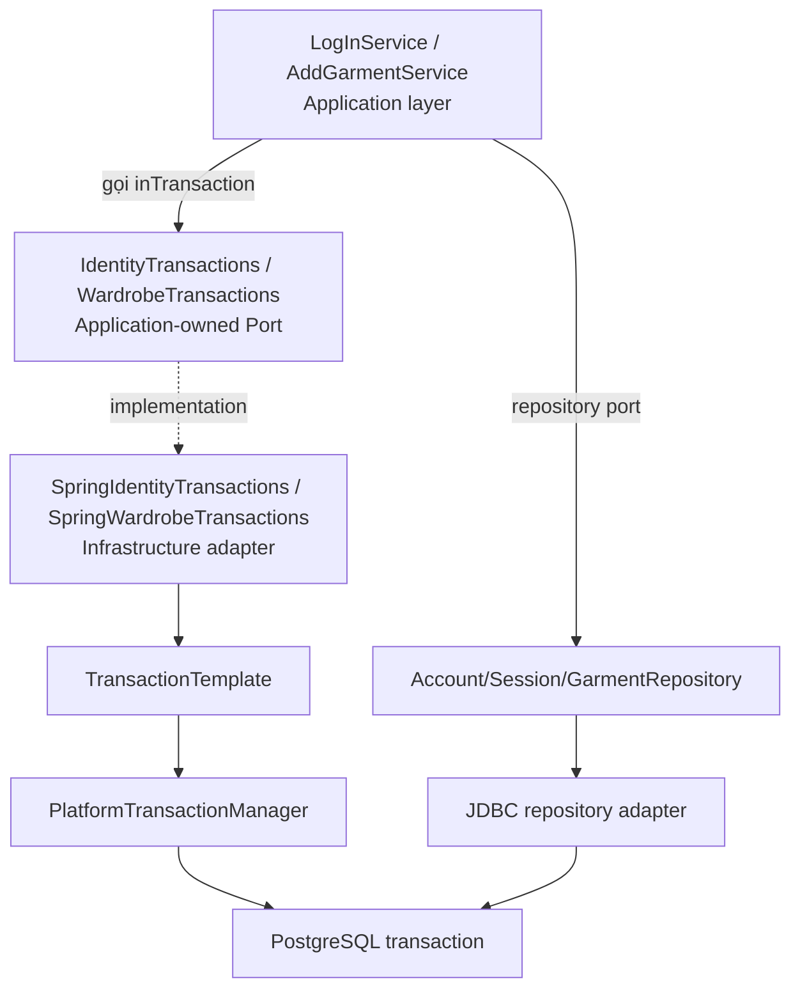

# CapsuleAI — Transactions & Concurrency trong Sprint 1–2

> **Tài liệu học từ codebase thực tế** · Java 21 · Spring Boot 4.1 · PostgreSQL 17 · Spring JDBC · Modular Monolith / Pragmatic Clean Architecture  
> **Nguồn:** `CapsuleAI(1).zip` — snapshot repository sau PR #4 do người dùng cung cấp, đọc ngày 10/11/2026.  
> **Phạm vi:** Backend đã có trong Sprint 1 (Identity/Session) và Sprint 2 (Password Reset, Garment Creation, Wardrobe Browse/Detail). Không giả định các sửa đổi Claude đang thực hiện sau snapshot này.  
> **Cách học:** Đọc **Phần I** để nắm lý thuyết → **Phần II** để hiểu cú pháp → **Phần III–IV** để lần theo từng use case và tình huống concurrent → **Phần V** để ôn lại, đối chiếu source/tests.

---

# PHẦN I — Lý thuyết nền tảng

## 1. Transaction là gì?

Một **database transaction** là một đơn vị công việc gồm một hoặc nhiều thao tác database, được xử lý theo nguyên tắc **cùng thành công (COMMIT) hoặc cùng bị hủy (ROLLBACK)**.

**Ví dụ trong CapsuleAI:** Khi user login thành công, hệ thống cần lưu **login session** và **refresh token đầu tiên**. Nếu chỉ lưu session mà không có refresh token, trạng thái hệ thống bị dở dang.

```text
BEGIN TRANSACTION
  INSERT identity_session
  INSERT identity_refresh_token
COMMIT

Nếu thao tác thứ hai lỗi:
BEGIN TRANSACTION
  INSERT identity_session
  INSERT identity_refresh_token  <-- lỗi
ROLLBACK  <-- session vừa chèn cũng bị hủy
```

Đây là chữ **A — Atomicity** trong ACID. Các chữ còn lại:

| Tính chất | Hiểu ngắn gọn | Liên hệ CapsuleAI |
|---|---|---|
| **Atomicity** | Cùng commit hoặc cùng rollback | Reset Password: đổi password + consume reset token + revoke sessions |
| **Consistency** | Giao dịch tôn trọng constraints/invariants | Mỗi session tối đa một refresh token hiện hành |
| **Isolation** | Các giao dịch đồng thời không được gây kết quả sai theo mức isolation | Hai request dùng cùng refresh token phải được phối hợp |
| **Durability** | Một khi commit, dữ liệu tồn tại bền vững theo bảo đảm DB | Garment đã lưu không biến mất chỉ vì HTTP response bị mất |

**Điểm cực kỳ quan trọng:** Có transaction **không đồng nghĩa** với việc mọi race condition tự động biến mất. Một transaction chứa `SELECT` rồi `INSERT` vẫn có thể bị transaction khác xen vào, nếu không có **lock/constraint/conditional SQL** phù hợp.

## 2. Concurrency là gì? Race condition là gì?

**Concurrency:** Nhiều thao tác cùng tiến triển, có thể xen kẽ nhau, ví dụ hai thiết bị cùng gọi API. Không nhất thiết có nghĩa hai CPU thực thi đúng cùng một nanosecond.

**Race condition:** Kết quả phụ thuộc vào thứ tự xen kẽ, gây vi phạm business rule nếu không có cơ chế phối hợp.

Ví dụ sai (pseudocode):

```java
if (!emailExists(email)) {  // Thread A và B đều thấy false
    insertAccount(email);   // Cả hai cùng cố insert
}
```

```text
Thread A                         Thread B
--------                         --------
SELECT email -> chưa tồn tại
                                 SELECT email -> chưa tồn tại
INSERT email
                                 INSERT email
```

Một kiểm tra `if` trong Java **không đủ để đồng bộ nhiều request hoặc nhiều instance backend**. CapsuleAI dùng **UNIQUE constraint + `INSERT ... ON CONFLICT`** để PostgreSQL bảo vệ quy tắc ngay tại nguồn dữ liệu.

## 3. Bảy cơ chế cần phân biệt

| Cơ chế | Chức năng chính | Ví dụ thực tế |
|---|---|---|
| **Transaction** | Commit/rollback nhiều thao tác như một đơn vị | Login, Reset, Add Garment |
| **Pessimistic row lock** | Buộc thao tác cạnh tranh chờ lock được giải phóng | `FOR UPDATE`, `FOR SHARE` |
| **UNIQUE constraint / index** | DB cấm hai bản ghi vi phạm quy tắc duy nhất | Email duy nhất, một creation key của owner |
| **Conditional UPDATE** | Chỉ thay đổi nếu điều kiện vẫn đúng lúc update | `WHERE revoked_at IS NULL` |
| **Atomic UPSERT** | DB gộp insert/update thành thao tác chống lost update | Counter `attempts = attempts + 1` |
| **Idempotency** | Retry cùng một *logical action* không tạo thêm hiệu ứng đã chấp nhận | `Idempotency-Key` khi Add Garment |
| **Keyset pagination** | Tránh lỗi vị trí trang khi dữ liệu thêm/xóa giữa các request | `(created_at, id) < (cursor...)` |

Nhớ kỹ: `synchronized` của Java chỉ phối hợp các thread chung một JVM/monitor; không phải giải pháp đủ cho backend chạy nhiều instance. CapsuleAI đặt phần lớn bảo đảm quan trọng ở **PostgreSQL**.

## 4. Isolation level hiện tại: READ COMMITTED

Hai adapter `SpringIdentityTransactions` và `SpringWardrobeTransactions` ghi rõ chúng sử dụng PostgreSQL **READ COMMITTED** mặc định.

- Mỗi SQL statement đọc dữ liệu đã được commit tại thời điểm phù hợp với snapshot của statement đó.
- Những statement khác nhau trong cùng transaction có thể quan sát trạng thái khác nhau nếu transaction bên ngoài đã commit ở giữa.
- `SELECT ... FOR UPDATE` có thể chờ và sau đó đọc/khóa hàng vừa được transaction khác cập nhật.
- Muốn xử lý concurrent writes đúng vẫn phải thiết kế **row locks, unique constraints và conditional writes**.

**Không nên nói:** “Đã đặt transaction nên database sẽ tự chạy tất cả request tuần tự.” Đó không phải cách READ COMMITTED hoạt động.

---

# PHẦN II — Vì sao CapsuleAI không gắn `@Transactional` lên Service?

## 5. Trước hết: annotation bạn quen là `@Transactional`

Spring cung cấp cách **Declarative Transaction Management**:

```java
import org.springframework.stereotype.Service;
import org.springframework.transaction.annotation.Transactional;

@Service
public class ExampleService {
    private final SomeRepository repository;

    public ExampleService(SomeRepository repository) {
        this.repository = repository;
    }

    @Transactional
    public void doSomething() {
        repository.writeA();
        repository.writeB();
    }
}
```

Khi method được gọi qua Spring transaction proxy, Spring mở/quản lý transaction. Nếu có `RuntimeException` thoát ra, theo cấu hình mặc định Spring rollback. Phải để ý **self-invocation** (method trong cùng class gọi nhau không đi qua proxy), exception rule, thread boundary và propagation; không phải mọi lời gọi method đều tự tạo transaction.

Đây là cách **khai báo** (*declarative*).

CapsuleAI chọn cách **programmatic** qua `TransactionTemplate`, rồi **ẩn Spring phía sau một Port** để Application layer không import Spring API.

## 6. Từng lớp trong CapsuleAI



**Ở Application layer:**

File `backend/src/main/java/com/capsuleai/identity/application/ports/IdentityTransactions.java`:

```java
import java.util.function.Supplier;

public interface IdentityTransactions {
    <T> T inTransaction(Supplier<T> work);

    default void inTransactionWithoutResult(Runnable work) {
        inTransaction(() -> {
            work.run();
            return null;
        });
    }
}
```

File `backend/src/main/java/com/capsuleai/wardrobe/application/ports/WardrobeTransactions.java`:

```java
import java.util.function.Supplier;

public interface WardrobeTransactions {
    <T> T inTransaction(Supplier<T> work);
}
```

Đây là **interface do chính CapsuleAI định nghĩa**, không phải hàm/annotation có sẵn của Spring.

### Giải thích từng ký hiệu trong `<T> T inTransaction(Supplier<T> work)`

| Cú pháp | Ý nghĩa |
|---|---|
| `<T>` | Generic type parameter: kiểu kết quả được quyết định tại chỗ gọi |
| `T` đứng trước method name | Method trả về một giá trị thuộc kiểu `T` |
| `inTransaction(...)` | Tên method *do dự án đặt* |
| `Supplier<T>` | Functional interface `get()` trả về `T`, **không nhận tham số** |
| `work` | Khối nghiệp vụ muốn chạy bên trong transaction |
| `() -> { ... }` | Lambda không nhận tham số, trả về kết quả từ block |

Ví dụ:

```java
String name = transactions.inTransaction(() -> {
    return "CapsuleAI";
});

Boolean accepted = transactions.inTransaction(() -> {
    return true;
});
```

Java có thể suy luận `T = String` hoặc `T = Boolean`.

**`Runnable` khác `Supplier<T>`:**

- `Supplier<T>.get()` **trả về T**.
- `Runnable.run()` **không trả về giá trị**.

Vì vậy, `inTransactionWithoutResult(Runnable work)` là phương thức tiện ích khi use case không cần kết quả trả về từ transaction.

### `default` nghĩa là gì?

`default` trong Java interface cho phép viết **sẵn phần thân method**, để implementation không cần định nghĩa lại. Ở đây `inTransactionWithoutResult` **tái sử dụng** `inTransaction` và phải `return null` vì `Supplier<T>` cần giá trị trả về.

## 7. Spring thực sự mở transaction ở đâu?

File `backend/src/main/java/com/capsuleai/identity/adapter/out/persistence/SpringIdentityTransactions.java`:

```java
import java.util.function.Supplier;
import org.springframework.transaction.PlatformTransactionManager;
import org.springframework.transaction.support.TransactionTemplate;

public final class SpringIdentityTransactions implements IdentityTransactions {
    private final TransactionTemplate transactionTemplate;

    public SpringIdentityTransactions(PlatformTransactionManager transactionManager) {
        this.transactionTemplate = new TransactionTemplate(transactionManager);
    }

    @Override
    public <T> T inTransaction(Supplier<T> work) {
        return transactionTemplate.execute(status -> work.get());
    }
}
```

**Giải thích dòng cuối theo thứ tự:**

1. Application đưa `work` vào adapter.
2. `transactionTemplate.execute(...)` chạy một **Spring transaction callback**.
3. Spring đưa một `TransactionStatus status` vào lambda; source này không cần thao tác trực tiếp với `status`.
4. `work.get()` thực thi code do Application cung cấp.
5. Nếu thành công, transaction được **commit** (khi nó là transaction do callback mở và không bị đánh dấu rollback).
6. Nếu ném `RuntimeException`, transaction được **rollback** và exception truyền ra ngoài.
7. Kết quả `work.get()` được trả về sau khi quản lý transaction hoàn tất thành công.

`SpringWardrobeTransactions.java` hoạt động tương tự, chỉ khác interface của module.

**`status` là gì?** Đó là `TransactionStatus` của Spring, có thể dùng ví dụ `status.setRollbackOnly()`. CapsuleAI đang cố ý **không làm thế** trong adapter; nó để runtime exception và các kết quả nghiệp vụ điều khiển luồng đơn giản hơn.

### Nơi tạo và inject bean

`IdentityConfiguration.java`:

```java
@Bean
IdentityTransactions identityTransactions(PlatformTransactionManager transactionManager) {
    return new SpringIdentityTransactions(transactionManager);
}
```

`WardrobeConfiguration.java`:

```java
@Bean
WardrobeTransactions wardrobeTransactions(PlatformTransactionManager transactionManager) {
    return new SpringWardrobeTransactions(transactionManager);
}
```

- **Hai interface khác nhau** để giữ ranh giới riêng của từng module.
- **Cùng dùng transaction manager** thuộc Spring/PostgreSQL hiện có; không cần hai database riêng.
- `JdbcClient` thực thi SQL bên trong callback có thể tham gia cùng Spring-managed transaction nhờ Spring JDBC resource management.

## 8. So sánh ba cách viết tương đương về ý tưởng

### Cách A — Annotation

```java
@Transactional
public Result businessOperation() {
    repository.writeA();
    repository.writeB();
    return new Result();
}
```

### Cách B — Spring `TransactionTemplate` trực tiếp

```java
return transactionTemplate.execute(status -> {
    repository.writeA();
    repository.writeB();
    return new Result();
});
```

### Cách C — CapsuleAI

```java
return transactions.inTransaction(() -> {
    repository.writeA();
    repository.writeB();
    return new Result();
});
```

Ở C, Application **không cần import `@Transactional`, `TransactionTemplate`, `PlatformTransactionManager`**; tất cả chi tiết Spring nằm ở adapter. Điều này phù hợp **Pragmatic Clean Architecture (ADA-015)** và giúp unit test inject implementation giả rất dễ.

| Tiêu chí | `@Transactional` | CapsuleAI Port + `TransactionTemplate` |
|---|---|---|
| Độ ngắn khi dùng Spring service | Rất ngắn | Nhiều class/interface hơn |
| Phụ thuộc Spring trong Application | Có (nếu annotation nằm trên application service) | Không |
| Ranh giới transaction | Toàn method được proxy | Khối lambda gọi rõ ràng |
| Unit test không cần Spring | Làm được nhưng phải lưu ý proxy/behavior | Dễ thay port bằng fake |
| Tránh self-invocation proxy trap | Cần cẩn thận | Callback không phụ thuộc Spring AOP proxy của service |
| Nhược điểm | Có thể làm phụ thuộc framework | Thêm boilerplate; phải thiết kế port phù hợp |

**Không nên kết luận `@Transactional` là sai**: Nó rất phù hợp với nhiều ứng dụng Spring Boot, kể cả Clean Architecture theo cách tổ chức phù hợp. Đây là **lựa chọn thiết kế** của CapsuleAI chứ không phải bắt buộc cho mọi dự án.

## 9. Hai kiểu call bạn thường gặp trong CapsuleAI

### Có trả kết quả: `inTransaction(...)`

```java
boolean committed = transactions.inTransaction(() -> {
    repository.writeSomething();
    return true;
});
```

Kiểu `T` lúc này là `Boolean`; transaction thành công và trả `true`.

**Lưu ý:** `return false` chỉ nói **không đạt điều kiện nghiệp vụ**. `return false` **không tự rollback**. Nếu đã thực hiện write rồi trả `false`, các write đó **vẫn được commit** trừ khi transaction bị đánh dấu rollback hay ném exception. Trong code Reset của CapsuleAI, các nhánh `false` đều được đặt trước bước thay đổi được chấp nhận.

### Không trả kết quả: `inTransactionWithoutResult(...)`

```java
transactions.inTransactionWithoutResult(() -> {
    accounts.lockCredentialAgainstChange(account.id());
    sessions.create(session, tokenHash);
});
```

Method `void`; interface bên dưới bọc `Runnable` vào `Supplier<Void>` và `return null`.

**Phân biệt ba cái tên dễ nhầm:**

- `IdentityTransactions.inTransaction(...)`: method **của CapsuleAI**.
- `IdentityTransactions.inTransactionWithoutResult(...)`: **default method của CapsuleAI**.
- `TransactionTemplate.execute(...)` / `executeWithoutResult(...)`: API **của Spring**. `executeWithoutResult` cũng xuất hiện trong `PasswordResetCleanupIT.java` để tạo một transaction giữ lock khi test; đó không phải method `inTransactionWithoutResult` do CapsuleAI tạo.

## 10. Test port: vì sao có `ImmediateTransactions` và `synchronized`?

Ở `backend/src/test/java/com/capsuleai/identity/application/ImmediateTransactions.java`:

```java
final class ImmediateTransactions implements IdentityTransactions {
    private int transactions;

    @Override
    public synchronized <T> T inTransaction(Supplier<T> work) {
        transactions++;
        return work.get();
    }
}
```

**Ý nghĩa:** Unit test có thể chạy business logic và kiểm tra số lần gọi port mà không boot Spring/PostgreSQL.

**Chú ý:** `synchronized` này chỉ bảo vệ fake/counter trong test; **không mô phỏng commit/rollback của DB**, không thay thế integration tests, và **không phải cơ chế concurrency của production**.

`ImmediateWardrobeTransactions.java` có cùng ý tưởng.

---

# PHẦN III — TẤT CẢ các transaction boundary thực sự trong Sprint 1–2

> Khi rà source `backend/src/main/java`, có **5 điểm gọi `transactions.inTransaction...` trực tiếp trong Application**: Login, Refresh, Request Password Reset, Complete Password Reset và Add Garment. Các case khác dùng câu SQL đơn lẻ hoặc read-only query, không nhất thiết có callback bao bên ngoài. Đây là phân loại theo **snapshot đã đọc**, không tính tương lai Sprint 3.

## 11. US-AUTH-002 — Login: `inTransactionWithoutResult`

**Source:** `identity/application/LogInService.java`, khoảng dòng 73–85.

```java
transactions.inTransactionWithoutResult(() -> {
    PasswordHash currentPasswordHash =
            accounts.lockCredentialAgainstChange(account.id())
                    .orElseThrow(InvalidCredentialsException::new);
    if (!currentPasswordHash.equals(account.passwordHash())) {
        throw new InvalidCredentialsException();
    }
    sessions.create(session, RefreshTokenHash.of(refreshToken));
});
```

**Đọc theo luồng:**

1. Validate email/password, tra account, so sánh password bằng PBKDF2 **ở ngoài transaction** (vì xử lý chậm).
2. Chuẩn bị session và refresh token.
3. Bắt đầu transaction.
4. `lockCredentialAgainstChange` đọc password hash hiện tại bằng **`SELECT ... FOR SHARE`**.
5. Nếu password hash đã bị reset đổi kể từ bước 1 → từ chối, **không tạo session**.
6. Nếu hợp lệ, `sessions.create(...)` ghi **session + refresh token**.
7. Commit xong mới trả tokens cho caller.

**Tại sao phải transaction?** Vì session + refresh token phải commit cùng nhau, và lock kiểm tra password phải được giữ đến khi lưu xong session. Đây cũng là một bài toán concurrency (xem **C02**).

### Ví dụ rất dễ nhớ

```text
User login đúng password cũ
        |
        | PBKDF2 đã xác minh
        v
Reset Password diễn ra ở thiết bị khác
        |
        v
Login vào transaction + đọc hash dưới FOR SHARE
        |
        +--> Hash mới khác hash đã verify? --> TỪ CHỐI
        |
        +--> Còn nguyên? --> Tạo session và token --> COMMIT
```

## 12. US-AUTH-003 — Refresh Token Rotation: `inTransaction`

**Source:** `identity/application/RefreshSessionService.java`, khoảng dòng 52–99.

```java
Optional<SessionTokens> renewed = transactions.inTransaction(
        () -> renewInsideTransaction(presented, replacementToken, now));

return renewed.orElseThrow(AuthenticationRequiredException::new);
```

Bên trong `renewInsideTransaction`:

```java
Optional<LockedRefreshCredential> locked = sessions.lockByRefreshToken(presented);
if (locked.isEmpty()) return Optional.empty();

return switch (RefreshRotationPolicy.decide(session, token, now)) {
    case ROTATE -> Optional.of(rotate(session, token, replacementToken, now));
    case REVOKE_SESSION_FOR_REUSE -> {
        sessions.revoke(session.id(), session.accountId(),
                RevocationReason.REFRESH_TOKEN_REUSE, now);
        yield Optional.empty();
    }
    case REJECT -> Optional.empty();
};
```

**Luồng thành công:**

```text
BEGIN
  SELECT refresh token + session FOR UPDATE OF t, s
  UPDATE old token: consumed_at = now
  INSERT new refresh token
  Issue new access token (logic, không ghi DB)
COMMIT
Return tokens
```

**Tại sao không throw exception trong transaction ngay khi thấy reuse?** Đây là chỗ rất hay:

```java
case REVOKE_SESSION_FOR_REUSE -> {
    sessions.revoke(...);  // WRITE: cần commit
    yield Optional.empty(); // KHÔNG throw ở đây
}
```

Sau khi `inTransaction` **trả về** `Optional.empty()`, transaction commit trạng thái revoke. **Sau đó** ở ngoài mới `orElseThrow(...)` để trả 401.

Nếu `throw AuthenticationRequiredException` ngay sau `sessions.revoke(...)` **bên trong** callback, Spring rollback và việc revoke có thể bị hủy! Đây là lý do thiết kế callback trả kết quả rất đáng học.

## 13. US-AUTH-005 — Request Password Reset: `inTransaction`

**Source:** `identity/application/RequestPasswordResetService.java`, dòng 88–106.

```java
boolean committed = transactions.inTransaction(() -> {
    if (!accounts.lockForCredentialChange(issued.accountId())) {
        return false;
    }
    resets.replaceOpenTokens(issued.accountId(), now);
    resets.add(issued, PasswordResetTokenHash.of(rawToken));
    return true;
});

if (committed) {
    instructionSender.sendInstructions(
            new PasswordResetInstructions(owner.email(), rawToken, issued.expiresAt()));
}
```

**Cần transaction vì:**

- Phải khóa account (`FOR UPDATE`) để **serialize các lần cấp reset link** cho cùng account.
- Đánh dấu tất cả reset link cũ còn mở là `replaced`.
- Insert reset link mới.
- Hai write phải cùng commit. Không được có trạng thái “vô hiệu hóa link cũ rồi nhưng không tạo được link mới” chỉ vì insert lỗi.

**Email gửi SAU commit:** `instructionSender.sendInstructions(...)` nằm **ngoài** transaction. Nếu gửi trong transaction, email có thể được gửi dù DB rollback; đồng thời I/O SMTP kéo dài thời gian giữ lock.

**Không được suy luận email chắc chắn đã gửi:** adapter giao việc cho queue in-memory; queue đầy/SMTP lỗi vẫn có thể làm mất email, trong khi interaction đã commit. Đây là giới hạn thiết kế cần hiểu (xem **C10**).

## 14. US-AUTH-005 — Complete Password Reset: `inTransaction`

**Source:** `identity/application/CompletePasswordResetService.java`, dòng 66–102.

```java
boolean completed = transactions.inTransaction(
        () -> completeInsideTransaction(accountId, presented, newPasswordHash, now));

if (!completed) {
    throw new PasswordResetRejectedException();
}
```

Trong transaction:

```java
if (!accounts.lockForCredentialChange(accountId)) return false;

Optional<PasswordResetToken> usable = resets.lockByTokenHash(presented)
        .filter(token -> token.accountId().equals(accountId))
        .filter(token -> token.isUsableAt(now));
if (usable.isEmpty()) return false;

accounts.replacePasswordHash(accountId, newPasswordHash);
resets.consume(usable.get().id(), now);
sessions.revokeAllActiveForAccount(accountId, RevocationReason.PASSWORD_RESET, now);
return true;
```

**Ba thay đổi phải atomic:**

1. Thay `password_hash`.
2. Đánh dấu reset token là **consumed**.
3. Revoke **mọi active session** của account.

**Vì sao hash password ở ngoài transaction?** PBKDF2 có thể tốn CPU; hash trước khi giữ lock giúp transaction ngắn hơn. Trước commit vẫn cần khóa và recheck link để không dùng token đã bị người khác consume/replace trong thời gian hash.

**Chú ý:** `boolean completed = false` là kết quả từ chối, không phải rollback. Code chỉ `return false` **trước các write**, nên an toàn. Những write bắt đầu rồi bị lỗi runtime sẽ rollback tất cả.

## 15. US-GAR-001 — Add Garment: `inTransaction`

**Source:** `wardrobe/application/AddGarmentService.java`, dòng 40–57.

```java
return transactions.inTransaction(() -> {
    if (garments.addIfCreationKeyUnused(candidate, entry.creationKey(), fingerprint)) {
        return new GarmentCreation(candidate, true);
    }

    RecordedGarmentCreation earlier = garments.findCreation(owner, entry.creationKey())
            .orElseThrow(() -> new IllegalStateException(
                    "A used creation key has no recorded garment"));

    if (!earlier.creationFingerprint().equals(fingerprint)) {
        throw new IdempotencyKeyReusedException();
    }
    return new GarmentCreation(earlier.garment(), false);
});
```

**Trước transaction:** validate 13-property profile, chuẩn hóa Materials/Styles, tạo SHA-256 fingerprint và candidate garment.

**Trong transaction:**

1. Insert row chính theo `(owner_account_id, creation_key)`.
2. Nếu insert thành công: insert **tất cả Materials và Styles**.
3. Nếu key đã tồn tại: đọc garment đã commit.
4. Fingerprint giống nhau → trả garment cũ, không tạo duplicate.
5. Fingerprint khác → throw `IdempotencyKeyReusedException` (API trả 422 theo source handler).

**Tại sao phải có transaction?** Nếu row `wardrobe_garment` đã insert nhưng thêm Material thứ hai lỗi, cả parent + tất cả child inserts phải rollback. Không được lưu garment “nửa vời”.

```text
BEGIN
  INSERT wardrobe_garment (ON CONFLICT DO NOTHING)
  INSERT wardrobe_garment_material #1
  INSERT wardrobe_garment_material #2
  INSERT wardrobe_garment_style #1
COMMIT

Nếu child insert lỗi:
ROLLBACK toàn bộ, kể cả parent garment
```

**Về concurrency:** Transaction chỉ là một nửa giải pháp. Nửa còn lại là **UNIQUE(owner, creation_key)** + `ON CONFLICT DO NOTHING` ở PostgreSQL (xem **C12**).

## 16. Những chỗ KHÔNG gọi port transaction trực tiếp

| Use case / thành phần | Thực tế ở code | Vì sao không cần multi-statement transaction wrapper riêng? |
|---|---|---|
| **US-AUTH-001 Register** | Một `INSERT ... ON CONFLICT (email) DO NOTHING` | Một statement đã atomic; UNIQUE bảo vệ email |
| **US-AUTH-004 Logout** | Một `UPDATE ... WHERE revoked_at IS NULL` | Conditional UPDATE tự bảo vệ chuyển trạng thái |
| **Password Reset attempt counting** | Một `INSERT ... ON CONFLICT DO UPDATE ... RETURNING` | Atomic counter trong một SQL statement |
| **Check reset link** | `SELECT` rồi kiểm tra tính khả dụng | Chỉ là kiểm tra tại thời điểm đọc; `complete()` recheck có lock |
| **US-WAR-001 Browse** | `SELECT` có owner predicate + keyset + LIMIT | Read-only, một statement/response; không giữ lock qua các page |
| **US-WAR-002 Inspect** | `SELECT` theo owner + ID, sau đó kiểm tra `removed_at` | Read-only; không sửa garment |
| **Cleanup job** | Mỗi `DELETE ... FOR UPDATE SKIP LOCKED` là statement/batch ngắn | Tránh giữ transaction/lock lâu cho cả vòng lặp |
| **Session authority check** | `SELECT` session, kiểm tra revoked/expired | Xác thực từng request theo trạng thái DB hiện tại |

**Không có explicit wrapper ≠ không có database transaction.** PostgreSQL vẫn thực hiện mỗi statement dưới transaction (autocommit nếu không có transaction bên ngoài). Sự khác biệt là application không gom nhiều statement thành **một transaction lớn**.

---

# PHẦN IV — TẤT CẢ các nhóm xử lý concurrency trong Sprint 1–2

## 17. Những cú pháp PostgreSQL phải nắm trước khi đọc từng case

### 17.1. `FOR UPDATE`: row-level exclusive locking để phối hợp thay đổi

```sql
SELECT id FROM identity.identity_account
WHERE id = :id
FOR UPDATE;
```

- Chọn và khóa các hàng trả về trong transaction hiện tại.
- Transaction khác muốn UPDATE/DELETE hoặc lấy row lock xung đột trên những hàng đó phải đợi.
- **Plain `SELECT` thông thường vẫn có thể đọc snapshot đã commit**; row lock không khiến mọi thao tác SELECT đều bị chặn.
- Lock được giữ đến cuối transaction (ngoại trừ một số tình huống savepoint).

### 17.2. `FOR SHARE`: shared row lock, phù hợp khi chỉ cần bảo vệ dữ liệu đang đọc

```sql
SELECT password_hash FROM identity.identity_account
WHERE id = :id
FOR SHARE;
```

- Nhiều login có thể đồng thời giữ shared lock trên account.
- Password Reset cần đổi hash bằng `UPDATE`/exclusive-compatible lock nên phải đợi khi xung đột.
- Đây **không phải lock toàn bộ bảng**.

### 17.3. `FOR UPDATE OF t, s`: khóa hàng ở cả hai bảng

```sql
SELECT ...
FROM identity.identity_refresh_token t
JOIN identity.identity_session s ON s.id = t.session_id
WHERE t.token_hash = :hash
FOR UPDATE OF t, s;
```

Ở đây khóa **token row + session row**, để việc quyết định rotate/reuse được tuần tự hóa và xung đột với update session được phối hợp.

### 17.4. `FOR UPDATE SKIP LOCKED`: không đợi row đang bị khóa

```sql
SELECT id FROM identity.identity_password_reset
WHERE ...
LIMIT :batchSize
FOR UPDATE SKIP LOCKED;
```

Dùng cho cleanup/batch worker: thấy row người khác đang giữ lock → **bỏ qua** để làm row khác. Nó **không bảo đảm một snapshot đầy đủ**, nên không phù hợp cho đọc danh sách nghiệp vụ bình thường.

### 17.5. `ON CONFLICT`: nhờ database xử lý cuộc đua uniqueness

```sql
INSERT INTO identity.identity_account (...)
VALUES (...)
ON CONFLICT (email) DO NOTHING;
```

Hai request cùng insert email → tối đa một row. Một request nhận update count 1; request kia nhận 0 (nếu transaction đầu commit).

### 17.6. Conditional update: kiểm tra và ghi trong cùng SQL

```sql
UPDATE identity.identity_session
SET revoked_at = :now
WHERE id = :id AND revoked_at IS NULL;
```

Chỉ một request có thể thực sự chuyển trạng thái từ chưa revoke sang đã revoke. Khác với Java `if (!session.revoked()) update()`, điều kiện được DB kiểm tra tại lúc update.

---

## C01 — Hai người đăng ký cùng một email (Sprint 1)

**Source:** `identity/adapter/out/persistence/JdbcAccountRepository.java:25–38`, migration V2.

```sql
INSERT INTO identity.identity_account (...)
VALUES (...)
ON CONFLICT (email) DO NOTHING;
```

Cột `email` có **UNIQUE constraint** (`uq_identity_account_email`).

```text
Request A: register race@example.com
Request B: register race@example.com
                  |
           cùng tranh UNIQUE(email)
                  |
         A insert thành công
         B không insert (duplicate)
```

**Điều bảo đảm:** Không có hai account với normalized email giống nhau. Không dùng `synchronized` ở Java, và không cần khóa toàn bộ bảng.

**Test:** `identity/application/ConcurrentRegistrationIT.java` → `equivalentEmailsRegisteredConcurrentlyCreateAtMostOneAccount` (test case mong đợi 1 CREATED, còn lại DUPLICATE).

## C02 — Login đang xác minh password thì Password Reset đổi password (Sprint 1 + 2)

**Source:** `LogInService.java`, `JdbcAccountRepository.java`, `CompletePasswordResetService.java`.

**Nguy cơ nếu thiếu lock:**

```text
T1 Login: đọc password hash CŨ, kiểm tra đúng
T2 Reset: đổi password sang MỚI và revoke all sessions
T1 Login: tạo SESSION MỚI bằng password cũ
```

Kết quả sai: có session mới **thoát khỏi đợt revoke** dù password cũ không còn được phép.

**Giải pháp CapsuleAI:**

1. Verify PBKDF2 ở ngoài transaction.
2. Login vào transaction, `SELECT password_hash ... FOR SHARE` và so sánh hash hiện tại với hash đã verify.
3. Reset lấy `FOR UPDATE` trên cùng account trước khi đổi hash/revoke.

**Hai thứ tự hợp lệ:**

```text
TRƯỜNG HỢP A — Reset thắng:
  Reset FOR UPDATE account -> đổi hash -> revoke -> COMMIT
  Login FOR SHARE -> đọc hash mới -> mismatch -> REJECT

TRƯỜNG HỢP B — Login thắng:
  Login FOR SHARE -> hash chưa đổi -> tạo session/token -> COMMIT
  Reset FOR UPDATE -> đổi hash + revoke cả session vừa tạo -> COMMIT
```

**Test:** `PasswordResetLoginRaceIT.java` → `aLoginThatVerifiedTheOldPasswordBeforeAResetCommitsGetsNoSession`, có một `PausingPasswordHasher` để tạo đúng interleaving nguy hiểm.

**Bài học:** “Đã kiểm tra trước transaction” có thể là thông tin **stale**. Phải recheck dưới lock nếu kết quả ảnh hưởng quyền truy cập.

## C03 — Tạo session và refresh token cùng lúc (Sprint 1)

**Source:** `LogInService.java` → `sessions.create(...)` → `JdbcSessionRepository.java:25–36`.

- Insert `identity_session`.
- Insert refresh token đầu tiên.
- Cùng một `inTransactionWithoutResult`.

**Transaction bảo vệ atomicity**, còn PK/foreign key/unique constraints bảo vệ quan hệ dữ liệu.

Nếu hai request login khác nhau thành công, chúng tạo **hai session độc lập** (đúng business rule); không được vô tình khóa một account theo cách cấm multiple sessions.

## C04 — Nhiều request refresh cùng dùng một refresh token (Sprint 1)

**Source:** `RefreshSessionService.java`, `JdbcSessionRepository.java:79–134`, migration V5.

**Rủi ro:** Cả request A và B đều thấy token cũ còn current → phát hành hai token thay thế.

**Giải pháp:**

- Khóa hàng token + session: `FOR UPDATE OF t, s`.
- Consume token cũ bằng conditional update: `WHERE consumed_at IS NULL`.
- Thêm token mới.
- Unique partial index `ux_identity_refresh_token_current` bảo đảm **tối đa một token chưa consumed trên mỗi session**.
- Nếu token đã consumed được trình lại theo `RefreshRotationPolicy`, revoke session do reuse.

```text
Request A                    Request B
---------                    ---------
FOR UPDATE(token,session)
                             FOR UPDATE -> WAIT
consume old token
insert new token
COMMIT
                             lock được giải phóng
                             thấy old token consumed
                             phát hiện REUSE
                             revoke session -> COMMIT
                             từ chối
```

**Kết quả cần hiểu cho thật đúng:** Trong một cuộc đua dùng lại token, có thể **một request rotate thành công nhưng session sau đó bị revoke do token reuse**, nên token mới đã cấp cũng không còn dùng được. Đây là chủ ý bảo mật, không phải “cả hai refresh thành công”.

**Test:** `ConcurrentRefreshIT.java` → `competingRenewalsWithOneTokenAllowExactlyOneSuccessThenRevokeTheSession` (4 request; 1 rotate, 3 bị từ chối, session revoked `REFRESH_TOKEN_REUSE`).

**Nuance:** Retry refresh bằng cùng token sau khi response đầu bị mất có thể bị coi là reuse và revoke session. Refresh-token rotation khác với idempotent garment creation; client phải xử lý tái xác thực khi cần.

## C05 — Logout và Refresh diễn ra đồng thời (Sprint 1)

**Source:** `LogOutService.java`, `RefreshSessionService.java`, `JdbcSessionRepository.java:52–63,79–100`.

Logout dùng:

```sql
UPDATE identity.identity_session
SET revoked_at = :now, revocation_reason = 'LOGOUT'
WHERE id = :id
  AND account_id = :accountId
  AND revoked_at IS NULL;
```

- UPDATE có điều kiện + row locking do PostgreSQL quản lý.
- Refresh giữ row lock trên session khi quyết định rotate.

**Nếu Logout commit trước:** Refresh thấy session revoked → từ chối.

**Nếu Refresh commit trước:** Logout revoke session → mọi access/refresh token gắn với session đó mất quyền sử dụng tiếp theo.

**Test:** `ConcurrentRefreshIT.java` → `concurrentLogoutAndRenewalLeaveNoUsableAuthority`.

**Điểm cần nhớ:** `UPDATE` atomically kiểm tra `revoked_at IS NULL`. Gọi logout lại có thể ra “nothing to revoke” thay vì ghi revoke hai lần.

## C06 — Nhiều request Forgot Password cùng account (Sprint 2)

**Source:** `RequestPasswordResetService.java:88–107`, `JdbcPasswordResetRepository.java:23–46`, migration V7.

**Business rule:** Chỉ có **một reset interaction còn mở** cho mỗi account. Request mới thay thế request cũ.

**Giải pháp phối hợp:**

1. Lấy account lock bằng `FOR UPDATE`.
2. `replaceOpenTokens(...)` đánh dấu `replaced_at` cho các interaction cũ.
3. Insert interaction mới.
4. Commit atomic.
5. Unique partial index `ux_identity_password_reset_open_per_account` phòng thủ ở database.

```text
Request A: account FOR UPDATE -> replace -> insert A -> COMMIT
Request B: chờ account lock -> replace A -> insert B -> COMMIT
```

Sau đó, chỉ **B** còn usable; A có thể đã được gửi email nhưng link bị thay thế.

**Test:** `ConcurrentPasswordResetIT.java` → `competingRequestsLeaveExactlyOneUsableLink` (4 yêu cầu, chỉ 1 link usable).

## C07 — Hai người/bốn request cùng Complete Password Reset với một link (Sprint 2)

**Source:** `CompletePasswordResetService.java`, `JdbcPasswordResetRepository.java:60–86`, migration V7.

**Nguy cơ:** Một reset link được consume nhiều lần, hoặc nhiều mật khẩu khác nhau cùng được xác nhận.

**Giải pháp:**

- Đọc token hash ban đầu để xác định account (chưa lock).
- PBKDF2 hash mật khẩu mới bên ngoài transaction.
- Trong transaction lấy **account FOR UPDATE trước**, rồi **reset token FOR UPDATE**.
- Recheck `isUsableAt(now)` dưới lock.
- Thay password + consume token + revoke sessions **trong cùng transaction**.

Token `consume` có thêm điều kiện:

```sql
UPDATE identity.identity_password_reset
SET consumed_at = :now
WHERE id = :id
  AND consumed_at IS NULL
  AND replaced_at IS NULL;
```

**Kết quả:** Chỉ một completion được chấp nhận. Các request đến sau thấy token consumed, trả từ chối.

**Test:** `ConcurrentPasswordResetIT.java` → `competingCompletionsOfOneLinkChangeThePasswordExactlyOnce`.

**Giải thích tại sao có cả lock và conditional UPDATE:** Lock giúp kiểm tra và thực thi quyết định như một khối; điều kiện SQL và constraints bổ sung bảo vệ invariants, kể cả trước lỗi logic hoặc concurrent paths khác.

## C08 — Password Reset và Refresh diễn ra đồng thời (Sprint 2)

**Source:** `CompletePasswordResetService.java`, `RefreshSessionService.java`.

Giả sử thiết bị A reset password, thiết bị B refresh session.

```text
THỨ TỰ 1: Refresh commit trước
  Refresh cũ -> new access/refresh token
  Reset -> revoke tất cả active sessions -> token mới cũng mất quyền

THỨ TỰ 2: Reset commit trước
  Session bị revoke
  Refresh -> kiểm tra session -> REJECT
```

**Kết quả sau khi reset commit:** Không có active session cũ nào tiếp tục được dùng để truy cập protected APIs. Điều này dựa trên persistent session authority, không chỉ JWT signature.

**Test:** `ConcurrentPasswordResetIT.java` → `resetRacingARenewalLeavesNoUsableSessionWhicheverCommitsFirst`.

## C09 — Rate limiting với nhiều request đồng thời (Sprint 2)

**Source:** `PasswordResetAttemptGuard.java`, `JdbcPasswordResetAttemptLimiter.java:26–40`, migration V7.

Mỗi counter được nhận diện bởi bộ khóa:

```text
(scope, subject_hash, window_start)
```

Trong đó:

- `scope`: REQUEST_PER_CLIENT, REQUEST_PER_EMAIL, VERIFICATION_PER_CLIENT.
- `subject_hash`: SHA-256 của normalized email hoặc client address.
- `window_start`: đầu fixed time window.

SQL thật:

```sql
INSERT INTO identity.identity_password_reset_attempt AS a
       (scope, subject_hash, window_start, attempts)
VALUES (:scope, :subjectHash, :windowStart, 1)
ON CONFLICT (scope, subject_hash, window_start)
DO UPDATE SET attempts = a.attempts + 1
RETURNING a.attempts;
```

**Tại sao không làm `SELECT attempts` rồi `UPDATE attempts+1` trong Java?** Hai request có thể cùng đọc 5 rồi cùng ghi 6, làm mất một lần thử (*lost update*). Atomic UPSERT cho mỗi request một count thực tế.

```text
16 concurrent requests
         |
         v
PostgreSQL serializes updates trên cùng counter row
         |
         v
Các kết quả: 1, 2, 3, ... 16 (không bị mất lần đếm)
```

`PasswordResetAttemptGuard.admit()` **đếm trước rồi mới so với max**:

```java
int attempts = limiter.recordAttempt(scope, subject, windowStart);
if (attempts > maximumAttempts.get(scope)) {
    throw new PasswordResetRateLimitedException(...);
}
```

Vì lần đếm là statement đã hoàn tất trước khi ném exception (không bị bao bởi transaction nghiệp vụ ở đây), các request vượt hạn mức vẫn được ghi nhận trong window.

**Test:** `JdbcPasswordResetAttemptLimiterIT.java` → `concurrentAttemptsEachReceiveADistinctCount` (16 threads), `scopesSubjectsAndWindowsAreCountedSeparately`.

## C10 — Async gửi email và bounded queue (Sprint 2)

**Source:** `identity/adapter/out/email/AsyncPasswordResetInstructionSender.java`.

Đây là **application thread concurrency**, không phải DB row locking.

```java
new ThreadPoolExecutor(
    1, 1, 0L, TimeUnit.MILLISECONDS,
    new ArrayBlockingQueue<>(queueCapacity),
    Thread.ofPlatform().name("password-reset-mail-", 0).daemon(true).factory()
);
```

- **Một worker thread** thực hiện gửi email.
- `ArrayBlockingQueue` có giới hạn (configuration dùng capacity 100).
- HTTP request không phải chờ SMTP gửi xong.
- Khi queue đầy / shutdown, có thể `RejectedExecutionException`; adapter log warning.
- Nếu SMTP exception, worker bắt và log warning.

**Trade-off:** Giảm thời gian chờ request nhưng **in-memory queue không durable**: app crash có thể mất email đã xếp hàng. Reset interaction trong DB vẫn còn, user có thể request lại theo chính sách. Không được gọi đây là một **transactional outbox** hoặc **guaranteed delivery**.

**Nguồn test:** `AsyncPasswordResetInstructionSenderTest.java`.

## C11 — Password Reset cleanup chạy cùng lúc với request/reset (Sprint 2)

**Source:** `PurgeEndedPasswordResetsService.java`, `JdbcPasswordResetRepository.java:89–104`, `PasswordResetCleanupJob.java`.

Cleanup chỉ xóa interaction đã kết thúc và đã quá retention:

```sql
DELETE FROM identity.identity_password_reset
WHERE id IN (
    SELECT id
    FROM identity.identity_password_reset
    WHERE COALESCE(consumed_at, replaced_at, expires_at) <= :cutoff
    ORDER BY id
    LIMIT :batchSize
    FOR UPDATE SKIP LOCKED
);
```

**Tình huống:**

```text
Transaction A: đang giữ FOR UPDATE trên reset row R
Cleanup B: đến R, thấy locked -> SKIP, xử lý row khác
Transaction A: COMMIT
Cleanup lần sau: R còn đủ điều kiện -> DELETE
```

**Điều này ngăn cleanup chờ row lock quá lâu.** Nếu chạy nhiều cleanup worker, cơ chế giúp chúng không chọn cùng các row đang bị worker khác giữ trong batch.

- Mỗi batch là SQL statement ngắn, không khóa cả vòng cleanup bằng một transaction dài.
- Scheduled job retry ở lần chạy tiếp theo sau lỗi.
- Dữ liệu được xóa theo chính sách thời hạn, không phải cứ nhận thấy token cũ là xóa ngay.

**Test:** `PasswordResetCleanupIT.java` → `theCleanupSkipsARowAnotherTransactionHoldsAndDeletesItOnTheNextRun`.

Trong test này còn có ví dụ trực tiếp Spring API:

```java
new TransactionTemplate(transactionManager).executeWithoutResult(status -> {
    jdbc.sql("SELECT id FROM identity.identity_password_reset WHERE id = :id FOR UPDATE")
        .param("id", held)
        .query(UUID.class)
        .single();
    // Dùng CountDownLatch để giữ transaction mở cho đến khi test cho phép thả lock.
});
```

`executeWithoutResult` ở đây là **method Spring**, không phải port do CapsuleAI tự đặt.

## C12 — Nhiều lần Add Garment đồng thời cùng `Idempotency-Key` (Sprint 2)

**Source:** `AddGarmentService.java`, `JdbcGarmentRepository.java:78–136`, migration V8.

Database có:

```sql
CONSTRAINT uq_wardrobe_garment_creation_key
    UNIQUE (owner_account_id, creation_key)
```

Và:

```sql
INSERT INTO wardrobe.wardrobe_garment (...)
VALUES (...)
ON CONFLICT (owner_account_id, creation_key) DO NOTHING;
```

**Giả sử 4 concurrent requests đều cùng owner, key K, cùng garment values:**

```text
Request A ----+
Request B ----+----> UNIQUE(owner, K) ---> 1 INSERT thành công
Request C ----+                           3 request còn lại thấy conflict
Request D ----+                           -> tìm existing garment
                                           -> fingerprint trùng
                                           -> trả cùng garment ID
```

**Các khả năng:**

| Trường hợp | Kết quả mong đợi |
|---|---|
| Cùng owner + cùng key + cùng accepted values | **1 garment**, request đầu 201, retry 200, cùng garment ID |
| Cùng owner + cùng key + giá trị khác | Request thứ hai **422** `IDEMPOTENCY_KEY_REUSED` |
| Cùng owner + key khác + giá trị giống | **Nhiều garment** (mỗi key là ý định tạo độc lập) |
| Owner khác + tình cờ cùng key | Không xung đột theo constraint `(owner, key)` |
| Transaction insert đầu rollback | Request cạnh tranh có thể tiến hành insert khi uniqueness được giải phóng |

**Vì sao cần fingerprint?** Unique key chỉ nhận ra đây là **cùng logical action identifier**, chưa biết payload có giống không. SHA-256 trên profile đã chuẩn hóa giúp phát hiện client dùng lại key cho một garment khác.

**Materials/Styles được canonical hóa** thành tập giá trị nên thứ tự chọn khác nhau không tự tạo fingerprint khác.

**Tests:**

- `ConcurrentGarmentCreationIT.java` → `concurrentDeliveriesOfOneAdditionCreateExactlyOneGarment`.
- `ConcurrentGarmentCreationIT.java` → `concurrentSeparateAdditionsOfTheSameGarmentAreAllKept`.
- `AddGarmentApiIT.java`, `GarmentCreationFingerprintTest.java` và `JdbcGarmentRepositoryIT.java` cho các khía cạnh API/persistence.

**Bài học:** `@Transactional` một mình **không chặn được duplicate**. Sự phối hợp đúng là **transaction + unique constraint + ON CONFLICT + fingerprint + business interpretation**.

## C13 — Browse Wardrobe khi có thêm/xóa garment giữa các page (Sprint 2)

**Source:** `BrowseWardrobeService.java`, `JdbcGarmentRepository.java:53–70,139–155`, migration V8.

Đây là **concurrency giữa các lần đọc**, không phải `FOR UPDATE`.

Cú pháp chính:

```sql
WHERE owner_account_id = :ownerAccountId
  AND removed_at IS NULL
  AND (created_at, id) < (:afterCreatedAt, :afterGarmentId)
ORDER BY created_at DESC, id DESC
LIMIT :maximumCount;
```

**Keyset Cursor** ghi nhớ `(created_at, id)` của garment cuối trang, thay vì `OFFSET` dựa trên vị trí hàng.

```text
Đầu tiên:  A B C D E
Trang 1:   A B   [cursor B]

Có thêm F mới hơn: F A B C D E
Trang 2:           C D  (tiếp sau vị trí B, không lặp B)
```

Nếu một garment bị đánh dấu removed giữa hai request, query sau có `removed_at IS NULL` nên nó bị bỏ qua; những garment còn lại vẫn được xét theo keyset.

**Giới hạn cần hiểu:**

- Không có một transaction/snapshot kéo dài qua nhiều HTTP requests.
- Pagination không tạo “bản chụp đóng băng” tuyệt đối của wardrobe.
- Nếu một bản ghi mới có `created_at` bằng cursor timestamp và UUID nằm phía sau cursor, nó có thể xuất hiện ở page sau; giả định “mọi insert mới nhất định nằm trước cursor” cần điều kiện ordering/timestamp phù hợp.
- Keyset tránh các lỗi dịch vị trí thường gặp của `OFFSET`; không thể thay thế mọi yêu cầu snapshot consistency.
- `SELECT_GARMENT` chứa subquery lấy Materials/Styles trong cùng một SQL statement để đọc nhất quán theo snapshot của statement.

**Tests:** `CurrentWardrobePageIT.java`, `BrowseWardrobeApiIT.java`.

## C14 — Inspect Garment và thao tác đọc trong khi dữ liệu thay đổi (Sprint 2)

**Source:** `InspectGarmentService.java`, `JdbcGarmentRepository.java:157–163`.

- Lookup được giới hạn bằng `owner_account_id` + `garmentId`.
- Không cần lấy `FOR UPDATE` chỉ để xem detail.
- Nếu row cho owner tồn tại nhưng `removed_at != null`, ứng dụng phân biệt **410 Gone**.
- Nếu unknown/foreign ID, trả **404 Not Found**; user khác không được nhìn thấy row.

**Concurrency nuance:** Mỗi request đọc trạng thái database tại thời điểm query; nếu garment bị remove ngay sau query, response detail có thể phản ánh trạng thái đã đọc. Đây là giới hạn thường gặp của read-only query, không phải lý do mặc định để giữ lock qua lúc người dùng xem màn hình.

**Tests:** `GarmentDetailApiIT.java` và `WardrobeAccessAfterPasswordResetIT.java` (cross-story).

**Đừng nhầm:** Trong Sprint 2, chưa có public removal endpoint. Những test về removed garments dùng controlled fixture/SQL; không được hiểu là đã triển khai chức năng xóa garment cho người dùng.

## C15 — Xác thực JWT trong lúc một session bị revoke (Sprint 1–2)

**Source:** `SessionAwareJwtAuthenticationConverter.java`, `SessionAuthorityService.java`, `JdbcSessionRepository.findById`.

JWT hợp lệ về chữ ký và hạn dùng **chưa đủ**. Với protected request, hệ thống còn kiểm tra persistent session có thuộc account và usable không.

```text
Incoming JWT
     |
     v
Verify JWT signature + expiry
     |
     v
Lookup persistent session state
     |
     +--> revoked/expired/wrong owner -> 401
     |
     +--> DB cannot be reached -> 503 authority unavailable
     |
     +--> usable -> permit current request
```

Do đó sau khi Password Reset revoke sessions, các JWT cũ **không tiếp tục được chấp nhận ở những lần xác thực tiếp theo**, dù chữ ký vẫn đúng và `exp` chưa hết hạn.

**Giới hạn chính xác:** Đây là kiểm tra authority tại lúc xác thực request; không phải cơ chế tự động hủy một request đã được xác thực và đang chạy giữa chừng khi revoke commit. Nếu cần bảo đảm mạnh hơn cho thao tác nhạy cảm đang chạy, phải thiết kế thêm phối hợp ở chính transaction của thao tác đó.

**Tests:** `AccessTokenSecurityIT.java`, `SessionAuthorityOutageIT.java`, `WardrobeAccessAfterPasswordResetIT.java`.

## C16 — Các cạnh tranh bổ sung và điểm cần tránh hiểu sai

### Reset Request vs Reset Completion

- Cả hai dùng **account-level lock** ở đường write, nên issuance/completion không thể tự do xen giữa các bước thay đổi cùng account.
- Completion còn lock + revalidate reset interaction.
- Link có thể trở nên **replaced** ngay trước khi complete; complete sau đó phải bị từ chối.
- `CheckPasswordResetService.check()` chỉ là kiểm tra tạm thời và **không giữ chỗ** cho lần complete sau.

### Hai Logout đồng thời

- `UPDATE ... WHERE revoked_at IS NULL` bảo đảm tối đa một request chuyển trạng thái thực sự.
- Không cần toàn bộ `LogOutService` được bảo vệ bằng `synchronized`.

### Hai instance backend khác nhau

- Java `synchronized`/`ReentrantLock` trong một process **không đủ** phối hợp giữa nhiều instance.
- PostgreSQL locks, constraints và atomic statements vẫn hoạt động khi hai instance dùng cùng database.

### Deadlock

- Nếu transaction X lock A rồi đợi B, còn transaction Y lock B rồi đợi A, có thể deadlock.
- Reset flow theo **account → reset token → sessions** nhằm hạn chế deadlock trong các luồng có liên quan.
- Không thể tuyên bố “hệ thống tuyệt đối không bao giờ deadlock”; cần kiểm tra mọi lock acquisition path, transaction timeout/retry và lỗi DB thực tế.

### Rollback không trả lại external side effects

- PostgreSQL rollback **không thu hồi được email SMTP đã gửi**, HTTP response đã phát, file đã upload lên Object Storage, hoặc in-memory task đã thực hiện.
- Vì vậy Password Reset gửi email **sau commit** và Sprint 3 media cần một lifecycle riêng.

---

# PHẦN V — Tổng hợp nhanh, test và tự luyện

## 18. Ma trận 5 transaction call sites

| Sprint / Story | File | Cú pháp | Điều cần atomic | Cơ chế concurrency kết hợp |
|---|---|---|---|---|
| S1 — Login | `LogInService` | `inTransactionWithoutResult` | Session + first refresh token | `FOR SHARE` recheck hash vs reset |
| S1 — Refresh | `RefreshSessionService` | `inTransaction` | Consume + insert token **hoặc** revoke for reuse | `FOR UPDATE OF t,s`, partial unique index |
| S2 — Reset Request | `RequestPasswordResetService` | `inTransaction` | Replace old links + insert new | Account `FOR UPDATE`, unique open-link index |
| S2 — Reset Complete | `CompletePasswordResetService` | `inTransaction` | New hash + consume token + revoke sessions | Account + token lock, conditional update |
| S2 — Add Garment | `AddGarmentService` | `inTransaction` | Parent + Materials + Styles, idempotent replay | Unique(owner,key), `ON CONFLICT`, fingerprint |

**Nắm một câu:** `TransactionTemplate` giải quyết **vòng đời transaction**. Port `IdentityTransactions`/`WardrobeTransactions` giải quyết **dependency direction**. Row locks/constraints/conditional SQL/idempotency giải quyết **các cuộc đua cụ thể**.

## 19. Ma trận concurrency: đọc source nào và test nào?

| ID | Chủ đề | Production source | Integration test minh họa |
|---|---|---|---|
| C01 | Concurrent registration | `JdbcAccountRepository` | `ConcurrentRegistrationIT` |
| C02 | Login vs password reset | `LogInService`, `JdbcAccountRepository`, `CompletePasswordResetService` | `PasswordResetLoginRaceIT` |
| C03 | Session + first token atomic | `LogInService`, `JdbcSessionRepository` | `LoginApiIT`, `SessionSchemaIT` |
| C04 | Concurrent refresh/reuse | `RefreshSessionService`, `JdbcSessionRepository`, V5 | `ConcurrentRefreshIT` |
| C05 | Logout vs refresh | `LogOutService`, `JdbcSessionRepository` | `ConcurrentRefreshIT` |
| C06 | Concurrent reset requests | `RequestPasswordResetService`, `JdbcPasswordResetRepository`, V7 | `ConcurrentPasswordResetIT` |
| C07 | Concurrent reset completions | `CompletePasswordResetService`, `JdbcPasswordResetRepository` | `ConcurrentPasswordResetIT` |
| C08 | Password reset vs refresh | `CompletePasswordResetService`, `RefreshSessionService` | `ConcurrentPasswordResetIT` |
| C09 | Concurrent rate-limit increments | `PasswordResetAttemptGuard`, `JdbcPasswordResetAttemptLimiter` | `JdbcPasswordResetAttemptLimiterIT` |
| C10 | Async SMTP delivery/queue | `AsyncPasswordResetInstructionSender` | `AsyncPasswordResetInstructionSenderTest` |
| C11 | Cleanup vs locked reset row | `JdbcPasswordResetRepository`, `PurgeEndedPasswordResetsService` | `PasswordResetCleanupIT` |
| C12 | Concurrent garment creation | `AddGarmentService`, `JdbcGarmentRepository`, V8 | `ConcurrentGarmentCreationIT` |
| C13 | Concurrent changes during pagination | `BrowseWardrobeService`, `JdbcGarmentRepository` | `BrowseWardrobeApiIT`, `CurrentWardrobePageIT` |
| C14 | Read detail vs removal | `InspectGarmentService`, `JdbcGarmentRepository` | `GarmentDetailApiIT` |
| C15 | Session revocation vs protected request | `SessionAwareJwtAuthenticationConverter`, `SessionAuthorityService` | `AccessTokenSecurityIT`, `WardrobeAccessAfterPasswordResetIT` |
| C16 | Request/complete/logout and isolation edge cases | Identity repository/port + PostgreSQL | `PasswordResetApiIT`, `LogoutApiIT`, `PasswordResetFailureIT` |

Đường dẫn source:

```text
backend/src/main/java/com/capsuleai/identity/
backend/src/main/java/com/capsuleai/wardrobe/
backend/src/test/java/com/capsuleai/identity/
backend/src/test/java/com/capsuleai/wardrobe/
backend/src/main/resources/db/migration/
```

Các test nêu trên **có trong snapshot và chứa những assertion tương ứng**; tài liệu này **không tuyên bố đã chạy lại test suite** trong phiên làm việc hiện tại.

## 19.1. Các lần gọi transaction trực tiếp trong integration tests (ngoài 5 Application call sites)

Nếu tìm toàn bộ từ khóa `inTransaction` trong repository, bạn còn thấy các lời gọi phục vụ **setup/kiểm thử**, không phải use case production mới:

- **`JdbcGarmentRepositoryIT.assertRoundTrip(...)`**: gọi `transactions.inTransaction(() -> garments.addIfCreationKeyUnused(...))` vì repository insert parent + Materials + Styles phải được test trong đúng transaction boundary như production.
- **`CurrentWardrobePageIT.store(...)`**: bọc lời gọi repository insert trong transaction để tạo fixture hợp lệ.
- **`CurrentWardrobePageIT.aLaterPageIsReadInIndexOrderWithoutSorting`**: bọc **`SET LOCAL enable_seqscan = off`** và `EXPLAIN` trong *cùng transaction*. `SET LOCAL` chỉ áp dụng trong transaction hiện tại; nhờ đó kiểm tra kế hoạch dùng `ix_wardrobe_garment_owner_current` mà không thay đổi setting toàn cục của PostgreSQL. Việc tắt sequential scan ở test là để quan sát khả năng dùng index trên bảng nhỏ, **không chứng minh PostgreSQL lúc nào cũng chọn index trong production**.
- **`PasswordResetCleanupIT`**: dùng Spring `new TransactionTemplate(transactionManager).executeWithoutResult(...)` để giữ `FOR UPDATE` trong khi cleanup chạy cạnh tranh. Đây là test chủ động tạo lock/race.
- **`ImmediateTransactions` và `ImmediateWardrobeTransactions`**: test fake chỉ gọi `work.get()`; không mở PostgreSQL transaction thực.

**Kết luận:** Có **5 vị trí production Application mở explicit transaction qua Port**, và thêm các vị trí test trực tiếp sử dụng Port/Spring TransactionTemplate nhằm tạo fixture, giữ lock hoặc kiểm tra query plan.

## 20. Các ngộ nhận dễ gặp

| Ngộ nhận | Hiểu đúng |
|---|---|
| “Dùng `inTransaction` nghĩa là không dùng Spring.” | Vẫn dùng Spring `TransactionTemplate`, nhưng ẩn sau interface. |
| “`inTransaction` là Spring method.” | Là method được CapsuleAI tự định nghĩa. |
| “`inTransactionWithoutResult` có trong `TransactionTemplate`.” | Không; cái tên đó là default method của `IdentityTransactions`; Spring dùng `executeWithoutResult`. |
| “`return false` tự rollback.” | Sai: transaction có thể commit khi callback trả `false`. |
| “`FOR UPDATE` chặn luôn mọi SELECT.” | Plain `SELECT` thông thường vẫn đọc snapshot đã commit. |
| “Đã `@Transactional` thì khỏi cần UNIQUE.” | Sai: uniqueness vẫn phải được DB cưỡng chế. |
| “`synchronized` unit-test fake bảo vệ database.” | Sai; fake không phải production DB transaction. |
| “Check reset token thành công thì 5 phút sau complete chắc thành công.” | Sai; có thể bị expire, consume, replace. |
| “Refresh retry phải trả lại token cũ như garment retry.” | Không; refresh reuse có thể revoke session theo chính sách. |
| “Password Reset rollback sẽ thu hồi email.” | Không; external effects không tự rollback. |
| “Cursor pagination là DB lock.” | Không; đây là cách tìm vị trí trang tiếp theo. |
| “Concurrent tests chứng minh không có race condition nào khác.” | Không; chỉ chứng minh các interleaving và invariant đã được test, không chứng minh toàn bộ khả năng có thể xảy ra. |

## 21. Bài tập tự kiểm tra (kèm đáp án)

**Câu 1.** Vì sao `RefreshSessionService` không `throw` ngay bên trong callback khi phát hiện token reuse?

<details><summary>Đáp án</summary>Vì phải commit thao tác `revoke(session)` trước. Throw runtime bên trong callback sẽ khiến transaction rollback; do đó callback trả `Optional.empty()`, commit, rồi mới throw `AuthenticationRequiredException` bên ngoài.</details>

**Câu 2.** Vì sao Login hash/verify password trước khi lấy account lock rồi còn phải recheck dưới `FOR SHARE`?

<details><summary>Đáp án</summary>PBKDF2 chậm nên nên thực hiện trước lock; nhưng password có thể đã reset khi đang hash/verify. Recheck dưới shared lock ngăn tạo session với credential bị thay đổi giữa chừng.</details>

**Câu 3.** Hai request Add Garment có cùng key và cùng dữ liệu. Chỉ có `@Transactional` mà không có UNIQUE constraint thì đủ không?

<details><summary>Đáp án</summary>Không. Cần UNIQUE `(owner_account_id, creation_key)` và `ON CONFLICT` để DB đảm bảo chỉ một creation được accepted; transaction bảo vệ tính toàn vẹn của parent và child writes.</details>

**Câu 4.** `UPDATE ... WHERE revoked_at IS NULL` có tác dụng gì nếu hai request logout đồng thời?

<details><summary>Đáp án</summary>Chỉ một request có thể chuyển hàng từ trạng thái chưa revoke sang revoked; request đến sau không update được hàng nữa.</details>

**Câu 5.** Sau khi client gọi `check` Reset Token thấy valid, `complete` có cần lock/recheck nữa không?

<details><summary>Đáp án</summary>Có. Check chỉ là ảnh chụp của một thời điểm, link có thể đã bị consume/replace/expire ngay sau đó.</details>

**Câu 6.** Tại sao không giữ transaction từ Page 1 sang Page 2 trong Wardrobe Browse?

<details><summary>Đáp án</summary>Hai page là hai HTTP requests độc lập. Giữ long-lived transaction/locks xuyên thời gian user cuộn trang sẽ tốn connection và gây contention. Keyset pagination theo `(created_at,id)` xử lý phổ biến các thay đổi giữa trang mà không đòi snapshot dài hạn.</details>

**Câu 7.** Nếu một operation ghi DB thành công nhưng `sendInstructions(...)` gửi email thất bại, `inTransaction` có tự rollback không?

<details><summary>Đáp án</summary>Không. Việc gửi xảy ra sau khi transaction đã commit. Không thể dùng transaction DB để rollback email; thiết kế phải có retry/recovery riêng.</details>

## 22. Mini-lab trên source thật (VS Code)

Mở repository trong VS Code; sử dụng **Ctrl+P** theo thứ tự:

1. `IdentityTransactions.java` → đọc generic `Supplier<T>`, `Runnable`, `default`.
2. `SpringIdentityTransactions.java` → thấy `TransactionTemplate.execute`.
3. `LogInService.java` → nối `inTransactionWithoutResult` với `FOR SHARE`.
4. `JdbcAccountRepository.java` → so sánh `FOR SHARE` và `FOR UPDATE`.
5. `RefreshSessionService.java` → tự vẽ đường `ROTATE` và `REVOKE_SESSION_FOR_REUSE`.
6. `JdbcSessionRepository.java` → đọc SQL `FOR UPDATE OF t, s`, conditional `UPDATE`.
7. `RequestPasswordResetService.java` / `CompletePasswordResetService.java` → xác định bước nào trong/ngoài transaction.
8. `JdbcPasswordResetAttemptLimiter.java` → giải thích atomic UPSERT.
9. `JdbcPasswordResetRepository.java` → giải thích `SKIP LOCKED`.
10. `AddGarmentService.java` / `JdbcGarmentRepository.java` → vẽ nhánh first creation/same retry/conflicting retry.
11. `ConcurrentRefreshIT.java` / `ConcurrentGarmentCreationIT.java` → xem `ExecutorService` + `CountDownLatch` tạo requests đồng thời như thế nào.
12. `PasswordResetLoginRaceIT.java` → xem `PausingPasswordHasher` cố tình tạo race condition khó bắt.

**Lệnh chạy các test liên quan trên Windows/PowerShell** (cần Docker Desktop cho ITs):

```powershell
Set-Location 'D:\CapsuleAI\backend'

.\mvnw.cmd '-Dtest=HarnessSmokeTest' '-Dit.test=ConcurrentRegistrationIT,ConcurrentRefreshIT,ConcurrentPasswordResetIT,PasswordResetLoginRaceIT,JdbcPasswordResetAttemptLimiterIT,PasswordResetCleanupIT,ConcurrentGarmentCreationIT' verify
```

> Câu lệnh là cách **thử chạy** các ITs nếu tên và Maven Failsafe configuration của checkout hiện tại còn tương ứng snapshot. Hãy kiểm tra console và Surefire/Failsafe reports để xác nhận chúng thực sự chạy; đừng chỉ nhìn `BUILD SUCCESS` mà kết luận mọi test đã được thực thi. Nếu IDE/checkout mới khác ZIP, kiểm tra cấu hình trước.

## 23. Mental Model cuối cùng

```text
                    USE CASE
                       |
                       v
           Business rules / validation
                       |
                       v
          Transaction Port (Application)
                       |
                       v
           TransactionTemplate (Spring)
                       |
                       v
          JDBC + PostgreSQL transaction
                       |
          +------------+------------+
          |            |            |
          v            v            v
      Row Locks     UNIQUE/UPSERT  Conditional UPDATE
          |            |            |
          +------------+------------+
                       |
                       v
          Consistent accepted outcome
                       |
                       v
             COMMIT / ROLLBACK
```

**Câu chốt 1:** CapsuleAI không bỏ `@Transactional` vì Spring thiếu tính năng, mà chọn **transaction port + `TransactionTemplate`** để Application layer độc lập framework và boundary rõ ràng.

**Câu chốt 2:** **Transaction ≠ Concurrency Control ≠ Idempotency**. Chúng giải những vấn đề khác nhau và thường phải kết hợp.

**Câu chốt 3:** Đọc concurrency của CapsuleAI theo trình tự: **Business invariant nào phải đúng? → Có thể race ở đâu? → Ai giữ lock/constraint? → Điều gì xảy ra nếu request A/B thắng trước? → Test nào chứng minh các tình huống đó?**

---

## 24. Nguồn tham khảo

### Source of truth: repository snapshot người dùng cung cấp

- `backend/src/main/java/com/capsuleai/identity/application/ports/IdentityTransactions.java`
- `backend/src/main/java/com/capsuleai/identity/adapter/out/persistence/SpringIdentityTransactions.java`
- `backend/src/main/java/com/capsuleai/wardrobe/application/ports/WardrobeTransactions.java`
- `backend/src/main/java/com/capsuleai/wardrobe/adapter/out/persistence/SpringWardrobeTransactions.java`
- Các application services, JDBC repositories, migrations V2–V8 và tests được nêu trong ma trận ở Phần V.

### Official references (để đọc thêm về framework/database)

- [Spring Framework — Programmatic Transaction Management](https://docs.spring.io/spring-framework/reference/data-access/transaction/programmatic.html)
- [PostgreSQL 17 — Explicit Locking](https://www.postgresql.org/docs/17/explicit-locking.html)
- [PostgreSQL 17 — SELECT Locking Clause / SKIP LOCKED](https://www.postgresql.org/docs/17/sql-select.html)
- [PostgreSQL 17 — INSERT ... ON CONFLICT](https://www.postgresql.org/docs/17/sql-insert.html)

> **Giới hạn xác minh:** Tài liệu là giải thích/đối chiếu source và test code trong ZIP người dùng cung cấp. Không chạy lại backend, PostgreSQL hoặc các ITs khi biên soạn; không khẳng định trạng thái runtime/CI trên nhánh đang được Claude chỉnh sửa.
