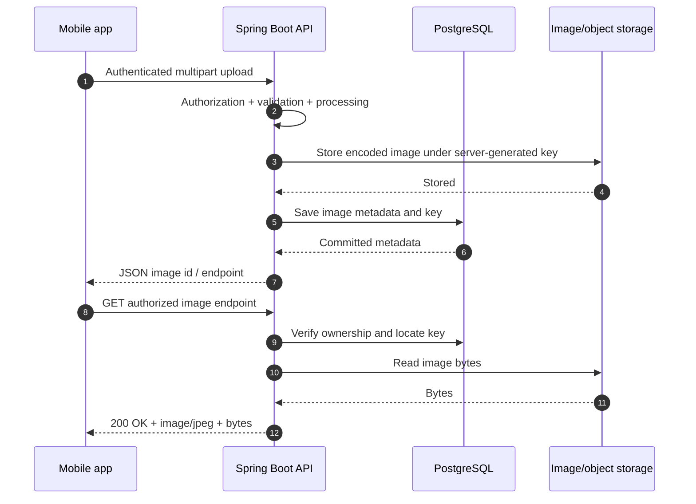
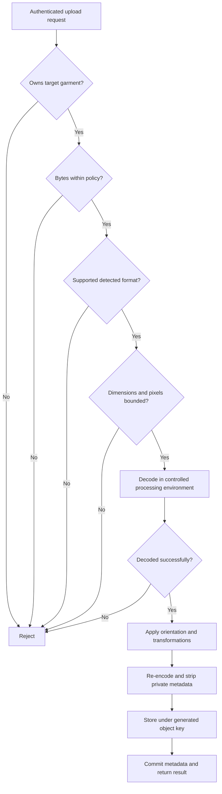
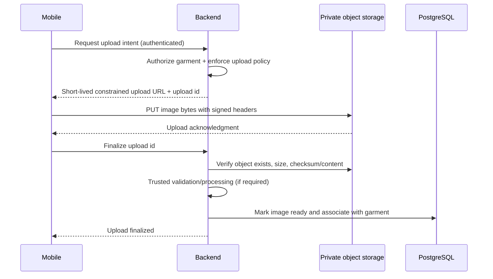
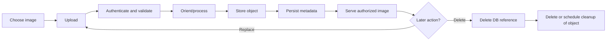
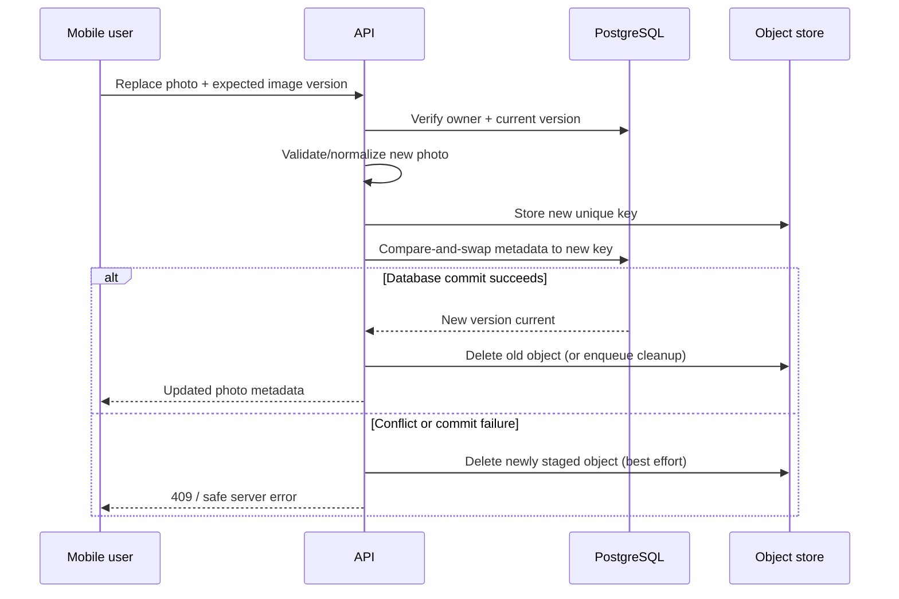
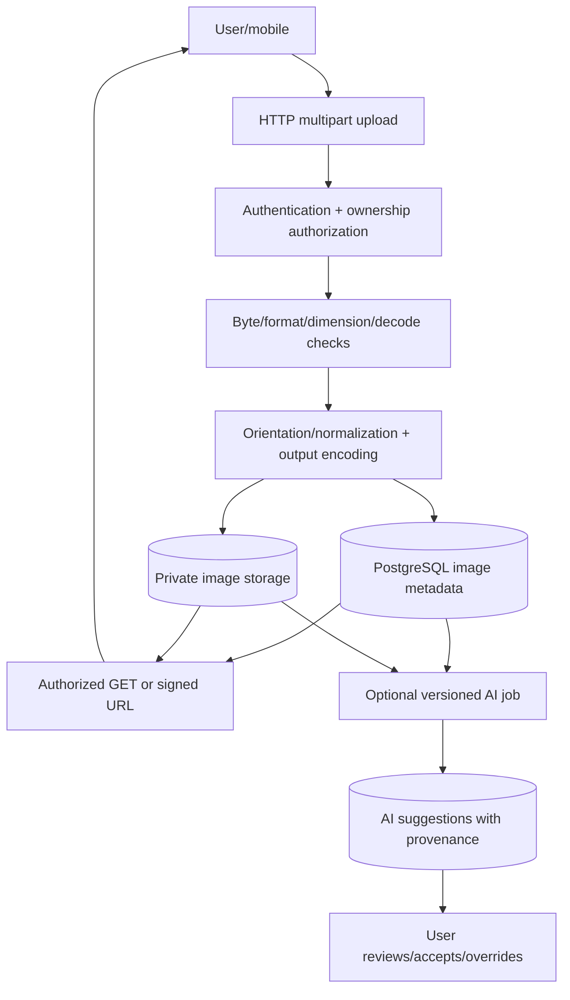

# Image Handling — Essential Concepts for Java Backend Engineers

> **Learning guide · Java 21+ / Spring Boot 4.x / PostgreSQL**  
> **Case study:** CapsuleAI wardrobe photographs  
> **Scope:** Core image engineering first; AI integration afterward.  
> **Updated:** November 2026

This guide teaches the *entire image lifecycle*, not merely how to write a file-upload controller. The illustrations involving CapsuleAI are **teaching scenarios, not assertions about its current code or architectural decisions**. The detailed implementation in Part 8 is a small, adaptable example with explicit limitations, not a drop-in replacement for an existing project.

## Learning objectives

By the end, you should be able to:

1. Explain what JPEG/PNG/WebP files contain and why an extension is not proof of content.
2. Trace an image from a mobile camera through HTTP, validation, storage, delivery, and deletion.
3. Defend an upload endpoint against common mistakes and resource-exhaustion attacks.
4. Choose among database, filesystem, and object storage with explicit trade-offs.
5. Design image metadata, ownership checks, failure recovery, and AI-processing boundaries.
6. Build and test a small, authenticated Spring Boot image feature.

## Table of contents

- [1. Digital image fundamentals](#1-digital-image-fundamentals)
- [2. Images in web applications](#2-images-in-web-applications)
- [3. Safe uploading and validation](#3-safe-uploading-and-validation)
- [4. Storage architecture](#4-storage-architecture)
- [5. Processing and optimization](#5-processing-and-optimization)
- [6. End-to-end image lifecycle](#6-end-to-end-image-lifecycle)
- [7. Image handling and AI](#7-image-handling-and-ai)
- [8. Spring Boot implementation walkthrough](#8-spring-boot-implementation-walkthrough)
- [9. Testing, mistakes, and operations](#9-testing-mistakes-and-operations)
- [10. Progressive exercises](#10-progressive-exercises)
- [11. Mental model and checklist](#11-mental-model-and-checklist)
- [12. Glossary](#12-glossary)
- [13. References](#13-references)

---

# 1. Digital image fundamentals

## 1.1 What is a digital image?

A **raster image** is a rectangular grid of tiny colored points called **pixels**. A photo that is 1,200 pixels wide and 800 pixels high contains `1,200 × 800 = 960,000` pixels. A camera or image encoder transforms that grid into a file such as `jacket.jpg`; the file is often **compressed**, so its byte count is not simply its pixel count.

**Analogy:** A pixel grid is like a mosaic. Image *dimensions* describe how many tiles the mosaic uses; *file size* describes how much space its packaged instructions occupy.

| Concept | Meaning | Example | Why a backend cares |
|---|---|---|---|
| Dimensions | Width × height in pixels | 1200 × 800 | Memory and processing cost |
| Aspect ratio | Width ÷ height | 3:2 = 1.5 | Prevents stretched thumbnails |
| Resolution | Often pixel dimensions; sometimes pixel density/PPI | 1200 × 800; 300 PPI | PPI metadata usually does not change screen pixels |
| File size | Number of stored bytes | 540 KB | Upload limit, bandwidth, storage billing |
| Decoded pixel memory | Approximate in-memory pixel representation | 1200 × 800 × 4 ≈ 3.84 MB | May be far greater than file size |

**Critical distinction:** A 2 MB compressed image may require tens or hundreds of MB of memory when decoded. Do not equate a file-size limit with safe pixel-processing limits.

## 1.2 Color: RGB, RGBA, and alpha

- **R, G, B** are red, green, and blue channels. In a common 8-bit-per-channel RGB image, `(255, 0, 0)` means vivid red.
- **A** is *alpha*, often representing transparency: `0` transparent, `255` fully opaque.
- **RGB 8-bit per channel** uses 24 bits (3 bytes) per pixel; **RGBA** uses 32 bits (4 bytes) per pixel before compression. Actual Java object memory has additional overhead.
- **Bit depth** describes how many bits represent a channel or sample. Higher bit depth can represent finer tonal differences, but does not automatically make a poorly exposed photograph better.
- **Color space/profile** matters: interpreting colors as sRGB differs from interpreting a wide-gamut profile. For clothing-color analysis, normalize color profiles thoughtfully; otherwise “the same color” can render or be measured differently.

**Example:** A red jacket's PNG can contain transparent background pixels. JPEG has no alpha channel; converting to JPEG requires choosing a background (commonly white), otherwise transparency is lost.

## 1.3 Raster versus vector

**Raster** images contain pixel samples: photographs are usually raster. **Vector** files contain drawing instructions (paths, shapes, text) that are rendered at a chosen size. SVG is a vector format, and it can contain active content or external references; **do not accept arbitrary SVG in an ordinary garment-photo endpoint**. If SVG is required for icons, use a separate tightly controlled handling policy.

## 1.4 Image formats

| Format | Typical MIME type | Compression | Transparency | Typical use | Caveat |
|---|---|---|---|---|---|
| JPEG (`.jpg`, `.jpeg`) | `image/jpeg` | Lossy | No | Camera/garment photos | Repeated re-encoding may degrade quality |
| PNG (`.png`) | `image/png` | Lossless | Yes | Graphics, transparent cutouts | Photos often much larger |
| WebP (`.webp`) | `image/webp` | Lossy or lossless | Yes | Efficient web/mobile delivery | Verify encoder/decoder availability |
| AVIF (`.avif`) | `image/avif` | Typically lossy; lossless possible | Yes | High compression efficiency | More CPU/compatibility considerations |
| GIF (`.gif`) | `image/gif` | Lossless palette compression | 1-bit transparency | Simple animations | Poor choice for high-color photos |
| SVG (`.svg`) | `image/svg+xml` | Vector markup | Yes | Trusted icons/graphics | Security risks from active markup |
| HEIC/HEIF (`.heic`, `.heif`) | Commonly `image/heic`, `image/heif` | Depends on codec | Possible | Mobile-camera originals | Decoding/support/licensing vary |
| TIFF (`.tif`, `.tiff`) | `image/tiff` | Various | Possible | Scans/professional workflows | Potentially huge/multipage |

**`.jpg` and `.jpeg` are the same JPEG format**, just different filename extensions. A format may have multiple encodings, profiles, metadata structures, or animation capabilities; extension alone is not enough to characterize it.

**Lossy compression** discards some image information for smaller files (e.g., JPEG). **Lossless compression** allows exact recovery of the stored pixel representation (e.g., PNG). A lossy file can still look excellent at normal viewing sizes; the optimal format depends on purpose.

### What could CapsuleAI accept?

A sensible *starting policy*, not a locked project decision, is:

1. **Core uploads:** JPEG and PNG, using formats your server can reliably validate, orient, and decode.
2. **Optional additional inputs:** WebP and HEIC/HEIF *only after* verifying processing-library support, performance, and device needs; convert to a supported internal representation if required.
3. **Output variants:** JPEG or WebP for photo previews, potentially PNG for transparency. Make format decisions after testing actual client support and cost.
4. **Reject by default:** SVG, GIF animations, and obscure formats if garment photos are the only intended content.

Do not claim that every Java installation can decode HEIC, AVIF, or WebP using standard `ImageIO`: codec support depends on installed providers.

## 1.5 EXIF and orientation

**EXIF** is metadata commonly found in camera images. It may describe camera settings, capture date, device details, GPS location, and **orientation**. A phone can store pixel data sideways with an orientation tag that tells viewers to rotate it. If a server strips metadata *without first applying orientation*, the image can appear rotated incorrectly.

Recommended ingestion order:

```text
Decode metadata safely → Determine EXIF orientation → Apply orientation
→ Normalize color if needed → Resize/convert → Strip private metadata
→ Encode output → Store
```

Privacy note: Do not publish raw GPS/device metadata from user photos unless there is a clear product need and informed consent.

## 1.6 Extension, MIME type, and magic bytes

An attacker can name a malicious file `shirt.jpg` and send `Content-Type: image/jpeg`. Both are **claims made by the client**, not proof of content. A **file signature** or **magic bytes** means characteristic bytes near the beginning of some formats, but matching the signature alone also does not prove the complete file is safe.

```text
Client filename:  photo.jpg     ← untrusted label
Client Content-Type: image/jpeg  ← untrusted claim
Magic bytes:       FF D8 FF ... ← useful hint
Successful restricted decoder:   ← stronger evidence, not a guarantee
Post-decoding policy checks:     ← required defense layer
```

Validation is **defense in depth**: allowlisted formats, bounded upload bytes, cautious decoding, bounded dimensions/pixels, controlled output encoding, authorization, and a secure storage boundary. See the OWASP references in §13.

**Quick check:** Can `cat.png` actually contain JPEG bytes? **Yes.** Should your server trust `.png` and treat it as PNG? **No.**

---

# 2. Images in web applications

## 2.1 File bytes versus `BufferedImage`

- **Encoded file (`byte[]`, `InputStream`):** Bytes in a JPEG or PNG representation; suitable for storage/transport.
- **Decoded `BufferedImage`:** A Java object representing accessible pixel data; suitable for transformations such as resizing.
- **Conversion:** `ImageIO.read(...)` (or a configured image reader) *decodes* data; `ImageIO.write(...)` *encodes* it. Encoding may change file size, format, metadata, and—if lossy—visual details.

```java
// Demonstration only; validate upload length and pixel dimensions before full decode.
BufferedImage pixels = ImageIO.read(inputStream);
ImageIO.write(pixels, "png", outputStream);
```

**Byte array vs stream:** A byte array loads all bytes in memory; a stream can process bytes incrementally. For a deliberately small, bounded demo, a byte array can be fine. For large objects or high concurrency, stream to storage and avoid unnecessary copies.

**Base64** turns binary into printable text but inflates its size by roughly one third (before any JSON overhead). Avoid Base64-in-JSON for ordinary image uploads; `multipart/form-data` or direct object-storage upload is usually preferable.

## 2.2 Multipart HTTP upload

A mobile client sends an HTTP request with one or more *parts*. One part can be an image file and another can contain regular form fields.

```http
POST /api/v1/garments/550e8400-e29b-41d4-a716-446655440000/image HTTP/1.1
Authorization: Bearer <access-token>
Content-Type: multipart/form-data; boundary=example-boundary

--example-boundary
Content-Disposition: form-data; name="file"; filename="jacket.jpg"
Content-Type: image/jpeg

<binary JPEG bytes>
--example-boundary--
```

The wire format contains a real multipart boundary generated by the client library. **Do not set a manually guessed boundary** when a mobile HTTP library constructs the multipart body.

Spring MVC receives the file as `MultipartFile`:

```java
@PostMapping(path = "/image", consumes = MediaType.MULTIPART_FORM_DATA_VALUE)
public ResponseEntity<Void> upload(@RequestParam("file") MultipartFile file) {
    // File is untrusted until validated; use a bounded upload policy.
    return ResponseEntity.noContent().build();
}
```

`MultipartFile.getSize()` is the number of supplied bytes, `getOriginalFilename()` is client-controlled, `getContentType()` is client-controlled, and `getInputStream()` accesses file content. Uploaded multipart data may be stored in temporary files or memory by the servlet implementation; application limits must be configured.

## 2.3 Full request-to-display flow



A different valid delivery pattern uses **short-lived signed URLs** so the mobile app fetches an image from object storage or a CDN without streaming it through the application server. Signed URLs must be protected like temporary bearer credentials.

## 2.4 Important HTTP headers and status codes

| Element | What it means | Practical note |
|---|---|---|
| `Content-Type: image/jpeg` | Media type of a *response* | Set from trusted verified/stored metadata, not a filename |
| `Content-Length` | Number of bytes in this HTTP body | May be handled automatically by the framework |
| `Content-Disposition: inline` | Suggest display in browser | `attachment` suggests downloading |
| `Cache-Control: private, max-age=60` | May be cached in private caches for 60 seconds | Privacy and invalidation policy matter |
| `ETag` | Validator for conditional requests | Enables `304 Not Modified`; can be content hash or version-based |
| `X-Content-Type-Options: nosniff` | Disables some MIME sniffing | Good defense for served files |
| `201 Created` | New resource created | Useful when creating image metadata |
| `200 OK` | Completed fetch or update | Common for returning a replacement result |
| `202 Accepted` | Work accepted, not yet finished | Appropriate for queued processing |
| `204 No Content` | Success with no body | Common for delete |
| `400 Bad Request` | Invalid request structure/content | Good for malformed image or missing file |
| `401 Unauthorized` | No valid authentication | Strictly authentication failure |
| `403 Forbidden` | Authenticated but not authorized | Optionally return 404 to hide resource existence |
| `404 Not Found` | Resource absent/not exposed | May be safer than exposing another user's garment |
| `409 Conflict` | State/version conflict | Concurrent replacement or idempotency conflict |
| `413 Content Too Large` | Upload exceeds size limit | Enforce gateway and backend limits |
| `415 Unsupported Media Type` | Unsupported file format | Distinguish from corrupt supported format |
| `422 Unprocessable Content` | Semantically invalid payload | Optional API-design choice |
| `500/503` | Server or dependency failure | Log details; don't leak internal paths |

A **preview** is an image shown before a permanent upload; it can be generated client-side. A **thumbnail** is a smaller derivative produced for lists and grids. Neither should replace a high-enough-quality source needed for downstream analysis.

---

# 3. Safe uploading and validation

## 3.1 The threat model

A public image endpoint accepts **untrusted bytes**. It must handle more than “was the filename `.png`?”

| Threat | Example | Defensive measure |
|---|---|---|
| Fake type | Executable renamed `.jpg` | Allowlisted actual formats + restricted decoder |
| Oversized payload | 2 GB request | Proxy and multipart byte limits; streaming limits |
| Decompression bomb | Small compressed file with huge pixel grid | Inspect dimensions *before* full decoding; cap pixel count |
| Corrupted input | Truncated PNG | Decode failure handling and rejection |
| Exploitable parser | Malformed format attacks outdated library | Update codecs, isolate expensive work, restrict accepted formats |
| Path traversal | Filename `../../secrets` | Ignore client filename as storage path; use generated keys |
| Cross-user access | Read another user's photo | Authenticate and authorize on **every** read/write/delete |
| EXIF leak | Photo contains GPS location | Remove metadata after orientation correction |
| Resource exhaustion | Too many parallel uploads | Rate limits, bounded workers, timeouts, quotas, monitoring |
| Stored active content | User-supplied SVG served in unsafe context | Reject active formats for photo endpoint |

**No single validator makes a file safe.** Signature checks can be spoofed, decoders can have bugs, and re-encoding does not guarantee that every threat disappears.

## 3.2 Recommended staged validation



Example **starting limits** for a photo service, to tune through realistic device testing: max 6 MiB compressed upload; max 6,000 pixels on either side; max 16 million total pixels. These are *illustrative business policies*, not universal security guarantees. Check upper bounds before allocating a `BufferedImage`, and remember CPU, parser, and metadata processing can still be costly even after dimension checks.

**Why validate twice?** A reverse proxy may reject an excessively large request early, but the application still needs a domain-level limit. The actual decoder and canonical encoder should also independently reject unsupported or malformed data.

## 3.3 Upload implementation decisions

- **Canonical encoding:** Decode and re-encode supported input into JPEG or PNG to produce controlled output bytes; preserve transparency when needed.
- **Orientation:** Process EXIF orientation **before** metadata stripping. A plain `ImageIO.write` round-trip is *not enough* to guarantee this.
- **Filename:** Ignore original filename for object storage and generate `UUID + verified extension`.
- **Temporary files:** Keep upload staging outside public static directories; protect OS permissions and clean temporary data.
- **Error responses:** Use stable error codes; do not return filesystem paths, stack traces, signing keys, or storage credentials.
- **Authentication:** Check both identity and *garment ownership*; having a valid JWT is not sufficient authorization.
- **Retry:** A retry could otherwise create two objects. Use an `Idempotency-Key` or an upload/session identifier with a request fingerprint where repeat behavior matters.

**Example errors:** `IMAGE_EMPTY`, `IMAGE_TOO_LARGE`, `IMAGE_UNSUPPORTED_FORMAT`, `IMAGE_INVALID_CONTENT`, `IMAGE_DIMENSIONS_EXCEEDED`, `GARMENT_NOT_FOUND`, `IMAGE_VERSION_CONFLICT`.

---

# 4. Storage architecture

## 4.1 Where should the bytes live?

| Option | Strengths | Weaknesses | Good use case |
|---|---|---|---|
| PostgreSQL `BYTEA` | DB transactions, backup together with metadata | Bigger DB/replication/backups; image traffic competes with OLTP | Small, controlled images, modest volume |
| Local filesystem | Simple, inexpensive in local development | Harder across multiple replicas; ephemeral container disks; backup burden | Prototypes, teaching, single-host deployments |
| Object storage (S3/R2/MinIO, etc.) | Durable-object APIs, scale, direct delivery patterns | Separate transaction boundary; IAM, cost and lifecycle management | Most growth-oriented production photo systems |

There is **no universal ban** on storing images in PostgreSQL. The correct decision depends on volume, access patterns, operating environment, backup requirements, security model, and cost. Avoid storing large photo bytes in an ordinary garment row by default when product traffic is expected to grow.

### Recommended separation for a typical photo service

```text
PostgreSQL:         image id, garment id, owner linkage, object key,
                    verified format, width/height, size, status, timestamps,
                    version, optionally checksum
Object storage:     original/normalized bytes, preview variants
Mobile client:      authorized image URL (possibly short-lived)
```

The **object key** is a server-owned identifier such as `garments/a1b2.../images/f3c4....jpg`, *not* a user-controlled path. Avoid embedding personal information in object keys because keys may appear in logs and signed URLs.

## 4.2 Public versus private storage

For personal wardrobe images, **private-by-default** is a reasonable baseline. A private bucket/object store prevents anonymous reads. To view a photo:

1. **API proxy:** Mobile requests `GET /garments/{id}/image` with authentication; backend verifies owner and streams the file.
2. **Signed GET URL:** Mobile requests an authenticated URL-issuing endpoint; backend authorizes and returns a short-lived signed object-storage URL.

An S3-style **presigned URL is a bearer capability**: anyone who possesses an unexpired URL can use the authorized operation, subject to other service restrictions. Do not log signed query strings indiscriminately or store them as permanent database values. Revoke access by using short expirations, changing objects/keys, or stronger policy mechanisms; issuing a replacement URL alone does not instantly revoke an old one. See AWS documentation in §13.

### Direct upload alternative



**Do not treat a successful client-reported upload as proof of a valid image**. The backend must verify the resulting object and enforce content policy before marking it `READY`.

## 4.3 Metadata schema example

This is a **reference schema**, not an assertion about CapsuleAI's existing migrations:

```sql
CREATE TABLE garment_image (
    id              UUID PRIMARY KEY,
    garment_id      UUID NOT NULL REFERENCES garment(id) ON DELETE CASCADE,
    storage_key     TEXT NOT NULL UNIQUE,
    media_type      VARCHAR(50) NOT NULL,
    width_px        INTEGER NOT NULL CHECK (width_px > 0),
    height_px       INTEGER NOT NULL CHECK (height_px > 0),
    byte_size       BIGINT NOT NULL CHECK (byte_size > 0),
    sha256_hex      CHAR(64),
    status          VARCHAR(20) NOT NULL
                    CHECK (status IN ('PENDING', 'PROCESSING', 'READY', 'FAILED')),
    version         BIGINT NOT NULL DEFAULT 0,
    created_at      TIMESTAMPTZ NOT NULL DEFAULT now(),
    updated_at      TIMESTAMPTZ NOT NULL DEFAULT now()
);
CREATE INDEX idx_garment_image_garment_id ON garment_image(garment_id);
```

If a garment can have **at most one current image**, model that explicitly: a unique `garment_id`, or separate `garment.current_image_id` plus a history table. If a garment can have multiple photos (front/back/detail), support an ordering/role attribute and appropriate uniqueness rules. **Do not enforce one-image-per-garment without a product requirement.**

Database timestamps are best represented as instants (`TIMESTAMPTZ` in PostgreSQL; `Instant` in Java), and displayed in the client’s time zone when needed.

## 4.4 Storage abstraction

```java
public interface ImageObjectStore {
    void put(String objectKey, byte[] encodedBytes) throws IOException;
    byte[] read(String objectKey) throws IOException;
    void delete(String objectKey) throws IOException;
}
```

The application depends on the **port** (`ImageObjectStore`); an adapter can use a local filesystem, S3, R2, or MinIO. This keeps provider details out of domain logic. It does not mean migration has zero effort—new access controls, signed URLs, and operational semantics still require changes.

## 4.5 Database/storage consistency

**Important:** A PostgreSQL transaction does **not** atomically commit an S3/local-file write. Typical failure cases:

| Failure | Result | Recovery idea |
|---|---|---|
| Object stored, DB insert fails | Orphan object | Best-effort compensation + periodic garbage collection |
| DB references object, object write fails | Broken image | Write object first, then commit reference; states/reconciliation |
| Image replaced, old object delete fails | Unreferenced old object | Retry or lifecycle cleanup job |
| Client times out after success | Retry ambiguity | Idempotency key + persisted request fingerprint |
| Two clients replace simultaneously | Lost update or conflicting writes | Optimistic versioning + `If-Match` / expected version |

For higher reliability, consider **PENDING → PROCESSING → READY/FAILED** states, transactional outbox events, durable retry queues, and a periodic object-vs-DB reconciliation job. Avoid claiming `@Transactional` automatically rolls back object-storage mutations.

---
# 5. Processing and optimization

## 5.1 Resizing versus cropping

**Resizing** changes image dimensions. **Cropping** removes part of the picture. If an original is `4000 × 3000` (4:3):

- A proportional resize to 1000 px wide yields `1000 × 750`.
- Forcing it into `1000 × 1000` without cropping **distorts** the jacket.
- A center crop to a square removes left/right image regions and can accidentally cut off a sleeve.
- **Fit/contain** keeps the entire original and adds padding or unused space; **fill/cover** crops to fully fill the target box.

**Backend design implication:** A product photograph may need a full-height original for garment attribute extraction and several constrained derivatives for UI. A thumbnail alone can lose texture or construction details useful to AI.

## 5.2 Normalization, conversion, and compression

**Normalization** means producing a consistent representation suitable for consumers. It may include orientation correction, color-space conversion, alpha treatment, dimension limits, and output format.

- **JPEG quality** often trades file size against visible compression artifacts. Avoid repeatedly re-encoding the same JPEG at low quality.
- **PNG** is lossless but is not automatically the smallest photo format.
- **WebP/AVIF** may improve transfer sizes, but codec availability, CPU, and client capability vary.
- **Image normalization for visual delivery** (orientation/format/color profile) differs from **model preprocessing** (fixed tensors, pixel normalization, channel order).
- **Avoid upscaling** a 500 × 500 image to 4000 × 4000 expecting new detail; the extra pixels are interpolated.

### A simple Java resize demonstration

```java
import java.awt.Graphics2D;
import java.awt.RenderingHints;
import java.awt.image.BufferedImage;

public final class ThumbnailMaker {
    private ThumbnailMaker() {}

    public static BufferedImage fitWidth(BufferedImage source, int maxWidth) {
        if (maxWidth <= 0) throw new IllegalArgumentException("maxWidth must be positive");
        if (source.getWidth() <= maxWidth) return source;

        double scale = (double) maxWidth / source.getWidth();
        int height = Math.max(1, (int) Math.round(source.getHeight() * scale));
        int type = source.getColorModel().hasAlpha()
                ? BufferedImage.TYPE_INT_ARGB : BufferedImage.TYPE_INT_RGB;
        BufferedImage target = new BufferedImage(maxWidth, height, type);
        Graphics2D g = target.createGraphics();
        try {
            g.setRenderingHint(RenderingHints.KEY_INTERPOLATION,
                    RenderingHints.VALUE_INTERPOLATION_BILINEAR);
            g.drawImage(source, 0, 0, maxWidth, height, null);
        } finally {
            g.dispose();
        }
        return target;
    }
}
```

**Walkthrough:** (1) refuse invalid widths, (2) never enlarge an already-small image, (3) compute height from the same scale factor, (4) create a buffer with/without alpha, (5) draw the scaled pixels, (6) release the graphics context. This example focuses on geometry; production pipelines must also handle EXIF orientation, profiles, metadata, memory, and encoding policy.

## 5.3 Image variants and cache design

For a single garment image you might store:

```text
images/<image-uuid>/original.jpg
images/<image-uuid>/preview-960.webp
images/<image-uuid>/thumbnail-256.webp
```

Versions are illustrative; do not generate variants that have no consumer. **Immutable object keys** make browser/CDN caching simpler: a replacement gets a *new* key rather than silently changing the contents behind an old cache key. A DB reference points to the current version. If old keys remain accessible via signed URLs, they must be cleaned up or allowed to expire according to retention policy.

Caching details:

- `Cache-Control: public` is generally unsuitable for access-controlled personal photos unless the entire delivery design is intentionally public.
- `private` allows private caches but not shared public caches; select retention carefully for sensitive content.
- `ETag` and `If-None-Match` can avoid re-sending unchanged bytes.
- A **CDN** caches content near clients, but private distribution needs carefully designed signed access and invalidation.

## 5.4 Where should processing occur?

| Operation | Mobile | API/backend | AI worker | Object storage/CDN |
|---|---|---|---|---|
| Select/capture photo | Best place | — | — | — |
| Preview/crop UI | Often ideal | Can verify result | — | — |
| Security validation | Supplement only | **Required trusted boundary** | Recheck model-specific constraints | May enforce byte/checksum policies |
| EXIF orientation | Can assist | Validate/normalize when needed | Can also normalize | Usually not automatic |
| Generate standard thumbnails | Optional | Often suitable | Usually unnecessary | Sometimes image-delivery service |
| AI tensor normalization | — | Usually not necessary | **Primary responsibility** | — |
| Durable storage | No | Orchestrates | References via key | **Primary responsibility** |
| Serve cached variants | Displays | Authorizes or proxies | — | Often efficient if secure |

**Synchronous** work holds the HTTP request open until complete. Use it for small, bounded image checks and storage. **Asynchronous** work puts a durable job in a queue and returns `202 Accepted` or a resource state such as `PROCESSING`; prefer this for expensive transformations, AI extraction, virus scanning, or large batches.

For production capacity planning consider: uploaded bytes, decoded pixel memory, temporary copies, CPU per decode/encode, concurrent uploads, storage operations, network egress, and cleanup. A 16-million-pixel RGBA buffer alone may occupy ~64 MB, before intermediate copies and Java overhead.

---

# 6. End-to-end image lifecycle

## 6.1 Core lifecycle



The shape is conceptually linear; in a real design, retries, asynchronous processing, and cleanup add branches.

## 6.2 Scenarios and business rules

### Scenario A — Create garment with an image

A client can submit garment fields and image through a single multipart endpoint, **or** create the garment first and upload the image in a second step. The latter simplifies large uploads and failure recovery but introduces an observable “garment without photo” state.

**Question to decide:** Is an image mandatory at garment creation? Do not assume it is unless the product explicitly requires it.

### Scenario B — Create garment without an image

The garment can exist with `imageStatus = NONE` and full manual properties. This supports offline/manual entry, users without a good photo, and a simpler initial workflow. A missing image should **not** automatically invalidate attributes that a person intentionally supplied.

### Scenario C — Add image later

1. User authenticates and chooses a garment they own.
2. Backend validates/normalizes the image.
3. Backend stores a new image version and associates it with the garment.
4. *Separately*, a product rule decides whether to offer optional AI analysis.

**Important:** Uploading a photograph does **not** logically require automatically overwriting garment attributes with AI predictions.

### Scenario D — Replace image



Why use a version? Suppose mobile device A and device B both replace the same jacket photo. Without a version check, a late upload can overwrite a newer user decision. Use optimistic locking (`@Version` in JPA or SQL compare-and-swap) and communicate version numbers/`ETag` to clients where last-write-wins is unacceptable.

### Scenario E — Delete image, retain garment

The garment and manual attributes remain. The image association is removed and the object is scheduled for deletion. Decide whether AI predictions derived exclusively from the deleted image should be retained, invalidated, or removed according to the product's data policy.

### Scenario F — Delete garment

Delete the garment's DB association(s), then clean up all related image objects and derivatives. A database foreign key `ON DELETE CASCADE` affects **database rows only**; it does **not** delete S3 files. Use cleanup jobs or events for external objects.

## 6.3 Idempotency, concurrency, and recovery

**Idempotency** means repeating a request has the same intended effect as applying it once. A client timeout leaves ambiguity: perhaps the image was stored and the response was lost. Replaying with an `Idempotency-Key` can return the original result instead of creating another object.

Example conceptual table:

```sql
CREATE TABLE upload_idempotency (
    user_subject      TEXT NOT NULL,
    idempotency_key   TEXT NOT NULL,
    request_hash      CHAR(64) NOT NULL,
    response_json     JSONB,
    status            VARCHAR(20) NOT NULL,
    created_at        TIMESTAMPTZ NOT NULL DEFAULT now(),
    PRIMARY KEY (user_subject, idempotency_key)
);
```

For equal user + key: same request fingerprint → replay stored result or report in-progress; different fingerprint → **409 Conflict**. A real implementation also needs atomic reservation, expiration policy, stuck-request recovery, and cleanup.

**Periodic reconciler:** list staged images older than a threshold, query whether metadata references them, and safely remove unreferenced objects. Never blindly delete current referenced images. Consider delayed event processing and in-flight transactions before deciding an object is orphaned.

## 6.4 Why processing states matter

| State | Meaning | Possible UI behavior |
|---|---|---|
| `NONE` | No image exists | Show “Add photo” |
| `PENDING_UPLOAD` | Upload session reserved | Show upload progress |
| `PROCESSING` | Backend working on content/variants | Show placeholder |
| `READY` | Validated image is available | Display photo |
| `FAILED` | Processing failed | Show retry/reselect affordance |

These states can belong to the **image lifecycle**. AI analysis may have its **own independent state machine** (e.g., `NOT_REQUESTED`, `QUEUED`, `RUNNING`, `COMPLETED`, `FAILED`). Do not conflate “image successfully stored” with “AI successfully extracted attributes.”

---

# 7. Image handling and AI

## 7.1 What is AI preprocessing?

Before a computer-vision model predicts clothing attributes, its input must be converted to the representation expected by the model:

```text
Validated image bytes
  → decode and orient
  → transform to model-specific color space (often RGB)
  → resize/crop/pad to model input shape
  → convert pixels to numeric tensor
  → apply model-specific normalization
  → run inference
  → validate and interpret predictions
```

A **tensor** is a structured array of numbers, e.g., `(1, 3, 224, 224)` for a batch of one three-channel image in a model that expects channel-first layout. This shape is illustrative—actual models vary. Some normalize inputs to `[0,1]`, some use mean/std, and others require different preprocessing; **always use the chosen model's documented contract**.

**Ordinary image processing** changes or measures images. **AI inference** runs a trained model to predict features such as category, colors, material, pattern, or silhouette. Neither automatically validates the accuracy of a garment's business attributes.

## 7.2 Store images separately from predictions

Image record: verified bytes/key, dimensions, type, owner linkage, image content version.

AI-analysis record: `image_id`, `image_version`, `model_version`, `preprocessing_version`, processing status, predicted properties, confidence/calibration information where meaningful, provenance, timestamps, errors.

**Why version all three?** Replacing the image, changing preprocessing, or deploying a new model can all change predictions. A prediction must be traceable to the exact image and model configuration that generated it.

## 7.3 User-entered versus AI-generated attributes

Imagine a user manually creates a garment:

```text
Category: OUTERWEAR    (USER)
Color:    NAVY         (USER)
Style:    SMART_CASUAL (USER)
Image:    None
```

Later, the user uploads a photo. A model suggests `Color = BLACK`, confidence 0.72. **Do not silently overwrite `NAVY`.** A safer product concept is:

```text
Effective color: NAVY         ← accepted user value
AI suggestion:   BLACK (0.72) ← reviewable candidate
Source:          USER
Image version:   2
Model version:   vX
```

Possible user interactions: keep manual value, accept AI suggestion, edit a new value, or dismiss the suggestion. A decision about which fields are user-authoritative must be explicit in product requirements.

### Is automatic AI rerun mandatory after a new photo?

**No.** It is a product/architecture choice. Examples:

- Never run AI unless explicitly requested.
- Run AI automatically when essential attributes are missing.
- Run AI on every new image version but keep existing user values authoritative.
- Run selectively based on changed image hashes, available compute budget, and freshness requirements.

Avoid unnecessary reprocessing when the same image bytes, preprocessing contract, and model version have already produced valid cached output. A `SHA-256` checksum can help detect byte-identical images (not visually similar images). Beware cross-user deduplication privacy risks.

## 7.4 Asynchronous AI extraction

```mermaid
sequenceDiagram
    autonumber
    participant M as Mobile
    participant A as Backend API
    participant D as PostgreSQL
    participant Q as Durable queue
    participant W as AI worker
    M->>A: Upload garment photo
    A->>A: Validate and store image
    A->>D: Persist image version / READY
    A-->>M: Image ready; AI NOT_REQUESTED or QUEUED
    opt Product policy requests extraction
        A->>D: Store extraction intent + outbox event
        D-->>Q: Publish durable job after commit
        Q->>W: Image/version/model job
        W->>W: Preprocess + inference
        W->>D: Save suggestions for exact image version
        M->>A: Fetch analysis status/suggestions
        A-->>M: Suggested attributes, without overwriting user values
    end
```

**Failure handling:** Retry bounded transient errors; route repeated failures to a dead-letter queue/manual review; record diagnostic codes without leaking user images; use unique job IDs or version keys to prevent duplicate effects. Before writing results, check that the garment's image version is still current. If an old photo was replaced during inference, old predictions must not become the current suggestions.

## 7.5 AI-specific design checks

- Is the purpose image *classification*, *attribute extraction*, *segmentation*, or *embedding*? These are different tasks.
- Does the model expect a cropped garment, a person wearing it, or a product-only image?
- Is the user allowed to modify or override every inferred property?
- Do confidence values have meaningful calibration, or are they merely model scores?
- Which data should be removed when the user deletes the garment/photo?
- What happens if AI processing is unavailable, expensive, or slow? The basic garment flow should remain understandable.

---
# 8. Spring Boot implementation walkthrough

This is a **small teaching sandbox** showing one private current image per garment, a local-file adapter, and PostgreSQL metadata. It is **not claimed to match CapsuleAI's actual schema, package boundaries, JWT configuration, or product rules**. Adapt it rather than copying it into an existing project unchanged.

**Scope and known limits:** JPEG/PNG only; maximum 6 MiB input and 16 million pixels; reads encoded bytes into memory; image transforms happen synchronously; local storage is suitable for a controlled development environment; basic best-effort cleanup is included. A production version needs a metadata-aware EXIF orientation pipeline, stronger parser isolation, per-user quotas/rate limits, durable cleanup/retries, object storage if appropriate, and a complete security test suite. The example demonstrates *only one current image per garment*.

## 8.1 Project dependencies and setup

For a **Spring Boot 4.x** Maven project, include these managed dependencies in your existing `pom.xml`. Do not paste these as a complete POM:

```xml
<dependencies>
    <dependency>
        <groupId>org.springframework.boot</groupId>
        <artifactId>spring-boot-starter-webmvc</artifactId>
    </dependency>
    <dependency>
        <groupId>org.springframework.boot</groupId>
        <artifactId>spring-boot-starter-data-jpa</artifactId>
    </dependency>
    <dependency>
        <groupId>org.springframework.boot</groupId>
        <artifactId>spring-boot-starter-security</artifactId>
    </dependency>
    <dependency>
        <groupId>org.springframework.boot</groupId>
        <artifactId>spring-boot-starter-security-oauth2-resource-server</artifactId>
    </dependency>
    <dependency>
        <groupId>org.springframework.boot</groupId>
        <artifactId>spring-boot-starter-flyway</artifactId>
    </dependency>
    <dependency>
        <groupId>org.flywaydb</groupId>
        <artifactId>flyway-database-postgresql</artifactId>
    </dependency>
    <dependency>
        <groupId>org.postgresql</groupId>
        <artifactId>postgresql</artifactId>
        <scope>runtime</scope>
    </dependency>
    <dependency>
        <groupId>org.springframework.boot</groupId>
        <artifactId>spring-boot-starter-webmvc-test</artifactId>
        <scope>test</scope>
    </dependency>
    <dependency>
        <groupId>org.springframework.boot</groupId>
        <artifactId>spring-boot-starter-data-jpa-test</artifactId>
        <scope>test</scope>
    </dependency>
    <dependency>
        <groupId>org.springframework.security</groupId>
        <artifactId>spring-security-test</artifactId>
        <scope>test</scope>
    </dependency>
</dependencies>
```

Spring Boot 3.x projects usually have different starter names (for example, `spring-boot-starter-web`), so **do not mix a Boot 4 migration blindly into a Boot 3 application**. For modern Boot 4, `spring-boot-starter-webmvc` supersedes the older web starter (see official migration guide §13).

**Example configuration** (`application.yml`, using environment variables, not secrets in source code):

```yaml
spring:
  datasource:
    url: ${DEMO_DB_URL}
    username: ${DEMO_DB_USER}
    password: ${DEMO_DB_PASSWORD}
  jpa:
    hibernate:
      ddl-auto: validate
  servlet:
    multipart:
      max-file-size: 6MB
      max-request-size: 7MB
  security:
    oauth2:
      resourceserver:
        jwt:
          issuer-uri: ${DEMO_JWT_ISSUER_URI}

app:
  image:
    storage-root: ${DEMO_IMAGE_STORAGE_ROOT}
```

Here, `6MB` means a Spring `DataSize` unit; application code below uses `6 * 1024 * 1024` bytes (6 MiB). Align proxy/framework/application limits deliberately and account for multipart overhead. The `issuer-uri` assumes a JWT issuer compatible with Spring's resource-server configuration; an existing custom JWT provider might need its own `JwtDecoder` instead. **Never replace an existing application's auth configuration without understanding it.**

Suggested teaching package structure:

```text
com.example.imageguide/
  ImageGuideApplication.java
  image/
    api/GarmentImageController.java
    api/ImageErrorHandler.java
    application/GarmentImageService.java
    application/ImageInspector.java
    application/ImageObjectStore.java
    persistence/DemoGarment.java
    persistence/DemoGarmentRepository.java
    persistence/GarmentImage.java
    persistence/GarmentImageRepository.java
    storage/LocalImageObjectStore.java
```

The following snippets use `package com.example.imageguide.image;` for brevity; put them into separate files in that same package, or adapt package statements/imports to the folder layout you choose. **Each public class/interface/record belongs in its own `.java` file.** Standard Java `java.lang` types need no explicit import.

A minimal application entry point:

```java
package com.example.imageguide;

import org.springframework.boot.SpringApplication;
import org.springframework.boot.autoconfigure.SpringBootApplication;

@SpringBootApplication
public class ImageGuideApplication {
    public static void main(String[] args) {
        SpringApplication.run(ImageGuideApplication.class, args);
    }
}
```

## 8.2 Teaching database migration

Use a new, separate demo database. Do not run this schema over a real CapsuleAI database that already has its own wardrobe tables.

```sql
-- src/main/resources/db/migration/V1__demo_image_tables.sql
CREATE TABLE demo_garment (
    id UUID PRIMARY KEY,
    owner_subject TEXT NOT NULL
);

CREATE TABLE demo_garment_image (
    id UUID PRIMARY KEY,
    garment_id UUID NOT NULL UNIQUE REFERENCES demo_garment(id),
    object_key TEXT NOT NULL UNIQUE,
    media_type VARCHAR(50) NOT NULL,
    width_px INTEGER NOT NULL CHECK (width_px > 0),
    height_px INTEGER NOT NULL CHECK (height_px > 0),
    byte_size BIGINT NOT NULL CHECK (byte_size > 0),
    version BIGINT NOT NULL DEFAULT 0
);
```

In this demo, `owner_subject` is the authenticated JWT `sub` value. In a real domain, the relationship may run through a user ID and an existing garment repository; use the application's canonical ownership model.

## 8.3 Persistence entities and repositories

`DemoGarment.java`:

```java
package com.example.imageguide.image;

import jakarta.persistence.Column;
import jakarta.persistence.Entity;
import jakarta.persistence.Id;
import jakarta.persistence.Table;
import java.util.UUID;

@Entity
@Table(name = "demo_garment")
public class DemoGarment {
    @Id
    private UUID id;

    @Column(name = "owner_subject", nullable = false)
    private String ownerSubject;

    protected DemoGarment() { } // JPA requires a no-arg constructor

    public DemoGarment(UUID id, String ownerSubject) {
        this.id = id;
        this.ownerSubject = ownerSubject;
    }
}
```

`DemoGarmentRepository.java`:

```java
package com.example.imageguide.image;

import java.util.UUID;
import org.springframework.data.jpa.repository.JpaRepository;

public interface DemoGarmentRepository extends JpaRepository<DemoGarment, UUID> {
    boolean existsByIdAndOwnerSubject(UUID id, String ownerSubject);
}
```

`GarmentImage.java`:

```java
package com.example.imageguide.image;

import jakarta.persistence.*;
import java.util.UUID;

@Entity
@Table(name = "demo_garment_image")
public class GarmentImage {
    @Id
    private UUID id;

    @Column(name = "garment_id", nullable = false, unique = true)
    private UUID garmentId;

    @Column(name = "object_key", nullable = false, unique = true)
    private String objectKey;

    @Column(name = "media_type", nullable = false)
    private String mediaType;

    @Column(name = "width_px", nullable = false)
    private int width;

    @Column(name = "height_px", nullable = false)
    private int height;

    @Column(name = "byte_size", nullable = false)
    private long byteSize;

    @Version
    private long version;

    protected GarmentImage() { }

    public GarmentImage(UUID garmentId, String objectKey,
                        String mediaType, int width, int height, long byteSize) {
        this.id = UUID.randomUUID();
        this.garmentId = garmentId;
        replace(objectKey, mediaType, width, height, byteSize);
    }

    public void replace(String key, String type, int w, int h, long size) {
        this.objectKey = key;
        this.mediaType = type;
        this.width = w;
        this.height = h;
        this.byteSize = size;
    }

    public UUID getId() { return id; }
    public String getObjectKey() { return objectKey; }
    public String getMediaType() { return mediaType; }
    public int getWidth() { return width; }
    public int getHeight() { return height; }
    public long getByteSize() { return byteSize; }
    public long getVersion() { return version; }
}
```

`GarmentImageRepository.java`:

```java
package com.example.imageguide.image;

import java.util.Optional;
import java.util.UUID;
import org.springframework.data.jpa.repository.JpaRepository;

public interface GarmentImageRepository extends JpaRepository<GarmentImage, UUID> {
    Optional<GarmentImage> findByGarmentId(UUID garmentId);
}
```

**Responsibilities:** `DemoGarment` represents the owned item; `GarmentImage` stores metadata, not image bytes; repositories provide DB operations; `@Version` helps detect competing updates on an existing row. The database `UNIQUE` on `garment_id` also prevents two current image rows for one garment. The code does **not** implement an HTTP `If-Match`/expected-version contract; see advanced exercise.

## 8.4 Validation and canonical encoding

Define a simple typed input error (`ImageInputException.java`):

```java
package com.example.imageguide.image;

import org.springframework.http.HttpStatus;

public class ImageInputException extends RuntimeException {
    private final HttpStatus status;

    public ImageInputException(HttpStatus status, String message) {
        super(message);
        this.status = status;
    }

    public HttpStatus getStatus() { return status; }
}
```

`ImageInspector.java`:

```java
package com.example.imageguide.image;

import java.awt.Graphics2D;
import java.awt.image.BufferedImage;
import java.io.ByteArrayInputStream;
import java.io.ByteArrayOutputStream;
import java.io.IOException;
import java.util.Iterator;
import java.util.Locale;
import javax.imageio.ImageIO;
import javax.imageio.ImageReader;
import javax.imageio.stream.ImageInputStream;
import org.springframework.http.HttpStatus;
import org.springframework.stereotype.Component;
import org.springframework.web.multipart.MultipartFile;

@Component
public class ImageInspector {
    private static final long MAX_BYTES = 6L * 1024 * 1024;
    private static final int MAX_SIDE = 6_000;
    private static final long MAX_PIXELS = 16_000_000L;

    public record EncodedImage(byte[] bytes, String mediaType,
                               String extension, int width, int height) { }

    public EncodedImage inspect(MultipartFile file) throws IOException {
        if (file == null || file.isEmpty()) {
            throw bad(HttpStatus.BAD_REQUEST, "IMAGE_EMPTY");
        }
        if (file.getSize() > MAX_BYTES) {
            throw bad(HttpStatus.CONTENT_TOO_LARGE, "IMAGE_TOO_LARGE");
        }

        byte[] uploaded = file.getBytes(); // bounded small-file teaching example
        if (uploaded.length > MAX_BYTES) {
            throw bad(HttpStatus.CONTENT_TOO_LARGE, "IMAGE_TOO_LARGE");
        }

        try (ImageInputStream input = ImageIO.createImageInputStream(
                new ByteArrayInputStream(uploaded))) {
            if (input == null) throw bad(HttpStatus.BAD_REQUEST, "IMAGE_INVALID_CONTENT");
            Iterator<ImageReader> readers = ImageIO.getImageReaders(input);
            if (!readers.hasNext()) {
                throw bad(HttpStatus.UNSUPPORTED_MEDIA_TYPE, "IMAGE_UNSUPPORTED_FORMAT");
            }

            ImageReader reader = readers.next();
            try {
                reader.setInput(input, true, true);
                String detected = reader.getFormatName().toLowerCase(Locale.ROOT);
                if (!detected.equals("jpeg") && !detected.equals("png")) {
                    throw bad(HttpStatus.UNSUPPORTED_MEDIA_TYPE, "IMAGE_UNSUPPORTED_FORMAT");
                }

                int width = reader.getWidth(0);
                int height = reader.getHeight(0);
                if (width < 1 || height < 1 || width > MAX_SIDE || height > MAX_SIDE
                        || (long) width * height > MAX_PIXELS) {
                    throw bad(HttpStatus.BAD_REQUEST, "IMAGE_DIMENSIONS_EXCEEDED");
                }

                BufferedImage decoded = reader.read(0);
                if (decoded == null) {
                    throw bad(HttpStatus.BAD_REQUEST, "IMAGE_INVALID_CONTENT");
                }

                // Normalize pixel representation and re-encode verified content.
                int type = detected.equals("png")
                        ? BufferedImage.TYPE_INT_ARGB : BufferedImage.TYPE_INT_RGB;
                BufferedImage clean = new BufferedImage(width, height, type);
                Graphics2D graphics = clean.createGraphics();
                try {
                    graphics.drawImage(decoded, 0, 0, null);
                } finally {
                    graphics.dispose();
                }

                String ext = detected.equals("jpeg") ? "jpg" : "png";
                try (ByteArrayOutputStream output = new ByteArrayOutputStream()) {
                    if (!ImageIO.write(clean, detected, output)) {
                        throw bad(HttpStatus.UNSUPPORTED_MEDIA_TYPE,
                                "IMAGE_ENCODER_UNAVAILABLE");
                    }
                    return new EncodedImage(output.toByteArray(),
                            "image/" + detected, ext, width, height);
                }
            } catch (ImageInputException ex) {
                throw ex;
            } catch (IOException | RuntimeException ex) {
                // Do not expose decoder internals to the client.
                throw bad(HttpStatus.BAD_REQUEST, "IMAGE_INVALID_CONTENT");
            } finally {
                reader.dispose();
            }
        }
    }

    private static ImageInputException bad(HttpStatus status, String code) {
        return new ImageInputException(status, code);
    }
}
```

**Explanation, line by line at the conceptual level:**

1. `MultipartFile` is untrusted upload content. A length check happens before `getBytes()` to avoid unbounded allocation.
2. `ImageInputStream` gives `ImageIO` a seekable byte source; `getImageReaders(input)` tries to find a registered format decoder based on content.
3. `reader.getFormatName()` establishes the detected decoder family. Only JPEG/PNG pass this deliberately narrow allowlist.
4. `reader.getWidth(0)` and `getHeight(0)` are obtained *before* full pixel decoding. We bound both sides and `(long) width * height` to reduce pixel-memory attacks; using `long` prevents integer multiplication overflow.
5. `reader.read(0)` performs actual decoding and can still fail on corrupt content or codec bugs. In high-risk deployments, run decoding in a constrained worker/sandbox.
6. A new RGB/ARGB buffer and `ImageIO.write` re-encode controlled pixels. This is useful but **not a complete security guarantee**.
7. The resulting MIME type and extension are based on the selected encoder, **never** on the client's original filename or Content-Type.
8. Readers, streams, and graphics contexts are closed/disposed.

**Deliberate limitation:** `reader.setInput(input, true, true)` asks the reader to ignore metadata; this example does **not** correct EXIF orientation. As a result, some mobile photos could be displayed sideways. Before making this production-ready, add a maintained metadata-aware orientation step *before* stripping EXIF, and test rotated HEIC/JPEG examples. Color-profile conversion, animated files, progressive images, metadata bombs, parser isolation, and output-size constraints also need an explicit production policy. This demo is an educational foundation, not a complete upload firewall.

## 8.5 Local object-storage adapter

`ImageObjectStore.java`:

```java
package com.example.imageguide.image;

import java.io.IOException;

public interface ImageObjectStore {
    void put(String key, byte[] bytes) throws IOException;
    byte[] read(String key) throws IOException;
    void delete(String key) throws IOException;
}
```

`LocalImageObjectStore.java`:

```java
package com.example.imageguide.image;

import java.io.IOException;
import java.nio.file.AtomicMoveNotSupportedException;
import java.nio.file.Files;
import java.nio.file.Path;
import java.nio.file.StandardCopyOption;
import org.springframework.beans.factory.annotation.Value;
import org.springframework.stereotype.Component;

@Component
public class LocalImageObjectStore implements ImageObjectStore {
    private final Path root;

    public LocalImageObjectStore(@Value("${app.image.storage-root}") String directory) {
        this.root = Path.of(directory).toAbsolutePath().normalize();
    }

    private Path resolve(String key) {
        if (!key.matches("[0-9a-f\\-]{36}\\.(jpg|png)")) {
            throw new IllegalArgumentException("Invalid server-generated object key");
        }
        Path path = root.resolve(key).normalize();
        if (!path.startsWith(root)) throw new SecurityException("Unsafe object key");
        return path;
    }

    @Override
    public void put(String key, byte[] bytes) throws IOException {
        Files.createDirectories(root);
        Path target = resolve(key);
        Path temporary = Files.createTempFile(root, ".image-", ".tmp");
        try {
            Files.write(temporary, bytes);
            try {
                Files.move(temporary, target, StandardCopyOption.ATOMIC_MOVE);
            } catch (AtomicMoveNotSupportedException notAtomic) {
                Files.move(temporary, target);
            }
        } finally {
            Files.deleteIfExists(temporary);
        }
    }

    @Override
    public byte[] read(String key) throws IOException {
        return Files.readAllBytes(resolve(key));
    }

    @Override
    public void delete(String key) throws IOException {
        Files.deleteIfExists(resolve(key));
    }
}
```

**Explanation:** The application generates keys, but the adapter still validates them; this is defense in depth against path traversal. File writes stage into a temporary file and then move into place; `ATOMIC_MOVE` is only supported on some filesystems. The directory should be outside static web roots and have restrictive OS permissions. For a multi-node deployment, use shared durable storage rather than assuming one instance's local disk is visible to other instances. The regex is intentionally narrow; if you change the key scheme, change and test the validation together.

**Important deployment caveat:** Filesystem race conditions, symlink manipulation by other processes, crash recovery, per-object encryption, and durability guarantees are environment-specific. A dedicated sandbox/storage service is preferable if hostile processes can write to the storage directory.

## 8.6 Service: upload, read, replace, delete

`GarmentImageService.java`:

```java
package com.example.imageguide.image;

import java.io.IOException;
import java.util.UUID;
import org.slf4j.Logger;
import org.slf4j.LoggerFactory;
import org.springframework.http.HttpStatus;
import org.springframework.stereotype.Service;
import org.springframework.transaction.support.TransactionTemplate;
import org.springframework.web.multipart.MultipartFile;
import org.springframework.web.server.ResponseStatusException;

@Service
public class GarmentImageService {
    private static final Logger log = LoggerFactory.getLogger(GarmentImageService.class);
    private final DemoGarmentRepository garments;
    private final GarmentImageRepository images;
    private final ImageInspector inspector;
    private final ImageObjectStore store;
    private final TransactionTemplate transactions;

    public GarmentImageService(DemoGarmentRepository garments,
                               GarmentImageRepository images,
                               ImageInspector inspector,
                               ImageObjectStore store,
                               TransactionTemplate transactions) {
        this.garments = garments;
        this.images = images;
        this.inspector = inspector;
        this.store = store;
        this.transactions = transactions;
    }

    public record ImageInfo(UUID garmentId, UUID imageId, String contentType,
                            int width, int height, long bytes) { }

    public record ImagePayload(byte[] bytes, String contentType) { }

    private void requireOwner(UUID garmentId, String owner) {
        if (!garments.existsByIdAndOwnerSubject(garmentId, owner)) {
            // 404 avoids disclosing whether another user's garment exists.
            throw new ResponseStatusException(HttpStatus.NOT_FOUND, "GARMENT_NOT_FOUND");
        }
    }

    public ImageInfo saveOrReplace(UUID garmentId, String owner, MultipartFile file)
            throws IOException {
        requireOwner(garmentId, owner);
        ImageInspector.EncodedImage accepted = inspector.inspect(file);
        String newKey = UUID.randomUUID() + "." + accepted.extension();
        store.put(newKey, accepted.bytes());

        String previousKey;
        try {
            previousKey = transactions.execute(status -> {
                GarmentImage row = images.findByGarmentId(garmentId).orElse(null);
                if (row == null) {
                    images.saveAndFlush(new GarmentImage(garmentId, newKey,
                            accepted.mediaType(), accepted.width(),
                            accepted.height(), accepted.bytes().length));
                    return null;
                }
                String oldKey = row.getObjectKey();
                row.replace(newKey, accepted.mediaType(), accepted.width(),
                        accepted.height(), accepted.bytes().length);
                images.saveAndFlush(row);
                return oldKey;
            });
        } catch (RuntimeException failure) {
            bestEffortDelete(newKey); // DB failed: compensate for staged object
            throw failure;
        }

        if (previousKey != null) {
            bestEffortDelete(previousKey); // Must not invalidate committed update
        }
        GarmentImage current = images.findByGarmentId(garmentId).orElseThrow();
        return new ImageInfo(garmentId, current.getId(), current.getMediaType(),
                current.getWidth(), current.getHeight(), current.getByteSize());
    }

    public ImagePayload read(UUID garmentId, String owner) throws IOException {
        requireOwner(garmentId, owner);
        GarmentImage row = images.findByGarmentId(garmentId).orElseThrow(
                () -> new ResponseStatusException(HttpStatus.NOT_FOUND, "IMAGE_NOT_FOUND"));
        return new ImagePayload(store.read(row.getObjectKey()), row.getMediaType());
    }

    public void delete(UUID garmentId, String owner) {
        requireOwner(garmentId, owner);
        String previousKey = transactions.execute(status -> {
            GarmentImage row = images.findByGarmentId(garmentId).orElse(null);
            if (row == null) return null; // Repeated delete has same result
            images.delete(row);
            images.flush();
            return row.getObjectKey();
        });
        if (previousKey != null) bestEffortDelete(previousKey);
    }

    private void bestEffortDelete(String key) {
        try {
            store.delete(key);
        } catch (IOException ex) {
            // Production: enqueue durable retry, record metrics, reconcile later.
            log.warn("Image object cleanup failed; key={}, error={}", key, ex.toString());
        }
    }
}
```

**What the service demonstrates:**

- Authentication is represented by `owner`; ownership is checked against the actual garment.
- New bytes are stored **before** the DB reference switches to their key.
- `TransactionTemplate.execute(...)` encloses the DB operation and completes the transaction before returning normally. Its try/catch can therefore attempt cleanup after a failed commit.
- If a replacement succeeds, the former object is removed *after* the new metadata commits.
- A failed external deletion never rolls back a DB commit; it is logged for future reconciliation.
- The delete API is designed to return success even when the image was already absent.

**Limitations to address before production:** `bestEffortDelete` does not persist a retry job. `ImageInfo` is loaded in a separate read after the transaction. Concurrent first-time uploads may hit the unique index and require a client-facing 409; concurrent replace/delete can require stronger version/lock coordination. For guaranteed cleanup and auditability, prefer an outbox/cleanup state machine. Do not confuse this basic compensating approach with a distributed transaction.

## 8.7 HTTP controller and security integration

`GarmentImageController.java`:

```java
package com.example.imageguide.image;

import java.io.IOException;
import java.util.UUID;
import org.springframework.http.CacheControl;
import org.springframework.http.HttpHeaders;
import org.springframework.http.MediaType;
import org.springframework.http.ResponseEntity;
import org.springframework.security.core.annotation.AuthenticationPrincipal;
import org.springframework.security.oauth2.jwt.Jwt;
import org.springframework.web.bind.annotation.*;
import org.springframework.web.multipart.MultipartFile;

@RestController
@RequestMapping("/api/v1/garments/{garmentId}/image")
public class GarmentImageController {
    private final GarmentImageService service;

    public GarmentImageController(GarmentImageService service) {
        this.service = service;
    }

    @PostMapping(consumes = MediaType.MULTIPART_FORM_DATA_VALUE)
    public ResponseEntity<GarmentImageService.ImageInfo> upload(
            @PathVariable UUID garmentId,
            @RequestParam("file") MultipartFile file,
            @AuthenticationPrincipal Jwt jwt) throws IOException {
        return ResponseEntity.ok(service.saveOrReplace(garmentId, jwt.getSubject(), file));
    }

    @GetMapping
    public ResponseEntity<byte[]> get(@PathVariable UUID garmentId,
                                       @AuthenticationPrincipal Jwt jwt)
            throws IOException {
        GarmentImageService.ImagePayload payload = service.read(garmentId, jwt.getSubject());
        return ResponseEntity.ok()
                .contentType(MediaType.parseMediaType(payload.contentType()))
                .contentLength(payload.bytes().length)
                .cacheControl(CacheControl.noStore())
                .header("X-Content-Type-Options", "nosniff")
                .header(HttpHeaders.CONTENT_DISPOSITION, "inline")
                .body(payload.bytes());
    }

    @DeleteMapping
    public ResponseEntity<Void> delete(@PathVariable UUID garmentId,
                                        @AuthenticationPrincipal Jwt jwt) {
        service.delete(garmentId, jwt.getSubject());
        return ResponseEntity.noContent().build();
    }
}
```

For sensitive personal photos, `Cache-Control: no-store` is a conservative starting choice. It reduces caching efficiency but limits retained copies in HTTP caches. A later product decision can adopt `private, max-age=...` after privacy and performance review. For large images, use streaming delivery or carefully scoped signed URLs instead of `ResponseEntity<byte[]>`.

**Security must already authenticate JWT requests.** Below is a **standalone teaching-only** security configuration, not an instruction to overwrite CapsuleAI's current filters:

```java
package com.example.imageguide.image;

import org.springframework.context.annotation.Bean;
import org.springframework.context.annotation.Configuration;
import org.springframework.security.config.Customizer;
import org.springframework.security.config.annotation.web.builders.HttpSecurity;
import org.springframework.security.web.SecurityFilterChain;

@Configuration
public class ImageDemoSecurityConfiguration {
    @Bean
    SecurityFilterChain imageDemoSecurity(HttpSecurity http) throws Exception {
        http.authorizeHttpRequests(auth -> auth
                .requestMatchers("/api/v1/garments/*/image").authenticated()
                .anyRequest().denyAll());
        http.oauth2ResourceServer(resourceServer ->
                resourceServer.jwt(Customizer.withDefaults()));
        // Only appropriate for a stateless bearer-token API that does not
        // accept cookie-authenticated unsafe requests.
        http.csrf(csrf -> csrf.disable());
        return http.build();
    }
}
```

If you support browser cookie sessions, indiscriminately disabling CSRF is unsafe. Integrate this policy with the application's existing `SecurityFilterChain`, JWT decoder, route matchers, and authentication/authorization architecture.

### Request examples

```bash
# Insert a teaching garment owned by the JWT subject in the demo DB first.
# The UUID below is only an example.

curl -i -X POST \
  -H "Authorization: Bearer $TOKEN" \
  -F "file=@./jacket.jpg;type=image/jpeg" \
  http://localhost:8080/api/v1/garments/550e8400-e29b-41d4-a716-446655440000/image

curl -H "Authorization: Bearer $TOKEN" \
  http://localhost:8080/api/v1/garments/550e8400-e29b-41d4-a716-446655440000/image \
  --output jacket-downloaded.jpg

curl -i -X DELETE -H "Authorization: Bearer $TOKEN" \
  http://localhost:8080/api/v1/garments/550e8400-e29b-41d4-a716-446655440000/image
```

If using PowerShell on Windows, be aware that `curl` may resolve differently depending on shell/version; prefer `curl.exe` to explicitly invoke the installed curl executable. Use your own real test JWT and the local development DB. Never put an actual bearer token into published documentation.

**Example successful JSON response:**

```json
{
  "garmentId": "550e8400-e29b-41d4-a716-446655440000",
  "imageId": "b4be27f6-e276-4945-97d7-b5489ece0868",
  "contentType": "image/jpeg",
  "width": 1200,
  "height": 800,
  "bytes": 186432
}
```

This endpoint uses `200 OK` for both first upload and replacement. For a more REST-specific contract you could model each image as its own resource, return `201 Created` on creation and `200` on replacement, and expose separate endpoints. **Do not treat this POST as inherently idempotent**; it creates new storage keys each time.

## 8.8 Global error handling

`ImageErrorHandler.java`:

```java
package com.example.imageguide.image;

import java.io.IOException;
import org.springframework.dao.DataIntegrityViolationException;
import org.springframework.http.HttpStatus;
import org.springframework.http.ProblemDetail;
import org.springframework.http.ResponseEntity;
import org.springframework.orm.ObjectOptimisticLockingFailureException;
import org.springframework.web.bind.annotation.ExceptionHandler;
import org.springframework.web.bind.annotation.RestControllerAdvice;
import org.springframework.web.multipart.MaxUploadSizeExceededException;

@RestControllerAdvice
public class ImageErrorHandler {
    private ResponseEntity<ProblemDetail> problem(HttpStatus status, String code) {
        ProblemDetail detail = ProblemDetail.forStatusAndDetail(status, code);
        detail.setProperty("code", code);
        return ResponseEntity.status(status).body(detail);
    }

    @ExceptionHandler(ImageInputException.class)
    ResponseEntity<ProblemDetail> invalid(ImageInputException ex) {
        return problem(ex.getStatus(), ex.getMessage());
    }

    @ExceptionHandler(MaxUploadSizeExceededException.class)
    ResponseEntity<ProblemDetail> tooLarge(MaxUploadSizeExceededException ex) {
        return problem(HttpStatus.CONTENT_TOO_LARGE, "IMAGE_TOO_LARGE");
    }

    @ExceptionHandler(ObjectOptimisticLockingFailureException.class)
    ResponseEntity<ProblemDetail> stale(ObjectOptimisticLockingFailureException ex) {
        return problem(HttpStatus.CONFLICT, "IMAGE_VERSION_CONFLICT");
    }

    @ExceptionHandler(DataIntegrityViolationException.class)
    ResponseEntity<ProblemDetail> constraint(DataIntegrityViolationException ex) {
        // In a real app, inspect/map specific constraint violations.
        return problem(HttpStatus.CONFLICT, "IMAGE_CONFLICT");
    }

    @ExceptionHandler(IOException.class)
    ResponseEntity<ProblemDetail> storageFailure(IOException ex) {
        // Log detailed error server-side; do not expose internal paths.
        return problem(HttpStatus.SERVICE_UNAVAILABLE, "IMAGE_STORAGE_UNAVAILABLE");
    }
}
```

`ProblemDetail` is a standard structured representation for HTTP errors. Do not return full exception messages from a decoder or object-store client. Authentication errors typically come from Spring Security's entry point/access-denied handling, before controller code.

## 8.9 Tests you should write

### Unit test: valid and fake-format input

```java
package com.example.imageguide.image;

import static org.junit.jupiter.api.Assertions.*;
import java.awt.image.BufferedImage;
import java.io.ByteArrayOutputStream;
import javax.imageio.ImageIO;
import org.junit.jupiter.api.Test;
import org.springframework.mock.web.MockMultipartFile;

class ImageInspectorTest {
    private final ImageInspector inspector = new ImageInspector();

    @Test
    void acceptsRealPngAndDetectsFormatFromContent() throws Exception {
        var sample = new BufferedImage(20, 10, BufferedImage.TYPE_INT_ARGB);
        var out = new ByteArrayOutputStream();
        assertTrue(ImageIO.write(sample, "png", out));

        // The filename and claimed MIME type deliberately lie.
        var file = new MockMultipartFile("file", "fake.jpg",
                "application/octet-stream", out.toByteArray());
        var result = inspector.inspect(file);

        assertEquals("image/png", result.mediaType());
        assertEquals("png", result.extension());
        assertEquals(20, result.width());
        assertEquals(10, result.height());
    }

    @Test
    void rejectsTextDisguisedAsJpeg() {
        var fake = new MockMultipartFile("file", "coat.jpg", "image/jpeg",
                "not an image".getBytes(java.nio.charset.StandardCharsets.UTF_8));
        ImageInputException error = assertThrows(ImageInputException.class,
                () -> inspector.inspect(fake));
        assertEquals("IMAGE_UNSUPPORTED_FORMAT", error.getMessage());
    }
}
```

**What these tests prove:** the inspector can recognize a PNG despite a lying filename/MIME type, and it rejects one kind of invalid content. **What they do not prove:** that the entire upload workflow is secure, that all malicious decoders are safe, or that EXIF rotation works.

### MockMvc endpoint test pattern

For a secured controller, set up MockMvc with appropriate mock authentication and the backend dependencies:

```java
// Sketch: adapt to Spring Boot test slice, Mockito setup, and your actual security.
mockMvc.perform(multipart("/api/v1/garments/{id}/image", garmentId)
        .file(new MockMultipartFile("file", "photo.png", "image/png", pngBytes))
        .with(jwt().jwt(token -> token.subject("owner-123"))))
    .andExpect(status().isOk());
```

Typical static imports for this snippet are `MockMvcRequestBuilders.multipart`, `SecurityMockMvcRequestPostProcessors.jwt`, and `MockMvcResultMatchers.status`. It is **not** a standalone test: the test must supply a suitable DB fixture/ownership condition, a storage adapter, and other application configuration. Also test an absent JWT (`401`), someone else's garment (your chosen `403`/`404`), size failures (`413`), corrupt bytes, simultaneous updates, and dependency failures.

### Integration test boundaries

| Test | Real dependencies | Proves | Does **not** prove |
|---|---|---|---|
| `ImageInspectorTest` | In-memory Java image bytes | Basic format/decode policy | Endpoint auth, database/storage |
| Controller MockMvc test | MVC/Security + mocks | Routing, status, auth binding | DB constraints, durable writes |
| PostgreSQL integration | Real PostgreSQL (e.g., Testcontainers) | Migration, FK, uniqueness, JPA versioning | Real object-storage behavior |
| Object-storage integration | Local/MinIO/S3-compatible test target | Put/get/delete, permissions/config | All production IAM/cloud conditions |
| End-to-end | HTTP + DB + storage + JWT | Full image lifecycle | Malicious image resistance under all workloads |

For concurrency tests, simulate two replacement attempts against the same initial version and define what should happen. For reliability tests, inject failures after object upload, at DB commit, and at cleanup to confirm there are no permanently invisible objects without a recovery plan.

---
# 9. Testing, mistakes, and operations

## 9.1 Security test matrix

| Case | Example input/action | Expected behavior |
|---|---|---|
| Empty file | 0 bytes | Reject without creating object/DB row |
| Unsupported format | GIF/ZIP/HEIC when only JPEG/PNG allowed | `415` or clearly documented format error |
| Spoofed MIME | PNG bytes labelled `image/jpeg` | Detect actual PNG or reject, never trust claim |
| Spoofed extension | Text bytes named `shirt.jpg` | Reject content |
| Truncated/invalid file | Damaged JPEG | Controlled 4xx, no stack trace |
| Byte boundary | 6 MiB + 1 byte | `413` at configured policy layer |
| Huge decoded dimensions | Tiny compressed payload reporting huge width/height | Reject before full decode |
| Long filename/path traversal | `../../x.jpg` | Never use as storage key |
| Unauthorized create | Valid JWT, garment belongs to another user | Deny without changing storage or DB |
| Unauthorized read | Valid JWT, other user's image | Deny, do not disclose URL/key |
| Unauthorized delete | Valid JWT, other user's image | Deny, preserve object |
| Repeated delete | Already-deleted image | Documented idempotent success (`204`) |
| Failed DB commit | Object was just staged | Compensation or durable cleanup scheduled |
| Failed old-object delete | Replacement already committed | New image still works; old key queued for cleanup |
| Concurrent writes | Two devices replace at same time | Documented version/last-write rule |
| Old AI result | Image replaced while worker runs | Do not attach stale prediction as current |
| EXIF orientation | JPEG with rotation tag | Correct visual orientation when production pipeline is enabled |
| EXIF privacy | Photo with GPS tags | Stored/displayed derivative omits sensitive tags |
| Cache behavior | Private authenticated image | No cross-user shared-cache exposure |

**Important:** A successful test does not eliminate risk. Decoder libraries and runtime dependencies must also be patched, and the system must have operational resource limits.

## 9.2 Common mistakes and corrections

1. **“The file ends in `.jpg`, so it's an image.”** Wrong: names are untrusted.
2. **“The client says `image/png`, so validation is done.”** Wrong: the MIME type may be forged.
3. **“A 1 MB file cannot exhaust memory.”** Wrong: decoded pixel size can be enormous.
4. **“`ImageIO.read()` supports every camera format.”** Wrong: reader-provider availability varies.
5. **“A database transaction will roll back S3.”** Wrong: they are different transactional systems.
6. **“`ON DELETE CASCADE` removes storage objects.”** Wrong: only DB relationships are affected.
7. **“Signed URLs are safe to share publicly.”** Wrong: possession grants temporary access within their scope.
8. **“We should store permanent signed URLs in PostgreSQL.”** Usually wrong: store a durable **key/reference**, generate time-limited URLs when necessary.
9. **“Every upload must re-run AI and overwrite manual fields.”** Wrong: extraction and override policy are separate business decisions.
10. **“PNG always looks better than JPEG.”** Not necessarily: depends on source, use case, and file-size constraints.
11. **“Resizing to 512 × 512 always preserves the garment.”** Wrong: forced resize can distort or crop details.
12. **“Security scanning/re-encoding makes all files safe.”** Wrong: defense in depth and current decoders remain necessary.
13. **“The image path is the same as the image URL.”** Wrong: a private object key is an internal identifier, whereas a URL is an access mechanism.
14. **“Replacing the photo must replace the garment.”** Wrong: the two can have different lifecycles.

## 9.3 Operational practices

**Metrics worth monitoring:** upload count/bytes; 4xx/5xx rate; upload latency percentiles; decode/encode duration and memory; object-store failures; images stuck in `PROCESSING`; orphan cleanup backlog; signed-URL issuance; AI inference failure rate; storage growth and network egress.

**Logging policy:** log request IDs, user-safe error codes, image IDs, processing duration, and internal object identifiers only when access-controlled. Do **not** log image bytes, tokens, signed URLs, GPS metadata, or user-identifying EXIF details. Configure log retention based on privacy needs.

**Deployment policy:** container limits, request/concurrency caps, gateway size limits, dependency patching, disk quotas, storage encryption, backups/recovery testing, and least-privilege object-store credentials.

**Cost mental model:** approximate monthly storage cost as `number of retained objects × average bytes × storage price`, plus request charges, traffic egress, variant duplication, processing CPU, and backup/replication costs. Always check the actual provider's up-to-date pricing, durability, and egress terms before choosing.

---

# 10. Progressive exercises

These exercises are designed for an independent image-handling learning project. They do **not** require modifying CapsuleAI.

## Level 1 — Beginner

### Exercise B1: Identify an image correctly

**Objective:** Learn why a filename is not a format.

**Tasks:** Collect a real JPEG, PNG, and a plain text file. Rename the text file `fake.jpg`, and rename a PNG to `photo.jpg`. Write a Java utility that reports original name, supplied MIME type, detected reader format, width/height when valid, and byte count. Define what happens if no decoder is available.

**Acceptance criteria:** The program discovers a renamed PNG as PNG; it rejects text disguised as JPEG; it never executes the uploaded file.

**Hint:** Use `ImageIO.getImageReaders(ImageInputStream)` with bounded input.

### Exercise B2: Compare compression and memory

**Objective:** Understand compressed bytes versus decoded pixels.

**Tasks:** Encode the same small test image as PNG and JPEG (with explicit encoder configuration for JPEG quality). Report dimensions, encoded file size, approximate RGBA decoded size (`w × h × 4`), and quality trade-offs.

**Acceptance criteria:** Explain why file size and decoded memory are different; identify a case where PNG is larger than JPEG.

**Hint:** Try both a photo and a flat-color drawing; results differ.

### Exercise B3: Inspect and protect metadata

**Objective:** Understand EXIF and privacy.

**Tasks:** Use an image with orientation and optional GPS metadata (use a non-sensitive test fixture). Examine the visible result before/after metadata stripping and document orientation correction.

**Acceptance criteria:** Privacy metadata is removed from the output and orientation is visually correct.

**Hint:** A basic Java ImageIO round-trip might *not* preserve correct orientation; research a maintained metadata-aware library.

## Level 2 — Intermediate

### Exercise I1: Build a secure upload endpoint

**Objective:** Implement a bounded JPEG/PNG upload API.

**Tasks:** Add Spring MVC multipart endpoint; authentication; allowlist; size and pixel limits; safe decoder; controlled output; typed error responses. Store the resulting image under a generated key.

**Acceptance criteria:** Tests cover legitimate JPEG/PNG, missing/invalid JWT, wrong owner, empty file, corrupt content, unsupported format, oversized bytes, and excessive pixel dimensions.

**Hint:** Distinguish validation of request bytes from authorization of the garment record.

### Exercise I2: Persist metadata and deliver images

**Objective:** Separate image storage from image metadata.

**Tasks:** Implement an `ImageObjectStore` interface, local-file adapter, PostgreSQL metadata, and authenticated GET endpoint. Explain why the DB stores an object key rather than a signed URL.

**Acceptance criteria:** Upload persists an image and metadata; reading as owner works; reading as another user fails; DB constraints are verified with integration tests.

**Hint:** Use PostgreSQL Testcontainers for actual FK/unique/version semantics.

### Exercise I3: Replace and delete safely

**Objective:** Understand image lifecycle recovery.

**Tasks:** Add replace/delete behavior. Simulate object-write failure, DB-insert failure, DB-commit failure, and old-object deletion failure. Specify the recovery plan for every partial state.

**Acceptance criteria:** A failed replacement never destroys the currently valid image; unreferenced objects can be discovered and cleaned up; `DELETE` is repeatable.

**Hint:** Draw a sequence diagram first, then place the compensation step after each failure boundary.

## Level 3 — Advanced

### Exercise A1: Move the same port to object storage

**Objective:** Keep use-case behavior separate from provider details.

**Tasks:** Add an S3-compatible adapter using MinIO in local development; private bucket; least-privilege credentials; signed GET URL flow; end-to-end integration tests.

**Acceptance criteria:** Existing service logic needs little change; cross-user access is denied; signed URL scope and expiry are verified; storage errors are reported safely.

**Hint:** A URL that grants access is a secret for its lifetime.

### Exercise A2: Idempotent, concurrent versioning

**Objective:** Prevent duplicates and lost updates.

**Tasks:** Add client `Idempotency-Key` scoped by owner and request fingerprint. Implement expected image version or `If-Match` for replacement. Test two devices racing and a client retry after response loss.

**Acceptance criteria:** Same key/same payload gets same result; same key/different payload gets 409; stale version cannot overwrite current image; orphan cleanup is safe.

**Hint:** Use unique DB constraints and a well-defined idempotency state machine; a Java `synchronized` block alone is not enough across instances.

### Exercise A3: Asynchronous processing and AI suggestions

**Objective:** Separate successful image ingestion from optional AI inference.

**Tasks:** Add image-processing states, durable work queue/outbox, retry policy, version-aware AI jobs, suggestion provenance, and simulated model outputs. Let users keep/accept/edit suggestions.

**Acceptance criteria:** The image remains available if AI fails; late results from an older image do not overwrite current attributes; failures are observable and recoverable.

**Hint:** Include both `imageVersion` and `modelVersion` on the inference job and result.

### Exercise A4: Production readiness review

**Objective:** Reason like an engineer reviewing a real service.

**Tasks:** Present a threat model, upload limits, concurrent throughput plan, storage budget, private delivery design, EXIF handling, parser-update policy, incident monitoring, recovery/reconciliation jobs, and a decision record comparing DB/local/object storage.

**Acceptance criteria:** Every major recommendation states its assumptions, trade-offs, failure mode, and test method. No requirement is invented on behalf of CapsuleAI.

---

# 11. Mental model and checklist

## 11.1 One-page mental model

> **An image is untrusted encoded bytes.** The backend authenticates the actor, authorizes the garment, bounds and validates those bytes, safely decodes/processes them, assigns server-owned identifiers, stores controlled output, and commits metadata. Reads must also be authorized. Replacements and deletions span storage and database systems, so cleanup and retries matter. AI analysis is an optional, versioned consumer of a validated image—not the owner of users' manually entered garment facts.



## 11.2 Practical release checklist

### Request boundary

- [ ] Auth required for upload, read, replace, and delete.
- [ ] Ownership verified using the canonical garment relationship.
- [ ] Server/gateway upload size limits and application limits agree.
- [ ] Actual file format allowlisted; extension and MIME are not trusted.
- [ ] Dimensions, pixel count, processing time, and concurrency are bounded.
- [ ] Corrupt, exotic, and suspicious uploads fail safely.
- [ ] Storage keys are server-generated and path-safe.

### Data and privacy

- [ ] Stored images have trusted media type and dimensions.
- [ ] EXIF orientation is corrected before removing metadata.
- [ ] GPS and unnecessary metadata are removed where appropriate.
- [ ] Object storage is private or explicitly approved to be public.
- [ ] Database holds stable keys/metadata, not permanent signed URLs.
- [ ] Responses do not expose raw internal paths/credentials.

### Lifecycle and reliability

- [ ] Upload and replacement have defined failure/compensation behavior.
- [ ] Orphaned object cleanup is durable and observable.
- [ ] Delete semantics are documented and idempotent where appropriate.
- [ ] Concurrency/version policy is explicit.
- [ ] Cache policy is consistent with privacy requirements.
- [ ] Backup/restore and retention/deletion policies are tested.

### AI (only when enabled)

- [ ] AI input pipeline matches model preprocessing requirements.
- [ ] Every prediction names its image/model/preprocessing version.
- [ ] Stale worker results cannot overwrite current predictions.
- [ ] Manual attributes are never silently replaced without a product rule.
- [ ] AI failure does not corrupt basic garment image management.

---

# 12. Glossary

| Term | Plain-English meaning |
|---|---|
| Alpha | Pixel transparency component |
| Aspect ratio | Relationship between image width and height |
| AVIF | Modern image format using AV1-based image coding |
| Base64 | Text encoding for binary data, usually larger than raw binary |
| Binary file | File whose bytes are not primarily human-readable text |
| `BufferedImage` | Java object for decoded image pixels |
| CDN | Content delivery network that caches content closer to users |
| Codec | Software that encodes/decodes a particular data format |
| Compression | Method to reduce stored/transferred bytes |
| Crop | Remove image regions to achieve a desired framing |
| EXIF | Common camera/photo metadata, including orientation and optional GPS |
| File signature / magic bytes | Characteristic bytes suggesting a file format |
| HEIC/HEIF | Image container/format family used by some camera devices |
| Idempotency | Repeating a request has the same intended effect as once |
| Image variant | Resized/reformatted derivative of an image |
| JPEG | Popular lossy format for photographs; `.jpg` = `.jpeg` |
| Lossless | Can restore stored sample data exactly from encoded form |
| Lossy | Removes some information to reduce encoded size |
| MIME type | Media-type label such as `image/png` |
| Multipart upload | HTTP request containing separate form/file parts |
| Object key | Stable identifier of an object inside a storage service |
| Object storage | Storage exposed through object/key APIs such as S3 |
| Optimistic locking | Detecting stale concurrent changes using a version |
| Pixel | One sampled picture element in a raster image |
| PNG | Lossless raster format with transparency support |
| Presigned URL | Temporarily authorized URL for a specific storage operation |
| Raster | Image represented as a grid of pixels |
| Re-encoding | Decode and encode again into a chosen representation |
| Resolution | Often image pixel dimensions; context can also mean PPI |
| SHA-256 | Cryptographic hash useful for identifying identical bytes |
| Thumbnail | Smaller image version for fast list/grid display |
| Tensor | Numeric array used as input/output by machine-learning models |
| Vector image | Drawing represented by shapes/instructions rather than fixed pixels |
| WebP | Image format supporting lossy/lossless compression and transparency |

---

# 13. References

These are official/primary engineering references. They support the general principles and APIs discussed above; the CapsuleAI-specific suggestions are **reasoned design recommendations**, not claims from these sources.

1. **OWASP — File Upload Cheat Sheet:** https://cheatsheetseries.owasp.org/cheatsheets/File_Upload_Cheat_Sheet.html  
   Use for allowlists, defense in depth, file signatures, authentication, filename controls, and storage hardening.
2. **OWASP — Input Validation Cheat Sheet:** https://cheatsheetseries.owasp.org/cheatsheets/Input_Validation_Cheat_Sheet.html  
   Use for treating client metadata as untrusted and validation boundaries.
3. **Spring Boot — Spring MVC / Multipart Uploads:** https://docs.spring.io/spring-boot/how-to/spring-mvc.html  
   Use for servlet multipart configuration and `MultipartFile` behavior.
4. **Spring — Uploading Files Guide:** https://spring.io/guides/gs/uploading-files/  
   Use for a smaller hands-on upload example and request-size properties.
5. **Spring Boot 4 Migration Guide:** https://github.com/spring-projects/spring-boot/wiki/Spring-Boot-4.0-Migration-Guide  
   Use to verify starter changes such as `spring-boot-starter-webmvc` and test starter alignment.
6. **Oracle Java — `ImageReader` API:** https://docs.oracle.com/en/java/javase/21/docs/api/java.desktop/javax/imageio/ImageReader.html  
   Use for `getWidth`, `getHeight`, decoder lifecycle, and input handling.
7. **Oracle Java — `ImageIO` API:** https://docs.oracle.com/en/java/javase/21/docs/api/java.desktop/javax/imageio/ImageIO.html  
   Use for reader registration and image encoding/decoding methods.
8. **AWS — Download and upload objects with presigned URLs:** https://docs.aws.amazon.com/AmazonS3/latest/userguide/using-presigned-url.html  
   Use for signed URL scope, expiration, bearer semantics, and direct upload considerations.
9. **PostgreSQL — Binary Data Types:** https://www.postgresql.org/docs/current/datatype-binary.html  
   Use for the `BYTEA` option.
10. **Spring Security — OAuth 2.0 Resource Server JWT:** https://docs.spring.io/spring-security/reference/servlet/oauth2/resource-server/jwt.html  
    Use for the JWT integration assumptions in the demo.

**Version note:** APIs and dependency names change. Verify them against the exact versions in *your* `pom.xml` and release notes. The sample code is educational and was not executed against your actual repository.

---

## Suggested study schedule

| Session | Topic | Outcome |
|---|---|---|
| 1 | §§1–2 | Explain bytes, formats, decoded pixels, and multipart HTTP |
| 2 | §3 | Draw and justify a secure validation pipeline |
| 3 | §4 | Compare metadata/bytes storage and explain non-atomic failures |
| 4 | §§5–6 | Model resize, variants, replacement, delete, and recovery |
| 5 | §8 (setup–inspector) | Build tested JPEG/PNG validation |
| 6 | §8 (storage–controller) | Implement end-to-end private image CRUD |
| 7 | §§9–10 | Execute the security/failure test matrix |
| 8 | §7 + advanced exercises | Explain versioned optional AI suggestions |

**Final challenge:** Describe, in your own words, what happens when a user creates a garment without a photograph, adds a photo three days later, replaces it from a second device during AI inference, and finally deletes the garment. Your explanation should account for ownership, metadata, versioning, stale AI results, external storage cleanup, and failure recovery.
