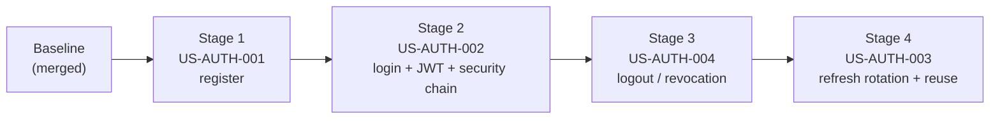

# Sprint 1 Backend Implementation Guides — Start Here

| Field | Value |
| --- | --- |
| Sprint | Sprint 1 — Secure Account Access — Backend Only ([sprint plan](../sprint-plan.md)) |
| Audience | The backend developer implementing Sprint 1 by hand |
| Repository analysed | Branch `sprint_01_security`, commit `1fb33a0`, clean working tree |
| Prepared | 2026-10-29 |
| Status | Reference package. The Java, SQL, YAML and test code in these guides was **written, not compiled or run**. Treat compile errors or failing tests as normal feedback, and ask for targeted guide revisions. |

**Reading order:** this README → [Shared Architecture](shared-architecture.md) → the current story guide. You should not need to read the whole SRS, PRD or architecture set first; every guide links to the exact source sections it relies on.

---

## 1. Sprint Goal

> Deliver a working Spring Boot authentication backend supporting account registration, login, authenticated-session continuity, and logout, with applicable security protections and automated verification.

The Goal is a **backend** outcome. Mobile screens, navigation, styling and accessibility are out of scope for you. Their evidence is still required before any story can be called Done ([Sprint plan §7](../sprint-plan.md#7-testing-and-definition-of-done)).

## 2. The four stories (in implementation order)

| # | Story | What you build | Guide |
| --- | --- | --- | --- |
| 1 | [US-AUTH-001 — Register a private account](../../../stories/auth/US-AUTH-001-register-account.md) | `POST /api/v1/auth/registrations`, account table, PBKDF2 hashing, unique normalized email (also under concurrency). | [US-AUTH-001-guide.md](US-AUTH-001-guide.md) |
| 2 | [US-AUTH-002 — Log in](../../../stories/auth/US-AUTH-002-log-in.md) | `POST /api/v1/auth/login`, sessions in PostgreSQL, JWT access token + refresh token, the default-deny Spring Security chain that checks the session on every request. | [US-AUTH-002-guide.md](US-AUTH-002-guide.md) |
| 3 | [US-AUTH-004 — Log out of my current session](../../../stories/auth/US-AUTH-004-log-out.md) | `POST /api/v1/auth/logout`, immediate revocation of only the current session. | [US-AUTH-004-guide.md](US-AUTH-004-guide.md) |
| 4 | [US-AUTH-003 — Resume access within my login session](../../../stories/auth/US-AUTH-003-resume-session.md) | `POST /api/v1/auth/refresh`, refresh-token rotation, reuse detection, the absolute 30-day maximum, and real concurrency tests. | [US-AUTH-003-guide.md](US-AUTH-003-guide.md) |
| — | [US-PRIV-001 — Protect the first delivered private operations](../../../stories/privacy/US-PRIV-001-protect-first-private-operations.md) (applicable parts) | Isolation, usable authority, secret protection — built into every story above. | [Shared Architecture §2.5](shared-architecture.md#25-privacy-and-us-priv-001-applicability) |

The order is intentional (**Registration → Login → Logout → Session Continuity**). It follows the [Sprint plan §5](../sprint-plan.md#5-dependencies-and-recommended-sequence): prove that issued authority can be revoked before adding renewal, the riskiest part.

## 3. Business context in five sentences

CapsuleAI users keep a **private** digital wardrobe, so the first thing the product needs is a trustworthy account. A person registers with an email (compared ignoring case and surrounding spaces) and a 12–128-character password that is stored and compared **exactly**, with no hidden trimming ([BRULE-AUTH-002/003](../../../../03-requirements/business-rules.md#2-account-and-identity-rules)). Logging in creates a **login session** that lasts at most 30 days; inside it, a 15-minute access token proves who is calling, and a refresh token renews access ([SRS §3.1.1](../../../../03-requirements/SRS.md#311-authentication-and-recovery-rules)). Logging out ends only *this* device's session; replaying an old refresh token revokes the session it belongs to ([BRULE-AUTH-006](../../../../03-requirements/business-rules.md#brule-auth-006--separate-sessions-and-revocation)). "Not authorized" must never look like "empty wardrobe", and secrets must never appear in responses or logs ([BRULE-AUTH-001](../../../../03-requirements/business-rules.md#brule-auth-001--authorized-personal-operations), NFR-SEC-003).

## 4. Shared concepts you will use in every story

| Term | Meaning in this codebase |
| --- | --- |
| Normalized email | `strip()` + `toLowerCase(Locale.ROOT)`; one account per value; no Gmail-style alias tricks. |
| Login session | One `identity_session` row per successful login, with a fixed `expires_at` 30 days later. The SRS calls it the "Refresh Session". |
| Access token | Signed JWT (HS256) with `sub` = account id and `sid` = session id; valid while `now < exp` (15 minutes). |
| Refresh token | 43-character random string; only its SHA-256 hash is stored; used once, then replaced. |
| Usable session | Not revoked **and** `now < expires_at`. Checked in PostgreSQL on **every** protected request. |
| Revocation | `revoked_at` + `revocation_reason` (`LOGOUT` or `REFRESH_TOKEN_REUSE`) on the session row. Never deleted. |
| Problem JSON | Error body (RFC 9457) with a stable `code` such as `VALIDATION_FAILED` or `AUTHENTICATION_REQUIRED`. |
| Port / adapter | Interface the application needs (port) and its technical implementation (adapter). |
| `MutableClock` | Test clock you can move forward, so expiry is tested without waiting. |

## 5. Architecture summary

- One Spring Boot **modular monolith**; all Sprint 1 code is in the **Identity** module, `com.capsuleai.identity` ([ADA-001, ADA-015](../../../../04-architecture/selected-architecture-decisions.md#3-selection-summary)).
- **Pragmatic Clean Architecture:** `domain` (rules, plain Java) ← `application` (use cases, plain Java) ← `adapter.in` / `adapter.out` (Spring MVC, Spring Security, JDBC) ← `configuration` (bean wiring). An ArchUnit test keeps Spring out of `domain`, `application` and `api`.
- **PostgreSQL is the session authority** ([ADA-008](../../../../04-architecture/selected-architecture-decisions.md#ada-008--session-refresh-and-reset-authority)): a valid JWT is necessary but never sufficient.
- **Spring JDBC (`JdbcClient`)**, Flyway migrations V2–V5, no JPA, no cache.
- **One security filter chain**, owned by Identity, denies everything except the three public auth endpoints.

Full design, diagrams, schema, contracts and the file change matrix: **[shared-architecture.md](shared-architecture.md)**.

## 6. Prerequisites and existing infrastructure

Already in place (do **not** recreate) — see the [backend README](../../../../../backend/README.md):

| Item | Version / state |
| --- | --- |
| Java | 21 |
| Spring Boot / Spring Security (managed) | 4.1.1 / 7.1.1 |
| Maven Wrapper | `backend\mvnw.cmd` (Maven 3.9.16) |
| PostgreSQL | 17.11 (Compose for development, Testcontainers for tests) |
| Flyway | 12.4.0, `V1__foundation.sql` applied |
| Tests | JUnit 6, AssertJ, Mockito, Testcontainers 2.0.5, ArchUnit 1.5.1; Surefire (`*Test`) + Failsafe (`*IT`) |
| CI | `.github/workflows/backend-ci.yml` runs `clean verify` on PRs to `main` |

You need: JDK 21, Docker Desktop (Linux engine) running for every `verify`, VS Code with Java extensions, a private `.env` for local PostgreSQL ([backend README §7–9](../../../../../backend/README.md#7-local-development-setup)). From US-AUTH-002 onward, local runs also need `CAPSULE_JWT_SIGNING_SECRET` (the US-AUTH-002 guide shows how to generate one).

New dependencies added by the Sprint (versions come from the Boot BOM): `spring-security-crypto`, `spring-boot-starter-webmvc-test` (test) in US-AUTH-001; `spring-boot-starter-security-oauth2-resource-server` in US-AUTH-002.

## 7. Implementation sequence and story dependencies



| Story | Needs from earlier stages | Adds for later stages |
| --- | --- | --- |
| 001 | Baseline only | `Account`, `EmailAddress`, `PasswordHasher`, exception handler, test support |
| 002 | 001's account model and hasher | Session table, JWT, filter chain, `SessionAuthority`, login helpers in tests |
| 004 | 002's session and filter chain | Revocation columns, `RevocationReason`, `SessionRepository.revoke` |
| 003 | 002's refresh token, 004's revocation | Rotation, reuse detection (final state) |

Each stage must build and pass `clean verify` on its own before you start the next. Files that later stories change are printed **in full** in the later guide; the [change matrix](shared-architecture.md#12-shared-file-ownership-and-change-matrix) lists them.

## 8. How to work through one story

1. **Branch** from up-to-date `main`: `feature/US-AUTH-00X-short-name`. Never commit to `main`.
2. **Read** the guide's Sections 1–5 (what and why) before typing code.
3. **Implement production code** in the order of the guide's Section 6 table, checking `.\mvnw.cmd -q compile` after each group (Section 8 tells you when a compile failure is expected).
4. **Implement the tests** from Section 9. Production first, tests second, is fine here; TDD is optional ([Test Strategy §16](../../../../07-testing/test-strategy.md#16-selective-tdd)).
5. **Run** focused tests, then the full suite exactly as CI does (Section 10):
   ```powershell
   Set-Location 'D:\CapsuleAI\backend'
   .\mvnw.cmd --batch-mode --no-transfer-progress clean verify
   ```
6. **Inspect reports** in `backend\target\surefire-reports` and `failsafe-reports`; record real counts.
7. **Update the API contract** (`docs/05-api/openapi.yaml`) as the guide shows.
8. **Self-review:** `git status --short`, `git diff --check`; stage explicit paths only; no `.env`, `target/` or secrets.
9. **Open a PR to `main`** naming the story and PBI (e.g. "US-AUTH-001 / PBI-004: register a private account"). Paste the guide's AC→test table with your actual results, and list the remaining external evidence.
10. **CI:** wait for the "Backend verification" check; optionally apply the guide's Section 11 report-guard change in the same PR; download `backend-test-reports` if anything fails.
11. **Review, fix, merge.** Then move to the next guide.

## 9. Testing workflow in one table

| Level | Where | Needs Docker | Typical command |
| --- | --- | --- | --- |
| Domain unit | `identity/domain/*Test` | No | `.\mvnw.cmd '-Dtest=PasswordPolicyTest' test` |
| Application (fakes) | `identity/application/*ServiceTest` | No | `.\mvnw.cmd '-Dtest=LogInServiceTest' test` |
| Architecture | `architecture/ArchitectureDependencyTest` | No | `.\mvnw.cmd '-Dtest=ArchitectureDependencyTest' test` |
| HTTP + security + PostgreSQL | `identity/**/*ApiIT`, `AccessTokenSecurityIT` | Yes | `.\mvnw.cmd '-Dit.test=LoginApiIT' verify` |
| Concurrency | `Concurrent*IT` | Yes | `.\mvnw.cmd '-Dit.test=ConcurrentRefreshIT' verify` |
| Migration / integrity | `*SchemaIT` | Yes | `.\mvnw.cmd '-Dit.test=SessionSchemaIT' verify` |
| Everything | — | Yes | `.\mvnw.cmd --batch-mode --no-transfer-progress clean verify` |

Rules that apply to every test you write: real PostgreSQL (never H2) for database behaviour; real signed tokens through the real filter chain for security behaviour; a controllable clock instead of sleeps; synthetic accounts only ([Test Strategy §4](../../../../07-testing/test-strategy.md#4-testing-principles)).

## 10. CI verification workflow

The existing workflow needs **no structural change**: Maven discovers new `*Test`/`*IT` classes automatically, Docker is available for Testcontainers, and any failing test fails the job. Its report guard only checks the three baseline reports, so each guide's Section 11 offers an optional, cumulative `$required` block that also proves the new Identity test classes ran with zero skips. CI triggers on pull requests targeting `main` (and pushes to `main`); a PR into another branch does not run it.

## 11. What you will be able to do afterwards

- Turn business rules into small, testable domain classes, and keep Spring out of them.
- Design ports that express business needs (e.g. "insert if email is free") instead of generic CRUD.
- Configure Spring Security 7 for a stateless JWT API, and explain why a valid token is not enough.
- Write Flyway migrations that evolve safely (forward only, with transition tests).
- Use PostgreSQL constraints, `ON CONFLICT` and `SELECT … FOR UPDATE` to make concurrency safe.
- Write unit, application, API, security, migration and concurrency tests with JUnit, AssertJ, MockMvc and Testcontainers.
- Protect secrets in hashes, `toString()`, logs and error bodies.
- Separate what backend tests prove from what needs mobile or manual evidence.

## 12. Known limitations and unresolved decisions

| Item | Default in the guides | Status |
| --- | --- | --- |
| Display Name maximum length | 100 code points | Needs PO/BA confirmation ([A-01](shared-architecture.md#15-ambiguities-limitations-and-open-questions)) |
| Password "character" definition | Unicode code points; unpaired surrogates rejected | Proposed ([TD-04](shared-architecture.md#14-technical-decision-log)) |
| Registration → entry | No automatic login; client logs in next | Follows the Sprint plan; PO may refine |
| Lost renewal response | Forces a new login (strict reuse rule) | Required by policy; mobile must renew single-flight |
| Logout with an expired access token | 401; client renews first | Documented client contract |
| Expired session row cleanup | Not implemented | Retention policy open ([A-06](shared-architecture.md#15-ambiguities-limitations-and-open-questions)) |
| Rate limiting, lockout, CAPTCHA, denylist, TLS | Not implemented | Out of story scope or deployment concern |
| Wardrobe/profile/history protection | Not exercised (features do not exist yet) | Recorded as unexercised, not passed |
| Mobile, accessibility, cache clearing | External evidence | Required before any story is Done |
| Reference code | Not compiled or executed by the author | Verify by implementing; request revisions |

Complete lists: [Technical decisions](shared-architecture.md#14-technical-decision-log) and [Ambiguities](shared-architecture.md#15-ambiguities-limitations-and-open-questions).

## 13. Package contents

| File | Purpose |
| --- | --- |
| [README.md](README.md) | This entry point. |
| [shared-architecture.md](shared-architecture.md) | Consolidated requirements, integrated design, diagrams, schema, API contract, decisions, change matrix. |
| [US-AUTH-001-guide.md](US-AUTH-001-guide.md) | Registration: design, full production code, full tests, verification. |
| [US-AUTH-002-guide.md](US-AUTH-002-guide.md) | Login, JWT and the security chain. |
| [US-AUTH-004-guide.md](US-AUTH-004-guide.md) | Logout and revocation. |
| [US-AUTH-003-guide.md](US-AUTH-003-guide.md) | Renewal, rotation, reuse detection, concurrency. |
