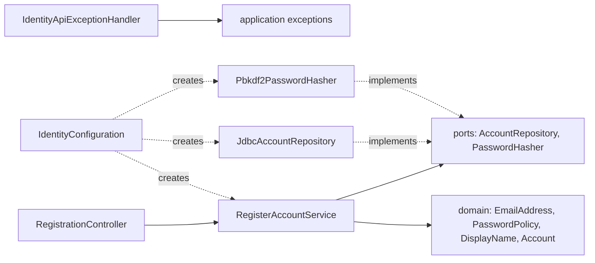

# US-AUTH-001 — Register a Private Account: Implementation Guide

| Field | Value |
| --- | --- |
| Story | [US-AUTH-001 — Register a private account](../../../stories/auth/US-AUTH-001-register-account.md) (v0.3, Baseline Draft) |
| Parent PBI | [PBI-004](../../../product-backlog.md#pbi-004--emailpassword-access-and-controllable-sessions); hard dependency [PBI-002](../../../product-backlog.md#pbi-002--protect-private-user-data-from-the-first-usable-increment) |
| Implementation order | **1 of 4** → next: [US-AUTH-002](US-AUTH-002-guide.md) |
| Stage produced | **Stage 1** — registration only |
| Read first | [README](README.md) → [Shared Architecture](shared-architecture.md) |
| Status | Reference code for manual implementation. **Not compiled or executed by the author.** |

---

## 1. Story Overview

**User story.** As a new user, I want to register a private account with my email and password, so that I can begin building a trustworthy personal wardrobe.

| Item | Description |
| --- | --- |
| User value | One personal identity for the wardrobe, without being forced to give optional personal data. |
| Backend objective | `POST /api/v1/auth/registrations` validates input, stores **exactly one** account per normalized email with a protected password, and returns a truthful outcome. |
| In scope (backend) | Required-field and confirmation checks; 12–128 exact password policy; normalized unique email under concurrency; optional Display Name kept exactly; truthful 201/400/409/503 outcomes; no secrets in output or logs. |
| Out of scope | Login, tokens, logout, renewal (next stories). Password recovery (PBI-005). Email verification, social/guest login, CAPTCHA, lockout, strength meter (story §8). Any mobile UI. |
| Dependencies | Existing engineering baseline (Boot 4.1.1, PostgreSQL, Flyway, Testcontainers, ArchUnit, CI). Nothing from other stories. |
| Expected outcome | Stage 1: a running backend that accepts registrations; every earlier test still passes; new unit, API, PostgreSQL and concurrency tests pass. |
| Relationship | US-AUTH-002 will **reuse** `Account`, `EmailAddress`, `PasswordHasher` and the exception handler, and will **add** `findByEmail`. Nothing in this stage refers to future classes. |

---

## 2. Business Requirements

### 2.1 Scenarios

| Scenario | What the backend must do | Source |
| --- | --- | --- |
| **Normal** — valid email, password, matching confirmation | Create one account for the normalized email; respond 201 with the account id, normalized email and optional name. | [UC-001 Main](../../../../03-requirements/use-cases/UC-001-register-account.md#6-main-success-scenario), FR-AUTH-001 |
| **Alternative** — no Display Name, no profile/location/garment | Still succeed; nothing optional is required. | UC-001 A1/A2, FR-AUTH-011 |
| **Exception** — missing field or mismatch | Explain every problem field; create nothing; allow corrected resubmission. | UC-001 E1, FR-AUTH-012 |
| **Exception** — password 11 or 129 characters | Reject with correction guidance; 12 and 128 are fine. | FR-AUTH-015 |
| **Exception** — email already used (any case/whitespace) | Create no second account; leave the existing one untouched; suggest Log in / Forgot Password. | UC-001 E2, FR-AUTH-016 |
| **Concurrency** — equivalent emails submitted at the same time | At most one account. | AC-06, FR-AUTH-016, [Test Strategy §8.2](../../../../07-testing/test-strategy.md#82-what-database-tests-must-establish) |
| **Recovery** — response lost, retry | Retry cannot duplicate; it receives 409 and the user can log in. | UC-001 E3, COM-002, ERR-NET-001 |
| **Failure** — database unavailable | Do not claim success; report "outcome not confirmed". | AC-09, COM-002 |
| **Cancellation** — user leaves before submitting | No request reaches the backend → nothing created. | AC-08 |

### 2.2 Requirements traceability

| Requirement | Short meaning | Relevant AC | Source |
| --- | --- | --- | --- |
| FR-AUTH-001 | Email/Password/Confirm registration; Display Name optional. | AC-01, AC-02, AC-07 | [SRS §3.1.1](../../../../03-requirements/SRS.md#311-authentication-and-recovery-rules) |
| FR-AUTH-011 | No optional data gates entry. | AC-02 | [SRS §3.1.1](../../../../03-requirements/SRS.md#311-authentication-and-recovery-rules) |
| FR-AUTH-012 | Explain missing values/mismatch; no success claim. | AC-03 | [SRS §3.1.1](../../../../03-requirements/SRS.md#311-authentication-and-recovery-rules) |
| FR-AUTH-015 | 12–128 characters, any characters, no transformation. | AC-04, AC-05 | [SRS §3.1.1](../../../../03-requirements/SRS.md#311-authentication-and-recovery-rules) |
| FR-AUTH-016 | One account per normalized email; guidance on duplicate; no alias merging. | AC-06, AC-09 | [SRS §3.1.1](../../../../03-requirements/SRS.md#311-authentication-and-recovery-rules) |
| DATA-AUTH-001 | Credentials protected; password value preserved. | AC-05, AC-10 | [SRS §4.2](../../../../03-requirements/SRS.md#42-account--profile-data) |
| DATA-AUTH-002 | Normalized email identity; optional Display Name. | AC-06, AC-07 | [SRS §4.2](../../../../03-requirements/SRS.md#42-account--profile-data) |
| COM-001 / COM-002 | Protected exchange; interrupted ≠ accepted. | AC-09, AC-10 | [SRS §5.4](../../../../03-requirements/SRS.md#54-communication-interfaces) |
| ERR-NET-001 | Uncertain outcome; safe retry without duplicates. | AC-09 | [SRS §9.9](../../../../03-requirements/SRS.md#99-communication-and-partial-dependency-failure) |
| NFR-SEC-003 | No credential secret in output/logs. | AC-10 | [SRS §6.2](../../../../03-requirements/SRS.md#62-security) |
| NFR-PRIV-001/002 | Only necessary data; no sharing/training. | AC-10 | [SRS §6.3](../../../../03-requirements/SRS.md#63-privacy) |
| BR-021, BR-012, BR-023; CAP-01; JRN-01; FEAT-AUTH-001 | Business/product origin. | all | [BRD §15](../../../../01-business/BRD.md#15-high-level-business-requirements), [PRD §8.1](../../../../02-product/PRD.md#81-jrn-01--account-onboarding--personalization), [PRD §10.1](../../../../02-product/PRD.md#101-feat-auth-001--personal-account-access-and-session-continuity) |

---

## 3. Business Rules

| Rule | Simple meaning | Example | Backend implication | Mandatory? |
| --- | --- | --- | --- | --- |
| [BRULE-AUTH-002](../../../../03-requirements/business-rules.md#brule-auth-002--normalized-email-identity) Normalized Email Identity | Remove surrounding spaces, ignore letter case; one account per result. Do **not** apply Gmail-style alias tricks. | ` Person@Example.com ` = `person@example.com`; `person+news@example.com` ≠ `person@example.com`; `p.erson@gmail.com` ≠ `person@gmail.com`. | `EmailAddress.normalize` = `strip()` + `toLowerCase(Locale.ROOT)`; unique DB constraint on the normalized column. | Yes |
| [BRULE-AUTH-003](../../../../03-requirements/business-rules.md#brule-auth-003--password-value-preservation) Password Value Preservation | 12–128 characters; anything allowed (spaces, Vietnamese, emoji); no "must contain a digit" rules; never trimmed or changed. | `"  Mật khẩu rất dài  "` is stored and later compared exactly, including the leading spaces. `"            "` (12 spaces) is valid. | `PasswordPolicy` only inspects; the hasher receives the exact string; a hash algorithm that uses every byte. | Yes |
| BRULE-AUTH-003 — denylist | A small approved common-password denylist **may** be used. | — | Not adopted in Sprint 1 (no approved list exists). | **Optional / not used** |
| [BRULE-AUTH-007](../../../../03-requirements/business-rules.md#brule-auth-007--purpose-limited-private-data-use) Purpose-Limited Private Data | Use personal data only for the product; no sharing, sale, AI training. | Display Name is used only to show it back to its owner. | Store only email, password hash, optional name, creation time. No external calls. | Yes |

---

## 4. Acceptance Criteria

| AC | Summary | Backend effect | Verification type |
| --- | --- | --- | --- |
| [AC-01](../../../stories/auth/US-AUTH-001-register-account.md#ac-01--create-one-account) Create one account | Valid new email → one account; entry path available. | 201 with `accountId`; account usable by login. | **Backend** (creation). **Cross-story** (entry via login, US-AUTH-002). **External** (onboarding screen). |
| [AC-02](../../../stories/auth/US-AUTH-001-register-account.md#ac-02--optional-information-does-not-gate-entry) Optional info does not gate entry | No name/body/location/garment → still succeeds. | Only three required fields. | **Backend** + **External** (Today/Wardrobe empty-state presentation). |
| [AC-03](../../../stories/auth/US-AUTH-001-register-account.md#ac-03--correct-missing-or-mismatched-input) Correct missing/mismatched input | Explain; create nothing; corrected resubmission works. | 400 with every `fieldErrors` entry; no row. | **Backend** + **External** (wording/presentation). |
| [AC-04](../../../stories/auth/US-AUTH-001-register-account.md#ac-04--enforce-password-length-without-added-composition-rules) Length without composition rules | 11/129 rejected, 12/128 accepted; any characters. | `PasswordPolicy`. | **Backend**. |
| [AC-05](../../../stories/auth/US-AUTH-001-register-account.md#ac-05--preserve-the-exact-password-value) Exact password value | Later login works only with the exact value. | Hasher gets the exact string; PBKDF2 uses all bytes. | **Backend** (credential level, this story) + **Cross-story** (login, US-AUTH-002 `LoginApiIT`). |
| [AC-06](../../../stories/auth/US-AUTH-001-register-account.md#ac-06--prevent-a-duplicate-normalized-identity) No duplicate normalized identity | No second account, also under concurrency; existing unchanged; guidance. | Unique constraint + `ON CONFLICT DO NOTHING`; 409. | **Backend** (incl. real PostgreSQL concurrency). |
| [AC-07](../../../stories/auth/US-AUTH-001-register-account.md#ac-07--keep-an-optional-name-intact) Keep an optional name intact | Diacritics retained exactly. | Stored and returned byte-for-byte. | **Backend** + **External** (display). |
| [AC-08](../../../stories/auth/US-AUTH-001-register-account.md#ac-08--cancel-unaccepted-registration) Cancel unaccepted registration | Cancelled attempt creates nothing. | Nothing is written unless a valid request reaches the insert. | **Backend** (rejected requests write nothing) + **External** (client cancel). |
| [AC-09](../../../stories/auth/US-AUTH-001-register-account.md#ac-09--distinguish-pending-failed-and-uncertain-creation) Pending/failed/uncertain | Never claim success; retry cannot duplicate. | 503 `TEMPORARILY_UNAVAILABLE`; retry → 409. | **Backend** + **External** (pending/uncertain UI). |
| [AC-10](../../../stories/auth/US-AUTH-001-register-account.md#ac-10--protect-information-during-entry) Protect information during entry | No protected access before login; no secrets disclosed. | Response has no token/password/hash; logs have no password. | **Backend** (this stage) + **Cross-story** (default-deny chain arrives in US-AUTH-002). |
| [AC-11](../../../stories/auth/US-AUTH-001-register-account.md#ac-11--understand-and-operate-registration) Accessible Vietnamese registration | Labels, screen reader, 200% text. | Stable error codes the client can translate. | **External only.** |

---

## 5. Just-in-Time Detailed Design

### 5.1 Classes and responsibilities

| Layer | Class | Responsibility | Why it exists |
| --- | --- | --- | --- |
| domain | `ValueProblem` | Vocabulary of rejection reasons (`REQUIRED`, `TOO_SHORT`, …). | One stable list shared by domain, application and the API. |
| domain | `InvalidValueException` | Thrown by value objects; carries a `ValueProblem`, never the value. | Lets each rule say *why* without leaking secrets. |
| domain | `EmailAddress` | Normalized email identity (BRULE-AUTH-002). | The **only** place normalization happens; login reuses it. |
| domain | `PasswordPolicy` | 12–128 code-point check; rejects malformed Unicode; never transforms. | BRULE-AUTH-003 in one testable place. |
| domain | `DisplayName` | Optional name kept exactly; blank = omitted; ≤ 100. | AC-07 exact retention. |
| domain | `PasswordHash` | Encoded hash with masked `toString()`. | Type safety: a raw password can never be stored by mistake. |
| domain | `Account` | The registered account record. | Shared by registration and (next story) login. |
| application | `RegisterAccountCommand` / `RegisteredAccount` | Input/output of the use case (masked password in `toString`). | Keeps HTTP types out of the use case. |
| application | `FieldViolation`, `RequestValidationException` | Collect **all** field problems in one rejection. | AC-03 "explains the missing value" for every field at once. |
| application | `EmailAlreadyRegisteredException` | Duplicate identity outcome. | Mapped to 409 with guidance. |
| application | `RegisterAccountService` | Validate → hash → insert-if-available → result. | The use case. Spring-free. |
| ports | `AccountRepository` | `addIfEmailAvailable(Account)` — atomic under concurrency. | Expresses the business need, not CRUD. |
| ports | `PasswordHasher` | `hash` / `matches`. | Slow crypto behind a port; fakes in tests. |
| adapter.out | `JdbcAccountRepository` | `INSERT … ON CONFLICT (email) DO NOTHING`. | Database-enforced uniqueness. |
| adapter.out | `Pbkdf2PasswordHasher` | PBKDF2-HMAC-SHA256, 600 000 iterations. | See TD-03 (why **not** BCrypt). |
| adapter.in | `RegistrationController`, `RegistrationRequest`, `RegistrationResponse` | HTTP ↔ use case. | Thin translation. |
| adapter.in | `IdentityApiExceptionHandler` | Exceptions → RFC 9457 problem JSON with `code`. | Consistent error contract for all Identity endpoints. |
| configuration | `IdentityConfiguration` | `@Bean` wiring (clock, hasher, repository, service). | Application classes carry no Spring annotations. |

Dependency direction (arrows = "depends on"):



### 5.2 HTTP contract

`POST /api/v1/auth/registrations` — public (there is no security filter yet in Stage 1; Stage 2 keeps it public explicitly).

Request:

```json
{
  "email": " Person@Example.com ",
  "password": "correct horse battery staple",
  "confirmPassword": "correct horse battery staple",
  "displayName": "Nguyễn Thị Ánh"
}
```

| Outcome | Status | Body |
| --- | --- | --- |
| Created | `201` | `{"accountId":"…uuid…","email":"person@example.com","displayName":"Nguyễn Thị Ánh"}` (`displayName` is `null` when omitted) |
| Invalid fields | `400` | `{"type":"about:blank","title":"Bad Request","status":400,"detail":"Some submitted values are missing or invalid. Correct them and submit again.","instance":"/api/v1/auth/registrations","code":"VALIDATION_FAILED","fieldErrors":[{"field":"password","code":"TOO_SHORT"}]}` |
| Not JSON / no body | `400` | `code: MALFORMED_REQUEST` |
| Email already registered | `409` | `code: EMAIL_ALREADY_REGISTERED`, detail suggests Log in / Forgot Password |
| Database unreachable | `503` | `code: TEMPORARILY_UNAVAILABLE` |

Field names and codes: `email` (`REQUIRED`, `INVALID_FORMAT`, `TOO_LONG`), `password` (`REQUIRED`, `TOO_SHORT`, `TOO_LONG`, `INVALID_CHARACTERS`), `confirmPassword` (`REQUIRED`, `MISMATCH`), `displayName` (`TOO_LONG`).

**[TECH]** The response contains no token. The mobile client shows success and then logs in with the same credentials (US-AUTH-002). See [Shared Architecture TD-07](shared-architecture.md#14-technical-decision-log).

### 5.3 Validation order

1. Every field is checked and **all** problems are collected (better correction UX than one error at a time).
2. Only if nothing is wrong: hash the password (slow, ~0.3–0.6 s) **before** touching the database, so no database connection waits on CPU work.
3. Insert-if-available. The database, not a prior `SELECT`, decides uniqueness — a `SELECT` then `INSERT` would race.

### 5.4 Database change

`V2__create_identity_account.sql` creates `identity_account` with a `UNIQUE (email)` constraint on the **normalized** email. PostgreSQL text is UTF-8, so Vietnamese names are stored exactly.

### 5.5 Transactions

None needed: registration writes one row in one statement, which PostgreSQL executes atomically in autocommit mode. (Login, next story, writes two rows and introduces the transaction port.)

### 5.6 Security in this stage

Only the `spring-security-crypto` module is added (for PBKDF2). The web security filter chain arrives in US-AUTH-002 together with JWT; adding it now would give Spring Boot's generated default user and form login, which this API does not want. AC-10 is satisfied in this stage because registration returns no credential and discloses no secret.

### 5.7 Error handling

`IdentityApiExceptionHandler` (scoped to `identity.adapter.in.web`) maps:

| Exception | Status / code |
| --- | --- |
| `RequestValidationException` | 400 `VALIDATION_FAILED` + `fieldErrors` |
| `HttpMessageNotReadableException` | 400 `MALFORMED_REQUEST` |
| `EmailAlreadyRegisteredException` | 409 `EMAIL_ALREADY_REGISTERED` |
| `DataAccessResourceFailureException`, `TransientDataAccessResourceException` (database unreachable) | 503 `TEMPORARILY_UNAVAILABLE` (logged without values) |
| any other exception (e.g. `BadSqlGrammarException`, a programming error) | not handled here → Spring's 500 error page. Not disguised as "temporarily unavailable" ([TD-26](shared-architecture.md#14-technical-decision-log)). |

---

## 6. File Implementation Plan

Paths relative to the repository root. `J` = `backend/src/main/java/com/capsuleai/identity`.

| Order | File Path | Action | Responsibility | Depends On |
| --- | --- | --- | --- | --- |
| 1 | `backend/pom.xml` | MODIFY | Add `spring-security-crypto`, test `spring-boot-starter-webmvc-test`. | — |
| 2 | `backend/src/main/resources/application.properties` | MODIFY | Suppress driver error details in logs. | — |
| 3 | `backend/src/main/resources/db/migration/V2__create_identity_account.sql` | NEW | Account table + unique email. | V1 |
| 4 | `J/domain/ValueProblem.java` | NEW | Rejection vocabulary. | — |
| 5 | `J/domain/InvalidValueException.java` | NEW | Rule violation. | 4 |
| 6 | `J/domain/EmailAddress.java` | NEW | Email normalization. | 5 |
| 7 | `J/domain/PasswordPolicy.java` | NEW | Password policy. | 5 |
| 8 | `J/domain/DisplayName.java` | NEW | Optional exact name. | 5 |
| 9 | `J/domain/PasswordHash.java` | NEW | Encoded hash. | — |
| 10 | `J/domain/Account.java` | NEW | Account record. | 6, 8, 9 |
| 11 | `J/application/FieldViolation.java` | NEW | One field problem. | 4 |
| 12 | `J/application/RequestValidationException.java` | NEW | All field problems. | 11 |
| 13 | `J/application/EmailAlreadyRegisteredException.java` | NEW | Duplicate outcome. | — |
| 14 | `J/application/RegisterAccountCommand.java` | NEW | Use-case input. | — |
| 15 | `J/application/RegisteredAccount.java` | NEW | Use-case output. | — |
| 16 | `J/application/ports/AccountRepository.java` | NEW | Persistence port. | 10 |
| 17 | `J/application/ports/PasswordHasher.java` | NEW | Hashing port. | 9 |
| 18 | `J/application/RegisterAccountService.java` | NEW | Registration use case. | 6–17 |
| 19 | `J/adapter/out/persistence/JdbcAccountRepository.java` | NEW | SQL insert-if-available. | 3, 16 |
| 20 | `J/adapter/out/security/Pbkdf2PasswordHasher.java` | NEW | PBKDF2. | 1, 17 |
| 21 | `J/configuration/IdentityConfiguration.java` | NEW | Bean wiring. | 18–20 |
| 22 | `J/adapter/in/web/RegistrationRequest.java` | NEW | Request JSON. | 14 |
| 23 | `J/adapter/in/web/RegistrationResponse.java` | NEW | Response JSON. | 15 |
| 24 | `J/adapter/in/web/RegistrationController.java` | NEW | Endpoint. | 18, 22, 23 |
| 25 | `J/adapter/in/web/IdentityApiExceptionHandler.java` | NEW | Error contract. | 12, 13 |
| 26 | `docs/05-api/openapi.yaml` | NEW | Living API contract. | 24, 25 |
| — | `backend/src/main/java/com/capsuleai/identity/package-info.java` | REUSE | Module description (unchanged). | — |
| — | `backend/src/main/java/com/capsuleai/CapsuleAiApplication.java` | REUSE | Component scan root (unchanged). | — |

Tests follow in [Section 9](#9-complete-automated-test-code).

---

## 7. Complete Production Code

### 7.1 `backend/pom.xml` — MODIFY

**Purpose.** Add exactly two dependencies. Versions come from the Spring Boot 4.1.1 BOM, so no `<version>` is written.

- `spring-security-crypto` — only the password-encoding part of Spring Security. It does **not** activate web security.
- `spring-boot-starter-webmvc-test` — Boot 4 moved `@AutoConfigureMockMvc` into its own test module; without it MockMvc tests do not compile.

Complete resulting file:

```xml
<?xml version="1.0" encoding="UTF-8"?>
<project xmlns="http://maven.apache.org/POM/4.0.0"
         xmlns:xsi="http://www.w3.org/2001/XMLSchema-instance"
         xsi:schemaLocation="http://maven.apache.org/POM/4.0.0 https://maven.apache.org/xsd/maven-4.0.0.xsd">
    <modelVersion>4.0.0</modelVersion>
    <parent>
        <groupId>org.springframework.boot</groupId>
        <artifactId>spring-boot-starter-parent</artifactId>
        <version>4.1.1</version>
        <relativePath/>
    </parent>
    <groupId>com.capsuleai</groupId>
    <artifactId>capsuleai-backend</artifactId>
    <version>0.0.1-SNAPSHOT</version>
    <properties>
        <java.version>21</java.version>
    </properties>
    <dependencies>
        <dependency>
            <groupId>org.springframework.boot</groupId>
            <artifactId>spring-boot-starter-webmvc</artifactId>
        </dependency>
        <dependency>
            <groupId>org.springframework.boot</groupId>
            <artifactId>spring-boot-starter-test</artifactId>
            <scope>test</scope>
        </dependency>

        <!-- US-AUTH-001: password hashing only (no web security yet) -->
        <dependency>
            <groupId>org.springframework.security</groupId>
            <artifactId>spring-security-crypto</artifactId>
        </dependency>

        <!-- US-AUTH-001: MockMvc support for HTTP integration tests (Boot 4 test module) -->
        <dependency>
            <groupId>org.springframework.boot</groupId>
            <artifactId>spring-boot-starter-webmvc-test</artifactId>
            <scope>test</scope>
        </dependency>

        <!-- Flyway integration with Spring Boot -->
        <dependency>
            <groupId>org.springframework.boot</groupId>
            <artifactId>spring-boot-starter-flyway</artifactId>
        </dependency>

        <!-- PostgreSQL-specific Flyway support -->
        <dependency>
            <groupId>org.flywaydb</groupId>
            <artifactId>flyway-database-postgresql</artifactId>
            <scope>runtime</scope>
        </dependency>

        <!-- PostgreSQL JDBC driver -->
        <dependency>
            <groupId>org.postgresql</groupId>
            <artifactId>postgresql</artifactId>
            <scope>runtime</scope>
        </dependency>

        <!-- Spring Boot and Testcontainers integration -->
        <dependency>
            <groupId>org.springframework.boot</groupId>
            <artifactId>spring-boot-testcontainers</artifactId>
            <scope>test</scope>
        </dependency>

        <!-- Testcontainers integration with JUnit Jupiter -->
        <dependency>
            <groupId>org.testcontainers</groupId>
            <artifactId>testcontainers-junit-jupiter</artifactId>
            <scope>test</scope>
        </dependency>

        <!-- PostgreSQL Testcontainers module -->
        <dependency>
            <groupId>org.testcontainers</groupId>
            <artifactId>testcontainers-postgresql</artifactId>
            <scope>test</scope>
        </dependency>

        <dependency>
            <groupId>com.tngtech.archunit</groupId>
            <artifactId>archunit</artifactId>
            <version>1.5.1</version>
            <scope>test</scope>
        </dependency>
    </dependencies>
    <build>
        <plugins>
            <plugin>
                <groupId>org.springframework.boot</groupId>
                <artifactId>spring-boot-maven-plugin</artifactId>
            </plugin>

            <plugin>
                <groupId>org.apache.maven.plugins</groupId>
                <artifactId>maven-surefire-plugin</artifactId>

                <configuration>
                    <failIfNoTests>true</failIfNoTests>
                </configuration>
            </plugin>

            <plugin>
                <groupId>org.apache.maven.plugins</groupId>
                <artifactId>maven-failsafe-plugin</artifactId>

                <configuration>
                    <failIfNoTests>true</failIfNoTests>
                </configuration>

                <executions>
                    <execution>
                        <goals>
                            <goal>integration-test</goal>
                            <goal>verify</goal>
                        </goals>
                    </execution>
                </executions>
            </plugin>
        </plugins>
    </build>
</project>
```

### 7.2 `backend/src/main/resources/application.properties` — MODIFY

**Purpose.** The PostgreSQL driver normally copies server "detail" text into exception messages, and for constraint violations that detail can contain the **whole row** — including a password hash. Turning it off keeps such values out of logs (NFR-SEC-003, TD-23). `spring.datasource.hikari.data-source-properties.*` is passed by HikariCP to the JDBC driver, also for Testcontainers connections.

```properties
spring.application.name=capsuleai-backend
server.address=127.0.0.1
server.port=8080

spring.flyway.locations=classpath:db/migration
spring.flyway.clean-disabled=true

# US-AUTH-001 / NFR-SEC-003: keep row values (for example password hashes)
# out of PostgreSQL driver exception messages and therefore out of logs.
spring.datasource.hikari.data-source-properties.logServerErrorDetail=false
```

### 7.3 `backend/src/main/resources/db/migration/V2__create_identity_account.sql` — NEW

**Purpose.** The Identity-owned account table. `email` holds the **normalized** value, so a plain `UNIQUE` constraint enforces "one account per normalized email" even when two requests race. The application normalizes; the database guarantees.

```sql
-- US-AUTH-001: Identity-owned account identity and protected credential.
-- email stores the NORMALIZED identity (stripped, lower-cased by the application).
CREATE TABLE identity_account (
    id            UUID        PRIMARY KEY,
    email         TEXT        NOT NULL,
    password_hash TEXT        NOT NULL,
    display_name  TEXT        NULL,
    created_at    TIMESTAMPTZ NOT NULL,
    CONSTRAINT uq_identity_account_email UNIQUE (email),
    CONSTRAINT ck_identity_account_email_not_empty CHECK (length(email) > 0),
    CONSTRAINT ck_identity_account_password_hash_not_empty CHECK (length(password_hash) > 0)
);
```

Decision notes:

- **No database `lower()` check.** PostgreSQL's `lower()` depends on collation and can disagree with Java for rare characters; a check that disagrees would reject valid inserts. Normalization lives in one place: `EmailAddress`.
- **`TIMESTAMPTZ`** stores an absolute instant, matching Java `Instant`.
- **No foreign keys yet**; sessions arrive in V3.

### 7.4 `J/domain/ValueProblem.java` — NEW

```java
package com.capsuleai.identity.domain;

/**
 * Why a submitted value was rejected.
 *
 * <p>The constant names are part of the published API contract (field error
 * codes), so rename one only together with a contract change.
 */
public enum ValueProblem {
    REQUIRED,
    INVALID_FORMAT,
    TOO_SHORT,
    TOO_LONG,
    INVALID_CHARACTERS,
    MISMATCH
}
```

### 7.5 `J/domain/InvalidValueException.java` — NEW

```java
package com.capsuleai.identity.domain;

/**
 * Signals that a value breaks an Identity rule.
 *
 * <p>The message names only the problem, never the rejected value, because
 * the value may be a password.
 */
public final class InvalidValueException extends RuntimeException {

    private final ValueProblem problem;

    public InvalidValueException(ValueProblem problem) {
        super("Value rejected: " + problem);
        this.problem = problem;
    }

    public ValueProblem problem() {
        return problem;
    }
}
```

### 7.6 `J/domain/EmailAddress.java` — NEW

**Purpose.** The single implementation of BRULE-AUTH-002. `strip()` removes Unicode whitespace around the value; `toLowerCase(Locale.ROOT)` avoids locale surprises (with a Turkish default locale, `"I".toLowerCase()` would become a dotless `ı`). The shape check is intentionally minimal (TD-05): one `@`, non-empty local part and domain, no inner whitespace, at most 254 characters.

```java
package com.capsuleai.identity.domain;

import java.util.Locale;

/**
 * The normalized email identity of an account (BRULE-AUTH-002, DATA-AUTH-002).
 *
 * <p>Normalization strips surrounding whitespace and lower-cases the value.
 * Provider-specific alias rules (removing dots or "+tags") are deliberately
 * NOT applied, so {@code person+news@example.com} stays a different identity.
 *
 * <p>Use {@link #normalize(String)} for user input. The canonical constructor
 * is for values that are already normalized, such as database rows.
 */
public record EmailAddress(String value) {

    /** RFC 5321 limits a forward path to 254 characters. */
    public static final int MAX_LENGTH = 254;

    public EmailAddress {
        if (value == null || value.isEmpty()) {
            throw new IllegalArgumentException("A normalized email value is required");
        }
    }

    public static EmailAddress normalize(String rawEmail) {
        if (rawEmail == null || rawEmail.isBlank()) {
            throw new InvalidValueException(ValueProblem.REQUIRED);
        }
        String normalized = rawEmail.strip().toLowerCase(Locale.ROOT);
        if (normalized.length() > MAX_LENGTH) {
            throw new InvalidValueException(ValueProblem.TOO_LONG);
        }
        if (!hasMinimalEmailShape(normalized)) {
            throw new InvalidValueException(ValueProblem.INVALID_FORMAT);
        }
        return new EmailAddress(normalized);
    }

    private static boolean hasMinimalEmailShape(String candidate) {
        int at = candidate.indexOf('@');
        boolean exactlyOneAt = at > 0 && at == candidate.lastIndexOf('@');
        boolean hasDomain = at < candidate.length() - 1;
        boolean noInnerWhitespace = candidate.codePoints().noneMatch(Character::isWhitespace);
        return exactlyOneAt && hasDomain && noInnerWhitespace;
    }
}
```

### 7.7 `J/domain/PasswordPolicy.java` — NEW

**Purpose.** BRULE-AUTH-003 / FR-AUTH-015. The method only **inspects** the string; it can never change it, because Java strings are immutable and the method returns nothing.

Two decisions (TD-04):

- Length is counted in **code points**, so `"😀"` counts as 1 even though Java stores it as 2 `char`s.
- An **unpaired surrogate** (half of an emoji, e.g. `"\uD83D"`) is rejected. It is not a real Unicode character, and the hashing step would silently replace it with `?`, so two different inputs could otherwise become the same credential — exactly what AC-05 forbids.

```java
package com.capsuleai.identity.domain;

/**
 * Password rules for NEW passwords (BRULE-AUTH-003, FR-AUTH-015).
 *
 * <p>12 to 128 characters; letters, numbers, symbols, spaces and any Unicode
 * are allowed; no character-class mixture is required; the value is never
 * trimmed, normalized or otherwise transformed.
 *
 * <p>Length counts Unicode code points, so an emoji is one character.
 */
public final class PasswordPolicy {

    public static final int MIN_LENGTH = 12;
    public static final int MAX_LENGTH = 128;

    private PasswordPolicy() {
    }

    /**
     * Inspects a new password exactly as entered.
     *
     * @throws InvalidValueException with REQUIRED, INVALID_CHARACTERS, TOO_SHORT or TOO_LONG
     */
    public static void validateNewPassword(String candidate) {
        if (candidate == null || candidate.isEmpty()) {
            throw new InvalidValueException(ValueProblem.REQUIRED);
        }
        if (!isWellFormedUnicode(candidate)) {
            throw new InvalidValueException(ValueProblem.INVALID_CHARACTERS);
        }
        int length = candidate.codePointCount(0, candidate.length());
        if (length < MIN_LENGTH) {
            throw new InvalidValueException(ValueProblem.TOO_SHORT);
        }
        if (length > MAX_LENGTH) {
            throw new InvalidValueException(ValueProblem.TOO_LONG);
        }
    }

    /**
     * Rejects unpaired UTF-16 surrogates. They are not Unicode characters and
     * would be replaced during hashing, so two different inputs could
     * otherwise produce the same credential.
     */
    private static boolean isWellFormedUnicode(String value) {
        for (int i = 0; i < value.length(); i++) {
            char current = value.charAt(i);
            if (Character.isHighSurrogate(current)) {
                boolean followedByLowSurrogate = i + 1 < value.length()
                        && Character.isLowSurrogate(value.charAt(i + 1));
                if (!followedByLowSurrogate) {
                    return false;
                }
                i++;
            } else if (Character.isLowSurrogate(current)) {
                return false;
            }
        }
        return true;
    }
}
```

### 7.8 `J/domain/DisplayName.java` — NEW

**Purpose.** AC-07: keep the optional name exactly (no trimming, no Unicode normalization — `"Nguyễn"` typed in NFC and in NFD stays as typed). `null` or blank means "omitted". The 100-code-point limit is a proposed technical bound ([OPEN] A-01).

```java
package com.capsuleai.identity.domain;

import java.util.Optional;

/**
 * Optional account display name (FR-AUTH-001, DATA-AUTH-002).
 *
 * <p>A supplied name is kept exactly as entered, including Vietnamese
 * diacritics and surrounding spaces. A null or blank value means "omitted".
 */
public record DisplayName(String value) {

    /** Proposed technical bound; see Shared Architecture A-01. */
    public static final int MAX_LENGTH = 100;

    public DisplayName {
        if (value == null || value.isBlank()) {
            throw new IllegalArgumentException("A display name value is required");
        }
    }

    /** Returns empty when the name was omitted, otherwise the exact value. */
    public static Optional<DisplayName> optional(String rawDisplayName) {
        if (rawDisplayName == null || rawDisplayName.isBlank()) {
            return Optional.empty();
        }
        if (rawDisplayName.codePointCount(0, rawDisplayName.length()) > MAX_LENGTH) {
            throw new InvalidValueException(ValueProblem.TOO_LONG);
        }
        return Optional.of(new DisplayName(rawDisplayName));
    }
}
```

### 7.9 `J/domain/PasswordHash.java` — NEW

**Purpose.** A distinct type for the encoded hash, so the compiler stops anyone from passing a raw password where a hash is expected. `toString()` is masked because records print all fields by default, and a log statement like `log.info("{}", account)` must not reveal the hash.

```java
package com.capsuleai.identity.domain;

/**
 * An encoded, salted, one-way password hash. Never the password itself.
 */
public record PasswordHash(String value) {

    public PasswordHash {
        if (value == null || value.isBlank()) {
            throw new IllegalArgumentException("An encoded password hash is required");
        }
    }

    @Override
    public String toString() {
        return "PasswordHash[PROTECTED]";
    }
}
```

### 7.10 `J/domain/Account.java` — NEW

```java
package com.capsuleai.identity.domain;

import java.time.Instant;
import java.util.Objects;
import java.util.Optional;
import java.util.UUID;

/**
 * A registered private account (DATA-AUTH-001, DATA-AUTH-002).
 *
 * <p>{@code displayName} is {@link Optional#empty()} when the user omitted it.
 */
public record Account(
        UUID id,
        EmailAddress email,
        PasswordHash passwordHash,
        Optional<DisplayName> displayName,
        Instant createdAt) {

    public Account {
        Objects.requireNonNull(id, "id");
        Objects.requireNonNull(email, "email");
        Objects.requireNonNull(passwordHash, "passwordHash");
        Objects.requireNonNull(displayName, "displayName must be Optional.empty() when absent");
        Objects.requireNonNull(createdAt, "createdAt");
    }
}
```

> **Concept — `Optional` in a record.** Many style guides avoid `Optional` fields. Here it is used deliberately because it makes "the user omitted the name" impossible to forget. The trade-off is acceptable for a small immutable record.

### 7.11 `J/application/FieldViolation.java` — NEW

```java
package com.capsuleai.identity.application;

import com.capsuleai.identity.domain.ValueProblem;

/** One rejected input field, named exactly as in the HTTP request body. */
public record FieldViolation(String field, ValueProblem problem) {
}
```

### 7.12 `J/application/RequestValidationException.java` — NEW

```java
package com.capsuleai.identity.application;

import java.util.List;

/**
 * The request was rejected before any state changed.
 * Carries every field problem so the client can show all corrections at once.
 */
public final class RequestValidationException extends RuntimeException {

    private final List<FieldViolation> violations;

    public RequestValidationException(List<FieldViolation> violations) {
        super("Request rejected with " + violations.size() + " field violation(s)");
        this.violations = List.copyOf(violations);
    }

    public List<FieldViolation> violations() {
        return violations;
    }
}
```

### 7.13 `J/application/EmailAlreadyRegisteredException.java` — NEW

```java
package com.capsuleai.identity.application;

/**
 * An account already exists for the normalized email (FR-AUTH-016).
 * Nothing was created and the existing account was not changed.
 */
public final class EmailAlreadyRegisteredException extends RuntimeException {

    public EmailAlreadyRegisteredException() {
        super("An account already exists for this normalized email");
    }
}
```

### 7.14 `J/application/RegisterAccountCommand.java` — NEW

**Purpose.** Raw input exactly as received. The record's default `toString()` would print both passwords; it is overridden so an accidental log line cannot leak them.

```java
package com.capsuleai.identity.application;

/** Raw registration input, exactly as received. toString() masks the passwords. */
public record RegisterAccountCommand(String email, String password, String confirmPassword, String displayName) {

    @Override
    public String toString() {
        return "RegisterAccountCommand[email=" + email
                + ", password=[PROTECTED], confirmPassword=[PROTECTED], displayName=" + displayName + "]";
    }
}
```

### 7.15 `J/application/RegisteredAccount.java` — NEW

```java
package com.capsuleai.identity.application;

import java.util.UUID;

/** Result of a successful registration. Deliberately contains no password or hash. */
public record RegisteredAccount(UUID accountId, String email, String displayName) {
}
```

### 7.16 `J/application/ports/AccountRepository.java` — NEW

**Purpose.** The port describes the **business need** — "add this account only if its identity is free, atomically" — rather than generic `save`/`exists` methods that would invite a racy check-then-insert. US-AUTH-002 adds `findByEmail`.

```java
package com.capsuleai.identity.application.ports;

import com.capsuleai.identity.domain.Account;

/** Identity-owned account persistence. */
public interface AccountRepository {

    /**
     * Stores the account only if no account already uses its normalized email.
     *
     * <p>Must be atomic under concurrency: of several equivalent registrations
     * running at the same time, exactly one may return {@code true}.
     *
     * @return {@code true} if stored; {@code false} if the email identity is
     *         already registered (nothing was changed)
     */
    boolean addIfEmailAvailable(Account account);
}
```

### 7.17 `J/application/ports/PasswordHasher.java` — NEW

`matches` is not used by registration itself, but it is part of what a password hasher *is*, and this story's tests use it to prove AC-05 at the credential level. Login (US-AUTH-002) uses it in production.

```java
package com.capsuleai.identity.application.ports;

import com.capsuleai.identity.domain.PasswordHash;

/**
 * One-way, salted password protection (DATA-AUTH-001).
 * Implementations use the raw value exactly as given, without trimming or normalizing.
 */
public interface PasswordHasher {

    PasswordHash hash(String rawPassword);

    boolean matches(String rawPassword, PasswordHash storedHash);
}
```

### 7.18 `J/application/RegisterAccountService.java` — NEW

**Purpose.** The use case. No Spring annotation: it is a plain Java class created by `IdentityConfiguration`, which is what ADA-015 asks for and what lets the unit test create it with `new`.

```java
package com.capsuleai.identity.application;

import com.capsuleai.identity.application.ports.AccountRepository;
import com.capsuleai.identity.application.ports.PasswordHasher;
import com.capsuleai.identity.domain.Account;
import com.capsuleai.identity.domain.DisplayName;
import com.capsuleai.identity.domain.EmailAddress;
import com.capsuleai.identity.domain.InvalidValueException;
import com.capsuleai.identity.domain.PasswordHash;
import com.capsuleai.identity.domain.PasswordPolicy;
import com.capsuleai.identity.domain.ValueProblem;
import java.time.Clock;
import java.time.Instant;
import java.time.temporal.ChronoUnit;
import java.util.ArrayList;
import java.util.List;
import java.util.Objects;
import java.util.Optional;
import java.util.UUID;

/**
 * US-AUTH-001 — registers one private account per normalized email identity.
 */
public final class RegisterAccountService {

    private final AccountRepository accounts;
    private final PasswordHasher passwordHasher;
    private final Clock clock;

    public RegisterAccountService(AccountRepository accounts, PasswordHasher passwordHasher, Clock clock) {
        this.accounts = Objects.requireNonNull(accounts, "accounts");
        this.passwordHasher = Objects.requireNonNull(passwordHasher, "passwordHasher");
        this.clock = Objects.requireNonNull(clock, "clock");
    }

    /**
     * @throws RequestValidationException      if any field is missing or invalid (nothing stored)
     * @throws EmailAlreadyRegisteredException if the normalized email is taken (nothing changed)
     */
    public RegisteredAccount register(RegisterAccountCommand command) {
        List<FieldViolation> violations = new ArrayList<>();

        EmailAddress email = null;
        try {
            email = EmailAddress.normalize(command.email());
        } catch (InvalidValueException rejected) {
            violations.add(new FieldViolation("email", rejected.problem()));
        }

        try {
            PasswordPolicy.validateNewPassword(command.password());
        } catch (InvalidValueException rejected) {
            violations.add(new FieldViolation("password", rejected.problem()));
        }

        if (command.confirmPassword() == null || command.confirmPassword().isEmpty()) {
            violations.add(new FieldViolation("confirmPassword", ValueProblem.REQUIRED));
        } else if (!command.confirmPassword().equals(command.password())) {
            violations.add(new FieldViolation("confirmPassword", ValueProblem.MISMATCH));
        }

        Optional<DisplayName> displayName = Optional.empty();
        try {
            displayName = DisplayName.optional(command.displayName());
        } catch (InvalidValueException rejected) {
            violations.add(new FieldViolation("displayName", rejected.problem()));
        }

        if (!violations.isEmpty()) {
            throw new RequestValidationException(violations);
        }

        // Hash before any database work: PBKDF2 is deliberately slow.
        PasswordHash passwordHash = passwordHasher.hash(command.password());
        Instant createdAt = clock.instant().truncatedTo(ChronoUnit.SECONDS);
        Account account = new Account(UUID.randomUUID(), email, passwordHash, displayName, createdAt);

        if (!accounts.addIfEmailAvailable(account)) {
            throw new EmailAlreadyRegisteredException();
        }
        return new RegisteredAccount(account.id(), email.value(), displayName.map(DisplayName::value).orElse(null));
    }
}
```

Important details:

- `confirmPassword.equals(password)` is an **exact** comparison — no trimming (AC-03, AC-05).
- Time comes from the injected `Clock`, never `Instant.now()`, so tests control it.
- Instants are truncated to seconds everywhere in Identity; PostgreSQL stores microseconds and JWTs store seconds, and consistent precision avoids "off by a few nanoseconds" test failures.

### 7.19 `J/adapter/out/persistence/JdbcAccountRepository.java` — NEW

**Purpose.** `ON CONFLICT (email) DO NOTHING` asks PostgreSQL to insert unless the unique constraint would be violated — then it silently inserts nothing. `update()` returns the number of inserted rows, so `1` = created and `0` = duplicate. If two transactions race, the second one **waits** for the first to commit and then reports 0; it never throws and never duplicates.

```java
package com.capsuleai.identity.adapter.out.persistence;

import com.capsuleai.identity.application.ports.AccountRepository;
import com.capsuleai.identity.domain.Account;
import com.capsuleai.identity.domain.DisplayName;
import java.sql.Types;
import java.time.ZoneOffset;
import org.springframework.jdbc.core.simple.JdbcClient;

/** PostgreSQL implementation of {@link AccountRepository}. */
public final class JdbcAccountRepository implements AccountRepository {

    private final JdbcClient jdbc;

    public JdbcAccountRepository(JdbcClient jdbc) {
        this.jdbc = jdbc;
    }

    @Override
    public boolean addIfEmailAvailable(Account account) {
        int inserted = jdbc.sql("""
                        INSERT INTO identity_account (id, email, password_hash, display_name, created_at)
                        VALUES (:id, :email, :passwordHash, :displayName, :createdAt)
                        ON CONFLICT (email) DO NOTHING
                        """)
                .param("id", account.id())
                .param("email", account.email().value())
                .param("passwordHash", account.passwordHash().value())
                .param("displayName", account.displayName().map(DisplayName::value).orElse(null), Types.VARCHAR)
                .param("createdAt", account.createdAt().atOffset(ZoneOffset.UTC))
                .update();
        return inserted == 1;
    }
}
```

- `Types.VARCHAR` tells the driver the SQL type when the value is `null`.
- `Instant` is converted to `OffsetDateTime` in UTC because the PostgreSQL JDBC driver maps `OffsetDateTime` to `timestamptz` directly.
- `JdbcClient` is auto-configured by Spring Boot (from `spring-boot-starter-flyway` → `spring-boot-starter-jdbc`).

### 7.20 `J/adapter/out/security/Pbkdf2PasswordHasher.java` — NEW

**Purpose and the most important security decision of this story (TD-03).** The common tutorial choice, BCrypt, **only uses the first 72 bytes** of a password. A 128-character Vietnamese password can be up to 384 bytes in UTF-8; with BCrypt two different long passwords sharing their first 72 bytes would both log in — a direct violation of AC-05 ("a different value … is not treated as the same password"). PBKDF2-HMAC-SHA256 uses every byte, needs no extra library, and the JDK encodes the password as UTF-8 without normalizing it.

- 600 000 iterations: current OWASP guidance for PBKDF2-HMAC-SHA256.
- `DelegatingPasswordEncoder` prefixes each hash with `{pbkdf2-sha256-v1}`, so a future story can add a stronger algorithm and still verify old hashes.

```java
package com.capsuleai.identity.adapter.out.security;

import com.capsuleai.identity.application.ports.PasswordHasher;
import com.capsuleai.identity.domain.PasswordHash;
import java.util.Map;
import org.springframework.security.crypto.password.DelegatingPasswordEncoder;
import org.springframework.security.crypto.password.PasswordEncoder;
import org.springframework.security.crypto.password.Pbkdf2PasswordEncoder;
import org.springframework.security.crypto.password.Pbkdf2PasswordEncoder.SecretKeyFactoryAlgorithm;

/**
 * PBKDF2-HMAC-SHA256 password hashing.
 *
 * <p>BCrypt is deliberately NOT used: it ignores everything after the first
 * 72 bytes, which would break exact comparison of long Unicode passwords
 * (BRULE-AUTH-003, US-AUTH-001 AC-05).
 */
public final class Pbkdf2PasswordHasher implements PasswordHasher {

    static final String ENCODING_ID = "pbkdf2-sha256-v1";

    private static final int SALT_LENGTH_BYTES = 16;
    private static final int ITERATIONS = 600_000;

    private final PasswordEncoder encoder;

    public Pbkdf2PasswordHasher() {
        Pbkdf2PasswordEncoder pbkdf2 = new Pbkdf2PasswordEncoder(
                "", SALT_LENGTH_BYTES, ITERATIONS, SecretKeyFactoryAlgorithm.PBKDF2WithHmacSHA256);
        this.encoder = new DelegatingPasswordEncoder(ENCODING_ID, Map.of(ENCODING_ID, pbkdf2));
    }

    @Override
    public PasswordHash hash(String rawPassword) {
        return new PasswordHash(encoder.encode(rawPassword));
    }

    @Override
    public boolean matches(String rawPassword, PasswordHash storedHash) {
        return encoder.matches(rawPassword, storedHash.value());
    }
}
```

### 7.21 `J/configuration/IdentityConfiguration.java` — NEW

**Purpose.** Creates the Identity objects as Spring beans. `proxyBeanMethods = false` means Spring does not create a CGLIB proxy; dependencies are passed as method parameters instead of calling other `@Bean` methods. Later stories add beans to this file.

```java
package com.capsuleai.identity.configuration;

import com.capsuleai.identity.adapter.out.persistence.JdbcAccountRepository;
import com.capsuleai.identity.adapter.out.security.Pbkdf2PasswordHasher;
import com.capsuleai.identity.application.RegisterAccountService;
import com.capsuleai.identity.application.ports.AccountRepository;
import com.capsuleai.identity.application.ports.PasswordHasher;
import java.time.Clock;
import org.springframework.context.annotation.Bean;
import org.springframework.context.annotation.Configuration;
import org.springframework.jdbc.core.simple.JdbcClient;

/** Wires the Identity module's private implementations. */
@Configuration(proxyBeanMethods = false)
public class IdentityConfiguration {

    @Bean
    Clock identityClock() {
        return Clock.systemUTC();
    }

    @Bean
    PasswordHasher passwordHasher() {
        return new Pbkdf2PasswordHasher();
    }

    @Bean
    AccountRepository accountRepository(JdbcClient jdbcClient) {
        return new JdbcAccountRepository(jdbcClient);
    }

    @Bean
    RegisterAccountService registerAccountService(
            AccountRepository accounts, PasswordHasher passwordHasher, Clock clock) {
        return new RegisterAccountService(accounts, passwordHasher, clock);
    }
}
```

### 7.22 `J/adapter/in/web/RegistrationRequest.java` — NEW

```java
package com.capsuleai.identity.adapter.in.web;

import com.capsuleai.identity.application.RegisterAccountCommand;

/** JSON body of POST /api/v1/auth/registrations. Missing fields arrive as null. */
public record RegistrationRequest(String email, String password, String confirmPassword, String displayName) {

    RegisterAccountCommand toCommand() {
        return new RegisterAccountCommand(email, password, confirmPassword, displayName);
    }

    @Override
    public String toString() {
        return "RegistrationRequest[email=" + email
                + ", password=[PROTECTED], confirmPassword=[PROTECTED], displayName=" + displayName + "]";
    }
}
```

> **Why no `@NotBlank` annotations?** Bean Validation would duplicate the domain rules and could disagree with them (for example `@NotBlank` would reject a 12-space password, which BRULE-AUTH-003 allows). The domain is the single source of truth, so no validation starter is added.

### 7.23 `J/adapter/in/web/RegistrationResponse.java` — NEW

```java
package com.capsuleai.identity.adapter.in.web;

import com.capsuleai.identity.application.RegisteredAccount;
import java.util.UUID;

/** JSON body of a successful registration. */
public record RegistrationResponse(UUID accountId, String email, String displayName) {

    static RegistrationResponse from(RegisteredAccount account) {
        return new RegistrationResponse(account.accountId(), account.email(), account.displayName());
    }
}
```

### 7.24 `J/adapter/in/web/RegistrationController.java` — NEW

```java
package com.capsuleai.identity.adapter.in.web;

import com.capsuleai.identity.application.RegisterAccountService;
import com.capsuleai.identity.application.RegisteredAccount;
import org.springframework.http.HttpStatus;
import org.springframework.http.ResponseEntity;
import org.springframework.web.bind.annotation.PostMapping;
import org.springframework.web.bind.annotation.RequestBody;
import org.springframework.web.bind.annotation.RequestMapping;
import org.springframework.web.bind.annotation.RestController;

/** US-AUTH-001 — public registration endpoint. */
@RestController
@RequestMapping("/api/v1/auth")
public class RegistrationController {

    private final RegisterAccountService registerAccountService;

    public RegistrationController(RegisterAccountService registerAccountService) {
        this.registerAccountService = registerAccountService;
    }

    @PostMapping("/registrations")
    public ResponseEntity<RegistrationResponse> register(@RequestBody RegistrationRequest request) {
        RegisteredAccount account = registerAccountService.register(request.toCommand());
        return ResponseEntity.status(HttpStatus.CREATED).body(RegistrationResponse.from(account));
    }
}
```

### 7.25 `J/adapter/in/web/IdentityApiExceptionHandler.java` — NEW

**Purpose.** Turns application outcomes into the published error contract. `basePackageClasses = IdentityApiExceptionHandler.class` limits it to controllers in this package, so future modules keep their own handlers. `ProblemDetail` (RFC 9457) properties set with `setProperty` are serialized as **top-level** JSON fields by Spring Boot 4, so the body contains `"code": "…"` directly. US-AUTH-002 and US-AUTH-003 add one handler each.

```java
package com.capsuleai.identity.adapter.in.web;

import com.capsuleai.identity.application.EmailAlreadyRegisteredException;
import com.capsuleai.identity.application.FieldViolation;
import com.capsuleai.identity.application.RequestValidationException;
import java.util.LinkedHashMap;
import java.util.List;
import java.util.Map;
import org.slf4j.Logger;
import org.slf4j.LoggerFactory;
import org.springframework.dao.DataAccessException;
import org.springframework.dao.DataAccessResourceFailureException;
import org.springframework.dao.TransientDataAccessResourceException;
import org.springframework.http.HttpStatus;
import org.springframework.http.MediaType;
import org.springframework.http.ProblemDetail;
import org.springframework.http.ResponseEntity;
import org.springframework.http.converter.HttpMessageNotReadableException;
import org.springframework.web.bind.annotation.ExceptionHandler;
import org.springframework.web.bind.annotation.RestControllerAdvice;

/**
 * Translates Identity outcomes into RFC 9457 problem responses.
 *
 * <p>Every body carries a stable machine-readable {@code code}; the mobile
 * client maps codes to Vietnamese guidance. No body echoes submitted values.
 */
@RestControllerAdvice(basePackageClasses = IdentityApiExceptionHandler.class)
public class IdentityApiExceptionHandler {

    private static final Logger log = LoggerFactory.getLogger(IdentityApiExceptionHandler.class);

    @ExceptionHandler(RequestValidationException.class)
    public ResponseEntity<ProblemDetail> handleValidation(RequestValidationException exception) {
        ProblemDetail problem = problem(HttpStatus.BAD_REQUEST, "VALIDATION_FAILED",
                "Some submitted values are missing or invalid. Correct them and submit again.");
        problem.setProperty("fieldErrors", fieldErrors(exception.violations()));
        return respond(problem);
    }

    @ExceptionHandler(EmailAlreadyRegisteredException.class)
    public ResponseEntity<ProblemDetail> handleEmailAlreadyRegistered(EmailAlreadyRegisteredException exception) {
        return respond(problem(HttpStatus.CONFLICT, "EMAIL_ALREADY_REGISTERED",
                "An account already exists for this email. Log in, or use Forgot Password to recover access."));
    }

    @ExceptionHandler(HttpMessageNotReadableException.class)
    public ResponseEntity<ProblemDetail> handleUnreadableBody(HttpMessageNotReadableException exception) {
        return respond(problem(HttpStatus.BAD_REQUEST, "MALFORMED_REQUEST",
                "The request body is missing or is not valid JSON."));
    }

    /**
     * Only an unreachable database becomes 503. Other data-access errors (for
     * example invalid SQL) are programming errors and stay 500.
     */
    @ExceptionHandler({DataAccessResourceFailureException.class, TransientDataAccessResourceException.class})
    public ResponseEntity<ProblemDetail> handleDataAccess(DataAccessException exception) {
        log.error("Identity persistence operation failed", exception);
        return respond(problem(HttpStatus.SERVICE_UNAVAILABLE, "TEMPORARILY_UNAVAILABLE",
                "The request could not be completed and its outcome is not confirmed. Check the result or retry."));
    }

    private static List<Map<String, String>> fieldErrors(List<FieldViolation> violations) {
        return violations.stream()
                .map(violation -> {
                    Map<String, String> error = new LinkedHashMap<>();
                    error.put("field", violation.field());
                    error.put("code", violation.problem().name());
                    return error;
                })
                .toList();
    }

    private static ProblemDetail problem(HttpStatus status, String code, String detail) {
        ProblemDetail problem = ProblemDetail.forStatusAndDetail(status, detail);
        problem.setProperty("code", code);
        return problem;
    }

    private static ResponseEntity<ProblemDetail> respond(ProblemDetail problem) {
        return ResponseEntity.status(problem.getStatus())
                .contentType(MediaType.APPLICATION_PROBLEM_JSON)
                .body(problem);
    }
}
```

Why logging the `DataAccessException` is safe: SQL is sent with parameters (`:email`), so values are not part of the SQL text, and Section 7.2 removed row values from driver messages.

Why only two exception types become 503: Spring translates JDBC failures into a hierarchy of `DataAccessException` subclasses. `DataAccessResourceFailureException` (which includes `CannotGetJdbcConnectionException`, thrown when the connection pool cannot hand out a connection) and `TransientDataAccessResourceException` mean "the database could not be reached" — a real temporary outage, so 503 is truthful. Other subclasses, such as `BadSqlGrammarException`, mean the code is wrong; reporting them as "temporarily unavailable" would hide a bug, so they fall through to Spring's 500 error page. US-AUTH-002 uses the **same two types** for the security filter ([TD-26](shared-architecture.md#14-technical-decision-log)); see [Shared Architecture §5.5](shared-architecture.md#55-database-connections-and-hikaricp) for how connections are obtained.

### 7.26 `docs/05-api/openapi.yaml` — NEW (living API contract)

**Purpose.** The DoD trigger "HTTP API or service contract changes" requires the contract to be synchronized ([DoD §5](../../../definition-of-done.md#5-conditional-completion-criteria)); Workflow §27 names OpenAPI as its source of truth. Create the folder `docs/05-api/` and this file.

```yaml
openapi: 3.1.0
info:
  title: CapsuleAI Backend API
  version: 0.1.0
  description: |
    Living HTTP contract (Scrum Workflow Section 27).
    Sprint 1 adds the Identity authentication endpoints.
    Error bodies are RFC 9457 problem details with a stable `code` property;
    clients map each code to Vietnamese guidance.
servers:
  - url: http://127.0.0.1:8080
    description: Local development
paths:
  /api/v1/auth/registrations:
    post:
      tags: [Identity]
      operationId: registerAccount
      summary: Register a private account (US-AUTH-001)
      description: |
        Creates exactly one account per normalized email (surrounding whitespace
        removed, compared case-insensitively). Does not log the user in; the
        client calls the login operation next.
      requestBody:
        required: true
        content:
          application/json:
            schema:
              $ref: '#/components/schemas/RegistrationRequest'
      responses:
        '201':
          description: Account created.
          content:
            application/json:
              schema:
                $ref: '#/components/schemas/RegistrationResponse'
        '400':
          $ref: '#/components/responses/BadRequest'
        '409':
          description: EMAIL_ALREADY_REGISTERED. Offer Log in and Forgot Password. The existing account is unchanged.
          content:
            application/problem+json:
              schema:
                $ref: '#/components/schemas/Problem'
        '503':
          $ref: '#/components/responses/Unavailable'
components:
  schemas:
    RegistrationRequest:
      type: object
      required: [email, password, confirmPassword]
      properties:
        email:
          type: string
          maxLength: 254
          example: person@example.com
        password:
          type: string
          description: 12 to 128 Unicode code points, used exactly as entered.
        confirmPassword:
          type: string
          description: Must equal password exactly.
        displayName:
          type: [string, 'null']
          description: Optional. Stored exactly. At most 100 code points.
    RegistrationResponse:
      type: object
      required: [accountId, email, displayName]
      properties:
        accountId:
          type: string
          format: uuid
        email:
          type: string
          description: Normalized email identity.
        displayName:
          type: [string, 'null']
    FieldError:
      type: object
      required: [field, code]
      properties:
        field:
          type: string
          example: password
        code:
          type: string
          enum: [REQUIRED, INVALID_FORMAT, TOO_SHORT, TOO_LONG, INVALID_CHARACTERS, MISMATCH]
    Problem:
      type: object
      required: [status, code]
      properties:
        type:
          type: string
        title:
          type: string
        status:
          type: integer
        detail:
          type: string
        instance:
          type: string
        code:
          type: string
          enum: [VALIDATION_FAILED, MALFORMED_REQUEST, EMAIL_ALREADY_REGISTERED, TEMPORARILY_UNAVAILABLE]
        fieldErrors:
          type: array
          items:
            $ref: '#/components/schemas/FieldError'
  responses:
    BadRequest:
      description: VALIDATION_FAILED (see fieldErrors) or MALFORMED_REQUEST. Nothing was saved.
      content:
        application/problem+json:
          schema:
            $ref: '#/components/schemas/Problem'
    Unavailable:
      description: TEMPORARILY_UNAVAILABLE. The outcome is not confirmed; review or retry.
      content:
        application/problem+json:
          schema:
            $ref: '#/components/schemas/Problem'
```

---

## 8. Manual Implementation Walkthrough

Work on a story branch, for example `feature/US-AUTH-001-register-account`, created from an up-to-date `main` (do not commit to `main` directly — [backend README §14](../../../../../backend/README.md#14-development-workflow)). Use VS Code with the Java extensions. After each step, run the check listed; do not wait until the end.

### Step 1 — Dependencies and configuration (files 1–2)

1. Edit `backend/pom.xml` as in 7.1. In VS Code, accept "Synchronize Java classpath" when prompted.
2. Edit `application.properties` as in 7.2.
3. **Check:** `Set-Location 'D:\CapsuleAI\backend'; .\mvnw.cmd -q compile` succeeds. Maven downloads the new artifacts the first time.

*Common mistakes:* adding `<version>` tags (unnecessary, and they can conflict with the Boot BOM); adding `spring-boot-starter-security` now (it would lock every endpoint behind a generated password).

### Step 2 — Migration (file 3)

Create `V2__create_identity_account.sql`. Note the **two** underscores after `V2`. Flyway runs it automatically on the next start.

*Check (optional, against your local database):* start PostgreSQL and the app as in the backend README §8–9, then:

```powershell
Set-Location 'D:\CapsuleAI'
docker compose --env-file .env exec postgres psql -U capsuleai_dev -d capsuleai_dev -c '\d identity_account'
docker compose --env-file .env exec postgres psql -U capsuleai_dev -d capsuleai_dev -c 'SELECT version, description, success FROM flyway_schema_history ORDER BY installed_rank;'
```

Expect versions 1 and 2, both successful. *Never edit V2 after it has run*; add V3 instead.

### Step 3 — Domain (files 4–10)

Create the seven domain files. They import only `java.*` — if VS Code suggests a Spring import inside `domain`, you are in the wrong layer (the ArchUnit test will fail).

How the rules execute, for input `"  Person@Example.COM "`:

1. `EmailAddress.normalize` → `strip()` → `"Person@Example.COM"` → lower-case → `"person@example.com"`.
2. Length 18 ≤ 254 → shape check: one `@` at index 6, domain present, no spaces → valid.
3. Returns `EmailAddress("person@example.com")`.

For password `"😀"` × 12: `length()` is 24 but `codePointCount` is 12 → accepted.

*Check:* `.\mvnw.cmd -q compile`.

### Step 4 — Application layer (files 11–18)

Create the exceptions, command/result records, the two ports and `RegisterAccountService`. The service imports nothing from Spring.

Request-to-database walkthrough for a valid request:

```text
RegistrationController.register(request)
 └─ RegisterAccountService.register(command)
     ├─ EmailAddress.normalize(" Person@Example.com ")  → person@example.com
     ├─ PasswordPolicy.validateNewPassword(password)   → ok (no exception)
     ├─ confirmPassword.equals(password)                → true
     ├─ DisplayName.optional(null)                      → Optional.empty()
     ├─ violations empty → continue
     ├─ passwordHasher.hash(password)                   → {pbkdf2-sha256-v1}…  (~0.5 s)
     ├─ new Account(randomUUID, email, hash, empty, now)
     └─ accounts.addIfEmailAvailable(account)
         └─ INSERT … ON CONFLICT (email) DO NOTHING      → 1 row → true
 └─ 201 {accountId, email, displayName:null}
```

*Common mistakes:* using `Instant.now()` (untestable); calling `trim()` on the password; checking "does the email exist?" with a `SELECT` before inserting (two requests can both see "no" and both insert — the database constraint is the only safe check).

### Step 5 — Adapters and wiring (files 19–21)

Create `JdbcAccountRepository`, `Pbkdf2PasswordHasher` and `IdentityConfiguration`.

> **Concept — why `@Bean` instead of `@Service`.** Spring needs to know which objects to create. Annotating `RegisterAccountService` with `@Service` would put a Spring import in the application layer. A `@Bean` method in the outer `configuration` package gives Spring the same information while the use case stays plain Java.

*Check:* `.\mvnw.cmd -q compile`.

### Step 6 — HTTP adapter (files 22–25)

Create the request/response records, the controller and the exception handler.

How an error becomes JSON: the service throws `RequestValidationException` → Spring MVC looks for an `@ExceptionHandler` in `@RestControllerAdvice` classes that apply to `RegistrationController` → `handleValidation` builds a `ProblemDetail` → Jackson serializes it with `code` and `fieldErrors` as top-level fields.

### Step 7 — API contract (file 26)

Create `docs/05-api/openapi.yaml`. You can preview it in VS Code with an OpenAPI extension or paste it into any OpenAPI viewer.

### Step 8 — Manual HTTP check

With PostgreSQL running and the app started with profile `local` (backend README §9), in a **second** PowerShell window:

```powershell
$uri = 'http://127.0.0.1:8080/api/v1/auth/registrations'
$body = @{
    email           = ' Person@Example.com '
    password        = 'correct horse battery staple'
    confirmPassword = 'correct horse battery staple'
    displayName     = 'Nguyễn Thị Ánh'
} | ConvertTo-Json
$bytes = [System.Text.Encoding]::UTF8.GetBytes($body)

Invoke-RestMethod -Method Post -Uri $uri -ContentType 'application/json; charset=utf-8' -Body $bytes

# Second attempt with the same identity: expect HTTP 409 and the problem body
try {
    Invoke-RestMethod -Method Post -Uri $uri -ContentType 'application/json; charset=utf-8' -Body $bytes
} catch {
    $_.Exception.Response.StatusCode.value__
    $_.ErrorDetails.Message
}
```

Windows PowerShell 5.1 does not send UTF-8 by default; sending `$bytes` keeps the Vietnamese name intact. Then inspect the row (the password must not appear anywhere):

```powershell
Set-Location 'D:\CapsuleAI'
docker compose --env-file .env exec postgres psql -U capsuleai_dev -d capsuleai_dev -c 'SELECT id, email, display_name, left(password_hash, 20) AS hash_prefix, created_at FROM identity_account;'
```

Manual requests are for learning; they are **not** acceptance evidence. The automated tests are.

---

## 9. Complete Automated Test Code

Write these after the production code. File paths are relative to `backend/src/test/java/com/capsuleai/`.

| # | File | Kind | Runner |
| --- | --- | --- | --- |
| T1 | `identity/support/MutableClock.java` | Support | — |
| T2 | `identity/support/IdentityTestConfiguration.java` | Support (container, clock) | — |
| T3 | `identity/support/IdentityIntegrationTestSupport.java` | Support (IT base) | — |
| T4 | `identity/domain/EmailAddressTest.java` | Domain unit | Surefire |
| T5 | `identity/domain/PasswordPolicyTest.java` | Domain unit | Surefire |
| T6 | `identity/domain/DisplayNameTest.java` | Domain unit | Surefire |
| T7 | `identity/application/InMemoryAccountRepository.java` | Fake | — |
| T8 | `identity/application/RecordingPasswordHasher.java` | Fake | — |
| T9 | `identity/application/RegisterAccountServiceTest.java` | Application | Surefire |
| T10 | `identity/adapter/out/security/Pbkdf2PasswordHasherTest.java` | Adapter unit (real crypto) | Surefire |
| T11 | `identity/adapter/in/web/IdentityApiExceptionHandlerTest.java` | Adapter unit | Surefire |
| T12 | `architecture/ArchitectureDependencyTest.java` | Architecture — **MODIFY** | Surefire |
| T13 | `architecturefixture/application/InvalidApplicationFixture.java` | Fixture | — |
| T14 | `identity/adapter/out/persistence/AccountSchemaIT.java` | PostgreSQL / migration | Failsafe |
| T15 | `identity/adapter/in/web/RegistrationApiIT.java` | HTTP + PostgreSQL | Failsafe |
| T16 | `identity/application/ConcurrentRegistrationIT.java` | Concurrency + PostgreSQL | Failsafe |

### T1 — `identity/support/MutableClock.java`

**Objective.** A `Clock` that tests can set and advance, so time-based rules are tested without waiting. Used from this story (creation time) and heavily from US-AUTH-002 (expiry).

```java
package com.capsuleai.identity.support;

import java.time.Clock;
import java.time.Duration;
import java.time.Instant;
import java.time.ZoneId;
import java.time.ZoneOffset;

/** A test clock that can be set or advanced, so expiry boundaries need no real waiting. */
public final class MutableClock extends Clock {

    public static final Instant DEFAULT_START = Instant.parse("2026-01-05T08:00:00Z");

    private final ZoneId zone;
    private Instant current;

    public MutableClock(Instant start) {
        this(start, ZoneOffset.UTC);
    }

    private MutableClock(Instant start, ZoneId zone) {
        this.current = start;
        this.zone = zone;
    }

    public synchronized void setInstant(Instant instant) {
        this.current = instant;
    }

    public synchronized void advance(Duration duration) {
        this.current = current.plus(duration);
    }

    @Override
    public synchronized Instant instant() {
        return current;
    }

    @Override
    public ZoneId getZone() {
        return zone;
    }

    @Override
    public synchronized Clock withZone(ZoneId newZone) {
        return new MutableClock(current, newZone);
    }
}
```

### T2 — `identity/support/IdentityTestConfiguration.java`

**Objective.** One place for the test infrastructure of every Identity integration test:

- The PostgreSQL container is a **Spring bean** with `@ServiceConnection`. Spring Boot starts it before the `DataSource` and stops it when the cached context closes, so all Identity ITs share **one** container (the Spring Boot documentation recommends container beans when contexts are cached).
- `MutableClock` is `@Primary`, so every `Clock` injection point receives it instead of `identityClock()`.
- `@TestConfiguration` classes are not picked up by component scanning, so `DatabaseSmokeIT` and production never see them.

US-AUTH-002 adds a test-only protected endpoint to this file.

```java
package com.capsuleai.identity.support;

import org.springframework.boot.test.context.TestConfiguration;
import org.springframework.boot.testcontainers.service.connection.ServiceConnection;
import org.springframework.context.annotation.Bean;
import org.springframework.context.annotation.Primary;
import org.testcontainers.postgresql.PostgreSQLContainer;

/** Test infrastructure shared by all Identity integration tests. */
@TestConfiguration(proxyBeanMethods = false)
public class IdentityTestConfiguration {

    @Bean
    @ServiceConnection
    PostgreSQLContainer identityPostgres() {
        return new PostgreSQLContainer("postgres:17.11-bookworm")
                .withDatabaseName("capsuleai_identity_test");
    }

    @Bean
    @Primary
    MutableClock mutableClock() {
        return new MutableClock(MutableClock.DEFAULT_START);
    }
}
```

### T3 — `identity/support/IdentityIntegrationTestSupport.java`

**Objective.** Shared base class. Because every IT inherits the **same** annotations, Spring caches and reuses **one** application context.

- `@SpringBootTest(classes = …)` starts the real application plus the test configuration; MockMvc talks to the real `DispatcherServlet` (and, from US-AUTH-002, the real security filters).
- Before each test, every `identity%` table is truncated and the clock is reset. Truncating by name pattern means later stories' new tables are cleaned automatically, without editing this class.

```java
package com.capsuleai.identity.support;

import com.capsuleai.CapsuleAiApplication;
import java.util.LinkedHashMap;
import java.util.List;
import java.util.Map;
import org.junit.jupiter.api.BeforeEach;
import org.springframework.beans.factory.annotation.Autowired;
import org.springframework.boot.test.context.SpringBootTest;
import org.springframework.boot.webmvc.test.autoconfigure.AutoConfigureMockMvc;
import org.springframework.http.MediaType;
import org.springframework.jdbc.core.simple.JdbcClient;
import org.springframework.test.context.ActiveProfiles;
import org.springframework.test.web.servlet.MockMvc;
import org.springframework.test.web.servlet.ResultActions;
import tools.jackson.databind.json.JsonMapper;

import static org.springframework.test.web.servlet.request.MockMvcRequestBuilders.post;

/**
 * Base class for Identity integration tests: real application, real
 * PostgreSQL (Testcontainers), MockMvc, controllable clock.
 */
@SpringBootTest(classes = {CapsuleAiApplication.class, IdentityTestConfiguration.class})
@AutoConfigureMockMvc
@ActiveProfiles("test")
public abstract class IdentityIntegrationTestSupport {

    protected static final String REGISTRATIONS = "/api/v1/auth/registrations";
    protected static final String PASSWORD = "correct horse battery staple";

    private static final JsonMapper JSON = JsonMapper.builder().build();

    @Autowired
    protected MockMvc mockMvc;

    @Autowired
    protected JdbcClient jdbc;

    @Autowired
    protected MutableClock clock;

    @BeforeEach
    protected void resetIdentityState() {
        clock.setInstant(MutableClock.DEFAULT_START);
        List<String> identityTables = jdbc.sql("""
                        SELECT tablename
                        FROM pg_tables
                        WHERE schemaname = 'public' AND tablename LIKE 'identity%'
                        """)
                .query(String.class)
                .list();
        if (!identityTables.isEmpty()) {
            jdbc.sql("TRUNCATE TABLE " + String.join(", ", identityTables) + " CASCADE").update();
        }
    }

    protected ResultActions postJson(String path, Map<String, ?> body) throws Exception {
        return mockMvc.perform(post(path)
                .contentType(MediaType.APPLICATION_JSON)
                .content(JSON.writeValueAsString(body)));
    }

    protected ResultActions register(String email, String password) throws Exception {
        return postJson(REGISTRATIONS, registrationBody(email, password, password, null));
    }

    protected static Map<String, Object> registrationBody(
            String email, String password, String confirmPassword, String displayName) {
        Map<String, Object> body = new LinkedHashMap<>();
        body.put("email", email);
        body.put("password", password);
        body.put("confirmPassword", confirmPassword);
        body.put("displayName", displayName);
        return body;
    }

    protected long countRows(String table) {
        return jdbc.sql("SELECT count(*) FROM " + table).query(Long.class).single();
    }
}
```

`JsonMapper` is Jackson 3 (`tools.jackson…`), the version Spring Boot 4 uses. Building request bodies with it escapes quotes and Unicode correctly.

### T4 — `identity/domain/EmailAddressTest.java`

**Covers:** AC-06 (normalization, no alias merging); FR-AUTH-016; BRULE-AUTH-002. **Proves:** the rule itself. **Does not prove:** database uniqueness (T14–T16).

```java
package com.capsuleai.identity.domain;

import org.junit.jupiter.api.Test;
import org.junit.jupiter.params.ParameterizedTest;
import org.junit.jupiter.params.provider.CsvSource;
import org.junit.jupiter.params.provider.NullAndEmptySource;
import org.junit.jupiter.params.provider.ValueSource;

import static org.assertj.core.api.Assertions.assertThat;
import static org.assertj.core.api.Assertions.assertThatThrownBy;

class EmailAddressTest {

    @Test
    void stripsSurroundingWhitespaceAndLowerCases() {
        assertThat(EmailAddress.normalize("  Person@Example.COM \t").value())
                .isEqualTo("person@example.com");
    }

    @Test
    void caseAndWhitespaceVariantsAreTheSameIdentity() {
        assertThat(EmailAddress.normalize(" Person@Example.com "))
                .isEqualTo(EmailAddress.normalize("person@example.com"));
    }

    @ParameterizedTest
    @CsvSource({
            "person+news@example.com, person@example.com",
            "p.erson@gmail.com, person@gmail.com",
            "person@googlemail.com, person@gmail.com"
    })
    void providerAliasesAreNotMerged(String alias, String other) {
        assertThat(EmailAddress.normalize(alias)).isNotEqualTo(EmailAddress.normalize(other));
    }

    @ParameterizedTest
    @NullAndEmptySource
    @ValueSource(strings = {"   ", "\t\n"})
    void missingEmailIsRequired(String raw) {
        assertProblem(raw, ValueProblem.REQUIRED);
    }

    @ParameterizedTest
    @ValueSource(strings = {"person", "@example.com", "person@", "per son@example.com", "a@b@example.com"})
    void emailWithoutTheMinimalShapeIsRejected(String raw) {
        assertProblem(raw, ValueProblem.INVALID_FORMAT);
    }

    @Test
    void acceptsTheMaximumLengthAndRejectsOneMore() {
        String domain = "@example.com";
        String atLimit = "a".repeat(EmailAddress.MAX_LENGTH - domain.length()) + domain;

        assertThat(EmailAddress.normalize(atLimit).value()).hasSize(254);
        assertProblem("a" + atLimit, ValueProblem.TOO_LONG);
    }

    private static void assertProblem(String raw, ValueProblem expected) {
        assertThatThrownBy(() -> EmailAddress.normalize(raw))
                .isInstanceOfSatisfying(InvalidValueException.class,
                        rejected -> assertThat(rejected.problem()).isEqualTo(expected));
    }
}
```

### T5 — `identity/domain/PasswordPolicyTest.java`

**Covers:** AC-04 (11/12/128/129, no composition rules), AC-05 (no trimming); FR-AUTH-015; BRULE-AUTH-003; TD-04. **Does not prove:** the HTTP mapping (T15).

```java
package com.capsuleai.identity.domain;

import org.junit.jupiter.api.Test;
import org.junit.jupiter.params.ParameterizedTest;
import org.junit.jupiter.params.provider.NullAndEmptySource;
import org.junit.jupiter.params.provider.ValueSource;

import static org.assertj.core.api.Assertions.assertThat;
import static org.assertj.core.api.Assertions.assertThatCode;
import static org.assertj.core.api.Assertions.assertThatThrownBy;

class PasswordPolicyTest {

    /** 😀 — one Unicode code point stored as two Java chars. */
    private static final String EMOJI = "\uD83D\uDE00";

    @ParameterizedTest(name = "{0} characters are accepted")
    @ValueSource(ints = {12, 128})
    void acceptsTheLengthBoundaries(int length) {
        assertThatCode(() -> PasswordPolicy.validateNewPassword("p".repeat(length)))
                .doesNotThrowAnyException();
    }

    @Test
    void rejectsElevenCharacters() {
        assertProblem("p".repeat(11), ValueProblem.TOO_SHORT);
    }

    @Test
    void rejects129Characters() {
        assertProblem("p".repeat(129), ValueProblem.TOO_LONG);
    }

    @ParameterizedTest
    @ValueSource(strings = {
            "only lowercase letters here",
            "123456789012",
            "            ",
            "M\u1EADt kh\u1EA9u r\u1EA5t d\u00E0i 2026",
            "\u043F\u0430\u0440\u043E\u043B\u044C-\u043F\u0430\u0440\u043E\u043B\u044C"
    })
    void acceptsAnyMixOfCharactersWithoutCompositionRules(String candidate) {
        assertThatCode(() -> PasswordPolicy.validateNewPassword(candidate))
                .doesNotThrowAnyException();
    }

    @Test
    void countsUnicodeCodePointsRatherThanJavaChars() {
        String twelveEmoji = EMOJI.repeat(12);
        assertThat(twelveEmoji.length()).isEqualTo(24);

        assertThatCode(() -> PasswordPolicy.validateNewPassword(twelveEmoji)).doesNotThrowAnyException();
        assertProblem(EMOJI.repeat(11), ValueProblem.TOO_SHORT);
        assertThatCode(() -> PasswordPolicy.validateNewPassword(EMOJI.repeat(128))).doesNotThrowAnyException();
        assertProblem(EMOJI.repeat(129), ValueProblem.TOO_LONG);
    }

    @Test
    void surroundingSpacesCountBecauseTheValueIsNeverTrimmed() {
        // 1 space + 11 letters = 12 characters; trimming would make it 11 and fail.
        assertThatCode(() -> PasswordPolicy.validateNewPassword(" " + "p".repeat(11)))
                .doesNotThrowAnyException();
    }

    @Test
    void rejectsUnpairedSurrogates() {
        assertProblem("valid-prefix-" + "\uD83D", ValueProblem.INVALID_CHARACTERS);
        assertProblem("\uDE00" + "valid-suffix-", ValueProblem.INVALID_CHARACTERS);
    }

    @ParameterizedTest
    @NullAndEmptySource
    void missingPasswordIsRequired(String candidate) {
        assertProblem(candidate, ValueProblem.REQUIRED);
    }

    private static void assertProblem(String candidate, ValueProblem expected) {
        assertThatThrownBy(() -> PasswordPolicy.validateNewPassword(candidate))
                .isInstanceOfSatisfying(InvalidValueException.class,
                        rejected -> assertThat(rejected.problem()).isEqualTo(expected));
    }
}
```

The Vietnamese and Cyrillic strings are written with `\u` escapes so the test does not depend on how your editor saves accented letters.

### T6 — `identity/domain/DisplayNameTest.java`

**Covers:** AC-02 (omission), AC-07 (exact diacritics, no Unicode normalization); A-01 bound.

```java
package com.capsuleai.identity.domain;

import java.text.Normalizer;
import org.junit.jupiter.api.Test;
import org.junit.jupiter.params.ParameterizedTest;
import org.junit.jupiter.params.provider.NullAndEmptySource;
import org.junit.jupiter.params.provider.ValueSource;

import static org.assertj.core.api.Assertions.assertThat;
import static org.assertj.core.api.Assertions.assertThatThrownBy;

class DisplayNameTest {

    /** "Nguyễn Thị Ánh" with precomposed letters (NFC). */
    private static final String NFC_NAME = "Nguy\u1EC5n Th\u1ECB \u00C1nh";
    /** The same visible text written with combining marks (NFD). */
    private static final String NFD_NAME = Normalizer.normalize(NFC_NAME, Normalizer.Form.NFD);

    @ParameterizedTest
    @NullAndEmptySource
    @ValueSource(strings = {"   "})
    void omittedNameIsAbsent(String raw) {
        assertThat(DisplayName.optional(raw)).isEmpty();
    }

    @Test
    void keepsVietnameseDiacriticsExactly() {
        assertThat(DisplayName.optional(NFC_NAME)).map(DisplayName::value).contains(NFC_NAME);
    }

    @Test
    void doesNotNormalizeTheUnicodeForm() {
        assertThat(NFD_NAME).isNotEqualTo(NFC_NAME);
        assertThat(DisplayName.optional(NFD_NAME)).map(DisplayName::value).contains(NFD_NAME);
    }

    @Test
    void keepsSurroundingSpacesAsEntered() {
        assertThat(DisplayName.optional(" Minh ")).map(DisplayName::value).contains(" Minh ");
    }

    @Test
    void acceptsOneHundredCharactersAndRejectsMore() {
        assertThat(DisplayName.optional("n".repeat(100))).isPresent();
        assertThatThrownBy(() -> DisplayName.optional("n".repeat(101)))
                .isInstanceOfSatisfying(InvalidValueException.class,
                        rejected -> assertThat(rejected.problem()).isEqualTo(ValueProblem.TOO_LONG));
    }
}
```

### T7 — `identity/application/InMemoryAccountRepository.java` (fake)

A small controllable implementation of the port for application tests. `putIfAbsent` under `synchronized` mimics the "exactly one wins" contract. It proves nothing about PostgreSQL. US-AUTH-002 adds `findByEmail`.

```java
package com.capsuleai.identity.application;

import com.capsuleai.identity.application.ports.AccountRepository;
import com.capsuleai.identity.domain.Account;
import com.capsuleai.identity.domain.EmailAddress;
import java.util.LinkedHashMap;
import java.util.List;
import java.util.Map;

/** In-memory fake of {@link AccountRepository} for application tests. */
final class InMemoryAccountRepository implements AccountRepository {

    private final Map<EmailAddress, Account> accountsByEmail = new LinkedHashMap<>();

    @Override
    public synchronized boolean addIfEmailAvailable(Account account) {
        return accountsByEmail.putIfAbsent(account.email(), account) == null;
    }

    synchronized List<Account> all() {
        return List.copyOf(accountsByEmail.values());
    }
}
```

### T8 — `identity/application/RecordingPasswordHasher.java` (fake)

Fast fake that **records the exact strings it was asked to hash**, so a test can prove the service never trimmed the password.

```java
package com.capsuleai.identity.application;

import com.capsuleai.identity.application.ports.PasswordHasher;
import com.capsuleai.identity.domain.PasswordHash;
import java.util.ArrayList;
import java.util.List;

/** Fast fake hasher that records the exact values it was asked to hash. */
final class RecordingPasswordHasher implements PasswordHasher {

    private static final String PREFIX = "test-hash:";

    private final List<String> hashedValues = new ArrayList<>();

    @Override
    public synchronized PasswordHash hash(String rawPassword) {
        hashedValues.add(rawPassword);
        return new PasswordHash(PREFIX + rawPassword);
    }

    @Override
    public boolean matches(String rawPassword, PasswordHash storedHash) {
        return storedHash.value().equals(PREFIX + rawPassword);
    }

    synchronized List<String> hashedValues() {
        return List.copyOf(hashedValues);
    }
}
```

### T9 — `identity/application/RegisterAccountServiceTest.java`

**Covers:** AC-01, AC-02, AC-03, AC-04 (no hashing of invalid input), AC-05 (exact value reaches the hasher), AC-06, AC-07. **Proves:** use-case orchestration and permitted effects with real domain rules. **Does not prove:** SQL, constraints, concurrency, HTTP.

```java
package com.capsuleai.identity.application;

import com.capsuleai.identity.domain.Account;
import com.capsuleai.identity.domain.ValueProblem;
import java.time.Clock;
import java.time.Instant;
import java.time.ZoneOffset;
import org.junit.jupiter.api.Test;

import static org.assertj.core.api.Assertions.assertThat;
import static org.assertj.core.api.Assertions.assertThatThrownBy;

class RegisterAccountServiceTest {

    private static final Instant NOW = Instant.parse("2026-01-05T08:00:00Z");
    private static final String PASSWORD = "correct horse battery staple";

    private final InMemoryAccountRepository accounts = new InMemoryAccountRepository();
    private final RecordingPasswordHasher hasher = new RecordingPasswordHasher();
    private final RegisterAccountService service =
            new RegisterAccountService(accounts, hasher, Clock.fixed(NOW, ZoneOffset.UTC));

    @Test
    void createsOneAccountForTheNormalizedEmail() {
        RegisteredAccount result = service.register(command("  Person@Example.COM ", PASSWORD, PASSWORD, null));

        assertThat(result.email()).isEqualTo("person@example.com");
        assertThat(accounts.all()).singleElement().satisfies(account -> {
            assertThat(account.id()).isEqualTo(result.accountId());
            assertThat(account.email().value()).isEqualTo("person@example.com");
            assertThat(account.createdAt()).isEqualTo(NOW);
            assertThat(account.passwordHash().value()).isNotEqualTo(PASSWORD);
        });
    }

    @Test
    void registersWithoutAnyOptionalInformation() {
        RegisteredAccount result = service.register(command("minimal@example.com", PASSWORD, PASSWORD, null));

        assertThat(result.displayName()).isNull();
        assertThat(accounts.all()).singleElement()
                .satisfies(account -> assertThat(account.displayName()).isEmpty());
    }

    @Test
    void keepsTheSuppliedDisplayNameExactly() {
        String name = "Nguy\u1EC5n Th\u1ECB \u00C1nh";

        RegisteredAccount result = service.register(command("anh@example.com", PASSWORD, PASSWORD, name));

        assertThat(result.displayName()).isEqualTo(name);
    }

    @Test
    void reportsEveryMissingRequiredFieldAndStoresNothing() {
        assertThatThrownBy(() -> service.register(command(null, null, null, null)))
                .isInstanceOfSatisfying(RequestValidationException.class, rejected ->
                        assertThat(rejected.violations()).containsExactly(
                                new FieldViolation("email", ValueProblem.REQUIRED),
                                new FieldViolation("password", ValueProblem.REQUIRED),
                                new FieldViolation("confirmPassword", ValueProblem.REQUIRED)));

        assertThat(accounts.all()).isEmpty();
        assertThat(hasher.hashedValues()).isEmpty();
    }

    @Test
    void rejectsAMismatchedConfirmation() {
        assertThatThrownBy(() -> service.register(command("person@example.com", PASSWORD, PASSWORD + "!", null)))
                .isInstanceOfSatisfying(RequestValidationException.class, rejected ->
                        assertThat(rejected.violations())
                                .containsExactly(new FieldViolation("confirmPassword", ValueProblem.MISMATCH)));

        assertThat(accounts.all()).isEmpty();
    }

    @Test
    void rejectsAPolicyInvalidPasswordBeforeHashing() {
        String elevenCharacters = "p".repeat(11);

        assertThatThrownBy(() -> service.register(
                command("short@example.com", elevenCharacters, elevenCharacters, null)))
                .isInstanceOfSatisfying(RequestValidationException.class, rejected ->
                        assertThat(rejected.violations())
                                .containsExactly(new FieldViolation("password", ValueProblem.TOO_SHORT)));

        assertThat(hasher.hashedValues()).isEmpty();
    }

    @Test
    void hashesThePasswordExactlyAsEntered() {
        // "  Mật khẩu có khoảng trắng  " — leading/trailing spaces and Vietnamese letters
        String password = "  M\u1EADt kh\u1EA9u c\u00F3 kho\u1EA3ng tr\u1EAFng  ";

        service.register(command("exact@example.com", password, password, null));

        assertThat(hasher.hashedValues()).containsExactly(password);
    }

    @Test
    void duplicateNormalizedEmailCreatesNoSecondAccountAndKeepsTheFirst() {
        service.register(command("person@example.com", PASSWORD, PASSWORD, "First"));
        Account original = accounts.all().get(0);

        assertThatThrownBy(() -> service.register(
                command(" PERSON@Example.com ", "another password 2026", "another password 2026", "Second")))
                .isInstanceOf(EmailAlreadyRegisteredException.class);

        assertThat(accounts.all()).containsExactly(original);
    }

    @Test
    void correctedResubmissionCanCompleteRegistration() {
        assertThatThrownBy(() -> service.register(command("fix@example.com", PASSWORD, "different", null)))
                .isInstanceOf(RequestValidationException.class);

        RegisteredAccount result = service.register(command("fix@example.com", PASSWORD, PASSWORD, null));

        assertThat(accounts.all()).singleElement()
                .extracting(Account::id)
                .isEqualTo(result.accountId());
    }

    private static RegisterAccountCommand command(String email, String password, String confirm, String name) {
        return new RegisterAccountCommand(email, password, confirm, name);
    }
}
```

### T10 — `identity/adapter/out/security/Pbkdf2PasswordHasherTest.java`

**Covers:** AC-05 at the credential level (exact value, spaces, Unicode form, case); TD-03 (long passwords beyond BCrypt's 72-byte limit). **Proves:** the real hashing adapter. **Does not prove:** the login flow (US-AUTH-002 `LoginApiIT`). This test performs about ten real PBKDF2 computations and can take several seconds — that slowness is the security feature.

```java
package com.capsuleai.identity.adapter.out.security;

import com.capsuleai.identity.domain.PasswordHash;
import java.text.Normalizer;
import java.util.Locale;
import org.junit.jupiter.api.Test;

import static org.assertj.core.api.Assertions.assertThat;

class Pbkdf2PasswordHasherTest {

    private final Pbkdf2PasswordHasher hasher = new Pbkdf2PasswordHasher();

    @Test
    void producesASaltedOneWayEncodingThatIsNotThePassword() {
        String password = "correct horse battery staple";

        PasswordHash first = hasher.hash(password);
        PasswordHash second = hasher.hash(password);

        assertThat(first.value()).startsWith("{pbkdf2-sha256-v1}").doesNotContain(password);
        assertThat(first.value()).isNotEqualTo(second.value());
        assertThat(hasher.matches(password, first)).isTrue();
        assertThat(hasher.matches(password, second)).isTrue();
    }

    @Test
    void acceptsOnlyTheExactPasswordIncludingSpacesAndUnicode() {
        // "  Mật khẩu rất dài  "
        String exact = "  M\u1EADt kh\u1EA9u r\u1EA5t d\u00E0i  ";
        PasswordHash stored = hasher.hash(exact);

        assertThat(hasher.matches(exact, stored)).isTrue();
        assertThat(hasher.matches(exact.strip(), stored)).isFalse();
        assertThat(hasher.matches(Normalizer.normalize(exact, Normalizer.Form.NFD), stored)).isFalse();
        assertThat(hasher.matches(exact.toUpperCase(Locale.ROOT), stored)).isFalse();
    }

    @Test
    void distinguishesLongPasswordsThatDifferOnlyAtTheEnd() {
        // 127 × "ậ" = 381 UTF-8 bytes, far beyond bcrypt's 72-byte limit.
        String commonPrefix = "\u1EAD".repeat(127);
        PasswordHash stored = hasher.hash(commonPrefix + "a");

        assertThat(hasher.matches(commonPrefix + "a", stored)).isTrue();
        assertThat(hasher.matches(commonPrefix + "b", stored)).isFalse();
    }
}
```

### T11 — `identity/adapter/in/web/IdentityApiExceptionHandlerTest.java`

**Covers:** AC-03 (all field errors), AC-06 (guidance), AC-09 (known failure is not success). **Proves:** the mapping logic. **Does not prove:** real database outages (cannot be simulated cheaply; recorded as a limitation).

```java
package com.capsuleai.identity.adapter.in.web;

import com.capsuleai.identity.application.EmailAlreadyRegisteredException;
import com.capsuleai.identity.application.FieldViolation;
import com.capsuleai.identity.application.RequestValidationException;
import com.capsuleai.identity.domain.ValueProblem;
import java.util.List;
import java.util.Map;
import org.junit.jupiter.api.Test;
import org.springframework.dao.DataAccessResourceFailureException;
import org.springframework.http.HttpStatus;
import org.springframework.http.MediaType;
import org.springframework.http.ProblemDetail;
import org.springframework.http.ResponseEntity;

import static org.assertj.core.api.Assertions.assertThat;

class IdentityApiExceptionHandlerTest {

    private final IdentityApiExceptionHandler handler = new IdentityApiExceptionHandler();

    @Test
    void validationProblemListsEveryFieldWithoutEchoingValues() {
        ResponseEntity<ProblemDetail> response = handler.handleValidation(new RequestValidationException(List.of(
                new FieldViolation("email", ValueProblem.REQUIRED),
                new FieldViolation("password", ValueProblem.TOO_SHORT))));

        assertThat(response.getStatusCode()).isEqualTo(HttpStatus.BAD_REQUEST);
        assertThat(response.getHeaders().getContentType()).isEqualTo(MediaType.APPLICATION_PROBLEM_JSON);
        assertThat(response.getBody()).isNotNull();
        assertThat(response.getBody().getProperties())
                .containsEntry("code", "VALIDATION_FAILED")
                .containsEntry("fieldErrors", List.of(
                        Map.of("field", "email", "code", "REQUIRED"),
                        Map.of("field", "password", "code", "TOO_SHORT")));
    }

    @Test
    void duplicateEmailOffersSignInAndRecoveryGuidance() {
        ResponseEntity<ProblemDetail> response =
                handler.handleEmailAlreadyRegistered(new EmailAlreadyRegisteredException());

        assertThat(response.getStatusCode()).isEqualTo(HttpStatus.CONFLICT);
        assertThat(response.getBody()).isNotNull();
        assertThat(response.getBody().getProperties()).containsEntry("code", "EMAIL_ALREADY_REGISTERED");
        assertThat(response.getBody().getDetail()).contains("Log in").contains("Forgot Password");
    }

    @Test
    void persistenceFailureIsReportedAsAnUnconfirmedOutcomeNotSuccess() {
        ResponseEntity<ProblemDetail> response =
                handler.handleDataAccess(new DataAccessResourceFailureException("database unavailable"));

        assertThat(response.getStatusCode()).isEqualTo(HttpStatus.SERVICE_UNAVAILABLE);
        assertThat(response.getBody()).isNotNull();
        assertThat(response.getBody().getProperties()).containsEntry("code", "TEMPORARILY_UNAVAILABLE");
    }
}
```

### T12 — `architecture/ArchitectureDependencyTest.java` — MODIFY

**Objective.** Add a rule that **application and api** code must stay free of Spring, servlet, Jackson, JDBC, adapters and configuration (ADA-015). This turns the "no `@Transactional`, no `@Service` in application" decision into an automated check. A deliberate fixture proves the new rule really detects violations. The two original tests are unchanged; the class goes from 2 to 4 tests.

Complete resulting file:

```java
package com.capsuleai.architecture;

import com.capsuleai.architecturefixture.application.InvalidApplicationFixture;
import com.capsuleai.architecturefixture.domain.InvalidDomainFixture;
import com.tngtech.archunit.core.domain.JavaClass;
import com.tngtech.archunit.core.domain.JavaClasses;
import com.tngtech.archunit.core.importer.ClassFileImporter;
import com.tngtech.archunit.core.importer.ImportOption;
import com.tngtech.archunit.lang.ArchRule;
import org.junit.jupiter.api.Test;

import static com.tngtech.archunit.lang.syntax.ArchRuleDefinition.noClasses;
import static org.assertj.core.api.Assertions.assertThat;

class ArchitectureDependencyTest {

    private static ArchRule domainRule() {
        return noClasses()
                .that()
                .resideInAPackage("com.capsuleai..domain..")
                .should()
                .dependOnClassesThat()
                .resideInAnyPackage(
                        "org.springframework..",
                        "jakarta.persistence..",
                        "org.hibernate..",
                        "java.sql..",
                        "javax.sql..",
                        "java.net.http..",
                        "com.fasterxml..",
                        "tools.jackson..",
                        "com.capsuleai..application..",
                        "com.capsuleai..adapter.."
                )
                .allowEmptyShould(true);
    }

    private static ArchRule frameworkFreeApplicationAndApiRule() {
        return noClasses()
                .that()
                .resideInAnyPackage(
                        "com.capsuleai..application..",
                        "com.capsuleai..api.."
                )
                .should()
                .dependOnClassesThat()
                .resideInAnyPackage(
                        "org.springframework..",
                        "jakarta.servlet..",
                        "jakarta.persistence..",
                        "org.hibernate..",
                        "java.sql..",
                        "javax.sql..",
                        "java.net.http..",
                        "com.fasterxml..",
                        "tools.jackson..",
                        "com.capsuleai..adapter..",
                        "com.capsuleai..configuration.."
                )
                .allowEmptyShould(true);
    }

    private static JavaClasses productionClasses() {
        return new ClassFileImporter()
                .withImportOption(
                        ImportOption.Predefined.DO_NOT_INCLUDE_TESTS
                )
                .importPackages("com.capsuleai");
    }

    @Test
    void productionDependenciesRespectInitialBoundaries() {

        JavaClasses production = productionClasses();

        assertThat(production)
                .extracting(JavaClass::getName)
                .contains("com.capsuleai.CapsuleAiApplication");

        domainRule().check(production);

        for (String owner : new String[] {
                "identity",
                "personalcontext",
                "wardrobe",
                "outfitadviceanduse",
                "wardrobeintelligence",
                "productmeasurement"
        }) {

            String base = "com.capsuleai." + owner;

            noClasses()
                    .that()
                    .resideOutsideOfPackage(base + "..")
                    .should()
                    .dependOnClassesThat()
                    .resideInAnyPackage(
                            base + ".domain..",
                            base + ".application..",
                            base + ".adapter.."
                    )
                    .allowEmptyShould(true)
                    .check(production);
        }
    }

    @Test
    void applicationAndApiCodeStaysFrameworkFree() {

        frameworkFreeApplicationAndApiRule().check(productionClasses());
    }

    @Test
    void domainRuleDetectsTheDeliberateTestFixtureViolation() {

        JavaClasses fixture = new ClassFileImporter()
                .importClasses(InvalidDomainFixture.class);

        assertThat(
                domainRule().evaluate(fixture).hasViolation()
        ).isTrue();
    }

    @Test
    void applicationRuleDetectsTheDeliberateTestFixtureViolation() {

        JavaClasses fixture = new ClassFileImporter()
                .importClasses(InvalidApplicationFixture.class);

        assertThat(
                frameworkFreeApplicationAndApiRule().evaluate(fixture).hasViolation()
        ).isTrue();
    }
}
```

### T13 — `architecturefixture/application/InvalidApplicationFixture.java`

Deliberately invalid **test-only** class, following the baseline's `InvalidDomainFixture` pattern. Its package name contains `application`, so the new rule must flag it.

```java
package com.capsuleai.architecturefixture.application;

import org.springframework.context.ApplicationContext;

// Deliberately invalid TEST fixture: application code must not depend on Spring.
public final class InvalidApplicationFixture {

    ApplicationContext forbiddenDependency;
}
```

### T14 — `identity/adapter/out/persistence/AccountSchemaIT.java`

**Covers:** AC-06 (database-level uniqueness, existing row unchanged), AC-07 (exact storage), migration transition from the foundation (DoD schema trigger). **Proves:** the real migration and constraints in PostgreSQL 17. **Does not prove:** HTTP behaviour.

```java
package com.capsuleai.identity.adapter.out.persistence;

import com.capsuleai.identity.application.ports.AccountRepository;
import com.capsuleai.identity.domain.Account;
import com.capsuleai.identity.domain.DisplayName;
import com.capsuleai.identity.domain.EmailAddress;
import com.capsuleai.identity.domain.PasswordHash;
import com.capsuleai.identity.support.IdentityIntegrationTestSupport;
import java.text.Normalizer;
import java.time.Instant;
import java.util.Map;
import java.util.Optional;
import java.util.UUID;
import org.flywaydb.core.Flyway;
import org.junit.jupiter.api.Test;
import org.springframework.beans.factory.annotation.Autowired;
import org.springframework.dao.DataIntegrityViolationException;

import static org.assertj.core.api.Assertions.assertThat;
import static org.assertj.core.api.Assertions.assertThatThrownBy;

class AccountSchemaIT extends IdentityIntegrationTestSupport {

    @Autowired
    private Flyway flyway;

    @Autowired
    private AccountRepository accounts;

    @Test
    void accountMigrationIsAppliedAfterTheFoundationMigration() {
        assertThat(flyway.info().applied())
                .extracting(migration -> migration.getVersion().getVersion())
                .contains("1", "2");
        assertThat(flyway.info().pending()).isEmpty();
    }

    @Test
    void databaseRejectsADuplicateEmailEvenWhenApplicationChecksAreBypassed() {
        insertAccountRow("dup@example.com");

        assertThatThrownBy(() -> insertAccountRow("dup@example.com"))
                .isInstanceOf(DataIntegrityViolationException.class);
        assertThat(countRows("identity_account")).isOne();
    }

    @Test
    void repositoryReportsAnUnavailableEmailAndLeavesTheExistingRowUnchanged() {
        Account first = account("taken@example.com", "{test}first-hash", Optional.empty());
        Account second = account("taken@example.com", "{test}second-hash", Optional.of(new DisplayName("Intruder")));

        assertThat(accounts.addIfEmailAvailable(first)).isTrue();
        assertThat(accounts.addIfEmailAvailable(second)).isFalse();

        Map<String, Object> row = jdbc.sql("SELECT id, password_hash, display_name FROM identity_account")
                .query()
                .singleRow();
        assertThat(row.get("id")).isEqualTo(first.id());
        assertThat(row.get("password_hash")).isEqualTo("{test}first-hash");
        assertThat(row.get("display_name")).isNull();
    }

    @Test
    void storesTheDisplayNameExactlyIncludingDecomposedDiacritics() {
        String decomposed = Normalizer.normalize("Nguy\u1EC5n \u00C1nh", Normalizer.Form.NFD);
        accounts.addIfEmailAvailable(account("nfd@example.com", "{test}hash", Optional.of(new DisplayName(decomposed))));

        String stored = jdbc.sql("SELECT display_name FROM identity_account WHERE email = 'nfd@example.com'")
                .query(String.class)
                .single();

        assertThat(stored)
                .isEqualTo(decomposed)
                .isNotEqualTo(Normalizer.normalize(decomposed, Normalizer.Form.NFC));
    }

    private void insertAccountRow(String email) {
        jdbc.sql("""
                        INSERT INTO identity_account (id, email, password_hash, created_at)
                        VALUES (:id, :email, '{test}hash', now())
                        """)
                .param("id", UUID.randomUUID())
                .param("email", email)
                .update();
    }

    private static Account account(String email, String hash, Optional<DisplayName> displayName) {
        return new Account(UUID.randomUUID(), EmailAddress.normalize(email), new PasswordHash(hash),
                displayName, Instant.parse("2026-01-05T08:00:00Z"));
    }
}
```

### T15 — `identity/adapter/in/web/RegistrationApiIT.java`

**Covers:** AC-01, AC-02, AC-03, AC-04, AC-06, AC-07, AC-08 (rejected requests write nothing), AC-09 (retry → 409), AC-10 (no token, no password in response or logs). **Proves:** the whole HTTP → service → PostgreSQL path, JSON contract and persisted state. **Does not prove:** the mobile flow, accessibility, or concurrency (T16).

```java
package com.capsuleai.identity.adapter.in.web;

import com.capsuleai.identity.support.IdentityIntegrationTestSupport;
import com.jayway.jsonpath.JsonPath;
import java.nio.charset.StandardCharsets;
import java.time.OffsetDateTime;
import java.util.Map;
import org.junit.jupiter.api.Test;
import org.junit.jupiter.api.extension.ExtendWith;
import org.junit.jupiter.params.ParameterizedTest;
import org.junit.jupiter.params.provider.CsvSource;
import org.junit.jupiter.params.provider.ValueSource;
import org.springframework.boot.test.system.CapturedOutput;
import org.springframework.boot.test.system.OutputCaptureExtension;
import org.springframework.http.MediaType;

import static org.assertj.core.api.Assertions.assertThat;
import static org.hamcrest.Matchers.containsString;
import static org.hamcrest.Matchers.hasItem;
import static org.hamcrest.Matchers.not;
import static org.hamcrest.Matchers.nullValue;
import static org.springframework.test.web.servlet.request.MockMvcRequestBuilders.post;
import static org.springframework.test.web.servlet.result.MockMvcResultMatchers.content;
import static org.springframework.test.web.servlet.result.MockMvcResultMatchers.jsonPath;
import static org.springframework.test.web.servlet.result.MockMvcResultMatchers.status;

@ExtendWith(OutputCaptureExtension.class)
class RegistrationApiIT extends IdentityIntegrationTestSupport {

    @Test
    void createsOneAccountAndReturnsOnlyNonSecretInformation(CapturedOutput output) throws Exception {
        String password = "Distinctive-Registration-Secret-4417";

        postJson(REGISTRATIONS, registrationBody("  Person@Example.COM ", password, password, null))
                .andExpect(status().isCreated())
                .andExpect(jsonPath("$.accountId").isNotEmpty())
                .andExpect(jsonPath("$.email").value("person@example.com"))
                .andExpect(jsonPath("$.displayName").value(nullValue()))
                .andExpect(jsonPath("$.accessToken").doesNotExist())
                .andExpect(content().string(not(containsString(password))));

        Map<String, Object> row = jdbc.sql("SELECT email, password_hash FROM identity_account")
                .query()
                .singleRow();
        assertThat(row.get("email")).isEqualTo("person@example.com");
        assertThat((String) row.get("password_hash"))
                .startsWith("{pbkdf2-sha256-v1}")
                .doesNotContain(password);
        assertThat(jdbc.sql("SELECT created_at FROM identity_account").query(OffsetDateTime.class).single()
                .toInstant()).isEqualTo(clock.instant());
        assertThat(output.getAll()).doesNotContain(password);
    }

    @Test
    void keepsAnOptionalDisplayNameWithVietnameseDiacritics() throws Exception {
        String name = "Nguy\u1EC5n Th\u1ECB \u00C1nh";

        String body = postJson(REGISTRATIONS, registrationBody("anh@example.com", PASSWORD, PASSWORD, name))
                .andExpect(status().isCreated())
                .andReturn()
                .getResponse()
                .getContentAsString(StandardCharsets.UTF_8);

        assertThat(JsonPath.<String>read(body, "$.displayName")).isEqualTo(name);
        assertThat(jdbc.sql("SELECT display_name FROM identity_account").query(String.class).single())
                .isEqualTo(name);
    }

    @Test
    void explainsEveryMissingRequiredFieldAndCreatesNoAccount() throws Exception {
        postJson(REGISTRATIONS, Map.of())
                .andExpect(status().isBadRequest())
                .andExpect(content().contentTypeCompatibleWith(MediaType.APPLICATION_PROBLEM_JSON))
                .andExpect(jsonPath("$.code").value("VALIDATION_FAILED"))
                .andExpect(jsonPath("$.fieldErrors[?(@.field == 'email')].code", hasItem("REQUIRED")))
                .andExpect(jsonPath("$.fieldErrors[?(@.field == 'password')].code", hasItem("REQUIRED")))
                .andExpect(jsonPath("$.fieldErrors[?(@.field == 'confirmPassword')].code", hasItem("REQUIRED")));

        assertThat(countRows("identity_account")).isZero();
    }

    @Test
    void mismatchedConfirmationIsCorrectableByResubmitting() throws Exception {
        postJson(REGISTRATIONS, registrationBody("fix@example.com", PASSWORD, PASSWORD + " typo", null))
                .andExpect(status().isBadRequest())
                .andExpect(jsonPath("$.fieldErrors[0].field").value("confirmPassword"))
                .andExpect(jsonPath("$.fieldErrors[0].code").value("MISMATCH"));
        assertThat(countRows("identity_account")).isZero();

        register("fix@example.com", PASSWORD).andExpect(status().isCreated());
        assertThat(countRows("identity_account")).isOne();
    }

    @ParameterizedTest
    @CsvSource({"11, TOO_SHORT", "129, TOO_LONG"})
    void rejectsPasswordsOutsideTheLengthPolicy(int length, String expectedCode) throws Exception {
        register("length@example.com", "p".repeat(length))
                .andExpect(status().isBadRequest())
                .andExpect(jsonPath("$.fieldErrors[0].field").value("password"))
                .andExpect(jsonPath("$.fieldErrors[0].code").value(expectedCode));

        assertThat(countRows("identity_account")).isZero();
    }

    @ParameterizedTest
    @ValueSource(ints = {12, 128})
    void acceptsPasswordsAtTheLengthBoundaries(int length) throws Exception {
        register("boundary-" + length + "@example.com", "p".repeat(length))
                .andExpect(status().isCreated());
    }

    @Test
    void duplicateNormalizedEmailIsRejectedAndTheExistingAccountIsUnchanged() throws Exception {
        register("person@example.com", PASSWORD).andExpect(status().isCreated());
        Map<String, Object> before = jdbc.sql("SELECT * FROM identity_account").query().singleRow();

        register("  PERSON@Example.COM ", "a different password 2026")
                .andExpect(status().isConflict())
                .andExpect(jsonPath("$.code").value("EMAIL_ALREADY_REGISTERED"));

        assertThat(jdbc.sql("SELECT * FROM identity_account").query().singleRow()).isEqualTo(before);
    }

    @Test
    void retryAfterAnAcceptedRegistrationCannotCreateADuplicate() throws Exception {
        // Simulates a lost 201 response: the client sends the identical request again.
        register("retry@example.com", PASSWORD).andExpect(status().isCreated());

        register("retry@example.com", PASSWORD)
                .andExpect(status().isConflict())
                .andExpect(jsonPath("$.code").value("EMAIL_ALREADY_REGISTERED"));

        assertThat(countRows("identity_account")).isOne();
    }

    @Test
    void providerAliasStringsRemainDistinctIdentities() throws Exception {
        register("person@example.com", PASSWORD).andExpect(status().isCreated());
        register("person+wardrobe@example.com", PASSWORD).andExpect(status().isCreated());

        assertThat(countRows("identity_account")).isEqualTo(2);
    }

    @Test
    void malformedJsonIsRejectedWithoutCreatingAnAccount() throws Exception {
        mockMvc.perform(post(REGISTRATIONS)
                        .contentType(MediaType.APPLICATION_JSON)
                        .content("{\"email\": "))
                .andExpect(status().isBadRequest())
                .andExpect(jsonPath("$.code").value("MALFORMED_REQUEST"));

        assertThat(countRows("identity_account")).isZero();
    }
}
```

Assertion notes: `jsonPath("$.fieldErrors[?(@.field == 'email')].code", hasItem(...))` uses a JsonPath filter, which returns a list. `CapturedOutput` records everything written to the console (including logs) during the test.

### T16 — `identity/application/ConcurrentRegistrationIT.java`

**Covers:** AC-06 ("the same at-most-one-account outcome holds when equivalent normalized-email registrations are submitted concurrently"), AC-09 (no duplicate on competing retries). **Proves:** real PostgreSQL behaviour with six independent connections released together by a latch. Any interleaving must yield exactly one creation. **Does not prove:** a specific interleaving (the outcome is asserted, not the timing — no sleeps).

```java
package com.capsuleai.identity.application;

import com.capsuleai.identity.support.IdentityIntegrationTestSupport;
import java.util.ArrayList;
import java.util.Collections;
import java.util.List;
import java.util.concurrent.CountDownLatch;
import java.util.concurrent.ExecutorService;
import java.util.concurrent.Executors;
import java.util.concurrent.Future;
import java.util.concurrent.TimeUnit;
import org.junit.jupiter.api.Test;
import org.springframework.beans.factory.annotation.Autowired;

import static org.assertj.core.api.Assertions.assertThat;

class ConcurrentRegistrationIT extends IdentityIntegrationTestSupport {

    @Autowired
    private RegisterAccountService registerAccountService;

    @Test
    void equivalentEmailsRegisteredConcurrentlyCreateAtMostOneAccount() throws Exception {
        List<String> equivalentEmails = List.of(
                "race@example.com",
                "RACE@example.com",
                " race@example.com",
                "Race@Example.com ",
                "rAcE@eXaMpLe.CoM",
                "race@EXAMPLE.com");

        CountDownLatch ready = new CountDownLatch(equivalentEmails.size());
        CountDownLatch start = new CountDownLatch(1);
        ExecutorService executor = Executors.newFixedThreadPool(equivalentEmails.size());
        List<String> outcomes = new ArrayList<>();
        try {
            List<Future<String>> futures = new ArrayList<>();
            for (String email : equivalentEmails) {
                futures.add(executor.submit(() -> {
                    ready.countDown();
                    start.await();
                    try {
                        registerAccountService.register(new RegisterAccountCommand(email, PASSWORD, PASSWORD, null));
                        return "CREATED";
                    } catch (EmailAlreadyRegisteredException duplicate) {
                        return "DUPLICATE";
                    }
                }));
            }
            assertThat(ready.await(10, TimeUnit.SECONDS)).isTrue();
            start.countDown();
            for (Future<String> future : futures) {
                outcomes.add(future.get(60, TimeUnit.SECONDS));
            }
        } finally {
            executor.shutdownNow();
        }

        assertThat(Collections.frequency(outcomes, "CREATED")).isOne();
        assertThat(Collections.frequency(outcomes, "DUPLICATE")).isEqualTo(equivalentEmails.size() - 1);
        assertThat(jdbc.sql("SELECT count(*) FROM identity_account WHERE email = 'race@example.com'")
                .query(Long.class).single()).isOne();
    }
}
```

Each thread hashes its password first (in parallel), then all six inserts reach PostgreSQL nearly together. `ON CONFLICT DO NOTHING` makes the losers wait for the winner's commit and then insert nothing.

### 9.1 Test traceability

| AC | Scenario | Test Class | Test Method | Verification Level |
| --- | --- | --- | --- | --- |
| AC-01 | One account for normalized email | `RegisterAccountServiceTest` | `createsOneAccountForTheNormalizedEmail` | Application |
| AC-01 | 201 contract, persisted row | `RegistrationApiIT` | `createsOneAccountAndReturnsOnlyNonSecretInformation` | HTTP + PostgreSQL |
| AC-02 | No optional data needed | `RegisterAccountServiceTest` | `registersWithoutAnyOptionalInformation` | Application |
| AC-02 | Omitted name → absent | `DisplayNameTest` | `omittedNameIsAbsent` | Domain |
| AC-03 | All missing fields explained, nothing stored | `RegisterAccountServiceTest` / `RegistrationApiIT` | `reportsEveryMissingRequiredFieldAndStoresNothing` / `explainsEveryMissingRequiredFieldAndCreatesNoAccount` | Application / HTTP |
| AC-03 | Mismatch, then corrected resubmission | `RegisterAccountServiceTest` / `RegistrationApiIT` | `rejectsAMismatchedConfirmation`, `correctedResubmissionCanCompleteRegistration` / `mismatchedConfirmationIsCorrectableByResubmitting` | Application / HTTP |
| AC-03 | Field error mapping | `IdentityApiExceptionHandlerTest` | `validationProblemListsEveryFieldWithoutEchoingValues` | Adapter unit |
| AC-04 | 11 / 129 rejected; 12 / 128 accepted | `PasswordPolicyTest` / `RegistrationApiIT` | `rejectsElevenCharacters`, `rejects129Characters`, `acceptsTheLengthBoundaries` / `rejectsPasswordsOutsideTheLengthPolicy`, `acceptsPasswordsAtTheLengthBoundaries` | Domain / HTTP |
| AC-04 | No composition rules; Unicode/spaces | `PasswordPolicyTest` | `acceptsAnyMixOfCharactersWithoutCompositionRules`, `countsUnicodeCodePointsRatherThanJavaChars` | Domain |
| AC-05 | No trimming | `PasswordPolicyTest` / `RegisterAccountServiceTest` | `surroundingSpacesCountBecauseTheValueIsNeverTrimmed` / `hashesThePasswordExactlyAsEntered` | Domain / Application |
| AC-05 | Only exact value matches stored credential | `Pbkdf2PasswordHasherTest` | `acceptsOnlyTheExactPasswordIncludingSpacesAndUnicode`, `distinguishesLongPasswordsThatDifferOnlyAtTheEnd` | Adapter (real crypto) |
| AC-05 | Later login with exact value | US-AUTH-002 `LoginApiIT` | `exactPasswordWithSpacesAndUnicodeAuthenticatesButChangedVariantsDoNot` | **Cross-story** |
| AC-06 | Normalization, no alias merging | `EmailAddressTest` / `RegistrationApiIT` | `caseAndWhitespaceVariantsAreTheSameIdentity`, `providerAliasesAreNotMerged` / `providerAliasStringsRemainDistinctIdentities` | Domain / HTTP |
| AC-06 | Duplicate rejected, existing unchanged, guidance | `RegisterAccountServiceTest` / `RegistrationApiIT` / `IdentityApiExceptionHandlerTest` | `duplicateNormalizedEmailCreatesNoSecondAccountAndKeepsTheFirst` / `duplicateNormalizedEmailIsRejectedAndTheExistingAccountIsUnchanged` / `duplicateEmailOffersSignInAndRecoveryGuidance` | Application / HTTP / Adapter |
| AC-06 | DB constraint holds without the application | `AccountSchemaIT` | `databaseRejectsADuplicateEmailEvenWhenApplicationChecksAreBypassed`, `repositoryReportsAnUnavailableEmailAndLeavesTheExistingRowUnchanged` | PostgreSQL |
| AC-06 | Concurrent equivalent registrations | `ConcurrentRegistrationIT` | `equivalentEmailsRegisteredConcurrentlyCreateAtMostOneAccount` | PostgreSQL concurrency |
| AC-07 | Diacritics retained exactly | `DisplayNameTest` / `RegistrationApiIT` / `AccountSchemaIT` | `keepsVietnameseDiacriticsExactly`, `doesNotNormalizeTheUnicodeForm` / `keepsAnOptionalDisplayNameWithVietnameseDiacritics` / `storesTheDisplayNameExactlyIncludingDecomposedDiacritics` | Domain / HTTP / PostgreSQL |
| AC-08 | Unaccepted request creates nothing | `RegistrationApiIT` | `malformedJsonIsRejectedWithoutCreatingAnAccount`, `explainsEveryMissingRequiredFieldAndCreatesNoAccount` | HTTP + PostgreSQL |
| AC-08 | User cancels before submitting | — | — | **External** (client) |
| AC-09 | Retry of accepted registration → no duplicate | `RegistrationApiIT` / `ConcurrentRegistrationIT` | `retryAfterAnAcceptedRegistrationCannotCreateADuplicate` / concurrency test | HTTP / PostgreSQL |
| AC-09 | Known failure not reported as success | `IdentityApiExceptionHandlerTest` | `persistenceFailureIsReportedAsAnUnconfirmedOutcomeNotSuccess` | Adapter unit |
| AC-09 | Pending/uncertain presentation | — | — | **External** |
| AC-10 | No token/password in response or logs | `RegistrationApiIT` | `createsOneAccountAndReturnsOnlyNonSecretInformation` | HTTP + logs |
| AC-10 | No protected access before login (default deny) | US-AUTH-002 `AccessTokenSecurityIT` | `unknownRoutesAreProtectedByDefault`, `requestWithoutAnAccessTokenIsRejectedWithoutContent` | **Cross-story** |
| AC-11 | Vietnamese, screen reader, 200% text | — | — | **External only** |
| ADA-015 | Application/api framework-free | `ArchitectureDependencyTest` | `applicationAndApiCodeStaysFrameworkFree`, `applicationRuleDetectsTheDeliberateTestFixtureViolation` | Architecture |

---

## 10. Run and Verify

Run Maven from `backend`, Docker Desktop running (Linux engine). Commands are Windows PowerShell.

```powershell
Set-Location 'D:\CapsuleAI\backend'

# 1. Compile production code
.\mvnw.cmd compile

# 2. Fast tests: domain, application, adapters, architecture (no Docker)
.\mvnw.cmd test

# 3. Focus on one class while fixing it
.\mvnw.cmd '-Dtest=PasswordPolicyTest' test
.\mvnw.cmd '-Dtest=ArchitectureDependencyTest' test

# 4. One integration class (still runs the fast tests first)
.\mvnw.cmd '-Dit.test=RegistrationApiIT' verify

# 5. Full verification exactly like CI
.\mvnw.cmd --batch-mode --no-transfer-progress clean verify
if ($LASTEXITCODE -ne 0) { throw 'Verification failed; read the first error above.' }

# 6. Inspect the reports
Get-ChildItem .\target\surefire-reports\*.txt | Get-Content
Get-ChildItem .\target\failsafe-reports\*.txt | Get-Content
```

**Expected after step 5:** `BUILD SUCCESS`; Surefire runs the 4 baseline cases (now `ArchitectureDependencyTest` has 4) plus the new unit tests; Failsafe runs `DatabaseSmokeIT` plus `AccountSchemaIT`, `RegistrationApiIT` and `ConcurrentRegistrationIT`, with zero failures, errors and skips. Write down the actual counts from the reports for your PR — do not copy numbers from this guide.

Database check after tests: tests use a disposable container, so nothing appears in your development database. For a manual database check, use Step 8 of the walkthrough.

| Symptom | Likely cause / fix |
| --- | --- |
| `package org.springframework.boot.webmvc.test.autoconfigure does not exist` | `spring-boot-starter-webmvc-test` missing from `pom.xml`. |
| `Could not find a valid Docker environment` | Docker Desktop not running or not in Linux-container mode. Do not skip the ITs. |
| `relation "identity_account" does not exist` | Migration file name wrong (needs `V2__…`, two underscores) or wrong folder. |
| ArchUnit failure mentioning `application` and `org.springframework` | A Spring import slipped into `application`; move that code to an adapter or configuration class. |
| `Pbkdf2PasswordHasherTest` slow | Expected (~0.3–0.6 s per hash). Do not lower the iteration count. |
| Vietnamese text garbled in a manual request | Send UTF-8 bytes (walkthrough Step 8). |

---

## 11. CI Integration

The existing workflow [`.github/workflows/backend-ci.yml`](../../../../../.github/workflows/backend-ci.yml) runs on pushes to `main` and on pull requests targeting `main`:

- `bash ./mvnw --batch-mode --no-transfer-progress clean verify` from `backend` — Surefire discovers every `*Test`, Failsafe every `*IT`, **automatically**. No CI change is needed for the new tests to run.
- Docker is available on `ubuntu-24.04`, so Testcontainers starts PostgreSQL.
- Any failing test makes Maven exit non-zero → the job fails. Reports are uploaded as `backend-test-reports` even after failure.
- New dependencies are downloaded by Maven and cached by `actions/setup-java`.

**Gap.** The "Require expected test reports" step only checks the three baseline reports, so it would not notice if the new Identity classes were silently not discovered (for example, a misnamed `RegistrationApiTest` would run in Surefire without Docker and fail differently, or a class named `RegistrationApiIt` would not run at all). **Suggested change (optional but recommended)**: replace the `$required` block in that step with:

```powershell
          $required = @{
            'surefire-reports/TEST-com.capsuleai.foundation.HarnessSmokeTest.xml' = 2
            'surefire-reports/TEST-com.capsuleai.architecture.ArchitectureDependencyTest.xml' = 4
            'failsafe-reports/TEST-com.capsuleai.foundation.DatabaseSmokeIT.xml' = 1
            'surefire-reports/TEST-com.capsuleai.identity.application.RegisterAccountServiceTest.xml' = 1
            'failsafe-reports/TEST-com.capsuleai.identity.adapter.in.web.RegistrationApiIT.xml' = 1
            'failsafe-reports/TEST-com.capsuleai.identity.application.ConcurrentRegistrationIT.xml' = 1
          }
```

The guard checks a **minimum** count (`-lt`) and zero failures/errors/skips. New classes use minimum 1 to prove discovery without breaking when you add tests later. Apply the change in the same PR, then confirm in the Actions log that each line prints `… tests, none failed/skipped`. Download the `backend-test-reports` artifact from the run page to inspect XML reports.

---

## 12. Completion Checklist

Tick only what you have actually done and seen pass.

**Production implementation**
- [ ] Files 1–26 created/modified as in Section 6; no extra Spring annotations in `domain`, `application` or `api`.
- [ ] `V2__create_identity_account.sql` applied locally; `flyway_schema_history` shows version 2 successful.
- [ ] `docs/05-api/openapi.yaml` created and matches the implemented responses.

**Business rules and AC**
- [ ] BRULE-AUTH-002: case/whitespace variants rejected as duplicates; alias strings stay distinct.
- [ ] BRULE-AUTH-003: 12/128 accepted, 11/129 rejected; spaces/Unicode allowed; no trimming.
- [ ] AC-01…AC-10 backend evidence present per Section 9.1.

**Tests**
- [ ] Unit/domain/application tests pass (`.\mvnw.cmd test`).
- [ ] `AccountSchemaIT`, `RegistrationApiIT`, `ConcurrentRegistrationIT` pass against Testcontainers PostgreSQL.
- [ ] `ArchitectureDependencyTest` shows 4 passing tests.
- [ ] `DatabaseSmokeIT` and `HarnessSmokeTest` still pass (regression).

**Security, data, errors**
- [ ] Password never appears in responses, logs (captured-output test) or the database.
- [ ] Duplicate attempt leaves the existing row byte-for-byte unchanged.
- [ ] 400/409/503 bodies are `application/problem+json` with the documented `code`.

**Verification and review**
- [ ] `.\mvnw.cmd --batch-mode --no-transfer-progress clean verify` → `BUILD SUCCESS`; counts recorded from reports.
- [ ] PR to `main` opened from the story branch, titled with `US-AUTH-001` / `PBI-004`, listing AC → test evidence.
- [ ] CI run green on the PR; report guard (if updated) prints the new classes.
- [ ] Self-review: `git diff --check`; no `.env`, `target/` or secrets staged.
- [ ] Code review completed; findings resolved.

**Remaining external evidence (story not Done without it)**
- [ ] Mobile registration screen, onboarding/Today handoff with optional setup skipped (AC-01, AC-02).
- [ ] Client-side cancel, pending and uncertain states (AC-08, AC-09).
- [ ] Vietnamese labels, TalkBack/VoiceOver, 200% text scaling (AC-11).

Next: [US-AUTH-002 — Log in](US-AUTH-002-guide.md).
