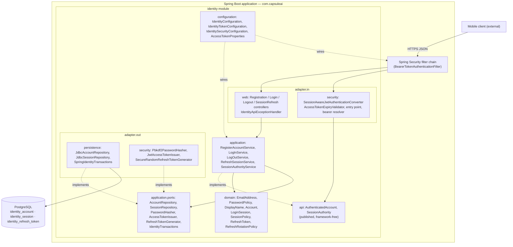
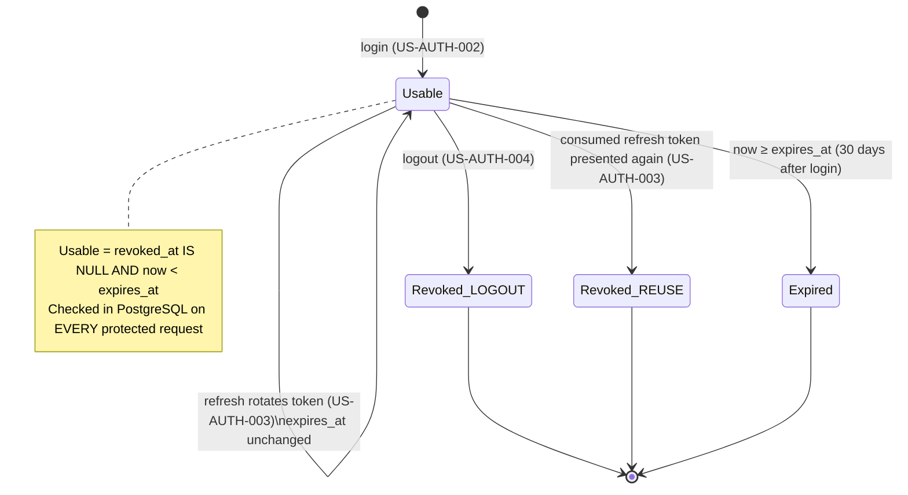
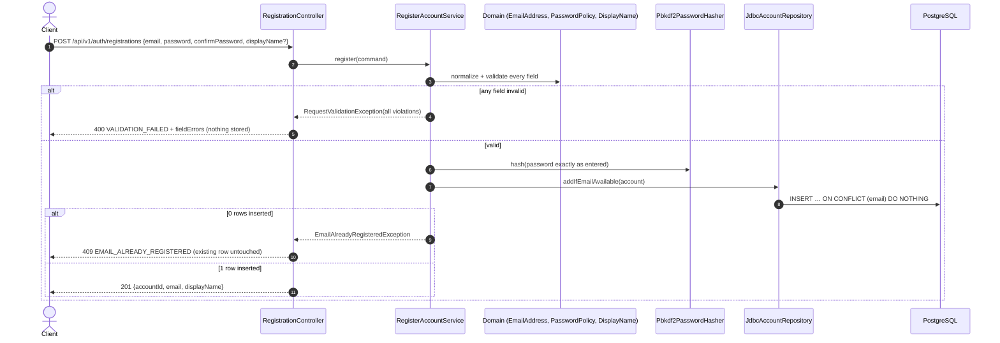
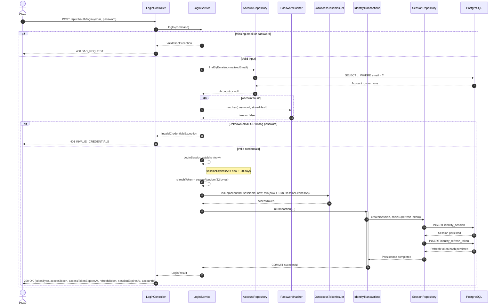
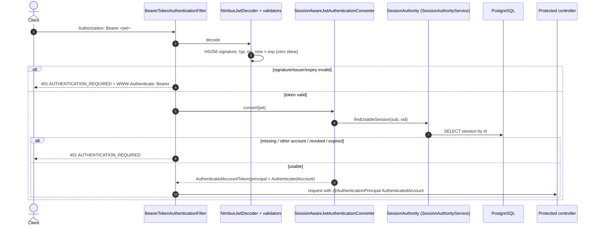
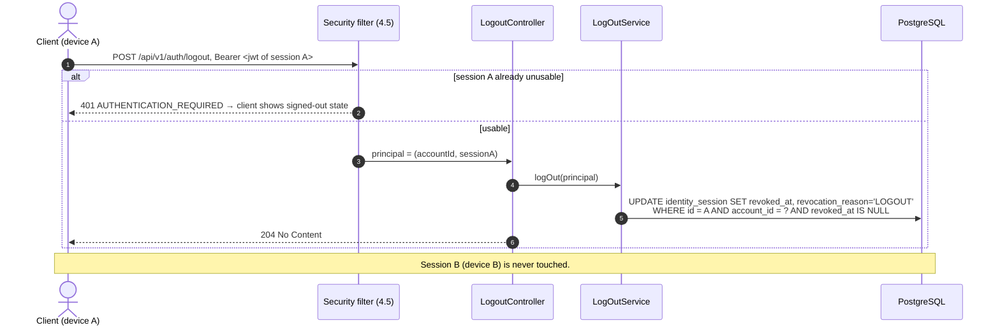
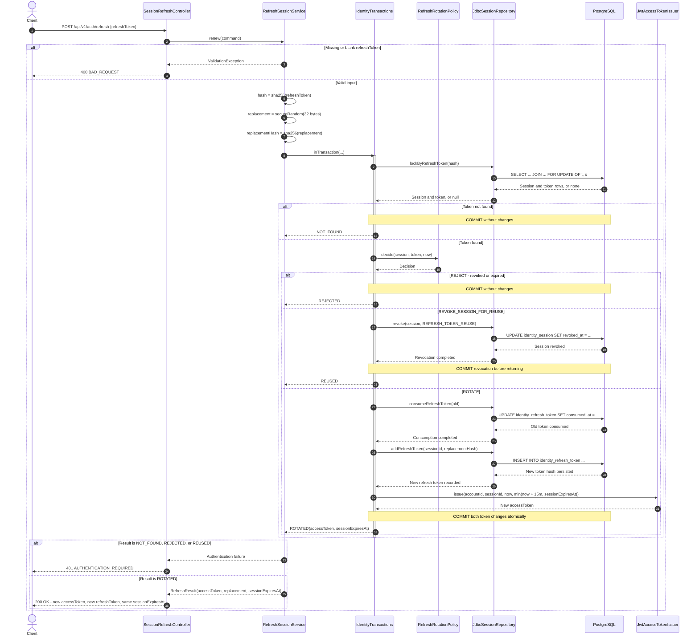
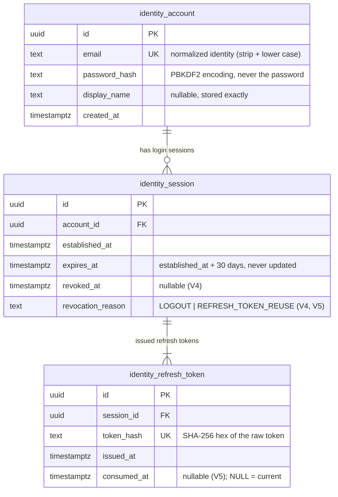

# Sprint 1 — Shared Backend Architecture (Identity Authentication)

| Field               | Value                                                                                                                                                                                                                                                                                                                                                                  |
| ------------------- | ---------------------------------------------------------------------------------------------------------------------------------------------------------------------------------------------------------------------------------------------------------------------------------------------------------------------------------------------------------------------- |
| Artifact            | Sprint 1 integrated design reference (JIT Detailed Design shared by four stories)                                                                                                                                                                                                                                                                                      |
| Sprint              | Sprint 1 — Secure Account Access — Backend Only                                                                                                                                                                                                                                                                                                                        |
| Stories             | [US-AUTH-001](../../../stories/auth/US-AUTH-001-register-account.md) → [US-AUTH-002](../../../stories/auth/US-AUTH-002-log-in.md) → [US-AUTH-004](../../../stories/auth/US-AUTH-004-log-out.md) → [US-AUTH-003](../../../stories/auth/US-AUTH-003-resume-session.md), applying [US-PRIV-001](../../../stories/privacy/US-PRIV-001-protect-first-private-operations.md) |
| Repository analysed | Branch `sprint_01_security`, commit `1fb33a0d75a1a8d86bb65554d1b042dc54c6e1b1` (clean working tree)                                                                                                                                                                                                                                                                    |
| Prepared            | 2026-10-29                                                                                                                                                                                                                                                                                                                                                             |
| Status              | Reference design for manual implementation. **Not compiled, not executed.** Nothing here proves any test passes.                                                                                                                                                                                                                                                       |

Read this document **after** the [README](README.md) and **before** a story guide. Each story guide repeats only what that story needs; this document is the single place where the whole Sprint fits together.

---

## 1. How to read the labels

Every important statement in these guides is tagged so you can tell what is fixed and what is a design choice.

| Label      | Meaning                                                                                                                            | Can the developer change it?                               |
| ---------- | ---------------------------------------------------------------------------------------------------------------------------------- | ---------------------------------------------------------- |
| **[REQ]**  | Established requirement or Business Rule (SRS, Business Rules, Use Case, Story AC).                                                | No. Change only through PO/BA and the owning document.     |
| **[ARCH]** | Established architecture decision (Selected Architecture Decisions, ADD, Implementation View).                                     | No, without the architecture change process.               |
| **[TECH]** | Proposed technical decision made in these guides, where sources leave freedom. Logged in [Section 14](#14-technical-decision-log). | Yes, but change every guide consistently.                  |
| **[OPEN]** | Genuine ambiguity or limitation. Logged in [Section 15](#15-ambiguities-limitations-and-open-questions).                           | Needs a human decision; the guides use the stated default. |

Source precedence used throughout: current requirements and Business Rules → story AC (read consistently with them) → architecture decisions and conventions → current code → new technical decisions.

---

## 2. Consolidated Sprint 1 business analysis

### 2.1 What users are trying to do

| Outcome                | User goal                                                                     | What the backend must make true                                                                                                      |
| ---------------------- | ----------------------------------------------------------------------------- | ------------------------------------------------------------------------------------------------------------------------------------ |
| Register (US-AUTH-001) | Create **one** private account with email + password.                         | Validate input, store exactly one account per normalized email, protect the password, never block on optional data.                  |
| Log in (US-AUTH-002)   | Reach **their own** account with email + password.                            | Compare email by normalized identity and password **exactly**, create a persistent login session, issue credentials.                 |
| Log out (US-AUTH-004)  | End access **on this device only**.                                           | Revoke the current session so its tokens stop working immediately; keep other sessions and all account data.                         |
| Resume (US-AUTH-003)   | Keep using the app without re-typing credentials, until the session's limits. | Renew access with a rotating refresh token, enforce the 30-day absolute limit, revoke a session whose old refresh token is replayed. |

### 2.2 Requirements catalogue (backend view)

Links are relative to this file. `SRS` = [SRS.md](../../../../03-requirements/SRS.md), `BRULE` = [business-rules.md](../../../../03-requirements/business-rules.md).

| ID               | Plain-English meaning for the backend                                                                 | Stories             | Story AC                                   | Source section                                                                                                   |
| ---------------- | ----------------------------------------------------------------------------------------------------- | ------------------- | ------------------------------------------ | ---------------------------------------------------------------------------------------------------------------- |
| FR-AUTH-001      | Registration takes Email, Password, Confirm Password; Display Name optional.                          | 001                 | AC-01, AC-02, AC-07                        | [SRS 3.1.1](../../../../03-requirements/SRS.md#311-authentication-and-recovery-rules)                            |
| FR-AUTH-002      | Login compares email trimmed + case-insensitive, password untransformed.                              | 002, 001            | 002 AC-02/03; 001 AC-05                    | [SRS 3.1.1](../../../../03-requirements/SRS.md#311-authentication-and-recovery-rules)                            |
| FR-AUTH-005      | Returning access works while the session is usable, within 30 days.                                   | 003                 | AC-01, AC-02                               | [SRS 3.1.1](../../../../03-requirements/SRS.md#311-authentication-and-recovery-rules)                            |
| FR-AUTH-006      | Expired access is renewed **only** by a usable Refresh Session or a new login.                        | 003                 | AC-02, AC-06                               | [SRS 3.1.1](../../../../03-requirements/SRS.md#311-authentication-and-recovery-rules)                            |
| FR-AUTH-007      | Logout revokes the current Refresh Session only; other devices continue.                              | 004                 | AC-01, AC-02, AC-05                        | [SRS 3.1.1](../../../../03-requirements/SRS.md#311-authentication-and-recovery-rules)                            |
| FR-AUTH-008      | Protected operations only for the authenticated, authorized account.                                  | all, PRIV           | 002 AC-06; 004 AC-04; PRIV AC-01           | [SRS 3.1.1](../../../../03-requirements/SRS.md#311-authentication-and-recovery-rules)                            |
| FR-AUTH-009      | Protected operations need a valid unexpired JWT **and** usable session/account context.               | 002, 003, 004, PRIV | 003 AC-06; 004 AC-01; PRIV AC-02           | [SRS 3.1.1](../../../../03-requirements/SRS.md#311-authentication-and-recovery-rules)                            |
| FR-AUTH-010      | Access Token 15 minutes; session maximum 30 days; rotation never extends it.                          | 002, 003            | 003 AC-02, AC-04                           | [SRS 3.1.1](../../../../03-requirements/SRS.md#311-authentication-and-recovery-rules)                            |
| FR-AUTH-011      | No optional data (name, body/gender, location, garment) gates entry.                                  | 001, 002            | 001 AC-02; 002 AC-05                       | [SRS 3.1.1](../../../../03-requirements/SRS.md#311-authentication-and-recovery-rules)                            |
| FR-AUTH-012      | Missing fields or mismatched confirmation are explained; no success claim.                            | 001                 | AC-03                                      | [SRS 3.1.1](../../../../03-requirements/SRS.md#311-authentication-and-recovery-rules)                            |
| FR-AUTH-013      | Each successful refresh consumes the current refresh token and issues new access + refresh tokens.    | 003                 | AC-03                                      | [SRS 3.1.1](../../../../03-requirements/SRS.md#311-authentication-and-recovery-rules)                            |
| FR-AUTH-014      | Reusing a rotated refresh token revokes the affected session.                                         | 003                 | AC-05                                      | [SRS 3.1.1](../../../../03-requirements/SRS.md#311-authentication-and-recovery-rules)                            |
| FR-AUTH-015      | Passwords 12–128 characters, any characters, no class mix, never transformed.                         | 001                 | AC-04, AC-05                               | [SRS 3.1.1](../../../../03-requirements/SRS.md#311-authentication-and-recovery-rules)                            |
| FR-AUTH-016      | At most one account per normalized email; duplicate gets sign-in/recovery guidance; no alias merging. | 001                 | AC-06, AC-09                               | [SRS 3.1.1](../../../../03-requirements/SRS.md#311-authentication-and-recovery-rules)                            |
| DATA-AUTH-001    | Credentials/sessions belong to the right account and are protected; password value preserved.         | all                 | 001 AC-05/10                               | [SRS 4.2](../../../../03-requirements/SRS.md#42-account--profile-data)                                           |
| DATA-AUTH-002    | Email stored as normalized identity; Display Name optional.                                           | 001                 | AC-06, AC-07                               | [SRS 4.2](../../../../03-requirements/SRS.md#42-account--profile-data)                                           |
| DATA-AUTH-005    | Sessions record account, maximum lifetime, current/consumed refresh validity, revocation.             | 002, 003, 004       | 003 AC-03..07; 004 AC-01/02                | [SRS 4.2](../../../../03-requirements/SRS.md#42-account--profile-data)                                           |
| COM-001          | Exchanges protect secrets; password values and session authority preserved.                           | all                 | 001 AC-10; PRIV AC-03                      | [SRS 5.4](../../../../03-requirements/SRS.md#54-communication-interfaces)                                        |
| COM-002          | Interrupted communication is distinguishable from accepted outcomes; no duplicate effects.            | all                 | 001 AC-09; 002 AC-07; 003 AC-08; 004 AC-06 | [SRS 5.4](../../../../03-requirements/SRS.md#54-communication-interfaces)                                        |
| ERR-AUTH-001     | Invalid credentials or unusable access are denied with guidance, never shown as empty wardrobe.       | 002, 003            | 002 AC-04; 003 AC-06                       | [SRS 9.1](../../../../03-requirements/SRS.md#91-access-and-recovery)                                             |
| ERR-AUTH-003     | Expired/revoked session or reuse → authenticate again; reuse revokes only the affected session.       | 003, 004            | 003 AC-04..06; 004 AC-05                   | [SRS 9.1](../../../../03-requirements/SRS.md#91-access-and-recovery)                                             |
| ERR-NET-001      | Interrupted actions: distinguish uncertainty, allow safe review/retry without duplicates.             | 001, 004            | 001 AC-09; 004 AC-06                       | [SRS 9.9](../../../../03-requirements/SRS.md#99-communication-and-partial-dependency-failure)                    |
| NFR-SEC-001      | Zero successful unauthorized cross-user accesses in agreed scenarios.                                 | 002, PRIV           | 002 AC-06; PRIV AC-01                      | [SRS 6.2](../../../../03-requirements/SRS.md#62-security)                                                        |
| NFR-SEC-002      | Logout/account switch never exposes the previous user's content; current-session logout isolation.    | 002, 004            | 002 AC-06; 004 AC-02/04                    | [SRS 6.2](../../../../03-requirements/SRS.md#62-security)                                                        |
| NFR-SEC-003      | No credential/token secret in unauthorized output, logs or measurement.                               | all                 | 001 AC-10; PRIV AC-03                      | [SRS 6.2](../../../../03-requirements/SRS.md#62-security)                                                        |
| NFR-PRIV-001/002 | Only necessary personal data; no sharing, sale or AI training.                                        | all                 | PRIV AC-04                                 | [SRS 6.3](../../../../03-requirements/SRS.md#63-privacy)                                                         |
| NFR-REL-003      | Accepted state survives recoverable restart.                                                          | 003                 | (durability evidence)                      | [SRS 6.4](../../../../03-requirements/SRS.md#64-reliability)                                                     |
| BRULE-AUTH-001   | Personal operations require authentication + authorization; unavailable access ≠ empty wardrobe.      | all                 | —                                          | [BRULE-AUTH-001](../../../../03-requirements/business-rules.md#brule-auth-001--authorized-personal-operations)   |
| BRULE-AUTH-002   | Normalized email identity (trim + case-insensitive; no alias rules).                                  | 001, 002            | 001 AC-06; 002 AC-02                       | [BRULE-AUTH-002](../../../../03-requirements/business-rules.md#brule-auth-002--normalized-email-identity)        |
| BRULE-AUTH-003   | Password value preservation (12–128, no transformation; denylist optional).                           | 001, 002            | 001 AC-04/05; 002 AC-03                    | [BRULE-AUTH-003](../../../../03-requirements/business-rules.md#brule-auth-003--password-value-preservation)      |
| BRULE-AUTH-006   | Separate sessions; logout = current session; rotation; reuse revokes affected session.                | 002, 003, 004       | 003 AC-03/05/07; 004 AC-02                 | [BRULE-AUTH-006](../../../../03-requirements/business-rules.md#brule-auth-006--separate-sessions-and-revocation) |
| BRULE-AUTH-007   | Purpose-limited private data use.                                                                     | all                 | PRIV AC-04                                 | [BRULE-AUTH-007](../../../../03-requirements/business-rules.md#brule-auth-007--purpose-limited-private-data-use) |

Out of Sprint scope: FR-AUTH-003/004/017/018, BRULE-AUTH-004/005 (password recovery, PBI-005). The design keeps them possible: a future "revoke all sessions of an account" is one `UPDATE` over `identity_session`.

### 2.3 Allowed and forbidden state changes

| State change                         | Allowed when                                                         | Forbidden                                                                                                                               |
| ------------------------------------ | -------------------------------------------------------------------- | --------------------------------------------------------------------------------------------------------------------------------------- |
| Create account                       | All required values valid **and** the normalized email is unused.    | Second account for an equivalent email (any case/whitespace), even under concurrency. Any account from a rejected or cancelled request. |
| Change an existing account           | **Never in Sprint 1.** Login, logout and renewal only read accounts. | Duplicate registration, failed login, logout or refresh altering the account row.                                                       |
| Create session                       | Password matched exactly for an existing account.                    | Session from wrong/missing credentials.                                                                                                 |
| Revoke session (LOGOUT)              | Authenticated request for **that** session.                          | Revoking another session, or another account's session.                                                                                 |
| Revoke session (REFRESH_TOKEN_REUSE) | A consumed refresh token of that session is presented again.         | Revoking other sessions of the account.                                                                                                 |
| Consume refresh token                | It is current, its session is not revoked and now < session expiry.  | Consuming twice; renewing a revoked/expired session; extending `expires_at`.                                                            |

### 2.4 Competing and interrupted requests

| Situation                            | Required behaviour                                                            | How the design achieves it                                                                                         |
| ------------------------------------ | ----------------------------------------------------------------------------- | ------------------------------------------------------------------------------------------------------------------ |
| Two equivalent registrations at once | At most one account (001 AC-06).                                              | Unique constraint on normalized `email` + `INSERT … ON CONFLICT DO NOTHING`.                                       |
| Registration response lost           | Retry cannot create a duplicate (001 AC-09).                                  | Retry receives `409 EMAIL_ALREADY_REGISTERED`; the user then logs in, which confirms the outcome.                  |
| Login response lost                  | No false claim; retry is safe.                                                | Retry creates another separate session; the orphaned one is unusable without its tokens and expires after 30 days. |
| Logout response lost                 | Distinguish unconfirmed from completed; no other session revoked (004 AC-06). | Retry with the same access token returns `401 AUTHENTICATION_REQUIRED` = "already signed out".                     |
| Two renewals with one refresh token  | Exactly one rotation; the other is reuse (003 AC-03/05).                      | `SELECT … FOR UPDATE` serializes them; the loser sees a consumed token and revokes the session.                    |
| Renewal response lost                | No replay grace (Sprint plan §3.3, Test Strategy §9.2).                       | Retry presents a consumed token → session revoked → user logs in again. Strict, but it is the established policy.  |
| Logout racing a renewal              | Session ends up revoked; no usable authority remains.                         | Both lock the same session row; whichever is second sees the result of the first.                                  |

### 2.5 Privacy and US-PRIV-001 applicability

| US-PRIV-001 AC           | What Sprint 1 delivers and tests                                                                                                                                               | What remains external or unexercised                                                           |
| ------------------------ | ------------------------------------------------------------------------------------------------------------------------------------------------------------------------------ | ---------------------------------------------------------------------------------------------- |
| AC-01 Affected ownership | Every non-public route denies by default. Logout (first real protected operation) and a **test-only** probe verify two accounts, signed-out access and wrong-account tokens.   | No wardrobe/profile/history operations exist yet; record them as _not yet exercised_.          |
| AC-02 Usable authority   | A signed, unexpired JWT is rejected when its session is revoked, expired, missing or belongs to another account.                                                               | Client hiding of preceding-account content.                                                    |
| AC-03 Secrets            | PBKDF2 password hashes; SHA-256 hashes of refresh tokens; masked `toString()`; no secrets in responses or logs (tested with captured output); driver error details suppressed. | Transport encryption (TLS) belongs to deployment ([OPEN] A-08).                                |
| AC-04 Purpose            | Identity stores only normalized email, password hash, optional display name, creation time and session facts. No external exchange.                                            | Recovery email (PBI-005) not delivered.                                                        |
| AC-05 Lifecycle          | Accounts and sessions are retained while the account is active (DATA-RET-002).                                                                                                 | No cleanup of long-expired session rows ([OPEN] A-06); image/history lifecycles not delivered. |
| AC-06 Bounded evidence   | AC→test tables in every guide; tests use synthetic accounts only.                                                                                                              | PO/Developers still own the finite PBI-002 completion boundary (refinement Q-04).              |

### 2.6 What backend tests can and cannot prove

Backend tests can prove HTTP contracts, real security-chain decisions, PostgreSQL constraints, transactions and concurrency. They **cannot** prove the mobile experience: Vietnamese labels, TalkBack/VoiceOver, 200% text scaling, onboarding/Today navigation, local cache clearing on logout or account switch, and pending/uncertain presentation. Each guide lists those as **External evidence**. A story is not Done until that evidence exists ([DoD §3](../../../definition-of-done.md#3-definition)).

---

## 3. Architecture overview

### 3.1 Where the code lives

**[ARCH]** One Spring Boot modular monolith ([ADA-001](../../../../04-architecture/selected-architecture-decisions.md#ada-001--business-core-architecture-style)), pragmatic Clean Architecture inside each module ([ADA-015](../../../../04-architecture/selected-architecture-decisions.md#ada-015--internal-module-architecture)), the **Identity** module owns account and session authority ([Implementation View](../../../../04-architecture/views/implementation-view.puml)), PostgreSQL is the persistent session authority ([ADA-008](../../../../04-architecture/selected-architecture-decisions.md#ada-008--session-refresh-and-reset-authority)). No other module is touched in Sprint 1.



### 3.2 Final package map

All paths are below `backend/src/main/java/com/capsuleai/identity/`.

| Package                   | Role                                                                                   | Allowed dependencies                                                                    |
| ------------------------- | -------------------------------------------------------------------------------------- | --------------------------------------------------------------------------------------- |
| `domain`                  | Business rules: email identity, password policy, session lifetime, rotation decisions. | JDK only. **[ARCH]** existing ArchUnit rule.                                            |
| `api`                     | Published contract other modules may use: `AuthenticatedAccount`, `SessionAuthority`.  | JDK only. **[TECH]** new ArchUnit rule.                                                 |
| `application`             | Use cases; owns transaction boundaries through a port.                                 | `domain`, `api`, `application.ports`, JDK. **No Spring.** **[TECH]** new ArchUnit rule. |
| `application.ports`       | What the use cases need from the outside world.                                        | `domain`, JDK.                                                                          |
| `adapter.in.web`          | HTTP JSON ↔ commands/results, error translation.                                       | Spring MVC, `application`, `api`.                                                       |
| `adapter.in.security`     | Turns a verified JWT into `AuthenticatedAccount` using `SessionAuthority`.             | Spring Security, `api`.                                                                 |
| `adapter.out.persistence` | JDBC (`JdbcClient`) implementations of repositories and transactions.                  | Spring JDBC/TX, `ports`, `domain`.                                                      |
| `adapter.out.security`    | PBKDF2 hashing, JWT signing, random refresh tokens.                                    | Spring Security crypto/JOSE, `ports`, `domain`.                                         |
| `configuration`           | `@Bean` wiring, the filter chain, token properties.                                    | Everything inside `identity`.                                                           |

Why the application layer has **no Spring**: [ADA-015](../../../../04-architecture/selected-architecture-decisions.md#ada-015--internal-module-architecture) says "Keep Spring/JPA, HTTP and provider types outside the domain/application core." That is why transactions go through the small `IdentityTransactions` port instead of `@Transactional`, and why application services are created with `@Bean` methods instead of `@Service`.

### 3.3 Why each abstraction exists (and what was deliberately not added)

| Abstraction                                  | Reason it earns its place                                                                                                                                |
| -------------------------------------------- | -------------------------------------------------------------------------------------------------------------------------------------------------------- |
| `AccountRepository`, `SessionRepository`     | Application code needs persistence outcomes (e.g. "insert if email free", "lock by refresh token"), not SQL. Lets application tests use in-memory fakes. |
| `PasswordHasher`                             | Hashing is slow and algorithm-specific; a fake keeps application tests fast.                                                                             |
| `AccessTokenIssuer`, `RefreshTokenGenerator` | Token format and randomness are infrastructure; fakes make tests deterministic.                                                                          |
| `IdentityTransactions`                       | Keeps the transaction boundary **visible in the use case** while the application stays Spring-free.                                                      |
| `SessionAuthority` (api)                     | The single published question "is this account/session usable now?" — the security adapter and any future module use it.                                 |

Not added on purpose: JPA/Hibernate, Redis/cache ([ADA-011](../../../../04-architecture/selected-architecture-decisions.md#ada-011--dedicated-cache-strategy)), a generic repository, interfaces for every class, separate command handlers, an event bus, roles/authorities.

---

## 4. Authentication lifecycle

### 4.1 The three credentials

| Credential    | Format **[TECH]**                                                                                                 | Lifetime **[REQ]**                                               | Stored by backend                                                                      | Purpose                                                      |
| ------------- | ----------------------------------------------------------------------------------------------------------------- | ---------------------------------------------------------------- | -------------------------------------------------------------------------------------- | ------------------------------------------------------------ |
| Password      | User text, 12–128 code points                                                                                     | Until changed (PBI-005)                                          | PBKDF2-HMAC-SHA256 hash, 600 000 iterations, 16-byte salt, prefix `{pbkdf2-sha256-v1}` | Prove identity at login.                                     |
| Access Token  | JWT, HS256, claims `iss=capsuleai-identity`, `sub=<accountId>`, `sid=<sessionId>`, `iat`, `exp`, header `typ=JWT` | **15 minutes**, capped at the session's expiry                   | Not stored                                                                             | Authenticate protected requests (`Authorization: Bearer …`). |
| Refresh Token | 32 random bytes, Base64url without padding (43 characters)                                                        | Valid until consumed, revoked or the session reaches **30 days** | SHA-256 hex hash only                                                                  | Renew access within the login session.                       |

A **login session** (= the SRS "Refresh Session") is one `identity_session` row. It is created at login and never extended. Each login creates a new, separate session (separate devices, BRULE-AUTH-006).

### 4.2 Session state machine



A session never returns to _Usable_. The only way back is a new login, which creates a **new** session.

### 4.3 Registration (US-AUTH-001)



**[TECH]** Registration does **not** log the user in. The sprint plan says "do not invent [automatic login] or assume registration issues credentials" ([Sprint plan §3.1](../sprint-plan.md#31-us-auth-001--registration)). The client's entry handoff is: show success, then call login with the same credentials.

### 4.4 Login (US-AUTH-002)



Tokens are created **before** the commit and returned **after** it, so a client never receives tokens for a session that was not saved.

### 4.5 Every protected request (US-AUTH-002 onward)



This is how "a cryptographically valid, unexpired Access Token does not permit protected use through the unusable session" ([US-AUTH-003 AC-06](../../../stories/auth/US-AUTH-003-resume-session.md#ac-06--reauthenticate-after-unusable-access), [ADD §9.1](../../../../04-architecture/ADD.md#91-authentication-authorization-and-session-lifecycle)) is enforced.

### 4.6 Logout (US-AUTH-004)



### 4.7 Refresh rotation and reuse detection (US-AUTH-003)



### 4.8 Time boundaries **[REQ]** with exact semantics **[TECH]**

All instants are truncated to whole seconds before use, so JWT `exp` (seconds) and database values agree.

| Boundary      | Valid while                                                                        | Rejected at                                             |
| ------------- | ---------------------------------------------------------------------------------- | ------------------------------------------------------- |
| Access token  | `now < exp`, where `exp = min(iat + 15 min, session.expires_at)`                   | `now ≥ exp` (RFC 7519: "on or after"). Zero clock skew. |
| Login session | `revoked_at IS NULL AND now < expires_at`, `expires_at = established_at + 30 days` | `now ≥ expires_at`, or any revocation.                  |

---

## 5. Persistence design

### 5.1 Final schema (after Stage 4)



### 5.2 Migration plan **[TECH]**

Each story owns one forward migration. Never edit a migration after it has run anywhere ([backend README §10](../../../../../backend/README.md#10-database-migrations)).

| Version | File (in `backend/src/main/resources/db/migration/`) | Story             | Adds                                                                                    |
| ------- | ---------------------------------------------------- | ----------------- | --------------------------------------------------------------------------------------- |
| V1      | `V1__foundation.sql`                                 | Baseline (exists) | `SELECT 1` only.                                                                        |
| V2      | `V2__create_identity_account.sql`                    | US-AUTH-001       | `identity_account`, unique `email`.                                                     |
| V3      | `V3__create_identity_session.sql`                    | US-AUTH-002       | `identity_session` (30-day CHECK), `identity_refresh_token` (unique, well-formed hash). |
| V4      | `V4__add_identity_session_revocation.sql`            | US-AUTH-004       | `revoked_at`, `revocation_reason` (`LOGOUT`), consistency CHECK.                        |
| V5      | `V5__add_refresh_token_rotation.sql`                 | US-AUTH-003       | `consumed_at`, one-current-token partial unique index, reason `REFRESH_TOKEN_REUSE`.    |

The order follows the story order, so every stage is a valid database. V5 runs safely on V4 data: before rotation existed, every session had exactly one unconsumed token.

### 5.3 Transactions and locking

**[ARCH]** PostgreSQL coordinates single-success refresh consumption and revocation ([ADA-008](../../../../04-architecture/selected-architecture-decisions.md#ada-008--session-refresh-and-reset-authority), [ADD §9.2](../../../../04-architecture/ADD.md#92-accepted-state-idempotency-transactions-and-concurrency)). **[TECH]** realization at PostgreSQL's default `READ COMMITTED` isolation:

| Operation       | Boundary                      | Mechanism                                                                                                                                                                                |
| --------------- | ----------------------------- | ---------------------------------------------------------------------------------------------------------------------------------------------------------------------------------------- |
| Register        | Single statement (autocommit) | `INSERT … ON CONFLICT (email) DO NOTHING`; 0 rows = duplicate. Hash computed **before**, outside any transaction (PBKDF2 is slow).                                                       |
| Login           | `IdentityTransactions`        | Insert session + first refresh-token hash together.                                                                                                                                      |
| Authority check | Single `SELECT`               | No lock; reads the latest committed state on every request.                                                                                                                              |
| Logout          | Single conditional `UPDATE`   | `WHERE id = ? AND account_id = ? AND revoked_at IS NULL`; waits if a renewal holds the row lock.                                                                                         |
| Refresh         | `IdentityTransactions`        | `SELECT … FOR UPDATE OF t, s` locks token **and** session rows; decide; consume + insert, or revoke; commit. A waiting competitor re-reads the committed row after the lock is released. |

### 5.4 Why the refresh locking is correct (worked race)

Two requests A and B present the same refresh token R1 at the same moment:

1. A runs `SELECT … FOR UPDATE` first and gets both row locks. B's identical `SELECT` **waits**.
2. A sees R1 current → consumes R1, inserts R2, signs a token, **commits**. Locks are released.
3. PostgreSQL resumes B's `SELECT` and re-checks the locked rows using their **new committed version**: R1 now has `consumed_at` set.
4. B's policy decision is `REVOKE_SESSION_FOR_REUSE` → B revokes the session and commits → B answers `401`.
5. R2 (A's new token) belongs to a revoked session → the next renewal with R2 is rejected.

Result: exactly one success, the session ends revoked, and the outcome does not depend on timing. This is the strict policy required by FR-AUTH-014 and the Test Strategy's "no replay exception" rule.

---

## 6. Security configuration

**[TECH]** Identity owns the single application-wide `SecurityFilterChain` (`identity.configuration.IdentitySecurityConfiguration`) because Identity owns authentication authority. Future modules are protected automatically by the default-deny rule and read the current account with `@AuthenticationPrincipal AuthenticatedAccount` from `identity.api`.

| Setting                                       | Value                                                                                                            | Why                                                                                                        |
| --------------------------------------------- | ---------------------------------------------------------------------------------------------------------------- | ---------------------------------------------------------------------------------------------------------- |
| Public endpoints                              | `POST /api/v1/auth/registrations` (S1), `POST /api/v1/auth/login` (S2), `POST /api/v1/auth/refresh` (S4)         | Registration/login/renewal happen before access exists. Renewal is authorized by the refresh token itself. |
| Everything else                               | `authenticated()`                                                                                                | Default deny (BRULE-AUTH-001). Unknown routes return 401, not 404.                                         |
| Error dispatch                                | `DispatcherType.ERROR` permitted                                                                                 | Lets Spring's error page render real 404/500 instead of masking them as 401.                               |
| CSRF, sessions                                | CSRF disabled; `STATELESS`                                                                                       | Bearer tokens in headers, no cookies, no server HTTP session.                                              |
| Form login, HTTP Basic, default logout filter | Disabled                                                                                                         | Not part of the contract.                                                                                  |
| Bearer resolver                               | Ignores `Authorization` on public endpoints                                                                      | A client that attaches an expired token to every call can still log in or renew.                           |
| JWT decoder                                   | HS256 secret ≥ 32 bytes; validators: `typ`, `iss`, `AccessTokenExpiryValidator` (application `Clock`, zero skew) | Exact 15-minute boundary; testable with a controllable clock.                                              |
| JWT → principal                               | `SessionAwareJwtAuthenticationConverter` → `SessionAuthority`                                                    | Usable-session check on every request (ADA-008).                                                           |
| 401 body                                      | `application/problem+json` with `code: AUTHENTICATION_REQUIRED`, plus `WWW-Authenticate: Bearer …`               | Tells the client "authenticate again", never "empty wardrobe".                                             |

Spring Boot 4 starter: `spring-boot-starter-security-oauth2-resource-server` (the old `spring-boot-starter-oauth2-resource-server` is deprecated in 4.1.1). Because a `JwtDecoder` bean exists, Boot does not create its default in-memory user.

---

## 7. HTTP API contract (final, Stage 4)

All bodies are JSON (UTF-8). Error bodies are RFC 9457 problem details with an extra stable `code` (and `fieldErrors` for validation). The mobile client maps each `code` to Vietnamese guidance. Timestamps are ISO-8601 UTC strings such as `2026-01-05T08:15:00Z`.

| Method & path                     | Auth                   | Request                                            | Success                               | Errors                                                                                                          | Story |
| --------------------------------- | ---------------------- | -------------------------------------------------- | ------------------------------------- | --------------------------------------------------------------------------------------------------------------- | ----- |
| `POST /api/v1/auth/registrations` | Public                 | `{email, password, confirmPassword, displayName?}` | `201 {accountId, email, displayName}` | 400 `VALIDATION_FAILED`, 400 `MALFORMED_REQUEST`, 409 `EMAIL_ALREADY_REGISTERED`, 503 `TEMPORARILY_UNAVAILABLE` | 001   |
| `POST /api/v1/auth/login`         | Public                 | `{email, password}`                                | `200 TokenResponse`                   | 400 `VALIDATION_FAILED`, 400 `MALFORMED_REQUEST`, 401 `INVALID_CREDENTIALS`, 503                                | 002   |
| `POST /api/v1/auth/logout`        | Bearer                 | none                                               | `204`                                 | 401 `AUTHENTICATION_REQUIRED`                                                                                   | 004   |
| `POST /api/v1/auth/refresh`       | Public (refresh token) | `{refreshToken}`                                   | `200 TokenResponse`                   | 400 `VALIDATION_FAILED`, 400 `MALFORMED_REQUEST`, 401 `AUTHENTICATION_REQUIRED`, 503                            | 003   |
| any other route                   | Bearer                 | —                                                  | —                                     | 401 `AUTHENTICATION_REQUIRED`                                                                                   | 002+  |

`TokenResponse`:

```json
{
  "tokenType": "Bearer",
  "accessToken": "eyJ0eXAiOiJKV1QiLCJhbGciOiJIUzI1NiJ9…",
  "accessTokenExpiresAt": "2026-01-05T08:15:00Z",
  "refreshToken": "q8lC2v…43 characters…",
  "sessionExpiresAt": "2026-02-04T08:00:00Z",
  "accountId": "6a3f0c8e-…"
}
```

Error catalogue:

| `code`                     | HTTP | Meaning for the client                                                                                                | Field codes                                                                             |
| -------------------------- | ---- | --------------------------------------------------------------------------------------------------------------------- | --------------------------------------------------------------------------------------- |
| `VALIDATION_FAILED`        | 400  | Fix the listed fields and resubmit. Nothing was saved.                                                                | `REQUIRED`, `INVALID_FORMAT`, `TOO_SHORT`, `TOO_LONG`, `INVALID_CHARACTERS`, `MISMATCH` |
| `MALFORMED_REQUEST`        | 400  | Body missing or not JSON (client defect).                                                                             | —                                                                                       |
| `EMAIL_ALREADY_REGISTERED` | 409  | Offer **Log in** and **Forgot Password**. Existing account unchanged.                                                 | —                                                                                       |
| `INVALID_CREDENTIALS`      | 401  | Email or password wrong; offer retry and Forgot Password. Same for unknown email.                                     | —                                                                                       |
| `AUTHENTICATION_REQUIRED`  | 401  | Session unusable (expired, revoked, missing, reused). Show signed-out/login state; **do not** show an empty wardrobe. | —                                                                                       |
| `TEMPORARILY_UNAVAILABLE`  | 503  | Outcome not confirmed. Offer review/retry.                                                                            | —                                                                                       |

The DoD requires the API contract to be synchronized ([DoD §5](../../../definition-of-done.md#5-conditional-completion-criteria); Workflow §27 names OpenAPI as the source of truth). Each story guide gives the OpenAPI change for `docs/05-api/openapi.yaml`, which the student creates in US-AUTH-001.

---

## 8. Failure and uncertain-outcome semantics

| Failure                                                                        | HTTP                    | State guarantee                                                                                                                                              |
| ------------------------------------------------------------------------------ | ----------------------- | ------------------------------------------------------------------------------------------------------------------------------------------------------------ |
| Validation error                                                               | 400                     | Nothing written.                                                                                                                                             |
| Duplicate email                                                                | 409                     | Existing account unchanged.                                                                                                                                  |
| Wrong credentials                                                              | 401                     | No session written; account unchanged.                                                                                                                       |
| Database unavailable/failed during a request handled by an Identity controller | 503                     | Transaction rolled back; for a single autocommit statement the outcome is unknown → review/retry is safe because of the unique email and strict token rules. |
| Database unavailable during the authority check in the filter                  | 500 (Spring error page) | **Never** a bypass: no authentication is established.                                                                                                        |
| Response lost after commit                                                     | (client sees timeout)   | See [Section 2.4](#24-competing-and-interrupted-requests).                                                                                                   |

---

## 9. Configuration and dependencies

| File                                                      | Stage | Change                                                                                            |
| --------------------------------------------------------- | ----- | ------------------------------------------------------------------------------------------------- |
| `backend/pom.xml`                                         | S1    | + `org.springframework.security:spring-security-crypto`, + test `spring-boot-starter-webmvc-test` |
| `backend/pom.xml`                                         | S2    | + `spring-boot-starter-security-oauth2-resource-server`                                           |
| `backend/src/main/resources/application.properties`       | S1    | `spring.datasource.hikari.data-source-properties.logServerErrorDetail=false`                      |
| `backend/src/main/resources/application-local.properties` | S2    | `capsuleai.identity.access-token.signing-secret=${CAPSULE_JWT_SIGNING_SECRET}` (no default)       |
| `backend/src/test/resources/application-test.properties`  | S2    | Disposable test-only signing secret                                                               |

All versions come from the Boot 4.1.1 BOM; no version tags are added. No JPA, Redis, Lombok, Bean Validation or extra test libraries are introduced.

---

## 10. Testing architecture

| Suite                       | Runner / naming   | Infrastructure                                                                                | Examples                                                                                  |
| --------------------------- | ----------------- | --------------------------------------------------------------------------------------------- | ----------------------------------------------------------------------------------------- |
| Domain unit                 | Surefire, `*Test` | None                                                                                          | `EmailAddressTest`, `PasswordPolicyTest`, `LoginSessionTest`, `RefreshRotationPolicyTest` |
| Application                 | Surefire, `*Test` | In-memory fakes, `MutableClock`                                                               | `RegisterAccountServiceTest`, `LogInServiceTest`, `RefreshSessionServiceTest`             |
| Adapter unit                | Surefire, `*Test` | Real PBKDF2                                                                                   | `Pbkdf2PasswordHasherTest`                                                                |
| Architecture                | Surefire, `*Test` | Compiled classes                                                                              | `ArchitectureDependencyTest` (extended in S1)                                             |
| API + security + PostgreSQL | Failsafe, `*IT`   | MockMvc **through the real filter chain**, Testcontainers PostgreSQL 17.11, Flyway migrations | `RegistrationApiIT`, `AccessTokenSecurityIT`, `LogoutApiIT`, `SessionRefreshApiIT`        |
| Concurrency                 | Failsafe, `*IT`   | Real threads, `CountDownLatch` start gate, real transactions                                  | `ConcurrentRegistrationIT`, `ConcurrentRefreshIT`                                         |
| Schema/migration            | Failsafe, `*IT`   | Direct SQL against migrated DB                                                                | `AccountSchemaIT`, `SessionSchemaIT`, …                                                   |

Shared test support (all in `backend/src/test/java/com/capsuleai/identity/support/`):

- `MutableClock` — a `Clock` tests can set or advance. Registered as `@Primary` in integration tests, so services **and** the JWT expiry validator use it. No sleeps, ever.
- `IdentityTestConfiguration` — `@TestConfiguration` with the PostgreSQL container as a Spring bean (`@ServiceConnection`), the `MutableClock`, and (from S2) a **test-only** protected probe endpoint `GET /test/identity/whoami`. It is never compiled into production.
- `IdentityIntegrationTestSupport` — abstract base for every Identity IT. All ITs share **one** cached Spring context and therefore **one** container. It truncates every `identity%` table and resets the clock before each test.

Why MockMvc and not a mock JWT: the Test Strategy states that mock-user/mock-JWT helpers "do not establish signature validation, expiry or real persistent session enforcement" ([Test Strategy §9.3](../../../../07-testing/test-strategy.md#93-evidence-across-layers)). Every security IT sends real signed tokens through the configured `SecurityFilterChain`. MockMvc does not start Tomcat; the servlet container itself is not under test.

`DatabaseSmokeIT` (baseline) keeps its own context and container and is not modified.

---

## 11. Cross-story integration rules

1. **One account model** (`domain.Account`), **one session model** (`domain.LoginSession`), **one filter chain**, **one token format**. No story introduces a second.
2. Later stories **add** to shared files; they never remove earlier behaviour. Every earlier test must still pass at every later stage.
3. Tests written in an earlier stage construct `LoginSession` only through `LoginSession.establish(…)` where possible, so changes to the record in later stages do not break them. Where a test must change, the guide prints the complete new test file.
4. Migrations are append-only (V2 → V5).
5. Each story's PR contains its production code, tests, migration, OpenAPI change and (optionally) the CI guard update.

---

## 12. Shared file ownership and change matrix

Paths are relative to `backend/` unless they start with `docs/` or `.github/`. "S1…S4" = stage after US-AUTH-001, 002, 004, 003.

### 12.1 Production and configuration

| File                                                                                                                                                                                                          | Introduced in  | Modified in                                                            | Final responsibility                                 |
| ------------------------------------------------------------------------------------------------------------------------------------------------------------------------------------------------------------- | -------------- | ---------------------------------------------------------------------- | ---------------------------------------------------- |
| `pom.xml`                                                                                                                                                                                                     | baseline       | S1, S2                                                                 | Dependencies (crypto, webmvc-test, resource server). |
| `src/main/resources/application.properties`                                                                                                                                                                   | baseline       | S1                                                                     | Suppress driver error details.                       |
| `src/main/resources/application-local.properties`                                                                                                                                                             | baseline       | S2                                                                     | Local JWT signing secret from environment.           |
| `src/main/resources/db/migration/V2…V5`                                                                                                                                                                       | S1, S2, S3, S4 | never                                                                  | Identity schema.                                     |
| `identity/domain/ValueProblem.java`, `InvalidValueException.java`                                                                                                                                             | S1             | —                                                                      | Rejection vocabulary.                                |
| `identity/domain/EmailAddress.java`, `PasswordPolicy.java`, `DisplayName.java`, `PasswordHash.java`, `Account.java`                                                                                           | S1             | —                                                                      | Account rules and model.                             |
| `identity/domain/SessionPolicy.java`, `RefreshTokenHash.java`                                                                                                                                                 | S2             | —                                                                      | Lifetimes; refresh-token hashing.                    |
| `identity/domain/LoginSession.java`                                                                                                                                                                           | S2             | **S3** (revocation fields)                                             | Session lifecycle model.                             |
| `identity/domain/RevocationReason.java`                                                                                                                                                                       | S3             | **S4** (`REFRESH_TOKEN_REUSE`)                                         | Why a session ended.                                 |
| `identity/domain/RefreshToken.java`, `RenewalDecision.java`, `RefreshRotationPolicy.java`                                                                                                                     | S4             | —                                                                      | Rotation rules.                                      |
| `identity/api/AuthenticatedAccount.java`, `SessionAuthority.java`                                                                                                                                             | S2             | —                                                                      | Published authority contract.                        |
| `identity/application/FieldViolation.java`, `RequestValidationException.java`, `EmailAlreadyRegisteredException.java`, `RegisterAccountCommand.java`, `RegisteredAccount.java`, `RegisterAccountService.java` | S1             | —                                                                      | Registration use case.                               |
| `identity/application/LogInCommand.java`, `SessionTokens.java`, `InvalidCredentialsException.java`, `LogInService.java`, `SessionAuthorityService.java`                                                       | S2             | —                                                                      | Login and authority.                                 |
| `identity/application/LogoutOutcome.java`, `LogOutService.java`                                                                                                                                               | S3             | —                                                                      | Logout.                                              |
| `identity/application/RenewSessionCommand.java`, `AuthenticationRequiredException.java`, `RefreshSessionService.java`                                                                                         | S4             | —                                                                      | Renewal.                                             |
| `identity/application/ports/AccountRepository.java`                                                                                                                                                           | S1             | **S2** (`findByEmail`)                                                 | Account persistence port.                            |
| `identity/application/ports/PasswordHasher.java`                                                                                                                                                              | S1             | —                                                                      | Hashing port.                                        |
| `identity/application/ports/IdentityTransactions.java`, `AccessTokenIssuer.java`, `RefreshTokenGenerator.java`                                                                                                | S2             | —                                                                      | Transaction/token ports.                             |
| `identity/application/ports/SessionRepository.java`                                                                                                                                                           | S2             | **S3** (`revoke`), **S4** (lock/consume/add)                           | Session persistence port.                            |
| `identity/application/ports/LockedRefreshCredential.java`                                                                                                                                                     | S4             | —                                                                      | Result of the locking query.                         |
| `identity/adapter/out/persistence/JdbcAccountRepository.java`                                                                                                                                                 | S1             | **S2** (`findByEmail`)                                                 | Account SQL.                                         |
| `identity/adapter/out/persistence/JdbcTime.java`, `SpringIdentityTransactions.java`                                                                                                                           | S2             | —                                                                      | Time mapping; `TransactionTemplate`.                 |
| `identity/adapter/out/persistence/JdbcSessionRepository.java`                                                                                                                                                 | S2             | **S3**, **S4**                                                         | Session SQL.                                         |
| `identity/adapter/out/security/Pbkdf2PasswordHasher.java`                                                                                                                                                     | S1             | —                                                                      | Password hashing.                                    |
| `identity/adapter/out/security/JwtAccessTokenIssuer.java`, `SecureRandomRefreshTokenGenerator.java`                                                                                                           | S2             | —                                                                      | Token creation.                                      |
| `identity/adapter/in/security/*` (5 classes)                                                                                                                                                                  | S2             | —                                                                      | JWT → usable session.                                |
| `identity/adapter/in/web/RegistrationRequest.java`, `RegistrationResponse.java`, `RegistrationController.java`                                                                                                | S1             | —                                                                      | Registration HTTP.                                   |
| `identity/adapter/in/web/IdentityApiExceptionHandler.java`                                                                                                                                                    | S1             | **S2** (401 invalid credentials), **S4** (401 authentication required) | Error translation.                                   |
| `identity/adapter/in/web/LoginRequest.java`, `TokenResponse.java`, `LoginController.java`                                                                                                                     | S2             | —                                                                      | Login HTTP.                                          |
| `identity/adapter/in/web/LogoutController.java`                                                                                                                                                               | S3             | —                                                                      | Logout HTTP.                                         |
| `identity/adapter/in/web/RefreshRequest.java`, `SessionRefreshController.java`                                                                                                                                | S4             | —                                                                      | Refresh HTTP.                                        |
| `identity/configuration/IdentityConfiguration.java`                                                                                                                                                           | S1             | **S2**, **S3**, **S4**                                                 | Bean wiring.                                         |
| `identity/configuration/AccessTokenProperties.java`, `IdentityTokenConfiguration.java`                                                                                                                        | S2             | —                                                                      | JWT key and codec beans.                             |
| `identity/configuration/IdentitySecurityConfiguration.java`                                                                                                                                                   | S2             | **S4** (public refresh)                                                | Filter chain.                                        |
| `docs/05-api/openapi.yaml`                                                                                                                                                                                    | S1             | S2, S3, S4                                                             | Living API contract.                                 |
| `.github/workflows/backend-ci.yml`                                                                                                                                                                            | baseline       | optional S1–S4 (report guard)                                          | CI verification.                                     |

### 12.2 Tests (paths below `src/test/`)

| File                                                                                                                                     | Introduced in | Modified in                   | Purpose                                 |
| ---------------------------------------------------------------------------------------------------------------------------------------- | ------------- | ----------------------------- | --------------------------------------- |
| `java/com/capsuleai/architecture/ArchitectureDependencyTest.java`                                                                        | baseline      | S1                            | + application/api framework-free rule.  |
| `java/com/capsuleai/architecturefixture/application/InvalidApplicationFixture.java`                                                      | S1            | —                             | Proves the new rule detects violations. |
| `java/com/capsuleai/identity/support/MutableClock.java`                                                                                  | S1            | —                             | Controllable time.                      |
| `java/com/capsuleai/identity/support/IdentityTestConfiguration.java`                                                                     | S1            | **S2** (probe endpoint)       | Container, clock, probe.                |
| `java/com/capsuleai/identity/support/IdentityIntegrationTestSupport.java`                                                                | S1            | **S2** (login/bearer helpers) | Shared IT base.                         |
| `java/com/capsuleai/identity/domain/*Test.java`                                                                                          | S1–S4         | `LoginSessionTest` in S3      | Domain rules.                           |
| `java/com/capsuleai/identity/application/InMemoryAccountRepository.java`                                                                 | S1            | S2                            | Fake.                                   |
| `java/com/capsuleai/identity/application/RecordingPasswordHasher.java`                                                                   | S1            | —                             | Fake.                                   |
| `java/com/capsuleai/identity/application/InMemorySessionRepository.java`                                                                 | S2            | S3, S4                        | Fake.                                   |
| `java/com/capsuleai/identity/application/ImmediateTransactions.java`, `FakeAccessTokenIssuer.java`, `SequenceRefreshTokenGenerator.java` | S2            | —                             | Fakes.                                  |
| `java/com/capsuleai/identity/application/*ServiceTest.java`                                                                              | S1–S4         | —                             | Use-case tests.                         |
| `java/com/capsuleai/identity/**/*IT.java`                                                                                                | S1–S4         | —                             | Integration evidence.                   |
| `resources/application-test.properties`                                                                                                  | S2            | —                             | Test signing secret.                    |

---

## 13. Expected source state per stage

| Stage                  | Endpoints     | Tables                                         | Security                                    | New test classes (cumulative identity count) |
| ---------------------- | ------------- | ---------------------------------------------- | ------------------------------------------- | -------------------------------------------- |
| Baseline               | none          | none                                           | none                                        | 0                                            |
| **S1** (US-AUTH-001)   | registrations | `identity_account`                             | Crypto only; no filter chain yet            | 9 test classes (+ fixture, fakes, support)   |
| **S2** (+ US-AUTH-002) | + login       | + `identity_session`, `identity_refresh_token` | Default-deny chain, JWT + session authority | +8                                           |
| **S3** (+ US-AUTH-004) | + logout      | + revocation columns                           | unchanged; logout is protected              | +3                                           |
| **S4** (+ US-AUTH-003) | + refresh     | + `consumed_at`, current-token index           | + public refresh                            | +5                                           |

Every stage must pass `.\mvnw.cmd --batch-mode --no-transfer-progress clean verify` on its own before the next story starts.

---

## 14. Technical decision log

| ID    | Decision **[TECH]**                                                                                                                | Why                                                                                                                                                                                                                                            | Affects                 |
| ----- | ---------------------------------------------------------------------------------------------------------------------------------- | ---------------------------------------------------------------------------------------------------------------------------------------------------------------------------------------------------------------------------------------------- | ----------------------- |
| TD-01 | Spring JDBC `JdbcClient`, no JPA.                                                                                                  | Few tables; explicit SQL makes locking and `ON CONFLICT` visible; ADA-003 leaves ORM open.                                                                                                                                                     | All persistence.        |
| TD-02 | Transactions via `IdentityTransactions` port (Spring `TransactionTemplate` adapter).                                               | Application stays Spring-free (ADA-015); boundary visible in use case.                                                                                                                                                                         | Login, refresh.         |
| TD-03 | PBKDF2-HMAC-SHA256, 600 000 iterations, 16-byte salt, in a `DelegatingPasswordEncoder` with id `pbkdf2-sha256-v1`. **Not BCrypt.** | BCrypt only uses the first 72 bytes; a 128-character Unicode password can be 512 bytes, so BCrypt would break "different value ≠ same password" (001 AC-05). The id prefix allows future algorithm upgrades. PBKDF2 needs no extra dependency. | Registration, login.    |
| TD-04 | Password length counted in Unicode code points; unpaired surrogates rejected (`INVALID_CHARACTERS`).                               | An emoji is one character to a user. Lone surrogates are not Unicode and would be silently replaced during hashing.                                                                                                                            | Registration.           |
| TD-05 | Email: `strip()` + `toLowerCase(Locale.ROOT)`; one `@`, non-empty parts, no inner whitespace, ≤ 254 characters.                    | Implements BRULE-AUTH-002 exactly; minimal shape check only.                                                                                                                                                                                   | Registration, login.    |
| TD-06 | Display name stored exactly; blank = omitted; ≤ 100 code points.                                                                   | Exact retention (AC-07); a bound prevents abuse. Limit is **[OPEN] A-01**.                                                                                                                                                                     | Registration.           |
| TD-07 | Registration returns 201 without tokens.                                                                                           | Sprint plan forbids inventing automatic login.                                                                                                                                                                                                 | 001 AC-01 handoff.      |
| TD-08 | JWT HS256 with a ≥ 32-byte Base64 secret from configuration; claims `iss/sub/sid/iat/exp`, `typ=JWT`.                              | Issuer and verifier are the same application; symmetric key is simplest and safe.                                                                                                                                                              | Login, refresh, filter. |
| TD-09 | Access token rejected when `now ≥ exp`, zero skew, application `Clock`.                                                            | Exact 15-minute rule; RFC 7519 semantics; testable.                                                                                                                                                                                            | Filter.                 |
| TD-10 | Access token `exp = min(iat + 15 min, session expiry)`.                                                                            | A token never claims more than its session allows.                                                                                                                                                                                             | Login, refresh.         |
| TD-11 | Refresh token = 256 random bits, Base64url; only SHA-256 hex stored.                                                               | A database leak does not reveal usable tokens; high entropy makes slow hashing unnecessary.                                                                                                                                                    | Login, refresh.         |
| TD-12 | One `identity_session` row per login; refresh tokens in a child table.                                                             | DATA-AUTH-005: separate sessions with current/consumed validity.                                                                                                                                                                               | All session stories.    |
| TD-13 | Authority read from PostgreSQL on every protected request; no cache.                                                               | ADA-008, ADA-011; logout/reuse take effect immediately.                                                                                                                                                                                        | Filter.                 |
| TD-14 | Rotation under `SELECT … FOR UPDATE OF t, s` at `READ COMMITTED`.                                                                  | Single-success consumption with deterministic outcomes ([§5.4](#54-why-the-refresh-locking-is-correct-worked-race)).                                                                                                                           | Refresh.                |
| TD-15 | Concurrent/late reuse of a consumed token always revokes the session (no grace window).                                            | FR-AUTH-014 and Test Strategy forbid a replay exception.                                                                                                                                                                                       | Refresh.                |
| TD-16 | Logout is a protected `POST` authenticated by the access token; no body.                                                           | Identifies "the current session" unambiguously; first real protected operation for US-PRIV-001.                                                                                                                                                | Logout.                 |
| TD-17 | Public endpoints ignore the `Authorization` header.                                                                                | Expired tokens attached by client interceptors must not block login/renewal.                                                                                                                                                                   | Filter.                 |
| TD-18 | RFC 9457 problem details + stable `code`.                                                                                          | Standard, machine-readable, no echo of submitted values.                                                                                                                                                                                       | All errors.             |
| TD-19 | Identity owns the single default-deny `SecurityFilterChain`.                                                                       | Identity owns authentication; other modules inherit protection.                                                                                                                                                                                | All routes.             |
| TD-20 | One forward migration per story (V2–V5).                                                                                           | Each PR is self-contained; teaches forward-only evolution.                                                                                                                                                                                     | Schema.                 |
| TD-21 | Test-only probe endpoint `/test/identity/whoami` in test sources.                                                                  | Exercises the real security path in S2 without inventing a production endpoint.                                                                                                                                                                | Tests.                  |
| TD-22 | `MutableClock` as `@Primary` test bean.                                                                                            | Deterministic expiry tests without waiting.                                                                                                                                                                                                    | Tests.                  |
| TD-23 | `logServerErrorDetail=false` for the PostgreSQL driver.                                                                            | PostgreSQL constraint errors can echo row values (e.g. a password hash) into exception messages and logs.                                                                                                                                      | Logging (NFR-SEC-003).  |
| TD-24 | Revoked/expired session rows are kept.                                                                                             | Needed to detect reuse; no retention rule requires deletion in Sprint 1 ([OPEN] A-06).                                                                                                                                                         | Schema.                 |

---

## 15. Ambiguities, limitations and open questions

| ID          | Topic                                                                                                                                                                         | Default used in the guides                                                                                      | Who decides                                                         |
| ----------- | ----------------------------------------------------------------------------------------------------------------------------------------------------------------------------- | --------------------------------------------------------------------------------------------------------------- | ------------------------------------------------------------------- |
| A-01        | Maximum Display Name length is not specified.                                                                                                                                 | 100 code points, `TOO_LONG` above.                                                                              | PO/BA.                                                              |
| A-02        | Exact email syntax is not specified.                                                                                                                                          | Minimal shape check (TD-05). No verification email (out of scope).                                              | PO/BA if stricter rules are wanted.                                 |
| A-03        | "Character" in 12–128 is not defined (code point vs. visible grapheme).                                                                                                       | Code points (TD-04).                                                                                            | PO/BA.                                                              |
| A-04        | Registration → authorized entry handoff mechanics.                                                                                                                            | No auto-login; client logs in next (TD-07).                                                                     | PO with mobile developers.                                          |
| A-05        | Strict reuse means a lost renewal response forces a new login.                                                                                                                | Kept strict (policy).                                                                                           | Already decided by SRS/Test Strategy; PO should be aware of the UX. |
| A-06        | Retention/cleanup of expired session rows.                                                                                                                                    | Kept indefinitely in Sprint 1.                                                                                  | PO/Developers (DATA-RET-002 scope).                                 |
| A-07        | Logout with an **expired** access token is rejected with 401; client must renew first. Before Stage 4 exists the session stays stored but nobody can renew it.                | Documented client contract.                                                                                     | Developers/mobile.                                                  |
| A-08        | TLS, rate limiting, lockout, CAPTCHA, denylist.                                                                                                                               | Not implemented (stories exclude lockout/CAPTCHA; denylist optional). TLS is a deployment concern (US-OPS-001). | PO/Developers.                                                      |
| A-09        | Login timing difference between unknown email and wrong password.                                                                                                             | Not equalized, because registration intentionally reveals existence (FR-AUTH-016).                              | Developers if policy changes.                                       |
| A-10        | Persistent-authority unavailability during the filter check returns 500 instead of a dedicated 503 problem body.                                                              | Safe (no bypass); refine later if needed.                                                                       | Developers.                                                         |
| Q-04 / Q-05 | First-protected-operation evidence boundary; capacity/selectability ([refinement review](../../../backlog-refinement-review.md#6-open-questions-for-product-owner-and-team)). | Evidence tables in each guide.                                                                                  | PO/Developers.                                                      |

---

## 16. References

- [Sprint 1 plan](../sprint-plan.md), especially §3 and §4.
- [SRS](../../../../03-requirements/SRS.md) §3.1.1, §4.2, §5.4, §6.2–6.4, §9.1, §9.9.
- [Business Rules](../../../../03-requirements/business-rules.md) BRULE-AUTH-001…007.
- [UC-001](../../../../03-requirements/use-cases/UC-001-register-account.md), [UC-002](../../../../03-requirements/use-cases/UC-002-log-in.md), [UC-003](../../../../03-requirements/use-cases/UC-003-log-out.md).
- [Selected Architecture Decisions](../../../../04-architecture/selected-architecture-decisions.md) ADA-001/003/008/009/011/014/015/016.
- [ADD](../../../../04-architecture/ADD.md) §6.7, §6.8, §9.1–9.4; [Implementation View](../../../../04-architecture/views/implementation-view.puml); [Data View](../../../../04-architecture/views/data-view.puml).
- [Test Strategy](../../../../07-testing/test-strategy.md) §8, §9, §14, §18; [Definition of Done](../../../definition-of-done.md).
- [Backend README](../../../../../backend/README.md); [CI workflow](../../../../../.github/workflows/backend-ci.yml).
- Story guides: [US-AUTH-001](US-AUTH-001-guide.md), [US-AUTH-002](US-AUTH-002-guide.md), [US-AUTH-004](US-AUTH-004-guide.md), [US-AUTH-003](US-AUTH-003-guide.md).
