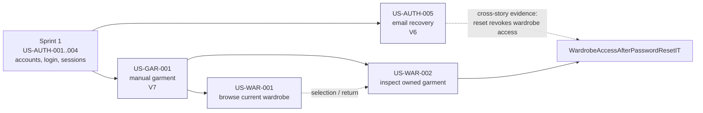

# Sprint 2 Backend Implementation Guides

| Field | Value |
| --- | --- |
| Sprint | Sprint 2 — Recover Access and Establish a Private Wardrobe |
| Stories | US-AUTH-005, US-GAR-001, US-WAR-001, US-WAR-002 |
| Repository baseline | Branch `sprint_02`, commit `1d0bc83` ("remove redundant properties of garment") |
| Audience | Backend developers implementing the Sprint 2 stories by hand, plus reviewers and the Scrum Team |
| Package | This README, [shared-architecture.md](shared-architecture.md) and four story guides |
| Status | Proposed implementation documentation. No production code in this repository has been changed by this package. |

---

## 1. Purpose of this package

These guides let a developer implement the four selected Sprint 2 stories from the current repository without reconstructing requirements, architecture or tests. Each story guide is self-contained. It contains:

- The original applicable requirements, quoted verbatim with their source, section and link.
- The engineering interpretation, kept separate from those quotations.
- The just-in-time technical design.
- Every file to add or modify, in order, with complete code and exact BEFORE/AFTER anchors.
- Complete automated tests, commands, manual checks, the AC and requirement-to-test matrices, and the checklists.

They follow the guide standard in the Sprint plan ([sprint-plan.md §14.2](../sprint-plan.md#142-standard-for-subsequent-self-contained-implementation-guides)) and the structure of the [Sprint 1 guides](../../sprint-01/implementation-guides/README.md).

## 2. Verification status — read this first

| Statement | True? |
| --- | --- |
| The proposed code in the story guides was compiled and its automated tests executed | **Yes, by the guide author in an isolated scratch clone of this repository**, never in this working tree. Each guide's code is taken mechanically from that clone's stage commits; nothing was retyped. |
| The full four-stage result passed `mvnw clean verify` | Yes, in the scratch clone: **360 unit tests and 217 integration tests**, with 0 failures, 0 errors and 0 skipped, on PostgreSQL 17.11 and Mailpit via Testcontainers. |
| Each intermediate stage compiles and passes on its own | Yes, in the scratch clone: every stage commit passed `clean verify` from a clean checkout ([§13](#13-expected-outcome-of-each-stage)). |
| The CI report guard passes | Yes, in the scratch clone: all 50 required report files are present. |
| The code has been applied to this repository | **No.** |
| Hosted GitHub Actions CI has run it | **No.** |
| Any Sprint 2 story is Done | **No.** Done requires the Definition of Done evidence on the integrated revision, including client evidence (accessibility, client states) and Product Owner decisions still open (§17). |
| It has been deployed | **No.** Recovery delivery was exercised against Mailpit, not against a production email provider. |

Your own build is the only evidence for your revision. Run the commands in each guide and read the reports.

## 3. Repository baseline

What the guides assume at `1d0bc83`, re-inspected for this package. The Sprint plan's own baseline assessment ([§3](../sprint-plan.md#3-current-repository-and-sprint-1-baseline-assessment)) was written at commit `529ec99`, before the Sprint 1 fixes (`aa243a8`) and CORS (`ab9afb9`); its later revisions only synchronized the garment taxonomy. Where the two differ, this table reflects `1d0bc83`.

| Area | Baseline state |
| --- | --- |
| Build | Java 21, Spring Boot 4.1.1, Maven Wrapper, single module `backend` |
| Identity | Sprint 1 complete in code: registration, login, JWT access token plus persistent session authority, refresh rotation with reuse detection, logout; CORS configuration (`CorsProperties`, `corsConfigurationSource`) |
| Wardrobe | Only `package-info.java`: no garment code, table or API |
| Other modules | `personalcontext`, `wardrobeintelligence`, `outfitadviceanduse`, `productmeasurement`: documentation boundaries only |
| Migrations | V1–V5 (foundation and Identity). **Never edit them.** Sprint 2 adds V6 (Identity) and V7 (Wardrobe). |
| API contract | `docs/05-api/openapi.yaml` v0.4.1, Identity only |
| Tests | JUnit 6, AssertJ, Mockito, Testcontainers 2 (PostgreSQL), ArchUnit; `IdentityOpenApiContractIT` checks every `/api/` handler against OpenAPI |
| CI | `.github/workflows/backend-ci.yml`: `clean verify` plus a guard that requires named surefire/failsafe reports |
| Garment authority | [Initial files/Image to Properties Extraction.md](../../../../../Initial%20files/Image%20to%20Properties%20Extraction.md), approved 2026-11-05 (13 properties, every vocabulary) |

## 4. Sprint Goal and selected stories

**Source:** [sprint-plan.md — 2. Sprint Goal](../sprint-plan.md#2-sprint-goal) · lines 28–34 at `1d0bc83`

> ## 2. Sprint Goal
>
> > Enable secure recovery of access to a trustworthy private wardrobe by delivering email password reset, confirmed manual garment creation, current-wardrobe browsing and garment inspection through verified backend APIs.
>
> The Goal connects restored private participation with the first useful **Understand My Wardrobe** capability in the [Product Goal](../../../product-goal.md), Sections 3–5. Recovery preserves access to the same account; manual confirmation establishes trustworthy possessions; browsing/detail make that information inspectable.
>
> **[REQ]** Backend success means correct-account recovery and authorized creation/read outcomes, truthful failure/unevaluated-eligibility states, preserved accepted data and inspectable automated integration evidence. Full mobile journeys and whole-story Done require the additional evidence identified in Sections 6/11. All four selected stories contribute to this Goal; none is optional, deferred or a stretch item.

**Source:** [sprint-plan.md — 5. Selected Sprint 2 Backlog](../sprint-plan.md#5-selected-sprint-2-backlog) · lines 96–107 at `1d0bc83`

> ## 5. Selected Sprint 2 Backlog
>
> Implementation priority below is the recommended sequence within the selected scope, not a change to the Product Backlog's global order.
>
> | Priority | Story / exact title | Parent PBI | User value / backend objective | Expected deliverables | Dependencies | Verification / backend acceptance |
> | --- | --- | --- | --- | --- | --- | --- |
> | 1 | [US-AUTH-005 — Recover account access through email](../../../stories/auth/US-AUTH-005-recover-account-access.md) | PBI-005 | Restore correct-account access through completed email recovery, not merely instruction delivery. | Account-safe initiation, real delivery boundary, reset validity/replacement/consumption, accepted password change and account-wide session revocation; affected API/migrations/tests. | Existing account/login/session authority from PBI-004; Email Delivery Service and usable instruction-opening contract. | AC-01–AC-16 mapping below; atomic reset effects, old authority denied, new-password login, actual delivery evidence and no disclosure. |
> | 2 | [US-GAR-001 — Add an owned garment manually](../../../stories/garment/US-GAR-001-add-garment-manually.md) | PBI-006 | Establish one confirmed owned garment without image/AI dependency. | Eight-category confirmed minimum with optional valid subtype/Brand/purchase Price, owner-associated persistence, authority/provenance and explanation that eligibility has not been evaluated, durable safe retry, protected API/migrations/tests. | PBI-004 usable access; Wardrobe ownership and private-data protections. Recovery completion is not a technical prerequisite. | AC-01–AC-14; accepted minimum-only entry survives reread, no unconfirmed/duplicate effect, bounded values and owner isolation. |
> | 3 | [US-WAR-001 — Browse my current wardrobe](../../../stories/wardrobe/US-WAR-001-browse-current-wardrobe.md) | PBI-007 | Recognize current possessions and distinguish genuine emptiness from unavailable access/data. | Authorized read-only collection, identifiable imageless/minimum-only summaries, current-ownership filtering, truthful empty/failure contract and tests. | PBI-004. Manual creation provides useful populated fixtures, not a hard gate to empty browsing. | AC-01–AC-11; only the current account's confirmed active entries; successful empty result distinct from failure; no read side effects. |
> | 4 | [US-WAR-002 — Inspect an owned garment](../../../stories/wardrobe/US-WAR-002-inspect-owned-garment.md) | PBI-007 | Understand the accepted profile, eligibility under a future approved policy and limits of use evidence. | Owner-scoped detail, available accepted information/provenance, conditional readiness, explicit unavailable use evidence, changed-current-state/failure semantics and tests. | PBI-004 and an actual current owned garment. Browse/add are useful routes; Wear/analytics are not prerequisites. | AC-01–AC-12; correct current garment, retained imageless/incomplete detail, no fabricated usage/readiness or read mutation. |
>
> **[REQ]** Keep account recovery one coherent request-to-restored-access story and keep browsing/detail as distinct outcomes (DD-003). Applicable privacy is included as work within these four rows; it is not a fifth backlog item.

## 5. Implementation order and guide links

**Source:** [sprint-plan.md — 8. Dependencies and Recommended Implementation Sequence](../sprint-plan.md#8-dependencies-and-recommended-implementation-sequence) · lines 252–267 at `1d0bc83`

> ## 8. Dependencies and Recommended Implementation Sequence
>
> Retain the requested order: **US-AUTH-005 → US-GAR-001 → US-WAR-001 → US-WAR-002**.
>
> | Step | Implementation focus | Actual dependency / reuse |
> | --- | --- | --- |
> | Initial bounded checks, with the first story | Reproduce the relevant baseline behavior later, reconcile the contract/CI/security findings in Section 3 and establish recovery delivery/opening feasibility. | Supporting work for affected integration, not a new preparation phase or a whole-Sprint design gate. No claim that all issues are already fixed. |
> | 1 — Recovery | Story-specific JIT design, automated tests and implementation of initiation/delivery/valid completion/revocation. | Existing account/login/session/password capabilities; no garment prerequisite. Verify revocation with the existing security probe initially, then real wardrobe operations as they arrive. |
> | 2 — Manual addition | Establish confirmed garment ownership, all 13 applicable properties and durable safe acceptance. | Existing usable access and Wardrobe module boundary; recovery is an independent capability, not a technical gate. |
> | 3 — Browsing | Reuse accepted Wardrobe state and accepted properties for owner-scoped current summaries. | Authentication is hard input. Empty collection behavior can be developed independently; manual creation supplies real populated cross-story evidence. |
> | 4 — Detail | Reuse the same accepted model and stable garment identification. | A current owned garment is the actual input. Browse provides selection/return; a particular creation method and future Wear/analytics do not gate detail. |
> | Continuous integration | Connect accepted creation → list → detail; reset → old authority denied → new login → same wardrobe retained. | Required combined evidence; testing/review begin with each story, not only at this final cross-story check. |
>
> Each story uses **Selected Story → JIT Detailed Design → Automated Tests + Implementation → Refactor → Integration Verification → PR / CI / Review**. Finish only the necessary detail for the current story before dependent code; do not first design all four APIs/schemas/sequences.
>
> An email dependency problem does not create a technical dependency blocking independent Wardrobe work. It remains a visible recovery risk with an owner; all four selected stories remain in scope. This plan creates neither replacement work nor a reduced-scope fallback.

| Order | Guide | Starts from | Leaves | New API | Migration | OpenAPI |
| --- | --- | --- | --- | --- | --- | --- |
| 1 | [US-AUTH-005 — Recover account access through email](US-AUTH-005-guide.md) | Baseline `1d0bc83` | Stage 1 | `POST /api/v1/auth/password-reset/request` (202), `/check` (204), `/complete` (204) | V6 | 0.5.0 |
| 2 | [US-GAR-001 — Add an owned garment manually](US-GAR-001-guide.md) | Stage 1 | Stage 2 | `POST /api/v1/wardrobe/garments` (201/200) | V7 | 0.6.0 |
| 3 | [US-WAR-001 — Browse my current wardrobe](US-WAR-001-guide.md) | Stage 2 | Stage 3 | `GET /api/v1/wardrobe/garments` | — | 0.7.0 |
| 4 | [US-WAR-002 — Inspect an owned garment](US-WAR-002-guide.md) | Stage 3 | Stage 4 | `GET /api/v1/wardrobe/garments/{garmentId}` | — | 0.8.0 |

A guide's [MODIFY] anchors and BEFORE blocks refer to the state its "Starts from" column names. Apply the guides in this order. If you change the order (for example, Wardrobe before recovery), shared files such as `openapi.yaml`, `backend-ci.yml`, `backend/README.md` and `IdentitySecurityConfiguration` will have different BEFORE text. [shared-architecture.md §21](shared-architecture.md#21-shared-file-ownership-matrix) lists every such file.

## 6. Story dependency graph



Solid arrows are technical dependencies (code or schema reused). Dotted arrows are integration evidence. Recovery is **not** a technical prerequisite of the Wardrobe stories (Sprint plan §8); the order exists so each guide's BEFORE text is exact.

## 7. How to read a story guide

| Section | Content |
| --- | --- |
| Header, 1–2 | Story overview; the baseline the guide starts from |
| 3–8 | **Verbatim** BRD, PRD, SRS, Business Rules, the complete story with every AC, use cases/activity diagrams and architecture decisions, each with a source line (`Source: [file](link) — section … (lines … at 1d0bc83)`) |
| 9 | Engineering interpretation: responsibilities, what each AC means for the backend, contradictions and their treatment |
| 10 | Just-in-time design: architecture, model, API, data, transactions, concurrency, security, sequences, decisions with alternatives |
| 11 | File change matrix (every file, action, purpose, step) |
| 12 | Production steps `P1…Pn`. Each step gives action, path, purpose, requirement refs, dependencies, explanation, and either the complete file ([ADD]) or numbered BEFORE/AFTER changes with a unique anchor ([MODIFY]) |
| 13 | Test steps `T1…Tn` with complete test code, then commands |
| 14–18 | Manual verification, AC and requirement-to-test matrices, Definition of Done, troubleshooting, checklists and known limitations |

Labels: **[REQ]** requirement, **[ARCH]** selected architecture decision, **[TECH]** proposed technical decision (traceable to a `TD-S2-nn` entry in [shared-architecture.md §22](shared-architecture.md#22-technical-decisions-open-decisions-and-contradictions)), **[OPEN]** unresolved (`OPEN-S2-nn`). **[ADD]**, **[MODIFY]** and **[REMOVE]** mark file actions. No step in this package removes a file.

## 8. Architecture summary

- **Modular monolith, pragmatic clean architecture** ([ARCH] ADA-015): `domain` and `application` are framework-free, `ports` are interfaces, `adapter.in.web` and `adapter.out.*` hold Spring code, and `configuration` wires beans. `ArchitectureDependencyTest` enforces this.
- **Identity** owns accounts, credentials, sessions and recovery. **Wardrobe** owns garments. Wardrobe sees Identity only through `identity.api.AuthenticatedAccount` (ADA-018) and stores the owner id without a foreign key into Identity tables (ADA-016).
- **Security:** a default-deny Spring Security chain. A JWT is accepted only while its persistent session is usable; recovery endpoints are public; every `/api/v1/wardrobe/**` call is protected and owner-scoped.
- **Persistence:** PostgreSQL through `JdbcClient` and Flyway; transactions are explicit through a port (`IdentityTransactions`, `WardrobeTransactions`).
- **Recovery:** a 256-bit secret, stored only as a SHA-256 hash, valid 30 minutes, used once, and replaced by a newer request. Completion changes the password and revokes every active session atomically. SMTP delivery is asynchronous after commit.
- **Wardrobe:** the 13 approved properties as enums whose codes are constant names with exact labels, category applicability in both Java and V7 `CHECK` constraints, exact Brand and Price, idempotent creation by `Idempotency-Key`, a constant `NOT_EVALUATED` eligibility, and `removed_at` for current versus removed.

Full detail: [shared-architecture.md](shared-architecture.md).

## 9. Prerequisites

| Tool | Version / note |
| --- | --- |
| JDK | 21 (Temurin or equivalent); `java -version` |
| Maven | Use the wrapper `backend\mvnw.cmd` (no separate install) |
| Docker | Docker Desktop running. Testcontainers starts PostgreSQL 17.11 and Mailpit `axllent/mailpit:v1.27.11` for integration tests |
| PostgreSQL for local runs | Compose service `postgres` (see `backend/README.md` §8) |
| Mailpit for local runs | Compose service `mailpit` added by US-AUTH-005 (SMTP `127.0.0.1:1025`, UI <http://localhost:8025>) |
| Shell | PowerShell; every command in the guides is PowerShell |
| Secrets | Database password and `CAPSULE_JWT_SIGNING_SECRET` set in the launching terminal ([backend README](../../../../../backend/README.md) §9). Optional SMTP credentials via `CAPSULE_MAIL_*`. **Never commit or paste real values.** |

## 10. Terminology

| Term | Meaning in these guides |
| --- | --- |
| Stage 1–4 | The repository state after applying guides 1…n in order. Stage 0 is the baseline `1d0bc83`. |
| Recovery interaction | One password-reset issuance: a secret delivered by email, valid 30 minutes and used once (`identity_password_reset` row) |
| Instruction link | `capsuleai.identity.password-reset.instruction-link` plus `#token=<secret>`; opened by the mobile app ([OPEN] OPEN-S2-02) |
| Active session | A persistent session that is not revoked and not expired; revoked by a completed reset |
| Current garment | `removed_at IS NULL`; a removed garment is "no longer current" |
| Logical addition | One intended garment creation, identified by the client's `Idempotency-Key` |
| Controlled value | A vocabulary value: a stable code (enum constant) plus its exact approved label |
| Saveable minimum | Confirmed Category plus dominant Color (BRULE-GAR-002) |
| `NOT_EVALUATED` | The only recommendation-eligibility value in Sprint 2 (FR-GAR-004) |
| `USER_ENTERED` | Provenance of every manual garment |

## 11. Per-story workflow

For each story, in order (Sprint plan §8: Selected Story → JIT Design → Tests + Implementation → Refactor → Integration Verification → PR / CI / Review):

1. Create a story branch from the integration branch (`sprint_02`), for example `feature/US-AUTH-005-password-recovery`.
2. Read guide sections 1–10. Raise any disagreement about the [TECH]/[OPEN] items before coding.
3. Apply the production steps `P1…Pn` in order. For each [MODIFY], find the unique anchor first; if the BEFORE text does not match, stop and reconcile (an earlier guide was not applied, or was applied differently).
4. Apply the test steps `T1…Tn`.
5. Run the guide's unit, focused integration and full `clean verify` commands; inspect `target/surefire-reports` and `target/failsafe-reports`.
6. Do the guide's manual verification.
7. Open a pull request into `sprint_02` (§15); wait for hosted CI and review.
8. Record AC evidence (guide §15) and the outstanding client/PO evidence. Do **not** mark the story Done until the Definition of Done is met.

## 12. Testing approach

| Level | Where | Runs with | Typical tools |
| --- | --- | --- | --- |
| Domain and application unit | `*Test` | `mvnw test` (Surefire), no Docker | JUnit 6, AssertJ, in-memory port fakes, `MutableClock` |
| Adapter unit | e.g. `SmtpPasswordResetInstructionSenderTest`, `AsyncPasswordResetInstructionSenderTest` | Surefire | Hand-written recording fakes (no Mockito needed; see [shared-architecture.md §19](shared-architecture.md#19-testing-architecture)) |
| PostgreSQL integration | `*SchemaIT`, `Jdbc*RepositoryIT` | `mvnw verify` (Failsafe), Docker | Testcontainers PostgreSQL 17.11 |
| HTTP and security integration | `*ApiIT` | Failsafe | Full Spring context, MockMvc, real filter chain |
| SMTP integration | `SmtpPasswordResetInstructionSenderIT` | Failsafe | Testcontainers Mailpit and its HTTP API |
| Concurrency | `Concurrent*IT`, `PasswordResetLoginRaceIT` | Failsafe | `CountDownLatch`/`CyclicBarrier` gates, no sleeps |
| Failure | `PasswordResetFailureIT`, `WardrobeFailureIT` | Failsafe | Test-only port wrappers that fail on demand |
| Contract | `IdentityOpenApiContractIT` | Failsafe | OpenAPI YAML compared with handlers and records |
| Cross-story | `WardrobeAccessAfterPasswordResetIT` | Failsafe | Recovery followed by every Wardrobe operation |
| Architecture | `ArchitectureDependencyTest` | Surefire | ArchUnit |

Time is controlled by the application's single `Clock` bean, replaced in tests by `MutableClock`, so expiry boundaries are exact and no test sleeps.

```powershell
Set-Location 'D:\CapsuleAI\backend'
.\mvnw.cmd test                                                     # unit tests only
.\mvnw.cmd --batch-mode --no-transfer-progress clean verify        # everything, as CI runs it
```

## 13. Expected outcome of each stage

The author re-ran `mvnw --batch-mode --no-transfer-progress clean verify` on 2026-11-06 against each stage commit of the scratch clone, each in a clean checkout. These are the results:

| Stage | After | Unit tests (Surefire) | Integration tests (Failsafe) | Build | Required CI reports |
| --- | --- | --- | --- | --- | --- |
| 1 | US-AUTH-005 | 187 passed | 146 passed | SUCCESS | 34 entries in the map |
| 2 | US-GAR-001 | 351 passed | 188 passed | SUCCESS | 45 entries |
| 3 | US-WAR-001 | 353 passed | 198 passed | SUCCESS | 47 entries |
| 4 | US-WAR-002 | 360 passed | 217 passed | SUCCESS | 50 entries; **guard executed: all 50 present, none failed or skipped** |

Every row reports 0 failures, 0 errors and 0 skipped. The guard script was executed only against the Stage 4 reports; for Stages 1–3 the table gives the size of the map, not a guard run. The jump at Stage 2 comes mostly from parameterized cases. `GarmentEntryValidatorTest` alone runs 105 (for example, one per approved subtype), and `PurchasePriceTest` runs 27.

Your counts should match these exactly if the guides were applied without deviation. A different count means a step was skipped or changed: compare against the guide's test step list.

## 14. Continuous integration

Each guide adds its new test classes to the `$required` map in `.github/workflows/backend-ci.yml`, with each class's minimum number of test cases. The guard fails the job when a named report is missing, has fewer test cases than required, or reports any failure, error or skip. A renamed, emptied or skipped class therefore cannot disappear silently. The map grows from 20 entries (baseline) to 34 (Stage 1), 45 (Stage 2), 47 (Stage 3) and **50** (Stage 4). CI triggers stay as in the baseline: pushes to `main` and pull requests targeting `main`. A story PR into `sprint_02` therefore runs no hosted CI; run `clean verify` locally and rely on the `sprint_02` → `main` PR for hosted evidence, unless the team extends the triggers (outside this package).

The workflow needs no new secret. Integration tests use Testcontainers (PostgreSQL, Mailpit) and the existing test-only configuration (`application-test.properties`, whose fixed signing key is a published test value, not a credential).

## 15. Branching and pull-request workflow

| Item | Convention |
| --- | --- |
| Integration branch | `sprint_02` (current) |
| Story branches | One per story, created from `sprint_02` after the previous story is merged, e.g. `feature/US-GAR-001-manual-garment` |
| Commits | Small, buildable commits. Each production step plus its tests may be one commit; keep migrations in their own commit |
| PR | One per story into `sprint_02`. The description lists AC evidence, test reports, the OpenAPI version and outstanding client/PO evidence |
| Review | At least one reviewer; check the migration, owner isolation, error codes and that no secret is committed |
| Release | `sprint_02` → `main` PR after all four stories; hosted CI must be green there |

This package itself is not committed, pushed or opened as a pull request.

## 16. Known limitations of the Sprint 2 increment

- Recovery is verified against Mailpit only; the production email provider, sender domain and deliverability evidence are open (OPEN-S2-09).
- No rate limiting of recovery requests (OPEN-S2-04); responses for registered and unregistered emails are identical, but timing equivalence is not measured (OPEN-S2-05).
- Price/Brand validation bounds and single-valued Style are provisional (OPEN-S2-01, OPEN-S2-08).
- No images, editing, removal, search/filter, pagination or recorded use; `removed_at` is set only by test fixtures.
- Client-side evidence (Vietnamese UI, accessibility, loading/draft states) is outside these backend guides.

## 17. Unresolved decisions

| ID | Question | Owner | Affects |
| --- | --- | --- | --- |
| OPEN-S2-01 | Price bounds, zero, precision, currency list; Brand length and normalization (PRD OPQ-013) | Product Owner | US-GAR-001 |
| OPEN-S2-02 | Final instruction-link contract (app scheme or universal link) | PO + mobile | US-AUTH-005 |
| OPEN-S2-03 | Final Vietnamese email wording | PO / UX writing | US-AUTH-005 |
| OPEN-S2-04 | Rate limiting / abuse protection for recovery requests | Team + PO | US-AUTH-005 |
| OPEN-S2-05 | Timing equivalence and partial-failure enumeration | Team | US-AUTH-005 |
| OPEN-S2-06 | Compromised-password denylist | PO + security | US-AUTH-005 |
| OPEN-S2-07 | Retention of consumed/expired reset rows | PO + privacy | US-AUTH-005 |
| OPEN-S2-08 | Style cardinality (one or several) | Product Owner | US-GAR-001 |
| OPEN-S2-09 | Email provider and production delivery evidence | PO + operations | US-AUTH-005 |
| OPEN-S2-10 | Pagination for large wardrobes | Team + PO | US-WAR-001 |
| OPEN-S2-11 | Stale PRD FEAT-WAR-001 item 2 wording | PO / BA | US-WAR-001/002 |
| OPEN-S2-12 | Stale DATA-GAR-002 verification note ("SOLID density") | BA | US-GAR-001 |

Details and the proposed default for each: [shared-architecture.md §22](shared-architecture.md#22-technical-decisions-open-decisions-and-contradictions).

## 18. Package contents

| File | Purpose |
| --- | --- |
| [README.md](README.md) | This overview |
| [shared-architecture.md](shared-architecture.md) | Cross-story architecture, data model, migrations, API conventions, security, testing, shared-file ownership, decision log |
| [US-AUTH-005-guide.md](US-AUTH-005-guide.md) | Stage 0 → 1: email password recovery |
| [US-GAR-001-guide.md](US-GAR-001-guide.md) | Stage 1 → 2: manual garment creation |
| [US-WAR-001-guide.md](US-WAR-001-guide.md) | Stage 2 → 3: current-wardrobe overview |
| [US-WAR-002-guide.md](US-WAR-002-guide.md) | Stage 3 → 4: garment detail and cross-story evidence |

## 19. Authoritative sources

| Source | Path |
| --- | --- |
| Business Requirements | [docs/01-business/BRD.md](../../../../01-business/BRD.md) |
| Product Requirements | [docs/02-product/PRD.md](../../../../02-product/PRD.md) |
| Software Requirements | [docs/03-requirements/SRS.md](../../../../03-requirements/SRS.md) |
| Business Rules | [docs/03-requirements/business-rules.md](../../../../03-requirements/business-rules.md) |
| Use cases | [UC-004](../../../../03-requirements/use-cases/UC-004-reset-password.md), [UC-007](../../../../03-requirements/use-cases/UC-007-add-garment.md), [UC-008](../../../../03-requirements/use-cases/UC-008-view-wardrobe.md) |
| Architecture decisions | [docs/04-architecture/selected-architecture-decisions.md](../../../../04-architecture/selected-architecture-decisions.md) |
| API contract | [docs/05-api/openapi.yaml](../../../../05-api/openapi.yaml) |
| Sprint plan | [sprint-plan.md](../sprint-plan.md) |
| Definition of Done | [definition-of-done.md](../../../definition-of-done.md) |
| Garment-property authority | [Initial files/Image to Properties Extraction.md](../../../../../Initial%20files/Image%20to%20Properties%20Extraction.md) |
| Backend README | [backend/README.md](../../../../../backend/README.md) |

## 20. Final package checklist

- [ ] All four guides applied in order; every [MODIFY] anchor matched
- [ ] `clean verify` green locally after each stage; reports inspected
- [ ] CI guard passes with 50 required reports after Stage 4
- [ ] Hosted CI green on the `sprint_02` → `main` pull request
- [ ] Manual verification of each guide done
- [ ] Every OPEN-S2 item decided or explicitly accepted by the Product Owner
- [ ] Client evidence collected for the AC parts marked "client"
- [ ] Definition of Done reviewed per story, and no story marked Done before then
