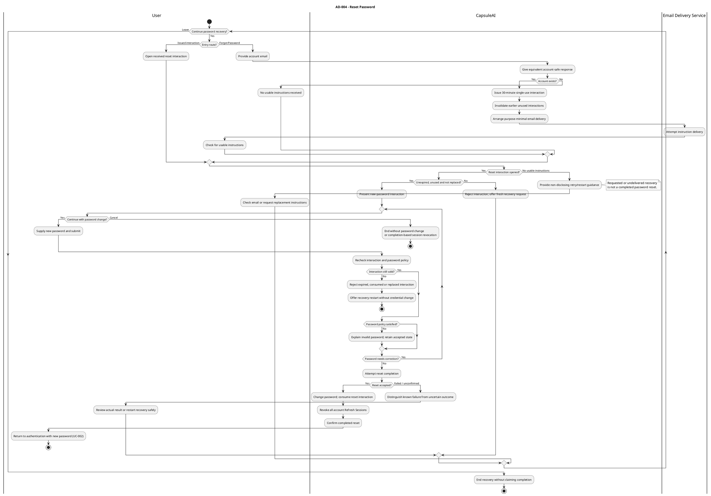
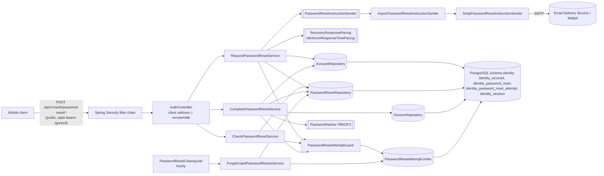
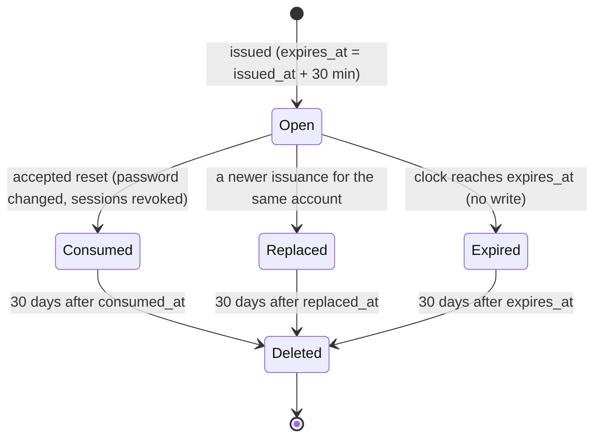
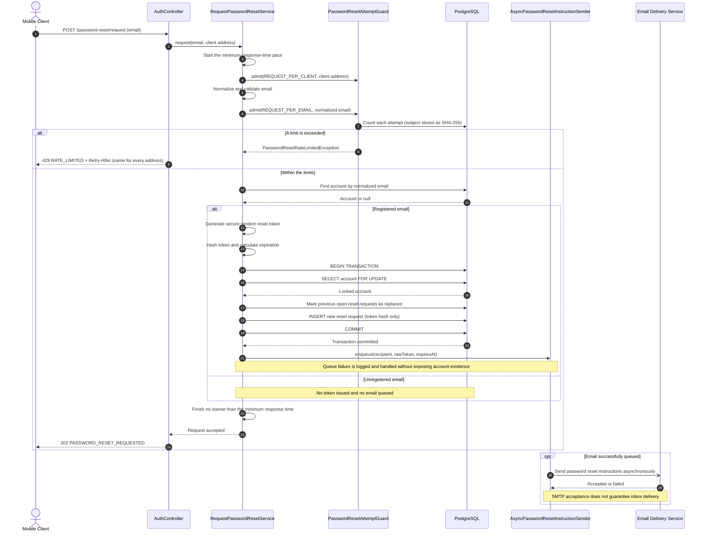
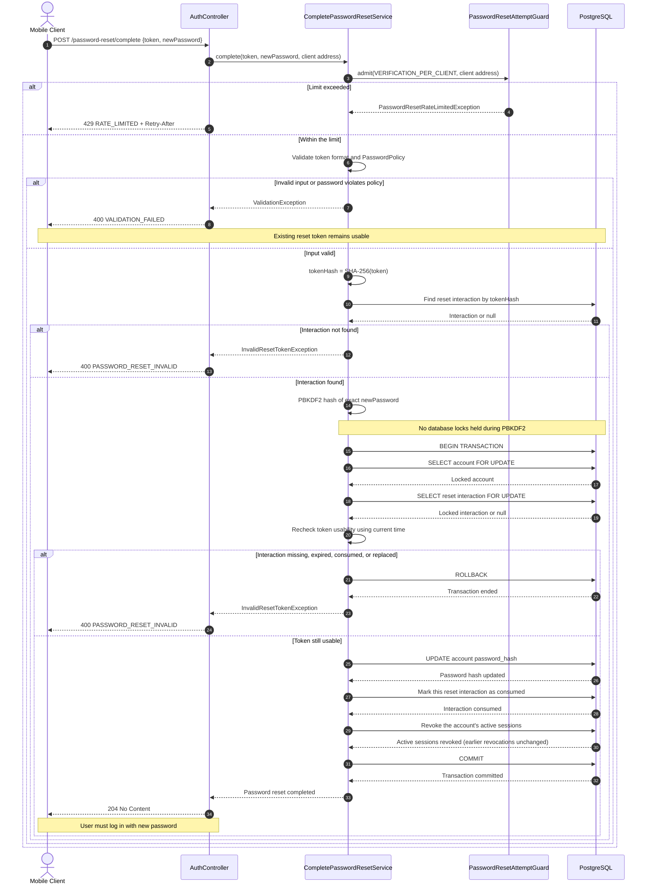

# US-AUTH-005 — Recover Account Access Through Email: Implementation Guide

| Field | Value |
| --- | --- |
| Sprint | Sprint 2 — Recover Access and Establish a Private Wardrobe |
| Story / parent PBI | US-AUTH-005 — Recover account access through email / [PBI-005](../../../product-backlog.md#pbi-005--recover-access-through-email-password-reset) |
| Implementation order | **1 of 4** (US-AUTH-005 → US-GAR-001 → US-WAR-001 → US-WAR-002) |
| Starts from | "Stage 0": branch `sprint_02` at `90d3237`, which contains the schema-ownership correction `17f32de` (V6 moves the Sprint 1 tables into the `identity` schema, Identity SQL is schema-qualified, architecture tests enforce AR-01–AR-08); see [README §3](README.md#3-repository-baseline) |
| Leaves | "Stage 1": the state US-GAR-001 starts from |
| Read with | [README](README.md) (workflow, commands) and [shared architecture](shared-architecture.md) (cross-story design, decision log) |
| Code status | **Proposed implementation code — compiled and its automated tests executed by the guide author on 2026-11-07 in an isolated scratch copy of this repository, after the Product Owner decisions of that day were incorporated** (Stage 1 commit on top of Stage 0: `clean verify` passed with 232 unit and 172 integration tests; the full four-stage result passed with 461 and 258). It has **not** been applied to this repository's `backend/` (⏳ BACKEND IMPLEMENTATION PENDING) and has **not** run in hosted CI. US-AUTH-005 is **not Done**. |

**How to use this guide.** Sections 3–8 reproduce every applicable source requirement **verbatim**, with links and line numbers, so you do not need to reopen the BRD, PRD, SRS, Business Rules, Story or Use Case. Section 9 says what they mean for the backend; Section 10 is the design; Sections 11–13 give every file change in order, with complete code or exact BEFORE/AFTER hunks; Sections 14–18 tell you how to prove it works and when you are finished.

Labels used throughout: **[REQ]** established requirement, **[ARCH]** established architecture decision, **[TECH]** proposed technical decision of this guide, **[OPEN]** genuinely unresolved question (none remains: the Product Owner decided every earlier one on 2026-11-07). A [TECH] choice is never a product requirement. Decision status markers: ✅ APPROVED AND INCORPORATED INTO GUIDES · ⏳ BACKEND IMPLEMENTATION PENDING · ⚠️ EXTERNAL VERIFICATION PENDING · 🟡 DEFERRED BY APPROVED DECISION.

---

## 1. Story Overview

| Item | Content |
| --- | --- |
| Story ID / name | US-AUTH-005 — Recover account access through email |
| Parent PBI | PBI-005 (Authentication domain, Foundation & Access theme) |
| User value | A registered user who forgot the password regains the **same** private account and wardrobe with a new password, through emailed single-use instructions. |
| Backend objective | Account-safe Forgot Password initiation; secure, replaceable, 30-minute, single-success reset interactions persisted in PostgreSQL; purpose-minimal SMTP delivery after commit with the approved Vietnamese message; an atomic accepted reset that sets the exact new password, consumes the interaction and revokes **every** active session of the account; identical attempt limits for every address; a minimum response time; 30-day deletion of ended interactions; no regression of Sprint 1 login, renewal and logout. |
| Hard dependencies | The Sprint 1 Identity implementation (account, PBKDF2 hashing, `PasswordPolicy`, persistent sessions, JWT + session authority). An SMTP server for delivery (Mailpit locally). |
| Scope (backend) | Three public operations under `/api/v1/auth/password-reset/`: `request`, `check`, `complete`; tables `identity.identity_password_reset` and `identity.identity_password_reset_attempt` (Flyway V7); the `PASSWORD_RESET` revocation reason; an email boundary (port, SMTP adapter, asynchronous decorator); attempt limits (429 `RATE_LIMITED`); response pacing; the scheduled retention cleanup; HTTPS link validation; the reset/login race fix in `LogInService`; tests at every level; OpenAPI v0.5.0; the CI trigger for `sprint_02` and report requirements; README. |
| Out of scope | Mobile screens, App Link / Universal Link handling and Vietnamese UI text in the app; SMS/OTP/security questions/social recovery; email verification; account deletion; a compromised-password denylist (🟡 deferred by OPEN-S2-06); choosing the HTTPS link domain and the production email provider, sender domain and its DNS records (⚠️ OPEN-S2-02, OPEN-S2-09). |
| Expected outcome | Backend behavior for AC-01–AC-15 and AC-17 is implemented and automatically verified; AC-16 (accessibility) and the client parts of AC-01/AC-06/AC-12/AC-13/AC-15/AC-17 remain client evidence; real-provider delivery evidence and the verified link domain remain outstanding. |

## 2. Repository Baseline

Verified at Stage 0. Java 21, Spring Boot 4.1.1, Spring Security 7.1.1, Spring JDBC (`JdbcClient`), Flyway (V1–V6; V6 moved the Sprint 1 tables into the `identity` schema), PostgreSQL 17.11, JUnit 6, AssertJ, Mockito, Testcontainers 2.0.5, ArchUnit 1.5.1, Maven Wrapper 3.9.16. No email library is on the classpath.

| Existing component (verified path under `backend/src/main/java/com/capsuleai/identity/`) | What it already provides | How recovery uses it |
| --- | --- | --- |
| `domain/EmailAddress.java` | Trim + lower-case normalization, no alias rules | Initiation looks the account up by the normalized email (AC-02). |
| `domain/PasswordPolicy.java` | 12–128 Unicode code points, no trimming/normalization, rejects unpaired surrogates | Validates the new password (AC-10, AC-11). |
| `adapter/out/security/Pbkdf2PasswordHasher.java` via `application/ports/PasswordHasher.java` | Salted PBKDF2-HMAC-SHA256 | Hashes the new password exactly as entered. |
| `domain/LoginSession.java`, `adapter/out/persistence/JdbcSessionRepository.java` | Persistent sessions, current-session `revoke`, locked refresh rotation | Extended with account-wide revocation. |
| `domain/RevocationReason.java` | `LOGOUT`, `REFRESH_TOKEN_REUSE` (V5 CHECK constraint) | Extended with `PASSWORD_RESET` (V7). |
| `application/LogInService.java` | Verifies the password **before** its session-creation transaction | Changed to recheck the credential under a shared account lock (race fix). |
| `application/SessionAuthorityService.java` + `adapter/in/security/SessionAwareJwtAuthenticationConverter.java` | Every protected request re-reads its session row | Makes reset revocation take effect immediately for unexpired access tokens (AC-05). |
| `adapter/in/web/AuthController.java`, `IdentityApiExceptionHandler.java` | Cohesive `/api/v1/auth` controller; scoped RFC 9457 errors with stable `code` | Recovery adds three handlers and one error mapping. |
| `configuration/IdentitySecurityConfiguration.java` | One default-deny chain; `PUBLIC_ENDPOINTS` shared by `permitAll` and the bearer resolver; CORS | Recovery operations join `PUBLIC_ENDPOINTS`. |
| `application/ports/IdentityTransactions.java`, `adapter/out/persistence/SpringIdentityTransactions.java` | Framework-free transaction boundary (READ COMMITTED) | Issuance and completion run inside it. |
| Tests: `support/IdentityIntegrationTestSupport.java`, `support/IdentityTestConfiguration.java`, `support/MutableClock.java` | Real app + filter chain + Testcontainers PostgreSQL + controllable clock; the fixture reset truncates every table of the `identity` schema | Reused by every new integration test; the new reset table is cleared automatically. |
| `backend/src/main/resources/db/migration/V6__move_identity_tables_into_identity_schema.sql` | The `identity` schema holding `identity_account`, `identity_session` and `identity_refresh_token`; all Identity SQL is written `identity.<table>` | The reset table joins the same schema; **V7** is the next free version (AR-01). |
| `foundation/IsolatedMigrationDatabase.java` (test) | A separate empty database on the test server, migrated to any version | `PasswordResetSchemaIT` upgrades Sprint 1 data from V6 to V7 on it. |
| `ArchitectureDependencyTest`, `PersistenceOwnershipSqlTest`, `DatabaseSchemaOwnershipIT` (test package `com.capsuleai.architecture`) | Enforce AR-01–AR-08: other modules use only a module's `api`; production SQL names only its own schema, always qualified; each migration after V6 changes one owner schema; on the migrated database every table is in its owner's schema and no foreign key crosses schemas. This story's code and migrations must pass them unchanged. |

**State that matters for this story.** The Identity tables are in the `identity` schema; Flyway's history stays in the default schema (`public`), which holds no business table. There is no reset table, no reset code and no email infrastructure. `AccountRepository` cannot change a password. `SessionRepository` revokes one session at a time. The [OpenAPI contract](../../../../05-api/openapi.yaml) (v0.4.1) explicitly lists password reset as not introduced. `.github/workflows/backend-ci.yml` runs only for pushes to `main` and pull requests targeting `main`; this story proposes adding pull requests into `sprint_02` (REVIEW-CI option A, TD-S2-30). No scheduling is enabled anywhere in the application.


---

## 3. Original Business Requirements — Verbatim

All wording in Sections 3–8 is copied mechanically from the repository at Stage 0; nothing is paraphrased. Only the targets of links inside a quotation are rewritten, so that they open the same file and heading from this guide's folder. The link text is unchanged. The **Source** line above each quotation names its file, heading and line range.

### 3.1 Business requirements BR-021 and BR-023

**Source:** [BRD.md — 15.4 Privacy, Trust, and Evolution](../../../../01-business/BRD.md#154-privacy-trust-and-evolution) · lines 497–499 at Stage 0

> | ID | Requirement | Business Rationale | Priority | Related Goals |
> |---|---|---|---|---|
> | BR-021 | Personal images, wardrobes, profile information, and behavior must remain private to authorized access, with understandable user control over their information. | Trust is necessary for participation across the value loop. | Must | BG-01, BG-02, BG-03, BG-04 |
> | BR-023 | The initial product must serve Android and iOS users in Vietnam while preserving compatibility with future regions, garment categories, and personalization approaches. | Deliver a viable initial experience with room for continued development. | Must | BG-01, BG-02, BG-03, BG-04 |

### 3.2 Business capability CAP-01

**Source:** [BRD.md — 13.1 Capability Map](../../../../01-business/BRD.md#131-capability-map) · lines 287–287 at Stage 0

> | ID | Capability | Business Purpose |
> |---|---|---|
> | CAP-01 | Account & Personalization | Maintain a private personal wardrobe context, style preferences, and optional profile information. |

## 4. Original Product Requirements — Verbatim

### 4.1 JRN-01

**Source:** [PRD.md — 8.1 JRN-01 — Account Onboarding & Personalization](../../../../02-product/PRD.md#81-jrn-01--account-onboarding--personalization) · lines 186–201 at Stage 0

> ### 8.1 JRN-01 — Account Onboarding & Personalization
>
> **Intent:** Establish private access and relevant everyday needs through progressive onboarding. The initial interface is Vietnamese; English terms below describe product meaning and do not prescribe English UI copy.
>
> 1. **Welcome / Product Value Introduction:** Explain wardrobe intelligence, user authority, and the connected product value.
> 2. **Register or Login:** Register with Email, Password, and Confirm Password; Display Name is optional. Login uses Email and Password. Forgot Password provides email-based password reset.
> 3. **Style Preferences:** Select from the initial controlled style vocabulary in Section 11.3.
> 4. **Common Occasion Needs:** Set relevant common needs/priorities for the Personalized Everyday Capsule. These ongoing needs are distinct from the current occasion of an outfit request.
> 5. **Optional Personal Context:** Offer gender/body profile with omission, later edit, and removal.
> 6. **Location:** Permit device location, manually select city/location, or skip with a limited-context explanation. Manual location remains available after permission denial.
> 7. **Recommended Add First Garment:** Explain its value and offer the action without making it an access blocker or requiring an arbitrary garment quota.
> 8. **Enter Today / Wardrobe:** Open the product; an empty wardrobe explains limited recommendations and offers Add Garment. Users can return later to complete skipped optional information.
>
> **Completion:** The authenticated user can access Today/Wardrobe without body/gender, device-location permission, or a first garment. Incomplete optional setup is distinct from failed authentication.
>
> **Recovery:** Explain account/reset/connectivity failures and offer retry; manual location and manual garment entry preserve available alternatives. **Features:** FEAT-AUTH-001, FEAT-PROF-001, FEAT-PROF-002, FEAT-AI-002.

### 4.2 FEAT-AUTH-001

**Source:** [PRD.md — 10.1 FEAT-AUTH-001 — Personal Account Access and Session Continuity](../../../../02-product/PRD.md#101-feat-auth-001--personal-account-access-and-session-continuity) · lines 349–382 at Stage 0

> ### 10.1 FEAT-AUTH-001 — Personal Account Access and Session Continuity
>
> **Purpose:** Establish authorized private access through email/password authentication and recovery.
>
> **User value:** Users can create, revisit, and recover their personal wardrobe account.
>
> **Related BRD:** BR-021, BR-023; CAP-01; BG-01–BG-04. **Primary users:** All three personas.
>
> **Entry points / trigger:** Welcome/Account Access, Forgot Password, launch without usable access, or renewed authentication. **Preconditions:** Connected mobile access and an email address for registration/recovery; valid account credentials for login.
>
> **Product behavior:**
>
> 1. Registration collects Email, Password, and Confirm Password; Display Name may be omitted. Explain incomplete input or password-confirmation mismatch.
> 2. Login uses Email and Password and opens the correct user's experience; first use follows JRN-01 progressive onboarding.
> 3. Forgot Password supports email-based password reset, with clear requested, reset-completed, and failure/retry experiences. Successful reset lets the user log in with the new password.
> 4. Preserve usable authenticated access through ordinary navigation/return visits while access remains valid. Explain required reauthentication and return to the intended area where practical.
> 5. Explicit logout ends the authenticated experience and prevents continued personal access until authentication succeeds again.
>
> **User controls:** Register, log in, request/complete password reset, retry, and log out. **Product states:** Welcome, signed out, registering/logging in, reset requested, resetting, reset completed/failed, authenticated, renewal required, onboarding incomplete.
>
> **Failure / fallback:** Explain invalid/incomplete input, unavailable reset, and network failures with recovery. Never expose another user's data or confuse failed authentication with an empty wardrobe. Optional personal/location information and first garment creation do not block authenticated entry.
>
> **Feature-level acceptance criteria:**
>
> - **AC-01:** Email/password registration and login open the correct account; signed-out users cannot access protected personal information.
> - **AC-02:** Incomplete input, mismatched Password/Confirm Password, and failed login are distinguishable from success and offer correction/retry.
> - **AC-03:** Logout prevents continued protected access until successful authentication.
> - **AC-04:** Valid returning access preserves the user's wardrobe; expired access requires renewed authentication rather than displaying an empty wardrobe.
> - **AC-05:** Missing optional body/gender, device-location permission, Display Name, or a first garment does not block account access.
> - **AC-06:** Forgot Password can lead to email-based reset; after successful reset, the new password allows login.
> - **AC-07:** A failed/unusable reset is not shown as completed and offers a useful restart/retry path.
> - **AC-08:** Social sign-in and guest accounts are not required or introduced as MVP access methods.
>
> **Out of scope / deferred detail:** Password policy, reset validity, session lifetimes, and security mechanisms are specified downstream. **Approved downstream system constraint (OPQ-008):** JWT-based authentication uses a short-lived JWT Access Token and a longer-lived Refresh Token. Exact lifetimes, rotation, secure storage, revocation, reuse detection, logout invalidation, signing, and key management belong in SRS/security and ASR/ADD/ADR as appropriate. Tokens are not user-facing features; no such mechanics belong in the BRD.

## 5. Original Software Requirements — Verbatim

### 5.1 Account & Authentication stimulus/response

**Source:** [SRS.md — 3.1 Account & Authentication](../../../../03-requirements/SRS.md#31-account--authentication) · lines 149–158 at Stage 0

> ### 3.1 Account & Authentication
>
> JRN-01 governs progressive access. Registration/login/recovery are available before authentication; personal operations require authorized access.
>
> | Stimulus | Expected System Response |
> |---|---|
> | Register with Email, Password, Confirm Password | Validate required input and confirmation; create access only on success. Display Name is optional. |
> | Login or return with usable access | Open the correct personal experience; explain renewal when required. |
> | Forgot Password / complete email reset | Distinguish requested, completed, and failed recovery; enable login with the new password after success. |
> | Logout | End personal access; require successful authentication before protected use resumes. |

### 5.2 Authentication and Recovery Rules (SRS §3.1.1)

**Source:** [SRS.md — 3.1.1 Authentication and Recovery Rules](../../../../03-requirements/SRS.md#311-authentication-and-recovery-rules) · lines 160–178 at Stage 0

> #### 3.1.1 Authentication and Recovery Rules
>
> The following rules define authentication, session renewal, password handling, and account recovery behavior for the MVP. FR-AUTH-* and DATA-AUTH-* specify the required outcomes; signing, key management, token/session storage, and revocation mechanisms remain downstream design.
>
> | Rule | Requirement |
> |---|---|
> | JWT Access Token | 15-minute lifetime. |
> | Refresh Session | Maximum 30-day login-session/Refresh Token lifetime; rotating a token does not extend the session maximum. |
> | Successful refresh | Consume the current Refresh Token; issue a new Access Token and Refresh Token. A consumed token is invalid for ordinary reuse. |
> | Rotated-token reuse | Revoke the affected login session and require renewed authentication for it. |
> | Separate devices | Separate login sessions are permitted. Logout revokes only the current session and ends that device/session's authenticated use; another separate session is not automatically revoked. |
> | Successful password reset | Consume the reset interaction, revoke all active Refresh Sessions for the account and require renewed authentication with the new password. |
> | Password | 12–128 characters; letters, numbers, symbols, spaces and Unicode are allowed. No mandatory character-class mixture or silent trimming/transformation/normalization. |
> | Common-password protection | A small approved denylist may be used; an external breached-password service is not an MVP dependency. |
> | Email identity | Trim surrounding whitespace and compare case-insensitively; at most one account per normalized email. Do not apply provider-specific alias transformations. |
> | Registration conflict | No duplicate account; provide sign-in/recovery guidance. |
> | Forgot Password privacy | Equivalent initial responses do not reveal account existence; Vietnamese wording conveys the conditional meaning “If an account exists for this email, password-reset instructions have been sent.” An initiation response does not confirm reset completion. |
> | Reset validity | 30-minute lifetime and single successful use; expired/consumed interactions cannot reset credentials. |
> | Reset replacement | Successfully issuing a new password-reset interaction invalidates all earlier unused password-reset interactions for the account (FR-AUTH-018). |

### 5.3 Functional requirements

**Source:** [SRS.md — 3.1.1 Authentication and Recovery Rules](../../../../03-requirements/SRS.md#311-authentication-and-recovery-rules) · lines 183–201 at Stage 0

> | ID | Requirement | Scope | Source | Verification |
> |---|---|---|---|---|
> | FR-AUTH-002 | The system shall authenticate Email/Password login using case-insensitive, surrounding-whitespace-trimmed email identity while comparing the user's untransformed password value. | MVP | FEAT-AUTH-001; BR-021 | T: email case/space variants; exact Unicode/space-containing passwords. |
> | FR-AUTH-003 | The system shall provide email-based Forgot Password initiation with equivalent user-facing responses for registered and unregistered email addresses. | MVP | FEAT-AUTH-001; BR-021 | T: paired known/unknown email responses and recovery handoff. |
> | FR-AUTH-004 | The system shall allow a valid single-use email recovery interaction to set a policy-valid new password, consume that interaction, revoke all account Refresh Sessions, and require subsequent authentication using the new password. | MVP | FEAT-AUTH-001; BR-021 | T: successful reset; old password/refresh sessions denied; new-password login. |
> | FR-AUTH-008 | The system shall restrict protected personal operations to an authenticated user authorized for the affected information. | MVP | FEAT-AUTH-001; BR-021 | T: signed-out/cross-user denial. |
> | FR-AUTH-009 | The system shall authenticate protected operations with a valid, unexpired JWT Access Token and the authorized session/account context. | MVP | FEAT-AUTH-001; BR-021 | T/I: absent, invalid, expired and valid JWT access; session authorization. |
> | FR-AUTH-015 | The system shall accept policy-valid passwords of 12–128 characters including letters, numbers, symbols, spaces, and Unicode without mandatory character-class mixtures or silent trimming, normalization, or transformation. | MVP | FEAT-AUTH-001; BR-021 | T: 11/12/128/129-character inputs; spaces/Unicode; no required class mixture. |
> | FR-AUTH-016 | The system shall map each normalized email to at most one account, trimming surrounding whitespace and comparing case-insensitively; duplicate registration shall offer sign-in/recovery guidance without creating another account or applying provider-specific alias rules. | MVP | FEAT-AUTH-001; BR-021 | T: duplicate case/space variants and distinct provider-alias strings. |
> | FR-AUTH-019 | The system shall limit Forgot Password initiation per normalized email address and per client network address, and password-reset interaction checking and completion per client network address, within configurable time windows. Registered and unregistered addresses shall receive identical limited outcomes, and the email delivery queue is not a substitute for these limits. | MVP | FEAT-AUTH-001; BR-021 | T: per-address and per-client limits, window boundary, registered/unregistered equivalence, concurrent attempts. |
> | FR-AUTH-020 | Password-reset instructions shall link to a configurable verified HTTPS address (Android App Links / iOS Universal Links) in production, carrying the reset secret only in the URL fragment; a private custom URL scheme is permitted only for local development. | MVP | FEAT-AUTH-001; BR-021 | T/I: link construction and configuration validation; mobile link verification and fallback are client/operational evidence. |
> | FR-AUTH-017 | The system shall limit each password-reset interaction to 30 minutes and one successful use, rejecting expired or already-used interactions without changing credentials. | MVP | FEAT-AUTH-001; BR-021 | T: valid, expiry-boundary, used-interaction and repeated-reset cases. |
> | FR-AUTH-018 | The system shall invalidate any earlier unused password-reset interaction for the account when a new password-reset interaction is successfully issued. | MVP | FEAT-AUTH-001; BR-021 | T: successfully issue a new password-reset interaction; verify all earlier unused interactions for the account are rejected and the new interaction remains usable. |

### 5.4 Data requirements

**Source:** [SRS.md — 4.2 Account & Profile Data](../../../../03-requirements/SRS.md#42-account--profile-data) · lines 650–655 at Stage 0

> | ID | Requirement | Scope | Source | Verification |
> |---|---|---|---|---|
> | DATA-AUTH-001 | The system shall associate credentials/recovery/session information with the correct account, protect those secrets, and preserve the password value and policy-governed validity outcomes in Section 3.1.1. | MVP | FEAT-AUTH-001; BR-021 | T/I: account ownership; exact password meaning; protected recovery/session state. |
> | DATA-AUTH-002 | The system shall represent Email through the normalized account identity defined in Section 3.1.1 and Display Name as optional, preserving one account per identity without provider-specific alias transformations. | MVP | FEAT-AUTH-001; BR-021 | T: uniqueness across email case/whitespace variants; optional Display Name. |
> | DATA-AUTH-006 | The system shall delete a consumed, replaced or expired password-reset interaction 30 days after it became terminal (its consumption, replacement or expiry time) and shall never delete a currently usable interaction. | MVP | FEAT-AUTH-001; BR-021 | T: retention boundary, active-interaction preservation, concurrent cleanup. |
> | DATA-AUTH-005 | The system shall represent separate login sessions with account association, maximum lifetime, current/consumed refresh validity and revocation state, and reset interactions with account association, expiry and single-use validity, sufficient to enforce Section 3.1.1. | MVP | FEAT-AUTH-001; BR-021 | T/I: independent sessions, rotated-token reuse, current/all-session revocation, reset expiry/use. |

### 5.5 External and communication interfaces

**Source:** [SRS.md — 5.2 Software Interfaces](../../../../03-requirements/SRS.md#52-software-interfaces) · lines 777–777 at Stage 0

> | ID | Requirement | Scope | Source | Verification |
> |---|---|---|---|---|
> | SI-003 | The system shall send Email Delivery Service only email and necessary recovery-delivery information, preserve account-existence-safe initiation responses, and distinguish requested/delivered recovery from a valid completed reset. | MVP | FEAT-AUTH-001; BR-021 | I/T: minimal delivery information, known/unknown initiation equivalence and requested/failed/expired/consumed/completed reset. |

**Source:** [SRS.md — 5.4 Communication Interfaces](../../../../03-requirements/SRS.md#54-communication-interfaces) · lines 792–794 at Stage 0

> | ID | Requirement | Scope | Source | Verification |
> |---|---|---|---|---|
> | COM-001 | The system shall protect private access/wardrobe/profile/history exchanges against unauthorized disclosure or alteration, preserving password values and the session/account authority defined in Section 3.1.1. | MVP | FEAT-AUTH-001; BR-021 | A/T: protected exchange; Unicode/spaces preserved; session ownership. |
> | COM-002 | The system shall distinguish interrupted communication from accepted save, access/recovery or Wear action outcomes, applying Section 9 recovery without false completion or duplicated logical actions. | MVP | FEAT-AI-002, FEAT-PERS-002, FEAT-AUTH-001; BR-005, BR-011, BR-021 | T: interrupted save/reset/refresh/Wear actions and outcome review. |
> | COM-003 | The system shall limit external shopping interaction to explicitly chosen navigation without granting destinations unrestricted private wardrobe/profile/history access; external dependencies receive only the minimum information needed for their purpose. | MVP | FEAT-SHOP-002, FEAT-AUTH-001; BR-018, BR-021 | I/T: explicit handoff, provider-specific minimal exchanges and no unrelated personal-data disclosure. |

### 5.6 Error and failure requirements

**Source:** [SRS.md — 9. Error and Failure Requirements](../../../../03-requirements/SRS.md#9-error-and-failure-requirements) · lines 986–988 at Stage 0

> ## 9. Error and Failure Requirements
>
> These requirements specify recoverable outcomes, not exception types or infrastructure retry algorithms. Previously confirmed information remains authoritative. An interrupted response is not proof that an action failed; uncertain outcomes must remain distinguishable from accepted results, and recovery must not create accidental duplicate logical actions.

**Source:** [SRS.md — 9.1 Access and Recovery](../../../../03-requirements/SRS.md#91-access-and-recovery) · lines 995–996 at Stage 0

> | ID | Failure Condition | Required System Behavior | Continuation / State Protection | Source | Verification |
> |---|---|---|---|---|---|
> | ERR-AUTH-002 | Reset cannot complete, is expired, or has already been used. | The system shall reject failed, expired, or already-used recovery interactions without claiming reset completion, offering renewed recovery with account-existence-safe initiation wording. | Credentials and session state change only on an actually completed reset; successful reset revokes all Refresh Sessions and requires login. | FEAT-AUTH-001; BR-021 | T: 30-minute expiry, consumed interaction, delivery failure, known/unknown email. |
> | ERR-AUTH-003 | Renewal is unusable, the session is revoked/expired, or rotated Refresh Token reuse is detected. | The system shall require renewed authentication for expired/revoked Refresh Sessions or detected rotated-token reuse, retaining the inaccessible-versus-empty distinction. | Protected session use pauses; reauthenticate. Reuse revokes the affected session, and logout does not automatically revoke other sessions. | FEAT-AUTH-001; BR-021 | T: maximum 30-day expiry and consumed refresh-token replay. |

**Source:** [SRS.md — 9.9 Communication and Partial Dependency Failure](../../../../03-requirements/SRS.md#99-communication-and-partial-dependency-failure) · lines 1052–1053 at Stage 0

> | ID | Failure Condition | Required System Behavior | Continuation / State Protection | Source | Verification |
> |---|---|---|---|---|---|
> | ERR-NET-001 | Network/communication fails during an action. | The system shall distinguish interrupted communication and uncertain mutation outcomes from confirmed success or empty data, providing applicable outcome review/retry without accidental duplicate actions. | Previously confirmed information is preserved; an already accepted action is not repeated as a new one. No general offline guarantee. | FEAT-AI-002, FEAT-PERS-002, FEAT-WAR-001; BR-005, BR-011, BR-022 | T: interruption before/after action acceptance. |
> | ERR-DEP-001 | External capability unavailable. | The system shall identify the affected unavailable dependency and preserve independent authorized core paths instead of presenting a dependency failure as loss of the user's wardrobe. | Use manual/retry/recovery paths appropriate to Sections 9.1–9.8; mandatory access remains protected. | FEAT-AI-001, FEAT-PROF-002, FEAT-AUTH-001, FEAT-SHOP-002; BR-001, BR-013, BR-018, BR-021, BR-022 | T: isolated analysis/weather/email/navigation failures. |

### 5.7 Security, privacy, usability and accessibility requirements

**Source:** [SRS.md — 6.2 Security](../../../../03-requirements/SRS.md#62-security) · lines 814–815 at Stage 0

> | ID | Requirement | Scope | Source | Verification |
> |---|---|---|---|---|
> | NFR-SEC-002 | The system shall prevent account switch or logout from exposing the preceding user's protected content, enforcing current-session logout isolation and all-Refresh-Session revocation after successful password reset. | MVP | FEAT-AUTH-001; BR-021 | T: two sessions/accounts; current logout versus account-wide reset. |
> | NFR-SEC-003 | The system shall protect credential/token/recovery secrets from unauthorized output/measurement disclosure and preserve account-existence-safe Forgot Password responses. | MVP | FEAT-AUTH-001, FEAT-MET-001; BR-021 | I/T: secret-output review, known/unknown email response comparison, measured registered/unregistered timing and documented residual enumeration risk; true service unavailability remains a truthful 503. |

**Source:** [SRS.md — 6.3 Privacy](../../../../03-requirements/SRS.md#63-privacy) · lines 821–822 at Stage 0

> | ID | Requirement | Scope | Source | Verification |
> |---|---|---|---|---|
> | NFR-PRIV-001 | The system shall limit personal data processing to necessary functionality, personalization, wardrobe/history/utilization, validation/measurement, security and operational integrity; explain its purpose and respect omission/correction/removal/permission controls within the authorized User's private experience, with no public wardrobes, user-to-user sharing, unrestricted third-party sharing or sale of personal data. | MVP | FEAT-AUTH-001, FEAT-PROF-001, FEAT-PROF-002, FEAT-PERS-001, FEAT-PERS-002; BR-012, BR-013, BR-021 | I/D: purpose, private access, feature controls and absence of unapproved sharing/sale. |
> | NFR-PRIV-002 | The MVP shall not use personal wardrobe images, profiles, Wear Events, feedback or corrections for AI model training/improvement; any future use requires separate explicit opt-in and an approved future product/privacy change, and external navigation does not grant unrestricted sharing consent. | MVP | FEAT-AUTH-001, FEAT-AI-002, FEAT-MET-001, FEAT-SHOP-002; BR-002, BR-018, BR-021 | I: complete MVP data-use boundary and future opt-in/change control; private data absent from training/improvement inputs. |

**Source:** [SRS.md — 6.6 Usability](../../../../03-requirements/SRS.md#66-usability) · lines 844–844 at Stage 0

> | ID | Requirement | Scope | Source | Verification |
> |---|---|---|---|---|
> | NFR-USE-001 | The system shall make Vietnamese setup/confirmation / unevaluated eligibility/results/recovery understandable and validate the six core task groups with at least 5 representative users across personas where practical, targeting ≥80% unaided completion for each evaluated task, zero unresolved Critical usability blockers for acceptance and average SUS ≥68 as a validation aid. | MVP | FEAT-AUTH-001, FEAT-AI-002, FEAT-WAR-001, FEAT-OUT-001; BR-002, BR-005, BR-022, BR-023 | D/A: six groups, ≥5 users total, per-task unaided rates, blocker review and average SUS; Section 12.4. |

**Source:** [SRS.md — 6.7 Accessibility](../../../../03-requirements/SRS.md#67-accessibility) · lines 853–854 at Stage 0

> | ID | Requirement | Scope | Source | Verification |
> |---|---|---|---|---|
> | NFR-ACC-001 | The system shall communicate meaningful confidence, unevaluated eligibility, unavailable/outdated, hypothetical, and removed states with understandable labels rather than relying solely on color or a garment image. | MVP | FEAT-GAR-001, FEAT-WAR-001, FEAT-OUT-001, FEAT-MULT-001, FEAT-ANL-001; BR-003, BR-005, BR-006, BR-022 | I/D: labels remain meaningful without color/image cues. |
> | NFR-ACC-002 | The system shall support meaningful accessible names/roles/states, operable core journeys and accessible primary actions at text scaling up to 200%, with approximately 48 dp Android/44 pt iOS minimum primary-control touch targets; applicable core journeys shall be validated with TalkBack and VoiceOver. | MVP | FEAT-AUTH-001, FEAT-AI-002, FEAT-OUT-001, FEAT-PERS-002; BR-002, BR-011, BR-022, BR-023 | D/I: both screen readers, accessible semantics, 200% text scaling, target sizes and outcome meaning; Section 12.4; no certification claim. |

### 5.8 Localization requirements

**Source:** [SRS.md — 7. Localization Requirements](../../../../03-requirements/SRS.md#7-localization-requirements) · lines 898–899 at Stage 0

> | ID | Requirement | Scope | Source | Verification |
> |---|---|---|---|---|
> | LOC-001 | The system shall provide the initial user interface, explanations, and applicable recovery guidance in Vietnamese on Android and iOS. | MVP | FEAT-AUTH-001, FEAT-OUT-001, FEAT-AI-002; BR-002, BR-022, BR-023 | I/D: initial Vietnamese journeys. |
> | LOC-002 | The system shall keep canonical category/subtype, style/occasion, confidence, and provenance semantics independent of translated display labels. | MVP | FEAT-PROF-001, FEAT-GAR-001, FEAT-AUTH-001; BR-003, BR-010, BR-023 | I/T: vocabulary-to-label mapping. |

## 6. Original Business Rules — Verbatim

**Source:** [business-rules.md — BRULE-AUTH-001 — Authorized Personal Operations](../../../../03-requirements/business-rules.md#brule-auth-001--authorized-personal-operations) · lines 81–87 at Stage 0

> ### BRULE-AUTH-001 — Authorized Personal Operations
>
> **Rule:** Personal wardrobe, profile, feedback, history, and assessment operations require authentication and authorization for the affected user's information. Unavailable authorized access is not an empty wardrobe and does not change personal state.
>
> **Applies To:** all personal domain operations.
>
> **Source:** FR-AUTH-008, ERR-AUTH-001, DATA-GAR-001.

**Source:** [business-rules.md — BRULE-AUTH-002 — Normalized Email Identity](../../../../03-requirements/business-rules.md#brule-auth-002--normalized-email-identity) · lines 89–97 at Stage 0

> ### BRULE-AUTH-002 — Normalized Email Identity
>
> **Rule:** Email identity is compared case-insensitively after trimming surrounding whitespace. Each normalized identity maps to at most one account. Provider-specific alias transformations are not applied; duplicate registration creates no second account and offers sign-in/recovery guidance.
>
> **Applies To:** registration, login, account recovery.
>
> **Source:** FR-AUTH-002, FR-AUTH-016, DATA-AUTH-002.
>
> **Boundary:** ` Person@Example.com ` and `person@example.com` identify the same account; provider alias strings are not automatically merged.

**Source:** [business-rules.md — BRULE-AUTH-003 — Password Value Preservation](../../../../03-requirements/business-rules.md#brule-auth-003--password-value-preservation) · lines 99–105 at Stage 0

> ### BRULE-AUTH-003 — Password Value Preservation
>
> **Rule:** A password has 12–128 characters and may contain letters, numbers, symbols, spaces, and Unicode without mandatory character-class mixtures. Its value must not be silently trimmed, transformed, or normalized. A small approved denylist is permitted; an external breached-password service is not an MVP dependency.
>
> **Applies To:** registration, login, password reset.
>
> **Source:** FR-AUTH-001, FR-AUTH-002, FR-AUTH-015, DATA-AUTH-001.

**Source:** [business-rules.md — BRULE-AUTH-004 — Password-Reset Interaction Validity](../../../../03-requirements/business-rules.md#brule-auth-004--password-reset-interaction-validity) · lines 107–113 at Stage 0

> ### BRULE-AUTH-004 — Password-Reset Interaction Validity
>
> **Rule:** A password-reset interaction is associated with its account, has a 30-minute lifetime, and permits one successful use. Expired or consumed interactions cannot change credentials. Successfully issuing a new password-reset interaction invalidates all earlier unused password-reset interactions for that account. A consumed, replaced or expired interaction is deleted 30 days after it became terminal; a usable interaction is never deleted (DATA-AUTH-006).
>
> **Applies To:** password recovery and repeated recovery requests.
>
> **Source:** FR-AUTH-017, FR-AUTH-018, DATA-AUTH-005, ERR-AUTH-002.

**Source:** [business-rules.md — BRULE-AUTH-005 — Completed Reset and Recovery Privacy](../../../../03-requirements/business-rules.md#brule-auth-005--completed-reset-and-recovery-privacy) · lines 115–121 at Stage 0

> ### BRULE-AUTH-005 — Completed Reset and Recovery Privacy
>
> **Rule:** A successful reset sets a policy-valid password, consumes the reset interaction, revokes every currently active session of the account (already expired or revoked sessions keep their historical state and reason), and requires renewed authentication with the new password; no pre-reset session credential remains usable. Failed recovery must not be reported as completed. Initial recovery responses are equivalent for registered and unregistered email identities and do not disclose account existence. Excessive initiation, checking and completion attempts are limited per address and per client, with identical limited outcomes for registered and unregistered identities (FR-AUTH-019).
>
> **Applies To:** account recovery, returning access.
>
> **Source:** FR-AUTH-003, FR-AUTH-004, ERR-AUTH-002.

**Source:** [business-rules.md — BRULE-AUTH-006 — Separate Sessions and Revocation](../../../../03-requirements/business-rules.md#brule-auth-006--separate-sessions-and-revocation) · lines 123–129 at Stage 0

> ### BRULE-AUTH-006 — Separate Sessions and Revocation
>
> **Rule:** Separate device/login sessions are logically distinct. Logout revokes the current session without automatically revoking another separate session. Successful refresh consumes the current Refresh Token and issues replacement access/refresh tokens; reuse of a rotated token revokes the affected session. Rotation cannot extend the session maximum; token/session lifetimes remain specified in SRS Section 3.1.1.
>
> **Applies To:** session renewal, logout, multiple devices.
>
> **Source:** FR-AUTH-007, FR-AUTH-010, FR-AUTH-013, FR-AUTH-014, DATA-AUTH-005.

**Source:** [business-rules.md — BRULE-AUTH-007 — Purpose-Limited Private Data Use](../../../../03-requirements/business-rules.md#brule-auth-007--purpose-limited-private-data-use) · lines 131–139 at Stage 0

> ### BRULE-AUTH-007 — Purpose-Limited Private Data Use
>
> **Rule:** Personal data is used only as necessary for CapsuleAI functionality, personalization, wardrobe/history/utilization, validation/measurement, security and operational integrity within the authorized User's private experience. MVP personal images, profiles, Wear Events, feedback and corrections are not used for AI model training/improvement. Future personal-data training requires separate explicit opt-in and an approved future product/privacy change.
>
> No public wardrobes, user-to-user wardrobe sharing, unrestricted third-party sharing or sale of personal data is introduced. External dependencies receive only purpose-minimal information: required selected weather location, email/necessary recovery-delivery information, or explicitly chosen shopping navigation without unrelated wardrobe/profile/history disclosure. Necessary active-account information and minimal history follow the retention/removal rules; this policy adds no Delete Account goal or legal certification.
>
> **Applies To:** personal information, account/profile/wardrobe/history, validation/measurement and external exchanges.
>
> **Source:** FR-AUTH-008, NFR-PRIV-001, NFR-PRIV-002, SI-002, SI-003, COM-003, FR-MET-006, DATA-RET-001, DATA-RET-002, DATA-RET-003.

## 7. Original User Story and Acceptance Criteria — Verbatim

The complete story file, including its metadata, every Acceptance Criterion with its original Given/When/Then, business rules, dependencies, scope exclusions, traceability and status.

**Source:** [US-AUTH-005-recover-account-access.md](../../../stories/auth/US-AUTH-005-recover-account-access.md) · complete file at Stage 0

> # US-AUTH-005 — Recover account access through email
>
> ## Document Control
>
> | Field | Value |
> | --- | --- |
> | Artifact | User Story |
> | Story ID | US-AUTH-005 |
> | Version | 0.3 |
> | Status | Baseline Draft |
> | Product | CapsuleAI |
> | Revision note | 2026-10-21: first focused refinement; clarified source-backed acceptance/evidence and traceability; identity, scope and Baseline Draft status preserved. 2026-10-22: linked related full-backlog drafts and explicit identity/domain metadata; existing outcome and AC retained. |
> | Parent PBI | [PBI-005](../../../product-backlog.md#pbi-005--recover-access-through-email-password-reset) |
> | Domain | Authentication |
> | Theme | Foundation & Access |
> | Product Goal Contribution | [Enabling / Protecting Product Value](../../../product-goal.md#4-desired-product-outcomes) |
>
> ## 1. Story
>
> As a registered user who cannot remember my password, I want to recover access through emailed reset instructions, so that I can regain my private wardrobe using a new password.
>
> ## 2. User Value
>
> Recovery is a complete request-to-restored-access outcome. Requesting or delivering instructions alone does not restore access, so those steps and their failure paths remain in this story.
>
> ## 3. Scope
>
> Forgot Password, account-safe initiation, purpose-minimal email delivery, valid reset completion, replacement/expiry/single-use validation, new-password policy, cancellation and failure/uncertainty, account-wide Refresh Session revocation, and return to credential login.
>
> ## 4. Preconditions
>
> - CapsuleAI's password-recovery interaction is reachable. Authentication is not required to request recovery.
> - Successful recovery requires an existing account and a valid issued interaction; missing instructions and invalid interactions are handled within the story.
>
> ## 5. Acceptance Criteria
>
> ### AC-01 — Request without disclosing account existence
>
> **Given** the recovery interaction is reachable and I am signed out
>
> **When** I request Forgot Password for a registered or unregistered email
>
> **Then** the initial user-facing responses are equivalent and convey the conditional meaning that reset instructions have been sent if an account exists. Neither response reveals account existence or claims that the password has changed.
>
> ### AC-02 — Deliver instructions for the correct email identity
>
> **Given** my account exists and I request recovery using its email with case or surrounding-whitespace variations
>
> **When** CapsuleAI successfully issues a reset interaction and email delivery succeeds
>
> **Then** instructions reach that account's email identity with a 30-minute, single-success-use interaction. Email comparison ignores case and trims surrounding whitespace without provider-specific alias transformations; issuance or delivery alone leaves the accepted password and account Refresh Sessions unchanged.
>
> ### AC-03 — Limit recovery disclosure
>
> **Given** instructions are arranged for an existing account
>
> **When** CapsuleAI exchanges information with Email Delivery Service
>
> **Then** only email and information necessary for recovery delivery is disclosed; unrelated wardrobe, profile and history contents and unrelated secrets are not included.
>
> ### AC-04 — Complete recovery and return to login
>
> **Given** I open an unexpired, unused interaction that has not been replaced and supply a policy-valid new password
>
> **When** CapsuleAI accepts my reset submission while the interaction remains valid
>
> **Then** the new password becomes authoritative, the interaction is consumed, and completed reset is confirmed. CapsuleAI directs me to authenticate again; the old password no longer authenticates and the new password permits login to the correct existing private experience.
>
> ### AC-05 — Revoke all account Refresh Sessions
>
> **Given** my account has separate active Refresh Sessions on two or more devices
>
> **When** password reset completes successfully
>
> **Then** all account Refresh Sessions are revoked and cannot renew access. Protected operations through those revoked sessions are denied even if their issued Access Tokens remain otherwise valid and unexpired. Subsequent authentication requires the new password; reset does not delete my accepted wardrobe/profile/history and does not affect a different account's sessions.
>
> ### AC-06 — Start from already delivered instructions
>
> **Given** I already have a valid issued interaction
>
> **When** I open it directly without making another Forgot Password request
>
> **Then** CapsuleAI offers the new-password interaction and permits the same valid completion path; another issuance is not required.
>
> ### AC-07 — Replace all earlier unused interactions
>
> **Given** the account has one or more earlier unused reset interactions
>
> **When** a new reset interaction is successfully issued for that account
>
> **Then** all earlier unused interactions are invalidated and cannot change the password; the new interaction remains usable under its own expiry/single-use rules. A mere unconfirmed request does not establish successful replacement.
>
> ### AC-08 — Reject invalid, expired, used or replaced recovery
>
> **Given** the interaction cannot establish valid recovery, has reached 30 minutes after issuance, has already succeeded, or was replaced
>
> **When** I open or submit it to change the password
>
> **Then** CapsuleAI rejects it, reports no completed reset, and offers a fresh account-safe recovery request. That rejected attempt changes no accepted password or session state.
>
> ### AC-09 — Recheck validity when completing
>
> **Given** I opened a valid interaction but it expires or is replaced before submission
>
> **When** I submit the new password
>
> **Then** CapsuleAI rejects the now-invalid interaction without changing credentials or revoking sessions based on that rejected attempt; opening earlier does not preserve validity beyond its boundary.
>
> ### AC-10 — Validate and correct the new password
>
> **Given** the interaction remains valid and the new password is not on any approved denylist in use
>
> **When** I submit passwords of 11, 12, 128 or 129 characters
>
> **Then** 11 and 129 are rejected with correction guidance; 12 and 128 satisfy the length rule. Policy-valid letters, numbers, symbols, spaces and Unicode require no mandatory class mixture. Rejection does not complete or consume the reset, and I may correct while the interaction remains valid.
>
> ### AC-11 — Preserve the accepted password exactly
>
> **Given** I submit a policy-valid new password with spaces or Unicode
>
> **When** reset succeeds and I later log in
>
> **Then** that exact value authenticates without trimming, normalization or transformation; an altered value is not silently treated as the accepted password.
>
> ### AC-12 — Cancel before submitting completion
>
> **Given** I have opened an issued interaction but have not submitted a password change
>
> **When** I leave or cancel
>
> **Then** no password change or completion-based session revocation occurs. The interaction retains its existing expiry, replacement and single-success-use boundaries.
>
> ### AC-13 — Recover when instructions are unavailable
>
> **Given** no usable instructions arrive, including an unregistered-email request or delivery failure
>
> **When** I review the recovery attempt
>
> **Then** CapsuleAI offers account-safe email-check/retry/restart guidance, retains equivalent non-disclosing initiation behavior, and distinguishes requested or undelivered recovery from completed reset. No credential change or completion-based session revocation occurs merely from requesting or attempting delivery; independent access paths remain available.
>
> ### AC-14 — Handle known failed completion
>
> **Given** my valid reset submission is known not to have been accepted
>
> **When** completion fails
>
> **Then** CapsuleAI explains failure without claiming success, leaves the accepted password/session state unchanged, and offers applicable correction/restart guidance.
>
> ### AC-15 — Resolve uncertain completion
>
> **Given** communication is interrupted after submission and acceptance cannot be confirmed
>
> **When** I review or restart recovery
>
> **Then** CapsuleAI identifies the outcome as unconfirmed, offers safe outcome review or renewed recovery, and claims neither completed reset nor definite unchanged credentials. If the original submission succeeded, the consumed interaction cannot change the password a second time.
>
> ### AC-16 — Operate and understand recovery
>
> **Given** I use the initial Vietnamese recovery interaction with a screen reader or text scaled up to 200%
>
> **When** I request instructions, supply a new password or follow invalid/delivery-failure guidance
>
> **Then** recovery actions and states remain operable and understandable through accessible names/states; messages keep requested, delivered, unconfirmed and completed recovery distinct without disclosing account existence.
>
> ### AC-17 — Limit excessive recovery attempts
>
> **Given** many recovery requests arrive for the same email address, or many recovery requests, link checks or completions arrive from the same client, within a short period
>
> **When** a configured limit is exceeded
>
> **Then** CapsuleAI declines further attempts for the rest of that period with the same response whether or not the address is registered, sends no further instructions, changes no credential, and tells the user when to try again. Valid earlier instructions keep their own validity. *(Added 2026-11-07, Product Owner decision OPEN-S2-04; FR-AUTH-019.)*
>
> ## 6. Business Rules and Constraints
>
> - BRULE-AUTH-002–BRULE-AUTH-005 preserve email identity, exact password policy, 30-minute/single-use/replacement validity, initiation privacy and successful-reset effects.
> - Replacement occurs on successful new issuance; password change, interaction consumption and all-account Refresh Session revocation occur only on accepted reset completion.
> - No password denylist applies in Sprint 2: the Product Owner deferred it on 2026-11-07 (OPEN-S2-06), and the Sprint 1 password policy applies unchanged to registration and reset. No new recovery method is selected.
> - *2026-11-07 Product Owner decisions:* production instructions link to a configurable verified HTTPS address opened through Android App Links / iOS Universal Links, with the secret only in the URL fragment; a private custom scheme is for local development only (FR-AUTH-020). The approved Vietnamese email states that the link works once and expires after 30 minutes, and that a recipient who did not ask may ignore it. Consumed, replaced and expired interactions are deleted 30 days after they end (DATA-AUTH-006). A completed reset revokes the account's active sessions and leaves earlier revocations as recorded. Release requires a real email provider with sender-domain, SPF/DKIM/DMARC and TLS configuration and actual delivery evidence; Mailpit evidence is not production evidence. The initial interface and guidance are Vietnamese on Android 10+ and iOS 15+; this specification is English. Story actions and states retain meaningful accessible names, roles and labels beyond color, operability at text scaling up to 200%, and the SRS primary touch-target criteria (approximately 48 dp on Android / 44 pt on iOS). Private information is used only for necessary authorized product purposes; MVP personal data is excluded from AI training/improvement and unrestricted sharing.
>
> ## 7. Dependencies
>
> - Parent PBI hard capability dependency: PBI-004's account/access capability.
> - [US-AUTH-002](../../../stories/auth/US-AUTH-002-log-in.md) supplies the return-to-authentication outcome; [US-AUTH-003](../../../stories/auth/US-AUTH-003-resume-session.md) must honor account-wide Refresh Session revocation.
> - Email Delivery Service is the established external delivery dependency. Delivery is not assumed to succeed, and this story does not select a provider.
> - An existing account can satisfy recovery; repeating registration is not a prerequisite.
>
> - Related first-private-operation evidence is [US-PRIV-001](../../../stories/privacy/US-PRIV-001-protect-first-private-operations.md) and common mobile entry is [US-MOB-001](../../../stories/mobile/US-MOB-001-use-vietnamese-mobile-journey-foundation.md). These drafts clarify the existing PBI-002 / useful PBI-003 support; documented stories do not prove those capabilities implemented.
>
> ## 8. Out of Scope
>
> Ordinary account creation/login/renewal/logout belong to PBI-004. This story adds no SMS, OTP, security questions, email-verification requirement, social recovery, account deletion, delivery-provider choice, token storage or revocation design.
>
> ## 9. Traceability
>
> | Source | References |
> | --- | --- |
> | Parent PBI | [PBI-005](../../../product-backlog.md#pbi-005--recover-access-through-email-password-reset) |
> | Business | [BRD](../../../../01-business/BRD.md): BR-021, BR-023; CAP-01 |
> | Product | [PRD](../../../../02-product/PRD.md): JRN-01; FEAT-AUTH-001 (email recovery) |
> | SRS | [SRS](../../../../03-requirements/SRS.md): FR-AUTH-003, FR-AUTH-004, FR-AUTH-008, FR-AUTH-009, FR-AUTH-015, FR-AUTH-017, FR-AUTH-018; DATA-AUTH-001, DATA-AUTH-005; SI-003, COM-001, COM-002, COM-003; ERR-AUTH-002, ERR-AUTH-003; NFR-SEC-002, NFR-SEC-003, NFR-PRIV-001, NFR-PRIV-002, NFR-ACC-001, NFR-ACC-002; LOC-001 |
> | Business Rules | [Business Rules](../../../../03-requirements/business-rules.md): BRULE-AUTH-002, BRULE-AUTH-003, BRULE-AUTH-004, BRULE-AUTH-005, BRULE-AUTH-007 |
> | Use Cases | [UC-004 — Reset Password](../../../../03-requirements/use-cases/UC-004-reset-password.md); [UC-002 — Log In](../../../../03-requirements/use-cases/UC-002-log-in.md), return handoff only |
> | Activity Diagrams | [AD-004 — Reset Password](../../../../03-requirements/activity-diagrams/AD-004-reset-password.puml) |
> | Architecture constraint | [Selected Architecture Decisions](../../../../04-architecture/selected-architecture-decisions.md), ADA-008: usable persistent account/session authority is required in addition to token validity. |
> | Completion / Verification | [Definition of Done](../../../definition-of-done.md), applicable common/triggered criteria; [Test Strategy](../../../../07-testing/test-strategy.md), selected-story evidence rather than foundation smoke tests alone. |
>
> ## 10. Open Refinement Notes
>
> **2026-11-07 Product Owner decisions.** OPEN-S2-02 (HTTPS App/Universal Links), OPEN-S2-03 (approved email wording), OPEN-S2-04 (rate limits, AC-17), OPEN-S2-05 (truthful 503, timing hardening and documented residual risk), OPEN-S2-06 (denylist deferred), OPEN-S2-07 (30-day retention), OPEN-S2-09 (provider-neutral SMTP; real delivery evidence before Done) and X-2 (active sessions only) are final. See the [decision implementation notes](../decision-implementation-notes.md). Story status is unchanged.
>
> **2026-10-21 refinement draft.** Retain one end-to-end recovery story; an initiation-only slice would not restore access. AC-05 clarifies the existing protected-use consequence of revoked sessions, including unexpired tokens. Email delivery and opening/return feasibility remain unverified in this implementation (Q-03); Developers must also review lifecycle/concurrency testability and whether the story is selectable as written (Q-05), with shared mobile/privacy evidence in Q-02/Q-04. This requires enough feasibility evidence, not a finalized provider contract or reset design before Planning.
>
> Question details, owners and conditional planning blockers are centralized in the [focused refinement review](../../../backlog-refinement-review.md#6-open-questions-for-product-owner-and-team). These notes do not change story status, assign estimates or authorize implementation. Necessary implementation detail remains JIT for a selected story. The [full story catalogue](../../../stories/README.md) now accounts for all 41 PBIs; those additional drafts change none of this story's acceptance boundaries.
>
> ## 11. Status
>
> **Baseline Draft.** Product Owner and Scrum Team review is pending; no approval or Sprint commitment is recorded.

## 8. Original Use Cases, Flows and Architecture Decisions — Verbatim

### 8.1 UC-004 — Reset Password (complete)

**Source:** [UC-004-reset-password.md](../../../../03-requirements/use-cases/UC-004-reset-password.md) · complete file at Stage 0

> # UC-004 — Reset Password
>
> ## 1. Use Case Summary
>
> | Field | Value |
> | --- | --- |
> | Use Case ID | UC-004 |
> | Use Case Name | Reset Password |
> | Scope | CapsuleAI |
> | Level | User Goal |
> | Primary Actor | User |
> | Supporting Actors | Email Delivery Service |
> | Version | 0.2 |
> | Status | Baseline Draft |
>
> Source authority: [BRD](../../../../01-business/BRD.md) defines business intent; [PRD](../../../../02-product/PRD.md) defines product behavior; [SRS](../../../../03-requirements/SRS.md) and [Business Rules](../../../../03-requirements/business-rules.md) constrain interaction; the [master Use Case Diagram](../../../../03-requirements/use-cases/use-case-diagram.puml) defines this goal and its actors. The [workflow](../../../../../Initial%20files/CapsuleAI_Scrum_Development_Workflow.md) governs artifact ownership and sequencing.
>
> ## 2. Goal
>
> Recover access to an existing CapsuleAI account by requesting and completing a valid email password-reset interaction, then authenticating with the new password.
>
> ## 3. Stakeholders and Interests
>
> | Stakeholder | Interest |
> | --- | --- |
> | User | Recover access while distinguishing requested instructions from completed password change. |
>
> ## 4. Preconditions
>
> - CapsuleAI's password-recovery interaction is reachable; authenticated access is not needed to request recovery.
>
> ## 5. Trigger
>
> The User chooses Forgot Password or opens an issued reset interaction.
>
> ## 6. Main Success Scenario
>
> 1. The User requests password recovery and supplies the account email.
> 2. CapsuleAI presents an account-existence-safe initiation response equivalent for registered and unregistered emails; this response does not confirm reset completion.
> 3. For an existing account, CapsuleAI successfully issues a 30-minute, single-success-use reset interaction, invalidating earlier unused interactions for that account, and arranges email delivery.
> 4. Email Delivery Service delivers the reset instructions; the User opens the received interaction.
> 5. CapsuleAI presents the new-password interaction while the reset remains valid.
> 6. The User supplies a policy-valid new password and requests completion.
> 7. CapsuleAI accepts the valid reset, changes the password, consumes the interaction and revokes all existing account login/renewal sessions as specified by BRULE-AUTH-005.
> 8. CapsuleAI confirms completed reset and directs the User to authenticate using the new password.
>
> ## 7. Alternative Flows
>
> ### A1 — Start from an already issued interaction
>
> At Main Step 1:
>
> 1. The User opens a previously delivered interaction.
> 2. Resume at Main Step 5 if it remains valid; otherwise follow the invalid-interaction exception.
>
> ### A2 — Issue replacement instructions
>
> At Main Step 3:
>
> 1. The User requests recovery again through Main Steps 1–3.
> 2. Successful new issuance invalidates all earlier unused interactions for that account; only a currently valid interaction can complete the reset.
>
> ### A3 — Cancel before completion
>
> At Main Step 6:
>
> 1. The User leaves without submitting a new password.
> 2. No password change or reset-completion session revocation occurs; the interaction remains governed by its existing expiry/replacement/single-use rules.
>
> ## 8. Exception / Failure Flows
>
> ### E1 — Unregistered email or instructions not received
>
> At Main Step 4:
>
> 1. The User receives no usable instructions and may check the email or request recovery again.
> 2. CapsuleAI preserves the equivalent initial response and does not disclose account existence or report reset completion.
>
> ### E2 — Email delivery unavailable or failed
>
> At Main Step 4:
>
> 1. CapsuleAI keeps requested/undelivered recovery distinct from a completed reset and offers account-safe retry/restart guidance.
> 2. Credentials are not changed merely by requesting or attempting delivery; independent account access/recovery paths remain protected.
>
> ### E3 — Expired, consumed or replaced interaction
>
> At Main Step 5:
>
> 1. CapsuleAI rejects an interaction at expiry (30 minutes after issuance), after successful use or after replacement by a newly issued interaction.
> 2. The User can restart at Main Step 1; no credential change is accepted through the rejected interaction.
>
> ### E4 — Invalid new password
>
> At Main Step 7:
>
> 1. CapsuleAI explains the password-policy problem without completing reset.
> 2. The User corrects the value and resumes at Main Step 6 while the interaction remains valid.
>
> ### E5 — Failed or uncertain reset completion
>
> At Main Step 7:
>
> 1. CapsuleAI distinguishes known failure from an outcome that cannot yet be confirmed; neither is labeled completed.
> 2. The User reviews the result or restarts recovery safely. A consumed interaction cannot be used for a second password change.
>
> ### E6 — Too many recovery attempts
>
> At any step that requests, checks or completes recovery (PO decision 2026-11-07, FR-AUTH-019):
>
> 1. CapsuleAI declines further attempts from the same email address or client for a limited period, with the same response whether or not the address is registered.
> 2. The User may try again after the period; earlier valid instructions remain governed by their own validity.
>
> ## 9. Success Postconditions
>
> - The accepted new password is authoritative; the reset interaction cannot be successfully reused.
> - All account login/renewal sessions are revoked for renewal, and subsequent authentication must use the new password.
> - Reset completion is distinct from email request, issuance or delivery.
>
> ## 10. Minimal / Failure Postconditions
>
> - A requested/delivered interaction alone does not change credentials or establish successful recovery.
> - Rejected, canceled or known failed completion leaves the accepted password/session state unchanged; uncertain completion requires outcome review.
> - Initial recovery responses do not reveal account existence.
>
> ## 11. Business Rules
>
> The following references constrain this interaction; detailed policy remains in the [Business Rules](../../../../03-requirements/business-rules.md).
>
> | Rule ID | Relevance |
> | --- | --- |
> | `BRULE-AUTH-007` | Personal information is purpose-limited/private; MVP personal data is not used for AI training/improvement or unrestricted external sharing. |
> | `BRULE-AUTH-002` | Recovery uses the account's normalized email identity. |
> | `BRULE-AUTH-003` | The new password preserves its value and satisfies the approved policy. |
> | `BRULE-AUTH-004` | Interactions last 30 minutes, permit one successful use and are superseded by new issuance. |
> | `BRULE-AUTH-005` | Completed reset consumes the interaction, revokes account-wide renewal sessions and preserves initiation privacy. |
>
> ## 12. Requirements Traceability
>
> | Source Type | IDs |
> | --- | --- |
> | [Journeys](../../../../02-product/PRD.md) | `JRN-01` |
> | [Product Features](../../../../02-product/PRD.md) | `FEAT-AUTH-001` |
> | [Software Requirements — Functional](../../../../03-requirements/SRS.md) | `FR-AUTH-003`, `FR-AUTH-004`, `FR-AUTH-015`, `FR-AUTH-017`, `FR-AUTH-018` |
> | [Software Requirements — Data](../../../../03-requirements/SRS.md) | `DATA-AUTH-001`, `DATA-AUTH-005` |
> | [Software Requirements — Failure / Recovery](../../../../03-requirements/SRS.md) | `ERR-AUTH-002`, `ERR-NET-001`, `ERR-DEP-001` |
> | [Software Requirements — Interfaces](../../../../03-requirements/SRS.md) | `SI-003`, `COM-001`, `COM-002` |
> | [Software Requirements — Quality / Localization](../../../../03-requirements/SRS.md) | `NFR-SEC-003`, `NFR-SEC-002`, `LOC-001`, `LOC-002`, `NFR-USE-001`, `NFR-ACC-002`, `NFR-PRIV-001`, `NFR-PRIV-002` |
> | [Business Rules](../../../../03-requirements/business-rules.md) | `BRULE-AUTH-002`, `BRULE-AUTH-003`, `BRULE-AUTH-004`, `BRULE-AUTH-005`, `BRULE-AUTH-007` |
> | [Business Requirements](../../../../01-business/BRD.md) | `BR-021` |
> | [Capabilities](../../../../01-business/BRD.md) | `CAP-01` |
>
> ## 13. Special Requirements / Constraints
>
> - Documentation is English; the Vietnamese MVP UI supports Android 10+ and iOS 15+. Translated labels preserve canonical meanings. Applicable actions/states have meaningful accessible names/roles/states and understandable labels beyond color, and remain operable with primary actions accessible at text scaling up to 200%. TalkBack/VoiceOver validation and platform primary touch-target criteria follow SRS Sections 6.7/12.4.
> - The initial Vietnamese response conveys a conditional account-safe meaning; response wording must not confirm whether an account exists.
> - No session/token storage or revocation mechanism is selected here. Revocation refers to the SRS's account-wide login/renewal-session boundary.
>
> - Email Delivery Service receives only email and information necessary for recovery delivery, without unrelated wardrobe/profile/history contents.
>
> ## 14. Related Use Cases
>
> Related goals do not imply UML include relationships. The master diagram defines the optional UC-023 extension of UC-021; no other UML dependency is introduced here.
>
> - [UC-002 — Log In](../../../../03-requirements/use-cases/UC-002-log-in.md): Authenticate after a completed reset.
> - [UC-003 — Log Out](../../../../03-requirements/use-cases/UC-003-log-out.md): Ordinary logout affects only the current session, unlike completed recovery.
>
> ## 15. Open Issues
>
> No unresolved Use Case-specific issue currently blocks this interaction.
>
> ## 16. Focused Use Case Diagram
>
> [Focused Use Case Diagram](../../../../03-requirements/use-cases/diagrams/UC-004-reset-password.puml)
>
> This focused diagram is a local projection of the master Use Case Diagram. Detailed workflow behavior is defined by this specification and by later Activity Diagrams.
>
> ## 17. Activity Diagram
>
> [Activity Diagram](../../../../03-requirements/activity-diagrams/AD-004-reset-password.puml)
>
> This diagram visualizes the established main, alternative, and failure flows of this Use Case; the textual specification remains the normative behavioral source.

**Source defect (kept verbatim):** the last link of UC-004 points to `use-cases/diagrams/UC-004-reset-password.puml`, which does not exist at Stage 0; UC-001 to UC-006 share the same pattern. This guide does not need it, because AD-004 (§8.2) is the complete flow diagram for this story. Report it to the document owner; it is not fixed here.

### 8.2 AD-004 — Reset Password activity diagram (complete PlantUML source)

**Source:** [AD-004-reset-password.puml](../../../../03-requirements/activity-diagrams/AD-004-reset-password.puml) · complete file at Stage 0



### 8.3 UC-002 — Log In, main success scenario (return-to-login handoff only)

**Source:** [UC-002-log-in.md — 6. Main Success Scenario](../../../../03-requirements/use-cases/UC-002-log-in.md#6-main-success-scenario) · lines 36–42 at Stage 0

> ## 6. Main Success Scenario
>
> 1. The User requests account access.
> 2. CapsuleAI requests Email and Password when credential-based authentication is needed.
> 3. The User supplies the credentials and requests login.
> 4. CapsuleAI establishes authorized access for the normalized email using the password exactly as supplied and confirms success.
> 5. CapsuleAI opens the correct personal experience, offering progressive onboarding when relevant or returning to the intended product area where practical.

### 8.4 Applicable architecture decisions

**Source:** [selected-architecture-decisions.md — ADA-006 — External integration boundaries](../../../../04-architecture/selected-architecture-decisions.md#ada-006--external-integration-boundaries) · lines 112–120 at Stage 0

> ## ADA-006 — External integration boundaries
>
> **Selected Option:** Option A — Narrow explicit ports/adapters for real dependencies
>
> **Selection Basis:** Accepted the [ADA-006 recommendation](../../../../04-architecture/architecture-decision-analysis.md). Real dependency boundaries need consistent business outcomes, failure handling and minimal disclosure. Small adapters isolate provider semantics without a speculative integration framework.
>
> **Backend Developer Impact:** Keep provider DTOs, SDKs and errors in adapters, with ACL translation where meanings differ. Preserve UC-006 as location/weather acquisition authority; consuming assessments do not become separate acquisition goals. Exact providers and contracts remain downstream.
>
> **Status:** Selected

**Source:** [selected-architecture-decisions.md — ADA-008 — Session, refresh and reset authority](../../../../04-architecture/selected-architecture-decisions.md#ada-008--session-refresh-and-reset-authority) · lines 132–140 at Stage 0

> ## ADA-008 — Session, refresh and reset authority
>
> **Selected Option:** Option A — Primary database as persistent session/reset authority
>
> **Selection Basis:** Accepted the [ADA-008 recommendation](../../../../04-architecture/architecture-decision-analysis.md). Single-success refresh/reset transitions and revocation need persistent coordinated authority. Offline JWT validity alone cannot enforce the existing usable-session policies.
>
> **Backend Developer Impact:** Persist session, refresh and reset authority in PostgreSQL and require usable account/session context for protected operations. Preserve the different logout, refresh-reuse and reset effects. Token representation, keys and concurrency mechanisms remain downstream.
>
> **Status:** Selected

**Source:** [selected-architecture-decisions.md — ADA-012 — Messaging and background coordination](../../../../04-architecture/selected-architecture-decisions.md#ada-012--messaging-and-background-coordination) · lines 172–180 at Stage 0

> ## ADA-012 — Messaging and background coordination
>
> **Selected Option:** Option A — Explicit core coordination with no broker initially
>
> **Selection Basis:** Accepted the [ADA-012 recommendation](../../../../04-architecture/architecture-decision-analysis.md). The MVP has no independent event-consumer or sustained queue requirement. Direct acceptance coordination can coexist with recoverable housekeeping and semantically appropriate local events.
>
> **Backend Developer Impact:** Start without a broker; required cleanup must be durable/resumable rather than depend on in-memory signals. Keep optional measurement failure independent of core acceptance. Any future Integration Event is a separately designed published contract, not an unchanged local event payload.
>
> **Status:** Selected

**Source:** [selected-architecture-decisions.md — ADA-015 — Internal Module Architecture](../../../../04-architecture/selected-architecture-decisions.md#ada-015--internal-module-architecture) · lines 202–210 at Stage 0

> ## ADA-015 — Internal Module Architecture
>
> **Selected Option:** Option B — Pragmatic Clean Architecture inside each business module
>
> **Selection Basis:** Accepted the [ADA-015 recommendation](../../../../04-architecture/architecture-decision-analysis.md). Dependency isolation protects shared domain meaning and independent tests from framework/provider changes. The analyzed approach remains small enough for simple behavior and explicit transaction coordination.
>
> **Backend Developer Impact:** Use pragmatic Clean Architecture inside each business module, with adapters implementing needed ports and configuration at the edge. Keep Spring/JPA, HTTP and provider types outside the domain/application core. Avoid interfaces for every class, generic repositories and empty layers; exact packages and mappings remain downstream.
>
> **Status:** Selected

**Source:** [selected-architecture-decisions.md — ADA-016 — Context Data Ownership](../../../../04-architecture/selected-architecture-decisions.md#ada-016--context-data-ownership) · lines 212–220 at Stage 0

> ## ADA-016 — Context Data Ownership
>
> **Selected Option:** Option B — One PostgreSQL database initially with explicit context-owned logical persistence boundaries
>
> **Selection Basis:** Accepted the [ADA-016 recommendation](../../../../04-architecture/architecture-decision-analysis.md). Privacy, accepted-state and same-basis obligations need explicit mutation/lifecycle owners. Those logical boundaries are compatible with one physical database and useful local transactions.
>
> **Backend Developer Impact:** Another context must not bypass an owner through private repository/entity/table/schema access by default. Collaborate through published owner boundaries; any justified exception needs purpose, invariant/lifecycle impact, coupling and review evidence in the owning design/ADR. Final contexts, schemas and FK/access rules remain downstream.
>
> **Status:** Selected

**Source:** [selected-architecture-decisions.md — 8. Approved Architecture Refinement AR-01–AR-08 — Context-Owned Schemas](../../../../04-architecture/selected-architecture-decisions.md#8-approved-architecture-refinement-ar-01ar-08--context-owned-schemas) · lines 286–353 at Stage 0

> ## 8. Approved Architecture Refinement AR-01–AR-08 — Context-Owned Schemas
>
> ### 8.1 Refinement Record
>
> | Field | Value |
> | --- | --- |
> | Refinement IDs | AR-01–AR-08 |
> | Refines | ADA-016 (primary), ADA-017 and ADA-018; consistent with ADA-001, ADA-003, ADA-009, ADA-012 and ADA-015 |
> | Approved By | Product Owner |
> | Approval Date | 2026-11-06 |
> | Status | Approved; realized for the implemented Identity module (Flyway V6) and enforced by automated tests (Section 8.5) |
> | Nature | A stricter, explicit realization of the selected options. ADA-016 selected logical, context-owned persistence inside one PostgreSQL database and left "final contexts, schemas and FK/access rules" downstream. ADD Section 9.4 likewise left "exact schema/FK/joins/access rules" downstream "rather than a universal cross-context FK ban". This refinement decides those details. It changes no selected option, selection basis, backend impact or historical revision above, and it was not in force when ADA-016 was selected. |
>
> ### 8.2 Rules
>
> | ID | Rule | Consequence for code, SQL and migrations |
> | --- | --- | --- |
> | AR-01 | **One PostgreSQL schema per persistence owner.** Every business module that persists its own state owns exactly one dedicated schema inside the single CapsuleAI database (ADA-003 unchanged). | The schema name is the module name in snake_case (Section 8.3). Tables are named `<schema>_<name>` and are always referenced as `<schema>.<schema>_<name>`. A module's schema is created by the migration of the first story that persists its state; no empty or speculative schema or table is created in advance. Flyway's default schema holds only Flyway's own `flyway_schema_history`. |
> | AR-02 | **No cross-context SQL joins.** A query joins only tables of its own owner's schema, even though every schema is in the same database. | Information owned elsewhere is obtained through the owner's published API and combined in application code, or through a deliberately designed published read contract. |
> | AR-03 | **No direct cross-context persistence access.** A module does not query, modify or depend on another owner's tables, table layout, JDBC repositories, persistence models or private domain models. No database view, function, trigger or rule bypasses an owner. | Only a module's own persistence adapter (`adapter.out.persistence`) issues SQL against its schema. A repository never becomes a generic repository for another context's data. |
> | AR-04 | **No cross-context foreign keys.** Foreign keys stay inside one owner's schema. | A reference to another owner's entity (for example `wardrobe.wardrobe_garment.owner_account_id`) is a plain identifier. Its validity comes from the owner's published contract at the time of the operation, not from the database. Section 8.4 states the lifecycle consequences. |
> | AR-05 | **Published module APIs.** Inter-context collaboration uses the owner's `api` package. | Authenticated requests reuse Identity's `AuthenticatedAccount` principal, which the security chain verifies against the persistent session; no per-request account lookup is added. A contract such as an account-existence lookup is created only when a real use case needs it. |
> | AR-06 | **No internal HTTP.** Modules call each other's published Java APIs in-process (ADA-001, ADA-017). | HTTP remains for real external boundaries (mobile clients, providers). |
> | AR-07 | **Deliberate transactional consistency.** One database still allows local ACID transactions, but a module never joins another owner's transaction by touching its tables. | A transaction spanning owners is coordinated explicitly through the owners' published operations. Its invariant and participants are documented with their service-extraction coupling (ADA-009, ADD Section 9.2), and partial failure is never hidden. The business requirement decides whether owners communicate by synchronous call or by event (ADA-017); this rule does not. |
> | AR-08 | **Automated enforcement.** The rules are verified by build-time tests (Section 8.5), not only by naming. | The application uses one database role with access to every schema. **Database privileges therefore do not enforce context isolation at runtime**; code ownership, published contracts and the tests do. Dedicated per-owner roles and data sources are not selected; they would add configuration and transaction complexity without a current requirement. |
>
> ### 8.3 Persistence Owners and Schemas
>
> The owners are the five logical contexts of the accepted [Logical View](../../../../04-architecture/views/logical-view.puml) and the Product Measurement supporting capability. The [Implementation View](../../../../04-architecture/views/implementation-view.puml) gives Product Measurement its own measurement persistence and lifecycle. No other context is introduced.
>
> | Owner (package) | Schema / table prefix | Owned state (Data View) | Published contracts | May depend on (published APIs only) | Status |
> | --- | --- | --- | --- | --- | --- |
> | Identity (`identity`) | `identity` / `identity_` | Account, credentials, persistent sessions, refresh tokens, password-reset interactions | `AuthenticatedAccount`, `SessionAuthority` (implemented) | None | **Implemented:** `identity.identity_account`, `identity.identity_session`, `identity.identity_refresh_token` (moved by V6) |
> | Personal Context (`personalcontext`) | `personal_context` / `personal_context_` | Profile, declared preferences and needs, selected location, translated environmental evidence | Declared, current and limited context | Identity | Not implemented; no schema yet |
> | Wardrobe (`wardrobe`) | `wardrobe` / `wardrobe_` | Confirmed garments and their properties, Materials, media associations, garment action outcomes, minimal removed-garment snapshots | Confirmed properties and current ownership | Identity | Not implemented; Sprint 2 (US-GAR-001) creates the schema |
> | Outfit Advice and Use (`outfitadviceanduse`) | `outfit_advice_and_use` / `outfit_advice_and_use_` | Feedback, Wear events, history, effective evidence, advice action outcomes | Advice, feedback, Wear and reported use; Outfit Evaluation Semantics | Identity, Wardrobe, Personal Context | Not implemented |
> | Wardrobe Intelligence (`wardrobeintelligence`) | `wardrobe_intelligence` / `wardrobe_intelligence_` | Only justified owned source/action/work state; no result store mandated | Coverage, Gaps, candidate utility, shopping | Identity, Wardrobe, Personal Context, Outfit Evaluation Semantics | Not implemented |
> | Product Measurement (`productmeasurement`, supporting) | `product_measurement` / `product_measurement_` | Purpose-limited, user-linked measurement evidence with its own retention | Measurement intake (local events) | Identity; receives facts from other owners | Not implemented |
>
> ### 8.4 Cross-Owner Lifecycle Consistency
>
> Because AR-04 forbids cross-schema foreign keys, the database neither prevents nor cascades a reference to another owner's entity. Consistency is an application responsibility:
>
> - **Creation and use:** an owner stores another owner's identifier only as the result of that owner's published contract in the same operation, for example the authenticated account from `AuthenticatedAccount`. The identifier alone does not prove the referenced entity still exists.
> - **Removal or deletion:** no account-deletion capability is selected today. A future one must be an explicit, durable and resumable application process (ADA-012). Identity publishes the lifecycle fact or operation. Every owner removes or de-identifies its own data through its own application services and persistence, within the applicable retention rules (DATA-RET-001–003, ADD Section 9.3). Cross-schema `ON DELETE CASCADE` is not available, and one owner must not imitate it by deleting another owner's rows.
> - **Verification:** where a real use case needs to confirm another owner's entity, that owner publishes a narrow contract for it (AR-05).
>
> ### 8.5 Enforcement and Its Limits
>
> | Check | Verifies |
> | --- | --- |
> | `ArchitectureDependencyTest` (ArchUnit) | Modules use each other only through `api`; published APIs expose no private domain or application model; Spring JDBC stays in persistence adapters and configuration; no dependency cycle between modules; domain and application code stay framework-free; every module package is registered with its schema. Deliberate-violation fixtures prove that each rule fails when broken. |
> | `PersistenceOwnershipSqlTest` | Production SQL (Java string literals and text blocks) names only its own module's schema and always schema-qualifies owner tables. Every migration after V6 changes exactly one owner schema, so it cannot create a cross-schema foreign key, view or join. It is a focused scanner, not a SQL parser; its conventions are listed in the test. |
> | `DatabaseSchemaOwnershipIT` | On the fully migrated database, through the PostgreSQL catalog: only registered owner schemas exist besides Flyway's default schema; that schema holds only `flyway_schema_history`; every table is in its owner's schema; no foreign key or view crosses schemas; owner schemas hold no routines. |
> | `IdentitySchemaRelocationIT` | V6 on a realistic Sprint 1 database: every row, index and constraint survives, the adapters work on the upgraded data, the history remains valid, and a restart applies nothing. |
>
> These checks run in `mvnw clean verify`, and the CI report guard requires them. They detect violations at build time; they do not restrict a running application, because the single database role can access every schema (AR-08).
>
> **Product Owner confirmation, 2026-11-07 (REVIEW-DB-ROLE).** Keep the single application DataSource and database role with these build-time checks; do not introduce per-context runtime roles now. Separate runtime roles may be reconsidered only through a future architecture decision.
>
> ### 8.6 Realization for the Implemented Identity Module
>
> V1–V5 created the Identity tables unqualified in Flyway's default schema. They have been applied to persistent databases and are never edited. The forward migration `V6__move_identity_tables_into_identity_schema.sql` creates the `identity` schema and moves the three tables with `ALTER TABLE ${flyway:defaultSchema}.<table> SET SCHEMA identity`:
>
> - It keeps every row, index, constraint and foreign key, copies nothing, and runs in one transaction.
> - Flyway's configuration and history location are unchanged, so V1–V5 are not re-applied.
> - All Identity SQL is now schema-qualified.
> - V6 needs the migrating role to own the three tables (a requirement of `SET SCHEMA`) and to hold `CREATE` on the database. This is true wherever the same role ran V1–V5; otherwise V6 fails without changing anything.

### 8.5 Who implements each flow step

This table is engineering interpretation, not source text.

| UC-004 step / flow | Backend (this guide) | Mobile client | External | Other story |
| --- | --- | --- | --- | --- |
| Main 1–2: request, equivalent response | `POST /password-reset/request` → identical 202 for any well-formed email, paced to the same minimum | Forgot Password screen; Vietnamese conditional message; screen-reader/200% (AC-16) | — | — |
| Main 3: issue, replace earlier, arrange delivery | `RequestPasswordResetService`, V7, account lock, `AsyncPasswordResetInstructionSender` | — | — | — |
| Main 4: deliver, user opens | `SmtpPasswordResetInstructionSender` hands the approved email to SMTP | Opens the HTTPS App Link / Universal Link `https://<verified domain>/…#token=…` (a custom scheme only in local development) and reads the fragment | Email Delivery Service (SMTP provider) delivers to the inbox; the link domain serves the association files | — |
| Main 5 / A1: present new-password interaction while valid | `POST /password-reset/check` (204 / 400 `PASSWORD_RESET_INVALID`) | Shows the form only after 204 | — | — |
| Main 6–7: submit, accept, change, consume, revoke all | `POST /password-reset/complete` → one transaction | Sends `token` + `newPassword` exactly as typed | — | US-AUTH-003 renewal and every protected request honor the revocation |
| Main 8: confirm and direct to login | 204 means completed; no tokens are returned | Shows completion and routes to login | — | US-AUTH-002 login with the new password |
| A2: replacement | Issuance replaces every open interaction under the account lock | — | — | — |
| A3: cancel | Nothing to do: opening and leaving change nothing | Cancel/leave controls | — | — |
| E1/E2: not received / delivery failed | Same 202; failure logged without secrets; user may request again | Email-check / retry guidance | Provider failure | — |
| E3: expired, consumed, replaced | 400 `PASSWORD_RESET_INVALID`, nothing changed | Offers a fresh request | — | — |
| E4: invalid new password | 400 `VALIDATION_FAILED` on `newPassword`; interaction stays usable | Correction guidance | — | — |
| E5: failed or uncertain completion | 503 `TEMPORARILY_UNAVAILABLE` (nothing changed); replay after a lost success → `PASSWORD_RESET_INVALID` with "log in with it" guidance | Outcome review: try logging in with the new password, or restart | — | — |
| E6: too many recovery attempts | 429 `RATE_LIMITED` with `Retry-After`, identical for every address; nothing issued or changed | "Wait and try again" guidance | — | — |
| (no UC step) retention | Ended interactions deleted 30 days after they ended by Identity's scheduled cleanup | — | — | — |


---

## 9. Engineering Interpretation

### 9.1 Responsibilities

| Responsibility | Owner | Notes |
| --- | --- | --- |
| Account-safe initiation, issuance/replacement, validity, atomic completion, revocation, attempt limits, timing hardening, retention cleanup, safe errors, secret protection, logs | **Backend (this guide)** | All AC except AC-16 have a backend-verifiable part. |
| Vietnamese screens, conditional wording, link opening, form, cancel, outcome review, waiting after a 429, screen reader and 200% text | **Mobile client** | Not implemented here; listed as outstanding evidence (Section 15). |
| Verified HTTPS link domain, Android `assetlinks.json`, iOS `apple-app-site-association`, fallback page or store link | **Operations + mobile** (OPEN-S2-02) | ⚠️ EXTERNAL VERIFICATION PENDING: no domain is chosen in this repository. |
| Inbox delivery | **Email Delivery Service** (an SMTP provider) | CapsuleAI can prove that SMTP accepted the message, not that it reached the inbox. Locally and in tests, Mailpit stands in; it is **not** production evidence (OPEN-S2-09, ⚠️ EXTERNAL VERIFICATION PENDING). |
| Return to login; renewal honoring revocation | US-AUTH-002 / US-AUTH-003 (already implemented) | Reused unchanged except for the login race fix. |

### 9.2 What each Acceptance Criterion means for the backend

| AC | [REQ] meaning | Backend realization | Residual outside the backend |
| --- | --- | --- | --- |
| AC-01 | Equivalent initial responses for registered/unregistered email; no claim of change | One constant 202 body for every well-formed email; delivery runs after the response; the same minimum response time for both | Vietnamese conditional wording |
| AC-02 | Correct normalized identity, 30 min, single success; issuance changes nothing | `EmailAddress.normalize`; `PasswordResetToken.issue`; no password/session write during issuance | Real inbox receipt |
| AC-03 | Only email and recovery information leaves | `PasswordResetInstructions` has exactly recipient, secret, expiry; the approved plain-text body without profile/wardrobe | — |
| AC-04 | Accepted completion sets the password, consumes, confirms; old fails, new works | One transaction; 204; existing login | Client routes to login |
| AC-05 | All account sessions revoked, unexpired access tokens denied, other data and accounts untouched | `revokeAllActiveForAccount`; session authority is read on every request; earlier revocations keep their reason | — |
| AC-06 | A delivered interaction can be opened directly | `POST /password-reset/check` | App Link / Universal Link opening |
| AC-07 | New issuance invalidates all earlier unused ones | `replaceOpenTokens` under the account lock + partial unique index | — |
| AC-08 | Invalid, expired (at 30:00), used, replaced → rejected, nothing changed, fresh request offered | `isUsableAt`, single `PASSWORD_RESET_INVALID` with guidance | Fresh-request UI |
| AC-09 | Validity rechecked at submission | Completion re-reads the interaction under lock at submission time | — |
| AC-10 | 11/129 rejected, 12/128 accepted, no class rules; rejection does not consume | Existing `PasswordPolicy`, validated before any lock; no denylist (OPEN-S2-06 deferred) | Correction UI |
| AC-11 | Exact value authenticates; transformed value does not | Existing PBKDF2 hasher on the raw value | — |
| AC-12 | Leaving before submission changes nothing | `check` is read-only; nothing else runs | Cancel controls |
| AC-13 | Missing/failed delivery keeps safe semantics; no credential change from requesting | Same 202; delivery failure only logged; request has no credential/session effect | Email-check/retry UI |
| AC-14 | Known failed completion changes nothing, no false success | Transaction rollback → 503 `TEMPORARILY_UNAVAILABLE` | Failure explanation UI |
| AC-15 | Lost response is unconfirmed; a consumed interaction cannot change twice | Replay → `PASSWORD_RESET_INVALID` ("If you just set a new password, log in with it") | Outcome-review UI |
| AC-16 | Accessible, distinct state meanings | Distinct, stable status/code per meaning: 202 requested, 204 completed, 400 invalid, 429 limited, 503 unconfirmed | **Entirely client/device evidence** |
| AC-17 | Excessive attempts are limited the same way for every address and never reveal an account | `PasswordResetAttemptGuard` before the account lookup; 429 `RATE_LIMITED` + `Retry-After`; check and complete share a per-client limit | "Wait and try again" UI |

### 9.3 Contradictions, ambiguities and how they are treated

| # | Statements (source) | Impact | Treatment |
| --- | --- | --- | --- |
| C-1 | SRS §3.1.1 "revoke all **active** Refresh Sessions" versus AC-05 and FR-AUTH-004 "all account Refresh Sessions" | Whether already-expired sessions get a reset revocation row | Confirmed by the PO (X-2): [TECH] TD-S2-07 revokes every session that is not revoked **and not expired**, atomically with the password change; sessions revoked earlier keep their reason. An expired session can never renew or authorize anything, so the security outcome is identical and history is not rewritten. ✅ ⏳ |
| C-2 | Story §6 and SRS §3.1.1: "A small approved denylist **may** apply" | Whether to reject common passwords | Decided: OPEN-S2-06 option B **defers** the denylist. Registration and reset keep the same Sprint 1 `PasswordPolicy` (12–128 code points). 🟡 DEFERRED BY APPROVED DECISION |
| C-3 | UC-004 §16 links `diagrams/UC-004-reset-password.puml`, which does not exist in the repository | Broken documentation link only | Reported here; no implementation impact. |
| C-4 | AC-01/NFR-SEC-003 (equivalent responses) versus ERR-DEP-001 (identify the unavailable dependency) when the database fails *after* the account lookup succeeded | A rare partial failure answers 503 for a registered email while an unregistered one gets 202 | Decided: OPEN-S2-05 option A keeps the truthful 503 (no fake success), adds timing hardening and rate limiting, and documents the residual risk (§10.13). ✅ ⏳ |
| C-5 | Sprint plan §6.1 "[OPEN] delivery provider/access and instruction-opening contract" | Link format the app must handle; provider | Decided: OPEN-S2-02 option A (verified HTTPS link, custom scheme for local development only, `#token=` fragment, §10.11) and OPEN-S2-09 option A (provider-neutral SMTP; real provider evidence before release). ✅ ⏳ ⚠️ |
| C-6 | FR-AUTH-019 and AC-17 require limits but name no numbers | Thresholds | The PO left thresholds to the team: [TECH] TD-S2-26 sets conservative, configurable defaults (§10.12). |

---

## 10. Just-in-Time Detailed Design

### 10.1 Architecture



Everything stays inside the Identity module (ADA-015/016): domain and application classes are framework-free; JDBC, SMTP, scheduling, timing and Spring live in adapters and configuration.

### 10.2 Domain model and interaction states



`PasswordResetToken.isUsableAt(now)` is true only in **Open** and strictly before `expiresAt`. "Expired" is computed, not stored. A newer issuance also marks an expired-but-open row as replaced, so the partial unique index (one open row per account) always holds. **Deleted** is the retention cleanup (§10.14): an Open row is never deleted.

### 10.3 API contract

| Operation | Request body | Success | Errors |
| --- | --- | --- | --- |
| `POST /api/v1/auth/password-reset/request` | `{"email": "..."}` | **202** `{"code":"PASSWORD_RESET_REQUESTED","detail":"If an account exists for this email, password-reset instructions have been sent."}` for every well-formed email | 400 `VALIDATION_FAILED` (`email`: `REQUIRED`, `INVALID_FORMAT`, `TOO_LONG`), 400 `MALFORMED_REQUEST`, 429 `RATE_LIMITED`, 503 `TEMPORARILY_UNAVAILABLE` |
| `POST /api/v1/auth/password-reset/check` | `{"token": "..."}` | **204** usable now | 400 `VALIDATION_FAILED` (`token`: `REQUIRED`), 400 `PASSWORD_RESET_INVALID`, 429, 503 |
| `POST /api/v1/auth/password-reset/complete` | `{"token": "...", "newPassword": "..."}` | **204** completed: log in with the new password; no tokens returned | 400 `VALIDATION_FAILED` (`token`; `newPassword`: `REQUIRED`, `TOO_SHORT`, `TOO_LONG`, `INVALID_CHARACTERS`), 400 `PASSWORD_RESET_INVALID`, 429, 503 |

All three are public (no bearer token; a stale `Authorization` header is ignored). Errors use the existing RFC 9457 body with a stable `code`; no body echoes the email, the secret or the password. A 429 carries `Retry-After` (whole seconds until the current window ends, at least 1) and the constant detail "Too many password-reset attempts. Wait a little and try again." for every limit and every address.

**[TECH] TD-S2-02: why three operations.** `request` and `complete` are required by the flow. `check` exists because AC-06/AC-08 require that *opening* an invalid link already reports rejection, before the user types a password. Using `POST` keeps the secret out of URLs, logs and proxies. **Why one invalid code:** unknown, expired, used and replaced all mean "this link can no longer change the password; request a new one". Distinguishing them would tell an attacker holding a leaked link whether the account recently reset its password, and the user's next step is the same.

### 10.4 Data model (V7)

Table `identity.identity_password_reset`, created in Identity's own schema `identity` (AR-01). Its only foreign key, to `identity.identity_account`, stays inside that schema (AR-04). V7 names no other schema, which `PersistenceOwnershipSqlTest` checks.

| Column | Type | Meaning |
| --- | --- | --- |
| `id` | UUID PK | Interaction id |
| `account_id` | UUID FK → `identity.identity_account` | Owner (Identity-internal FK) |
| `token_hash` | TEXT UNIQUE, `^[0-9a-f]{64}$` | SHA-256 of the 256-bit secret; the secret itself is never stored |
| `issued_at`, `expires_at` | TIMESTAMPTZ; `expires_at > issued_at` and `≤ issued_at + 30 min` | Validity window |
| `consumed_at` | TIMESTAMPTZ NULL | Set by an accepted reset |
| `replaced_at` | TIMESTAMPTZ NULL | Set by a newer issuance |
| — | CHECK `consumed_at IS NULL OR replaced_at IS NULL` | One outcome only |
| — | UNIQUE INDEX on `account_id` WHERE both NULL | At most one open interaction per account |
| — | INDEX on `COALESCE(consumed_at, replaced_at, expires_at)` | The moment the interaction ended; used by the 30-day cleanup |

Table `identity.identity_password_reset_attempt` holds the attempt counters (OPEN-S2-04):

| Column | Type | Meaning |
| --- | --- | --- |
| `scope` | TEXT, CHECK in `REQUEST_PER_EMAIL`, `REQUEST_PER_CLIENT`, `VERIFICATION_PER_CLIENT` | Which limit |
| `subject_hash` | TEXT, `^[0-9a-f]{64}$` | SHA-256 of the normalized email or the client address; the subject itself is never stored |
| `window_start` | TIMESTAMPTZ | Start of the fixed window |
| `attempts` | INTEGER > 0 | Attempts counted in that window, including blocked ones |
| — | PRIMARY KEY `(scope, subject_hash, window_start)`; INDEX on `window_start` | One row per counter; old windows found quickly |

`identity.identity_session.revocation_reason` now also accepts `PASSWORD_RESET`.

### 10.5 Transactions

| Use case | Inside one transaction | After commit |
| --- | --- | --- |
| Count an attempt | One `INSERT … ON CONFLICT DO UPDATE … RETURNING` per limit, each committed on its own | The guard compares the returned count with the limit |
| Request (registered email) | lock account `FOR UPDATE` → mark open interactions replaced → insert the new one | hand instructions to the asynchronous sender; wait until the minimum response time |
| Check | — (single read) | — |
| Complete | lock account `FOR UPDATE` → lock interaction `FOR UPDATE` → re-check usable now → update password hash → consume → revoke all active sessions | nothing (no tokens are issued) |
| Login (changed) | lock account `FOR SHARE` → compare current hash with the verified one → insert session + refresh token | return tokens |
| Cleanup | one `DELETE … WHERE id IN (SELECT … ORDER BY id LIMIT :batch FOR UPDATE SKIP LOCKED)` per batch; then one `DELETE` of old counters | the next batch, until a batch is short |

PBKDF2 hashing (≈ hundreds of ms) always happens **before** the transaction, so no row lock is held while hashing. Counting an attempt in its own short transaction means a counted attempt stays counted even when the request then fails.

### 10.6 Concurrency and failure analysis

**Lock order (deadlock freedom).** Every path that takes more than one lock takes them in the same order: **account → reset interaction → sessions**. Refresh rotation locks only its token and session rows and never waits for the account, so it cannot form a cycle with reset either. Attempt counting touches only its counter row, outside the issuance transaction. The cleanup never waits: it skips locked rows. PostgreSQL's deadlock detector remains a backstop, not the design.

| Race / failure | Expected outcome | Mechanism | Evidence |
| --- | --- | --- | --- |
| Two Forgot Password requests at once | Exactly one usable link; both get 202 | Account `FOR UPDATE` serializes issuance; partial unique index | `ConcurrentPasswordResetIT.competingRequestsLeaveExactlyOneUsableLink` |
| Many requests against one limit at once | No more than the limit is admitted; the rest get 429 | Upsert on the counter's primary key serializes the counts; each attempt gets a distinct count | `PasswordResetRateLimitIT.concurrentRequestsCannotExceedTheLimit`, `JdbcPasswordResetAttemptLimiterIT.concurrentAttemptsEachReceiveADistinctCount` |
| Counter store unreachable | 503 `TEMPORARILY_UNAVAILABLE` for registered and unregistered addresses alike; nothing issued | Counting runs before the account lookup | `PasswordResetFailureIT.aCounterStoreFailureIsTheSameTruthful503ForRegisteredAndUnregisteredAddresses` |
| Two completions of one link | Exactly one changes the password; the other gets `PASSWORD_RESET_INVALID` | Interaction `FOR UPDATE` + re-check; conditional `consume` | `competingCompletionsOfOneLinkChangeThePasswordExactlyOnce` |
| Completion versus a newer issuance | Whichever commits first wins; a replaced link never changes the password | Both lock the account first | `aNewIssuanceInvalidatesTheEarlierLinkAndTheNewOneWorks`, `aReplacedInteractionIsRejectedAndTheReplacementStillWorks` |
| Completion versus login that verified the old password | No session survives with the old credential | Login rechecks the hash under `FOR SHARE`; reset waits for an in-flight login and then revokes its session | `PasswordResetLoginRaceIT` (deterministic), `LogInServiceTest.credentialReplacedBetweenVerificationAndSessionCreationGrantsNoSession` |
| Completion versus refresh rotation | The session ends revoked; any renewed tokens are useless | Row locks on the session; revocation re-evaluates after the rotation commits | `resetRacingARenewalLeavesNoUsableSessionWhicheverCommitsFirst` |
| Completion with sessions revoked earlier | Only active sessions get `PASSWORD_RESET`; earlier revocations keep their reason and time | `revokeAllActiveForAccount` updates only unrevoked, unexpired rows | `CompletePasswordResetServiceTest.earlierRevocationsKeepTheirReasonAndOnlyActiveSessionsAreRevoked` |
| Cleanup versus a request or completion holding a row | Neither waits; the row is deleted by a later run if it is due | `FOR UPDATE SKIP LOCKED` | `PasswordResetCleanupIT.theCleanupSkipsARowAnotherTransactionHoldsAndDeletesItOnTheNextRun` |
| Cleanup run fails | Logged; the next run deletes what is still due | Each batch is its own statement; the job swallows and logs | `PasswordResetCleanupJobTest.aFailedRunIsLoggedAndDoesNotPropagate` |
| Replayed link after success | `PASSWORD_RESET_INVALID`; password unchanged by the replay | Consumed rows are never usable | `aReplayedSubmissionAfterSuccessCannotChangeThePasswordAgain` |
| Lost 204 (response never arrives) | Outcome unconfirmed for the client; a resubmission explains how to check | Same as replay; login with the new password confirms | AC-15 rows above |
| Database fails after the password change, before commit | Nothing of the reset persists; 503 | Single transaction rollback | `PasswordResetFailureIT.aResetThatFailsAfterChangingThePasswordIsRolledBackEntirely` |
| Database fails while storing an issuance | No email is sent; 503; retry works | Send happens only after a successful commit | `PasswordResetFailureIT.anIssuanceThatCannotBeStoredSendsNoEmailAndCanBeRetried`, `RequestPasswordResetServiceTest.instructionsAreNotSentWhenTheIssuanceCannotBeCommitted` |
| Mail server down, slow or rejecting | Same 202; warning logged without secret/recipient; link stays valid | SMTP timeouts 5 s; failure caught in the adapter; bounded async queue | `SmtpPasswordResetInstructionSenderIT.anUnreachableMailServerIsLoggedAndNeverThrown`, `AsyncPasswordResetInstructionSenderTest` |

### 10.7 Security and privacy

- **Secret.** 32 bytes from `SecureRandom` (256 bits), Base64url (43 characters). Only its SHA-256 is stored. It appears in exactly one place outside the server: the emailed link, in the fragment.
- **No account-existence leak.** Identical 202 status and body; validation depends only on the typed value; limits are decided before the account lookup; delivery is asynchronous; a successful request lasts at least the minimum response time for every address. The residual risk is documented in §10.13.
- **No secret in logs or responses.** Commands, requests and instructions mask their secrets in `toString()`; adapters log exception class names only; attempt counters store hashes. `PasswordResetApiIT.secretsNeverAppearInResponsesOrLogs` checks the captured output.
- **Exact password.** The new password is validated and hashed exactly as typed, with the same policy and PBKDF2 as registration; no denylist (OPEN-S2-06 deferred).
- **Immediate revocation.** Every protected request already re-reads its session (Sprint 1, ADA-008), so revoking the sessions instantly denies unexpired access tokens and refresh tokens.
- **No automatic login.** Completion returns 204 without tokens: nothing in the requirements says reset logs the user in, and AC-04 says "directs me to authenticate again".
- **Abuse.** Attempt limits on all three operations (§10.12); the bounded delivery queue (100) additionally protects the server.

### 10.8 Email delivery boundary

| Concern | Decision |
| --- | --- |
| Protocol | SMTP through Spring's `JavaMailSender` ([TECH] TD-S2-04, OPEN-S2-09 option A): provider-neutral, no SDK, no account chosen here |
| Commit boundary | Send only after the issuance committed; never for a rolled-back interaction |
| Timing | Asynchronous: one daemon thread, bounded queue of 100; `close()` drains for up to 10 s on shutdown |
| Timeouts | `mail.smtp.connectiontimeout`, `timeout`, `writetimeout` = 5000 ms (JavaMail defaults are infinite) |
| Failure | Logged as `WARN` with the exception class only; never rethrown; the user may request again (replacement keeps exactly one valid link) |
| Delivery uncertainty | SMTP acceptance is not inbox delivery. The system never claims "delivered" (AC-13, AC-16), and a 202 is not a delivery guarantee |
| Content (approved, OPEN-S2-03) | Plain text, UTF-8, Vietnamese. Subject `Đặt lại mật khẩu CapsuleAI`. Body: a reset was requested for the account with this address; the link `instruction-link#token=…`; it works once and expires after 30 minutes; ignore the email if you did not ask, the current password stays unchanged. From = `sender-address`; To = account email only; no name, profile or wardrobe data |
| Configuration | `spring.mail.*` (host, port, username, password, auth, STARTTLS) and `capsuleai.identity.password-reset.sender-address` / `.instruction-link` / `.development-custom-scheme-allowed`, validated at startup; secrets only from environment variables |
| Local / test | Mailpit (`axllent/mailpit:v1.27.11`) in Compose; a recording substitute in Identity ITs; real SMTP to a Mailpit Testcontainer in `SmtpPasswordResetInstructionSenderIT`. **Mailpit evidence is not production proof** |
| Before release or Done (OPEN-S2-09) | A real provider, a sender domain with SPF, DKIM and DMARC, TLS to the provider (`CAPSULE_MAIL_STARTTLS=true` or the provider's port), and recorded delivery evidence to real inboxes. ⚠️ EXTERNAL VERIFICATION PENDING |

### 10.9 Sequence diagrams

These are the detailed diagrams contributed on `sprint_02` (commit `90d3237`). Two changes were made. Completion no longer shows an "invalidate other open reset interactions" step: at most one interaction per account can be open, so completion consumes only its own. Both flows now show the attempt guard and, for requests, the minimum response time.





### 10.10 Important design decisions and alternatives

| Decision | Chosen | Alternatives considered | Why this fits now |
| --- | --- | --- | --- |
| Reset secret storage (TD-S2-03) | Random 256-bit opaque secret, SHA-256 stored | Signed JWT reset token; encrypted token; PBKDF2 of the secret | Must be single-use and replaceable, which needs a server row anyway (ADA-008). The secret has full entropy, so a fast hash suffices and allows lookup; it reuses the refresh-token pattern. |
| Concurrency control (TD-S2-06) | Row locks in a fixed order (account → interaction → sessions) under READ COMMITTED | SERIALIZABLE isolation with retries; advisory locks; optimistic version column | Uses the existing transaction style and the account row as the natural serialization point; deterministic outcomes, no retry loop. |
| Login race fix (TD-S2-08) | Recheck the hash under `FOR SHARE` inside login's transaction | Verify the password inside the transaction; credential version column | Keeps slow PBKDF2 outside the lock; no schema change; a changed hash already means "credential changed". |
| Delivery timing (TD-S2-04) | Asynchronous after commit, bounded, best-effort, user-retryable | Synchronous send; durable outbox table + poller | Synchronous leaks existence through timing and ties the request to SMTP latency. An outbox adds a table, a scheduler and retention for an idempotent email the user can simply request again (ADA-012, plan §10.2). |
| Revocation scope (TD-S2-07) | Active sessions of the account, one UPDATE | Delete sessions; revoke expired too | Revocation (not deletion) is what the plan requires; expired rows are already unusable; earlier revocations stay as evidence. |
| Instruction link (TD-S2-05) | Configurable HTTPS base link + `#token=` fragment; custom scheme only for local development | Query parameter; numeric code typed by the user; custom scheme in production | Fragments never reach servers; a verified domain cannot be claimed by another app; a typed code would be a new recovery method the story excludes. |
| Attempt limits (TD-S2-26) | Fixed windows counted in PostgreSQL, per email and per client | In-memory counters; Redis; sliding windows; the delivery queue as the only brake | Correct across restarts and instances with no new infrastructure (no Redis, no broker); one row per window. |
| Timing hardening (TD-S2-27) | Minimum response time of a successful request | Random jitter; dummy issuance work for unknown addresses | Bounded, measurable and simple; dummy writes would add load and still not be constant time. |
| Retention (TD-S2-28) | Hourly in-process cleanup, 30 days after an interaction ended | Keep forever; external scheduler; delete on read | Identity-owned, needs no infrastructure, and an active interaction is never touched. |
| CI trigger (TD-S2-30) | Also run for PRs into `sprint_02` | `main` only | Story PRs get hosted evidence; `main` is unchanged. |

### 10.11 Instruction link and mobile handoff (OPEN-S2-02 option A)

| Aspect | Design |
| --- | --- |
| Production link | `https://<verified domain>/<path>`, configured through `CAPSULE_PASSWORD_RESET_LINK`. The domain serves `/.well-known/assetlinks.json` (Android App Links) and `/.well-known/apple-app-site-association` (iOS Universal Links), so the installed app opens it and no other app can claim it. **No domain is chosen or invented here.** |
| Local development | `capsuleai://reset-password` is accepted only because `application-local.properties` sets `development-custom-scheme-allowed=true`. Every other profile rejects a custom scheme at startup. |
| Never accepted | `http:` links; a link with a fragment or user info; an `https:` link without a host |
| Secret transport | Appended as `#token=<secret>`. The fragment is not sent to the web server, so it is absent from server and proxy logs even when the app is not installed. |
| Fallback | Mobile/external: when the app is not installed, the HTTPS page (outside this repository) tells the user to install or open the app. The backend serves no web page. |
| App behaviour | Read `token` from the fragment, call `check`, show the form only after 204, then `complete`. |
| Evidence | `PasswordResetPropertiesTest` (`anHttpsLinkIsAcceptedWithoutTheDevelopmentFlag`, `aCustomSchemeIsRejectedUnlessDevelopmentAllowsIt`, `plainHttpIsNeverAccepted`); the domain, association files and app handling are ⚠️ EXTERNAL VERIFICATION PENDING |

### 10.12 Abuse protection: attempt limits (OPEN-S2-04 option A)

| Aspect | Design |
| --- | --- |
| What is limited | `request`: per client address (`REQUEST_PER_CLIENT`, default 20) and per normalized email (`REQUEST_PER_EMAIL`, default 3). `check` and `complete`: one shared limit per client address (`VERIFICATION_PER_CLIENT`, default 30). |
| Window | Fixed, aligned to the epoch: `windowStart = floor(epochSecond / window) × window`, default 15 minutes, so every instance counts into the same row. A fixed window can admit up to twice the limit around a boundary; accepted for one row per window. |
| Counting | Every attempt counts, including blocked ones, so persistent probing stays blocked until the window ends. One atomic upsert per limit; PostgreSQL serializes concurrent attempts on the primary key. |
| Equivalence | The client limit is checked first, then the email is normalized and validated, then the email limit is checked; the account lookup comes last. Registered and unregistered addresses therefore produce identical 429s, with the same body, header and timing class. |
| Response | 429 `RATE_LIMITED`, `Retry-After` = seconds until the window ends (≥ 1), constant detail. Not paced. Never reveals which limit or whether an account exists. |
| Client address | `HttpServletRequest.getRemoteAddr()`. Behind a reverse proxy, enable `server.forward-headers-strategy=native` and restrict `server.tomcat.remoteip.internal-proxies` to the real proxy; otherwise all users share the proxy's limit. The application never parses `X-Forwarded-For` itself. |
| Failure behaviour | If the counters cannot be written, the operation fails with 503 for every address (fail closed, truthful); nothing is issued or changed. |
| Privacy | Only SHA-256 of the email or address is stored; counters are deleted one day after their window started (§10.14). |
| Ownership | Identity-owned table and code. The delivery queue is not a substitute. No Redis or other new infrastructure. |
| Thresholds | Technical defaults (TD-S2-26), configurable per environment through `capsuleai.identity.password-reset.protection.*`; tests set them to 1000 so ordinary tests never hit them. |
| Evidence | `PasswordResetAttemptGuardTest`, `JdbcPasswordResetAttemptLimiterIT`, `PasswordResetRateLimitIT`, `RequestPasswordResetServiceTest.registeredAndUnregisteredAddressesAreLimitedIdenticallyBeforeAnyAccountLookup`, `theEmailLimitCountsTheNormalizedAddressSoSpellingVariantsShareIt`, `theClientLimitAppliesEvenToMalformedRequests`, `CheckPasswordResetServiceTest.checksFromOneClientAreLimited`, `CompletePasswordResetServiceTest.completionsFromALimitedClientChangeNothing`, `PasswordResetFailureIT.aCounterStoreFailureIsTheSameTruthful503ForRegisteredAndUnregisteredAddresses` |

### 10.13 Timing hardening and partial failures (OPEN-S2-05 option A)

| Aspect | Design |
| --- | --- |
| Hardening | `RequestPasswordResetService` starts a pace on arrival and, on success, waits until `minimum-request-response-time` (default 250 ms, 0–2 s) has passed, for registered and unregistered addresses alike. Validation errors and 429 are not paced: they never depend on an account. |
| Measurement | `PasswordResetTimingIT` runs 3 warm-up and 12 measured requests per path with a 150 ms minimum. It asserts that every request lasts at least the minimum and that the two medians differ by less than half of it, and it logs both medians. |
| What is **not** claimed | Constant time. Load, garbage collection, a slow database or an issuance slower than the minimum can still separate the paths. The test is evidence under normal load, not a proof. |
| Asymmetric partial failure | Only a registered address reaches the issuance writes. A database failure exactly there answers 503 `TEMPORARILY_UNAVAILABLE`, which an unregistered address cannot produce. The PO chose this truthful answer over a fake 202, because a 202 would claim instructions were sent. |
| Symmetric failures | A counter-store outage, a complete database outage or a validation error affect both paths identically (tested). |
| Residual risk (accepted) | An attacker able to induce database failures during issuance could learn that an address is registered. The attempt limits bound how often anyone can try, and the event is logged. |

### 10.14 Retention and cleanup (OPEN-S2-07 option A)

| Aspect | Design |
| --- | --- |
| Retention timestamp | The moment an interaction ended: `COALESCE(consumed_at, replaced_at, expires_at)`. Consumed or replaced interactions end when that happened; an untouched one ends at its expiry. |
| Rule | Delete 30 days after it ended (`PasswordResetPolicy.RECORD_RETENTION`). An open interaction whose expiry lies in the future is never due, so an active link is never deleted. Attempt counters are deleted one day after their window started. |
| Scheduling | `PasswordResetCleanupJob`: `@Scheduled` with `initial-delay` 1 minute and `fixedDelay` 1 hour, registered only when `cleanup.enabled=true` (default). In-process: no external scheduler or broker (ADA-012). |
| Transactions and batches | Each batch is one statement: `DELETE … WHERE id IN (SELECT … ORDER BY id LIMIT 500 FOR UPDATE SKIP LOCKED)`. Batches repeat until one is shorter than the batch size. Locks are held only for one batch. |
| Concurrency | `SKIP LOCKED` means the job never waits for, or deadlocks with, a request, a completion or the same job on another instance; a skipped row is deleted by a later run. |
| Failure recovery | A failed run is logged without data and the next run tries again. Nothing depends on one run succeeding; a missed hour only delays deletion. |
| Evidence | `PurgeEndedPasswordResetsServiceTest`, `PasswordResetCleanupIT` (exact 30-day boundary for consumed, replaced and expired rows; an active interaction kept; a locked row skipped and deleted next time; old counters removed), `PasswordResetCleanupJobTest` |


---

## 11. File Change Matrix

Every file this story adds or modifies, in implementation order. `P` = production/configuration/documentation step, `T` = test step. Nothing is removed. The **Action** column is taken from the actual difference between Stage 0 and the Stage 1 code, so it cannot drift from Sections 12–13.

| # | Action | File | Layer | Purpose | Related requirements |
|---|---|---|---|---|---|
| P1 | [MODIFY] | `backend/pom.xml` | Build | Adds `spring-boot-starter-mail` (Jakarta Mail through Spring's `JavaMailSender`), the only new runtime dependency. | SI-003, ADA-006 |
| P2 | [ADD] | `backend/src/main/resources/db/migration/V7__create_identity_password_reset.sql` | Persistence (Flyway) | Creates `identity.identity_password_reset` with its retention index, the attempt counters `identity.identity_password_reset_attempt`, and allows the `PASSWORD_RESET` session revocation reason. | DATA-AUTH-001, DATA-AUTH-005, DATA-AUTH-006, FR-AUTH-017, FR-AUTH-018, FR-AUTH-019, BRULE-AUTH-004, ADA-008 |
| P3 | [ADD] | `backend/src/main/java/com/capsuleai/identity/domain/PasswordResetPolicy.java` | Domain | Single home of the 30-minute interaction lifetime and the 30-day retention after an interaction ended. | FR-AUTH-017, DATA-AUTH-006, BRULE-AUTH-004, SRS §3.1.1, OPEN-S2-07 |
| P4 | [ADD] | `backend/src/main/java/com/capsuleai/identity/domain/PasswordResetToken.java` | Domain | One issued interaction and the rule "usable = not consumed, not replaced, strictly before expiry". | FR-AUTH-017, FR-AUTH-018, DATA-AUTH-005, AC-07, AC-08, AC-09 |
| P5 | [ADD] | `backend/src/main/java/com/capsuleai/identity/domain/PasswordResetTokenHash.java` | Domain | SHA-256 hex digest of a reset secret; `toString()` never prints it. | DATA-AUTH-001, NFR-SEC-003 |
| P6 | [MODIFY] | `backend/src/main/java/com/capsuleai/identity/domain/RevocationReason.java` | Domain | Adds `PASSWORD_RESET` so an account-wide reset revocation is recorded distinctly from logout and reuse. | FR-AUTH-004, NFR-SEC-002, BRULE-AUTH-006 |
| P7 | [MODIFY] | `backend/src/main/java/com/capsuleai/identity/application/ports/AccountRepository.java` | Application port | Adds the three account operations recovery needs: a shared credential lock for login, an exclusive lock for credential change, and the password-hash update. | FR-AUTH-004, AC-04, AC-05, Sprint plan §10.2 (login race) |
| P8 | [MODIFY] | `backend/src/main/java/com/capsuleai/identity/application/ports/SessionRepository.java` | Application port | Adds `revokeAllActiveForAccount`, the account-wide revocation that logout's current-session `revoke` cannot provide. | FR-AUTH-004, AC-05, NFR-SEC-002 |
| P9 | [ADD] | `backend/src/main/java/com/capsuleai/identity/application/ports/PasswordResetRepository.java` | Application port | Identity-owned persistence of reset interactions: replace open ones, add, find, lock, consume, and delete a batch of interactions that ended before a cutoff. | DATA-AUTH-005, DATA-AUTH-006, FR-AUTH-017, FR-AUTH-018, ADA-008 |
| P10 | [ADD] | `backend/src/main/java/com/capsuleai/identity/application/ports/PasswordResetTokenGenerator.java` | Application port | Creates unguessable reset secrets; lets tests use predictable ones. | DATA-AUTH-001, NFR-SEC-003 |
| P11 | [ADD] | `backend/src/main/java/com/capsuleai/identity/application/ports/PasswordResetInstructions.java` | Application port (value) | Everything the email boundary may receive: recipient, secret, expiry. Nothing else. | SI-003, AC-03, BRULE-AUTH-007, COM-003 |
| P12 | [ADD] | `backend/src/main/java/com/capsuleai/identity/application/ports/PasswordResetInstructionSender.java` | Application port | The Email Delivery Service boundary. Called only after the issuing transaction committed; must not throw for delivery problems. | SI-003, ERR-DEP-001, AC-01, AC-13, ADA-006 |
| P13 | [ADD] | `backend/src/main/java/com/capsuleai/identity/application/ports/PasswordResetAttemptScope.java` | Application port (value) | The three counted limits: requests per normalized email, requests per client, link checks/completions per client. | FR-AUTH-019, OPEN-S2-04 |
| P14 | [ADD] | `backend/src/main/java/com/capsuleai/identity/application/ports/PasswordResetAttemptLimiter.java` | Application port | Counts one attempt in a window and returns the new count; forgets windows that started before a cutoff. | FR-AUTH-019, OPEN-S2-04 |
| P15 | [ADD] | `backend/src/main/java/com/capsuleai/identity/application/ports/RecoveryResponsePacing.java` | Application port | Starts a pace when a Forgot Password request arrives and finishes it no sooner than the configured minimum. | NFR-SEC-003, OPEN-S2-05 |
| P16 | [ADD] | `backend/src/main/java/com/capsuleai/identity/application/RequestPasswordResetCommand.java` | Application | Input of Forgot Password: the email and the client address used for limits. | FR-AUTH-003, FR-AUTH-019 |
| P17 | [ADD] | `backend/src/main/java/com/capsuleai/identity/application/CheckPasswordResetCommand.java` | Application | Input of opening an interaction; masks the secret; carries the client address. | AC-06, FR-AUTH-019, NFR-SEC-003 |
| P18 | [ADD] | `backend/src/main/java/com/capsuleai/identity/application/CompletePasswordResetCommand.java` | Application | Input of a reset submission; masks secret and password; carries the client address. | FR-AUTH-004, FR-AUTH-019, NFR-SEC-003 |
| P19 | [ADD] | `backend/src/main/java/com/capsuleai/identity/application/PasswordResetRejectedException.java` | Application | One outcome for unknown, expired, used and replaced interactions; nothing was changed. | ERR-AUTH-002, AC-08, AC-09, AC-15 |
| P20 | [ADD] | `backend/src/main/java/com/capsuleai/identity/application/PasswordResetRateLimitedException.java` | Application | A limit was exceeded; carries how long until the window ends. Says nothing about the account. | FR-AUTH-019, AC-17 |
| P21 | [ADD] | `backend/src/main/java/com/capsuleai/identity/application/PasswordResetAttemptGuard.java` | Application | Admits an attempt or throws `PasswordResetRateLimitedException`; fixed windows aligned to the epoch, so every instance agrees. | FR-AUTH-019, AC-17, OPEN-S2-04, TD-S2-26 |
| P22 | [ADD] | `backend/src/main/java/com/capsuleai/identity/application/RequestPasswordResetService.java` | Application (use case) | Forgot Password: issues and replaces under the account lock, commits, then hands instructions to the email boundary. Unknown emails do nothing. | FR-AUTH-003, FR-AUTH-018, FR-AUTH-019, SI-003, BRULE-AUTH-005, NFR-SEC-003, AC-01, AC-02, AC-07, AC-13, AC-17 |
| P23 | [ADD] | `backend/src/main/java/com/capsuleai/identity/application/CheckPasswordResetService.java` | Application (use case) | Opening a link: is the interaction usable now? Read-only; the client address is admitted against the verification limit first. | AC-06, AC-08, AC-12, AC-17, FR-AUTH-019 |
| P24 | [ADD] | `backend/src/main/java/com/capsuleai/identity/application/CompletePasswordResetService.java` | Application (use case) | Accepted reset: in one transaction change the password, consume the interaction and revoke every active session. | FR-AUTH-004, FR-AUTH-015, FR-AUTH-017, FR-AUTH-019, BRULE-AUTH-003, BRULE-AUTH-005, AC-04, AC-05, AC-08–AC-11, AC-14, AC-15, AC-17 |
| P25 | [ADD] | `backend/src/main/java/com/capsuleai/identity/application/PurgeEndedPasswordResetsService.java` | Application (use case) | Retention: deletes interactions that ended more than 30 days ago, batch after batch, then attempt counters older than a day. | DATA-AUTH-006, BRULE-AUTH-004, OPEN-S2-07, TD-S2-28 |
| P26 | [MODIFY] | `backend/src/main/java/com/capsuleai/identity/application/LogInService.java` | Application (use case) — existing | Closes the reset/login race: re-reads the credential under a shared account lock inside the session-creation transaction. | FR-AUTH-004, AC-04, AC-05, Sprint plan §10.2 "Concurrent authority" |
| P27 | [MODIFY] | `backend/src/main/java/com/capsuleai/identity/adapter/out/persistence/JdbcAccountRepository.java` | Outbound adapter — existing | Implements the three new account operations with `FOR SHARE`, `FOR UPDATE` and a checked `UPDATE`. | FR-AUTH-004 |
| P28 | [MODIFY] | `backend/src/main/java/com/capsuleai/identity/adapter/out/persistence/JdbcSessionRepository.java` | Outbound adapter — existing | Implements account-wide revocation of every session that is not revoked and not expired, in one statement. | FR-AUTH-004, AC-05, SRS §3.1.1 "revoke all active Refresh Sessions" |
| P29 | [ADD] | `backend/src/main/java/com/capsuleai/identity/adapter/out/persistence/JdbcPasswordResetRepository.java` | Outbound adapter | PostgreSQL implementation of `PasswordResetRepository`, reusing Identity's `JdbcTime` conversions; the retention delete selects a batch `FOR UPDATE SKIP LOCKED`. | DATA-AUTH-005, DATA-AUTH-006, FR-AUTH-017, FR-AUTH-018 |
| P30 | [ADD] | `backend/src/main/java/com/capsuleai/identity/adapter/out/persistence/JdbcPasswordResetAttemptLimiter.java` | Outbound adapter | Counts attempts with one `INSERT … ON CONFLICT DO UPDATE … RETURNING`, storing only the SHA-256 of the subject. | FR-AUTH-019, OPEN-S2-04, TD-S2-26 |
| P31 | [ADD] | `backend/src/main/java/com/capsuleai/identity/adapter/out/security/SecureRandomPasswordResetTokenGenerator.java` | Outbound adapter | 256-bit random secrets, Base64url without padding (43 characters), the same construction as refresh tokens. | DATA-AUTH-001, NFR-SEC-003 |
| P32 | [ADD] | `backend/src/main/java/com/capsuleai/identity/adapter/out/timing/MinimumResponseTimePacing.java` | Outbound adapter (timing) | Waits with `LockSupport.parkNanos` until the minimum since the request started has passed, measured with `System.nanoTime`. | NFR-SEC-003, OPEN-S2-05, TD-S2-27 |
| P33 | [ADD] | `backend/src/main/java/com/capsuleai/identity/adapter/out/email/SmtpPasswordResetInstructionSender.java` | Outbound adapter (email) | Builds the plain-text Vietnamese message and hands it to SMTP. Logs failures without the secret or the recipient. | SI-003, AC-02, AC-03, AC-13, ERR-DEP-001, NFR-SEC-003, LOC-001 |
| P34 | [ADD] | `backend/src/main/java/com/capsuleai/identity/adapter/out/email/AsyncPasswordResetInstructionSender.java` | Outbound adapter (email) | Runs delivery on one background thread with a bounded queue, so the Forgot Password response never waits for the mail server. | FR-AUTH-003, NFR-SEC-003, AC-01, AC-13 |
| P35 | [ADD] | `backend/src/main/java/com/capsuleai/identity/adapter/in/scheduling/PasswordResetCleanupJob.java` | Inbound adapter (scheduling) | Runs the retention cleanup on Spring's scheduler (initial delay 1 minute, then every hour); logs and swallows a failed run. | DATA-AUTH-006, OPEN-S2-07, TD-S2-28 |
| P36 | [ADD] | `backend/src/main/java/com/capsuleai/identity/adapter/in/web/PasswordResetRequest.java` | Inbound adapter (web) | JSON body `{email}`; `toCommand(clientAddress)`. | FR-AUTH-003 |
| P37 | [ADD] | `backend/src/main/java/com/capsuleai/identity/adapter/in/web/PasswordResetCheckRequest.java` | Inbound adapter (web) | JSON body `{token}`; masks the secret; `toCommand(clientAddress)`. | AC-06 |
| P38 | [ADD] | `backend/src/main/java/com/capsuleai/identity/adapter/in/web/PasswordResetCompletionRequest.java` | Inbound adapter (web) | JSON body `{token, newPassword}`; masks both; `toCommand(clientAddress)`. | FR-AUTH-004 |
| P39 | [ADD] | `backend/src/main/java/com/capsuleai/identity/adapter/in/web/PasswordResetRequestedResponse.java` | Inbound adapter (web) | The single 202 body for every accepted request: never says whether an account exists or that a password changed. | FR-AUTH-003, SRS §3.1.1 Forgot Password privacy, AC-01, AC-16 |
| P40 | [MODIFY] | `backend/src/main/java/com/capsuleai/identity/adapter/in/web/AuthController.java` | Inbound adapter (web) — existing | Adds three thin handlers under `/api/v1/auth/password-reset/` to the existing cohesive auth controller; each passes `HttpServletRequest.getRemoteAddr()` as the client address. | FR-AUTH-003, FR-AUTH-004, FR-AUTH-019, AC-01, AC-04, AC-06, AC-17, Backend conventions §1 |
| P41 | [MODIFY] | `backend/src/main/java/com/capsuleai/identity/adapter/in/web/IdentityApiExceptionHandler.java` | Inbound adapter (web) — existing | Maps `PasswordResetRejectedException` to 400 `PASSWORD_RESET_INVALID` with safe next-step guidance, and `PasswordResetRateLimitedException` to 429 `RATE_LIMITED` with `Retry-After` in whole seconds (at least 1). | ERR-AUTH-002, FR-AUTH-019, AC-08, AC-15, AC-16, AC-17 |
| P42 | [ADD] | `backend/src/main/java/com/capsuleai/identity/configuration/PasswordResetProperties.java` | Configuration | `capsuleai.identity.password-reset.sender-address`, `.instruction-link` and `.development-custom-scheme-allowed`, validated at startup. | SI-003, FR-AUTH-020, NFR-SEC-003, OPEN-S2-02 |
| P43 | [ADD] | `backend/src/main/java/com/capsuleai/identity/configuration/PasswordResetProtectionProperties.java` | Configuration | `capsuleai.identity.password-reset.protection.*`: the three limits, the window and the minimum response time, validated at startup. | FR-AUTH-019, NFR-SEC-003, OPEN-S2-04, OPEN-S2-05 |
| P44 | [ADD] | `backend/src/main/java/com/capsuleai/identity/configuration/IdentityPasswordResetConfiguration.java` | Configuration | Wires the reset repository, secret generator, attempt limiter and guard, pacing, SMTP + asynchronous delivery, the three use cases and the purge service. | ADA-006, ADA-015 |
| P45 | [ADD] | `backend/src/main/java/com/capsuleai/identity/configuration/IdentityPasswordResetCleanupConfiguration.java` | Configuration | Enables scheduling and registers the cleanup job only when `capsuleai.identity.password-reset.cleanup.enabled=true`. | DATA-AUTH-006, OPEN-S2-07 |
| P46 | [MODIFY] | `backend/src/main/java/com/capsuleai/identity/configuration/IdentitySecurityConfiguration.java` | Configuration — existing | Adds the three recovery operations to `PUBLIC_ENDPOINTS`, which both authorization and the bearer-token resolver use. | FR-AUTH-003, UC-004 Preconditions, Sprint plan §10.3 |
| P47 | [MODIFY] | `backend/src/main/resources/application.properties` | Configuration — existing | Finite SMTP timeouts and UTF-8 for every profile; the attempt limits, minimum response time and cleanup schedule; custom schemes off. | ERR-DEP-001, FR-AUTH-019, DATA-AUTH-006, OPEN-S2-02 |
| P48 | [MODIFY] | `backend/src/main/resources/application-local.properties` | Configuration — existing | Local mail settings that default to the Mailpit service and can be replaced by `CAPSULE_MAIL_*` variables; allows the development custom scheme. | SI-003, OPEN-S2-02 |
| P49 | [MODIFY] | `compose.yaml` | Local infrastructure — existing | Adds the Mailpit SMTP sink bound to 127.0.0.1 so local recovery can be exercised end to end. | SI-003 (local verification only) |
| P50 | [MODIFY] | `docs/05-api/openapi.yaml` | API contract — existing | Documents the three recovery operations, their schemas, `PASSWORD_RESET_INVALID` and 429 `RATE_LIMITED` with `Retry-After`; version 0.5.0. | DoD §5 "HTTP API or service contract changes" |
| P51 | [MODIFY] | `.github/workflows/backend-ci.yml` | CI — existing | Runs for pull requests into `sprint_02` as well as `main` (REVIEW-CI option A), and requires every new US-AUTH-005 test report with its exact test count. | DoD §4 Build and CI, REVIEW-CI |
| P52 | [MODIFY] | `backend/README.md` | Documentation — existing | Describes recovery, the mail settings, Mailpit, the HTTPS link rules, the protection and retention settings, reverse-proxy advice, the before-release evidence list and new troubleshooting rows. | DoD §4 Documentation and traceability, OPEN-S2-09 |
| T1 | [ADD] | `backend/src/test/java/com/capsuleai/identity/domain/PasswordResetTokenTest.java` | Domain unit test | 30-minute boundary (29:59 usable, 30:00 rejected), consumed/replaced never usable, invariants. | FR-AUTH-017, AC-08, AC-09 |
| T2 | [ADD] | `backend/src/test/java/com/capsuleai/identity/domain/PasswordResetTokenHashTest.java` | Domain unit test | Deterministic SHA-256 (published test vector), masked `toString()`. | DATA-AUTH-001, NFR-SEC-003 |
| T3 | [MODIFY] | `backend/src/test/java/com/capsuleai/identity/application/InMemoryAccountRepository.java` | Test double — existing | Implements the three new `AccountRepository` methods. | — |
| T4 | [MODIFY] | `backend/src/test/java/com/capsuleai/identity/application/InMemorySessionRepository.java` | Test double — existing | Implements `revokeAllActiveForAccount`. | — |
| T5 | [ADD] | `backend/src/test/java/com/capsuleai/identity/application/InMemoryPasswordResetRepository.java` | Test double | In-memory `PasswordResetRepository` (no locking). | — |
| T6 | [ADD] | `backend/src/test/java/com/capsuleai/identity/application/SequencePasswordResetTokenGenerator.java` | Test double | Predictable secrets `reset-token-1`, `reset-token-2`, … | — |
| T7 | [ADD] | `backend/src/test/java/com/capsuleai/identity/application/InMemoryPasswordResetAttemptLimiter.java` | Test double | Exact in-memory attempt counters; `permissiveGuard(clock)` gives tests a guard whose limits are never reached. | — |
| T8 | [ADD] | `backend/src/test/java/com/capsuleai/identity/application/RecordingResponsePacing.java` | Test double | Counts started and finished paces; never waits. | — |
| T9 | [ADD] | `backend/src/test/java/com/capsuleai/identity/support/RecordingPasswordResetInstructionSender.java` | Test double (shared) | Records handed-over instructions so tests can follow the emailed link. Labelled as a controlled substitute. | SI-003 |
| T10 | [ADD] | `backend/src/test/java/com/capsuleai/identity/application/RequestPasswordResetServiceTest.java` | Application unit test | Known/unknown/alias/normalization, replacement, no password/session change, validation, no send without commit, limits before the lookup, pacing of both paths. | FR-AUTH-003, FR-AUTH-018, FR-AUTH-019, AC-01, AC-02, AC-07, AC-13, AC-17 |
| T11 | [ADD] | `backend/src/test/java/com/capsuleai/identity/application/CheckPasswordResetServiceTest.java` | Application unit test | Repeatable read-only opening, 30-minute boundary, replaced/unknown rejection, verification limit. | AC-06, AC-08, AC-12, AC-17 |
| T12 | [ADD] | `backend/src/test/java/com/capsuleai/identity/application/CompletePasswordResetServiceTest.java` | Application unit test | Accepted reset effects, other account untouched, exact Unicode password, single use, boundaries 11/12/128/129, replacement, earlier revocations kept (X-2), verification limit. | FR-AUTH-004, FR-AUTH-015, FR-AUTH-017, FR-AUTH-019, AC-04, AC-05, AC-08–AC-11, AC-17 |
| T13 | [ADD] | `backend/src/test/java/com/capsuleai/identity/application/PasswordResetAttemptGuardTest.java` | Application unit test | Limit then block until the window ends (exact `Retry-After`), separate scopes and clients, a new window, blocked attempts still counted, epoch alignment, invalid settings. | FR-AUTH-019, AC-17 |
| T14 | [ADD] | `backend/src/test/java/com/capsuleai/identity/application/PurgeEndedPasswordResetsServiceTest.java` | Application unit test | Deletes every due interaction across several batches. | DATA-AUTH-006 |
| T15 | [MODIFY] | `backend/src/test/java/com/capsuleai/identity/application/LogInServiceTest.java` | Application unit test — existing | New case: a credential replaced between verification and session creation grants no session. | AC-04, AC-05 |
| T16 | [ADD] | `backend/src/test/java/com/capsuleai/identity/adapter/out/email/AsyncPasswordResetInstructionSenderTest.java` | Adapter unit test | Caller returns before delivery, failures logged without secrets, full queue drops with a warning, shutdown. | AC-01, AC-13, NFR-SEC-003 |
| T17 | [ADD] | `backend/src/test/java/com/capsuleai/identity/adapter/out/email/SmtpPasswordResetInstructionSenderTest.java` | Adapter unit test | Message contains only recipient and fragment link, the approved subject, single use, 30 minutes and the ignore-if-unexpected sentence; mail-server failure is logged safely and not rethrown. | AC-03, SI-003, NFR-SEC-003, OPEN-S2-03 |
| T18 | [ADD] | `backend/src/test/java/com/capsuleai/identity/adapter/out/timing/MinimumResponseTimePacingTest.java` | Adapter unit test | Finishes no sooner than the minimum; zero does not wait; negative is rejected. | NFR-SEC-003, OPEN-S2-05 |
| T19 | [ADD] | `backend/src/test/java/com/capsuleai/identity/adapter/in/scheduling/PasswordResetCleanupJobTest.java` | Adapter unit test | A failed run is logged and does not escape the scheduler thread. | DATA-AUTH-006, OPEN-S2-07 |
| T20 | [ADD] | `backend/src/test/java/com/capsuleai/identity/configuration/PasswordResetPropertiesTest.java` | Configuration unit test | Valid binding; missing or invalid settings stop startup; `https:` needs a host, `http:` is rejected, a custom scheme only with the development flag. | FR-AUTH-020, OPEN-S2-02 |
| T21 | [MODIFY] | `backend/src/test/java/com/capsuleai/identity/support/IdentityTestConfiguration.java` | Test infrastructure — existing | Registers the recording sender as the `@Primary` instruction sender for Identity integration tests. | — |
| T22 | [MODIFY] | `backend/src/test/java/com/capsuleai/identity/support/IdentityIntegrationTestSupport.java` | Test infrastructure — existing | Clears recorded instructions before each test; adds reset request/complete helpers. | — |
| T23 | [MODIFY] | `backend/src/test/resources/application-test.properties` | Test configuration — existing | Mail and reset settings for the test profile (an `https://capsuleai.test` link, limits of 1000, no minimum response time, cleanup disabled); the recording sender means SMTP is never contacted. | — |
| T24 | [ADD] | `backend/src/test/java/com/capsuleai/identity/adapter/out/persistence/PasswordResetSchemaIT.java` | PostgreSQL integration test | V7 constraints, one open interaction per account, PASSWORD_RESET reason, upgrade from V6 with existing Sprint 1 data on a separate database. | DATA-AUTH-005, FR-AUTH-018, DoD §5 schema |
| T25 | [ADD] | `backend/src/test/java/com/capsuleai/identity/adapter/out/persistence/JdbcPasswordResetAttemptLimiterIT.java` | PostgreSQL integration test | Distinct counts under concurrency, separate scopes/subjects/windows, subject stored only as its hash, forgetting old windows. | FR-AUTH-019, AC-17 |
| T26 | [ADD] | `backend/src/test/java/com/capsuleai/identity/adapter/out/persistence/PasswordResetCleanupIT.java` | PostgreSQL integration test | Exactly-30-day boundary for consumed, replaced and expired rows; an active interaction is never deleted; a locked row is skipped and deleted on the next run; old counters removed. | DATA-AUTH-006, OPEN-S2-07 |
| T27 | [ADD] | `backend/src/test/java/com/capsuleai/identity/adapter/in/web/PasswordResetApiIT.java` | HTTP/security integration test | Every AC path through the real filter chain and PostgreSQL, including secret-free logs and responses. | AC-01, AC-02, AC-04–AC-11, AC-13, AC-15, NFR-SEC-003 |
| T28 | [ADD] | `backend/src/test/java/com/capsuleai/identity/adapter/in/web/PasswordResetRateLimitIT.java` | HTTP/security integration test | With low limits: registered and unregistered addresses limited identically, one client across addresses, checks and completions share a limit, the next window, concurrent requests never exceed the limit. | FR-AUTH-019, AC-17, OPEN-S2-04 |
| T29 | [ADD] | `backend/src/test/java/com/capsuleai/identity/application/ConcurrentPasswordResetIT.java` | Concurrency integration test | Competing completions, reset racing renewal, competing issuance — committed outcomes on real row locks. | AC-05, AC-07, AC-15, Sprint plan §11.1 concurrency |
| T30 | [ADD] | `backend/src/test/java/com/capsuleai/identity/application/PasswordResetFailureIT.java` | Failure-injection integration test | A connection lost after the password change rolls the whole reset back; a failed issuance sends no email; an unreachable counter store is the same truthful 503 for registered and unregistered addresses; all can be retried. | AC-13, AC-14, ERR-AUTH-002, ERR-DEP-001, OPEN-S2-05 |
| T31 | [ADD] | `backend/src/test/java/com/capsuleai/identity/application/PasswordResetTimingIT.java` | Timing integration test | Measures successful requests for a registered and an unregistered address with a 150 ms minimum; every request lasts at least the minimum and the medians differ by less than half of it (logged). | NFR-SEC-003, OPEN-S2-05 |
| T32 | [ADD] | `backend/src/test/java/com/capsuleai/identity/application/PasswordResetLoginRaceIT.java` | Concurrency integration test | Deterministic reset-versus-login interleaving with a pausing hasher (own Spring context). | AC-04, AC-05, Sprint plan §10.2 |
| T33 | [ADD] | `backend/src/test/java/com/capsuleai/identity/adapter/out/email/SmtpPasswordResetInstructionSenderIT.java` | SMTP integration test (Docker) | Real SMTP delivery to a disposable Mailpit container through the production adapter and asynchronous composition. | AC-02, AC-03, SI-003, ERR-DEP-001 |

## 12. Complete Production Implementation

Implement the steps in order; each one compiles on top of the previous ones. For an **[ADD]** step, create the file with exactly the content shown. For a **[MODIFY]** step, find the unique anchor in the current file, confirm it matches **BEFORE**, and replace it with **AFTER**.

**Configuration you will touch (the `pom.xml`, `application*.properties` and `compose.yaml` steps):**

| Property | Where | Value / environment variable | Required |
| --- | --- | --- | --- |
| `spring.mail.host`, `spring.mail.port` | `application-local.properties` | `CAPSULE_MAIL_HOST` (default `localhost`), `CAPSULE_MAIL_PORT` (default `1025`) | Yes, in every profile that starts the app |
| `spring.mail.username`, `spring.mail.password` | `application-local.properties` | `CAPSULE_MAIL_USERNAME`, `CAPSULE_MAIL_PASSWORD` (defaults empty) | Provider-dependent; **never commit a value** |
| `spring.mail.properties.mail.smtp.auth`, `.starttls.enable` | `application-local.properties` | `CAPSULE_MAIL_SMTP_AUTH`, `CAPSULE_MAIL_STARTTLS` (default `false` for Mailpit) | Set `true` for real providers |
| `spring.mail.properties.mail.smtp.connectiontimeout`, `timeout`, `writetimeout` | `application.properties` | 5000 ms | Fixed |
| `capsuleai.identity.password-reset.sender-address` | `application-local.properties` | `CAPSULE_MAIL_FROM` (default `no-reply@capsuleai.local`) | Yes; startup fails if missing or not an email |
| `capsuleai.identity.password-reset.instruction-link` | `application-local.properties` | `CAPSULE_PASSWORD_RESET_LINK` (local default `capsuleai://reset-password`) | Yes; absolute, no fragment, no user info; `https:` with a host in every non-local environment |
| `capsuleai.identity.password-reset.development-custom-scheme-allowed` | `application.properties` (`false`), `application-local.properties` (`true`) | — | Only local development may use a custom scheme |
| `capsuleai.identity.password-reset.protection.*` | `application.properties` | 3 / 20 / 30 attempts per `PT15M`; minimum response time `PT0.25S` | Defaults apply; override per environment |
| `capsuleai.identity.password-reset.cleanup.*` | `application.properties` | enabled, initial delay `PT1M`, interval `PT1H`, batch size 500 | Defaults apply |
| `server.forward-headers-strategy`, `server.tomcat.remoteip.internal-proxies` | deployment configuration (not in this repository) | `native` and the proxy's address range | Only behind a trusted reverse proxy |

### Step P1 — [MODIFY] `pom.xml`

**Action:** [MODIFY]  
**Path:** `backend/pom.xml`  
**Layer:** Build

**Purpose:** Adds `spring-boot-starter-mail` (Jakarta Mail through Spring's `JavaMailSender`), the only new runtime dependency.

**Requirement references:** SI-003, ADA-006

**Dependencies:** None

**Why this dependency.** No outbound email infrastructure exists in the baseline. SMTP is a protocol, not a provider: the same adapter works with any SMTP service (a transactional email provider, a company relay, or Mailpit locally), so no provider SDK or account is selected here ([TECH] TD-S2-04). The version is managed by the Spring Boot 4.1.1 BOM, like every other starter.

**Verified path at this stage:** `backend/pom.xml` (Stage 0 (corrected Sprint 1 baseline)). Apply every change below; everything outside the shown hunks stays exactly as it is.

**Change 1 of 1** — Stage 0 (corrected Sprint 1 baseline), starting at line 37. Unique anchor in the current file: `<artifactId>spring-boot-starter-security-oauth2-resource-server</artifactId>`

BEFORE

```xml
            <groupId>org.springframework.boot</groupId>
            <artifactId>spring-boot-starter-security-oauth2-resource-server</artifactId>
        </dependency>

        <!-- US-AUTH-001: MockMvc support for HTTP integration tests (Boot 4 test module) -->
        <dependency>
            <groupId>org.springframework.boot</groupId>
            <artifactId>spring-boot-starter-webmvc-test</artifactId>
```

AFTER

```xml
            <groupId>org.springframework.boot</groupId>
            <artifactId>spring-boot-starter-security-oauth2-resource-server</artifactId>
        </dependency>

        <!-- US-AUTH-005: SMTP delivery of password-reset instructions (JavaMailSender) -->
        <dependency>
            <groupId>org.springframework.boot</groupId>
            <artifactId>spring-boot-starter-mail</artifactId>
        </dependency>

        <!-- US-AUTH-001: MockMvc support for HTTP integration tests (Boot 4 test module) -->
        <dependency>
            <groupId>org.springframework.boot</groupId>
            <artifactId>spring-boot-starter-webmvc-test</artifactId>
```

### Step P2 — [ADD] `V7__create_identity_password_reset.sql`

**Action:** [ADD]  
**Path:** `backend/src/main/resources/db/migration/V7__create_identity_password_reset.sql`  
**Layer:** Persistence (Flyway)

**Purpose:** Creates `identity.identity_password_reset` with its retention index, the attempt counters `identity.identity_password_reset_attempt`, and allows the `PASSWORD_RESET` session revocation reason.

**Requirement references:** DATA-AUTH-001, DATA-AUTH-005, DATA-AUTH-006, FR-AUTH-017, FR-AUTH-018, FR-AUTH-019, BRULE-AUTH-004, ADA-008

**Dependencies:** V6 (the `identity` schema holding the Sprint 1 tables), V2 (`identity.identity_account`), V5 (current revocation constraint)

**How it works.** One row per issued interaction. Only the SHA-256 hash of the secret is stored, so a database reader cannot reset a password. `consumed_at` / `replaced_at` record the two ways an interaction can end, and a CHECK forbids both at once. The partial unique index `ux_identity_password_reset_open_per_account` is the database-level guarantee behind FR-AUTH-018: an account can never have two open interactions, even if a future code path skipped the account lock. The lifetime CHECK keeps any row from outliving 30 minutes.

**Retention and limits (OPEN-S2-04, OPEN-S2-07).** `ix_identity_password_reset_ended` indexes the moment an interaction ended, `COALESCE(consumed_at, replaced_at, expires_at)`, so the 30-day cleanup finds due rows without a table scan. `identity.identity_password_reset_attempt` holds one counter per (scope, SHA-256 of the subject, window start); the subject is never stored in clear, and the table has no foreign key because an email or client address may belong to no account.

**Compatibility.** The migration only adds a table and widens one CHECK constraint; existing accounts, sessions and refresh tokens are untouched (proven by `PasswordResetSchemaIT.existingAccountsAndSessionsSurviveTheUpgradeFromV6`, which upgrades a separate database holding Sprint 1 data that V6 already moved into the `identity` schema). V1–V6 are not edited.

**Ownership ([ARCH] AR-01, AR-04).** Every object is created in Identity's own `identity` schema, and the foreign key to `identity.identity_account` stays inside it. `PersistenceOwnershipSqlTest` rejects a migration that names a second schema or an unqualified table.

**Complete file:**

```sql
-- US-AUTH-005: persistent password-reset authority (ADA-008, DATA-AUTH-005).
-- Owner: Identity. Every object is in the identity schema (AR-01); the foreign key
-- stays inside it (AR-04). V6 created the schema and moved the Sprint 1 tables there.
-- One row per issued interaction. Only the SHA-256 hash of its secret is stored.
-- An interaction ends at most one way: consumed by an accepted reset, or replaced
-- by a newer issuance (FR-AUTH-017, FR-AUTH-018). Expiry is enforced by comparing
-- expires_at with the application clock.
CREATE TABLE identity.identity_password_reset (
    id          UUID        PRIMARY KEY,
    account_id  UUID        NOT NULL REFERENCES identity.identity_account (id),
    token_hash  TEXT        NOT NULL,
    issued_at   TIMESTAMPTZ NOT NULL,
    expires_at  TIMESTAMPTZ NOT NULL,
    consumed_at TIMESTAMPTZ NULL,
    replaced_at TIMESTAMPTZ NULL,
    CONSTRAINT uq_identity_password_reset_token_hash UNIQUE (token_hash),
    CONSTRAINT ck_identity_password_reset_token_hash_format CHECK (token_hash ~ '^[0-9a-f]{64}$'),
    CONSTRAINT ck_identity_password_reset_lifetime
        CHECK (expires_at > issued_at AND expires_at <= issued_at + INTERVAL '30 minutes'),
    CONSTRAINT ck_identity_password_reset_single_outcome
        CHECK (consumed_at IS NULL OR replaced_at IS NULL),
    CONSTRAINT ck_identity_password_reset_consumed_after_issue
        CHECK (consumed_at IS NULL OR consumed_at >= issued_at),
    CONSTRAINT ck_identity_password_reset_replaced_after_issue
        CHECK (replaced_at IS NULL OR replaced_at >= issued_at)
);

-- An account has at most one open (neither consumed nor replaced) interaction.
-- Issuance replaces the open one before inserting, under the account row lock.
CREATE UNIQUE INDEX ux_identity_password_reset_open_per_account
    ON identity.identity_password_reset (account_id)
    WHERE consumed_at IS NULL AND replaced_at IS NULL;

CREATE INDEX ix_identity_password_reset_account ON identity.identity_password_reset (account_id);

-- Ended interactions are deleted 30 days after they end (OPEN-S2-07): the cleanup
-- searches by the moment an interaction ended.
CREATE INDEX ix_identity_password_reset_ended
    ON identity.identity_password_reset ((COALESCE(consumed_at, replaced_at, expires_at)));

-- Abuse protection (OPEN-S2-04, FR-AUTH-019): one counter per scope, hashed subject
-- (normalized email or client address, never stored in clear) and fixed time window.
CREATE TABLE identity.identity_password_reset_attempt (
    scope        TEXT        NOT NULL,
    subject_hash TEXT        NOT NULL,
    window_start TIMESTAMPTZ NOT NULL,
    attempts     INTEGER     NOT NULL,
    CONSTRAINT pk_identity_password_reset_attempt PRIMARY KEY (scope, subject_hash, window_start),
    CONSTRAINT ck_identity_password_reset_attempt_scope
        CHECK (scope IN ('REQUEST_PER_EMAIL', 'REQUEST_PER_CLIENT', 'VERIFICATION_PER_CLIENT')),
    CONSTRAINT ck_identity_password_reset_attempt_subject_hash CHECK (subject_hash ~ '^[0-9a-f]{64}$'),
    CONSTRAINT ck_identity_password_reset_attempt_count CHECK (attempts > 0)
);

CREATE INDEX ix_identity_password_reset_attempt_window ON identity.identity_password_reset_attempt (window_start);

-- An accepted reset revokes every active session of the account with its own reason.
ALTER TABLE identity.identity_session
    DROP CONSTRAINT ck_identity_session_revocation_reason;

ALTER TABLE identity.identity_session
    ADD CONSTRAINT ck_identity_session_revocation_reason
        CHECK (revocation_reason IN ('LOGOUT', 'REFRESH_TOKEN_REUSE', 'PASSWORD_RESET'));
```

### Step P3 — [ADD] `PasswordResetPolicy.java`

**Action:** [ADD]  
**Path:** `backend/src/main/java/com/capsuleai/identity/domain/PasswordResetPolicy.java`  
**Layer:** Domain

**Purpose:** Single home of the 30-minute interaction lifetime and the 30-day retention after an interaction ended.

**Requirement references:** FR-AUTH-017, DATA-AUTH-006, BRULE-AUTH-004, SRS §3.1.1, OPEN-S2-07

**Dependencies:** None

**Complete file:**

```java
package com.capsuleai.identity.domain;

import java.time.Duration;
import java.time.Instant;

/** Fixed password-reset policy (SRS §3.1.1, FR-AUTH-017, BRULE-AUTH-004). */
public final class PasswordResetPolicy {

    /** A reset interaction can change the password only strictly before this much time has passed. */
    public static final Duration INTERACTION_LIFETIME = Duration.ofMinutes(30);

    /**
     * A consumed, replaced or expired interaction is deleted this long after it ended
     * (Product Owner decision OPEN-S2-07, DATA-AUTH-006).
     */
    public static final Duration RECORD_RETENTION = Duration.ofDays(30);

    private PasswordResetPolicy() {
    }

    public static Instant expiresAt(Instant issuedAt) {
        return issuedAt.plus(INTERACTION_LIFETIME);
    }
}
```

### Step P4 — [ADD] `PasswordResetToken.java`

**Action:** [ADD]  
**Path:** `backend/src/main/java/com/capsuleai/identity/domain/PasswordResetToken.java`  
**Layer:** Domain

**Purpose:** One issued interaction and the rule "usable = not consumed, not replaced, strictly before expiry".

**Requirement references:** FR-AUTH-017, FR-AUTH-018, DATA-AUTH-005, AC-07, AC-08, AC-09

**Dependencies:** `PasswordResetPolicy`

**Boundary.** `isUsableAt(now)` uses `now.isBefore(expiresAt)`, so the interaction is rejected *at* exactly 30 minutes (AC-08 "has reached 30 minutes after issuance"). Tests check 29:59 (usable) and 30:00 (rejected).

**Complete file:**

```java
package com.capsuleai.identity.domain;

import java.time.Instant;
import java.util.Objects;
import java.util.UUID;

/**
 * One issued password-reset interaction (DATA-AUTH-005, BRULE-AUTH-004).
 * Only the hash of its secret is ever stored.
 *
 * <p>An interaction ends in at most one way: consumed by an accepted reset, or
 * replaced by a newer issuance. An expired interaction simply stops being usable.
 */
public record PasswordResetToken(
        UUID id,
        UUID accountId,
        Instant issuedAt,
        Instant expiresAt,
        Instant consumedAt,
        Instant replacedAt) {

    public PasswordResetToken {
        Objects.requireNonNull(id, "id");
        Objects.requireNonNull(accountId, "accountId");
        Objects.requireNonNull(issuedAt, "issuedAt");
        Objects.requireNonNull(expiresAt, "expiresAt");
        if (!expiresAt.isAfter(issuedAt)) {
            throw new IllegalArgumentException("A reset interaction must expire after it is issued");
        }
        if (consumedAt != null && replacedAt != null) {
            throw new IllegalArgumentException("A reset interaction cannot be both consumed and replaced");
        }
    }

    public static PasswordResetToken issue(UUID id, UUID accountId, Instant issuedAt) {
        return new PasswordResetToken(id, accountId, issuedAt, PasswordResetPolicy.expiresAt(issuedAt), null, null);
    }

    /** Usable = not consumed, not replaced, and strictly before its 30-minute expiry. */
    public boolean isUsableAt(Instant now) {
        return consumedAt == null && replacedAt == null && now.isBefore(expiresAt);
    }
}
```

### Step P5 — [ADD] `PasswordResetTokenHash.java`

**Action:** [ADD]  
**Path:** `backend/src/main/java/com/capsuleai/identity/domain/PasswordResetTokenHash.java`  
**Layer:** Domain

**Purpose:** SHA-256 hex digest of a reset secret; `toString()` never prints it.

**Requirement references:** DATA-AUTH-001, NFR-SEC-003

**Dependencies:** None

**Why SHA-256 and not PBKDF2.** The secret is 256 random bits, so it cannot be guessed; a fast hash is enough to make stored rows useless to an attacker and lets the database find a row by its hash. Passwords are different: they are low-entropy and keep using PBKDF2 (`Pbkdf2PasswordHasher`). This mirrors the existing `RefreshTokenHash`.

**Complete file:**

```java
package com.capsuleai.identity.domain;

import java.nio.charset.StandardCharsets;
import java.security.MessageDigest;
import java.security.NoSuchAlgorithmException;
import java.util.HexFormat;

/**
 * Lower-case hex SHA-256 of a password-reset secret. Only this value is stored,
 * so a database reader cannot use a stored row to reset a password.
 */
public record PasswordResetTokenHash(String value) {

    public PasswordResetTokenHash {
        if (value == null || !value.matches("[0-9a-f]{64}")) {
            throw new IllegalArgumentException("A lower-case hex SHA-256 digest is required");
        }
    }

    public static PasswordResetTokenHash of(String rawToken) {
        if (rawToken == null || rawToken.isEmpty()) {
            throw new IllegalArgumentException("A password-reset token is required");
        }
        try {
            byte[] digest = MessageDigest.getInstance("SHA-256")
                    .digest(rawToken.getBytes(StandardCharsets.UTF_8));
            return new PasswordResetTokenHash(HexFormat.of().formatHex(digest));
        } catch (NoSuchAlgorithmException impossible) {
            throw new IllegalStateException("SHA-256 is required on every Java platform", impossible);
        }
    }

    @Override
    public String toString() {
        return "PasswordResetTokenHash[PROTECTED]";
    }
}
```

### Step P6 — [MODIFY] `RevocationReason.java`

**Action:** [MODIFY]  
**Path:** `backend/src/main/java/com/capsuleai/identity/domain/RevocationReason.java`  
**Layer:** Domain

**Purpose:** Adds `PASSWORD_RESET` so an account-wide reset revocation is recorded distinctly from logout and reuse.

**Requirement references:** FR-AUTH-004, NFR-SEC-002, BRULE-AUTH-006

**Dependencies:** V7 constraint

**Verified path at this stage:** `backend/src/main/java/com/capsuleai/identity/domain/RevocationReason.java` (Stage 0 (corrected Sprint 1 baseline)). Apply every change below; everything outside the shown hunks stays exactly as it is.

**Change 1 of 1** — Stage 0 (corrected Sprint 1 baseline), starting at line 6. Unique anchor in the current file: `/** The user ended this session (US-AUTH-004, FR-AUTH-007). */`

BEFORE

```java
    /** The user ended this session (US-AUTH-004, FR-AUTH-007). */
    LOGOUT,

    /** A consumed refresh token was presented again (US-AUTH-003, FR-AUTH-014). */
    REFRESH_TOKEN_REUSE
}
```

AFTER

```java
    /** The user ended this session (US-AUTH-004, FR-AUTH-007). */
    LOGOUT,

    /** A consumed refresh token was presented again (US-AUTH-003, FR-AUTH-014). */
    REFRESH_TOKEN_REUSE,

    /** An accepted password reset revoked every active session of the account (US-AUTH-005, FR-AUTH-004). */
    PASSWORD_RESET
}
```

### Step P7 — [MODIFY] `AccountRepository.java`

**Action:** [MODIFY]  
**Path:** `backend/src/main/java/com/capsuleai/identity/application/ports/AccountRepository.java`  
**Layer:** Application port

**Purpose:** Adds the three account operations recovery needs: a shared credential lock for login, an exclusive lock for credential change, and the password-hash update.

**Requirement references:** FR-AUTH-004, AC-04, AC-05, Sprint plan §10.2 (login race)

**Dependencies:** `PasswordHash`

**Why locks belong in the port.** The application decides *when* the account must be held stable; the adapter decides *how* (`FOR SHARE` / `FOR UPDATE`). Keeping the method names business-meaningful (`lockCredentialAgainstChange`, `lockForCredentialChange`) keeps SQL out of the use cases (ADA-015).

**Verified path at this stage:** `backend/src/main/java/com/capsuleai/identity/application/ports/AccountRepository.java` (Stage 0 (corrected Sprint 1 baseline)). Apply every change below; everything outside the shown hunks stays exactly as it is.

**Change 1 of 2** — Stage 0 (corrected Sprint 1 baseline), starting at line 1. Unique anchor in the current file: `package com.capsuleai.identity.application.ports;`

BEFORE

```java
package com.capsuleai.identity.application.ports;

import com.capsuleai.identity.domain.Account;
import com.capsuleai.identity.domain.EmailAddress;
import java.util.Optional;

/** Identity-owned account persistence. */
public interface AccountRepository {
```

AFTER

```java
package com.capsuleai.identity.application.ports;

import com.capsuleai.identity.domain.Account;
import com.capsuleai.identity.domain.EmailAddress;
import com.capsuleai.identity.domain.PasswordHash;
import java.util.Optional;
import java.util.UUID;

/** Identity-owned account persistence. */
public interface AccountRepository {
```

**Change 2 of 2** — Stage 0 (corrected Sprint 1 baseline), starting at line 19. Unique anchor in the current file: `boolean addIfEmailAvailable(Account account);`

BEFORE

```java
    boolean addIfEmailAvailable(Account account);

    /** @return the account registered for this normalized email, if any */
    Optional<Account> findByEmail(EmailAddress email);
}
```

AFTER

```java
    boolean addIfEmailAvailable(Account account);

    /** @return the account registered for this normalized email, if any */
    Optional<Account> findByEmail(EmailAddress email);

    /**
     * Reads the account's current password hash and holds a SHARED lock on the
     * account until the surrounding transaction ends. A concurrent password reset
     * waits, so a login cannot create a session from a credential that a reset has
     * just replaced. Must be called inside {@link IdentityTransactions}.
     *
     * @return the current hash, or empty if the account does not exist
     */
    Optional<PasswordHash> lockCredentialAgainstChange(UUID accountId);

    /**
     * Holds an EXCLUSIVE lock on the account until the surrounding transaction ends.
     * Reset issuance and reset completion take it first, so they run one after
     * another per account and always lock account, then reset, then session rows.
     * Must be called inside {@link IdentityTransactions}.
     *
     * @return {@code true} if the account exists (and is now locked)
     */
    boolean lockForCredentialChange(UUID accountId);

    /** Replaces the password hash of a locked account (FR-AUTH-004). */
    void replacePasswordHash(UUID accountId, PasswordHash newPasswordHash);
}
```

### Step P8 — [MODIFY] `SessionRepository.java`

**Action:** [MODIFY]  
**Path:** `backend/src/main/java/com/capsuleai/identity/application/ports/SessionRepository.java`  
**Layer:** Application port

**Purpose:** Adds `revokeAllActiveForAccount`, the account-wide revocation that logout's current-session `revoke` cannot provide.

**Requirement references:** FR-AUTH-004, AC-05, NFR-SEC-002

**Dependencies:** `RevocationReason.PASSWORD_RESET`

**Verified path at this stage:** `backend/src/main/java/com/capsuleai/identity/application/ports/SessionRepository.java` (Stage 0 (corrected Sprint 1 baseline)). Apply every change below; everything outside the shown hunks stays exactly as it is.

**Change 1 of 1** — Stage 0 (corrected Sprint 1 baseline), starting at line 26. Unique anchor in the current file: `*         already revoked or is not that account's session`

BEFORE

```java
     *         already revoked or is not that account's session
     */
    boolean revoke(UUID sessionId, UUID accountId, RevocationReason reason, Instant revokedAt);

    /**
     * Finds a refresh token by hash together with its session and LOCKS both rows
     * until the surrounding transaction ends, so competing renewals and logouts
     * of the same session run one after another.
```

AFTER

```java
     *         already revoked or is not that account's session
     */
    boolean revoke(UUID sessionId, UUID accountId, RevocationReason reason, Instant revokedAt);

    /**
     * Revokes every active (not revoked, not yet expired) session of the account in
     * one statement (FR-AUTH-004, NFR-SEC-002). Other accounts are untouched.
     * Call inside {@link IdentityTransactions} after the account lock.
     *
     * @return how many sessions this call revoked
     */
    int revokeAllActiveForAccount(UUID accountId, RevocationReason reason, Instant revokedAt);

    /**
     * Finds a refresh token by hash together with its session and LOCKS both rows
     * until the surrounding transaction ends, so competing renewals and logouts
     * of the same session run one after another.
```

### Step P9 — [ADD] `PasswordResetRepository.java`

**Action:** [ADD]  
**Path:** `backend/src/main/java/com/capsuleai/identity/application/ports/PasswordResetRepository.java`  
**Layer:** Application port

**Purpose:** Identity-owned persistence of reset interactions: replace open ones, add, find, lock, consume, and delete a batch of interactions that ended before a cutoff.

**Requirement references:** DATA-AUTH-005, DATA-AUTH-006, FR-AUTH-017, FR-AUTH-018, ADA-008

**Dependencies:** `PasswordResetToken`, `PasswordResetTokenHash`

**Complete file:**

```java
package com.capsuleai.identity.application.ports;

import com.capsuleai.identity.domain.PasswordResetToken;
import com.capsuleai.identity.domain.PasswordResetTokenHash;
import java.time.Instant;
import java.util.Optional;
import java.util.UUID;

/** Identity-owned persistence of password-reset interactions (DATA-AUTH-005, ADA-008). */
public interface PasswordResetRepository {

    /**
     * Marks every open (neither consumed nor replaced) interaction of the account as
     * replaced (FR-AUTH-018). Call inside {@link IdentityTransactions} after
     * {@link AccountRepository#lockForCredentialChange(UUID)}.
     *
     * @return how many interactions were replaced
     */
    int replaceOpenTokens(UUID accountId, Instant replacedAt);

    /** Stores a newly issued interaction with the hash of its secret. */
    void add(PasswordResetToken token, PasswordResetTokenHash hash);

    /** Reads an interaction by the hash of its secret, without locking. */
    Optional<PasswordResetToken> findByTokenHash(PasswordResetTokenHash hash);

    /**
     * Reads an interaction by the hash of its secret and LOCKS its row until the
     * surrounding transaction ends, so competing completions and a competing
     * replacement run one after another. Must be called inside {@link IdentityTransactions}.
     */
    Optional<PasswordResetToken> lockByTokenHash(PasswordResetTokenHash hash);

    /**
     * Marks a locked, open interaction as consumed by an accepted reset.
     *
     * @throws IllegalStateException if the interaction was not open
     */
    void consume(UUID tokenId, Instant consumedAt);

    /**
     * Deletes at most {@code batchSize} interactions that ended (were consumed, replaced or
     * expired) at or before {@code cutoff}, skipping rows another transaction holds locked.
     * An interaction that is still usable never qualifies.
     *
     * @return the number of deleted interactions
     */
    int deleteEndedBefore(Instant cutoff, int batchSize);
}
```

### Step P10 — [ADD] `PasswordResetTokenGenerator.java`

**Action:** [ADD]  
**Path:** `backend/src/main/java/com/capsuleai/identity/application/ports/PasswordResetTokenGenerator.java`  
**Layer:** Application port

**Purpose:** Creates unguessable reset secrets; lets tests use predictable ones.

**Requirement references:** DATA-AUTH-001, NFR-SEC-003

**Dependencies:** None

**Complete file:**

```java
package com.capsuleai.identity.application.ports;

/** Creates new, unguessable password-reset secrets. */
public interface PasswordResetTokenGenerator {

    String newToken();
}
```

### Step P11 — [ADD] `PasswordResetInstructions.java`

**Action:** [ADD]  
**Path:** `backend/src/main/java/com/capsuleai/identity/application/ports/PasswordResetInstructions.java`  
**Layer:** Application port (value)

**Purpose:** Everything the email boundary may receive: recipient, secret, expiry. Nothing else.

**Requirement references:** SI-003, AC-03, BRULE-AUTH-007, COM-003

**Dependencies:** `EmailAddress`

**Purpose-minimal by construction.** Because the port's only input type has three fields, no wardrobe, profile, history or other account data *can* reach the email adapter (AC-03). `toString()` masks the secret so a stray log line cannot leak it.

**Complete file:**

```java
package com.capsuleai.identity.application.ports;

import com.capsuleai.identity.domain.EmailAddress;
import java.time.Instant;
import java.util.Objects;

/**
 * Everything the Email Delivery Service may receive for one recovery (SI-003,
 * BRULE-AUTH-007): the normalized recipient, the reset secret and its expiry.
 * No wardrobe, profile, history or other account data. toString() masks the secret.
 */
public record PasswordResetInstructions(EmailAddress recipient, String resetToken, Instant expiresAt) {

    public PasswordResetInstructions {
        Objects.requireNonNull(recipient, "recipient");
        Objects.requireNonNull(resetToken, "resetToken");
        Objects.requireNonNull(expiresAt, "expiresAt");
    }

    @Override
    public String toString() {
        return "PasswordResetInstructions[recipient=" + recipient.value()
                + ", resetToken=[PROTECTED], expiresAt=" + expiresAt + "]";
    }
}
```

### Step P12 — [ADD] `PasswordResetInstructionSender.java`

**Action:** [ADD]  
**Path:** `backend/src/main/java/com/capsuleai/identity/application/ports/PasswordResetInstructionSender.java`  
**Layer:** Application port

**Purpose:** The Email Delivery Service boundary. Called only after the issuing transaction committed; must not throw for delivery problems.

**Requirement references:** SI-003, ERR-DEP-001, AC-01, AC-13, ADA-006

**Dependencies:** `PasswordResetInstructions`

**Complete file:**

```java
package com.capsuleai.identity.application.ports;

/**
 * Hands reset instructions to the Email Delivery Service (SI-003, ADA-006).
 *
 * <p>Called only after the issued interaction has been committed. Implementations
 * must not throw for delivery problems: a provider failure is reported in protected
 * logs, while the initiation response stays equivalent for every email (FR-AUTH-003).
 */
public interface PasswordResetInstructionSender {

    void sendInstructions(PasswordResetInstructions instructions);
}
```

### Step P13 — [ADD] `PasswordResetAttemptScope.java`

**Action:** [ADD]  
**Path:** `backend/src/main/java/com/capsuleai/identity/application/ports/PasswordResetAttemptScope.java`  
**Layer:** Application port (value)

**Purpose:** The three counted limits: requests per normalized email, requests per client, link checks/completions per client.

**Requirement references:** FR-AUTH-019, OPEN-S2-04

**Dependencies:** None

**Complete file:**

```java
package com.capsuleai.identity.application.ports;

/**
 * What a password-reset attempt is counted against (FR-AUTH-019).
 *
 * <p>The subject of {@link #REQUEST_PER_EMAIL} is the normalized email address; the
 * subject of the other scopes is the client network address. Counting a request
 * against its email happens whether or not that email is registered.
 */
public enum PasswordResetAttemptScope {

    /** Forgot Password requests for one normalized email address (mailbox-flooding protection). */
    REQUEST_PER_EMAIL,

    /** Forgot Password requests from one client network address. */
    REQUEST_PER_CLIENT,

    /** Link checks and reset completions from one client network address. */
    VERIFICATION_PER_CLIENT
}
```

### Step P14 — [ADD] `PasswordResetAttemptLimiter.java`

**Action:** [ADD]  
**Path:** `backend/src/main/java/com/capsuleai/identity/application/ports/PasswordResetAttemptLimiter.java`  
**Layer:** Application port

**Purpose:** Counts one attempt in a window and returns the new count; forgets windows that started before a cutoff.

**Requirement references:** FR-AUTH-019, OPEN-S2-04

**Dependencies:** `PasswordResetAttemptScope`

**Why a port.** The application decides *what* is counted and *when*; the adapter decides *how* the count stays exact under concurrency (one atomic upsert in PostgreSQL). Tests use an exact in-memory fake.

**Complete file:**

```java
package com.capsuleai.identity.application.ports;

import java.time.Instant;

/**
 * Durable attempt counters for password-reset abuse protection (FR-AUTH-019, ADA-008).
 *
 * <p>Counting must be atomic: concurrent attempts for the same subject and window each
 * receive a distinct count, so a limit cannot be exceeded by a burst of parallel
 * requests. The adapter never stores the subject itself, only a one-way hash.
 */
public interface PasswordResetAttemptLimiter {

    /**
     * Records one attempt and returns how many attempts, including this one, the subject
     * has made in the window that starts at {@code windowStart}.
     */
    int recordAttempt(PasswordResetAttemptScope scope, String subject, Instant windowStart);

    /** Removes counters of windows that started before {@code cutoff}; returns how many were removed. */
    int forgetWindowsStartedBefore(Instant cutoff);
}
```

### Step P15 — [ADD] `RecoveryResponsePacing.java`

**Action:** [ADD]  
**Path:** `backend/src/main/java/com/capsuleai/identity/application/ports/RecoveryResponsePacing.java`  
**Layer:** Application port

**Purpose:** Starts a pace when a Forgot Password request arrives and finishes it no sooner than the configured minimum.

**Requirement references:** NFR-SEC-003, OPEN-S2-05

**Dependencies:** None

**Complete file:**

```java
package com.capsuleai.identity.application.ports;

/**
 * Evens out the response time of successful Forgot Password requests (OPEN-S2-05).
 *
 * <p>A registered email does more work than an unregistered one (it issues and stores an
 * interaction). Holding every successful request until a configured minimum duration has
 * passed hides that difference as long as the work fits within the minimum. It is a
 * mitigation, not a constant-time guarantee; the residual risk is documented.
 */
public interface RecoveryResponsePacing {

    /** Starts timing one request. */
    Pace start();

    /** One timed request. */
    @FunctionalInterface
    interface Pace {

        /** Returns no sooner than the configured minimum after {@link #start()}. */
        void finishNoSoonerThanMinimum();
    }
}
```

### Step P16 — [ADD] `RequestPasswordResetCommand.java`

**Action:** [ADD]  
**Path:** `backend/src/main/java/com/capsuleai/identity/application/RequestPasswordResetCommand.java`  
**Layer:** Application

**Purpose:** Input of Forgot Password: the email and the client address used for limits.

**Requirement references:** FR-AUTH-003, FR-AUTH-019

**Dependencies:** None

**Complete file:**

```java
package com.capsuleai.identity.application;

/**
 * Input of a Forgot Password request: the email exactly as the user typed it, and the
 * network address of the client, used only for attempt limiting (FR-AUTH-019).
 */
public record RequestPasswordResetCommand(String email, String clientAddress) {
}
```

### Step P17 — [ADD] `CheckPasswordResetCommand.java`

**Action:** [ADD]  
**Path:** `backend/src/main/java/com/capsuleai/identity/application/CheckPasswordResetCommand.java`  
**Layer:** Application

**Purpose:** Input of opening an interaction; masks the secret; carries the client address.

**Requirement references:** AC-06, FR-AUTH-019, NFR-SEC-003

**Dependencies:** None

**Complete file:**

```java
package com.capsuleai.identity.application;

/** Input of opening a reset interaction from its instructions. toString() masks the secret. */
public record CheckPasswordResetCommand(String token, String clientAddress) {

    @Override
    public String toString() {
        return "CheckPasswordResetCommand[token=[PROTECTED], clientAddress=" + clientAddress + "]";
    }
}
```

### Step P18 — [ADD] `CompletePasswordResetCommand.java`

**Action:** [ADD]  
**Path:** `backend/src/main/java/com/capsuleai/identity/application/CompletePasswordResetCommand.java`  
**Layer:** Application

**Purpose:** Input of a reset submission; masks secret and password; carries the client address.

**Requirement references:** FR-AUTH-004, FR-AUTH-019, NFR-SEC-003

**Dependencies:** None

**Complete file:**

```java
package com.capsuleai.identity.application;

/** Input of a reset submission. toString() masks the secret and the new password. */
public record CompletePasswordResetCommand(String token, String newPassword, String clientAddress) {

    @Override
    public String toString() {
        return "CompletePasswordResetCommand[token=[PROTECTED], newPassword=[PROTECTED], clientAddress="
                + clientAddress + "]";
    }
}
```

### Step P19 — [ADD] `PasswordResetRejectedException.java`

**Action:** [ADD]  
**Path:** `backend/src/main/java/com/capsuleai/identity/application/PasswordResetRejectedException.java`  
**Layer:** Application

**Purpose:** One outcome for unknown, expired, used and replaced interactions; nothing was changed.

**Requirement references:** ERR-AUTH-002, AC-08, AC-09, AC-15

**Dependencies:** None

**Complete file:**

```java
package com.capsuleai.identity.application;

/**
 * The presented reset interaction cannot change the password: it is unknown,
 * expired, already used or replaced (ERR-AUTH-002). Nothing was changed.
 * Deliberately does not say which case applied.
 */
public final class PasswordResetRejectedException extends RuntimeException {

    public PasswordResetRejectedException() {
        super("The password-reset interaction is not usable");
    }
}
```

### Step P20 — [ADD] `PasswordResetRateLimitedException.java`

**Action:** [ADD]  
**Path:** `backend/src/main/java/com/capsuleai/identity/application/PasswordResetRateLimitedException.java`  
**Layer:** Application

**Purpose:** A limit was exceeded; carries how long until the window ends. Says nothing about the account.

**Requirement references:** FR-AUTH-019, AC-17

**Dependencies:** None

**Complete file:**

```java
package com.capsuleai.identity.application;

import java.time.Duration;
import java.util.Objects;

/**
 * Too many password-reset attempts for one email address or client in the current
 * window (FR-AUTH-019). The same exception, and therefore the same response, is used for
 * every scope and for registered and unregistered addresses alike.
 */
public final class PasswordResetRateLimitedException extends RuntimeException {

    private final Duration retryAfter;

    public PasswordResetRateLimitedException(Duration retryAfter) {
        super("Too many password-reset attempts", null, false, false);
        this.retryAfter = Objects.requireNonNull(retryAfter, "retryAfter");
    }

    /** Time until the current window ends, after which attempts are counted afresh. */
    public Duration retryAfter() {
        return retryAfter;
    }
}
```

### Step P21 — [ADD] `PasswordResetAttemptGuard.java`

**Action:** [ADD]  
**Path:** `backend/src/main/java/com/capsuleai/identity/application/PasswordResetAttemptGuard.java`  
**Layer:** Application

**Purpose:** Admits an attempt or throws `PasswordResetRateLimitedException`; fixed windows aligned to the epoch, so every instance agrees.

**Requirement references:** FR-AUTH-019, AC-17, OPEN-S2-04, TD-S2-26

**Dependencies:** `PasswordResetAttemptLimiter`, `Clock`

**How a window works.** `windowStartOf(now)` floors the epoch second to the window length (15 minutes by default), so all instances count into the same row. Every attempt is counted, including blocked ones: a client that keeps probing stays blocked until the window ends, and `retryAfter` is exactly the rest of the window. A fixed window can admit up to twice the limit across a window boundary; that is the accepted trade-off for one row per window and no background work (sliding windows would need a row per attempt).

**Complete file:**

```java
package com.capsuleai.identity.application;

import com.capsuleai.identity.application.ports.PasswordResetAttemptLimiter;
import com.capsuleai.identity.application.ports.PasswordResetAttemptScope;
import java.time.Clock;
import java.time.Duration;
import java.time.Instant;
import java.util.EnumMap;
import java.util.Map;
import java.util.Objects;

/**
 * Applies the configured password-reset attempt limits (FR-AUTH-019, OPEN-S2-04).
 *
 * <p>Fixed windows: an attempt at {@code now} belongs to the window starting at
 * {@code now} rounded down to a multiple of the window length since the epoch, so every
 * instance of the application agrees on the window without coordination. An attempt is
 * counted before it is judged, so a client that keeps trying while blocked stays blocked
 * for the rest of the window.
 */
public final class PasswordResetAttemptGuard {

    private final PasswordResetAttemptLimiter limiter;
    private final Map<PasswordResetAttemptScope, Integer> maximumAttempts;
    private final Duration window;
    private final Clock clock;

    public PasswordResetAttemptGuard(PasswordResetAttemptLimiter limiter,
                                     int maximumRequestsPerEmail,
                                     int maximumRequestsPerClient,
                                     int maximumVerificationsPerClient,
                                     Duration window,
                                     Clock clock) {
        this.limiter = Objects.requireNonNull(limiter, "limiter");
        this.window = Objects.requireNonNull(window, "window");
        this.clock = Objects.requireNonNull(clock, "clock");
        if (window.toSeconds() < 1) {
            throw new IllegalArgumentException("The attempt window must be at least one second");
        }
        this.maximumAttempts = new EnumMap<>(PasswordResetAttemptScope.class);
        maximumAttempts.put(PasswordResetAttemptScope.REQUEST_PER_EMAIL, positive(maximumRequestsPerEmail));
        maximumAttempts.put(PasswordResetAttemptScope.REQUEST_PER_CLIENT, positive(maximumRequestsPerClient));
        maximumAttempts.put(PasswordResetAttemptScope.VERIFICATION_PER_CLIENT, positive(maximumVerificationsPerClient));
    }

    /**
     * Counts one attempt for {@code subject}.
     *
     * @throws PasswordResetRateLimitedException if the subject exceeded its limit in the current window
     */
    public void admit(PasswordResetAttemptScope scope, String subject) {
        Objects.requireNonNull(scope, "scope");
        Objects.requireNonNull(subject, "subject");
        Instant now = clock.instant();
        Instant windowStart = windowStartOf(now);
        int attempts = limiter.recordAttempt(scope, subject, windowStart);
        if (attempts > maximumAttempts.get(scope)) {
            throw new PasswordResetRateLimitedException(Duration.between(now, windowStart.plus(window)));
        }
    }

    /** The longest window in use; counters older than this are no longer needed. */
    public Duration window() {
        return window;
    }

    Instant windowStartOf(Instant now) {
        long windowSeconds = window.toSeconds();
        long start = Math.floorDiv(now.getEpochSecond(), windowSeconds) * windowSeconds;
        return Instant.ofEpochSecond(start);
    }

    private static int positive(int maximum) {
        if (maximum < 1) {
            throw new IllegalArgumentException("An attempt limit must allow at least one attempt");
        }
        return maximum;
    }
}
```

### Step P22 — [ADD] `RequestPasswordResetService.java`

**Action:** [ADD]  
**Path:** `backend/src/main/java/com/capsuleai/identity/application/RequestPasswordResetService.java`  
**Layer:** Application (use case)

**Purpose:** Forgot Password: issues and replaces under the account lock, commits, then hands instructions to the email boundary. Unknown emails do nothing.

**Requirement references:** FR-AUTH-003, FR-AUTH-018, FR-AUTH-019, SI-003, BRULE-AUTH-005, NFR-SEC-003, AC-01, AC-02, AC-07, AC-13, AC-17

**Dependencies:** Account/reset ports, `IdentityTransactions`, `Clock`, `PasswordResetAttemptGuard`, `RecoveryResponsePacing`

**Order of work (OPEN-S2-04, OPEN-S2-05).** Start the pace; admit the client address; normalize and validate the email; admit the normalized email; only then look the account up. Both limits are therefore decided before anything depends on whether an account exists, and an outage of the counters fails every address alike. A successful request finishes no sooner than the minimum response time, whether or not it issued anything; validation errors and 429 are not paced because they never depend on the account.

**What can go wrong and how it is handled.**

- *Account existence leak.* Both paths return normally and the controller answers both with the same body. Validation errors depend only on the typed value (missing/malformed), never on whether an account exists.
- *Sending for an uncommitted interaction.* `sendInstructions` runs only when the transaction returned `true`, i.e. after commit. If the commit fails, nothing is sent (`instructionsAreNotSentWhenTheIssuanceCannotBeCommitted`).
- *Two requests at the same time.* Both take `lockForCredentialChange`; the second waits, then replaces the first's open interaction. The partial unique index is the database backstop (`ConcurrentPasswordResetIT.competingRequestsLeaveExactlyOneUsableLink`).
- *Delivery failure.* Handled inside the adapter; the response is unchanged and the user can request again (AC-13).
- *A database failure inside the issuance.* Only a registered address reaches those writes, so this one failure is a 503 that an unregistered address cannot produce. The Product Owner chose this truthful answer over a fake 202 (OPEN-S2-05); the limits bound how often anyone can try.

**Complete file:**

```java
package com.capsuleai.identity.application;

import com.capsuleai.identity.application.ports.AccountRepository;
import com.capsuleai.identity.application.ports.IdentityTransactions;
import com.capsuleai.identity.application.ports.PasswordResetAttemptScope;
import com.capsuleai.identity.application.ports.PasswordResetInstructionSender;
import com.capsuleai.identity.application.ports.PasswordResetInstructions;
import com.capsuleai.identity.application.ports.PasswordResetRepository;
import com.capsuleai.identity.application.ports.PasswordResetTokenGenerator;
import com.capsuleai.identity.application.ports.RecoveryResponsePacing;
import com.capsuleai.identity.domain.Account;
import com.capsuleai.identity.domain.EmailAddress;
import com.capsuleai.identity.domain.InvalidValueException;
import com.capsuleai.identity.domain.PasswordResetToken;
import com.capsuleai.identity.domain.PasswordResetTokenHash;
import java.time.Clock;
import java.time.Instant;
import java.time.temporal.ChronoUnit;
import java.util.List;
import java.util.Objects;
import java.util.Optional;
import java.util.UUID;

/**
 * US-AUTH-005 — Forgot Password initiation (FR-AUTH-003, FR-AUTH-018, SI-003).
 *
 * <p>For a registered email it issues a new 30-minute interaction, replacing every
 * earlier open one, and hands the instructions to the email boundary after the
 * commit. For an unregistered email it does nothing. Both return normally, so the
 * caller answers both identically. Neither changes a password or a session.
 *
 * <p>Account-existence protection (OPEN-S2-04, OPEN-S2-05): attempts are counted per client
 * and per normalized email <em>before</em> the account is looked up, so registered and
 * unregistered addresses are limited identically and an outage of the counters fails both
 * alike. A successful request lasts at least the configured minimum response time whether
 * or not it issued anything. Residual risk: only a registered address reaches the issuance
 * writes, so a database failure exactly there is a 503 that an unregistered address cannot
 * produce; that response is truthful by decision, and rate limiting bounds any probing.
 */
public final class RequestPasswordResetService {

    private final AccountRepository accounts;
    private final PasswordResetRepository resets;
    private final PasswordResetTokenGenerator resetTokens;
    private final PasswordResetInstructionSender instructionSender;
    private final IdentityTransactions transactions;
    private final Clock clock;
    private final PasswordResetAttemptGuard attemptGuard;
    private final RecoveryResponsePacing pacing;

    public RequestPasswordResetService(AccountRepository accounts,
                                       PasswordResetRepository resets,
                                       PasswordResetTokenGenerator resetTokens,
                                       PasswordResetInstructionSender instructionSender,
                                       IdentityTransactions transactions,
                                       Clock clock,
                                       PasswordResetAttemptGuard attemptGuard,
                                       RecoveryResponsePacing pacing) {
        this.accounts = Objects.requireNonNull(accounts, "accounts");
        this.resets = Objects.requireNonNull(resets, "resets");
        this.resetTokens = Objects.requireNonNull(resetTokens, "resetTokens");
        this.instructionSender = Objects.requireNonNull(instructionSender, "instructionSender");
        this.transactions = Objects.requireNonNull(transactions, "transactions");
        this.attemptGuard = Objects.requireNonNull(attemptGuard, "attemptGuard");
        this.pacing = Objects.requireNonNull(pacing, "pacing");
        this.clock = Objects.requireNonNull(clock, "clock");
    }

    /**
     * @throws RequestValidationException if the email is missing or cannot be an email
     *         address; this depends only on the typed value, never on account existence
     * @throws PasswordResetRateLimitedException if the client or the email exceeded its limit;
     *         decided before the account lookup, so it is the same for every address
     */
    public void request(RequestPasswordResetCommand command) {
        RecoveryResponsePacing.Pace pace = pacing.start();
        attemptGuard.admit(PasswordResetAttemptScope.REQUEST_PER_CLIENT, command.clientAddress());
        EmailAddress email = normalizedEmail(command.email());
        attemptGuard.admit(PasswordResetAttemptScope.REQUEST_PER_EMAIL, email.value());

        Optional<Account> account = accounts.findByEmail(email);
        if (account.isPresent()) {
            issueFor(account.get());
        }
        pace.finishNoSoonerThanMinimum();
    }

    private void issueFor(Account owner) {
        Instant now = clock.instant().truncatedTo(ChronoUnit.SECONDS);
        String rawToken = resetTokens.newToken();
        PasswordResetToken issued = PasswordResetToken.issue(UUID.randomUUID(), owner.id(), now);

        boolean committed = transactions.inTransaction(() -> {
            if (!accounts.lockForCredentialChange(issued.accountId())) {
                return false;
            }
            resets.replaceOpenTokens(issued.accountId(), now);
            resets.add(issued, PasswordResetTokenHash.of(rawToken));
            return true;
        });

        // Instructions leave only for an interaction that is committed and therefore usable.
        if (committed) {
            instructionSender.sendInstructions(
                    new PasswordResetInstructions(owner.email(), rawToken, issued.expiresAt()));
        }
    }

    private static EmailAddress normalizedEmail(String rawEmail) {
        try {
            return EmailAddress.normalize(rawEmail);
        } catch (InvalidValueException rejected) {
            throw new RequestValidationException(List.of(new FieldViolation("email", rejected.problem())));
        }
    }
}
```

### Step P23 — [ADD] `CheckPasswordResetService.java`

**Action:** [ADD]  
**Path:** `backend/src/main/java/com/capsuleai/identity/application/CheckPasswordResetService.java`  
**Layer:** Application (use case)

**Purpose:** Opening a link: is the interaction usable now? Read-only; the client address is admitted against the verification limit first.

**Requirement references:** AC-06, AC-08, AC-12, AC-17, FR-AUTH-019

**Dependencies:** `PasswordResetRepository`, `Clock`, `PasswordResetAttemptGuard`

**Complete file:**

```java
package com.capsuleai.identity.application;

import com.capsuleai.identity.application.ports.PasswordResetAttemptScope;
import com.capsuleai.identity.application.ports.PasswordResetRepository;
import com.capsuleai.identity.domain.PasswordResetTokenHash;
import com.capsuleai.identity.domain.ValueProblem;
import java.time.Clock;
import java.util.List;
import java.util.Objects;

/**
 * US-AUTH-005 AC-06/AC-08 — opening received instructions: is this interaction
 * still usable right now? Read-only. Opening never extends, consumes or changes
 * anything, and completion checks validity again (AC-09).
 */
public final class CheckPasswordResetService {

    private final PasswordResetRepository resets;
    private final Clock clock;
    private final PasswordResetAttemptGuard attemptGuard;

    public CheckPasswordResetService(PasswordResetRepository resets, Clock clock, PasswordResetAttemptGuard attemptGuard) {
        this.resets = Objects.requireNonNull(resets, "resets");
        this.clock = Objects.requireNonNull(clock, "clock");
        this.attemptGuard = Objects.requireNonNull(attemptGuard, "attemptGuard");
    }

    /**
     * @throws RequestValidationException     if no token was supplied
     * @throws PasswordResetRejectedException if the interaction is unknown, expired, used or replaced
     * @throws PasswordResetRateLimitedException if the client made too many checks/completions
     */
    public void check(CheckPasswordResetCommand command) {
        attemptGuard.admit(PasswordResetAttemptScope.VERIFICATION_PER_CLIENT, command.clientAddress());
        if (command.token() == null || command.token().isBlank()) {
            throw new RequestValidationException(List.of(new FieldViolation("token", ValueProblem.REQUIRED)));
        }
        boolean usable = resets.findByTokenHash(PasswordResetTokenHash.of(command.token()))
                .filter(token -> token.isUsableAt(clock.instant()))
                .isPresent();
        if (!usable) {
            throw new PasswordResetRejectedException();
        }
    }
}
```

### Step P24 — [ADD] `CompletePasswordResetService.java`

**Action:** [ADD]  
**Path:** `backend/src/main/java/com/capsuleai/identity/application/CompletePasswordResetService.java`  
**Layer:** Application (use case)

**Purpose:** Accepted reset: in one transaction change the password, consume the interaction and revoke every active session.

**Requirement references:** FR-AUTH-004, FR-AUTH-015, FR-AUTH-017, FR-AUTH-019, BRULE-AUTH-003, BRULE-AUTH-005, AC-04, AC-05, AC-08–AC-11, AC-14, AC-15, AC-17

**Dependencies:** Account/reset/session ports, `PasswordHasher`, `IdentityTransactions`, `Clock`, `PasswordResetAttemptGuard`

**Order of work and why.**

0. Admit the client address against the shared verification limit (check and complete count together), so guessing secrets is bounded.
1. Validate token presence and the new password with the existing `PasswordPolicy` (12–128 code points, exact value). A policy failure throws before anything is read or locked, so the interaction stays usable for correction (AC-10).
2. Look the interaction up *without* a lock to learn its account. Unknown → rejected immediately (no PBKDF2 work for guessed secrets).
3. Hash the new password with the existing `PasswordHasher` **before** the transaction, so no lock is held during the deliberately slow PBKDF2.
4. Read the clock, then in one transaction: lock the **account** (`FOR UPDATE`), lock the **interaction** (`FOR UPDATE`) and re-check it is still usable *at this moment* (AC-09), replace the hash, consume, revoke all **active** sessions. Sessions that were already revoked (logout, refresh reuse) keep their original reason and time (X-2).

**Lock order.** Account → reset interaction → sessions. Reset issuance takes the account lock first too, and login takes a shared account lock before inserting a session, so these paths wait for each other instead of deadlocking (see shared architecture §14).

**Lost response (AC-15).** If the commit succeeded but the client never saw 204, a resubmission finds the interaction consumed and gets `PASSWORD_RESET_INVALID`, whose text tells the user to log in with the new password. A consumed interaction can never change the password twice (`aConsumedInteractionCannotChangeThePasswordASecondTime`).

**Complete file:**

```java
package com.capsuleai.identity.application;

import com.capsuleai.identity.application.ports.AccountRepository;
import com.capsuleai.identity.application.ports.IdentityTransactions;
import com.capsuleai.identity.application.ports.PasswordHasher;
import com.capsuleai.identity.application.ports.PasswordResetAttemptScope;
import com.capsuleai.identity.application.ports.PasswordResetRepository;
import com.capsuleai.identity.application.ports.SessionRepository;
import com.capsuleai.identity.domain.InvalidValueException;
import com.capsuleai.identity.domain.PasswordHash;
import com.capsuleai.identity.domain.PasswordPolicy;
import com.capsuleai.identity.domain.PasswordResetToken;
import com.capsuleai.identity.domain.PasswordResetTokenHash;
import com.capsuleai.identity.domain.RevocationReason;
import com.capsuleai.identity.domain.ValueProblem;
import java.time.Clock;
import java.time.Instant;
import java.time.temporal.ChronoUnit;
import java.util.ArrayList;
import java.util.List;
import java.util.Objects;
import java.util.Optional;
import java.util.UUID;

/**
 * US-AUTH-005 — accepted reset completion (FR-AUTH-004, FR-AUTH-017, BRULE-AUTH-005).
 *
 * <p>One transaction changes the password, consumes the interaction and revokes
 * every active session of the account; all three commit together or none does.
 * It locks the account first, then the interaction, then the sessions: the same
 * order reset issuance and login use, so these paths cannot deadlock each other.
 */
public final class CompletePasswordResetService {

    private final AccountRepository accounts;
    private final PasswordResetRepository resets;
    private final SessionRepository sessions;
    private final PasswordHasher passwordHasher;
    private final IdentityTransactions transactions;
    private final Clock clock;
    private final PasswordResetAttemptGuard attemptGuard;

    public CompletePasswordResetService(AccountRepository accounts,
                                        PasswordResetRepository resets,
                                        SessionRepository sessions,
                                        PasswordHasher passwordHasher,
                                        IdentityTransactions transactions,
                                        Clock clock,
                                        PasswordResetAttemptGuard attemptGuard) {
        this.accounts = Objects.requireNonNull(accounts, "accounts");
        this.resets = Objects.requireNonNull(resets, "resets");
        this.sessions = Objects.requireNonNull(sessions, "sessions");
        this.passwordHasher = Objects.requireNonNull(passwordHasher, "passwordHasher");
        this.transactions = Objects.requireNonNull(transactions, "transactions");
        this.clock = Objects.requireNonNull(clock, "clock");
        this.attemptGuard = Objects.requireNonNull(attemptGuard, "attemptGuard");
    }

    /**
     * @throws RequestValidationException     if the token is missing or the new password breaks
     *         the policy; the interaction stays usable for a corrected submission (AC-10)
     * @throws PasswordResetRejectedException if the interaction is unknown, expired, used or
     *         replaced at the moment of submission (AC-08, AC-09); nothing was changed
     * @throws PasswordResetRateLimitedException if the client made too many checks/completions
     */
    public void complete(CompletePasswordResetCommand command) {
        attemptGuard.admit(PasswordResetAttemptScope.VERIFICATION_PER_CLIENT, command.clientAddress());
        validate(command);
        PasswordResetTokenHash presented = PasswordResetTokenHash.of(command.token());

        UUID accountId = resets.findByTokenHash(presented)
                .map(PasswordResetToken::accountId)
                .orElseThrow(PasswordResetRejectedException::new);

        // Hash before taking any lock: PBKDF2 is deliberately slow.
        PasswordHash newPasswordHash = passwordHasher.hash(command.newPassword());
        Instant now = clock.instant().truncatedTo(ChronoUnit.SECONDS);

        boolean completed = transactions.inTransaction(
                () -> completeInsideTransaction(accountId, presented, newPasswordHash, now));
        if (!completed) {
            throw new PasswordResetRejectedException();
        }
    }

    /** Returns false instead of throwing for a refusal: nothing has changed at that point. */
    private boolean completeInsideTransaction(
            UUID accountId, PasswordResetTokenHash presented, PasswordHash newPasswordHash, Instant now) {
        if (!accounts.lockForCredentialChange(accountId)) {
            return false;
        }
        Optional<PasswordResetToken> usable = resets.lockByTokenHash(presented)
                .filter(token -> token.accountId().equals(accountId))
                .filter(token -> token.isUsableAt(now));
        if (usable.isEmpty()) {
            return false;
        }
        accounts.replacePasswordHash(accountId, newPasswordHash);
        resets.consume(usable.get().id(), now);
        sessions.revokeAllActiveForAccount(accountId, RevocationReason.PASSWORD_RESET, now);
        return true;
    }

    private static void validate(CompletePasswordResetCommand command) {
        List<FieldViolation> violations = new ArrayList<>();
        if (command.token() == null || command.token().isBlank()) {
            violations.add(new FieldViolation("token", ValueProblem.REQUIRED));
        }
        try {
            PasswordPolicy.validateNewPassword(command.newPassword());
        } catch (InvalidValueException rejected) {
            violations.add(new FieldViolation("newPassword", rejected.problem()));
        }
        if (!violations.isEmpty()) {
            throw new RequestValidationException(violations);
        }
    }
}
```

### Step P25 — [ADD] `PurgeEndedPasswordResetsService.java`

**Action:** [ADD]  
**Path:** `backend/src/main/java/com/capsuleai/identity/application/PurgeEndedPasswordResetsService.java`  
**Layer:** Application (use case)

**Purpose:** Retention: deletes interactions that ended more than 30 days ago, batch after batch, then attempt counters older than a day.

**Requirement references:** DATA-AUTH-006, BRULE-AUTH-004, OPEN-S2-07, TD-S2-28

**Dependencies:** `PasswordResetRepository`, `PasswordResetAttemptLimiter`, `Clock`

**Which rows are due.** An interaction *ended* when it was consumed, replaced or reached its expiry, whichever is recorded: `COALESCE(consumed_at, replaced_at, expires_at)`. It is due 30 days after that. An open interaction whose expiry lies in the future can never be due, so an active link is never deleted. Each batch is its own statement (and transaction); the loop stops when a batch is shorter than the batch size, so a failure loses nothing that the next run will not delete.

**Complete file:**

```java
package com.capsuleai.identity.application;

import com.capsuleai.identity.application.ports.PasswordResetAttemptLimiter;
import com.capsuleai.identity.application.ports.PasswordResetRepository;
import com.capsuleai.identity.domain.PasswordResetPolicy;
import java.time.Clock;
import java.time.Duration;
import java.time.Instant;
import java.util.Objects;

/**
 * Deletes password-reset data that no longer serves a purpose (OPEN-S2-07, DATA-AUTH-006).
 *
 * <p>An interaction ends when it is consumed, replaced or expires; it is deleted
 * {@link PasswordResetPolicy#RECORD_RETENTION} after that moment. A usable interaction has
 * neither ended nor been kept for 30 days, so it is never deleted. Attempt counters are
 * removed one day after their window started; they are never needed longer.
 *
 * <p>Each batch is its own short statement, so the cleanup never holds locks for long and
 * never blocks a concurrent reset. A failed run changes nothing that the next run cannot redo.
 */
public final class PurgeEndedPasswordResetsService {

    static final Duration ATTEMPT_COUNTER_RETENTION = Duration.ofDays(1);

    private final PasswordResetRepository resets;
    private final PasswordResetAttemptLimiter attempts;
    private final int batchSize;
    private final Clock clock;

    public PurgeEndedPasswordResetsService(PasswordResetRepository resets,
                                           PasswordResetAttemptLimiter attempts,
                                           int batchSize,
                                           Clock clock) {
        this.resets = Objects.requireNonNull(resets, "resets");
        this.attempts = Objects.requireNonNull(attempts, "attempts");
        this.clock = Objects.requireNonNull(clock, "clock");
        if (batchSize < 1) {
            throw new IllegalArgumentException("The cleanup batch size must be at least 1");
        }
        this.batchSize = batchSize;
    }

    /** Runs one cleanup pass and reports what was deleted. */
    public PurgeResult purge() {
        Instant now = clock.instant();
        Instant interactionCutoff = now.minus(PasswordResetPolicy.RECORD_RETENTION);
        int interactions = 0;
        int deleted;
        do {
            deleted = resets.deleteEndedBefore(interactionCutoff, batchSize);
            interactions += deleted;
        } while (deleted == batchSize);
        int counters = attempts.forgetWindowsStartedBefore(now.minus(ATTEMPT_COUNTER_RETENTION));
        return new PurgeResult(interactions, counters);
    }

    /** Numbers of deleted interactions and attempt counters. */
    public record PurgeResult(int deletedInteractions, int deletedAttemptCounters) {
    }
}
```

### Step P26 — [MODIFY] `LogInService.java`

**Action:** [MODIFY]  
**Path:** `backend/src/main/java/com/capsuleai/identity/application/LogInService.java`  
**Layer:** Application (use case) — existing

**Purpose:** Closes the reset/login race: re-reads the credential under a shared account lock inside the session-creation transaction.

**Requirement references:** FR-AUTH-004, AC-04, AC-05, Sprint plan §10.2 "Concurrent authority"

**Dependencies:** `AccountRepository.lockCredentialAgainstChange`

**The race this fixes.** `LogInService` verifies the password *before* its transaction (PBKDF2 is slow). Without this change: login verifies the old password → a reset commits and revokes all sessions → login inserts a brand-new session that the reset never saw. That session would keep working with the old password's authority. Now the transaction takes `FOR SHARE` on the account and compares the stored hash with the one it verified. If a reset changed it meanwhile, login throws `InvalidCredentialsException` and creates nothing. If login's lock comes first, the reset's `FOR UPDATE` waits until the session is committed and then revokes it too. `PasswordResetLoginRaceIT` forces the first interleaving deterministically.

**Sprint 1 behavior is unchanged** for every non-racing login: all `LoginApiIT`, `LogInServiceTest` and security tests still pass.

**Verified path at this stage:** `backend/src/main/java/com/capsuleai/identity/application/LogInService.java` (Stage 0 (corrected Sprint 1 baseline)). Apply every change below; everything outside the shown hunks stays exactly as it is.

**Change 1 of 2** — Stage 0 (corrected Sprint 1 baseline), starting at line 9. Unique anchor in the current file: `import com.capsuleai.identity.domain.Account;`

BEFORE

```java
import com.capsuleai.identity.domain.Account;
import com.capsuleai.identity.domain.EmailAddress;
import com.capsuleai.identity.domain.InvalidValueException;
import com.capsuleai.identity.domain.LoginSession;
import com.capsuleai.identity.domain.RefreshTokenHash;
import com.capsuleai.identity.domain.SessionPolicy;
import com.capsuleai.identity.domain.ValueProblem;
import java.time.Clock;
```

AFTER

```java
import com.capsuleai.identity.domain.Account;
import com.capsuleai.identity.domain.EmailAddress;
import com.capsuleai.identity.domain.InvalidValueException;
import com.capsuleai.identity.domain.LoginSession;
import com.capsuleai.identity.domain.PasswordHash;
import com.capsuleai.identity.domain.RefreshTokenHash;
import com.capsuleai.identity.domain.SessionPolicy;
import com.capsuleai.identity.domain.ValueProblem;
import java.time.Clock;
```

**Change 2 of 2** — Stage 0 (corrected Sprint 1 baseline), starting at line 69. Unique anchor in the current file: `Instant accessTokenExpiresAt = SessionPolicy.accessTokenExpiresAt(now, session.expiresAt());`

BEFORE

```java
        Instant accessTokenExpiresAt = SessionPolicy.accessTokenExpiresAt(now, session.expiresAt());
        String accessToken = accessTokens.issue(account.id(), session.id(), now, accessTokenExpiresAt);

        // Both rows commit together; tokens leave this method only after the commit.
        transactions.inTransactionWithoutResult(
                () -> sessions.create(session, RefreshTokenHash.of(refreshToken)));

        return new SessionTokens(account.id(), accessToken, accessTokenExpiresAt, refreshToken, session.expiresAt());
    }
```

AFTER

```java
        Instant accessTokenExpiresAt = SessionPolicy.accessTokenExpiresAt(now, session.expiresAt());
        String accessToken = accessTokens.issue(account.id(), session.id(), now, accessTokenExpiresAt);

        // Both rows commit together; tokens leave this method only after the commit.
        // The password was verified outside this transaction, so recheck it under a
        // shared account lock: a reset that replaced the credential meanwhile wins.
        transactions.inTransactionWithoutResult(() -> {
            PasswordHash currentPasswordHash = accounts.lockCredentialAgainstChange(account.id())
                    .orElseThrow(InvalidCredentialsException::new);
            if (!currentPasswordHash.equals(account.passwordHash())) {
                throw new InvalidCredentialsException();
            }
            sessions.create(session, RefreshTokenHash.of(refreshToken));
        });

        return new SessionTokens(account.id(), accessToken, accessTokenExpiresAt, refreshToken, session.expiresAt());
    }
```

### Step P27 — [MODIFY] `JdbcAccountRepository.java`

**Action:** [MODIFY]  
**Path:** `backend/src/main/java/com/capsuleai/identity/adapter/out/persistence/JdbcAccountRepository.java`  
**Layer:** Outbound adapter — existing

**Purpose:** Implements the three new account operations with `FOR SHARE`, `FOR UPDATE` and a checked `UPDATE`.

**Requirement references:** FR-AUTH-004

**Dependencies:** `AccountRepository` change

**Verified path at this stage:** `backend/src/main/java/com/capsuleai/identity/adapter/out/persistence/JdbcAccountRepository.java` (Stage 0 (corrected Sprint 1 baseline)). Apply every change below; everything outside the shown hunks stays exactly as it is.

**Change 1 of 1** — Stage 0 (corrected Sprint 1 baseline), starting at line 48. Unique anchor in the current file: `.query(JdbcAccountRepository::mapAccount)`

BEFORE

```java
                .query(JdbcAccountRepository::mapAccount)
                .optional();
    }

    private static Account mapAccount(ResultSet row, int rowNumber) throws SQLException {
        return new Account(
                row.getObject("id", UUID.class),
                new EmailAddress(row.getString("email")),
```

AFTER

```java
                .query(JdbcAccountRepository::mapAccount)
                .optional();
    }

    @Override
    public Optional<PasswordHash> lockCredentialAgainstChange(UUID accountId) {
        return jdbc.sql("""
                        SELECT password_hash
                        FROM identity.identity_account
                        WHERE id = :id
                        FOR SHARE
                        """)
                .param("id", accountId)
                .query((row, rowNumber) -> new PasswordHash(row.getString("password_hash")))
                .optional();
    }

    @Override
    public boolean lockForCredentialChange(UUID accountId) {
        return jdbc.sql("""
                        SELECT id
                        FROM identity.identity_account
                        WHERE id = :id
                        FOR UPDATE
                        """)
                .param("id", accountId)
                .query(UUID.class)
                .optional()
                .isPresent();
    }

    @Override
    public void replacePasswordHash(UUID accountId, PasswordHash newPasswordHash) {
        int updated = jdbc.sql("""
                        UPDATE identity.identity_account
                        SET password_hash = :passwordHash
                        WHERE id = :id
                        """)
                .param("passwordHash", newPasswordHash.value())
                .param("id", accountId)
                .update();
        if (updated != 1) {
            throw new IllegalStateException("Account " + accountId + " does not exist");
        }
    }

    private static Account mapAccount(ResultSet row, int rowNumber) throws SQLException {
        return new Account(
                row.getObject("id", UUID.class),
                new EmailAddress(row.getString("email")),
```

### Step P28 — [MODIFY] `JdbcSessionRepository.java`

**Action:** [MODIFY]  
**Path:** `backend/src/main/java/com/capsuleai/identity/adapter/out/persistence/JdbcSessionRepository.java`  
**Layer:** Outbound adapter — existing

**Purpose:** Implements account-wide revocation of every session that is not revoked and not expired, in one statement.

**Requirement references:** FR-AUTH-004, AC-05, SRS §3.1.1 "revoke all active Refresh Sessions"

**Dependencies:** `SessionRepository` change

**Why `expires_at > :revokedAt`.** The SRS speaks of *active* Refresh Sessions. Sessions past their 30-day maximum are already unusable; leaving their history untouched avoids rewriting rows for no security benefit. Revoked-or-not, an expired session can never renew (`RefreshRotationPolicy`).

**Verified path at this stage:** `backend/src/main/java/com/capsuleai/identity/adapter/out/persistence/JdbcSessionRepository.java` (Stage 0 (corrected Sprint 1 baseline)). Apply every change below; everything outside the shown hunks stays exactly as it is.

**Change 1 of 1** — Stage 0 (corrected Sprint 1 baseline), starting at line 62. Unique anchor in the current file: `return updated == 1;`

BEFORE

```java
                .update();
        return updated == 1;
    }

    @Override
    public Optional<LockedRefreshCredential> lockByRefreshToken(RefreshTokenHash hash) {
        return jdbc.sql("""
                        SELECT t.id          AS token_id,
```

AFTER

```java
                .update();
        return updated == 1;
    }

    @Override
    public int revokeAllActiveForAccount(UUID accountId, RevocationReason reason, Instant revokedAt) {
        return jdbc.sql("""
                        UPDATE identity.identity_session
                        SET revoked_at = :revokedAt, revocation_reason = :reason
                        WHERE account_id = :accountId AND revoked_at IS NULL AND expires_at > :revokedAt
                        """)
                .param("revokedAt", JdbcTime.toDatabase(revokedAt))
                .param("reason", reason.name())
                .param("accountId", accountId)
                .update();
    }

    @Override
    public Optional<LockedRefreshCredential> lockByRefreshToken(RefreshTokenHash hash) {
        return jdbc.sql("""
                        SELECT t.id          AS token_id,
```

### Step P29 — [ADD] `JdbcPasswordResetRepository.java`

**Action:** [ADD]  
**Path:** `backend/src/main/java/com/capsuleai/identity/adapter/out/persistence/JdbcPasswordResetRepository.java`  
**Layer:** Outbound adapter

**Purpose:** PostgreSQL implementation of `PasswordResetRepository`, reusing Identity's `JdbcTime` conversions; the retention delete selects a batch `FOR UPDATE SKIP LOCKED`.

**Requirement references:** DATA-AUTH-005, DATA-AUTH-006, FR-AUTH-017, FR-AUTH-018

**Dependencies:** V7, `PasswordResetRepository`

**Why `SKIP LOCKED`.** A request or completion may hold a row the cleanup selected. Skipping it means the cleanup never waits behind user traffic and never deadlocks with it; the skipped row is still due and is deleted by a later run (`PasswordResetCleanupIT.theCleanupSkipsARowAnotherTransactionHoldsAndDeletesItOnTheNextRun`).

**Complete file:**

```java
package com.capsuleai.identity.adapter.out.persistence;

import com.capsuleai.identity.application.ports.PasswordResetRepository;
import com.capsuleai.identity.domain.PasswordResetToken;
import com.capsuleai.identity.domain.PasswordResetTokenHash;
import java.sql.ResultSet;
import java.sql.SQLException;
import java.time.Instant;
import java.util.Optional;
import java.util.UUID;
import org.springframework.jdbc.core.simple.JdbcClient;

/** PostgreSQL implementation of {@link PasswordResetRepository}. */
public final class JdbcPasswordResetRepository implements PasswordResetRepository {

    private final JdbcClient jdbc;

    public JdbcPasswordResetRepository(JdbcClient jdbc) {
        this.jdbc = jdbc;
    }

    @Override
    public int replaceOpenTokens(UUID accountId, Instant replacedAt) {
        return jdbc.sql("""
                        UPDATE identity.identity_password_reset
                        SET replaced_at = :replacedAt
                        WHERE account_id = :accountId AND consumed_at IS NULL AND replaced_at IS NULL
                        """)
                .param("replacedAt", JdbcTime.toDatabase(replacedAt))
                .param("accountId", accountId)
                .update();
    }

    @Override
    public void add(PasswordResetToken token, PasswordResetTokenHash hash) {
        jdbc.sql("""
                        INSERT INTO identity.identity_password_reset (id, account_id, token_hash, issued_at, expires_at)
                        VALUES (:id, :accountId, :tokenHash, :issuedAt, :expiresAt)
                        """)
                .param("id", token.id())
                .param("accountId", token.accountId())
                .param("tokenHash", hash.value())
                .param("issuedAt", JdbcTime.toDatabase(token.issuedAt()))
                .param("expiresAt", JdbcTime.toDatabase(token.expiresAt()))
                .update();
    }

    @Override
    public Optional<PasswordResetToken> findByTokenHash(PasswordResetTokenHash hash) {
        return jdbc.sql("""
                        SELECT id, account_id, issued_at, expires_at, consumed_at, replaced_at
                        FROM identity.identity_password_reset
                        WHERE token_hash = :tokenHash
                        """)
                .param("tokenHash", hash.value())
                .query(JdbcPasswordResetRepository::mapToken)
                .optional();
    }

    @Override
    public Optional<PasswordResetToken> lockByTokenHash(PasswordResetTokenHash hash) {
        return jdbc.sql("""
                        SELECT id, account_id, issued_at, expires_at, consumed_at, replaced_at
                        FROM identity.identity_password_reset
                        WHERE token_hash = :tokenHash
                        FOR UPDATE
                        """)
                .param("tokenHash", hash.value())
                .query(JdbcPasswordResetRepository::mapToken)
                .optional();
    }

    @Override
    public void consume(UUID tokenId, Instant consumedAt) {
        int updated = jdbc.sql("""
                        UPDATE identity.identity_password_reset
                        SET consumed_at = :consumedAt
                        WHERE id = :id AND consumed_at IS NULL AND replaced_at IS NULL
                        """)
                .param("consumedAt", JdbcTime.toDatabase(consumedAt))
                .param("id", tokenId)
                .update();
        if (updated != 1) {
            throw new IllegalStateException(
                    "Password-reset interaction " + tokenId + " was not open; lock it with lockByTokenHash first");
        }
    }

    @Override
    public int deleteEndedBefore(Instant cutoff, int batchSize) {
        // An interaction ends when it is consumed or replaced, otherwise when it expires.
        return jdbc.sql("""
                        DELETE FROM identity.identity_password_reset
                        WHERE id IN (
                            SELECT id FROM identity.identity_password_reset
                            WHERE COALESCE(consumed_at, replaced_at, expires_at) <= :cutoff
                            ORDER BY id
                            LIMIT :batchSize
                            FOR UPDATE SKIP LOCKED)
                        """)
                .param("cutoff", JdbcTime.toDatabase(cutoff))
                .param("batchSize", batchSize)
                .update();
    }

    private static PasswordResetToken mapToken(ResultSet row, int rowNumber) throws SQLException {
        return new PasswordResetToken(
                row.getObject("id", UUID.class),
                row.getObject("account_id", UUID.class),
                JdbcTime.fromDatabase(row, "issued_at"),
                JdbcTime.fromDatabase(row, "expires_at"),
                JdbcTime.fromDatabase(row, "consumed_at"),
                JdbcTime.fromDatabase(row, "replaced_at"));
    }
}
```

### Step P30 — [ADD] `JdbcPasswordResetAttemptLimiter.java`

**Action:** [ADD]  
**Path:** `backend/src/main/java/com/capsuleai/identity/adapter/out/persistence/JdbcPasswordResetAttemptLimiter.java`  
**Layer:** Outbound adapter

**Purpose:** Counts attempts with one `INSERT … ON CONFLICT DO UPDATE … RETURNING`, storing only the SHA-256 of the subject.

**Requirement references:** FR-AUTH-019, OPEN-S2-04, TD-S2-26

**Dependencies:** V7, `PasswordResetAttemptLimiter`

**Exact under concurrency.** PostgreSQL serializes concurrent upserts of the same key on its unique index, so each attempt receives a distinct count and no more than the limit is admitted (`JdbcPasswordResetAttemptLimiterIT.concurrentAttemptsEachReceiveADistinctCount`, `PasswordResetRateLimitIT.concurrentRequestsCannotExceedTheLimit`). Each count commits on its own, so a later rollback of the request does not undo it.

**Complete file:**

```java
package com.capsuleai.identity.adapter.out.persistence;

import com.capsuleai.identity.application.ports.PasswordResetAttemptLimiter;
import com.capsuleai.identity.application.ports.PasswordResetAttemptScope;
import java.nio.charset.StandardCharsets;
import java.security.MessageDigest;
import java.security.NoSuchAlgorithmException;
import java.time.Instant;
import java.util.HexFormat;
import org.springframework.jdbc.core.simple.JdbcClient;

/**
 * PostgreSQL attempt counters (FR-AUTH-019). One row per scope, hashed subject and window;
 * the upsert increments it atomically, so concurrent attempts each get a distinct count
 * without an application lock. The subject (an email address or client address) is stored
 * only as its SHA-256 hash, and rows are deleted a day after their window starts.
 */
public final class JdbcPasswordResetAttemptLimiter implements PasswordResetAttemptLimiter {

    private final JdbcClient jdbc;

    public JdbcPasswordResetAttemptLimiter(JdbcClient jdbc) {
        this.jdbc = jdbc;
    }

    @Override
    public int recordAttempt(PasswordResetAttemptScope scope, String subject, Instant windowStart) {
        return jdbc.sql("""
                        INSERT INTO identity.identity_password_reset_attempt AS a
                               (scope, subject_hash, window_start, attempts)
                        VALUES (:scope, :subjectHash, :windowStart, 1)
                        ON CONFLICT (scope, subject_hash, window_start)
                        DO UPDATE SET attempts = a.attempts + 1
                        RETURNING a.attempts
                        """)
                .param("scope", scope.name())
                .param("subjectHash", sha256(subject))
                .param("windowStart", JdbcTime.toDatabase(windowStart))
                .query(Integer.class)
                .single();
    }

    @Override
    public int forgetWindowsStartedBefore(Instant cutoff) {
        return jdbc.sql("DELETE FROM identity.identity_password_reset_attempt WHERE window_start < :cutoff")
                .param("cutoff", JdbcTime.toDatabase(cutoff))
                .update();
    }

    static String sha256(String subject) {
        try {
            MessageDigest digest = MessageDigest.getInstance("SHA-256");
            return HexFormat.of().formatHex(digest.digest(subject.getBytes(StandardCharsets.UTF_8)));
        } catch (NoSuchAlgorithmException impossible) {
            throw new IllegalStateException("SHA-256 is required on every Java platform", impossible);
        }
    }
}
```

### Step P31 — [ADD] `SecureRandomPasswordResetTokenGenerator.java`

**Action:** [ADD]  
**Path:** `backend/src/main/java/com/capsuleai/identity/adapter/out/security/SecureRandomPasswordResetTokenGenerator.java`  
**Layer:** Outbound adapter

**Purpose:** 256-bit random secrets, Base64url without padding (43 characters), the same construction as refresh tokens.

**Requirement references:** DATA-AUTH-001, NFR-SEC-003

**Dependencies:** `PasswordResetTokenGenerator`

**Complete file:**

```java
package com.capsuleai.identity.adapter.out.security;

import com.capsuleai.identity.application.ports.PasswordResetTokenGenerator;
import java.security.SecureRandom;
import java.util.Base64;

/** 256-bit random password-reset secrets, Base64url-encoded without padding (43 characters). */
public final class SecureRandomPasswordResetTokenGenerator implements PasswordResetTokenGenerator {

    private static final int TOKEN_BYTES = 32;

    private final SecureRandom random = new SecureRandom();

    @Override
    public String newToken() {
        byte[] bytes = new byte[TOKEN_BYTES];
        random.nextBytes(bytes);
        return Base64.getUrlEncoder().withoutPadding().encodeToString(bytes);
    }
}
```

### Step P32 — [ADD] `MinimumResponseTimePacing.java`

**Action:** [ADD]  
**Path:** `backend/src/main/java/com/capsuleai/identity/adapter/out/timing/MinimumResponseTimePacing.java`  
**Layer:** Outbound adapter (timing)

**Purpose:** Waits with `LockSupport.parkNanos` until the minimum since the request started has passed, measured with `System.nanoTime`.

**Requirement references:** NFR-SEC-003, OPEN-S2-05, TD-S2-27

**Dependencies:** `RecoveryResponsePacing`

**What it does and does not prove.** It hides the extra issuance work of a registered address under normal load. It cannot hide a path that is slower than the minimum, scheduler jitter or a database fault, so no constant-time claim is made; `PasswordResetTimingIT` measures the medians and logs them.

**Complete file:**

```java
package com.capsuleai.identity.adapter.out.timing;

import com.capsuleai.identity.application.ports.RecoveryResponsePacing;
import java.time.Duration;
import java.util.Objects;
import java.util.concurrent.locks.LockSupport;

/**
 * Holds a successful Forgot Password request until a minimum duration has passed since it
 * started (OPEN-S2-05). Uses the monotonic {@link System#nanoTime()} clock, not the
 * application's business {@code Clock}, because it measures real elapsed time. A minimum of
 * zero disables pacing.
 */
public final class MinimumResponseTimePacing implements RecoveryResponsePacing {

    private final long minimumNanos;

    public MinimumResponseTimePacing(Duration minimum) {
        Objects.requireNonNull(minimum, "minimum");
        if (minimum.isNegative()) {
            throw new IllegalArgumentException("The minimum response time cannot be negative");
        }
        this.minimumNanos = minimum.toNanos();
    }

    @Override
    public Pace start() {
        long started = System.nanoTime();
        return () -> {
            long remaining;
            while ((remaining = minimumNanos - (System.nanoTime() - started)) > 0) {
                LockSupport.parkNanos(remaining);
            }
        };
    }
}
```

### Step P33 — [ADD] `SmtpPasswordResetInstructionSender.java`

**Action:** [ADD]  
**Path:** `backend/src/main/java/com/capsuleai/identity/adapter/out/email/SmtpPasswordResetInstructionSender.java`  
**Layer:** Outbound adapter (email)

**Purpose:** Builds the plain-text Vietnamese message and hands it to SMTP. Logs failures without the secret or the recipient.

**Requirement references:** SI-003, AC-02, AC-03, AC-13, ERR-DEP-001, NFR-SEC-003, LOC-001

**Dependencies:** `JavaMailSender`, `PasswordResetPolicy`

**Message contents (approved, OPEN-S2-03).** From, To (the account's normalized email), the subject `Đặt lại mật khẩu CapsuleAI` and a plain-text body that says a reset was requested for this address, gives the link `<instruction-link>#token=<secret>`, states that it works once and expires after 30 minutes, and tells a recipient who did not ask to ignore the email (the password stays unchanged). It contains no name, profile or wardrobe information and never claims delivery. The secret is placed in the URL **fragment**, which browsers never send to a web server, so it cannot end up in server or proxy logs when the link is an HTTPS App Link or Universal Link ([TECH] TD-S2-05).

**Complete file:**

```java
package com.capsuleai.identity.adapter.out.email;

import com.capsuleai.identity.application.ports.PasswordResetInstructionSender;
import com.capsuleai.identity.application.ports.PasswordResetInstructions;
import com.capsuleai.identity.domain.PasswordResetPolicy;
import java.net.URI;
import java.util.Objects;
import org.slf4j.Logger;
import org.slf4j.LoggerFactory;
import org.springframework.mail.MailException;
import org.springframework.mail.SimpleMailMessage;
import org.springframework.mail.javamail.JavaMailSender;

/**
 * Delivers reset instructions as a plain-text Vietnamese email through SMTP
 * (SI-003, ADA-006). The message carries only what recovery needs: the recipient,
 * a link holding the reset secret, and its validity. The secret travels in the
 * link fragment, which browsers never send to a web server.
 *
 * <p>A delivery failure is logged without the secret or the recipient and is not
 * rethrown, so the initiation response stays equivalent (FR-AUTH-003, ERR-DEP-001).
 */
public final class SmtpPasswordResetInstructionSender implements PasswordResetInstructionSender {

    static final String SUBJECT = "Đặt lại mật khẩu CapsuleAI";

    private static final Logger log = LoggerFactory.getLogger(SmtpPasswordResetInstructionSender.class);

    private final JavaMailSender mailSender;
    private final String senderAddress;
    private final URI instructionLink;

    public SmtpPasswordResetInstructionSender(JavaMailSender mailSender, String senderAddress, URI instructionLink) {
        this.mailSender = Objects.requireNonNull(mailSender, "mailSender");
        this.senderAddress = Objects.requireNonNull(senderAddress, "senderAddress");
        this.instructionLink = Objects.requireNonNull(instructionLink, "instructionLink");
    }

    @Override
    public void sendInstructions(PasswordResetInstructions instructions) {
        SimpleMailMessage message = new SimpleMailMessage();
        message.setFrom(senderAddress);
        message.setTo(instructions.recipient().value());
        message.setSubject(SUBJECT);
        message.setText(body(resetLink(instructions.resetToken())));
        try {
            mailSender.send(message);
        } catch (MailException deliveryFailure) {
            log.warn("Password-reset instructions could not be handed to the mail server ({})",
                    deliveryFailure.getClass().getSimpleName());
        }
    }

    String resetLink(String resetToken) {
        return instructionLink + "#token=" + resetToken;
    }

    private static String body(String resetLink) {
        long validMinutes = PasswordResetPolicy.INTERACTION_LIFETIME.toMinutes();
        return """
                Xin chào,

                CapsuleAI đã nhận được yêu cầu đặt lại mật khẩu cho tài khoản sử dụng địa chỉ email này.

                Mở liên kết dưới đây để đặt mật khẩu mới. Liên kết chỉ dùng được một lần và hết hạn sau %d phút:
                %s

                Nếu bạn không yêu cầu đặt lại mật khẩu, hãy bỏ qua email này. Mật khẩu hiện tại của bạn sẽ không thay đổi.

                CapsuleAI
                """.formatted(validMinutes, resetLink);
    }
}
```

### Step P34 — [ADD] `AsyncPasswordResetInstructionSender.java`

**Action:** [ADD]  
**Path:** `backend/src/main/java/com/capsuleai/identity/adapter/out/email/AsyncPasswordResetInstructionSender.java`  
**Layer:** Outbound adapter (email)

**Purpose:** Runs delivery on one background thread with a bounded queue, so the Forgot Password response never waits for the mail server.

**Requirement references:** FR-AUTH-003, NFR-SEC-003, AC-01, AC-13

**Dependencies:** Any `PasswordResetInstructionSender`

**Why asynchronous.** A synchronous SMTP call would make answers for registered emails measurably slower than for unregistered ones, which leaks account existence through timing. The decorator returns immediately for both. **Trade-off:** delivery after the response is best-effort: if the application stops with deliveries still queued, `close()` waits up to 10 seconds, then gives up. The interaction stays valid and the user can request again (AC-13). A durable outbox would remove that window but is not justified for an idempotent, user-retryable email (ADA-012: no broker; plan §10.2: no universal outbox).

**Complete file:**

```java
package com.capsuleai.identity.adapter.out.email;

import com.capsuleai.identity.application.ports.PasswordResetInstructionSender;
import com.capsuleai.identity.application.ports.PasswordResetInstructions;
import java.util.Objects;
import java.util.concurrent.ArrayBlockingQueue;
import java.util.concurrent.ExecutorService;
import java.util.concurrent.RejectedExecutionException;
import java.util.concurrent.ThreadPoolExecutor;
import java.util.concurrent.TimeUnit;
import org.slf4j.Logger;
import org.slf4j.LoggerFactory;

/**
 * Hands instructions to the delivery adapter on a background thread, so the
 * Forgot Password response never waits for the mail server and takes about as
 * long for registered as for unregistered emails (FR-AUTH-003, NFR-SEC-003).
 *
 * <p>The queue is bounded. When it is full, or the application is stopping, the
 * instructions are not sent and a warning is logged; the issued interaction stays
 * valid and the user can simply request again (AC-13).
 */
public final class AsyncPasswordResetInstructionSender implements PasswordResetInstructionSender, AutoCloseable {

    private static final Logger log = LoggerFactory.getLogger(AsyncPasswordResetInstructionSender.class);

    private final PasswordResetInstructionSender delivery;
    private final ExecutorService executor;

    public AsyncPasswordResetInstructionSender(PasswordResetInstructionSender delivery, ExecutorService executor) {
        this.delivery = Objects.requireNonNull(delivery, "delivery");
        this.executor = Objects.requireNonNull(executor, "executor");
    }

    /** One delivery thread and at most {@code queueCapacity} waiting deliveries. */
    public static AsyncPasswordResetInstructionSender withBoundedQueue(
            PasswordResetInstructionSender delivery, int queueCapacity) {
        ExecutorService singleDeliveryThread = new ThreadPoolExecutor(
                1, 1, 0L, TimeUnit.MILLISECONDS,
                new ArrayBlockingQueue<>(queueCapacity),
                Thread.ofPlatform().name("password-reset-mail-", 0).daemon(true).factory());
        return new AsyncPasswordResetInstructionSender(delivery, singleDeliveryThread);
    }

    @Override
    public void sendInstructions(PasswordResetInstructions instructions) {
        try {
            executor.execute(() -> deliver(instructions));
        } catch (RejectedExecutionException deliveryQueueUnavailable) {
            log.warn("Password-reset instructions were not queued for delivery (queue full or shutting down)");
        }
    }

    private void deliver(PasswordResetInstructions instructions) {
        try {
            delivery.sendInstructions(instructions);
        } catch (RuntimeException unexpectedFailure) {
            log.warn("Password-reset instruction delivery failed ({})", unexpectedFailure.getClass().getSimpleName());
        }
    }

    /** Lets queued deliveries finish for a short while when the application stops. */
    @Override
    public void close() throws InterruptedException {
        executor.shutdown();
        if (!executor.awaitTermination(10, TimeUnit.SECONDS)) {
            executor.shutdownNow();
        }
    }
}
```

### Step P35 — [ADD] `PasswordResetCleanupJob.java`

**Action:** [ADD]  
**Path:** `backend/src/main/java/com/capsuleai/identity/adapter/in/scheduling/PasswordResetCleanupJob.java`  
**Layer:** Inbound adapter (scheduling)

**Purpose:** Runs the retention cleanup on Spring's scheduler (initial delay 1 minute, then every hour); logs and swallows a failed run.

**Requirement references:** DATA-AUTH-006, OPEN-S2-07, TD-S2-28

**Dependencies:** `PurgeEndedPasswordResetsService`

**Scheduling and recovery.** `@Scheduled(fixedDelay)` starts the next run only after the previous one ended, so runs never overlap on one instance. With several instances, `FOR UPDATE SKIP LOCKED` keeps concurrent runs from deleting the same row twice or waiting on each other. A failed run is logged without data and the next run tries again; nothing depends on a single run succeeding. No external scheduler or broker is needed (ADA-012).

**Complete file:**

```java
package com.capsuleai.identity.adapter.in.scheduling;

import com.capsuleai.identity.application.PurgeEndedPasswordResetsService;
import com.capsuleai.identity.application.PurgeEndedPasswordResetsService.PurgeResult;
import java.util.Objects;
import org.slf4j.Logger;
import org.slf4j.LoggerFactory;
import org.springframework.scheduling.annotation.Scheduled;

/**
 * Runs the password-reset cleanup periodically inside the application (OPEN-S2-07); no
 * external scheduler or broker is involved. A failed run is logged and retried by the next
 * run, which deletes whatever is still due.
 */
public class PasswordResetCleanupJob {

    private static final Logger log = LoggerFactory.getLogger(PasswordResetCleanupJob.class);

    private final PurgeEndedPasswordResetsService purge;

    public PasswordResetCleanupJob(PurgeEndedPasswordResetsService purge) {
        this.purge = Objects.requireNonNull(purge, "purge");
    }

    @Scheduled(initialDelayString = "${capsuleai.identity.password-reset.cleanup.initial-delay}",
               fixedDelayString = "${capsuleai.identity.password-reset.cleanup.interval}")
    public void run() {
        try {
            PurgeResult result = purge.purge();
            log.info("Password-reset cleanup deleted {} ended interactions and {} attempt counters",
                    result.deletedInteractions(), result.deletedAttemptCounters());
        } catch (RuntimeException failure) {
            log.warn("Password-reset cleanup failed and will run again at its next interval ({})",
                    failure.getClass().getSimpleName());
        }
    }
}
```

### Step P36 — [ADD] `PasswordResetRequest.java`

**Action:** [ADD]  
**Path:** `backend/src/main/java/com/capsuleai/identity/adapter/in/web/PasswordResetRequest.java`  
**Layer:** Inbound adapter (web)

**Purpose:** JSON body `{email}`; `toCommand(clientAddress)`.

**Requirement references:** FR-AUTH-003

**Dependencies:** None

**Complete file:**

```java
package com.capsuleai.identity.adapter.in.web;

import com.capsuleai.identity.application.RequestPasswordResetCommand;

/** JSON body of POST /api/v1/auth/password-reset/request. */
public record PasswordResetRequest(String email) {

    RequestPasswordResetCommand toCommand(String clientAddress) {
        return new RequestPasswordResetCommand(email, clientAddress);
    }
}
```

### Step P37 — [ADD] `PasswordResetCheckRequest.java`

**Action:** [ADD]  
**Path:** `backend/src/main/java/com/capsuleai/identity/adapter/in/web/PasswordResetCheckRequest.java`  
**Layer:** Inbound adapter (web)

**Purpose:** JSON body `{token}`; masks the secret; `toCommand(clientAddress)`.

**Requirement references:** AC-06

**Dependencies:** None

**Complete file:**

```java
package com.capsuleai.identity.adapter.in.web;

import com.capsuleai.identity.application.CheckPasswordResetCommand;

/** JSON body of POST /api/v1/auth/password-reset/check. toString() masks the secret. */
public record PasswordResetCheckRequest(String token) {

    CheckPasswordResetCommand toCommand(String clientAddress) {
        return new CheckPasswordResetCommand(token, clientAddress);
    }

    @Override
    public String toString() {
        return "PasswordResetCheckRequest[token=[PROTECTED]]";
    }
}
```

### Step P38 — [ADD] `PasswordResetCompletionRequest.java`

**Action:** [ADD]  
**Path:** `backend/src/main/java/com/capsuleai/identity/adapter/in/web/PasswordResetCompletionRequest.java`  
**Layer:** Inbound adapter (web)

**Purpose:** JSON body `{token, newPassword}`; masks both; `toCommand(clientAddress)`.

**Requirement references:** FR-AUTH-004

**Dependencies:** None

**Complete file:**

```java
package com.capsuleai.identity.adapter.in.web;

import com.capsuleai.identity.application.CompletePasswordResetCommand;

/** JSON body of POST /api/v1/auth/password-reset/complete. toString() masks both secrets. */
public record PasswordResetCompletionRequest(String token, String newPassword) {

    CompletePasswordResetCommand toCommand(String clientAddress) {
        return new CompletePasswordResetCommand(token, newPassword, clientAddress);
    }

    @Override
    public String toString() {
        return "PasswordResetCompletionRequest[token=[PROTECTED], newPassword=[PROTECTED]]";
    }
}
```

### Step P39 — [ADD] `PasswordResetRequestedResponse.java`

**Action:** [ADD]  
**Path:** `backend/src/main/java/com/capsuleai/identity/adapter/in/web/PasswordResetRequestedResponse.java`  
**Layer:** Inbound adapter (web)

**Purpose:** The single 202 body for every accepted request: never says whether an account exists or that a password changed.

**Requirement references:** FR-AUTH-003, SRS §3.1.1 Forgot Password privacy, AC-01, AC-16

**Dependencies:** None

**Complete file:**

```java
package com.capsuleai.identity.adapter.in.web;

/**
 * The one response to every accepted Forgot Password request, whether or not an
 * account exists (FR-AUTH-003). It never claims that a password changed.
 */
public record PasswordResetRequestedResponse(String code, String detail) {

    static final PasswordResetRequestedResponse FOR_EVERY_EMAIL = new PasswordResetRequestedResponse(
            "PASSWORD_RESET_REQUESTED",
            "If an account exists for this email, password-reset instructions have been sent.");
}
```

### Step P40 — [MODIFY] `AuthController.java`

**Action:** [MODIFY]  
**Path:** `backend/src/main/java/com/capsuleai/identity/adapter/in/web/AuthController.java`  
**Layer:** Inbound adapter (web) — existing

**Purpose:** Adds three thin handlers under `/api/v1/auth/password-reset/` to the existing cohesive auth controller; each passes `HttpServletRequest.getRemoteAddr()` as the client address.

**Requirement references:** FR-AUTH-003, FR-AUTH-004, FR-AUTH-019, AC-01, AC-04, AC-06, AC-17, Backend conventions §1

**Dependencies:** The three services

**No new controller.** Recovery shares the `/api/v1/auth` base path and the authentication responsibility, so it joins `AuthController` (backend conventions §1, TD-27). Each handler calls only its own use case.

**Which client address.** `getRemoteAddr()` is the TCP peer, unless Spring Boot's forwarded-header support is enabled (`server.forward-headers-strategy=native` plus `server.tomcat.remoteip.internal-proxies` naming the real proxy). The application never reads `X-Forwarded-For` itself, so a client cannot choose the address it is limited by.

**Verified path at this stage:** `backend/src/main/java/com/capsuleai/identity/adapter/in/web/AuthController.java` (Stage 0 (corrected Sprint 1 baseline)). Apply every change below; everything outside the shown hunks stays exactly as it is.

**Change 1 of 3** — Stage 0 (corrected Sprint 1 baseline), starting at line 1. Unique anchor in the current file: `package com.capsuleai.identity.adapter.in.web;`

BEFORE

```java
package com.capsuleai.identity.adapter.in.web;

import com.capsuleai.identity.api.AuthenticatedAccount;
import com.capsuleai.identity.application.LogInService;
import com.capsuleai.identity.application.LogOutService;
import com.capsuleai.identity.application.RefreshSessionService;
import com.capsuleai.identity.application.RegisterAccountService;
import com.capsuleai.identity.application.RegisteredAccount;
import org.springframework.http.HttpStatus;
import org.springframework.http.ResponseEntity;
import org.springframework.security.core.annotation.AuthenticationPrincipal;
import org.springframework.web.bind.annotation.PostMapping;
import org.springframework.web.bind.annotation.RequestBody;
```

AFTER

```java
package com.capsuleai.identity.adapter.in.web;

import com.capsuleai.identity.api.AuthenticatedAccount;
import com.capsuleai.identity.application.CheckPasswordResetService;
import com.capsuleai.identity.application.CompletePasswordResetService;
import com.capsuleai.identity.application.LogInService;
import com.capsuleai.identity.application.LogOutService;
import com.capsuleai.identity.application.RefreshSessionService;
import com.capsuleai.identity.application.RegisterAccountService;
import com.capsuleai.identity.application.RegisteredAccount;
import com.capsuleai.identity.application.RequestPasswordResetService;
import org.springframework.http.HttpStatus;
import jakarta.servlet.http.HttpServletRequest;
import org.springframework.http.ResponseEntity;
import org.springframework.security.core.annotation.AuthenticationPrincipal;
import org.springframework.web.bind.annotation.PostMapping;
import org.springframework.web.bind.annotation.RequestBody;
```

**Change 2 of 3** — Stage 0 (corrected Sprint 1 baseline), starting at line 27. Unique anchor in the current file: `private final RegisterAccountService registerAccountService;`

BEFORE

```java
    private final RegisterAccountService registerAccountService;
    private final LogInService logInService;
    private final LogOutService logOutService;
    private final RefreshSessionService refreshSessionService;

    public AuthController(RegisterAccountService registerAccountService,
                          LogInService logInService,
                          LogOutService logOutService,
                          RefreshSessionService refreshSessionService) {
        this.registerAccountService = registerAccountService;
        this.logInService = logInService;
        this.logOutService = logOutService;
        this.refreshSessionService = refreshSessionService;
    }

    /** US-AUTH-001 — public; creates an account without issuing tokens. */
    @PostMapping("/registrations")
```

AFTER

```java
    private final RegisterAccountService registerAccountService;
    private final LogInService logInService;
    private final LogOutService logOutService;
    private final RefreshSessionService refreshSessionService;
    private final RequestPasswordResetService requestPasswordResetService;
    private final CheckPasswordResetService checkPasswordResetService;
    private final CompletePasswordResetService completePasswordResetService;

    public AuthController(RegisterAccountService registerAccountService,
                          LogInService logInService,
                          LogOutService logOutService,
                          RefreshSessionService refreshSessionService,
                          RequestPasswordResetService requestPasswordResetService,
                          CheckPasswordResetService checkPasswordResetService,
                          CompletePasswordResetService completePasswordResetService) {
        this.registerAccountService = registerAccountService;
        this.logInService = logInService;
        this.logOutService = logOutService;
        this.refreshSessionService = refreshSessionService;
        this.requestPasswordResetService = requestPasswordResetService;
        this.checkPasswordResetService = checkPasswordResetService;
        this.completePasswordResetService = completePasswordResetService;
    }

    /** US-AUTH-001 — public; creates an account without issuing tokens. */
    @PostMapping("/registrations")
```

**Change 3 of 3** — Stage 0 (corrected Sprint 1 baseline), starting at line 63. Unique anchor in the current file: `@PostMapping("/refresh")`

BEFORE

```java
    @PostMapping("/refresh")
    public TokenResponse refresh(@RequestBody RefreshRequest request) {
        return TokenResponse.from(refreshSessionService.renew(request.toCommand()));
    }
}
```

AFTER

```java
    @PostMapping("/refresh")
    public TokenResponse refresh(@RequestBody RefreshRequest request) {
        return TokenResponse.from(refreshSessionService.renew(request.toCommand()));
    }

    /** US-AUTH-005 — public Forgot Password; the same 202 answer for every well-formed email. */
    @PostMapping("/password-reset/request")
    public ResponseEntity<PasswordResetRequestedResponse> requestPasswordReset(
            @RequestBody PasswordResetRequest request, HttpServletRequest http) {
        requestPasswordResetService.request(request.toCommand(http.getRemoteAddr()));
        return ResponseEntity.status(HttpStatus.ACCEPTED).body(PasswordResetRequestedResponse.FOR_EVERY_EMAIL);
    }

    /** US-AUTH-005 — public; is the opened interaction still usable? Changes nothing. */
    @PostMapping("/password-reset/check")
    public ResponseEntity<Void> checkPasswordReset(@RequestBody PasswordResetCheckRequest request,
                                                   HttpServletRequest http) {
        checkPasswordResetService.check(request.toCommand(http.getRemoteAddr()));
        return ResponseEntity.noContent().build();
    }

    /** US-AUTH-005 — public; the reset secret is the credential. The user must log in afterwards. */
    @PostMapping("/password-reset/complete")
    public ResponseEntity<Void> completePasswordReset(@RequestBody PasswordResetCompletionRequest request,
                                                      HttpServletRequest http) {
        completePasswordResetService.complete(request.toCommand(http.getRemoteAddr()));
        return ResponseEntity.noContent().build();
    }
}
```

### Step P41 — [MODIFY] `IdentityApiExceptionHandler.java`

**Action:** [MODIFY]  
**Path:** `backend/src/main/java/com/capsuleai/identity/adapter/in/web/IdentityApiExceptionHandler.java`  
**Layer:** Inbound adapter (web) — existing

**Purpose:** Maps `PasswordResetRejectedException` to 400 `PASSWORD_RESET_INVALID` with safe next-step guidance, and `PasswordResetRateLimitedException` to 429 `RATE_LIMITED` with `Retry-After` in whole seconds (at least 1).

**Requirement references:** ERR-AUTH-002, FR-AUTH-019, AC-08, AC-15, AC-16, AC-17

**Dependencies:** `PasswordResetRejectedException`, `PasswordResetRateLimitedException`

**Verified path at this stage:** `backend/src/main/java/com/capsuleai/identity/adapter/in/web/IdentityApiExceptionHandler.java` (Stage 0 (corrected Sprint 1 baseline)). Apply every change below; everything outside the shown hunks stays exactly as it is.

**Change 1 of 3** — Stage 0 (corrected Sprint 1 baseline), starting at line 3. Unique anchor in the current file: `import com.capsuleai.identity.application.AuthenticationRequiredException;`

BEFORE

```java
import com.capsuleai.identity.application.AuthenticationRequiredException;
import com.capsuleai.identity.application.EmailAlreadyRegisteredException;
import com.capsuleai.identity.application.FieldViolation;
import com.capsuleai.identity.application.InvalidCredentialsException;
import com.capsuleai.identity.application.RequestValidationException;
import java.sql.SQLException;
import java.util.LinkedHashMap;
import java.util.List;
```

AFTER

```java
import com.capsuleai.identity.application.AuthenticationRequiredException;
import com.capsuleai.identity.application.EmailAlreadyRegisteredException;
import com.capsuleai.identity.application.FieldViolation;
import com.capsuleai.identity.application.InvalidCredentialsException;
import com.capsuleai.identity.application.PasswordResetRateLimitedException;
import com.capsuleai.identity.application.PasswordResetRejectedException;
import com.capsuleai.identity.application.RequestValidationException;
import java.sql.SQLException;
import java.util.LinkedHashMap;
import java.util.List;
```

**Change 2 of 3** — Stage 0 (corrected Sprint 1 baseline), starting at line 13. Unique anchor in the current file: `import org.slf4j.LoggerFactory;`

BEFORE

```java
import org.slf4j.LoggerFactory;
import org.springframework.dao.DataAccessException;
import org.springframework.dao.DataAccessResourceFailureException;
import org.springframework.dao.TransientDataAccessResourceException;
import org.springframework.http.HttpStatus;
import org.springframework.http.MediaType;
import org.springframework.http.ProblemDetail;
import org.springframework.http.ResponseEntity;
```

AFTER

```java
import org.slf4j.LoggerFactory;
import org.springframework.dao.DataAccessException;
import org.springframework.dao.DataAccessResourceFailureException;
import org.springframework.dao.TransientDataAccessResourceException;
import org.springframework.http.HttpHeaders;
import org.springframework.http.HttpStatus;
import org.springframework.http.MediaType;
import org.springframework.http.ProblemDetail;
import org.springframework.http.ResponseEntity;
```

**Change 3 of 3** — Stage 0 (corrected Sprint 1 baseline), starting at line 59. Unique anchor in the current file: `return respond(problem(HttpStatus.UNAUTHORIZED, "AUTHENTICATION_REQUIRED",`

BEFORE

```java
        return respond(problem(HttpStatus.UNAUTHORIZED, "AUTHENTICATION_REQUIRED",
                "Your session can no longer be renewed. Log in again to continue."));
    }

    @ExceptionHandler(HttpMessageNotReadableException.class)
    public ResponseEntity<ProblemDetail> handleUnreadableBody(HttpMessageNotReadableException exception) {
        return respond(problem(HttpStatus.BAD_REQUEST, "MALFORMED_REQUEST",
                "The request body is missing or is not valid JSON."));
```

AFTER

```java
        return respond(problem(HttpStatus.UNAUTHORIZED, "AUTHENTICATION_REQUIRED",
                "Your session can no longer be renewed. Log in again to continue."));
    }

    /**
     * US-AUTH-005 AC-08/AC-15 — one answer for unknown, expired, used and replaced
     * interactions. It names the safe next steps, including the case where the
     * user's own earlier submission already succeeded.
     */
    /**
     * FR-AUTH-019: one body for every limited scope and for registered and unregistered
     * addresses alike; {@code Retry-After} gives the seconds until the window ends.
     */
    @ExceptionHandler(PasswordResetRateLimitedException.class)
    public ResponseEntity<ProblemDetail> handlePasswordResetRateLimited(PasswordResetRateLimitedException exception) {
        long retryAfterSeconds = Math.max(1, (exception.retryAfter().toMillis() + 999) / 1000);
        ProblemDetail problem = problem(HttpStatus.TOO_MANY_REQUESTS, "RATE_LIMITED",
                "Too many password-reset attempts. Wait a little and try again.");
        return ResponseEntity.status(HttpStatus.TOO_MANY_REQUESTS)
                .header(HttpHeaders.RETRY_AFTER, Long.toString(retryAfterSeconds))
                .contentType(MediaType.APPLICATION_PROBLEM_JSON)
                .body(problem);
    }

    @ExceptionHandler(PasswordResetRejectedException.class)
    public ResponseEntity<ProblemDetail> handlePasswordResetRejected(PasswordResetRejectedException exception) {
        return respond(problem(HttpStatus.BAD_REQUEST, "PASSWORD_RESET_INVALID",
                "This password-reset link can no longer be used. If you just set a new password, log in with it; "
                        + "otherwise request a new link."));
    }

    @ExceptionHandler(HttpMessageNotReadableException.class)
    public ResponseEntity<ProblemDetail> handleUnreadableBody(HttpMessageNotReadableException exception) {
        return respond(problem(HttpStatus.BAD_REQUEST, "MALFORMED_REQUEST",
                "The request body is missing or is not valid JSON."));
```

### Step P42 — [ADD] `PasswordResetProperties.java`

**Action:** [ADD]  
**Path:** `backend/src/main/java/com/capsuleai/identity/configuration/PasswordResetProperties.java`  
**Layer:** Configuration

**Purpose:** `capsuleai.identity.password-reset.sender-address`, `.instruction-link` and `.development-custom-scheme-allowed`, validated at startup.

**Requirement references:** SI-003, FR-AUTH-020, NFR-SEC-003, OPEN-S2-02

**Dependencies:** `EmailAddress`

**Link rules (OPEN-S2-02 option A).** An `https:` link must name a host: in production that host is the verified domain whose association files let Android App Links and iOS Universal Links open the app, with a web or store fallback when the app is not installed. `http:` is always rejected. Any other scheme (a custom scheme such as `capsuleai://`) is accepted only when `development-custom-scheme-allowed=true`, which only the `local` profile sets. No domain is chosen in this repository.

**Complete file:**

```java
package com.capsuleai.identity.configuration;

import com.capsuleai.identity.domain.EmailAddress;
import com.capsuleai.identity.domain.InvalidValueException;
import java.net.URI;
import org.springframework.boot.context.properties.ConfigurationProperties;

/**
 * Password-reset email settings ({@code capsuleai.identity.password-reset.*}).
 *
 * <p>{@code senderAddress} is the From address. {@code instructionLink} is the
 * absolute link the mobile client opens; the reset secret is appended as the
 * fragment {@code #token=...}, so the configured link must not have a fragment.
 * Startup fails if either is missing or invalid.
 */
@ConfigurationProperties("capsuleai.identity.password-reset")
public record PasswordResetProperties(String senderAddress,
                                      URI instructionLink,
                                      boolean developmentCustomSchemeAllowed) {

    public PasswordResetProperties {
        if (senderAddress == null || senderAddress.isBlank()) {
            throw new IllegalArgumentException("capsuleai.identity.password-reset.sender-address is not configured");
        }
        try {
            EmailAddress.normalize(senderAddress);
        } catch (InvalidValueException notAnEmailAddress) {
            throw new IllegalArgumentException(
                    "capsuleai.identity.password-reset.sender-address must be an email address");
        }
        if (instructionLink == null) {
            throw new IllegalArgumentException("capsuleai.identity.password-reset.instruction-link is not configured");
        }
        if (!instructionLink.isAbsolute() || instructionLink.getRawFragment() != null
                || instructionLink.getRawUserInfo() != null) {
            throw new IllegalArgumentException("capsuleai.identity.password-reset.instruction-link must be an absolute "
                    + "link without user information or fragment, such as https://<verified-domain>/reset-password");
        }
        // OPEN-S2-02: production links are verified HTTPS App Links / Universal Links; a private
        // custom scheme is accepted only where the development flag allows it, and plain http never.
        String scheme = instructionLink.getScheme().toLowerCase(java.util.Locale.ROOT);
        if (scheme.equals("https")) {
            if (instructionLink.getHost() == null || instructionLink.getHost().isBlank()) {
                throw new IllegalArgumentException("capsuleai.identity.password-reset.instruction-link must name the "
                        + "verified HTTPS domain the mobile app is associated with");
            }
        } else if (scheme.equals("http") || !developmentCustomSchemeAllowed) {
            throw new IllegalArgumentException("capsuleai.identity.password-reset.instruction-link must use https; a "
                    + "custom scheme is allowed only with development-custom-scheme-allowed=true (local development)");
        }
    }
}
```

### Step P43 — [ADD] `PasswordResetProtectionProperties.java`

**Action:** [ADD]  
**Path:** `backend/src/main/java/com/capsuleai/identity/configuration/PasswordResetProtectionProperties.java`  
**Layer:** Configuration

**Purpose:** `capsuleai.identity.password-reset.protection.*`: the three limits, the window and the minimum response time, validated at startup.

**Requirement references:** FR-AUTH-019, NFR-SEC-003, OPEN-S2-04, OPEN-S2-05

**Dependencies:** None

**Complete file:**

```java
package com.capsuleai.identity.configuration;

import java.time.Duration;
import java.util.Objects;
import org.springframework.boot.context.properties.ConfigurationProperties;

/**
 * Password-reset abuse protection (OPEN-S2-04, OPEN-S2-05). The defaults live in
 * {@code application.properties}; they are conservative technical choices (TD-S2-26), not
 * product rules, and each deployment may tune them.
 *
 * @param requestPerEmailMaxAttempts      Forgot Password requests allowed per normalized email per window
 * @param requestPerClientMaxAttempts     Forgot Password requests allowed per client address per window
 * @param verificationPerClientMaxAttempts link checks and completions allowed per client address per window
 * @param window                          length of one fixed counting window
 * @param minimumRequestResponseTime      every successful Forgot Password request lasts at least this long
 */
@ConfigurationProperties("capsuleai.identity.password-reset.protection")
public record PasswordResetProtectionProperties(int requestPerEmailMaxAttempts,
                                                int requestPerClientMaxAttempts,
                                                int verificationPerClientMaxAttempts,
                                                Duration window,
                                                Duration minimumRequestResponseTime) {

    public PasswordResetProtectionProperties {
        Objects.requireNonNull(window, "capsuleai.identity.password-reset.protection.window is not configured");
        Objects.requireNonNull(minimumRequestResponseTime,
                "capsuleai.identity.password-reset.protection.minimum-request-response-time is not configured");
        if (requestPerEmailMaxAttempts < 1 || requestPerClientMaxAttempts < 1 || verificationPerClientMaxAttempts < 1) {
            throw new IllegalArgumentException(
                    "capsuleai.identity.password-reset.protection limits must each allow at least one attempt");
        }
        if (window.toSeconds() < 1) {
            throw new IllegalArgumentException("capsuleai.identity.password-reset.protection.window must be at least 1s");
        }
        if (minimumRequestResponseTime.isNegative() || minimumRequestResponseTime.compareTo(Duration.ofSeconds(2)) > 0) {
            throw new IllegalArgumentException(
                    "capsuleai.identity.password-reset.protection.minimum-request-response-time must be between 0 and 2s");
        }
    }
}
```

### Step P44 — [ADD] `IdentityPasswordResetConfiguration.java`

**Action:** [ADD]  
**Path:** `backend/src/main/java/com/capsuleai/identity/configuration/IdentityPasswordResetConfiguration.java`  
**Layer:** Configuration

**Purpose:** Wires the reset repository, secret generator, attempt limiter and guard, pacing, SMTP + asynchronous delivery, the three use cases and the purge service.

**Requirement references:** ADA-006, ADA-015

**Dependencies:** Everything above; Spring Boot's `JavaMailSender`

**Complete file:**

```java
package com.capsuleai.identity.configuration;

import com.capsuleai.identity.adapter.out.email.AsyncPasswordResetInstructionSender;
import com.capsuleai.identity.adapter.out.email.SmtpPasswordResetInstructionSender;
import com.capsuleai.identity.adapter.out.persistence.JdbcPasswordResetAttemptLimiter;
import com.capsuleai.identity.adapter.out.persistence.JdbcPasswordResetRepository;
import com.capsuleai.identity.adapter.out.security.SecureRandomPasswordResetTokenGenerator;
import com.capsuleai.identity.adapter.out.timing.MinimumResponseTimePacing;
import com.capsuleai.identity.application.CheckPasswordResetService;
import com.capsuleai.identity.application.CompletePasswordResetService;
import com.capsuleai.identity.application.PasswordResetAttemptGuard;
import com.capsuleai.identity.application.PurgeEndedPasswordResetsService;
import com.capsuleai.identity.application.RequestPasswordResetService;
import com.capsuleai.identity.application.ports.AccountRepository;
import com.capsuleai.identity.application.ports.IdentityTransactions;
import com.capsuleai.identity.application.ports.PasswordHasher;
import com.capsuleai.identity.application.ports.PasswordResetAttemptLimiter;
import com.capsuleai.identity.application.ports.PasswordResetInstructionSender;
import com.capsuleai.identity.application.ports.PasswordResetRepository;
import com.capsuleai.identity.application.ports.PasswordResetTokenGenerator;
import com.capsuleai.identity.application.ports.RecoveryResponsePacing;
import com.capsuleai.identity.application.ports.SessionRepository;
import java.time.Clock;
import org.springframework.beans.factory.annotation.Value;
import org.springframework.boot.context.properties.EnableConfigurationProperties;
import org.springframework.context.annotation.Bean;
import org.springframework.context.annotation.Configuration;
import org.springframework.jdbc.core.simple.JdbcClient;
import org.springframework.mail.javamail.JavaMailSender;

/** Wires US-AUTH-005 password recovery: persistence, secret generation, email delivery and use cases. */
@Configuration(proxyBeanMethods = false)
@EnableConfigurationProperties({PasswordResetProperties.class, PasswordResetProtectionProperties.class})
public class IdentityPasswordResetConfiguration {

    /** Deliveries waiting beyond this are dropped with a warning; the user can request again. */
    static final int DELIVERY_QUEUE_CAPACITY = 100;

    @Bean
    PasswordResetRepository passwordResetRepository(JdbcClient jdbcClient) {
        return new JdbcPasswordResetRepository(jdbcClient);
    }

    @Bean
    PasswordResetAttemptLimiter passwordResetAttemptLimiter(JdbcClient jdbcClient) {
        return new JdbcPasswordResetAttemptLimiter(jdbcClient);
    }

    @Bean
    PasswordResetAttemptGuard passwordResetAttemptGuard(PasswordResetAttemptLimiter limiter,
                                                        PasswordResetProtectionProperties protection,
                                                        Clock clock) {
        return new PasswordResetAttemptGuard(limiter, protection.requestPerEmailMaxAttempts(),
                protection.requestPerClientMaxAttempts(), protection.verificationPerClientMaxAttempts(),
                protection.window(), clock);
    }

    @Bean
    RecoveryResponsePacing recoveryResponsePacing(PasswordResetProtectionProperties protection) {
        return new MinimumResponseTimePacing(protection.minimumRequestResponseTime());
    }

    @Bean
    PurgeEndedPasswordResetsService purgeEndedPasswordResetsService(
            PasswordResetRepository resets,
            PasswordResetAttemptLimiter attempts,
            @Value("${capsuleai.identity.password-reset.cleanup.batch-size}") int batchSize,
            Clock clock) {
        return new PurgeEndedPasswordResetsService(resets, attempts, batchSize, clock);
    }

    @Bean
    PasswordResetTokenGenerator passwordResetTokenGenerator() {
        return new SecureRandomPasswordResetTokenGenerator();
    }

    @Bean
    AsyncPasswordResetInstructionSender passwordResetInstructionSender(JavaMailSender mailSender,
                                                                       PasswordResetProperties properties) {
        SmtpPasswordResetInstructionSender smtpDelivery = new SmtpPasswordResetInstructionSender(
                mailSender, properties.senderAddress(), properties.instructionLink());
        return AsyncPasswordResetInstructionSender.withBoundedQueue(smtpDelivery, DELIVERY_QUEUE_CAPACITY);
    }

    @Bean
    RequestPasswordResetService requestPasswordResetService(AccountRepository accounts,
                                                            PasswordResetRepository resets,
                                                            PasswordResetTokenGenerator resetTokens,
                                                            PasswordResetInstructionSender instructionSender,
                                                            IdentityTransactions transactions,
                                                            Clock clock,
                                                            PasswordResetAttemptGuard attemptGuard,
                                                            RecoveryResponsePacing pacing) {
        return new RequestPasswordResetService(accounts, resets, resetTokens, instructionSender, transactions, clock,
                attemptGuard, pacing);
    }

    @Bean
    CheckPasswordResetService checkPasswordResetService(PasswordResetRepository resets, Clock clock,
                                                        PasswordResetAttemptGuard attemptGuard) {
        return new CheckPasswordResetService(resets, clock, attemptGuard);
    }

    @Bean
    CompletePasswordResetService completePasswordResetService(AccountRepository accounts,
                                                              PasswordResetRepository resets,
                                                              SessionRepository sessions,
                                                              PasswordHasher passwordHasher,
                                                              IdentityTransactions transactions,
                                                              Clock clock,
                                                              PasswordResetAttemptGuard attemptGuard) {
        return new CompletePasswordResetService(accounts, resets, sessions, passwordHasher, transactions, clock,
                attemptGuard);
    }
}
```

### Step P45 — [ADD] `IdentityPasswordResetCleanupConfiguration.java`

**Action:** [ADD]  
**Path:** `backend/src/main/java/com/capsuleai/identity/configuration/IdentityPasswordResetCleanupConfiguration.java`  
**Layer:** Configuration

**Purpose:** Enables scheduling and registers the cleanup job only when `capsuleai.identity.password-reset.cleanup.enabled=true`.

**Requirement references:** DATA-AUTH-006, OPEN-S2-07

**Dependencies:** `PurgeEndedPasswordResetsService`

**Why a separate, conditional configuration.** Tests disable the job (`cleanup.enabled=false`) so a scheduled run never deletes fixture rows in the middle of a test; `PasswordResetCleanupIT` calls the purge service directly instead. Production keeps it on by default.

**Complete file:**

```java
package com.capsuleai.identity.configuration;

import com.capsuleai.identity.adapter.in.scheduling.PasswordResetCleanupJob;
import com.capsuleai.identity.application.PurgeEndedPasswordResetsService;
import org.springframework.boot.autoconfigure.condition.ConditionalOnProperty;
import org.springframework.context.annotation.Bean;
import org.springframework.context.annotation.Configuration;
import org.springframework.scheduling.annotation.EnableScheduling;

/**
 * Schedules the Identity-owned password-reset cleanup (OPEN-S2-07) with Spring's in-process
 * scheduler. Disabled with {@code capsuleai.identity.password-reset.cleanup.enabled=false}
 * (the test profile does this and calls the service directly).
 */
@Configuration(proxyBeanMethods = false)
@EnableScheduling
@ConditionalOnProperty(name = "capsuleai.identity.password-reset.cleanup.enabled", havingValue = "true")
public class IdentityPasswordResetCleanupConfiguration {

    @Bean
    PasswordResetCleanupJob passwordResetCleanupJob(PurgeEndedPasswordResetsService purge) {
        return new PasswordResetCleanupJob(purge);
    }
}
```

### Step P46 — [MODIFY] `IdentitySecurityConfiguration.java`

**Action:** [MODIFY]  
**Path:** `backend/src/main/java/com/capsuleai/identity/configuration/IdentitySecurityConfiguration.java`  
**Layer:** Configuration — existing

**Purpose:** Adds the three recovery operations to `PUBLIC_ENDPOINTS`, which both authorization and the bearer-token resolver use.

**Requirement references:** FR-AUTH-003, UC-004 Preconditions, Sprint plan §10.3

**Dependencies:** Existing `PublicEndpointAwareBearerTokenResolver`

**Why one matcher.** The same `PUBLIC_ENDPOINTS` feeds `permitAll()` and `PublicEndpointAwareBearerTokenResolver`. A client that attaches an expired access token to every request can therefore still recover access (`PasswordResetApiIT.aStaleBearerHeaderDoesNotBlockRecovery`). Every other route keeps the default-deny rule.

**Verified path at this stage:** `backend/src/main/java/com/capsuleai/identity/configuration/IdentitySecurityConfiguration.java` (Stage 0 (corrected Sprint 1 baseline)). Apply every change below; everything outside the shown hunks stays exactly as it is.

**Change 1 of 1** — Stage 0 (corrected Sprint 1 baseline), starting at line 41. Unique anchor in the current file: `* Operations anyone may call. Renewal is public because the refresh token in`

BEFORE

```java

    /**
     * Operations anyone may call. Renewal is public because the refresh token in
     * the body is its credential; requiring a still-valid access token would make
     * renewal at access expiry impossible (Sprint plan §4).
     */
    static final RequestMatcher PUBLIC_ENDPOINTS = new OrRequestMatcher(
            PathPatternRequestMatcher.pathPattern(HttpMethod.POST, "/api/v1/auth/registrations"),
            PathPatternRequestMatcher.pathPattern(HttpMethod.POST, "/api/v1/auth/login"),
            PathPatternRequestMatcher.pathPattern(HttpMethod.POST, "/api/v1/auth/refresh"));

    @Bean
    SecurityFilterChain identitySecurityFilterChain(HttpSecurity http,
                                                    JwtDecoder accessTokenDecoder,
```

AFTER

```java

    /**
     * Operations anyone may call. Renewal is public because the refresh token in
     * the body is its credential; requiring a still-valid access token would make
     * renewal at access expiry impossible (Sprint plan §4). Password recovery is
     * public because the user cannot log in; the reset secret is its credential.
     */
    static final RequestMatcher PUBLIC_ENDPOINTS = new OrRequestMatcher(
            PathPatternRequestMatcher.pathPattern(HttpMethod.POST, "/api/v1/auth/registrations"),
            PathPatternRequestMatcher.pathPattern(HttpMethod.POST, "/api/v1/auth/login"),
            PathPatternRequestMatcher.pathPattern(HttpMethod.POST, "/api/v1/auth/refresh"),
            PathPatternRequestMatcher.pathPattern(HttpMethod.POST, "/api/v1/auth/password-reset/request"),
            PathPatternRequestMatcher.pathPattern(HttpMethod.POST, "/api/v1/auth/password-reset/check"),
            PathPatternRequestMatcher.pathPattern(HttpMethod.POST, "/api/v1/auth/password-reset/complete"));

    @Bean
    SecurityFilterChain identitySecurityFilterChain(HttpSecurity http,
                                                    JwtDecoder accessTokenDecoder,
```

### Step P47 — [MODIFY] `application.properties`

**Action:** [MODIFY]  
**Path:** `backend/src/main/resources/application.properties`  
**Layer:** Configuration — existing

**Purpose:** Finite SMTP timeouts and UTF-8 for every profile; the attempt limits, minimum response time and cleanup schedule; custom schemes off.

**Requirement references:** ERR-DEP-001, FR-AUTH-019, DATA-AUTH-006, OPEN-S2-02

**Dependencies:** Mail starter

**Verified path at this stage:** `backend/src/main/resources/application.properties` (Stage 0 (corrected Sprint 1 baseline)). Apply every change below; everything outside the shown hunks stays exactly as it is.

**Change 1 of 1** — Stage 0 (corrected Sprint 1 baseline), starting at line 11. Unique anchor in the current file: `# Browser origins that may call the API cross-origin (CORS): comma-separated`

BEFORE

```properties

# Browser origins that may call the API cross-origin (CORS): comma-separated
# exact origins such as https://app.example.com. Empty by default, so no other
# origin is granted access until a deployment lists its trusted web clients.
capsuleai.cors.allowed-origins=${CAPSULE_CORS_ALLOWED_ORIGINS:}
```

AFTER

```properties

# Browser origins that may call the API cross-origin (CORS): comma-separated
# exact origins such as https://app.example.com. Empty by default, so no other
# origin is granted access until a deployment lists its trusted web clients.
capsuleai.cors.allowed-origins=${CAPSULE_CORS_ALLOWED_ORIGINS:}

# US-AUTH-005: never let an unresponsive mail server block a delivery thread
# (default JavaMail timeouts are infinite). Values are milliseconds.
spring.mail.default-encoding=UTF-8
spring.mail.properties.mail.smtp.connectiontimeout=5000
spring.mail.properties.mail.smtp.timeout=5000
spring.mail.properties.mail.smtp.writetimeout=5000

# US-AUTH-005 (OPEN-S2-04/05): password-reset abuse protection. Conservative technical
# defaults (TD-S2-26), tune per deployment. Counted per fixed window: requests per
# normalized email and per client address; link checks and completions per client.
capsuleai.identity.password-reset.protection.request-per-email-max-attempts=3
capsuleai.identity.password-reset.protection.request-per-client-max-attempts=20
capsuleai.identity.password-reset.protection.verification-per-client-max-attempts=30
capsuleai.identity.password-reset.protection.window=PT15M
# Every successful Forgot Password request lasts at least this long (timing hardening).
capsuleai.identity.password-reset.protection.minimum-request-response-time=PT0.25S

# US-AUTH-005 (OPEN-S2-07): delete ended reset interactions 30 days after they end.
capsuleai.identity.password-reset.cleanup.enabled=true
capsuleai.identity.password-reset.cleanup.initial-delay=PT1M
capsuleai.identity.password-reset.cleanup.interval=PT1H
capsuleai.identity.password-reset.cleanup.batch-size=500

# OPEN-S2-02: production instruction links must be https (verified App/Universal Link
# domain, supplied by the deployment). Only local development may use a custom scheme.
capsuleai.identity.password-reset.development-custom-scheme-allowed=false
```

### Step P48 — [MODIFY] `application-local.properties`

**Action:** [MODIFY]  
**Path:** `backend/src/main/resources/application-local.properties`  
**Layer:** Configuration — existing

**Purpose:** Local mail settings that default to the Mailpit service and can be replaced by `CAPSULE_MAIL_*` variables; allows the development custom scheme.

**Requirement references:** SI-003, OPEN-S2-02

**Dependencies:** `compose.yaml` Mailpit service

**Verified path at this stage:** `backend/src/main/resources/application-local.properties` (Stage 0 (corrected Sprint 1 baseline)). Apply every change below; everything outside the shown hunks stays exactly as it is.

**Change 1 of 1** — Stage 0 (corrected Sprint 1 baseline), starting at line 10. Unique anchor in the current file: `capsuleai.identity.access-token.signing-secret=${CAPSULE_JWT_SIGNING_SECRET}`

BEFORE

```properties
capsuleai.identity.access-token.signing-secret=${CAPSULE_JWT_SIGNING_SECRET}

# Local development: the browser-based Swagger Editor may call this backend.
# CAPSULE_CORS_ALLOWED_ORIGINS replaces the whole list (include the editor again if still needed).
capsuleai.cors.allowed-origins=${CAPSULE_CORS_ALLOWED_ORIGINS:https://editor.swagger.io}
```

AFTER

```properties
capsuleai.identity.access-token.signing-secret=${CAPSULE_JWT_SIGNING_SECRET}

# Local development: the browser-based Swagger Editor may call this backend.
# CAPSULE_CORS_ALLOWED_ORIGINS replaces the whole list (include the editor again if still needed).
capsuleai.cors.allowed-origins=${CAPSULE_CORS_ALLOWED_ORIGINS:https://editor.swagger.io}

# US-AUTH-005: password-reset email. Defaults target the local Mailpit service in
# compose.yaml (SMTP 127.0.0.1:1025, inbox at http://localhost:8025): nothing leaves
# this machine. For a real provider set host/port/credentials and enable auth/STARTTLS.
spring.mail.host=${CAPSULE_MAIL_HOST:localhost}
spring.mail.port=${CAPSULE_MAIL_PORT:1025}
spring.mail.username=${CAPSULE_MAIL_USERNAME:}
spring.mail.password=${CAPSULE_MAIL_PASSWORD:}
spring.mail.properties.mail.smtp.auth=${CAPSULE_MAIL_SMTP_AUTH:false}
spring.mail.properties.mail.smtp.starttls.enable=${CAPSULE_MAIL_STARTTLS:false}
capsuleai.identity.password-reset.sender-address=${CAPSULE_MAIL_FROM:no-reply@capsuleai.local}
capsuleai.identity.password-reset.instruction-link=${CAPSULE_PASSWORD_RESET_LINK:capsuleai://reset-password}
# Local development only: allow the private custom scheme above (OPEN-S2-02).
capsuleai.identity.password-reset.development-custom-scheme-allowed=true
```

### Step P49 — [MODIFY] `compose.yaml`

**Action:** [MODIFY]  
**Path:** `compose.yaml`  
**Layer:** Local infrastructure — existing

**Purpose:** Adds the Mailpit SMTP sink bound to 127.0.0.1 so local recovery can be exercised end to end.

**Requirement references:** SI-003 (local verification only)

**Dependencies:** Docker

**Verified path at this stage:** `compose.yaml` (Stage 0 (corrected Sprint 1 baseline)). Apply every change below; everything outside the shown hunks stays exactly as it is.

**Change 1 of 1** — Stage 0 (corrected Sprint 1 baseline), starting at line 20. Unique anchor in the current file: `interval: 5s`

BEFORE

```yaml
      interval: 5s
      timeout: 3s
      retries: 10

volumes:
  pgdata:
```

AFTER

```yaml
      interval: 5s
      timeout: 3s
      retries: 10

  # US-AUTH-005: local SMTP sink for password-reset emails. Nothing is relayed
  # outside this machine; read received mail at http://localhost:8025.
  mailpit:
    image: axllent/mailpit:v1.27.11

    ports:
      - "127.0.0.1:1025:1025"
      - "127.0.0.1:8025:8025"

volumes:
  pgdata:
```

### Step P50 — [MODIFY] `openapi.yaml`

**Action:** [MODIFY]  
**Path:** `docs/05-api/openapi.yaml`  
**Layer:** API contract — existing

**Purpose:** Documents the three recovery operations, their schemas, `PASSWORD_RESET_INVALID` and 429 `RATE_LIMITED` with `Retry-After`; version 0.5.0.

**Requirement references:** DoD §5 "HTTP API or service contract changes"

**Dependencies:** `IdentityOpenApiContractIT` enforces it

**Verified path at this stage:** `docs/05-api/openapi.yaml` (Stage 0 (corrected Sprint 1 baseline)). Apply every change below; everything outside the shown hunks stays exactly as it is.

**Change 1 of 7** — Stage 0 (corrected Sprint 1 baseline), starting at line 1. Unique anchor in the current file: `openapi: 3.1.0`

BEFORE

```yaml
openapi: 3.1.0

info:
  title: CapsuleAI Identity API
  version: 0.4.1
  description: |
    CapsuleAI Sprint 1 — Secure Account Access (Backend Only).

    Covers:
      - US-AUTH-001: Register an account
      - US-AUTH-002: Log in to a private account
      - US-AUTH-004: Log out of the current session
      - US-AUTH-003: Resume access through refresh-token rotation

    Authentication model:
      - Access tokens are HS256-signed JWTs.
      - Access tokens last at most 15 minutes.
```

AFTER

```yaml
openapi: 3.1.0

info:
  title: CapsuleAI Identity API
  version: 0.5.0
  description: |
    CapsuleAI Sprint 1 — Secure Account Access, extended in Sprint 2
    (Backend Only).

    Covers:
      - US-AUTH-001: Register an account
      - US-AUTH-002: Log in to a private account
      - US-AUTH-004: Log out of the current session
      - US-AUTH-003: Resume access through refresh-token rotation
      - US-AUTH-005: Recover account access through email

    Authentication model:
      - Access tokens are HS256-signed JWTs.
      - Access tokens last at most 15 minutes.
```

**Change 2 of 7** — Stage 0 (corrected Sprint 1 baseline), starting at line 22. Unique anchor in the current file: `- Refresh tokens are opaque, rotated after successful use,`

BEFORE

```yaml
      - Refresh tokens are opaque, rotated after successful use,
        and never accepted twice.
      - Reuse of a consumed refresh token revokes its session.
      - Logout revokes only the current session.

    Registration, login, and refresh are public endpoints.
    Logout requires a valid bearer access token.

    A 401 means the presented credential is not acceptable.
    A 503 means a required dependency (PostgreSQL) could not
    be reached: the credential was not found invalid and the
```

AFTER

```yaml
      - Refresh tokens are opaque, rotated after successful use,
        and never accepted twice.
      - Reuse of a consumed refresh token revokes its session.
      - Logout revokes only the current session.
      - An accepted password reset revokes every active session
        of the account.

    Registration, login, refresh and the three password-reset
    operations are public endpoints. Logout requires a valid
    bearer access token.

    A 401 means the presented credential is not acceptable.
    A 503 means a required dependency (PostgreSQL) could not
    be reached: the credential was not found invalid and the
```

**Change 3 of 7** — Stage 0 (corrected Sprint 1 baseline), starting at line 37. Unique anchor in the current file: `configured to allow (see "Browser access (CORS)" in the`

BEFORE

```yaml
    configured to allow (see "Browser access (CORS)" in the
    backend README). CORS does not replace authentication.

    This specification does not introduce endpoints for
    password reset, session listing, all-device logout,
    wardrobe data, or user profiles.

servers:
  - url: http://localhost:8080
```

AFTER

```yaml
    configured to allow (see "Browser access (CORS)" in the
    backend README). CORS does not replace authentication.

    This specification does not introduce endpoints for
    session listing, all-device logout,
    wardrobe data, or user profiles.

servers:
  - url: http://localhost:8080
```

**Change 4 of 7** — Stage 0 (corrected Sprint 1 baseline), starting at line 360. Unique anchor in the current file: `components:`

BEFORE

```yaml

        "503":
          $ref: "#/components/responses/Unavailable"

components:
  securitySchemes:
    bearerAuth:
      type: http
```

AFTER

```yaml

        "503":
          $ref: "#/components/responses/Unavailable"

  /api/v1/auth/password-reset/request:
    post:
      tags:
        - Identity
      operationId: requestPasswordReset
      summary: Request password-reset instructions by email
      description: |
        US-AUTH-005 (FR-AUTH-003, FR-AUTH-018, FR-AUTH-019, SI-003).

        Requests are limited per normalized email address and per
        client address in fixed windows. Over a limit the answer
        is 429 RATE_LIMITED, identical for registered and
        unregistered addresses. A successful request is paced to a
        minimum response time whether or not instructions were
        issued. 202 means the request was accepted, not that an
        email was delivered. The emailed link is the configured
        HTTPS App/Universal Link with the secret in the fragment
        (#token=...).

        For a registered email, issues a new single-use reset
        interaction valid for 30 minutes and emails its link.
        Issuing replaces every earlier unused interaction of
        that account. For an unregistered email nothing is
        issued or sent.

        The response is identical in both cases and never says
        whether an account exists or that a password changed.
        Email delivery happens after the response; a delivery
        failure does not change the response. Nothing about the
        password or the sessions changes.

        Email is compared case-insensitively after trimming
        surrounding whitespace. A bearer Authorization header is
        ignored.

      security: []

      requestBody:
        required: true
        content:
          application/json:
            schema:
              $ref: "#/components/schemas/PasswordResetRequest"
            example:
              email: "person@example.com"

      responses:
        "202":
          description: |
            The request was accepted. Instructions were sent if an
            account exists for the email.
          content:
            application/json:
              schema:
                $ref: "#/components/schemas/PasswordResetRequestedResponse"
              example:
                code: "PASSWORD_RESET_REQUESTED"
                detail: "If an account exists for this email, password-reset instructions have been sent."

        "400":
          $ref: "#/components/responses/BadRequest"

        "429":
          $ref: "#/components/responses/RateLimited"

        "503":
          $ref: "#/components/responses/Unavailable"

  /api/v1/auth/password-reset/check:
    post:
      tags:
        - Identity
      operationId: checkPasswordReset
      summary: Check that an opened reset link is still usable
      description: |
        US-AUTH-005 AC-06/AC-08.

        Lets the client decide whether to show the new-password
        form after the user opens an emailed link. It changes
        nothing: opening does not extend, consume or replace the
        interaction, and completion checks validity again.

      security: []

      requestBody:
        required: true
        content:
          application/json:
            schema:
              $ref: "#/components/schemas/PasswordResetCheckRequest"
            example:
              token: "Zk3v9ExampleResetSecretFromTheEmailLink"

      responses:
        "204":
          description: The interaction is usable now.

        "400":
          description: |
            VALIDATION_FAILED when the token is missing, or
            PASSWORD_RESET_INVALID when the interaction is unknown,
            expired, already used or replaced.
          content:
            application/problem+json:
              schema:
                $ref: "#/components/schemas/Problem"
              examples:
                linkNoLongerUsable:
                  $ref: "#/components/examples/PasswordResetInvalid"

        "429":
          $ref: "#/components/responses/RateLimited"

        "503":
          $ref: "#/components/responses/Unavailable"

  /api/v1/auth/password-reset/complete:
    post:
      tags:
        - Identity
      operationId: completePasswordReset
      summary: Set a new password with a reset link
      description: |
        US-AUTH-005 (FR-AUTH-004, FR-AUTH-015, FR-AUTH-017,
        BRULE-AUTH-005).

        In one transaction: sets the exact new password,
        consumes the interaction and revokes every active login
        session of the account. Their access and refresh tokens
        stop working at once. The user must then log in with
        the new password; no tokens are returned.

        The interaction is checked again at submission. A
        policy-breaking password is rejected without consuming
        the interaction, so the user can correct it.

        If the response is lost, submitting the same link again
        returns PASSWORD_RESET_INVALID when the first submission
        succeeded; logging in with the new password confirms it.

      security: []

      requestBody:
        required: true
        content:
          application/json:
            schema:
              $ref: "#/components/schemas/PasswordResetCompletionRequest"
            example:
              token: "Zk3v9ExampleResetSecretFromTheEmailLink"
              newPassword: "a brand new passphrase"

      responses:
        "204":
          description: |
            The password was changed, the interaction consumed and
            every session revoked. Log in with the new password.

        "400":
          description: |
            VALIDATION_FAILED for a missing token or a new password
            that breaks the policy (the interaction stays usable),
            or PASSWORD_RESET_INVALID when the interaction is
            unknown, expired, already used or replaced. Nothing
            was changed.
          content:
            application/problem+json:
              schema:
                $ref: "#/components/schemas/Problem"
              examples:
                passwordTooShort:
                  summary: New password breaks the policy
                  value:
                    title: "Bad Request"
                    status: 400
                    detail: "Some submitted values are missing or invalid. Correct them and submit again."
                    instance: "/api/v1/auth/password-reset/complete"
                    code: "VALIDATION_FAILED"
                    fieldErrors:
                      - field: "newPassword"
                        code: "TOO_SHORT"
                linkNoLongerUsable:
                  $ref: "#/components/examples/PasswordResetInvalid"

        "429":
          $ref: "#/components/responses/RateLimited"

        "503":
          $ref: "#/components/responses/Unavailable"

components:
  securitySchemes:
    bearerAuth:
      type: http
```

**Change 5 of 7** — Stage 0 (corrected Sprint 1 baseline), starting at line 600. Unique anchor in the current file: `At this instant the session becomes unusable.`

BEFORE

```yaml

            At this instant the session becomes unusable.
            Refresh operations never extend this value.

    FieldError:
      type: object
      description: A validation failure associated with a request field.
      required:
```

AFTER

```yaml

            At this instant the session becomes unusable.
            Refresh operations never extend this value.

    PasswordResetRequest:
      type: object
      description: Email of the account to recover.
      required:
        - email
      properties:
        email:
          type: string
          maxLength: 254
          description: |
            Compared case-insensitively after trimming
            surrounding whitespace; provider aliases are not
            merged. A missing or malformed value is rejected
            with 400 regardless of account existence.

    PasswordResetRequestedResponse:
      type: object
      description: |
        The single response to every accepted Forgot Password
        request, whether or not an account exists.
      required:
        - code
        - detail
      properties:
        code:
          type: string
          const: PASSWORD_RESET_REQUESTED
        detail:
          type: string

    PasswordResetCheckRequest:
      type: object
      required:
        - token
      properties:
        token:
          type: string
          minLength: 1
          writeOnly: true
          description: The reset secret from the emailed link fragment.

    PasswordResetCompletionRequest:
      type: object
      required:
        - token
        - newPassword
      properties:
        token:
          type: string
          minLength: 1
          writeOnly: true
          description: The reset secret from the emailed link fragment.
        newPassword:
          type: string
          minLength: 12
          maxLength: 128
          writeOnly: true
          description: |
            12–128 Unicode characters, kept exactly as entered:
            no trimming, normalization or character-class rules.

    FieldError:
      type: object
      description: A validation failure associated with a request field.
      required:
```

**Change 6 of 7** — Stage 0 (corrected Sprint 1 baseline), starting at line 687. Unique anchor in the current file: `- "VALIDATION_FAILED"`

BEFORE

```yaml
            - "VALIDATION_FAILED"
            - "MALFORMED_REQUEST"
            - "INVALID_CREDENTIALS"
            - "AUTHENTICATION_REQUIRED"
            - "TEMPORARILY_UNAVAILABLE"

        fieldErrors:
          type: array
```

AFTER

```yaml
            - "VALIDATION_FAILED"
            - "MALFORMED_REQUEST"
            - "INVALID_CREDENTIALS"
            - "AUTHENTICATION_REQUIRED"
            - "PASSWORD_RESET_INVALID"
            - "TEMPORARILY_UNAVAILABLE"

        fieldErrors:
          type: array
```

**Change 7 of 7** — Stage 0 (corrected Sprint 1 baseline), starting at line 697. Unique anchor in the current file: `validation.`

BEFORE

```yaml
            validation.
          items:
            $ref: "#/components/schemas/FieldError"

  responses:
    BadRequest:
      description: |
        Request validation failed or the JSON request
        could not be parsed. Every invalid field is listed;
```

AFTER

```yaml
            validation.
          items:
            $ref: "#/components/schemas/FieldError"

  examples:
    PasswordResetInvalid:
      summary: Reset link unknown, expired, used or replaced
      value:
        title: "Bad Request"
        status: 400
        detail: "This password-reset link can no longer be used. If you just set a new password, log in with it; otherwise request a new link."
        instance: "/api/v1/auth/password-reset/complete"
        code: "PASSWORD_RESET_INVALID"

  responses:
    RateLimited:
      description: |
        Too many password-reset requests for this email address, or
        too many requests, link checks or completions from this
        client, in the current window (FR-AUTH-019). The same body
        is returned for every limit and for registered and
        unregistered addresses; nothing was sent or changed.
      headers:
        Retry-After:
          description: Seconds until the current window ends.
          schema:
            type: integer
            minimum: 1
      content:
        application/problem+json:
          schema:
            $ref: "#/components/schemas/Problem"
          example:
            title: "Too Many Requests"
            status: 429
            detail: "Too many password-reset attempts. Wait a little and try again."
            instance: "/api/v1/auth/password-reset/request"
            code: "RATE_LIMITED"

    BadRequest:
      description: |
        Request validation failed or the JSON request
        could not be parsed. Every invalid field is listed;
```

### Step P51 — [MODIFY] `backend-ci.yml`

**Action:** [MODIFY]  
**Path:** `.github/workflows/backend-ci.yml`  
**Layer:** CI — existing

**Purpose:** Runs for pull requests into `sprint_02` as well as `main` (REVIEW-CI option A), and requires every new US-AUTH-005 test report with its exact test count.

**Requirement references:** DoD §4 Build and CI, REVIEW-CI

**Dependencies:** Test classes below

**Proposed trigger change (REVIEW-CI, TD-S2-30).** `pull_request.branches` becomes `[main, sprint_02]`; pushes to `main` and every guard rule stay as they are. This repository's real workflow file is unchanged until a developer applies this step.

**Verified path at this stage:** `.github/workflows/backend-ci.yml` (Stage 0 (corrected Sprint 1 baseline)). Apply every change below; everything outside the shown hunks stays exactly as it is.

**Change 1 of 2** — Stage 0 (corrected Sprint 1 baseline), starting at line 3. Unique anchor in the current file: `push:`

BEFORE

```yaml
on:
  push:
    branches: [main]
  pull_request:
    branches: [main]

permissions:
  contents: read
```

AFTER

```yaml
on:
  push:
    branches: [main]
  pull_request:
    branches: [main, sprint_02]

permissions:
  contents: read
```

**Change 2 of 2** — Stage 0 (corrected Sprint 1 baseline), starting at line 66. Unique anchor in the current file: `'failsafe-reports/TEST-com.capsuleai.identity.adapter.in.security.SessionAuthorityOutageIT.xml' = 11`

BEFORE

```yaml
            'failsafe-reports/TEST-com.capsuleai.identity.adapter.in.security.SessionAuthorityOutageIT.xml' = 11
            'failsafe-reports/TEST-com.capsuleai.identity.adapter.in.web.IdentityOpenApiContractIT.xml' = 5
            'surefire-reports/TEST-com.capsuleai.identity.configuration.CorsPropertiesTest.xml' = 23
            'failsafe-reports/TEST-com.capsuleai.identity.adapter.in.security.CorsSecurityIT.xml' = 25
          }

          foreach ($entry in $required.GetEnumerator()) {
            $path = Join-Path 'target' $entry.Key
```

AFTER

```yaml
            'failsafe-reports/TEST-com.capsuleai.identity.adapter.in.security.SessionAuthorityOutageIT.xml' = 11
            'failsafe-reports/TEST-com.capsuleai.identity.adapter.in.web.IdentityOpenApiContractIT.xml' = 5
            'surefire-reports/TEST-com.capsuleai.identity.configuration.CorsPropertiesTest.xml' = 23
            'failsafe-reports/TEST-com.capsuleai.identity.adapter.in.security.CorsSecurityIT.xml' = 25
            'surefire-reports/TEST-com.capsuleai.identity.domain.PasswordResetTokenTest.xml' = 7
            'surefire-reports/TEST-com.capsuleai.identity.domain.PasswordResetTokenHashTest.xml' = 4
            'surefire-reports/TEST-com.capsuleai.identity.application.RequestPasswordResetServiceTest.xml' = 13
            'surefire-reports/TEST-com.capsuleai.identity.application.CheckPasswordResetServiceTest.xml' = 5
            'surefire-reports/TEST-com.capsuleai.identity.application.CompletePasswordResetServiceTest.xml' = 14
            'surefire-reports/TEST-com.capsuleai.identity.adapter.out.email.AsyncPasswordResetInstructionSenderTest.xml' = 4
            'surefire-reports/TEST-com.capsuleai.identity.adapter.out.email.SmtpPasswordResetInstructionSenderTest.xml' = 2
            'surefire-reports/TEST-com.capsuleai.identity.configuration.PasswordResetPropertiesTest.xml' = 10
            'failsafe-reports/TEST-com.capsuleai.identity.adapter.in.web.PasswordResetApiIT.xml' = 15
            'failsafe-reports/TEST-com.capsuleai.identity.adapter.out.persistence.PasswordResetSchemaIT.xml' = 7
            'failsafe-reports/TEST-com.capsuleai.identity.adapter.out.email.SmtpPasswordResetInstructionSenderIT.xml' = 3
            'failsafe-reports/TEST-com.capsuleai.identity.application.ConcurrentPasswordResetIT.xml' = 3
            'failsafe-reports/TEST-com.capsuleai.identity.application.PasswordResetFailureIT.xml' = 4
            'failsafe-reports/TEST-com.capsuleai.identity.application.PasswordResetLoginRaceIT.xml' = 2
            'surefire-reports/TEST-com.capsuleai.identity.application.PasswordResetAttemptGuardTest.xml' = 6
            'surefire-reports/TEST-com.capsuleai.identity.application.PurgeEndedPasswordResetsServiceTest.xml' = 1
            'surefire-reports/TEST-com.capsuleai.identity.adapter.out.timing.MinimumResponseTimePacingTest.xml' = 3
            'surefire-reports/TEST-com.capsuleai.identity.adapter.in.scheduling.PasswordResetCleanupJobTest.xml' = 1
            'failsafe-reports/TEST-com.capsuleai.identity.adapter.out.persistence.JdbcPasswordResetAttemptLimiterIT.xml' = 4
            'failsafe-reports/TEST-com.capsuleai.identity.adapter.out.persistence.PasswordResetCleanupIT.xml' = 4
            'failsafe-reports/TEST-com.capsuleai.identity.adapter.in.web.PasswordResetRateLimitIT.xml' = 5
            'failsafe-reports/TEST-com.capsuleai.identity.application.PasswordResetTimingIT.xml' = 1
          }

          foreach ($entry in $required.GetEnumerator()) {
            $path = Join-Path 'target' $entry.Key
```

### Step P52 — [MODIFY] `README.md`

**Action:** [MODIFY]  
**Path:** `backend/README.md`  
**Layer:** Documentation — existing

**Purpose:** Describes recovery, the mail settings, Mailpit, the HTTPS link rules, the protection and retention settings, reverse-proxy advice, the before-release evidence list and new troubleshooting rows.

**Requirement references:** DoD §4 Documentation and traceability, OPEN-S2-09

**Dependencies:** None

**Verified path at this stage:** `backend/README.md` (Stage 0 (corrected Sprint 1 baseline)). Apply every change below; everything outside the shown hunks stays exactly as it is.

**Change 1 of 7** — Stage 0 (corrected Sprint 1 baseline), starting at line 5. Unique anchor in the current file: `CapsuleAI helps users understand their wardrobe, choose outfits and evaluate wardrobe improvements. This backend is its Java/Spring Boot business core, organized as one **Modular Monolith**.`

BEFORE

```markdown
CapsuleAI helps users understand their wardrobe, choose outfits and evaluate wardrobe improvements. This backend is its Java/Spring Boot business core, organized as one **Modular Monolith**.

The **Pre-Sprint Engineering Baseline is implemented and merged into `main`** through [PR #1](https://github.com/luubinhdeptrai/CapsuleAI/pull/1). It provides the application/build foundation, six documented module boundaries, PostgreSQL configuration, Flyway migrations, automated smoke/dependency tests and GitHub Actions verification.

**Sprint 1 Identity authentication is implemented** (US-AUTH-001–004): registration, login, persistent login sessions with HS256 JWT access tokens, refresh-token rotation with reuse detection and current-session logout, under `/api/v1/auth` ([OpenAPI contract](../docs/05-api/openapi.yaml)). Garments, outfits, Wear/history, Coverage/Multiplier, shopping, password recovery and real provider integrations remain selected-story work. This is not a production deployment or a completed product Increment; story completion follows the Definition of Done.

## 2. Technology stack

Versions come from [pom.xml](pom.xml), [Wrapper configuration](.mvn/wrapper/maven-wrapper.properties), [Compose](../compose.yaml) and Boot's [4.1.1 dependency BOM](https://repo.maven.apache.org/maven2/org/springframework/boot/spring-boot-dependencies/4.1.1/spring-boot-dependencies-4.1.1.pom).
```

AFTER

```markdown
CapsuleAI helps users understand their wardrobe, choose outfits and evaluate wardrobe improvements. This backend is its Java/Spring Boot business core, organized as one **Modular Monolith**.

The **Pre-Sprint Engineering Baseline is implemented and merged into `main`** through [PR #1](https://github.com/luubinhdeptrai/CapsuleAI/pull/1). It provides the application/build foundation, six documented module boundaries, PostgreSQL configuration, Flyway migrations, automated smoke/dependency tests and GitHub Actions verification.

**Sprint 1 Identity authentication is implemented** (US-AUTH-001–004): registration, login, persistent login sessions with HS256 JWT access tokens, refresh-token rotation with reuse detection and current-session logout, under `/api/v1/auth` ([OpenAPI contract](../docs/05-api/openapi.yaml)). **Sprint 2 adds email password recovery** (US-AUTH-005) under `/api/v1/auth/password-reset/*`, delivered through SMTP. Garments, outfits, Wear/history, Coverage/Multiplier, shopping and other real provider integrations remain selected-story work. This is not a production deployment or a completed product Increment; story completion follows the Definition of Done.

## 2. Technology stack

Versions come from [pom.xml](pom.xml), [Wrapper configuration](.mvn/wrapper/maven-wrapper.properties), [Compose](../compose.yaml) and Boot's [4.1.1 dependency BOM](https://repo.maven.apache.org/maven2/org/springframework/boot/spring-boot-dependencies/4.1.1/spring-boot-dependencies-4.1.1.pom).
```

**Change 2 of 7** — Stage 0 (corrected Sprint 1 baseline), starting at line 16. Unique anchor in the current file: `| Java | 21 | Compilation/runtime |`

BEFORE

```markdown
| --- | --- | --- |
| Java | 21 | Compilation/runtime |
| Spring Boot / servlet MVC | 4.1.1 | Application configuration and embedded HTTP server |
| Spring Security (OAuth2 resource server, JOSE, crypto) | 7.1.1 | Bearer JWT authentication and password hashing |
| Maven / Maven Wrapper | 3.9.16 / 3.3.4 | Reproducible build; Wrapper uses `only-script` |
| PostgreSQL | `17.11-bookworm` image | Development and integration-test databases |
| Flyway / PostgreSQL JDBC | 12.4.0 / 42.7.13 | Migrations and connectivity |
| JUnit Jupiter | 6.0.3 | Test execution |
```

AFTER

```markdown
| --- | --- | --- |
| Java | 21 | Compilation/runtime |
| Spring Boot / servlet MVC | 4.1.1 | Application configuration and embedded HTTP server |
| Spring Security (OAuth2 resource server, JOSE, crypto) | 7.1.1 | Bearer JWT authentication and password hashing |
| Spring Boot Mail (Jakarta Mail) | Managed by Boot 4.1.1 | SMTP delivery of password-reset instructions |
| Mailpit | `axllent/mailpit:v1.27.11` image | Local SMTP sink (Compose) and real-SMTP integration tests |
| Maven / Maven Wrapper | 3.9.16 / 3.3.4 | Reproducible build; Wrapper uses `only-script` |
| PostgreSQL | `17.11-bookworm` image | Development and integration-test databases |
| Flyway / PostgreSQL JDBC | 12.4.0 / 42.7.13 | Migrations and connectivity |
| JUnit Jupiter | 6.0.3 | Test execution |
```

**Change 3 of 7** — Stage 0 (corrected Sprint 1 baseline), starting at line 226. Unique anchor in the current file: `A new secret on each start only invalidates earlier access tokens, which is fine for development. Never commit or share the value.`

BEFORE

````markdown
```

A new secret on each start only invalidates earlier access tokens, which is fine for development. Never commit or share the value.

Choose **one** startup method in that terminal.

**Maven plugin:**
````

AFTER

````markdown
```

A new secret on each start only invalidates earlier access tokens, which is fine for development. Never commit or share the value.

**Password-reset email (US-AUTH-005).** The `local` profile sends reset instructions to the Mailpit service in [Compose](../compose.yaml) (SMTP `127.0.0.1:1025`); nothing leaves the machine. Start it from the repository root and read received mail at <http://localhost:8025>:

```powershell
Set-Location 'D:\CapsuleAI'
docker compose --env-file .env up -d mailpit
```

To use a real SMTP provider instead, set its values in the launching terminal before starting Boot (prompt for the password as for the database password). `CAPSULE_PASSWORD_RESET_LINK` is the link the mobile app opens; the reset secret is appended as `#token=…`. Outside local development it must be an `https` address on the verified domain that the Android App Links and iOS Universal Links of the app are associated with (OPEN-S2-02); a custom scheme such as `capsuleai://` starts only where `capsuleai.identity.password-reset.development-custom-scheme-allowed=true` (the `local` profile sets it):

```powershell
$env:CAPSULE_MAIL_HOST = 'smtp.example.com'
$env:CAPSULE_MAIL_PORT = '587'
$env:CAPSULE_MAIL_USERNAME = 'apikey-or-user'
$mailPassword = Read-Host 'SMTP password' -AsSecureString
$env:CAPSULE_MAIL_PASSWORD = [System.Net.NetworkCredential]::new('', $mailPassword).Password
$env:CAPSULE_MAIL_SMTP_AUTH = 'true'
$env:CAPSULE_MAIL_STARTTLS = 'true'
$env:CAPSULE_MAIL_FROM = 'no-reply@your-domain.example'
$env:CAPSULE_PASSWORD_RESET_LINK = 'capsuleai://reset-password'
```

**Recovery protection and retention (US-AUTH-005).** `capsuleai.identity.password-reset.protection.*` sets the attempt limits: requests per normalized email (default 3), requests per client address (20), and link checks/completions per client address (30), each per 15-minute window. It also sets the minimum response time of a successful request (250 ms). These are conservative technical defaults (TD-S2-26), counted in PostgreSQL, so they hold across restarts and instances. The client address is the servlet `remoteAddr`. Behind a reverse proxy, enable Spring Boot's forwarded-header support (`server.forward-headers-strategy=native`) and restrict `server.tomcat.remoteip.internal-proxies` to the real proxy; otherwise every user shares the proxy's address. A scheduled Identity job deletes reset interactions 30 days after they end (`capsuleai.identity.password-reset.cleanup.*`).

**Before release (OPEN-S2-09).** Mailpit proves the SMTP adapter, not delivery. A release requires:

- A real production-capable provider.
- A sender domain with SPF, DKIM and DMARC.
- STARTTLS or SMTPS (`CAPSULE_MAIL_STARTTLS=true` or the provider's TLS port).
- Recorded evidence that a reset email reached a real mailbox.

Choose **one** startup method in that terminal.

**Maven plugin:**
````

**Change 4 of 7** — Stage 0 (corrected Sprint 1 baseline), starting at line 264. Unique anchor in the current file: `$env:CAPSULE_DB_USER = $null`

BEFORE

````markdown
$env:CAPSULE_DB_USER = $null
$env:CAPSULE_JWT_SIGNING_SECRET = $null
$secretBytes = $null
$env:CAPSULE_CORS_ALLOWED_ORIGINS = $null
```

See [Boot profiles](https://docs.spring.io/spring-boot/reference/features/profiles.html) and [Maven plugin options](https://docs.spring.io/spring-boot/maven-plugin/run.html).
````

AFTER

````markdown
$env:CAPSULE_DB_USER = $null
$env:CAPSULE_JWT_SIGNING_SECRET = $null
$secretBytes = $null
$env:CAPSULE_CORS_ALLOWED_ORIGINS = $null
$env:CAPSULE_MAIL_PASSWORD = $null
$mailPassword = $null
```

See [Boot profiles](https://docs.spring.io/spring-boot/reference/features/profiles.html) and [Maven plugin options](https://docs.spring.io/spring-boot/maven-plugin/run.html).
````

**Change 5 of 7** — Stage 0 (corrected Sprint 1 baseline), starting at line 304. Unique anchor in the current file: `## 10. Database migrations`

BEFORE

````markdown
## 10. Database migrations

The Boot Flyway starter, PostgreSQL Flyway module and JDBC driver apply real migrations on configured startup. Common properties select `classpath:db/migration` and disable Flyway clean.

`V1__foundation.sql` establishes migration plumbing. V2–V5 create and evolve the Identity tables `identity_account`, `identity_session` and `identity_refresh_token` in Flyway's default schema. `V6__move_identity_tables_into_identity_schema.sql` moves those three tables, with all their rows, indexes and constraints, into the `identity` schema (AR-01); it copies and drops nothing. Flyway maintains `flyway_schema_history`, which stays in the default schema. After successful startup, inspect it from root:

```powershell
Set-Location 'D:\CapsuleAI'
docker compose --env-file .env exec postgres psql -U capsuleai_dev -d capsuleai_dev -c 'SELECT version, description, success FROM flyway_schema_history ORDER BY installed_rank;'
```

Expect successful rows for versions `1` to `6`. Restart Boot using the same settings and confirm each remains applied once. List the Identity tables in their schema:

```powershell
docker compose --env-file .env exec postgres psql -U capsuleai_dev -d capsuleai_dev -c '\dt identity.*'
```
````

AFTER

````markdown
## 10. Database migrations

The Boot Flyway starter, PostgreSQL Flyway module and JDBC driver apply real migrations on configured startup. Common properties select `classpath:db/migration` and disable Flyway clean.

`V1__foundation.sql` establishes migration plumbing. V2–V5 create and evolve the Identity tables `identity_account`, `identity_session` and `identity_refresh_token` in Flyway's default schema. `V6__move_identity_tables_into_identity_schema.sql` moves those three tables, with all their rows, indexes and constraints, into the `identity` schema (AR-01); it copies and drops nothing. `V7__create_identity_password_reset.sql` (US-AUTH-005) adds `identity.identity_password_reset`, its attempt counters `identity.identity_password_reset_attempt` and the `PASSWORD_RESET` session-revocation reason. Flyway maintains `flyway_schema_history`, which stays in the default schema. After successful startup, inspect it from root:

```powershell
Set-Location 'D:\CapsuleAI'
docker compose --env-file .env exec postgres psql -U capsuleai_dev -d capsuleai_dev -c 'SELECT version, description, success FROM flyway_schema_history ORDER BY installed_rank;'
```

Expect successful rows for versions `1` to `7`. Restart Boot using the same settings and confirm each remains applied once. List the Identity tables in their schema:

```powershell
docker compose --env-file .env exec postgres psql -U capsuleai_dev -d capsuleai_dev -c '\dt identity.*'
```
````

**Change 6 of 7** — Stage 0 (corrected Sprint 1 baseline), starting at line 435. Unique anchor in the current file: `Stage with 'git add -- <actual-intended-path>' before inspecting the staged change. Exclude private .env, generated target output and secrets. Story AC plus the [Definition of Done](../docs/06-scrum/definition-of-done.md) govern completion; foundation completion does not mark product stories Done.`

BEFORE

```markdown
Stage with `git add -- <actual-intended-path>` before inspecting the staged change. Exclude private .env, generated target output and secrets. Story AC plus the [Definition of Done](../docs/06-scrum/definition-of-done.md) govern completion; foundation completion does not mark product stories Done.

## 15. Current limitations and next steps

Production source contains Identity's Sprint 1 authentication: registration, login, JWT plus persistent session authority on every protected request, refresh rotation and current-session logout. Password recovery, Wardrobe and all other business endpoints and tables, Python/media/provider integrations and production deployment remain unimplemented.

Architecture tests protect module boundaries, SQL ownership and schema placement at build time; database privileges do not separate schemas at runtime. The local-password fallback noted in Section 9 remains a configuration caveat; explicitly supply private credentials and check setup on each actual environment.

After normal foundation handoff, follow **Backlog Refinement → Sprint Planning → selected-story JIT design and automated implementation**. Add only needed APIs/data detail/interaction/state models. Do not predesign the whole MVP or duplicate baseline decisions into ADR files; ADA/Selected Decisions already record them.
```

AFTER

```markdown
Stage with `git add -- <actual-intended-path>` before inspecting the staged change. Exclude private .env, generated target output and secrets. Story AC plus the [Definition of Done](../docs/06-scrum/definition-of-done.md) govern completion; foundation completion does not mark product stories Done.

## 15. Current limitations and next steps

Production source contains Identity's Sprint 1 authentication: registration, login, JWT plus persistent session authority on every protected request, refresh rotation and current-session logout. Sprint 2 adds email password recovery with account-wide session revocation. Wardrobe and all other business endpoints and tables, Python/media/provider integrations and production deployment remain unimplemented; recovery has been verified against Mailpit, not against a chosen production email provider, and real delivery evidence is still required before release.

Architecture tests protect module boundaries, SQL ownership and schema placement at build time; database privileges do not separate schemas at runtime. The local-password fallback noted in Section 9 remains a configuration caveat; explicitly supply private credentials and check setup on each actual environment.

After normal foundation handoff, follow **Backlog Refinement → Sprint Planning → selected-story JIT design and automated implementation**. Add only needed APIs/data detail/interaction/state models. Do not predesign the whole MVP or duplicate baseline decisions into ADR files; ADA/Selected Decisions already record them.
```

**Change 7 of 7** — Stage 0 (corrected Sprint 1 baseline), starting at line 455. Unique anchor in the current file: `| Port 8080/5433 occupied | Identify its owner; stop your own earlier instance or consistently change database port/application URL. Do not kill unknown processes. |`

BEFORE

```markdown
| Port 8080/5433 occupied | Identify its owner; stop your own earlier instance or consistently change database port/application URL. Do not kill unknown processes. |
| Integration tests did not run | `test`/`package` intentionally omit ITs; use `verify` and inspect Failsafe. |
| Invalid architecture fixture | Intentional test-only violation; its detector must find it. Production import excludes tests. |
| Root HTTP 401 | Expected: unknown routes are protected by default. |
| Startup: `capsuleai.cors.allowed-origins entry … is not an exact origin` | Fix that entry in `CAPSULE_CORS_ALLOWED_ORIGINS`: `scheme://host[:port]` only (Section 9, Browser access). |
| Browser console: blocked by CORS policy; preflight `403` | The page's origin is not listed exactly (scheme, host and port must match), or it asked for a method/header other than `GET`/`POST` and `Authorization`/`Content-Type`/`Accept`. Fix the list and restart Boot. |
| Browser: `Failed to fetch` and the backend logs nothing | Not CORS. Check that Boot runs on the server URL's port, that the browser runs on the same machine, and that the Local Network Access prompt was allowed (site settings). Use Chrome, Edge or Firefox if a browser blocks `http://localhost` from an HTTPS page as mixed content. |
| Preflight succeeds but the request returns 401 | Expected without a usable access token: log in again or renew, then **Authorize** with the new `accessToken`. CORS never authenticates a request. |
```

AFTER

```markdown
| Port 8080/5433 occupied | Identify its owner; stop your own earlier instance or consistently change database port/application URL. Do not kill unknown processes. |
| Integration tests did not run | `test`/`package` intentionally omit ITs; use `verify` and inspect Failsafe. |
| Invalid architecture fixture | Intentional test-only violation; its detector must find it. Production import excludes tests. |
| Root HTTP 401 | Expected: unknown routes are protected by default. |
| Startup: `password-reset.sender-address` or `instruction-link is not configured` | Run with the `local` profile (it has Mailpit defaults) or set `CAPSULE_MAIL_FROM` and `CAPSULE_PASSWORD_RESET_LINK` (Section 9). |
| Forgot Password answers 202 but no email arrives | Expected for an unregistered email. Otherwise check Mailpit at <http://localhost:8025>, then the log line "Password-reset instructions could not be handed to the mail server" and the `CAPSULE_MAIL_*` settings. The response is deliberately the same either way. |
| Startup: `capsuleai.cors.allowed-origins entry … is not an exact origin` | Fix that entry in `CAPSULE_CORS_ALLOWED_ORIGINS`: `scheme://host[:port]` only (Section 9, Browser access). |
| Browser console: blocked by CORS policy; preflight `403` | The page's origin is not listed exactly (scheme, host and port must match), or it asked for a method/header other than `GET`/`POST` and `Authorization`/`Content-Type`/`Accept`. Fix the list and restart Boot. |
| Browser: `Failed to fetch` and the backend logs nothing | Not CORS. Check that Boot runs on the server URL's port, that the browser runs on the same machine, and that the Local Network Access prompt was allowed (site settings). Use Chrome, Edge or Firefox if a browser blocks `http://localhost` from an HTTPS page as mixed content. |
| Preflight succeeds but the request returns 401 | Expected without a usable access token: log in again or renew, then **Authorize** with the new `accessToken`. CORS never authenticates a request. |
```

## 13. Complete Automated Test Implementation

Test levels follow the [Test Strategy](../../../../07-testing/test-strategy.md): domain and application rules with fast in-memory doubles (Surefire, `*Test`); persistence, HTTP/security, concurrency, failure injection and real SMTP against real PostgreSQL and Mailpit containers (Failsafe, `*IT`). Every concurrency test starts competing actions behind a `CountDownLatch` and then checks the **committed** outcome; none uses `Thread.sleep`. Time is controlled with the existing `MutableClock`.

**Controlled substitutes are labelled.** `RecordingPasswordResetInstructionSender` replaces delivery in Identity ITs so tests can follow the emailed link; it proves what CapsuleAI hands over, not that a mail server delivered it. Real SMTP is exercised separately against Mailpit (`SmtpPasswordResetInstructionSenderIT`). `PasswordResetLoginRaceIT` and `PasswordResetFailureIT` wrap real beans with test-only pauses and failures; each runs in its own Spring context.

### Step T1 — [ADD] `PasswordResetTokenTest.java`

**Action:** [ADD]  
**Path:** `backend/src/test/java/com/capsuleai/identity/domain/PasswordResetTokenTest.java`  
**Layer:** Domain unit test

**Purpose:** 30-minute boundary (29:59 usable, 30:00 rejected), consumed/replaced never usable, invariants.

**Requirement references:** FR-AUTH-017, AC-08, AC-09

**Dependencies:** Step P4

**Complete file:**

```java
package com.capsuleai.identity.domain;

import java.time.Duration;
import java.time.Instant;
import java.util.UUID;
import org.junit.jupiter.api.Test;

import static org.assertj.core.api.Assertions.assertThat;
import static org.assertj.core.api.Assertions.assertThatThrownBy;

class PasswordResetTokenTest {

    private static final Instant ISSUED = Instant.parse("2026-01-05T08:00:00Z");

    private final PasswordResetToken issued = PasswordResetToken.issue(UUID.randomUUID(), UUID.randomUUID(), ISSUED);

    @Test
    void anIssuedInteractionExpiresExactlyThirtyMinutesLater() {
        assertThat(issued.expiresAt()).isEqualTo(ISSUED.plus(Duration.ofMinutes(30)));
        assertThat(PasswordResetPolicy.INTERACTION_LIFETIME).isEqualTo(Duration.ofMinutes(30));
    }

    @Test
    void itIsUsableUntilTheLastSecondBeforeExpiry() {
        assertThat(issued.isUsableAt(ISSUED)).isTrue();
        assertThat(issued.isUsableAt(ISSUED.plus(Duration.ofMinutes(30)).minusSeconds(1))).isTrue();
    }

    @Test
    void itIsNotUsableAtOrAfterTheThirtyMinuteBoundary() {
        assertThat(issued.isUsableAt(ISSUED.plus(Duration.ofMinutes(30)))).isFalse();
        assertThat(issued.isUsableAt(ISSUED.plus(Duration.ofMinutes(30)).plusSeconds(1))).isFalse();
    }

    @Test
    void aConsumedInteractionIsNeverUsableAgain() {
        PasswordResetToken consumed = new PasswordResetToken(issued.id(), issued.accountId(), ISSUED,
                issued.expiresAt(), ISSUED.plusSeconds(60), null);

        assertThat(consumed.isUsableAt(ISSUED.plusSeconds(61))).isFalse();
    }

    @Test
    void aReplacedInteractionIsNotUsableEvenBeforeItsExpiry() {
        PasswordResetToken replaced = new PasswordResetToken(issued.id(), issued.accountId(), ISSUED,
                issued.expiresAt(), null, ISSUED.plusSeconds(60));

        assertThat(replaced.isUsableAt(ISSUED.plusSeconds(61))).isFalse();
    }

    @Test
    void anInteractionCannotEndBothWays() {
        assertThatThrownBy(() -> new PasswordResetToken(issued.id(), issued.accountId(), ISSUED,
                issued.expiresAt(), ISSUED.plusSeconds(1), ISSUED.plusSeconds(2)))
                .isInstanceOf(IllegalArgumentException.class);
    }

    @Test
    void anInteractionMustExpireAfterIssue() {
        assertThatThrownBy(() -> new PasswordResetToken(issued.id(), issued.accountId(), ISSUED, ISSUED, null, null))
                .isInstanceOf(IllegalArgumentException.class);
    }
}
```

### Step T2 — [ADD] `PasswordResetTokenHashTest.java`

**Action:** [ADD]  
**Path:** `backend/src/test/java/com/capsuleai/identity/domain/PasswordResetTokenHashTest.java`  
**Layer:** Domain unit test

**Purpose:** Deterministic SHA-256 (published test vector), masked `toString()`.

**Requirement references:** DATA-AUTH-001, NFR-SEC-003

**Dependencies:** Step P5

**Complete file:**

```java
package com.capsuleai.identity.domain;

import org.junit.jupiter.api.Test;

import static org.assertj.core.api.Assertions.assertThat;
import static org.assertj.core.api.Assertions.assertThatThrownBy;

class PasswordResetTokenHashTest {

    @Test
    void theSameSecretAlwaysHashesToTheSameLowerCaseHexDigest() {
        PasswordResetTokenHash hash = PasswordResetTokenHash.of("reset-secret");

        assertThat(hash.value()).matches("[0-9a-f]{64}");
        assertThat(PasswordResetTokenHash.of("reset-secret")).isEqualTo(hash);
        assertThat(PasswordResetTokenHash.of("reset-secret-2")).isNotEqualTo(hash);
    }

    @Test
    void theDigestIsSha256OfTheUtf8Secret() {
        // SHA-256("abc"), a published test vector.
        assertThat(PasswordResetTokenHash.of("abc").value())
                .isEqualTo("ba7816bf8f01cfea414140de5dae2223b00361a396177a9cb410ff61f20015ad");
    }

    @Test
    void toStringNeverShowsTheDigest() {
        PasswordResetTokenHash hash = PasswordResetTokenHash.of("reset-secret");

        assertThat(hash.toString()).doesNotContain(hash.value()).contains("PROTECTED");
    }

    @Test
    void anEmptySecretIsRejected() {
        assertThatThrownBy(() -> PasswordResetTokenHash.of("")).isInstanceOf(IllegalArgumentException.class);
        assertThatThrownBy(() -> new PasswordResetTokenHash("ABC")).isInstanceOf(IllegalArgumentException.class);
    }
}
```

### Step T3 — [MODIFY] `InMemoryAccountRepository.java`

**Action:** [MODIFY]  
**Path:** `backend/src/test/java/com/capsuleai/identity/application/InMemoryAccountRepository.java`  
**Layer:** Test double — existing

**Purpose:** Implements the three new `AccountRepository` methods.

**Requirement references:** —

**Dependencies:** Step P7

**Verified path at this stage:** `backend/src/test/java/com/capsuleai/identity/application/InMemoryAccountRepository.java` (Stage 0 (corrected Sprint 1 baseline)). Apply every change below; everything outside the shown hunks stays exactly as it is.

**Change 1 of 2** — Stage 0 (corrected Sprint 1 baseline), starting at line 2. Unique anchor in the current file: `import com.capsuleai.identity.application.ports.AccountRepository;`

BEFORE

```java

import com.capsuleai.identity.application.ports.AccountRepository;
import com.capsuleai.identity.domain.Account;
import com.capsuleai.identity.domain.EmailAddress;
import java.util.LinkedHashMap;
import java.util.List;
import java.util.Map;
import java.util.Optional;

/** In-memory fake of {@link AccountRepository} for application tests. */
final class InMemoryAccountRepository implements AccountRepository {
```

AFTER

```java

import com.capsuleai.identity.application.ports.AccountRepository;
import com.capsuleai.identity.domain.Account;
import com.capsuleai.identity.domain.EmailAddress;
import com.capsuleai.identity.domain.PasswordHash;
import java.util.LinkedHashMap;
import java.util.List;
import java.util.Map;
import java.util.Optional;
import java.util.UUID;

/** In-memory fake of {@link AccountRepository} for application tests. */
final class InMemoryAccountRepository implements AccountRepository {
```

**Change 2 of 2** — Stage 0 (corrected Sprint 1 baseline), starting at line 22. Unique anchor in the current file: `public synchronized Optional<Account> findByEmail(EmailAddress email) {`

BEFORE

```java
    public synchronized Optional<Account> findByEmail(EmailAddress email) {
        return Optional.ofNullable(accountsByEmail.get(email));
    }

    synchronized List<Account> all() {
        return List.copyOf(accountsByEmail.values());
    }
}
```

AFTER

```java
    public synchronized Optional<Account> findByEmail(EmailAddress email) {
        return Optional.ofNullable(accountsByEmail.get(email));
    }

    @Override
    public synchronized Optional<PasswordHash> lockCredentialAgainstChange(UUID accountId) {
        return findById(accountId).map(Account::passwordHash);
    }

    @Override
    public synchronized boolean lockForCredentialChange(UUID accountId) {
        return findById(accountId).isPresent();
    }

    @Override
    public synchronized void replacePasswordHash(UUID accountId, PasswordHash newPasswordHash) {
        Account account = findById(accountId).orElseThrow(() -> new IllegalStateException("Unknown account"));
        accountsByEmail.put(account.email(), new Account(
                account.id(), account.email(), newPasswordHash, account.displayName(), account.createdAt()));
    }

    synchronized Optional<Account> findById(UUID accountId) {
        return accountsByEmail.values().stream().filter(account -> account.id().equals(accountId)).findFirst();
    }

    synchronized List<Account> all() {
        return List.copyOf(accountsByEmail.values());
    }
}
```

### Step T4 — [MODIFY] `InMemorySessionRepository.java`

**Action:** [MODIFY]  
**Path:** `backend/src/test/java/com/capsuleai/identity/application/InMemorySessionRepository.java`  
**Layer:** Test double — existing

**Purpose:** Implements `revokeAllActiveForAccount`.

**Requirement references:** —

**Dependencies:** Step P8

**Verified path at this stage:** `backend/src/test/java/com/capsuleai/identity/application/InMemorySessionRepository.java` (Stage 0 (corrected Sprint 1 baseline)). Apply every change below; everything outside the shown hunks stays exactly as it is.

**Change 1 of 1** — Stage 0 (corrected Sprint 1 baseline), starting at line 41. Unique anchor in the current file: `session.establishedAt(), session.expiresAt(), revokedAt, reason));`

BEFORE

```java
                session.establishedAt(), session.expiresAt(), revokedAt, reason));
        return true;
    }

    @Override
    public synchronized Optional<LockedRefreshCredential> lockByRefreshToken(RefreshTokenHash hash) {
        RefreshToken token = tokensByHash.get(hash);
        if (token == null) {
```

AFTER

```java
                session.establishedAt(), session.expiresAt(), revokedAt, reason));
        return true;
    }

    @Override
    public synchronized int revokeAllActiveForAccount(UUID accountId, RevocationReason reason, Instant revokedAt) {
        int revoked = 0;
        for (LoginSession session : List.copyOf(sessionsById.values())) {
            if (session.belongsTo(accountId) && session.isUsableAt(revokedAt)) {
                sessionsById.put(session.id(), new LoginSession(session.id(), session.accountId(),
                        session.establishedAt(), session.expiresAt(), revokedAt, reason));
                revoked++;
            }
        }
        return revoked;
    }

    @Override
    public synchronized Optional<LockedRefreshCredential> lockByRefreshToken(RefreshTokenHash hash) {
        RefreshToken token = tokensByHash.get(hash);
        if (token == null) {
```

### Step T5 — [ADD] `InMemoryPasswordResetRepository.java`

**Action:** [ADD]  
**Path:** `backend/src/test/java/com/capsuleai/identity/application/InMemoryPasswordResetRepository.java`  
**Layer:** Test double

**Purpose:** In-memory `PasswordResetRepository` (no locking).

**Requirement references:** —

**Dependencies:** Step P9

**Complete file:**

```java
package com.capsuleai.identity.application;

import com.capsuleai.identity.application.ports.PasswordResetRepository;
import com.capsuleai.identity.domain.PasswordResetToken;
import com.capsuleai.identity.domain.PasswordResetTokenHash;
import java.time.Instant;
import java.util.LinkedHashMap;
import java.util.List;
import java.util.Map;
import java.util.Optional;
import java.util.UUID;

/** In-memory fake of {@link PasswordResetRepository} for application tests (no real locking). */
final class InMemoryPasswordResetRepository implements PasswordResetRepository {

    private final Map<PasswordResetTokenHash, PasswordResetToken> tokensByHash = new LinkedHashMap<>();

    @Override
    public synchronized int replaceOpenTokens(UUID accountId, Instant replacedAt) {
        int replaced = 0;
        for (Map.Entry<PasswordResetTokenHash, PasswordResetToken> entry : tokensByHash.entrySet()) {
            PasswordResetToken token = entry.getValue();
            if (token.accountId().equals(accountId) && token.consumedAt() == null && token.replacedAt() == null) {
                entry.setValue(new PasswordResetToken(token.id(), token.accountId(), token.issuedAt(),
                        token.expiresAt(), null, replacedAt));
                replaced++;
            }
        }
        return replaced;
    }

    @Override
    public synchronized void add(PasswordResetToken token, PasswordResetTokenHash hash) {
        tokensByHash.put(hash, token);
    }

    @Override
    public synchronized Optional<PasswordResetToken> findByTokenHash(PasswordResetTokenHash hash) {
        return Optional.ofNullable(tokensByHash.get(hash));
    }

    @Override
    public synchronized Optional<PasswordResetToken> lockByTokenHash(PasswordResetTokenHash hash) {
        return findByTokenHash(hash);
    }

    @Override
    public synchronized int deleteEndedBefore(Instant cutoff, int batchSize) {
        var ended = tokensByHash.entrySet().stream()
                .filter(entry -> !endOf(entry.getValue()).isAfter(cutoff))
                .limit(batchSize)
                .map(java.util.Map.Entry::getKey)
                .toList();
        ended.forEach(tokensByHash::remove);
        return ended.size();
    }

    private static Instant endOf(PasswordResetToken token) {
        if (token.consumedAt() != null) {
            return token.consumedAt();
        }
        return token.replacedAt() != null ? token.replacedAt() : token.expiresAt();
    }

    @Override
    public synchronized void consume(UUID tokenId, Instant consumedAt) {
        for (Map.Entry<PasswordResetTokenHash, PasswordResetToken> entry : tokensByHash.entrySet()) {
            PasswordResetToken token = entry.getValue();
            if (token.id().equals(tokenId)) {
                if (token.consumedAt() != null || token.replacedAt() != null) {
                    throw new IllegalStateException("Password-reset interaction is not open");
                }
                entry.setValue(new PasswordResetToken(token.id(), token.accountId(), token.issuedAt(),
                        token.expiresAt(), consumedAt, null));
                return;
            }
        }
        throw new IllegalStateException("Unknown password-reset interaction");
    }

    synchronized List<PasswordResetToken> all() {
        return List.copyOf(tokensByHash.values());
    }
}
```

### Step T6 — [ADD] `SequencePasswordResetTokenGenerator.java`

**Action:** [ADD]  
**Path:** `backend/src/test/java/com/capsuleai/identity/application/SequencePasswordResetTokenGenerator.java`  
**Layer:** Test double

**Purpose:** Predictable secrets `reset-token-1`, `reset-token-2`, …

**Requirement references:** —

**Dependencies:** Step P10

**Complete file:**

```java
package com.capsuleai.identity.application;

import com.capsuleai.identity.application.ports.PasswordResetTokenGenerator;

/** Predictable reset secrets for application tests: reset-token-1, reset-token-2, ... */
final class SequencePasswordResetTokenGenerator implements PasswordResetTokenGenerator {

    private int issued;

    @Override
    public synchronized String newToken() {
        issued++;
        return "reset-token-" + issued;
    }
}
```

### Step T7 — [ADD] `InMemoryPasswordResetAttemptLimiter.java`

**Action:** [ADD]  
**Path:** `backend/src/test/java/com/capsuleai/identity/application/InMemoryPasswordResetAttemptLimiter.java`  
**Layer:** Test double

**Purpose:** Exact in-memory attempt counters; `permissiveGuard(clock)` gives tests a guard whose limits are never reached.

**Requirement references:** —

**Dependencies:** Port `PasswordResetAttemptLimiter`

**Complete file:**

```java
package com.capsuleai.identity.application;

import com.capsuleai.identity.application.ports.PasswordResetAttemptLimiter;
import com.capsuleai.identity.application.ports.PasswordResetAttemptScope;
import java.time.Clock;
import java.time.Duration;
import java.time.Instant;
import java.util.HashMap;
import java.util.List;
import java.util.Map;

/** Test fake: exact in-memory attempt counters per scope, subject and window. */
public final class InMemoryPasswordResetAttemptLimiter implements PasswordResetAttemptLimiter {

    record Key(PasswordResetAttemptScope scope, String subject, Instant windowStart) {
    }

    private final Map<Key, Integer> attempts = new HashMap<>();

    /** A guard whose limits no unit test reaches. */
    public static PasswordResetAttemptGuard permissiveGuard(Clock clock) {
        return new PasswordResetAttemptGuard(new InMemoryPasswordResetAttemptLimiter(), 1_000, 1_000, 1_000,
                Duration.ofMinutes(15), clock);
    }

    @Override
    public synchronized int recordAttempt(PasswordResetAttemptScope scope, String subject, Instant windowStart) {
        return attempts.merge(new Key(scope, subject, windowStart), 1, Integer::sum);
    }

    @Override
    public synchronized int forgetWindowsStartedBefore(Instant cutoff) {
        List<Key> old = attempts.keySet().stream().filter(key -> key.windowStart().isBefore(cutoff)).toList();
        old.forEach(attempts::remove);
        return old.size();
    }

    public synchronized int attemptsOf(PasswordResetAttemptScope scope, String subject) {
        return attempts.entrySet().stream()
                .filter(entry -> entry.getKey().scope() == scope && entry.getKey().subject().equals(subject))
                .mapToInt(Map.Entry::getValue)
                .sum();
    }
}
```

### Step T8 — [ADD] `RecordingResponsePacing.java`

**Action:** [ADD]  
**Path:** `backend/src/test/java/com/capsuleai/identity/application/RecordingResponsePacing.java`  
**Layer:** Test double

**Purpose:** Counts started and finished paces; never waits.

**Requirement references:** —

**Dependencies:** Port `RecoveryResponsePacing`

**Complete file:**

```java
package com.capsuleai.identity.application;

import com.capsuleai.identity.application.ports.RecoveryResponsePacing;
import java.util.concurrent.atomic.AtomicInteger;

/** Test fake: counts how many requests started and finished pacing; never waits. */
public final class RecordingResponsePacing implements RecoveryResponsePacing {

    private final AtomicInteger started = new AtomicInteger();
    private final AtomicInteger finished = new AtomicInteger();

    @Override
    public Pace start() {
        started.incrementAndGet();
        return finished::incrementAndGet;
    }

    public int started() {
        return started.get();
    }

    public int finished() {
        return finished.get();
    }
}
```

### Step T9 — [ADD] `RecordingPasswordResetInstructionSender.java`

**Action:** [ADD]  
**Path:** `backend/src/test/java/com/capsuleai/identity/support/RecordingPasswordResetInstructionSender.java`  
**Layer:** Test double (shared)

**Purpose:** Records handed-over instructions so tests can follow the emailed link. Labelled as a controlled substitute.

**Requirement references:** SI-003

**Dependencies:** Step P12

**Complete file:**

```java
package com.capsuleai.identity.support;

import com.capsuleai.identity.application.ports.PasswordResetInstructionSender;
import com.capsuleai.identity.application.ports.PasswordResetInstructions;
import java.util.ArrayList;
import java.util.List;
import java.util.Optional;

/**
 * TEST-ONLY substitute for the Email Delivery Service. It records the instructions
 * the application handed over, synchronously, so tests can follow the emailed link.
 * It proves what CapsuleAI sends, not that a mail server delivered it; real SMTP
 * delivery is verified separately in {@code SmtpPasswordResetInstructionSenderIT}.
 */
public final class RecordingPasswordResetInstructionSender implements PasswordResetInstructionSender {

    private final List<PasswordResetInstructions> sent = new ArrayList<>();

    @Override
    public synchronized void sendInstructions(PasswordResetInstructions instructions) {
        sent.add(instructions);
    }

    public synchronized List<PasswordResetInstructions> sent() {
        return List.copyOf(sent);
    }

    /** The reset secret of the most recent instructions sent to this normalized email. */
    public synchronized Optional<String> latestTokenFor(String normalizedEmail) {
        for (int index = sent.size() - 1; index >= 0; index--) {
            if (sent.get(index).recipient().value().equals(normalizedEmail)) {
                return Optional.of(sent.get(index).resetToken());
            }
        }
        return Optional.empty();
    }

    public synchronized void clear() {
        sent.clear();
    }
}
```

### Step T10 — [ADD] `RequestPasswordResetServiceTest.java`

**Action:** [ADD]  
**Path:** `backend/src/test/java/com/capsuleai/identity/application/RequestPasswordResetServiceTest.java`  
**Layer:** Application unit test

**Purpose:** Known/unknown/alias/normalization, replacement, no password/session change, validation, no send without commit, limits before the lookup, pacing of both paths.

**Requirement references:** FR-AUTH-003, FR-AUTH-018, FR-AUTH-019, AC-01, AC-02, AC-07, AC-13, AC-17

**Dependencies:** `RequestPasswordResetService`

**Complete file:**

```java
package com.capsuleai.identity.application;

import com.capsuleai.identity.application.ports.IdentityTransactions;
import com.capsuleai.identity.application.ports.PasswordResetInstructions;
import com.capsuleai.identity.domain.Account;
import com.capsuleai.identity.domain.EmailAddress;
import com.capsuleai.identity.domain.PasswordHash;
import com.capsuleai.identity.domain.PasswordResetToken;
import com.capsuleai.identity.domain.PasswordResetTokenHash;
import com.capsuleai.identity.domain.ValueProblem;
import com.capsuleai.identity.support.MutableClock;
import com.capsuleai.identity.support.RecordingPasswordResetInstructionSender;
import java.time.Duration;
import java.util.Optional;
import java.util.UUID;
import java.util.function.Supplier;
import org.junit.jupiter.api.Test;

import static org.assertj.core.api.Assertions.assertThat;
import static org.assertj.core.api.Assertions.assertThatThrownBy;

class RequestPasswordResetServiceTest {

    private final InMemoryAccountRepository accounts = new InMemoryAccountRepository();
    private final InMemoryPasswordResetRepository resets = new InMemoryPasswordResetRepository();
    private final SequencePasswordResetTokenGenerator resetTokens = new SequencePasswordResetTokenGenerator();
    private final RecordingPasswordResetInstructionSender sender = new RecordingPasswordResetInstructionSender();
    private final ImmediateTransactions transactions = new ImmediateTransactions();
    private final MutableClock clock = new MutableClock(MutableClock.DEFAULT_START);
    private final RecordingResponsePacing pacing = new RecordingResponsePacing();

    private final RequestPasswordResetService service =
            new RequestPasswordResetService(accounts, resets, resetTokens, sender, transactions, clock,
                    InMemoryPasswordResetAttemptLimiter.permissiveGuard(clock), pacing);

    @Test
    void aRegisteredEmailReceivesOneThirtyMinuteInteraction() {
        Account account = registered("person@example.com");

        service.request(new RequestPasswordResetCommand("person@example.com", "198.51.100.7"));

        PasswordResetToken stored = resets.all().get(0);
        assertThat(resets.all()).hasSize(1);
        assertThat(stored.accountId()).isEqualTo(account.id());
        assertThat(stored.issuedAt()).isEqualTo(MutableClock.DEFAULT_START);
        assertThat(stored.expiresAt()).isEqualTo(MutableClock.DEFAULT_START.plus(Duration.ofMinutes(30)));
        assertThat(sender.sent()).singleElement().satisfies(sent -> {
            assertThat(sent.recipient()).isEqualTo(account.email());
            assertThat(sent.expiresAt()).isEqualTo(stored.expiresAt());
            assertThat(resets.findByTokenHash(PasswordResetTokenHash.of(sent.resetToken()))).contains(stored);
        });
    }

    @Test
    void caseAndSurroundingWhitespaceVariantsReachTheSameAccount() {
        Account account = registered("person@example.com");

        service.request(new RequestPasswordResetCommand("  PERSON@Example.COM ", "198.51.100.7"));

        assertThat(sender.sent()).singleElement()
                .extracting(PasswordResetInstructions::recipient)
                .isEqualTo(account.email());
    }

    @Test
    void providerAliasesAreNotMergedIntoAnotherAccount() {
        registered("person@example.com");

        service.request(new RequestPasswordResetCommand("person+alias@example.com", "198.51.100.7"));

        assertThat(resets.all()).isEmpty();
        assertThat(sender.sent()).isEmpty();
    }

    @Test
    void anUnregisteredEmailReturnsNormallyAndIssuesNothing() {
        service.request(new RequestPasswordResetCommand("nobody@example.com", "198.51.100.7"));

        assertThat(resets.all()).isEmpty();
        assertThat(sender.sent()).isEmpty();
        assertThat(transactions.count()).isZero();
    }

    @Test
    void aNewIssuanceReplacesEveryEarlierOpenInteraction() {
        registered("person@example.com");
        service.request(new RequestPasswordResetCommand("person@example.com", "198.51.100.7"));
        clock.advance(Duration.ofMinutes(5));

        service.request(new RequestPasswordResetCommand("person@example.com", "198.51.100.7"));

        assertThat(resets.all()).hasSize(2);
        PasswordResetToken first = resets.findByTokenHash(PasswordResetTokenHash.of("reset-token-1")).orElseThrow();
        PasswordResetToken second = resets.findByTokenHash(PasswordResetTokenHash.of("reset-token-2")).orElseThrow();
        assertThat(first.replacedAt()).isEqualTo(MutableClock.DEFAULT_START.plus(Duration.ofMinutes(5)));
        assertThat(first.isUsableAt(clock.instant())).isFalse();
        assertThat(second.isUsableAt(clock.instant())).isTrue();
    }

    @Test
    void requestingChangesNeitherThePasswordNorTheSessions() {
        Account account = registered("person@example.com");

        service.request(new RequestPasswordResetCommand("person@example.com", "198.51.100.7"));

        assertThat(accounts.findById(account.id())).map(Account::passwordHash).contains(account.passwordHash());
    }

    @Test
    void aMissingOrMalformedEmailIsAValidationErrorBeforeAnyLookup() {
        assertThatThrownBy(() -> service.request(new RequestPasswordResetCommand(" ", "198.51.100.7")))
                .isInstanceOfSatisfying(RequestValidationException.class, rejected -> assertThat(rejected.violations())
                        .containsExactly(new FieldViolation("email", ValueProblem.REQUIRED)));
        assertThatThrownBy(() -> service.request(new RequestPasswordResetCommand("not-an-email", "198.51.100.7")))
                .isInstanceOfSatisfying(RequestValidationException.class, rejected -> assertThat(rejected.violations())
                        .containsExactly(new FieldViolation("email", ValueProblem.INVALID_FORMAT)));
        assertThat(sender.sent()).isEmpty();
    }

    @Test
    void instructionsAreNotSentWhenTheIssuanceCannotBeCommitted() {
        Account account = registered("person@example.com");
        RequestPasswordResetService failingCommit = new RequestPasswordResetService(accounts, resets, resetTokens,
                sender, new FailingTransactions(), clock, InMemoryPasswordResetAttemptLimiter.permissiveGuard(clock), pacing);

        assertThatThrownBy(() -> failingCommit.request(new RequestPasswordResetCommand("person@example.com", "198.51.100.7")))
                .isInstanceOf(IllegalStateException.class);
        assertThat(sender.sent()).isEmpty();
        assertThat(accounts.findById(account.id())).isPresent();
    }

    private Account registered(String normalizedEmail) {
        Account account = new Account(UUID.randomUUID(), new EmailAddress(normalizedEmail),
                new PasswordHash("test-hash:original password"), Optional.empty(), MutableClock.DEFAULT_START);
        accounts.addIfEmailAvailable(account);
        return account;
    }

    /** A transaction boundary whose commit fails, as when the database connection is lost. */
    private static final class FailingTransactions implements IdentityTransactions {

        @Override
        public <T> T inTransaction(Supplier<T> work) {
            work.get();
            throw new IllegalStateException("commit failed");
        }
    }


    // ---- OPEN-S2-04 / OPEN-S2-05: abuse protection and timing hardening

    @Test
    void registeredAndUnregisteredAddressesAreLimitedIdenticallyBeforeAnyAccountLookup() {
        registered("person@example.com");
        RequestPasswordResetService strict = new RequestPasswordResetService(accounts, resets, resetTokens, sender,
                transactions, clock, new PasswordResetAttemptGuard(new InMemoryPasswordResetAttemptLimiter(), 2, 100, 100,
                        Duration.ofMinutes(15), clock), pacing);

        for (String email : new String[] {"person@example.com", "nobody@example.com"}) {
            strict.request(new RequestPasswordResetCommand(email, "198.51.100.7"));
            strict.request(new RequestPasswordResetCommand(email, "198.51.100.7"));
            assertThatThrownBy(() -> strict.request(new RequestPasswordResetCommand(email, "198.51.100.7")))
                    .as("third request for %s in one window", email)
                    .isInstanceOf(PasswordResetRateLimitedException.class);
        }
        assertThat(sender.sent()).as("no instructions once limited").hasSize(2);
    }

    @Test
    void theEmailLimitCountsTheNormalizedAddressSoSpellingVariantsShareIt() {
        RequestPasswordResetService strict = new RequestPasswordResetService(accounts, resets, resetTokens, sender,
                transactions, clock, new PasswordResetAttemptGuard(new InMemoryPasswordResetAttemptLimiter(), 1, 100, 100,
                        Duration.ofMinutes(15), clock), pacing);

        strict.request(new RequestPasswordResetCommand("person@example.com", "198.51.100.7"));

        assertThatThrownBy(() -> strict.request(new RequestPasswordResetCommand("  PERSON@Example.com ", "203.0.113.9")))
                .isInstanceOf(PasswordResetRateLimitedException.class);
    }

    @Test
    void theClientLimitAppliesEvenToMalformedRequests() {
        RequestPasswordResetService strict = new RequestPasswordResetService(accounts, resets, resetTokens, sender,
                transactions, clock, new PasswordResetAttemptGuard(new InMemoryPasswordResetAttemptLimiter(), 100, 1, 100,
                        Duration.ofMinutes(15), clock), pacing);

        assertThatThrownBy(() -> strict.request(new RequestPasswordResetCommand("not-an-email", "198.51.100.7")))
                .isInstanceOf(RequestValidationException.class);
        assertThatThrownBy(() -> strict.request(new RequestPasswordResetCommand("person@example.com", "198.51.100.7")))
                .isInstanceOf(PasswordResetRateLimitedException.class);
    }

    @Test
    void everySuccessfulRequestIsPacedWhetherOrNotTheAddressIsRegistered() {
        registered("person@example.com");

        service.request(new RequestPasswordResetCommand("person@example.com", "198.51.100.7"));
        service.request(new RequestPasswordResetCommand("nobody@example.com", "198.51.100.7"));

        assertThat(pacing.started()).isEqualTo(2);
        assertThat(pacing.finished()).isEqualTo(2);
    }

    @Test
    void aFailedRequestIsNotPacedSoATruthfulErrorIsNotDelayed() {
        assertThatThrownBy(() -> service.request(new RequestPasswordResetCommand("not-an-email", "198.51.100.7")))
                .isInstanceOf(RequestValidationException.class);

        assertThat(pacing.finished()).isZero();
    }
}
```

### Step T11 — [ADD] `CheckPasswordResetServiceTest.java`

**Action:** [ADD]  
**Path:** `backend/src/test/java/com/capsuleai/identity/application/CheckPasswordResetServiceTest.java`  
**Layer:** Application unit test

**Purpose:** Repeatable read-only opening, 30-minute boundary, replaced/unknown rejection, verification limit.

**Requirement references:** AC-06, AC-08, AC-12, AC-17

**Dependencies:** `CheckPasswordResetService`

**Complete file:**

```java
package com.capsuleai.identity.application;

import com.capsuleai.identity.domain.PasswordResetToken;
import com.capsuleai.identity.domain.PasswordResetTokenHash;
import com.capsuleai.identity.domain.ValueProblem;
import com.capsuleai.identity.support.MutableClock;
import java.time.Duration;
import java.util.UUID;
import org.junit.jupiter.api.Test;

import static org.assertj.core.api.Assertions.assertThat;
import static org.assertj.core.api.Assertions.assertThatCode;
import static org.assertj.core.api.Assertions.assertThatThrownBy;

class CheckPasswordResetServiceTest {

    private final InMemoryPasswordResetRepository resets = new InMemoryPasswordResetRepository();
    private final MutableClock clock = new MutableClock(MutableClock.DEFAULT_START);
    private final CheckPasswordResetService service = new CheckPasswordResetService(resets, clock,
            InMemoryPasswordResetAttemptLimiter.permissiveGuard(clock));

    @Test
    void anIssuedInteractionCanBeOpenedRepeatedlyWithoutBeingChanged() {
        PasswordResetToken issued = issue("reset-secret");

        assertThatCode(() -> service.check(new CheckPasswordResetCommand("reset-secret", "198.51.100.7"))).doesNotThrowAnyException();
        assertThatCode(() -> service.check(new CheckPasswordResetCommand("reset-secret", "198.51.100.7"))).doesNotThrowAnyException();

        assertThat(resets.all()).containsExactly(issued);
    }

    @Test
    void openingAtTheThirtyMinuteBoundaryIsRejected() {
        issue("reset-secret");
        clock.advance(Duration.ofMinutes(30).minusSeconds(1));
        assertThatCode(() -> service.check(new CheckPasswordResetCommand("reset-secret", "198.51.100.7"))).doesNotThrowAnyException();

        clock.advance(Duration.ofSeconds(1));
        assertThatThrownBy(() -> service.check(new CheckPasswordResetCommand("reset-secret", "198.51.100.7")))
                .isInstanceOf(PasswordResetRejectedException.class);
    }

    @Test
    void replacedAndUnknownInteractionsAreRejected() {
        PasswordResetToken issued = issue("reset-secret");
        resets.replaceOpenTokens(issued.accountId(), clock.instant());

        assertThatThrownBy(() -> service.check(new CheckPasswordResetCommand("reset-secret", "198.51.100.7")))
                .isInstanceOf(PasswordResetRejectedException.class);
        assertThatThrownBy(() -> service.check(new CheckPasswordResetCommand("never-issued", "198.51.100.7")))
                .isInstanceOf(PasswordResetRejectedException.class);
    }

    @Test
    void aMissingTokenIsAValidationError() {
        assertThatThrownBy(() -> service.check(new CheckPasswordResetCommand("", "198.51.100.7")))
                .isInstanceOfSatisfying(RequestValidationException.class, rejected -> assertThat(rejected.violations())
                        .containsExactly(new FieldViolation("token", ValueProblem.REQUIRED)));
    }

    private PasswordResetToken issue(String rawToken) {
        PasswordResetToken token = PasswordResetToken.issue(UUID.randomUUID(), UUID.randomUUID(), clock.instant());
        resets.add(token, PasswordResetTokenHash.of(rawToken));
        return token;
    }


    @Test
    void checksFromOneClientAreLimited() {
        issue("reset-secret");
        CheckPasswordResetService strict = new CheckPasswordResetService(resets, clock, new PasswordResetAttemptGuard(
                new InMemoryPasswordResetAttemptLimiter(), 100, 100, 2, java.time.Duration.ofMinutes(15), clock));

        strict.check(new CheckPasswordResetCommand("reset-secret", "198.51.100.7"));
        strict.check(new CheckPasswordResetCommand("reset-secret", "198.51.100.7"));

        assertThatThrownBy(() -> strict.check(new CheckPasswordResetCommand("reset-secret", "198.51.100.7")))
                .isInstanceOf(PasswordResetRateLimitedException.class);
        assertThatCode(() -> strict.check(new CheckPasswordResetCommand("reset-secret", "203.0.113.9")))
                .doesNotThrowAnyException();
    }
}
```

### Step T12 — [ADD] `CompletePasswordResetServiceTest.java`

**Action:** [ADD]  
**Path:** `backend/src/test/java/com/capsuleai/identity/application/CompletePasswordResetServiceTest.java`  
**Layer:** Application unit test

**Purpose:** Accepted reset effects, other account untouched, exact Unicode password, single use, boundaries 11/12/128/129, replacement, earlier revocations kept (X-2), verification limit.

**Requirement references:** FR-AUTH-004, FR-AUTH-015, FR-AUTH-017, FR-AUTH-019, AC-04, AC-05, AC-08–AC-11, AC-17

**Dependencies:** `CompletePasswordResetService`

**Complete file:**

```java
package com.capsuleai.identity.application;

import com.capsuleai.identity.domain.Account;
import com.capsuleai.identity.domain.EmailAddress;
import com.capsuleai.identity.domain.LoginSession;
import com.capsuleai.identity.domain.PasswordHash;
import com.capsuleai.identity.domain.PasswordResetToken;
import com.capsuleai.identity.domain.PasswordResetTokenHash;
import com.capsuleai.identity.domain.RefreshTokenHash;
import com.capsuleai.identity.domain.RevocationReason;
import com.capsuleai.identity.domain.ValueProblem;
import com.capsuleai.identity.support.MutableClock;
import com.capsuleai.identity.support.RecordingPasswordResetInstructionSender;
import java.time.Duration;
import java.util.Optional;
import java.util.UUID;
import org.junit.jupiter.api.Test;
import org.junit.jupiter.params.ParameterizedTest;
import org.junit.jupiter.params.provider.ValueSource;

import static org.assertj.core.api.Assertions.assertThat;
import static org.assertj.core.api.Assertions.assertThatThrownBy;

class CompletePasswordResetServiceTest {

    private static final String NEW_PASSWORD = "a brand new passphrase";

    private final InMemoryAccountRepository accounts = new InMemoryAccountRepository();
    private final InMemoryPasswordResetRepository resets = new InMemoryPasswordResetRepository();
    private final InMemorySessionRepository sessions = new InMemorySessionRepository();
    private final RecordingPasswordHasher hasher = new RecordingPasswordHasher();
    private final ImmediateTransactions transactions = new ImmediateTransactions();
    private final MutableClock clock = new MutableClock(MutableClock.DEFAULT_START);
    private final RecordingPasswordResetInstructionSender sender = new RecordingPasswordResetInstructionSender();

    private final RequestPasswordResetService requestService = new RequestPasswordResetService(
            accounts, resets, new SequencePasswordResetTokenGenerator(), sender, transactions, clock,
            InMemoryPasswordResetAttemptLimiter.permissiveGuard(clock), new RecordingResponsePacing());
    private final CompletePasswordResetService service =
            new CompletePasswordResetService(accounts, resets, sessions, hasher, transactions, clock,
                    InMemoryPasswordResetAttemptLimiter.permissiveGuard(clock));

    @Test
    void anAcceptedResetChangesThePasswordConsumesTheInteractionAndRevokesEverySession() {
        Account account = registered("person@example.com");
        LoginSession phone = sessionOf(account);
        LoginSession laptop = sessionOf(account);
        String token = issuedTokenFor(account);

        service.complete(new CompletePasswordResetCommand(token, NEW_PASSWORD, "198.51.100.7"));

        assertThat(accounts.findById(account.id()).orElseThrow().passwordHash())
                .isEqualTo(new PasswordHash("test-hash:" + NEW_PASSWORD));
        assertThat(resets.findByTokenHash(PasswordResetTokenHash.of(token)).orElseThrow().consumedAt())
                .isEqualTo(clock.instant());
        assertThat(sessions.all()).extracting(LoginSession::id).containsExactlyInAnyOrder(phone.id(), laptop.id());
        assertThat(sessions.all()).allSatisfy(session -> {
            assertThat(session.revocationReason()).isEqualTo(RevocationReason.PASSWORD_RESET);
            assertThat(session.isUsableAt(clock.instant())).isFalse();
        });
    }

    @Test
    void anotherAccountKeepsItsPasswordAndSessions() {
        Account account = registered("person@example.com");
        Account other = registered("other@example.com");
        LoginSession otherSession = sessionOf(other);

        service.complete(new CompletePasswordResetCommand(issuedTokenFor(account), NEW_PASSWORD, "198.51.100.7"));

        assertThat(accounts.findById(other.id()).orElseThrow().passwordHash()).isEqualTo(other.passwordHash());
        assertThat(sessions.findById(otherSession.id()).orElseThrow().isUsableAt(clock.instant())).isTrue();
    }

    @Test
    void theExactNewPasswordIsHashedWithoutTrimmingOrNormalization() {
        Account account = registered("person@example.com");
        String unicodePassword = "  Mật khẩu mới  ";

        service.complete(new CompletePasswordResetCommand(issuedTokenFor(account), unicodePassword, "198.51.100.7"));

        assertThat(hasher.hashedValues()).containsExactly(unicodePassword);
    }

    @Test
    void aConsumedInteractionCannotChangeThePasswordASecondTime() {
        Account account = registered("person@example.com");
        String token = issuedTokenFor(account);
        service.complete(new CompletePasswordResetCommand(token, NEW_PASSWORD, "198.51.100.7"));

        assertThatThrownBy(() -> service.complete(new CompletePasswordResetCommand(token, "yet another passphrase", "198.51.100.7")))
                .isInstanceOf(PasswordResetRejectedException.class);
        assertThat(accounts.findById(account.id()).orElseThrow().passwordHash())
                .isEqualTo(new PasswordHash("test-hash:" + NEW_PASSWORD));
    }

    @Test
    void anInteractionIsUsableOneSecondBeforeExpiryButNotAtThirtyMinutes() {
        Account account = registered("person@example.com");
        String expiring = issuedTokenFor(account);
        clock.advance(Duration.ofMinutes(30));

        assertThatThrownBy(() -> service.complete(new CompletePasswordResetCommand(expiring, NEW_PASSWORD, "198.51.100.7")))
                .isInstanceOf(PasswordResetRejectedException.class);
        assertThat(accounts.findById(account.id()).orElseThrow().passwordHash()).isEqualTo(account.passwordHash());

        String fresh = issuedTokenFor(account);
        clock.advance(Duration.ofMinutes(30).minusSeconds(1));
        service.complete(new CompletePasswordResetCommand(fresh, NEW_PASSWORD, "198.51.100.7"));
        assertThat(resets.findByTokenHash(PasswordResetTokenHash.of(fresh)).orElseThrow().consumedAt()).isNotNull();
    }

    @Test
    void aReplacedInteractionIsRejectedAndTheReplacementStillWorks() {
        Account account = registered("person@example.com");
        String replaced = issuedTokenFor(account);
        String replacement = issuedTokenFor(account);

        assertThatThrownBy(() -> service.complete(new CompletePasswordResetCommand(replaced, NEW_PASSWORD, "198.51.100.7")))
                .isInstanceOf(PasswordResetRejectedException.class);
        service.complete(new CompletePasswordResetCommand(replacement, NEW_PASSWORD, "198.51.100.7"));

        assertThat(accounts.findById(account.id()).orElseThrow().passwordHash())
                .isEqualTo(new PasswordHash("test-hash:" + NEW_PASSWORD));
    }

    @Test
    void anUnknownSecretIsRejectedWithoutHashingOrChangingAnything() {
        Account account = registered("person@example.com");
        LoginSession session = sessionOf(account);

        assertThatThrownBy(() -> service.complete(new CompletePasswordResetCommand("made-up", NEW_PASSWORD, "198.51.100.7")))
                .isInstanceOf(PasswordResetRejectedException.class);

        assertThat(hasher.hashedValues()).isEmpty();
        assertThat(sessions.findById(session.id()).orElseThrow().isRevoked()).isFalse();
    }

    @ParameterizedTest
    @ValueSource(ints = {11, 129})
    void aPolicyBreakingPasswordIsRejectedAndLeavesTheInteractionUsable(int length) {
        Account account = registered("person@example.com");
        String token = issuedTokenFor(account);

        assertThatThrownBy(() -> service.complete(new CompletePasswordResetCommand(token, "p".repeat(length), "198.51.100.7")))
                .isInstanceOfSatisfying(RequestValidationException.class, rejected -> assertThat(rejected.violations())
                        .singleElement()
                        .extracting(FieldViolation::field)
                        .isEqualTo("newPassword"));

        PasswordResetToken unchanged = resets.findByTokenHash(PasswordResetTokenHash.of(token)).orElseThrow();
        assertThat(unchanged.isUsableAt(clock.instant())).isTrue();
        service.complete(new CompletePasswordResetCommand(token, NEW_PASSWORD, "198.51.100.7"));
    }

    @ParameterizedTest
    @ValueSource(ints = {12, 128})
    void passwordsAtTheLengthBoundariesAreAccepted(int length) {
        Account account = registered("person@example.com");

        service.complete(new CompletePasswordResetCommand(issuedTokenFor(account), "p".repeat(length), "198.51.100.7"));

        assertThat(hasher.hashedValues()).containsExactly("p".repeat(length));
    }

    @Test
    void missingTokenAndPasswordAreReportedTogether() {
        assertThatThrownBy(() -> service.complete(new CompletePasswordResetCommand(null, null, "198.51.100.7")))
                .isInstanceOfSatisfying(RequestValidationException.class, rejected -> assertThat(rejected.violations())
                        .containsExactly(
                                new FieldViolation("token", ValueProblem.REQUIRED),
                                new FieldViolation("newPassword", ValueProblem.REQUIRED)));
    }

    private Account registered(String normalizedEmail) {
        Account account = new Account(UUID.randomUUID(), new EmailAddress(normalizedEmail),
                new PasswordHash("test-hash:original password"), Optional.empty(), clock.instant());
        accounts.addIfEmailAvailable(account);
        return account;
    }

    private String issuedTokenFor(Account account) {
        requestService.request(new RequestPasswordResetCommand(account.email().value(), "198.51.100.7"));
        return sender.latestTokenFor(account.email().value()).orElseThrow();
    }

    private LoginSession sessionOf(Account account) {
        LoginSession session = LoginSession.establish(UUID.randomUUID(), account.id(), clock.instant());
        sessions.create(session, RefreshTokenHash.of(UUID.randomUUID().toString()));
        return session;
    }


    @Test
    void completionsFromALimitedClientChangeNothing() {
        Account account = registered("person@example.com");
        String token = issuedTokenFor(account);
        PasswordResetAttemptGuard strictGuard = new PasswordResetAttemptGuard(
                new InMemoryPasswordResetAttemptLimiter(), 100, 100, 1, Duration.ofMinutes(15), clock);
        CompletePasswordResetService strict =
                new CompletePasswordResetService(accounts, resets, sessions, hasher, transactions, clock, strictGuard);
        strictGuard.admit(com.capsuleai.identity.application.ports.PasswordResetAttemptScope.VERIFICATION_PER_CLIENT,
                "198.51.100.7");

        assertThatThrownBy(() -> strict.complete(new CompletePasswordResetCommand(token, NEW_PASSWORD, "198.51.100.7")))
                .isInstanceOf(PasswordResetRateLimitedException.class);
        assertThat(accounts.findByEmail(account.email()).orElseThrow().passwordHash())
                .isEqualTo(account.passwordHash());
    }

    /** X-2: only active sessions are revoked; earlier revocations keep their recorded reason. */
    @Test
    void earlierRevocationsKeepTheirReasonAndOnlyActiveSessionsAreRevoked() {
        Account account = registered("person@example.com");
        LoginSession active = sessionOf(account);
        LoginSession loggedOut = sessionOf(account);
        sessions.revoke(loggedOut.id(), account.id(), RevocationReason.LOGOUT, clock.instant());
        String token = issuedTokenFor(account);

        service.complete(new CompletePasswordResetCommand(token, NEW_PASSWORD, "198.51.100.7"));

        assertThat(sessions.findById(loggedOut.id()).orElseThrow().revocationReason()).isEqualTo(RevocationReason.LOGOUT);
        assertThat(sessions.findById(active.id()).orElseThrow().revocationReason())
                .isEqualTo(RevocationReason.PASSWORD_RESET);
    }
}
```

### Step T13 — [ADD] `PasswordResetAttemptGuardTest.java`

**Action:** [ADD]  
**Path:** `backend/src/test/java/com/capsuleai/identity/application/PasswordResetAttemptGuardTest.java`  
**Layer:** Application unit test

**Purpose:** Limit then block until the window ends (exact `Retry-After`), separate scopes and clients, a new window, blocked attempts still counted, epoch alignment, invalid settings.

**Requirement references:** FR-AUTH-019, AC-17

**Dependencies:** `PasswordResetAttemptGuard`

**Complete file:**

```java
package com.capsuleai.identity.application;

import com.capsuleai.identity.application.ports.PasswordResetAttemptScope;
import com.capsuleai.identity.support.MutableClock;
import java.time.Duration;
import java.time.Instant;
import org.junit.jupiter.api.Test;

import static org.assertj.core.api.Assertions.assertThat;
import static org.assertj.core.api.Assertions.assertThatCode;
import static org.assertj.core.api.Assertions.assertThatThrownBy;

class PasswordResetAttemptGuardTest {

    private static final Instant WINDOW_START = Instant.parse("2026-01-05T08:00:00Z");

    private final MutableClock clock = new MutableClock(WINDOW_START.plusSeconds(60));
    private final InMemoryPasswordResetAttemptLimiter limiter = new InMemoryPasswordResetAttemptLimiter();
    private final PasswordResetAttemptGuard guard =
            new PasswordResetAttemptGuard(limiter, 3, 5, 7, Duration.ofMinutes(15), clock);

    @Test
    void theConfiguredNumberOfAttemptsIsAdmittedAndTheNextOneIsLimitedUntilTheWindowEnds() {
        for (int attempt = 1; attempt <= 3; attempt++) {
            guard.admit(PasswordResetAttemptScope.REQUEST_PER_EMAIL, "person@example.com");
        }

        assertThatThrownBy(() -> guard.admit(PasswordResetAttemptScope.REQUEST_PER_EMAIL, "person@example.com"))
                .isInstanceOf(PasswordResetRateLimitedException.class)
                .satisfies(limited -> assertThat(((PasswordResetRateLimitedException) limited).retryAfter())
                        .isEqualTo(Duration.ofMinutes(14)));
    }

    @Test
    void eachScopeHasItsOwnLimit() {
        for (int attempt = 1; attempt <= 5; attempt++) {
            guard.admit(PasswordResetAttemptScope.REQUEST_PER_CLIENT, "198.51.100.7");
        }
        for (int attempt = 1; attempt <= 7; attempt++) {
            guard.admit(PasswordResetAttemptScope.VERIFICATION_PER_CLIENT, "198.51.100.7");
        }

        assertThatThrownBy(() -> guard.admit(PasswordResetAttemptScope.REQUEST_PER_CLIENT, "198.51.100.7"))
                .isInstanceOf(PasswordResetRateLimitedException.class);
        assertThatThrownBy(() -> guard.admit(PasswordResetAttemptScope.VERIFICATION_PER_CLIENT, "198.51.100.7"))
                .isInstanceOf(PasswordResetRateLimitedException.class);
        assertThatCode(() -> guard.admit(PasswordResetAttemptScope.REQUEST_PER_CLIENT, "203.0.113.9"))
                .as("another client is not affected").doesNotThrowAnyException();
    }

    @Test
    void aNewWindowCountsAfresh() {
        for (int attempt = 1; attempt <= 3; attempt++) {
            guard.admit(PasswordResetAttemptScope.REQUEST_PER_EMAIL, "person@example.com");
        }
        clock.setInstant(WINDOW_START.plus(Duration.ofMinutes(15)));

        assertThatCode(() -> guard.admit(PasswordResetAttemptScope.REQUEST_PER_EMAIL, "person@example.com"))
                .doesNotThrowAnyException();
    }

    @Test
    void blockedAttemptsAreStillCountedSoPersistentProbingStaysBlocked() {
        for (int attempt = 1; attempt <= 6; attempt++) {
            try {
                guard.admit(PasswordResetAttemptScope.REQUEST_PER_EMAIL, "person@example.com");
            } catch (PasswordResetRateLimitedException expected) {
                // keep trying, as an abusive client would
            }
        }

        assertThat(limiter.attemptsOf(PasswordResetAttemptScope.REQUEST_PER_EMAIL, "person@example.com")).isEqualTo(6);
    }

    @Test
    void windowsAreAlignedToTheEpochSoEveryInstanceAgrees() {
        assertThat(guard.windowStartOf(Instant.parse("2026-01-05T08:14:59Z"))).isEqualTo(WINDOW_START);
        assertThat(guard.windowStartOf(Instant.parse("2026-01-05T08:15:00Z"))).isEqualTo(WINDOW_START.plusSeconds(900));
    }

    @Test
    void limitsAndWindowMustBeUsable() {
        assertThatThrownBy(() -> new PasswordResetAttemptGuard(limiter, 0, 5, 7, Duration.ofMinutes(15), clock))
                .isInstanceOf(IllegalArgumentException.class);
        assertThatThrownBy(() -> new PasswordResetAttemptGuard(limiter, 3, 5, 7, Duration.ofMillis(500), clock))
                .isInstanceOf(IllegalArgumentException.class);
    }
}
```

### Step T14 — [ADD] `PurgeEndedPasswordResetsServiceTest.java`

**Action:** [ADD]  
**Path:** `backend/src/test/java/com/capsuleai/identity/application/PurgeEndedPasswordResetsServiceTest.java`  
**Layer:** Application unit test

**Purpose:** Deletes every due interaction across several batches.

**Requirement references:** DATA-AUTH-006

**Dependencies:** `PurgeEndedPasswordResetsService`

**Complete file:**

```java
package com.capsuleai.identity.application;

import com.capsuleai.identity.application.ports.PasswordResetAttemptScope;
import com.capsuleai.identity.domain.PasswordResetToken;
import com.capsuleai.identity.domain.PasswordResetTokenHash;
import com.capsuleai.identity.support.MutableClock;
import java.time.Duration;
import java.time.Instant;
import java.util.UUID;
import org.junit.jupiter.api.Test;

import static org.assertj.core.api.Assertions.assertThat;

class PurgeEndedPasswordResetsServiceTest {

    private final MutableClock clock = new MutableClock(MutableClock.DEFAULT_START);
    private final InMemoryPasswordResetRepository resets = new InMemoryPasswordResetRepository();
    private final InMemoryPasswordResetAttemptLimiter attempts = new InMemoryPasswordResetAttemptLimiter();

    @Test
    void everyDueInteractionIsDeletedEvenWhenThereAreMoreThanOneBatch() {
        Instant longAgo = clock.instant().minus(Duration.ofDays(40));
        for (int index = 0; index < 5; index++) {
            resets.add(PasswordResetToken.issue(UUID.randomUUID(), UUID.randomUUID(), longAgo.plusSeconds(index)),
                    PasswordResetTokenHash.of("expired-" + index));
        }
        PasswordResetToken usable = PasswordResetToken.issue(UUID.randomUUID(), UUID.randomUUID(), clock.instant());
        resets.add(usable, PasswordResetTokenHash.of("usable"));
        attempts.recordAttempt(PasswordResetAttemptScope.REQUEST_PER_CLIENT, "198.51.100.7",
                clock.instant().minus(Duration.ofDays(2)));

        PurgeEndedPasswordResetsService.PurgeResult result =
                new PurgeEndedPasswordResetsService(resets, attempts, 2, clock).purge();

        assertThat(result.deletedInteractions()).isEqualTo(5);
        assertThat(result.deletedAttemptCounters()).isOne();
        assertThat(resets.all()).containsExactly(usable);
    }
}
```

### Step T15 — [MODIFY] `LogInServiceTest.java`

**Action:** [MODIFY]  
**Path:** `backend/src/test/java/com/capsuleai/identity/application/LogInServiceTest.java`  
**Layer:** Application unit test — existing

**Purpose:** New case: a credential replaced between verification and session creation grants no session.

**Requirement references:** AC-04, AC-05

**Dependencies:** `LogInService`

**Verified path at this stage:** `backend/src/test/java/com/capsuleai/identity/application/LogInServiceTest.java` (Stage 0 (corrected Sprint 1 baseline)). Apply every change below; everything outside the shown hunks stays exactly as it is.

**Change 1 of 2** — Stage 0 (corrected Sprint 1 baseline), starting at line 1. Unique anchor in the current file: `package com.capsuleai.identity.application;`

BEFORE

```java
package com.capsuleai.identity.application;

import com.capsuleai.identity.domain.Account;
import com.capsuleai.identity.domain.EmailAddress;
import com.capsuleai.identity.domain.LoginSession;
import com.capsuleai.identity.domain.RefreshTokenHash;
import com.capsuleai.identity.domain.ValueProblem;
import com.capsuleai.identity.support.MutableClock;
import java.text.Normalizer;
```

AFTER

```java
package com.capsuleai.identity.application;

import com.capsuleai.identity.application.ports.PasswordHasher;
import com.capsuleai.identity.domain.Account;
import com.capsuleai.identity.domain.EmailAddress;
import com.capsuleai.identity.domain.LoginSession;
import com.capsuleai.identity.domain.PasswordHash;
import com.capsuleai.identity.domain.RefreshTokenHash;
import com.capsuleai.identity.domain.ValueProblem;
import com.capsuleai.identity.support.MutableClock;
import java.text.Normalizer;
```

**Change 2 of 2** — Stage 0 (corrected Sprint 1 baseline), starting at line 140. Unique anchor in the current file: `assertThat(service.logIn(new LogInCommand("minimal@example.com", PASSWORD)).accountId())`

BEFORE

```java
        assertThat(service.logIn(new LogInCommand("minimal@example.com", PASSWORD)).accountId())
                .isEqualTo(account.id());
    }

    private Account registered(String email, String password) {
        Account account = new Account(UUID.randomUUID(), EmailAddress.normalize(email),
                hasher.hash(password), Optional.empty(), clock.instant());
        accounts.addIfEmailAvailable(account);
```

AFTER

```java
        assertThat(service.logIn(new LogInCommand("minimal@example.com", PASSWORD)).accountId())
                .isEqualTo(account.id());
    }

    /** US-AUTH-005: a reset that replaces the credential after verification must win. */
    @Test
    void credentialReplacedBetweenVerificationAndSessionCreationGrantsNoSession() {
        Account account = registered("reset-race@example.com", PASSWORD);
        PasswordHasher resetDuringVerification = new PasswordHasher() {
            @Override
            public PasswordHash hash(String rawPassword) {
                return hasher.hash(rawPassword);
            }

            @Override
            public boolean matches(String rawPassword, PasswordHash storedHash) {
                boolean matched = hasher.matches(rawPassword, storedHash);
                accounts.replacePasswordHash(account.id(), hasher.hash("the password set by reset"));
                return matched;
            }
        };
        LogInService racingLogin = new LogInService(
                accounts, resetDuringVerification, sessions, refreshTokens, accessTokens, transactions, clock);

        assertThatThrownBy(() -> racingLogin.logIn(new LogInCommand("reset-race@example.com", PASSWORD)))
                .isInstanceOf(InvalidCredentialsException.class);
        assertThat(sessions.all()).isEmpty();
    }

    private Account registered(String email, String password) {
        Account account = new Account(UUID.randomUUID(), EmailAddress.normalize(email),
                hasher.hash(password), Optional.empty(), clock.instant());
        accounts.addIfEmailAvailable(account);
```

### Step T16 — [ADD] `AsyncPasswordResetInstructionSenderTest.java`

**Action:** [ADD]  
**Path:** `backend/src/test/java/com/capsuleai/identity/adapter/out/email/AsyncPasswordResetInstructionSenderTest.java`  
**Layer:** Adapter unit test

**Purpose:** Caller returns before delivery, failures logged without secrets, full queue drops with a warning, shutdown.

**Requirement references:** AC-01, AC-13, NFR-SEC-003

**Dependencies:** `AsyncPasswordResetInstructionSender`

**Complete file:**

```java
package com.capsuleai.identity.adapter.out.email;

import com.capsuleai.identity.application.ports.PasswordResetInstructionSender;
import com.capsuleai.identity.application.ports.PasswordResetInstructions;
import com.capsuleai.identity.domain.EmailAddress;
import java.time.Instant;
import java.util.List;
import java.util.concurrent.CopyOnWriteArrayList;
import java.util.concurrent.CountDownLatch;
import java.util.concurrent.ExecutorService;
import java.util.concurrent.Executors;
import java.util.concurrent.TimeUnit;
import org.junit.jupiter.api.Test;
import org.junit.jupiter.api.extension.ExtendWith;
import org.springframework.boot.test.system.CapturedOutput;
import org.springframework.boot.test.system.OutputCaptureExtension;

import static org.assertj.core.api.Assertions.assertThat;
import static org.assertj.core.api.Assertions.assertThatCode;

@ExtendWith(OutputCaptureExtension.class)
class AsyncPasswordResetInstructionSenderTest {

    private static final PasswordResetInstructions INSTRUCTIONS = new PasswordResetInstructions(
            new EmailAddress("person@example.com"), "secret-reset-token", Instant.parse("2026-01-05T08:30:00Z"));

    @Test
    void theCallerReturnsBeforeDeliveryAndDeliveryStillHappens() throws Exception {
        CountDownLatch deliveryMayFinish = new CountDownLatch(1);
        CountDownLatch delivered = new CountDownLatch(1);
        List<PasswordResetInstructions> received = new CopyOnWriteArrayList<>();
        PasswordResetInstructionSender slowDelivery = instructions -> {
            awaitQuietly(deliveryMayFinish);
            received.add(instructions);
            delivered.countDown();
        };

        try (AsyncPasswordResetInstructionSender sender =
                     AsyncPasswordResetInstructionSender.withBoundedQueue(slowDelivery, 10)) {
            sender.sendInstructions(INSTRUCTIONS);
            assertThat(received).isEmpty();

            deliveryMayFinish.countDown();
            assertThat(delivered.await(5, TimeUnit.SECONDS)).isTrue();
        }
        assertThat(received).containsExactly(INSTRUCTIONS);
    }

    @Test
    void aFailingDeliveryIsLoggedWithoutTheSecretAndNeverReachesTheCaller(CapturedOutput output) throws Exception {
        CountDownLatch attempted = new CountDownLatch(1);
        PasswordResetInstructionSender brokenDelivery = instructions -> {
            attempted.countDown();
            throw new IllegalStateException("provider rejected " + instructions.resetToken());
        };

        try (AsyncPasswordResetInstructionSender sender =
                     AsyncPasswordResetInstructionSender.withBoundedQueue(brokenDelivery, 10)) {
            assertThatCode(() -> sender.sendInstructions(INSTRUCTIONS)).doesNotThrowAnyException();
            assertThat(attempted.await(5, TimeUnit.SECONDS)).isTrue();
        }
        assertThat(output.getAll())
                .contains("Password-reset instruction delivery failed (IllegalStateException)")
                .doesNotContain("secret-reset-token")
                .doesNotContain("person@example.com");
    }

    @Test
    void aFullQueueDropsTheDeliveryWithAWarningInsteadOfBlockingTheRequest(CapturedOutput output) throws Exception {
        CountDownLatch release = new CountDownLatch(1);
        CountDownLatch firstStarted = new CountDownLatch(1);
        PasswordResetInstructionSender blockedDelivery = instructions -> {
            firstStarted.countDown();
            awaitQuietly(release);
        };

        try (AsyncPasswordResetInstructionSender sender =
                     AsyncPasswordResetInstructionSender.withBoundedQueue(blockedDelivery, 1)) {
            sender.sendInstructions(INSTRUCTIONS);
            assertThat(firstStarted.await(5, TimeUnit.SECONDS)).isTrue();
            sender.sendInstructions(INSTRUCTIONS);

            assertThatCode(() -> sender.sendInstructions(INSTRUCTIONS)).doesNotThrowAnyException();
            release.countDown();
        }
        assertThat(output.getAll())
                .contains("Password-reset instructions were not queued for delivery (queue full or shutting down)");
    }

    @Test
    void afterShutdownNewDeliveriesAreRefusedQuietly() throws Exception {
        ExecutorService executor = Executors.newSingleThreadExecutor();
        AsyncPasswordResetInstructionSender sender =
                new AsyncPasswordResetInstructionSender(instructions -> { }, executor);
        sender.close();

        assertThatCode(() -> sender.sendInstructions(INSTRUCTIONS)).doesNotThrowAnyException();
        assertThat(executor.isShutdown()).isTrue();
    }

    private static void awaitQuietly(CountDownLatch latch) {
        try {
            latch.await(5, TimeUnit.SECONDS);
        } catch (InterruptedException interrupted) {
            Thread.currentThread().interrupt();
        }
    }
}
```

### Step T17 — [ADD] `SmtpPasswordResetInstructionSenderTest.java`

**Action:** [ADD]  
**Path:** `backend/src/test/java/com/capsuleai/identity/adapter/out/email/SmtpPasswordResetInstructionSenderTest.java`  
**Layer:** Adapter unit test

**Purpose:** Message contains only recipient and fragment link, the approved subject, single use, 30 minutes and the ignore-if-unexpected sentence; mail-server failure is logged safely and not rethrown.

**Requirement references:** AC-03, SI-003, NFR-SEC-003, OPEN-S2-03

**Dependencies:** `SmtpPasswordResetInstructionSender`

**Complete file:**

```java
package com.capsuleai.identity.adapter.out.email;

import com.capsuleai.identity.application.ports.PasswordResetInstructions;
import com.capsuleai.identity.domain.EmailAddress;
import java.net.URI;
import java.time.Instant;
import java.util.ArrayList;
import java.util.List;
import org.junit.jupiter.api.Test;
import org.junit.jupiter.api.extension.ExtendWith;
import org.springframework.boot.test.system.CapturedOutput;
import org.springframework.boot.test.system.OutputCaptureExtension;
import org.springframework.mail.MailSendException;
import org.springframework.mail.SimpleMailMessage;
import org.springframework.mail.javamail.JavaMailSenderImpl;

import static org.assertj.core.api.Assertions.assertThat;
import static org.assertj.core.api.Assertions.assertThatCode;

@ExtendWith(OutputCaptureExtension.class)
class SmtpPasswordResetInstructionSenderTest {

    private static final PasswordResetInstructions INSTRUCTIONS = new PasswordResetInstructions(
            new EmailAddress("person@example.com"), "secret-reset-token", Instant.parse("2026-01-05T08:30:00Z"));

    @Test
    void theMessageCarriesOnlyTheRecipientAndAFragmentLinkWithTheSecret() {
        CapturingMailSender mailServer = new CapturingMailSender();
        SmtpPasswordResetInstructionSender sender = new SmtpPasswordResetInstructionSender(
                mailServer, "no-reply@capsuleai.test", URI.create("capsuleai://reset-password"));

        sender.sendInstructions(INSTRUCTIONS);

        SimpleMailMessage message = mailServer.sent.get(0);
        assertThat(mailServer.sent).hasSize(1);
        assertThat(message.getFrom()).isEqualTo("no-reply@capsuleai.test");
        assertThat(message.getTo()).containsExactly("person@example.com");
        assertThat(message.getCc()).isNull();
        assertThat(message.getBcc()).isNull();
        assertThat(message.getSubject()).isEqualTo("Đặt lại mật khẩu CapsuleAI");
        assertThat(message.getText())
                .contains("capsuleai://reset-password#token=secret-reset-token")
                .contains("30 phút")
                .contains("một lần")
                .contains("hết hạn sau 30 phút")
                .contains("hãy bỏ qua email này");
    }

    @Test
    void aMailServerFailureIsLoggedWithoutTheSecretOrTheRecipientAndNotRethrown(CapturedOutput output) {
        JavaMailSenderImpl unreachableMailServer = new JavaMailSenderImpl() {
            @Override
            public void send(SimpleMailMessage... simpleMessages) {
                throw new MailSendException("Mail server connection failed for person@example.com");
            }
        };
        SmtpPasswordResetInstructionSender sender = new SmtpPasswordResetInstructionSender(
                unreachableMailServer, "no-reply@capsuleai.test", URI.create("capsuleai://reset-password"));

        assertThatCode(() -> sender.sendInstructions(INSTRUCTIONS)).doesNotThrowAnyException();

        assertThat(output.getAll())
                .contains("Password-reset instructions could not be handed to the mail server (MailSendException)")
                .doesNotContain("secret-reset-token")
                .doesNotContain("person@example.com");
    }

    /** Records messages instead of contacting a mail server. */
    private static final class CapturingMailSender extends JavaMailSenderImpl {

        private final List<SimpleMailMessage> sent = new ArrayList<>();

        @Override
        public void send(SimpleMailMessage... simpleMessages) {
            sent.addAll(List.of(simpleMessages));
        }
    }
}
```

### Step T18 — [ADD] `MinimumResponseTimePacingTest.java`

**Action:** [ADD]  
**Path:** `backend/src/test/java/com/capsuleai/identity/adapter/out/timing/MinimumResponseTimePacingTest.java`  
**Layer:** Adapter unit test

**Purpose:** Finishes no sooner than the minimum; zero does not wait; negative is rejected.

**Requirement references:** NFR-SEC-003, OPEN-S2-05

**Dependencies:** `MinimumResponseTimePacing`

**Complete file:**

```java
package com.capsuleai.identity.adapter.out.timing;

import com.capsuleai.identity.application.ports.RecoveryResponsePacing;
import java.time.Duration;
import org.junit.jupiter.api.Test;

import static org.assertj.core.api.Assertions.assertThat;
import static org.assertj.core.api.Assertions.assertThatThrownBy;

class MinimumResponseTimePacingTest {

    @Test
    void aRequestFinishesNoSoonerThanTheMinimum() {
        RecoveryResponsePacing pacing = new MinimumResponseTimePacing(Duration.ofMillis(30));
        long started = System.nanoTime();

        pacing.start().finishNoSoonerThanMinimum();

        assertThat(System.nanoTime() - started).isGreaterThanOrEqualTo(Duration.ofMillis(30).toNanos());
    }

    @Test
    void aZeroMinimumDoesNotWait() {
        RecoveryResponsePacing pacing = new MinimumResponseTimePacing(Duration.ZERO);
        long started = System.nanoTime();

        pacing.start().finishNoSoonerThanMinimum();

        assertThat(System.nanoTime() - started).isLessThan(Duration.ofMillis(20).toNanos());
    }

    @Test
    void aNegativeMinimumIsRejected() {
        assertThatThrownBy(() -> new MinimumResponseTimePacing(Duration.ofMillis(-1)))
                .isInstanceOf(IllegalArgumentException.class);
    }
}
```

### Step T19 — [ADD] `PasswordResetCleanupJobTest.java`

**Action:** [ADD]  
**Path:** `backend/src/test/java/com/capsuleai/identity/adapter/in/scheduling/PasswordResetCleanupJobTest.java`  
**Layer:** Adapter unit test

**Purpose:** A failed run is logged and does not escape the scheduler thread.

**Requirement references:** DATA-AUTH-006, OPEN-S2-07

**Dependencies:** `PasswordResetCleanupJob`

**Complete file:**

```java
package com.capsuleai.identity.adapter.in.scheduling;

import com.capsuleai.identity.application.PurgeEndedPasswordResetsService;
import com.capsuleai.identity.application.ports.PasswordResetAttemptLimiter;
import com.capsuleai.identity.application.ports.PasswordResetAttemptScope;
import com.capsuleai.identity.application.ports.PasswordResetRepository;
import com.capsuleai.identity.domain.PasswordResetToken;
import com.capsuleai.identity.domain.PasswordResetTokenHash;
import com.capsuleai.identity.support.MutableClock;
import java.time.Instant;
import java.util.Optional;
import java.util.UUID;
import org.junit.jupiter.api.Test;

import static org.assertj.core.api.Assertions.assertThatCode;

/** A failed run must not escape the scheduler thread; the next run simply tries again. */
class PasswordResetCleanupJobTest {

    @Test
    void aFailedRunIsLoggedAndDoesNotPropagate() {
        PurgeEndedPasswordResetsService failing = new PurgeEndedPasswordResetsService(
                new UnreachableResets(), new NoCounters(), 10, new MutableClock(MutableClock.DEFAULT_START));

        assertThatCode(() -> new PasswordResetCleanupJob(failing).run()).doesNotThrowAnyException();
    }

    private static final class UnreachableResets implements PasswordResetRepository {
        @Override public int replaceOpenTokens(UUID accountId, Instant replacedAt) { throw new IllegalStateException(); }
        @Override public void add(PasswordResetToken token, PasswordResetTokenHash hash) { throw new IllegalStateException(); }
        @Override public Optional<PasswordResetToken> findByTokenHash(PasswordResetTokenHash hash) { return Optional.empty(); }
        @Override public Optional<PasswordResetToken> lockByTokenHash(PasswordResetTokenHash hash) { return Optional.empty(); }
        @Override public void consume(UUID tokenId, Instant consumedAt) { throw new IllegalStateException(); }
        @Override public int deleteEndedBefore(Instant cutoff, int batchSize) {
            throw new IllegalStateException("database unreachable");
        }
    }

    private static final class NoCounters implements PasswordResetAttemptLimiter {
        @Override public int recordAttempt(PasswordResetAttemptScope scope, String subject, Instant windowStart) { return 1; }
        @Override public int forgetWindowsStartedBefore(Instant cutoff) { return 0; }
    }
}
```

### Step T20 — [ADD] `PasswordResetPropertiesTest.java`

**Action:** [ADD]  
**Path:** `backend/src/test/java/com/capsuleai/identity/configuration/PasswordResetPropertiesTest.java`  
**Layer:** Configuration unit test

**Purpose:** Valid binding; missing or invalid settings stop startup; `https:` needs a host, `http:` is rejected, a custom scheme only with the development flag.

**Requirement references:** FR-AUTH-020, OPEN-S2-02

**Dependencies:** `PasswordResetProperties`

**Complete file:**

```java
package com.capsuleai.identity.configuration;

import java.net.URI;
import org.junit.jupiter.api.Test;
import org.junit.jupiter.params.ParameterizedTest;
import org.junit.jupiter.params.provider.ValueSource;
import org.springframework.boot.context.properties.EnableConfigurationProperties;
import org.springframework.boot.test.context.runner.ApplicationContextRunner;

import static org.assertj.core.api.Assertions.assertThat;
import static org.assertj.core.api.Assertions.assertThatThrownBy;

class PasswordResetPropertiesTest {

    private final ApplicationContextRunner contextRunner = new ApplicationContextRunner()
            .withUserConfiguration(PasswordResetPropertiesBinding.class);

    @EnableConfigurationProperties(PasswordResetProperties.class)
    static class PasswordResetPropertiesBinding {
    }

    @Test
    void validSettingsBind() {
        contextRunner
                .withPropertyValues(
                        "capsuleai.identity.password-reset.sender-address=no-reply@capsuleai.example",
                        "capsuleai.identity.password-reset.instruction-link=https://app.capsuleai.example/reset")
                .run(context -> {
                    PasswordResetProperties properties = context.getBean(PasswordResetProperties.class);
                    assertThat(properties.senderAddress()).isEqualTo("no-reply@capsuleai.example");
                    assertThat(properties.instructionLink()).isEqualTo(URI.create("https://app.capsuleai.example/reset"));
                });
    }

    @Test
    void missingSettingsStopStartup() {
        contextRunner.run(context -> assertThat(context).hasFailed()
                .getFailure()
                .rootCause()
                .hasMessageContaining("sender-address is not configured"));
    }

    @ParameterizedTest
    @ValueSource(strings = {"reset-password", "capsuleai://reset-password#already", "https://user@app.example/reset"})
    void aLinkThatCannotCarryTheSecretFragmentIsRejected(String instructionLink) {
        assertThatThrownBy(() -> new PasswordResetProperties("no-reply@capsuleai.example", URI.create(instructionLink), true))
                .isInstanceOf(IllegalArgumentException.class)
                .hasMessageContaining("instruction-link must be an absolute link");
    }

    /** OPEN-S2-02: production links are verified HTTPS App Links / Universal Links. */
    @Test
    void anHttpsLinkIsAcceptedWithoutTheDevelopmentFlag() {
        PasswordResetProperties properties = new PasswordResetProperties(
                "no-reply@capsuleai.example", URI.create("https://capsuleai.test/reset-password"), false);

        assertThat(properties.instructionLink().getScheme()).isEqualTo("https");
    }

    @Test
    void aCustomSchemeIsRejectedUnlessDevelopmentAllowsIt() {
        URI customScheme = URI.create("capsuleai://reset-password");

        assertThatThrownBy(() -> new PasswordResetProperties("no-reply@capsuleai.example", customScheme, false))
                .isInstanceOf(IllegalArgumentException.class)
                .hasMessageContaining("must use https");
        assertThat(new PasswordResetProperties("no-reply@capsuleai.example", customScheme, true).instructionLink())
                .isEqualTo(customScheme);
    }

    @ParameterizedTest
    @ValueSource(booleans = {false, true})
    void plainHttpIsNeverAccepted(boolean developmentCustomSchemeAllowed) {
        assertThatThrownBy(() -> new PasswordResetProperties("no-reply@capsuleai.example",
                URI.create("http://capsuleai.test/reset-password"), developmentCustomSchemeAllowed))
                .isInstanceOf(IllegalArgumentException.class)
                .hasMessageContaining("must use https");
    }

    @Test
    void aSenderThatIsNotAnEmailAddressIsRejected() {
        assertThatThrownBy(() -> new PasswordResetProperties("CapsuleAI", URI.create("https://capsuleai.test/reset"), false))
                .isInstanceOf(IllegalArgumentException.class)
                .hasMessageContaining("sender-address must be an email address");
    }
}
```

### Step T21 — [MODIFY] `IdentityTestConfiguration.java`

**Action:** [MODIFY]  
**Path:** `backend/src/test/java/com/capsuleai/identity/support/IdentityTestConfiguration.java`  
**Layer:** Test infrastructure — existing

**Purpose:** Registers the recording sender as the `@Primary` instruction sender for Identity integration tests.

**Requirement references:** —

**Dependencies:** `RecordingPasswordResetInstructionSender`

**Verified path at this stage:** `backend/src/test/java/com/capsuleai/identity/support/IdentityTestConfiguration.java` (Stage 0 (corrected Sprint 1 baseline)). Apply every change below; everything outside the shown hunks stays exactly as it is.

**Change 1 of 1** — Stage 0 (corrected Sprint 1 baseline), starting at line 27. Unique anchor in the current file: `MutableClock mutableClock() {`

BEFORE

```java
    MutableClock mutableClock() {
        return new MutableClock(MutableClock.DEFAULT_START);
    }

    /**
     * TEST-ONLY protected operation. Production has no such endpoint. It returns
     * the principal resolved by the real security chain.
     */
```

AFTER

```java
    MutableClock mutableClock() {
        return new MutableClock(MutableClock.DEFAULT_START);
    }

    /** Replaces asynchronous SMTP delivery so tests can read the emailed reset secret. */
    @Bean
    @Primary
    RecordingPasswordResetInstructionSender recordingPasswordResetInstructionSender() {
        return new RecordingPasswordResetInstructionSender();
    }

    /**
     * TEST-ONLY protected operation. Production has no such endpoint. It returns
     * the principal resolved by the real security chain.
     */
```

### Step T22 — [MODIFY] `IdentityIntegrationTestSupport.java`

**Action:** [MODIFY]  
**Path:** `backend/src/test/java/com/capsuleai/identity/support/IdentityIntegrationTestSupport.java`  
**Layer:** Test infrastructure — existing

**Purpose:** Clears recorded instructions before each test; adds reset request/complete helpers.

**Requirement references:** —

**Dependencies:** `IdentityTestConfiguration`

**Verified path at this stage:** `backend/src/test/java/com/capsuleai/identity/support/IdentityIntegrationTestSupport.java` (Stage 0 (corrected Sprint 1 baseline)). Apply every change below; everything outside the shown hunks stays exactly as it is.

**Change 1 of 3** — Stage 0 (corrected Sprint 1 baseline), starting at line 34. Unique anchor in the current file: `public abstract class IdentityIntegrationTestSupport {`

BEFORE

```java
public abstract class IdentityIntegrationTestSupport {

    protected static final String REGISTRATIONS = "/api/v1/auth/registrations";
    protected static final String LOGIN = "/api/v1/auth/login";
    protected static final String PROTECTED_PROBE = IdentityTestConfiguration.ProtectedProbeController.PATH;
    protected static final String PASSWORD = "correct horse battery staple";

    private static final JsonMapper JSON = JsonMapper.builder().build();
```

AFTER

```java
public abstract class IdentityIntegrationTestSupport {

    protected static final String REGISTRATIONS = "/api/v1/auth/registrations";
    protected static final String LOGIN = "/api/v1/auth/login";
    protected static final String PASSWORD_RESET_REQUEST = "/api/v1/auth/password-reset/request";
    protected static final String PASSWORD_RESET_CHECK = "/api/v1/auth/password-reset/check";
    protected static final String PASSWORD_RESET_COMPLETE = "/api/v1/auth/password-reset/complete";
    protected static final String PROTECTED_PROBE = IdentityTestConfiguration.ProtectedProbeController.PATH;
    protected static final String PASSWORD = "correct horse battery staple";

    private static final JsonMapper JSON = JsonMapper.builder().build();
```

**Change 2 of 3** — Stage 0 (corrected Sprint 1 baseline), starting at line 52. Unique anchor in the current file: `protected MutableClock clock;`

BEFORE

```java

    @Autowired
    protected MutableClock clock;

    @BeforeEach
    protected void resetIdentityState() {
        clock.setInstant(MutableClock.DEFAULT_START);
        // Every table Identity owns lives in its own schema (AR-01), so this also
        // covers tables added by later Identity migrations.
        List<String> identityTables = jdbc.sql("""
                        SELECT format('%I.%I', schemaname, tablename)
```

AFTER

```java

    @Autowired
    protected MutableClock clock;

    @Autowired
    protected RecordingPasswordResetInstructionSender passwordResetInstructions;

    @BeforeEach
    protected void resetIdentityState() {
        clock.setInstant(MutableClock.DEFAULT_START);
        passwordResetInstructions.clear();
        // Every table Identity owns lives in its own schema (AR-01), so this also
        // covers tables added by later Identity migrations.
        List<String> identityTables = jdbc.sql("""
                        SELECT format('%I.%I', schemaname, tablename)
```

**Change 3 of 3** — Stage 0 (corrected Sprint 1 baseline), starting at line 142. Unique anchor in the current file: `return UUID.fromString(JsonPath.read(body, "$.sessionId"));`

BEFORE

```java
                .getContentAsString(StandardCharsets.UTF_8);
        return UUID.fromString(JsonPath.read(body, "$.sessionId"));
    }

    protected long countRows(String table) {
        return jdbc.sql("SELECT count(*) FROM " + table).query(Long.class).single();
    }
}
```

AFTER

```java
                .getContentAsString(StandardCharsets.UTF_8);
        return UUID.fromString(JsonPath.read(body, "$.sessionId"));
    }

    /** Requests recovery and returns the reset secret from the instructions CapsuleAI sent. */
    protected String requestPasswordResetToken(String normalizedEmail) throws Exception {
        postJson(PASSWORD_RESET_REQUEST, Map.of("email", normalizedEmail)).andExpect(status().isAccepted());
        return passwordResetInstructions.latestTokenFor(normalizedEmail)
                .orElseThrow(() -> new AssertionError("No reset instructions were sent to " + normalizedEmail));
    }

    protected ResultActions completePasswordReset(String resetToken, String newPassword) throws Exception {
        return postJson(PASSWORD_RESET_COMPLETE, Map.of("token", resetToken, "newPassword", newPassword));
    }

    protected long countRows(String table) {
        return jdbc.sql("SELECT count(*) FROM " + table).query(Long.class).single();
    }
}
```

### Step T23 — [MODIFY] `application-test.properties`

**Action:** [MODIFY]  
**Path:** `backend/src/test/resources/application-test.properties`  
**Layer:** Test configuration — existing

**Purpose:** Mail and reset settings for the test profile (an `https://capsuleai.test` link, limits of 1000, no minimum response time, cleanup disabled); the recording sender means SMTP is never contacted.

**Requirement references:** —

**Dependencies:** `PasswordResetProperties`, `PasswordResetProtectionProperties`

**Verified path at this stage:** `backend/src/test/resources/application-test.properties` (Stage 0 (corrected Sprint 1 baseline)). Apply every change below; everything outside the shown hunks stays exactly as it is.

**Change 1 of 1** — Stage 0 (corrected Sprint 1 baseline), starting at line 1. Unique anchor in the current file: `# Disposable, test-only access-token signing key (Base64 of a fixed 43-byte phrase).`

BEFORE

```properties
# Disposable, test-only access-token signing key (Base64 of a fixed 43-byte phrase).
# It protects nothing and must never be used outside automated tests.
capsuleai.identity.access-token.signing-secret=Y2Fwc3VsZWFpLWlkZW50aXR5LXRlc3Qtb25seS1zaWduaW5nLWtleS12MQ==
```

AFTER

```properties
# Disposable, test-only access-token signing key (Base64 of a fixed 43-byte phrase).
# It protects nothing and must never be used outside automated tests.
capsuleai.identity.access-token.signing-secret=Y2Fwc3VsZWFpLWlkZW50aXR5LXRlc3Qtb25seS1zaWduaW5nLWtleS12MQ==

# US-AUTH-005: Identity integration tests replace delivery with a recording sender
# (IdentityTestConfiguration), so this address is never contacted. Real SMTP is
# exercised against a Mailpit container in SmtpPasswordResetInstructionSenderIT.
spring.mail.host=127.0.0.1
spring.mail.port=2525
capsuleai.identity.password-reset.sender-address=no-reply@capsuleai.test
# Production-shaped HTTPS link on the reserved .test domain (RFC 2606); no real domain.
capsuleai.identity.password-reset.instruction-link=https://capsuleai.test/reset-password
# Generous limits and no pacing for the shared context; PasswordResetRateLimitIT and
# PasswordResetTimingIT use their own contexts with production-like values.
capsuleai.identity.password-reset.protection.request-per-email-max-attempts=1000
capsuleai.identity.password-reset.protection.request-per-client-max-attempts=1000
capsuleai.identity.password-reset.protection.verification-per-client-max-attempts=1000
capsuleai.identity.password-reset.protection.minimum-request-response-time=PT0S
# Tests call the cleanup service directly instead of waiting for the scheduler.
capsuleai.identity.password-reset.cleanup.enabled=false
```

### Step T24 — [ADD] `PasswordResetSchemaIT.java`

**Action:** [ADD]  
**Path:** `backend/src/test/java/com/capsuleai/identity/adapter/out/persistence/PasswordResetSchemaIT.java`  
**Layer:** PostgreSQL integration test

**Purpose:** V7 constraints, one open interaction per account, PASSWORD_RESET reason, upgrade from V6 with existing Sprint 1 data on a separate database.

**Requirement references:** DATA-AUTH-005, FR-AUTH-018, DoD §5 schema

**Dependencies:** V7

**Complete file:**

```java
package com.capsuleai.identity.adapter.out.persistence;

import com.capsuleai.foundation.IsolatedMigrationDatabase;
import com.capsuleai.identity.domain.PasswordResetTokenHash;
import com.capsuleai.identity.support.IdentityIntegrationTestSupport;
import java.time.Duration;
import java.time.Instant;
import java.time.ZoneOffset;
import java.util.UUID;
import org.flywaydb.core.Flyway;
import org.junit.jupiter.api.Test;
import org.springframework.beans.factory.annotation.Autowired;
import org.springframework.dao.DataIntegrityViolationException;
import org.springframework.jdbc.core.simple.JdbcClient;
import org.testcontainers.postgresql.PostgreSQLContainer;

import static org.assertj.core.api.Assertions.assertThat;
import static org.assertj.core.api.Assertions.assertThatThrownBy;

class PasswordResetSchemaIT extends IdentityIntegrationTestSupport {

    private static final Instant ISSUED = Instant.parse("2026-01-05T08:00:00Z");
    private static final String PASSWORD_RESET_VERSION = "7";

    @Autowired
    private Flyway flyway;

    @Autowired
    private PostgreSQLContainer server;

    @Test
    void passwordResetMigrationIsApplied() {
        assertThat(flyway.info().applied())
                .extracting(migration -> migration.getVersion().getVersion())
                .contains(PASSWORD_RESET_VERSION);
        assertThat(flyway.info().pending()).isEmpty();
    }

    @Test
    void onlyAHashOfTheSecretCanBeStored() {
        UUID accountId = insertAccount();

        assertThatThrownBy(() -> insertReset(accountId, "raw-reset-secret", ISSUED, ISSUED.plus(Duration.ofMinutes(30))))
                .isInstanceOf(DataIntegrityViolationException.class);
    }

    @Test
    void anInteractionLivesAtMostThirtyMinutes() {
        UUID accountId = insertAccount();

        assertThatThrownBy(() -> insertReset(accountId, hash("too-long"), ISSUED,
                ISSUED.plus(Duration.ofMinutes(30)).plusSeconds(1)))
                .isInstanceOf(DataIntegrityViolationException.class);
        insertReset(accountId, hash("exactly-thirty"), ISSUED, ISSUED.plus(Duration.ofMinutes(30)));
    }

    @Test
    void anInteractionCannotBeBothConsumedAndReplaced() {
        UUID resetId = insertReset(insertAccount(), hash("one-outcome"), ISSUED, ISSUED.plus(Duration.ofMinutes(30)));

        assertThatThrownBy(() -> jdbc.sql("""
                        UPDATE identity.identity_password_reset SET consumed_at = :at, replaced_at = :at WHERE id = :id
                        """)
                .param("at", ISSUED.plusSeconds(60).atOffset(ZoneOffset.UTC))
                .param("id", resetId)
                .update())
                .isInstanceOf(DataIntegrityViolationException.class);
    }

    @Test
    void anAccountHasAtMostOneOpenInteraction() {
        UUID accountId = insertAccount();
        UUID first = insertReset(accountId, hash("first"), ISSUED, ISSUED.plus(Duration.ofMinutes(30)));

        assertThatThrownBy(() -> insertReset(accountId, hash("second"), ISSUED, ISSUED.plus(Duration.ofMinutes(30))))
                .isInstanceOf(DataIntegrityViolationException.class);

        jdbc.sql("UPDATE identity.identity_password_reset SET replaced_at = :at WHERE id = :id")
                .param("at", ISSUED.plusSeconds(1).atOffset(ZoneOffset.UTC))
                .param("id", first)
                .update();
        insertReset(accountId, hash("second"), ISSUED, ISSUED.plus(Duration.ofMinutes(30)));
    }

    @Test
    void passwordResetIsAnAcceptedSessionRevocationReason() {
        UUID sessionId = insertSession(insertAccount());

        jdbc.sql("UPDATE identity.identity_session SET revoked_at = :at, revocation_reason = 'PASSWORD_RESET' WHERE id = :id")
                .param("at", ISSUED.plusSeconds(60).atOffset(ZoneOffset.UTC))
                .param("id", sessionId)
                .update();

        assertThat(jdbc.sql("SELECT revocation_reason FROM identity.identity_session WHERE id = :id")
                .param("id", sessionId).query(String.class).single()).isEqualTo("PASSWORD_RESET");
    }

    /**
     * A database in the state before this story (Sprint 1 data, already moved into the
     * identity schema by V6) is upgraded by exactly the password-reset migration.
     */
    @Test
    void existingAccountsAndSessionsSurviveTheUpgradeFromV6() {
        try (IsolatedMigrationDatabase database = IsolatedMigrationDatabase.create(server, jdbc)) {
            database.migrateTo("6");
            JdbcClient existing = database.jdbc();
            UUID accountId = UUID.randomUUID();
            UUID activeSessionId = UUID.randomUUID();
            UUID loggedOutSessionId = UUID.randomUUID();
            existing.sql("INSERT INTO identity.identity_account (id, email, password_hash, created_at) "
                            + "VALUES (:id, 'existing@example.com', '{test}hash', now())")
                    .param("id", accountId).update();
            for (UUID sessionId : new UUID[] {activeSessionId, loggedOutSessionId}) {
                existing.sql("INSERT INTO identity.identity_session (id, account_id, established_at, expires_at) "
                                + "VALUES (:id, :accountId, now(), now() + INTERVAL '1 day')")
                        .param("id", sessionId).param("accountId", accountId).update();
            }
            existing.sql("UPDATE identity.identity_session "
                            + "SET revoked_at = now(), revocation_reason = 'LOGOUT' WHERE id = :id")
                    .param("id", loggedOutSessionId).update();

            assertThat(database.migrateTo(PASSWORD_RESET_VERSION).migrationsExecuted).isOne();

            assertThat(existing.sql("SELECT password_hash FROM identity.identity_account WHERE id = :id")
                    .param("id", accountId).query(String.class).single()).isEqualTo("{test}hash");
            assertThat(existing.sql("SELECT revocation_reason FROM identity.identity_session WHERE id = :id")
                    .param("id", loggedOutSessionId).query(String.class).single()).isEqualTo("LOGOUT");
            existing.sql("UPDATE identity.identity_session "
                            + "SET revoked_at = now(), revocation_reason = 'PASSWORD_RESET' WHERE id = :id")
                    .param("id", activeSessionId).update();
            assertThat(existing.sql("SELECT count(*) FROM identity.identity_password_reset")
                    .query(Long.class).single()).isZero();
            assertThat(existing.sql("SELECT to_regclass('public.identity_password_reset') IS NULL")
                    .query(Boolean.class).single()).as("nothing created in Flyway's default schema").isTrue();
        }
    }

    private static String hash(String rawSecret) {
        return PasswordResetTokenHash.of(rawSecret).value();
    }

    private UUID insertAccount() {
        UUID accountId = UUID.randomUUID();
        jdbc.sql("""
                        INSERT INTO identity.identity_account (id, email, password_hash, created_at)
                        VALUES (:id, :email, '{test}hash', now())
                        """)
                .param("id", accountId)
                .param("email", accountId + "@example.com")
                .update();
        return accountId;
    }

    private UUID insertSession(UUID accountId) {
        UUID sessionId = UUID.randomUUID();
        jdbc.sql("""
                        INSERT INTO identity.identity_session (id, account_id, established_at, expires_at)
                        VALUES (:id, :accountId, :establishedAt, :expiresAt)
                        """)
                .param("id", sessionId)
                .param("accountId", accountId)
                .param("establishedAt", ISSUED.atOffset(ZoneOffset.UTC))
                .param("expiresAt", ISSUED.plus(Duration.ofDays(30)).atOffset(ZoneOffset.UTC))
                .update();
        return sessionId;
    }

    private UUID insertReset(UUID accountId, String tokenHash, Instant issuedAt, Instant expiresAt) {
        UUID resetId = UUID.randomUUID();
        jdbc.sql("""
                        INSERT INTO identity.identity_password_reset (id, account_id, token_hash, issued_at, expires_at)
                        VALUES (:id, :accountId, :tokenHash, :issuedAt, :expiresAt)
                        """)
                .param("id", resetId)
                .param("accountId", accountId)
                .param("tokenHash", tokenHash)
                .param("issuedAt", issuedAt.atOffset(ZoneOffset.UTC))
                .param("expiresAt", expiresAt.atOffset(ZoneOffset.UTC))
                .update();
        return resetId;
    }
}
```

### Step T25 — [ADD] `JdbcPasswordResetAttemptLimiterIT.java`

**Action:** [ADD]  
**Path:** `backend/src/test/java/com/capsuleai/identity/adapter/out/persistence/JdbcPasswordResetAttemptLimiterIT.java`  
**Layer:** PostgreSQL integration test

**Purpose:** Distinct counts under concurrency, separate scopes/subjects/windows, subject stored only as its hash, forgetting old windows.

**Requirement references:** FR-AUTH-019, AC-17

**Dependencies:** `JdbcPasswordResetAttemptLimiter`

**Complete file:**

```java
package com.capsuleai.identity.adapter.out.persistence;

import com.capsuleai.identity.application.ports.PasswordResetAttemptLimiter;
import com.capsuleai.identity.application.ports.PasswordResetAttemptScope;
import com.capsuleai.identity.support.IdentityIntegrationTestSupport;
import java.time.Instant;
import java.util.ArrayList;
import java.util.List;
import java.util.concurrent.CyclicBarrier;
import java.util.concurrent.ExecutorService;
import java.util.concurrent.Executors;
import java.util.concurrent.Future;
import java.util.stream.IntStream;
import org.junit.jupiter.api.Test;
import org.springframework.beans.factory.annotation.Autowired;

import static org.assertj.core.api.Assertions.assertThat;

/** FR-AUTH-019: the counters are exact under concurrency and never store the subject itself. */
class JdbcPasswordResetAttemptLimiterIT extends IdentityIntegrationTestSupport {

    private static final Instant WINDOW = Instant.parse("2026-01-05T08:00:00Z");

    @Autowired
    private PasswordResetAttemptLimiter limiter;

    @Test
    void concurrentAttemptsEachReceiveADistinctCount() throws Exception {
        int threads = 16;
        CyclicBarrier start = new CyclicBarrier(threads);
        ExecutorService executor = Executors.newFixedThreadPool(threads);
        try {
            List<Future<Integer>> counts = new ArrayList<>();
            for (int thread = 0; thread < threads; thread++) {
                counts.add(executor.submit(() -> {
                    start.await();
                    return limiter.recordAttempt(PasswordResetAttemptScope.REQUEST_PER_EMAIL, "race@example.com", WINDOW);
                }));
            }
            List<Integer> observed = new ArrayList<>();
            for (Future<Integer> count : counts) {
                observed.add(count.get());
            }

            assertThat(observed).containsExactlyInAnyOrderElementsOf(IntStream.rangeClosed(1, threads).boxed().toList());
        } finally {
            executor.shutdownNow();
        }
    }

    @Test
    void scopesSubjectsAndWindowsAreCountedSeparately() {
        limiter.recordAttempt(PasswordResetAttemptScope.REQUEST_PER_EMAIL, "person@example.com", WINDOW);

        assertThat(limiter.recordAttempt(PasswordResetAttemptScope.REQUEST_PER_EMAIL, "person@example.com", WINDOW)).isEqualTo(2);
        assertThat(limiter.recordAttempt(PasswordResetAttemptScope.REQUEST_PER_EMAIL, "other@example.com", WINDOW)).isOne();
        assertThat(limiter.recordAttempt(PasswordResetAttemptScope.REQUEST_PER_CLIENT, "person@example.com", WINDOW)).isOne();
        assertThat(limiter.recordAttempt(PasswordResetAttemptScope.REQUEST_PER_EMAIL, "person@example.com",
                WINDOW.plusSeconds(900))).isOne();
    }

    @Test
    void theSubjectIsStoredOnlyAsItsHash() {
        limiter.recordAttempt(PasswordResetAttemptScope.REQUEST_PER_EMAIL, "private.person@example.com", WINDOW);

        List<String> stored = jdbc.sql("SELECT subject_hash FROM identity.identity_password_reset_attempt")
                .query(String.class).list();
        assertThat(stored).containsExactly(JdbcPasswordResetAttemptLimiter.sha256("private.person@example.com"));
        assertThat(stored.get(0)).doesNotContain("private.person");
    }

    @Test
    void forgettingRemovesOnlyWindowsThatStartedBeforeTheCutoff() {
        limiter.recordAttempt(PasswordResetAttemptScope.REQUEST_PER_CLIENT, "198.51.100.7", WINDOW);
        limiter.recordAttempt(PasswordResetAttemptScope.REQUEST_PER_CLIENT, "198.51.100.7", WINDOW.plusSeconds(900));

        assertThat(limiter.forgetWindowsStartedBefore(WINDOW.plusSeconds(900))).isOne();
        assertThat(countRows("identity.identity_password_reset_attempt")).isOne();
    }
}
```

### Step T26 — [ADD] `PasswordResetCleanupIT.java`

**Action:** [ADD]  
**Path:** `backend/src/test/java/com/capsuleai/identity/adapter/out/persistence/PasswordResetCleanupIT.java`  
**Layer:** PostgreSQL integration test

**Purpose:** Exactly-30-day boundary for consumed, replaced and expired rows; an active interaction is never deleted; a locked row is skipped and deleted on the next run; old counters removed.

**Requirement references:** DATA-AUTH-006, OPEN-S2-07

**Dependencies:** `PurgeEndedPasswordResetsService`, `JdbcPasswordResetRepository`

**Complete file:**

```java
package com.capsuleai.identity.adapter.out.persistence;

import com.capsuleai.identity.application.PurgeEndedPasswordResetsService;
import com.capsuleai.identity.domain.PasswordResetTokenHash;
import com.capsuleai.identity.support.IdentityIntegrationTestSupport;
import java.time.Duration;
import java.time.Instant;
import java.time.ZoneOffset;
import java.util.List;
import java.util.UUID;
import java.util.concurrent.CompletableFuture;
import java.util.concurrent.CountDownLatch;
import java.util.concurrent.TimeUnit;
import org.junit.jupiter.api.BeforeEach;
import org.junit.jupiter.api.Test;
import org.springframework.beans.factory.annotation.Autowired;
import org.springframework.transaction.PlatformTransactionManager;
import org.springframework.transaction.support.TransactionTemplate;

import static org.assertj.core.api.Assertions.assertThat;

/**
 * OPEN-S2-07, DATA-AUTH-006: an interaction is deleted 30 days after it ended (consumed,
 * replaced or expired); a usable interaction never is, and the cleanup never waits for a
 * row another transaction holds.
 */
class PasswordResetCleanupIT extends IdentityIntegrationTestSupport {

    private static final Duration RETENTION = Duration.ofDays(30);

    @Autowired
    private PurgeEndedPasswordResetsService purge;

    @Autowired
    private PlatformTransactionManager transactionManager;

    private Instant now;

    @BeforeEach
    void theCurrentInstant() {
        now = clock.instant();
    }

    @Test
    void eachEndedInteractionIsDeletedExactlyThirtyDaysAfterItEnded() {
        UUID consumedLongAgo = consumedAt(now.minus(RETENTION).minusSeconds(1));
        UUID consumedExactlyThirtyDaysAgo = consumedAt(now.minus(RETENTION));
        UUID consumedRecently = consumedAt(now.minus(RETENTION).plusSeconds(1));
        UUID replacedLongAgo = replacedAt(now.minus(RETENTION).minusSeconds(1));
        UUID expiredLongAgo = expiredAt(now.minus(RETENTION).minusSeconds(1));
        UUID expiredRecently = expiredAt(now.minus(RETENTION).plusSeconds(1));

        PurgeEndedPasswordResetsService.PurgeResult result = purge.purge();

        assertThat(result.deletedInteractions()).isEqualTo(4);
        assertThat(remaining()).containsExactlyInAnyOrder(consumedRecently, expiredRecently)
                .doesNotContain(consumedLongAgo, consumedExactlyThirtyDaysAgo, replacedLongAgo, expiredLongAgo);
    }

    @Test
    void aUsableInteractionIsNeverDeleted() {
        UUID usable = insert(now.minusSeconds(60), null, null);
        clock.setInstant(now.plusSeconds(60));

        purge.purge();

        assertThat(remaining()).containsExactly(usable);
    }

    @Test
    void theCleanupSkipsARowAnotherTransactionHoldsAndDeletesItOnTheNextRun() throws Exception {
        UUID held = consumedAt(now.minus(RETENTION).minus(Duration.ofDays(1)));
        UUID free = consumedAt(now.minus(RETENTION).minus(Duration.ofDays(2)));
        CountDownLatch locked = new CountDownLatch(1);
        CountDownLatch release = new CountDownLatch(1);
        CompletableFuture<Void> holder = CompletableFuture.runAsync(() -> new TransactionTemplate(transactionManager)
                .executeWithoutResult(status -> {
                    jdbc.sql("SELECT id FROM identity.identity_password_reset WHERE id = :id FOR UPDATE")
                            .param("id", held).query(UUID.class).single();
                    locked.countDown();
                    try {
                        release.await(10, TimeUnit.SECONDS);
                    } catch (InterruptedException interrupted) {
                        Thread.currentThread().interrupt();
                    }
                }));
        try {
            assertThat(locked.await(10, TimeUnit.SECONDS)).isTrue();

            assertThat(purge.purge().deletedInteractions()).isOne();
            assertThat(remaining()).containsExactly(held).doesNotContain(free);
        } finally {
            release.countDown();
            holder.get(10, TimeUnit.SECONDS);
        }

        assertThat(purge.purge().deletedInteractions()).isOne();
        assertThat(remaining()).isEmpty();
    }

    @Test
    void attemptCountersAreRemovedADayAfterTheirWindowStarted() {
        jdbc.sql("INSERT INTO identity.identity_password_reset_attempt (scope, subject_hash, window_start, attempts) "
                        + "VALUES ('REQUEST_PER_CLIENT', :old, :oldWindow, 3), ('REQUEST_PER_CLIENT', :recent, :recentWindow, 1)")
                .param("old", "a".repeat(64))
                .param("oldWindow", now.minus(Duration.ofDays(1)).minusSeconds(1).atOffset(ZoneOffset.UTC))
                .param("recent", "b".repeat(64))
                .param("recentWindow", now.minus(Duration.ofHours(23)).atOffset(ZoneOffset.UTC))
                .update();

        assertThat(purge.purge().deletedAttemptCounters()).isOne();
        assertThat(countRows("identity.identity_password_reset_attempt")).isOne();
    }

    // ---------------------------------------------------------------- rows

    private UUID consumedAt(Instant consumed) {
        return insert(consumed.minusSeconds(60), consumed, null);
    }

    private UUID replacedAt(Instant replaced) {
        return insert(replaced.minusSeconds(60), null, replaced);
    }

    private UUID expiredAt(Instant expiry) {
        return insert(expiry.minus(Duration.ofMinutes(30)), null, null);
    }

    /** Each row gets its own account: an account may hold only one open interaction. */
    private UUID insert(Instant issued, Instant consumed, Instant replaced) {
        UUID id = UUID.randomUUID();
        UUID accountId = UUID.randomUUID();
        jdbc.sql("INSERT INTO identity.identity_account (id, email, password_hash, created_at) "
                        + "VALUES (:id, :email, '{test}hash', now())")
                .param("id", accountId).param("email", accountId + "@example.com").update();
        jdbc.sql("""
                        INSERT INTO identity.identity_password_reset
                               (id, account_id, token_hash, issued_at, expires_at, consumed_at, replaced_at)
                        VALUES (:id, :accountId, :hash, :issued, :expires, :consumed, :replaced)
                        """)
                .param("id", id)
                .param("accountId", accountId)
                .param("hash", PasswordResetTokenHash.of(id.toString()).value())
                .param("issued", issued.atOffset(ZoneOffset.UTC))
                .param("expires", issued.plus(Duration.ofMinutes(30)).atOffset(ZoneOffset.UTC))
                .param("consumed", consumed == null ? null : consumed.atOffset(ZoneOffset.UTC), java.sql.Types.TIMESTAMP_WITH_TIMEZONE)
                .param("replaced", replaced == null ? null : replaced.atOffset(ZoneOffset.UTC), java.sql.Types.TIMESTAMP_WITH_TIMEZONE)
                .update();
        return id;
    }

    private List<UUID> remaining() {
        return jdbc.sql("SELECT id FROM identity.identity_password_reset").query(UUID.class).list();
    }
}
```

### Step T27 — [ADD] `PasswordResetApiIT.java`

**Action:** [ADD]  
**Path:** `backend/src/test/java/com/capsuleai/identity/adapter/in/web/PasswordResetApiIT.java`  
**Layer:** HTTP/security integration test

**Purpose:** Every AC path through the real filter chain and PostgreSQL, including secret-free logs and responses.

**Requirement references:** AC-01, AC-02, AC-04–AC-11, AC-13, AC-15, NFR-SEC-003

**Dependencies:** `AuthController`, test support

**Complete file:**

```java
package com.capsuleai.identity.adapter.in.web;

import com.capsuleai.identity.support.IdentityIntegrationTestSupport;
import java.nio.charset.StandardCharsets;
import java.time.Duration;
import java.util.Map;
import java.util.UUID;
import org.junit.jupiter.api.Test;
import org.junit.jupiter.api.extension.ExtendWith;
import org.junit.jupiter.params.ParameterizedTest;
import org.junit.jupiter.params.provider.ValueSource;
import org.springframework.boot.test.system.CapturedOutput;
import org.springframework.boot.test.system.OutputCaptureExtension;
import org.springframework.http.HttpHeaders;
import org.springframework.http.MediaType;
import org.springframework.test.web.servlet.MvcResult;

import static org.assertj.core.api.Assertions.assertThat;
import static org.hamcrest.Matchers.containsString;
import static org.springframework.test.web.servlet.request.MockMvcRequestBuilders.post;
import static org.springframework.test.web.servlet.result.MockMvcResultMatchers.content;
import static org.springframework.test.web.servlet.result.MockMvcResultMatchers.header;
import static org.springframework.test.web.servlet.result.MockMvcResultMatchers.jsonPath;
import static org.springframework.test.web.servlet.result.MockMvcResultMatchers.status;

/**
 * US-AUTH-005 through the real HTTP API, filter chain and PostgreSQL. Delivery is
 * the recording substitute from the test configuration, so each test can open the
 * link CapsuleAI "emailed".
 */
@ExtendWith(OutputCaptureExtension.class)
class PasswordResetApiIT extends IdentityIntegrationTestSupport {

    private static final String REFRESH = "/api/v1/auth/refresh";
    private static final String NEW_PASSWORD = "a brand new passphrase";

    @Test
    void registeredAndUnregisteredEmailsReceiveIdenticalResponses() throws Exception {
        registerAccount("known@example.com", PASSWORD);

        MvcResult known = postJson(PASSWORD_RESET_REQUEST, Map.of("email", "known@example.com")).andReturn();
        MvcResult unknown = postJson(PASSWORD_RESET_REQUEST, Map.of("email", "unknown@example.com")).andReturn();

        assertThat(known.getResponse().getStatus()).isEqualTo(202).isEqualTo(unknown.getResponse().getStatus());
        assertThat(known.getResponse().getContentType()).isEqualTo(unknown.getResponse().getContentType());
        assertThat(known.getResponse().getContentAsString(StandardCharsets.UTF_8))
                .isEqualTo(unknown.getResponse().getContentAsString(StandardCharsets.UTF_8))
                .contains("\"code\":\"PASSWORD_RESET_REQUESTED\"")
                .contains("If an account exists for this email");
        assertThat(passwordResetInstructions.sent()).singleElement()
                .satisfies(sent -> assertThat(sent.recipient().value()).isEqualTo("known@example.com"));
    }

    @Test
    void emailCaseAndSurroundingSpacesReachTheRegisteredAccount() throws Exception {
        registerAccount("person@example.com", PASSWORD);

        postJson(PASSWORD_RESET_REQUEST, Map.of("email", "  PERSON@Example.com ")).andExpect(status().isAccepted());

        assertThat(passwordResetInstructions.latestTokenFor("person@example.com")).isPresent();
    }

    @Test
    void aStaleBearerHeaderDoesNotBlockRecovery() throws Exception {
        registerAccount("person@example.com", PASSWORD);

        mockMvc.perform(post(PASSWORD_RESET_REQUEST)
                        .header(HttpHeaders.AUTHORIZATION, "Bearer expired-or-garbage")
                        .contentType(MediaType.APPLICATION_JSON)
                        .content("{\"email\":\"person@example.com\"}"))
                .andExpect(status().isAccepted())
                .andExpect(header().doesNotExist(HttpHeaders.WWW_AUTHENTICATE));
    }

    @Test
    void requestingAndOpeningChangeNeitherThePasswordNorTheSessions() throws Exception {
        IssuedTokens tokens = registerAndLogIn("person@example.com");
        String resetToken = requestPasswordResetToken("person@example.com");

        postJson(PASSWORD_RESET_CHECK, Map.of("token", resetToken)).andExpect(status().isNoContent());

        getProtectedProbe(tokens.accessToken()).andExpect(status().isOk());
        logIn("person@example.com", PASSWORD);
    }

    @Test
    void anAcceptedResetRequiresTheNewPasswordAndRevokesEverySessionOfTheAccount() throws Exception {
        UUID accountId = registerAccount("person@example.com", PASSWORD);
        IssuedTokens phone = logIn("person@example.com", PASSWORD);
        IssuedTokens laptop = logIn("person@example.com", PASSWORD);
        String resetToken = requestPasswordResetToken("person@example.com");

        completePasswordReset(resetToken, NEW_PASSWORD).andExpect(status().isNoContent());

        postJson(LOGIN, Map.of("email", "person@example.com", "password", PASSWORD))
                .andExpect(status().isUnauthorized())
                .andExpect(jsonPath("$.code").value("INVALID_CREDENTIALS"));
        for (IssuedTokens revoked : new IssuedTokens[] {phone, laptop}) {
            getProtectedProbe(revoked.accessToken()).andExpect(status().isUnauthorized());
            postJson(REFRESH, Map.of("refreshToken", revoked.refreshToken())).andExpect(status().isUnauthorized());
        }
        assertThat(jdbc.sql("SELECT count(*) FROM identity.identity_session WHERE revocation_reason = 'PASSWORD_RESET'")
                .query(Long.class).single()).isEqualTo(2);
        assertThat(logIn("person@example.com", NEW_PASSWORD).accountId()).isEqualTo(accountId);
    }

    @Test
    void anotherAccountKeepsItsSessionsAndPassword() throws Exception {
        registerAccount("person@example.com", PASSWORD);
        IssuedTokens other = registerAndLogIn("other@example.com");

        completePasswordReset(requestPasswordResetToken("person@example.com"), NEW_PASSWORD)
                .andExpect(status().isNoContent());

        getProtectedProbe(other.accessToken()).andExpect(status().isOk());
        logIn("other@example.com", PASSWORD);
    }

    @Test
    void theInteractionIsRejectedFromExactlyThirtyMinutesAfterIssue() throws Exception {
        registerAccount("person@example.com", PASSWORD);
        String resetToken = requestPasswordResetToken("person@example.com");

        clock.advance(Duration.ofMinutes(30).minusSeconds(1));
        postJson(PASSWORD_RESET_CHECK, Map.of("token", resetToken)).andExpect(status().isNoContent());

        clock.advance(Duration.ofSeconds(1));
        postJson(PASSWORD_RESET_CHECK, Map.of("token", resetToken))
                .andExpect(status().isBadRequest())
                .andExpect(jsonPath("$.code").value("PASSWORD_RESET_INVALID"));
        completePasswordReset(resetToken, NEW_PASSWORD)
                .andExpect(status().isBadRequest())
                .andExpect(jsonPath("$.code").value("PASSWORD_RESET_INVALID"));
        logIn("person@example.com", PASSWORD);
    }

    @Test
    void aNewIssuanceInvalidatesTheEarlierLinkAndTheNewOneWorks() throws Exception {
        registerAccount("person@example.com", PASSWORD);
        String earlier = requestPasswordResetToken("person@example.com");
        String replacement = requestPasswordResetToken("person@example.com");

        completePasswordReset(earlier, NEW_PASSWORD)
                .andExpect(status().isBadRequest())
                .andExpect(jsonPath("$.code").value("PASSWORD_RESET_INVALID"));
        completePasswordReset(replacement, NEW_PASSWORD).andExpect(status().isNoContent());

        logIn("person@example.com", NEW_PASSWORD);
    }

    @Test
    void aReplayedSubmissionAfterSuccessCannotChangeThePasswordAgain() throws Exception {
        registerAccount("person@example.com", PASSWORD);
        String resetToken = requestPasswordResetToken("person@example.com");
        completePasswordReset(resetToken, NEW_PASSWORD).andExpect(status().isNoContent());

        completePasswordReset(resetToken, "an attacker's passphrase")
                .andExpect(status().isBadRequest())
                .andExpect(jsonPath("$.code").value("PASSWORD_RESET_INVALID"))
                .andExpect(jsonPath("$.detail").value(containsString("log in with it")));

        logIn("person@example.com", NEW_PASSWORD);
    }

    @ParameterizedTest
    @ValueSource(ints = {11, 129})
    void aPolicyBreakingPasswordIsCorrectedWithoutConsumingTheLink(int length) throws Exception {
        registerAccount("person@example.com", PASSWORD);
        String resetToken = requestPasswordResetToken("person@example.com");

        completePasswordReset(resetToken, "p".repeat(length))
                .andExpect(status().isBadRequest())
                .andExpect(jsonPath("$.code").value("VALIDATION_FAILED"))
                .andExpect(jsonPath("$.fieldErrors[0].field").value("newPassword"));

        completePasswordReset(resetToken, "p".repeat(12)).andExpect(status().isNoContent());
        logIn("person@example.com", "p".repeat(12));
    }

    @Test
    void theExactUnicodePasswordWithSpacesAuthenticatesAndAlteredFormsDoNot() throws Exception {
        registerAccount("person@example.com", PASSWORD);
        String unicodePassword = "  Mật khẩu mới  ";

        completePasswordReset(requestPasswordResetToken("person@example.com"), unicodePassword)
                .andExpect(status().isNoContent());

        logIn("person@example.com", unicodePassword);
        postJson(LOGIN, Map.of("email", "person@example.com", "password", unicodePassword.strip()))
                .andExpect(status().isUnauthorized());
    }

    @Test
    void anUnknownLinkChangesNothing() throws Exception {
        IssuedTokens tokens = registerAndLogIn("person@example.com");

        completePasswordReset("never-issued-secret", NEW_PASSWORD)
                .andExpect(status().isBadRequest())
                .andExpect(jsonPath("$.code").value("PASSWORD_RESET_INVALID"));

        getProtectedProbe(tokens.accessToken()).andExpect(status().isOk());
        logIn("person@example.com", PASSWORD);
    }

    @Test
    void missingFieldsAreValidationErrors() throws Exception {
        postJson(PASSWORD_RESET_REQUEST, Map.of())
                .andExpect(status().isBadRequest())
                .andExpect(jsonPath("$.fieldErrors[0].field").value("email"))
                .andExpect(jsonPath("$.fieldErrors[0].code").value("REQUIRED"));
        postJson(PASSWORD_RESET_CHECK, Map.of())
                .andExpect(status().isBadRequest())
                .andExpect(jsonPath("$.fieldErrors[0].field").value("token"));
        postJson(PASSWORD_RESET_COMPLETE, Map.of())
                .andExpect(status().isBadRequest())
                .andExpect(jsonPath("$.fieldErrors.length()").value(2));
    }

    @Test
    void secretsNeverAppearInResponsesOrLogs(CapturedOutput output) throws Exception {
        registerAccount("person@example.com", PASSWORD);
        String resetToken = requestPasswordResetToken("person@example.com");

        String completion = completePasswordReset(resetToken, NEW_PASSWORD)
                .andExpect(content().string(""))
                .andReturn().getResponse().getContentAsString(StandardCharsets.UTF_8);
        String replay = completePasswordReset(resetToken, NEW_PASSWORD)
                .andReturn().getResponse().getContentAsString(StandardCharsets.UTF_8);

        assertThat(completion + replay).doesNotContain(resetToken).doesNotContain(NEW_PASSWORD);
        assertThat(output.getAll()).doesNotContain(resetToken).doesNotContain(NEW_PASSWORD);
    }
}
```

### Step T28 — [ADD] `PasswordResetRateLimitIT.java`

**Action:** [ADD]  
**Path:** `backend/src/test/java/com/capsuleai/identity/adapter/in/web/PasswordResetRateLimitIT.java`  
**Layer:** HTTP/security integration test

**Purpose:** With low limits: registered and unregistered addresses limited identically, one client across addresses, checks and completions share a limit, the next window, concurrent requests never exceed the limit.

**Requirement references:** FR-AUTH-019, AC-17, OPEN-S2-04

**Dependencies:** `PasswordResetAttemptGuard`, `IdentityApiExceptionHandler`

**Complete file:**

```java
package com.capsuleai.identity.adapter.in.web;

import com.capsuleai.identity.support.IdentityIntegrationTestSupport;
import java.nio.charset.StandardCharsets;
import java.time.Duration;
import java.util.ArrayList;
import java.util.List;
import java.util.Map;
import java.util.concurrent.CyclicBarrier;
import java.util.concurrent.ExecutorService;
import java.util.concurrent.Executors;
import java.util.concurrent.Future;
import org.junit.jupiter.api.Test;
import org.springframework.http.HttpHeaders;
import org.springframework.http.MediaType;
import org.springframework.test.context.TestPropertySource;
import org.springframework.test.web.servlet.MvcResult;
import org.springframework.test.web.servlet.ResultActions;
import tools.jackson.databind.json.JsonMapper;

import static org.assertj.core.api.Assertions.assertThat;
import static org.springframework.test.web.servlet.request.MockMvcRequestBuilders.post;
import static org.springframework.test.web.servlet.result.MockMvcResultMatchers.header;
import static org.springframework.test.web.servlet.result.MockMvcResultMatchers.jsonPath;
import static org.springframework.test.web.servlet.result.MockMvcResultMatchers.status;

/**
 * FR-AUTH-019 / OPEN-S2-04 through the real filter chain, controller and PostgreSQL counters,
 * with small limits in a context of its own.
 */
@TestPropertySource(properties = {
        "capsuleai.identity.password-reset.protection.request-per-email-max-attempts=2",
        "capsuleai.identity.password-reset.protection.request-per-client-max-attempts=4",
        "capsuleai.identity.password-reset.protection.verification-per-client-max-attempts=3",
        "capsuleai.identity.password-reset.protection.window=PT15M"
})
class PasswordResetRateLimitIT extends IdentityIntegrationTestSupport {

    private static final JsonMapper JSON = JsonMapper.builder().build();

    @Test
    void registeredAndUnregisteredAddressesGetTheSameLimitedResponse() throws Exception {
        registerAccount("known@example.com", PASSWORD);
        List<String> limitedBodies = new ArrayList<>();
        for (String email : new String[] {"known@example.com", "unknown@example.com"}) {
            String client = email.startsWith("known") ? "198.51.100.10" : "198.51.100.11";
            requestFrom(client, email).andExpect(status().isAccepted());
            requestFrom(client, email).andExpect(status().isAccepted());
            MvcResult limited = requestFrom(client, email)
                    .andExpect(status().isTooManyRequests())
                    .andExpect(header().string(HttpHeaders.RETRY_AFTER, "900"))
                    .andExpect(jsonPath("$.code").value("RATE_LIMITED"))
                    .andReturn();
            limitedBodies.add(withoutInstance(limited.getResponse().getContentAsString(StandardCharsets.UTF_8)));
        }

        assertThat(limitedBodies.get(0)).isEqualTo(limitedBodies.get(1));
        assertThat(passwordResetInstructions.sent()).as("instructions stop once limited").hasSize(2);
    }

    @Test
    void oneClientIsLimitedAcrossDifferentAddresses() throws Exception {
        for (int request = 1; request <= 4; request++) {
            requestFrom("203.0.113.20", "person" + request + "@example.com").andExpect(status().isAccepted());
        }

        requestFrom("203.0.113.20", "person5@example.com").andExpect(status().isTooManyRequests());
        requestFrom("203.0.113.21", "person5@example.com").andExpect(status().isAccepted());
    }

    @Test
    void checksAndCompletionsShareOneLimitPerClient() throws Exception {
        registerAccount("verifier@example.com", PASSWORD);
        String token = requestPasswordResetToken("verifier@example.com");

        postFrom("203.0.113.30", PASSWORD_RESET_CHECK, Map.of("token", token)).andExpect(status().isNoContent());
        postFrom("203.0.113.30", PASSWORD_RESET_CHECK, Map.of("token", "guessed-token"))
                .andExpect(status().isBadRequest());
        postFrom("203.0.113.30", PASSWORD_RESET_COMPLETE, Map.of("token", "guessed-token", "newPassword", "a brand new passphrase"))
                .andExpect(status().isBadRequest());

        postFrom("203.0.113.30", PASSWORD_RESET_COMPLETE, Map.of("token", token, "newPassword", "a brand new passphrase"))
                .andExpect(status().isTooManyRequests())
                .andExpect(jsonPath("$.code").value("RATE_LIMITED"));
        postFrom("203.0.113.31", PASSWORD_RESET_COMPLETE, Map.of("token", token, "newPassword", "a brand new passphrase"))
                .andExpect(status().isNoContent());
    }

    @Test
    void theNextWindowAcceptsRequestsAgain() throws Exception {
        requestFrom("203.0.113.40", "patient@example.com").andExpect(status().isAccepted());
        requestFrom("203.0.113.40", "patient@example.com").andExpect(status().isAccepted());
        requestFrom("203.0.113.40", "patient@example.com").andExpect(status().isTooManyRequests());

        clock.advance(Duration.ofMinutes(15));

        requestFrom("203.0.113.40", "patient@example.com").andExpect(status().isAccepted());
    }

    @Test
    void concurrentRequestsCannotExceedTheLimit() throws Exception {
        int threads = 8;
        CyclicBarrier start = new CyclicBarrier(threads);
        ExecutorService executor = Executors.newFixedThreadPool(threads);
        try {
            List<Future<Integer>> statuses = new ArrayList<>();
            for (int thread = 0; thread < threads; thread++) {
                String client = "198.51.100." + (100 + thread);
                statuses.add(executor.submit(() -> {
                    start.await();
                    return requestFrom(client, "burst@example.com").andReturn().getResponse().getStatus();
                }));
            }
            List<Integer> observed = new ArrayList<>();
            for (Future<Integer> status : statuses) {
                observed.add(status.get());
            }

            assertThat(observed).filteredOn(code -> code == 202).hasSize(2);
            assertThat(observed).filteredOn(code -> code == 429).hasSize(threads - 2);
        } finally {
            executor.shutdownNow();
        }
    }

    private ResultActions requestFrom(String client, String email) throws Exception {
        return postFrom(client, PASSWORD_RESET_REQUEST, Map.of("email", email));
    }

    private ResultActions postFrom(String client, String path, Map<String, ?> body) throws Exception {
        return mockMvc.perform(post(path)
                .with(request -> {
                    request.setRemoteAddr(client);
                    return request;
                })
                .contentType(MediaType.APPLICATION_JSON)
                .content(JSON.writeValueAsString(body)));
    }

    private static String withoutInstance(String problemJson) {
        return problemJson.replaceAll("\"instance\":\"[^\"]*\",?", "");
    }
}
```

### Step T29 — [ADD] `ConcurrentPasswordResetIT.java`

**Action:** [ADD]  
**Path:** `backend/src/test/java/com/capsuleai/identity/application/ConcurrentPasswordResetIT.java`  
**Layer:** Concurrency integration test

**Purpose:** Competing completions, reset racing renewal, competing issuance — committed outcomes on real row locks.

**Requirement references:** AC-05, AC-07, AC-15, Sprint plan §11.1 concurrency

**Dependencies:** Request and complete services

**Complete file:**

```java
package com.capsuleai.identity.application;

import com.capsuleai.identity.support.IdentityIntegrationTestSupport;
import java.util.ArrayList;
import java.util.List;
import java.util.Map;
import java.util.UUID;
import java.util.concurrent.Callable;
import java.util.concurrent.CountDownLatch;
import java.util.concurrent.ExecutorService;
import java.util.concurrent.Executors;
import java.util.concurrent.Future;
import java.util.concurrent.TimeUnit;
import org.junit.jupiter.api.Test;
import org.springframework.beans.factory.annotation.Autowired;

import static org.assertj.core.api.Assertions.assertThat;
import static org.assertj.core.api.Assertions.assertThatThrownBy;
import static org.springframework.test.web.servlet.result.MockMvcResultMatchers.status;

/**
 * US-AUTH-005 races on real PostgreSQL row locks. Each test starts its competing
 * actions together and then checks the committed outcome, which must be the same
 * whichever action the database lets go first.
 */
class ConcurrentPasswordResetIT extends IdentityIntegrationTestSupport {

    @Autowired
    private CompletePasswordResetService completePasswordResetService;

    @Autowired
    private RequestPasswordResetService requestPasswordResetService;

    @Autowired
    private CheckPasswordResetService checkPasswordResetService;

    @Autowired
    private RefreshSessionService refreshSessionService;

    @Test
    void competingCompletionsOfOneLinkChangeThePasswordExactlyOnce() throws Exception {
        registerAccount("race@example.com", PASSWORD);
        String resetToken = requestPasswordResetToken("race@example.com");
        List<String> candidatePasswords = List.of(
                "first candidate passphrase", "second candidate passphrase",
                "third candidate passphrase", "fourth candidate passphrase");

        List<Object> outcomes = runConcurrently(candidatePasswords.stream()
                .<Callable<Object>>map(candidate -> () -> {
                    completePasswordResetService.complete(new CompletePasswordResetCommand(resetToken, candidate, "198.51.100.7"));
                    return candidate;
                })
                .toList());

        List<Object> successes = outcomes.stream().filter(String.class::isInstance).toList();
        assertThat(successes).hasSize(1);
        assertThat(outcomes).filteredOn(PasswordResetRejectedException.class::isInstance).hasSize(3);
        logIn("race@example.com", (String) successes.get(0));
        for (String candidate : candidatePasswords) {
            if (!candidate.equals(successes.get(0))) {
                postJson(LOGIN, Map.of("email", "race@example.com", "password", candidate))
                        .andExpect(status().isUnauthorized());
            }
        }
        assertThat(jdbc.sql("SELECT count(*) FROM identity.identity_password_reset WHERE consumed_at IS NOT NULL")
                .query(Long.class).single()).isOne();
    }

    @Test
    void resetRacingARenewalLeavesNoUsableSessionWhicheverCommitsFirst() throws Exception {
        IssuedTokens login = registerAndLogIn("renewal-race@example.com");
        UUID sessionId = sessionIdOf(login.accessToken());
        String resetToken = requestPasswordResetToken("renewal-race@example.com");

        List<Object> outcomes = runConcurrently(List.<Callable<Object>>of(
                () -> {
                    completePasswordResetService.complete(
                            new CompletePasswordResetCommand(resetToken, "the passphrase after reset", "198.51.100.7"));
                    return "reset completed";
                },
                () -> refreshSessionService.renew(new RenewSessionCommand(login.refreshToken()))));

        assertThat(outcomes.get(0)).isEqualTo("reset completed");
        assertThat(jdbc.sql("SELECT revocation_reason FROM identity.identity_session WHERE id = :id")
                .param("id", sessionId).query(String.class).single()).isEqualTo("PASSWORD_RESET");
        if (outcomes.get(1) instanceof SessionTokens renewed) {
            // Renewal committed first; the reset then revoked the session the new tokens belong to.
            getProtectedProbe(renewed.accessToken()).andExpect(status().isUnauthorized());
            assertThatThrownBy(() -> refreshSessionService.renew(new RenewSessionCommand(renewed.refreshToken())))
                    .isInstanceOf(AuthenticationRequiredException.class);
        } else {
            assertThat(outcomes.get(1)).isInstanceOf(AuthenticationRequiredException.class);
        }
        getProtectedProbe(login.accessToken()).andExpect(status().isUnauthorized());
    }

    @Test
    void competingRequestsLeaveExactlyOneUsableLink() throws Exception {
        registerAccount("issuance-race@example.com", PASSWORD);
        Callable<Object> request = () -> {
            requestPasswordResetService.request(new RequestPasswordResetCommand("issuance-race@example.com", "198.51.100.7"));
            return "requested";
        };

        List<Object> outcomes = runConcurrently(List.of(request, request, request, request));

        assertThat(outcomes).containsOnly("requested");
        assertThat(jdbc.sql("""
                        SELECT count(*) FROM identity.identity_password_reset
                        WHERE consumed_at IS NULL AND replaced_at IS NULL
                        """)
                .query(Long.class).single()).isOne();
        List<String> sentTokens = passwordResetInstructions.sent().stream()
                .map(sent -> sent.resetToken())
                .toList();
        assertThat(sentTokens).hasSize(4);
        assertThat(sentTokens).filteredOn(this::isUsable).hasSize(1);
    }

    private boolean isUsable(String resetToken) {
        try {
            checkPasswordResetService.check(new CheckPasswordResetCommand(resetToken, "198.51.100.7"));
            return true;
        } catch (PasswordResetRejectedException rejected) {
            return false;
        }
    }

    /** Starts all actions together; returns each result or the RuntimeException it threw. */
    private static List<Object> runConcurrently(List<? extends Callable<?>> actions) throws Exception {
        ExecutorService executor = Executors.newFixedThreadPool(actions.size());
        CountDownLatch ready = new CountDownLatch(actions.size());
        CountDownLatch start = new CountDownLatch(1);
        try {
            List<Future<Object>> futures = new ArrayList<>();
            for (Callable<?> action : actions) {
                futures.add(executor.submit(() -> {
                    ready.countDown();
                    start.await();
                    try {
                        return action.call();
                    } catch (RuntimeException failure) {
                        return failure;
                    }
                }));
            }
            assertThat(ready.await(10, TimeUnit.SECONDS)).isTrue();
            start.countDown();
            List<Object> outcomes = new ArrayList<>();
            for (Future<Object> future : futures) {
                outcomes.add(future.get(60, TimeUnit.SECONDS));
            }
            return outcomes;
        } finally {
            executor.shutdownNow();
        }
    }
}
```

### Step T30 — [ADD] `PasswordResetFailureIT.java`

**Action:** [ADD]  
**Path:** `backend/src/test/java/com/capsuleai/identity/application/PasswordResetFailureIT.java`  
**Layer:** Failure-injection integration test

**Purpose:** A connection lost after the password change rolls the whole reset back; a failed issuance sends no email; an unreachable counter store is the same truthful 503 for registered and unregistered addresses; all can be retried.

**Requirement references:** AC-13, AC-14, ERR-AUTH-002, ERR-DEP-001, OPEN-S2-05

**Dependencies:** Request and complete services

**Complete file:**

```java
package com.capsuleai.identity.application;

import com.capsuleai.identity.adapter.out.persistence.JdbcPasswordResetAttemptLimiter;
import com.capsuleai.identity.adapter.out.persistence.JdbcPasswordResetRepository;
import com.capsuleai.identity.adapter.out.persistence.JdbcSessionRepository;
import com.capsuleai.identity.application.ports.LockedRefreshCredential;
import com.capsuleai.identity.application.ports.PasswordResetAttemptLimiter;
import com.capsuleai.identity.application.ports.PasswordResetAttemptScope;
import com.capsuleai.identity.application.ports.PasswordResetRepository;
import com.capsuleai.identity.application.ports.SessionRepository;
import com.capsuleai.identity.domain.LoginSession;
import com.capsuleai.identity.domain.PasswordResetToken;
import com.capsuleai.identity.domain.PasswordResetTokenHash;
import com.capsuleai.identity.domain.RefreshTokenHash;
import com.capsuleai.identity.domain.RevocationReason;
import com.capsuleai.identity.support.IdentityIntegrationTestSupport;
import java.time.Instant;
import java.util.Map;
import java.util.Optional;
import java.util.UUID;
import java.util.concurrent.atomic.AtomicBoolean;
import org.junit.jupiter.api.AfterEach;
import org.junit.jupiter.api.Test;
import org.springframework.beans.factory.annotation.Autowired;
import org.springframework.boot.test.context.TestConfiguration;
import org.springframework.context.annotation.Bean;
import org.springframework.context.annotation.Import;
import org.springframework.context.annotation.Primary;
import org.springframework.dao.DataAccessResourceFailureException;
import org.springframework.jdbc.core.simple.JdbcClient;

import static org.assertj.core.api.Assertions.assertThat;
import static org.springframework.test.web.servlet.result.MockMvcResultMatchers.jsonPath;
import static org.springframework.test.web.servlet.result.MockMvcResultMatchers.status;

/**
 * US-AUTH-005 AC-14 and ERR-DEP-001 through the real API and PostgreSQL: the
 * database connection is lost part-way through. A reset is all or nothing, a
 * failed issuance sends no email, and both are reported as unconfirmed, never as done.
 */
@Import(PasswordResetFailureIT.FailureInjectionConfiguration.class)
class PasswordResetFailureIT extends IdentityIntegrationTestSupport {

    private static final String NEW_PASSWORD = "a brand new passphrase";

    @Autowired
    private FailingSessionRepository failingSessionRepository;

    @Autowired
    private FailingPasswordResetRepository failingPasswordResetRepository;

    @Autowired
    private FailingAttemptLimiter failingAttemptLimiter;

    @TestConfiguration(proxyBeanMethods = false)
    static class FailureInjectionConfiguration {

        @Bean
        @Primary
        FailingSessionRepository failingSessionRepository(JdbcClient jdbcClient) {
            return new FailingSessionRepository(new JdbcSessionRepository(jdbcClient));
        }

        @Bean
        @Primary
        FailingPasswordResetRepository failingPasswordResetRepository(JdbcClient jdbcClient) {
            return new FailingPasswordResetRepository(new JdbcPasswordResetRepository(jdbcClient));
        }

        @Bean
        @Primary
        FailingAttemptLimiter failingAttemptLimiter(JdbcClient jdbcClient) {
            return new FailingAttemptLimiter(new JdbcPasswordResetAttemptLimiter(jdbcClient));
        }
    }

    /** TEST-ONLY. The real session repository, which can lose the connection while revoking. */
    static final class FailingSessionRepository implements SessionRepository {

        private final SessionRepository delegate;
        private final AtomicBoolean failRevocation = new AtomicBoolean();

        FailingSessionRepository(SessionRepository delegate) {
            this.delegate = delegate;
        }

        @Override
        public void create(LoginSession session, RefreshTokenHash firstRefreshToken) {
            delegate.create(session, firstRefreshToken);
        }

        @Override
        public Optional<LoginSession> findById(UUID sessionId) {
            return delegate.findById(sessionId);
        }

        @Override
        public boolean revoke(UUID sessionId, UUID accountId, RevocationReason reason, Instant revokedAt) {
            return delegate.revoke(sessionId, accountId, reason, revokedAt);
        }

        @Override
        public int revokeAllActiveForAccount(UUID accountId, RevocationReason reason, Instant revokedAt) {
            int revoked = delegate.revokeAllActiveForAccount(accountId, reason, revokedAt);
            if (failRevocation.getAndSet(false)) {
                throw new DataAccessResourceFailureException("connection lost after the revocation (simulated)");
            }
            return revoked;
        }

        @Override
        public Optional<LockedRefreshCredential> lockByRefreshToken(RefreshTokenHash hash) {
            return delegate.lockByRefreshToken(hash);
        }

        @Override
        public void consumeRefreshToken(UUID refreshTokenId, Instant consumedAt) {
            delegate.consumeRefreshToken(refreshTokenId, consumedAt);
        }

        @Override
        public void addRefreshToken(UUID sessionId, RefreshTokenHash hash, Instant issuedAt) {
            delegate.addRefreshToken(sessionId, hash, issuedAt);
        }
    }

    /** TEST-ONLY. The real reset repository, which can lose the connection while storing an issuance. */
    /** Fails every attempt count while {@code failCounting} is set: the counter store is unreachable. */
    static final class FailingAttemptLimiter implements PasswordResetAttemptLimiter {

        private final PasswordResetAttemptLimiter delegate;
        private final AtomicBoolean failCounting = new AtomicBoolean();

        FailingAttemptLimiter(PasswordResetAttemptLimiter delegate) {
            this.delegate = delegate;
        }

        @Override
        public int recordAttempt(PasswordResetAttemptScope scope, String subject, Instant windowStart) {
            if (failCounting.get()) {
                throw new DataAccessResourceFailureException("injected: attempt counters unreachable");
            }
            return delegate.recordAttempt(scope, subject, windowStart);
        }

        @Override
        public int forgetWindowsStartedBefore(Instant cutoff) {
            return delegate.forgetWindowsStartedBefore(cutoff);
        }
    }

    static final class FailingPasswordResetRepository implements PasswordResetRepository {

        private final PasswordResetRepository delegate;
        private final AtomicBoolean failAdd = new AtomicBoolean();

        FailingPasswordResetRepository(PasswordResetRepository delegate) {
            this.delegate = delegate;
        }

        @Override
        public int replaceOpenTokens(UUID accountId, Instant replacedAt) {
            return delegate.replaceOpenTokens(accountId, replacedAt);
        }

        @Override
        public void add(PasswordResetToken token, PasswordResetTokenHash hash) {
            if (failAdd.getAndSet(false)) {
                throw new DataAccessResourceFailureException("connection lost before the insert (simulated)");
            }
            delegate.add(token, hash);
        }

        @Override
        public Optional<PasswordResetToken> findByTokenHash(PasswordResetTokenHash hash) {
            return delegate.findByTokenHash(hash);
        }

        @Override
        public Optional<PasswordResetToken> lockByTokenHash(PasswordResetTokenHash hash) {
            return delegate.lockByTokenHash(hash);
        }

        @Override
        public void consume(UUID tokenId, Instant consumedAt) {
            delegate.consume(tokenId, consumedAt);
        }

        @Override
        public int deleteEndedBefore(Instant cutoff, int batchSize) {
            return delegate.deleteEndedBefore(cutoff, batchSize);
        }
    }

    @AfterEach
    void stopInjectingFailures() {
        failingSessionRepository.failRevocation.set(false);
        failingPasswordResetRepository.failAdd.set(false);
        failingAttemptLimiter.failCounting.set(false);
    }

    @Test
    void aResetThatFailsAfterChangingThePasswordIsRolledBackEntirely() throws Exception {
        IssuedTokens tokens = registerAndLogIn("rollback@example.com");
        String resetToken = requestPasswordResetToken("rollback@example.com");
        failingSessionRepository.failRevocation.set(true);

        completePasswordReset(resetToken, NEW_PASSWORD)
                .andExpect(status().isServiceUnavailable())
                .andExpect(jsonPath("$.code").value("TEMPORARILY_UNAVAILABLE"));

        // Nothing of the failed reset survived: old password, sessions and the link all still work.
        getProtectedProbe(tokens.accessToken()).andExpect(status().isOk());
        logIn("rollback@example.com", PASSWORD);
        postJson(PASSWORD_RESET_CHECK, Map.of("token", resetToken)).andExpect(status().isNoContent());
        assertThat(jdbc.sql("SELECT count(*) FROM identity.identity_password_reset WHERE consumed_at IS NOT NULL")
                .query(Long.class).single()).isZero();

        completePasswordReset(resetToken, NEW_PASSWORD).andExpect(status().isNoContent());
        logIn("rollback@example.com", NEW_PASSWORD);
    }

    @Test
    void anIssuanceThatCannotBeStoredSendsNoEmailAndCanBeRetried() throws Exception {
        registerAccount("issuance-failure@example.com", PASSWORD);
        failingPasswordResetRepository.failAdd.set(true);

        postJson(PASSWORD_RESET_REQUEST, Map.of("email", "issuance-failure@example.com"))
                .andExpect(status().isServiceUnavailable())
                .andExpect(jsonPath("$.code").value("TEMPORARILY_UNAVAILABLE"));
        assertThat(passwordResetInstructions.sent()).isEmpty();
        assertThat(countRows("identity.identity_password_reset")).isZero();

        String resetToken = requestPasswordResetToken("issuance-failure@example.com");
        postJson(PASSWORD_RESET_CHECK, Map.of("token", resetToken)).andExpect(status().isNoContent());
    }

    // ---- OPEN-S2-05: failure paths of the Forgot Password request

    /** The counters run before the account lookup, so an outage there looks the same for every address. */
    @Test
    void aCounterStoreFailureIsTheSameTruthful503ForRegisteredAndUnregisteredAddresses() throws Exception {
        registerAccount("known-during-outage@example.com", PASSWORD);
        failingAttemptLimiter.failCounting.set(true);

        String registered = postJson(PASSWORD_RESET_REQUEST, Map.of("email", "known-during-outage@example.com"))
                .andExpect(status().isServiceUnavailable())
                .andExpect(jsonPath("$.code").value("TEMPORARILY_UNAVAILABLE"))
                .andReturn().getResponse().getContentAsString(java.nio.charset.StandardCharsets.UTF_8);
        String unregistered = postJson(PASSWORD_RESET_REQUEST, Map.of("email", "unknown-during-outage@example.com"))
                .andExpect(status().isServiceUnavailable())
                .andReturn().getResponse().getContentAsString(java.nio.charset.StandardCharsets.UTF_8);

        assertThat(registered.replaceAll("\"instance\":\"[^\"]*\",?", ""))
                .isEqualTo(unregistered.replaceAll("\"instance\":\"[^\"]*\",?", ""));
        assertThat(passwordResetInstructions.sent()).isEmpty();
    }

    /**
     * Documented residual risk: only a registered address reaches the issuance writes, so a
     * failure exactly there is a truthful 503 that an unregistered address does not produce.
     */
    @Test
    void aFailureWhileIssuingIsATruthful503ThatOnlyARegisteredAddressCanReach() throws Exception {
        registerAccount("known-partial@example.com", PASSWORD);
        failingPasswordResetRepository.failAdd.set(true);

        postJson(PASSWORD_RESET_REQUEST, Map.of("email", "known-partial@example.com"))
                .andExpect(status().isServiceUnavailable());
        postJson(PASSWORD_RESET_REQUEST, Map.of("email", "unknown-partial@example.com"))
                .andExpect(status().isAccepted());
        assertThat(countRows("identity.identity_password_reset")).isZero();
    }
}
```

### Step T31 — [ADD] `PasswordResetTimingIT.java`

**Action:** [ADD]  
**Path:** `backend/src/test/java/com/capsuleai/identity/application/PasswordResetTimingIT.java`  
**Layer:** Timing integration test

**Purpose:** Measures successful requests for a registered and an unregistered address with a 150 ms minimum; every request lasts at least the minimum and the medians differ by less than half of it (logged).

**Requirement references:** NFR-SEC-003, OPEN-S2-05

**Dependencies:** `MinimumResponseTimePacing`

**Complete file:**

```java
package com.capsuleai.identity.application;

import com.capsuleai.identity.support.IdentityIntegrationTestSupport;
import java.time.Duration;
import java.util.ArrayList;
import java.util.List;
import java.util.Map;
import org.junit.jupiter.api.Test;
import org.slf4j.Logger;
import org.slf4j.LoggerFactory;
import org.springframework.test.context.TestPropertySource;

import static org.assertj.core.api.Assertions.assertThat;
import static org.springframework.test.web.servlet.result.MockMvcResultMatchers.status;

/**
 * OPEN-S2-05: measures successful Forgot Password requests for a registered and an
 * unregistered address through the real application, with a 150 ms minimum response time.
 *
 * <p>The assertion bounds are deliberately generous: this is evidence that the pacing hides
 * the extra issuance work under normal load, not a proof of constant time. The measured
 * medians are logged so a reviewer can compare runs.
 */
@TestPropertySource(properties = "capsuleai.identity.password-reset.protection.minimum-request-response-time=PT0.15S")
class PasswordResetTimingIT extends IdentityIntegrationTestSupport {

    private static final Logger log = LoggerFactory.getLogger(PasswordResetTimingIT.class);
    private static final Duration MINIMUM = Duration.ofMillis(150);
    private static final int WARM_UP = 3;
    private static final int MEASURED = 12;

    @Test
    void registeredAndUnregisteredRequestsTakeComparableTime() throws Exception {
        registerAccount("timed@example.com", PASSWORD);
        List<Long> registered = new ArrayList<>();
        List<Long> unregistered = new ArrayList<>();

        for (int round = 0; round < WARM_UP + MEASURED; round++) {
            long registeredNanos = timedRequest("timed@example.com");
            long unregisteredNanos = timedRequest("missing" + round + "@example.com");
            if (round >= WARM_UP) {
                registered.add(registeredNanos);
                unregistered.add(unregisteredNanos);
            }
        }

        long registeredMedian = median(registered);
        long unregisteredMedian = median(unregistered);
        log.info("Forgot Password median response: registered {} ms, unregistered {} ms (minimum {} ms)",
                registeredMedian / 1_000_000, unregisteredMedian / 1_000_000, MINIMUM.toMillis());
        assertThat(registered).allSatisfy(nanos -> assertThat(nanos).isGreaterThanOrEqualTo(MINIMUM.toNanos()));
        assertThat(unregistered).allSatisfy(nanos -> assertThat(nanos).isGreaterThanOrEqualTo(MINIMUM.toNanos()));
        assertThat(Math.abs(registeredMedian - unregisteredMedian))
                .as("difference of the medians")
                .isLessThan(MINIMUM.toNanos() / 2);
    }

    private long timedRequest(String email) throws Exception {
        long started = System.nanoTime();
        postJson(PASSWORD_RESET_REQUEST, Map.of("email", email)).andExpect(status().isAccepted());
        return System.nanoTime() - started;
    }

    private static long median(List<Long> values) {
        List<Long> sorted = values.stream().sorted().toList();
        return sorted.get(sorted.size() / 2);
    }
}
```

### Step T32 — [ADD] `PasswordResetLoginRaceIT.java`

**Action:** [ADD]  
**Path:** `backend/src/test/java/com/capsuleai/identity/application/PasswordResetLoginRaceIT.java`  
**Layer:** Concurrency integration test

**Purpose:** Deterministic reset-versus-login interleaving with a pausing hasher (own Spring context).

**Requirement references:** AC-04, AC-05, Sprint plan §10.2

**Dependencies:** `LogInService`

**Complete file:**

```java
package com.capsuleai.identity.application;

import com.capsuleai.identity.adapter.out.security.Pbkdf2PasswordHasher;
import com.capsuleai.identity.application.ports.PasswordHasher;
import com.capsuleai.identity.domain.PasswordHash;
import com.capsuleai.identity.support.IdentityIntegrationTestSupport;
import java.util.Map;
import java.util.concurrent.CompletableFuture;
import java.util.concurrent.CountDownLatch;
import java.util.concurrent.TimeUnit;
import java.util.concurrent.atomic.AtomicBoolean;
import org.junit.jupiter.api.AfterEach;
import org.junit.jupiter.api.Test;
import org.springframework.beans.factory.annotation.Autowired;
import org.springframework.boot.test.context.TestConfiguration;
import org.springframework.context.annotation.Bean;
import org.springframework.context.annotation.Import;
import org.springframework.context.annotation.Primary;

import static org.assertj.core.api.Assertions.assertThat;
import static org.springframework.test.web.servlet.result.MockMvcResultMatchers.status;

/**
 * US-AUTH-005 versus login, interleaved deterministically: a login has verified the
 * OLD password and is paused before it creates its session; a reset then commits;
 * the login resumes. LogInService verifies outside its transaction, so without the
 * recheck under the account lock this login would create a session that the reset
 * never revoked.
 */
@Import(PasswordResetLoginRaceIT.PausingPasswordHasherConfiguration.class)
class PasswordResetLoginRaceIT extends IdentityIntegrationTestSupport {

    private static final String OLD_PASSWORD = PASSWORD;
    private static final String NEW_PASSWORD = "the passphrase set by reset";

    @Autowired
    private PausingPasswordHasher pausingPasswordHasher;

    @Autowired
    private LogInService logInService;

    @TestConfiguration(proxyBeanMethods = false)
    static class PausingPasswordHasherConfiguration {

        @Bean
        @Primary
        PausingPasswordHasher pausingPasswordHasher() {
            return new PausingPasswordHasher(new Pbkdf2PasswordHasher());
        }
    }

    /**
     * TEST-ONLY. Delegates to the real PBKDF2 hasher; when armed, a successful
     * verification announces itself and then waits until the test releases it.
     */
    static final class PausingPasswordHasher implements PasswordHasher {

        private final PasswordHasher delegate;
        private final AtomicBoolean armed = new AtomicBoolean();
        private volatile CountDownLatch verified = new CountDownLatch(1);
        private volatile CountDownLatch mayContinue = new CountDownLatch(1);

        PausingPasswordHasher(PasswordHasher delegate) {
            this.delegate = delegate;
        }

        void armForOneVerification() {
            verified = new CountDownLatch(1);
            mayContinue = new CountDownLatch(1);
            armed.set(true);
        }

        boolean awaitVerification() throws InterruptedException {
            return verified.await(30, TimeUnit.SECONDS);
        }

        void release() {
            armed.set(false);
            mayContinue.countDown();
        }

        @Override
        public PasswordHash hash(String rawPassword) {
            return delegate.hash(rawPassword);
        }

        @Override
        public boolean matches(String rawPassword, PasswordHash storedHash) {
            boolean matched = delegate.matches(rawPassword, storedHash);
            if (matched && armed.compareAndSet(true, false)) {
                verified.countDown();
                try {
                    mayContinue.await(30, TimeUnit.SECONDS);
                } catch (InterruptedException interrupted) {
                    Thread.currentThread().interrupt();
                }
            }
            return matched;
        }
    }

    @AfterEach
    void releaseAnyPausedLogin() {
        pausingPasswordHasher.release();
    }

    @Test
    void aLoginThatVerifiedTheOldPasswordBeforeAResetCommitsGetsNoSession() throws Exception {
        registerAccount("race@example.com", OLD_PASSWORD);
        String resetToken = requestPasswordResetToken("race@example.com");
        pausingPasswordHasher.armForOneVerification();

        CompletableFuture<Object> pausedLogin = CompletableFuture.supplyAsync(() -> {
            try {
                return logInService.logIn(new LogInCommand("race@example.com", OLD_PASSWORD));
            } catch (RuntimeException rejected) {
                return rejected;
            }
        });
        assertThat(pausingPasswordHasher.awaitVerification()).as("login verified the old password").isTrue();

        completePasswordReset(resetToken, NEW_PASSWORD).andExpect(status().isNoContent());
        pausingPasswordHasher.release();

        assertThat(pausedLogin.get(30, TimeUnit.SECONDS)).isInstanceOf(InvalidCredentialsException.class);
        assertThat(countRows("identity.identity_session")).isZero();
        postJson(LOGIN, Map.of("email", "race@example.com", "password", OLD_PASSWORD))
                .andExpect(status().isUnauthorized());
        logIn("race@example.com", NEW_PASSWORD);
    }

    @Test
    void aPausedLoginWithoutAResetStillSucceeds() throws Exception {
        registerAccount("no-race@example.com", OLD_PASSWORD);
        pausingPasswordHasher.armForOneVerification();

        CompletableFuture<SessionTokens> pausedLogin = CompletableFuture.supplyAsync(
                () -> logInService.logIn(new LogInCommand("no-race@example.com", OLD_PASSWORD)));
        assertThat(pausingPasswordHasher.awaitVerification()).isTrue();
        pausingPasswordHasher.release();

        SessionTokens tokens = pausedLogin.get(30, TimeUnit.SECONDS);
        getProtectedProbe(tokens.accessToken()).andExpect(status().isOk());
    }
}
```

### Step T33 — [ADD] `SmtpPasswordResetInstructionSenderIT.java`

**Action:** [ADD]  
**Path:** `backend/src/test/java/com/capsuleai/identity/adapter/out/email/SmtpPasswordResetInstructionSenderIT.java`  
**Layer:** SMTP integration test (Docker)

**Purpose:** Real SMTP delivery to a disposable Mailpit container through the production adapter and asynchronous composition.

**Requirement references:** AC-02, AC-03, SI-003, ERR-DEP-001

**Dependencies:** SMTP and asynchronous senders

**Complete file:**

```java
package com.capsuleai.identity.adapter.out.email;

import com.capsuleai.identity.application.ports.PasswordResetInstructions;
import com.capsuleai.identity.domain.EmailAddress;
import com.jayway.jsonpath.JsonPath;
import java.io.IOException;
import java.net.URI;
import java.net.http.HttpClient;
import java.net.http.HttpRequest;
import java.net.http.HttpResponse;
import java.nio.charset.StandardCharsets;
import java.time.Instant;
import java.util.List;
import org.junit.jupiter.api.BeforeEach;
import org.junit.jupiter.api.Test;
import org.junit.jupiter.api.extension.ExtendWith;
import org.springframework.boot.test.system.CapturedOutput;
import org.springframework.boot.test.system.OutputCaptureExtension;
import org.springframework.mail.javamail.JavaMailSenderImpl;
import org.testcontainers.containers.GenericContainer;
import org.testcontainers.containers.wait.strategy.Wait;
import org.testcontainers.junit.jupiter.Container;
import org.testcontainers.junit.jupiter.Testcontainers;

import static org.assertj.core.api.Assertions.assertThat;
import static org.assertj.core.api.Assertions.assertThatCode;

/**
 * Real SMTP delivery of reset instructions to a disposable Mailpit server
 * (US-AUTH-005 AC-02/AC-03, SI-003). This is the actual production adapter and
 * protocol; only the mail server is a local stand-in for the chosen provider.
 */
@Testcontainers
@ExtendWith(OutputCaptureExtension.class)
class SmtpPasswordResetInstructionSenderIT {

    private static final int SMTP_PORT = 1025;
    private static final int API_PORT = 8025;
    private static final URI INSTRUCTION_LINK = URI.create("capsuleai://reset-password");
    private static final PasswordResetInstructions INSTRUCTIONS = new PasswordResetInstructions(
            new EmailAddress("person@example.com"), "real-smtp-reset-secret", Instant.parse("2026-01-05T08:30:00Z"));

    @Container
    private static final GenericContainer<?> MAILPIT = new GenericContainer<>("axllent/mailpit:v1.27.11")
            .withExposedPorts(SMTP_PORT, API_PORT)
            .waitingFor(Wait.forHttp("/api/v1/info").forPort(API_PORT));

    private final HttpClient http = HttpClient.newHttpClient();

    @BeforeEach
    void emptyTheMailbox() throws Exception {
        http.send(HttpRequest.newBuilder(mailpitApi("/api/v1/messages")).DELETE().build(),
                HttpResponse.BodyHandlers.discarding());
    }

    @Test
    void instructionsArriveAsOnePlainTextMessageToTheAccountEmailOnly() throws Exception {
        sender(mailServerAt(MAILPIT.getMappedPort(SMTP_PORT))).sendInstructions(INSTRUCTIONS);

        String listing = get("/api/v1/messages");
        assertThat(JsonPath.<Integer>read(listing, "$.messages.length()")).isOne();
        String message = get("/api/v1/message/" + JsonPath.<String>read(listing, "$.messages[0].ID"));

        assertThat(JsonPath.<List<String>>read(message, "$.To[*].Address")).containsExactly("person@example.com");
        assertThat(JsonPath.<List<String>>read(message, "$.Cc[*].Address")).isEmpty();
        assertThat(JsonPath.<List<String>>read(message, "$.Bcc[*]")).isEmpty();
        assertThat(JsonPath.<String>read(message, "$.From.Address")).isEqualTo("no-reply@capsuleai.test");
        assertThat(JsonPath.<String>read(message, "$.Subject")).isEqualTo("Đặt lại mật khẩu CapsuleAI");
        assertThat(JsonPath.<String>read(message, "$.Text"))
                .contains("capsuleai://reset-password#token=real-smtp-reset-secret")
                .contains("30 phút");
        assertThat(JsonPath.<String>read(message, "$.HTML")).isEmpty();
    }

    @Test
    void theProductionAsyncCompositionDeliversBeforeShutdownCompletes() throws Exception {
        AsyncPasswordResetInstructionSender asyncSender = AsyncPasswordResetInstructionSender.withBoundedQueue(
                sender(mailServerAt(MAILPIT.getMappedPort(SMTP_PORT))), 10);

        asyncSender.sendInstructions(INSTRUCTIONS);
        asyncSender.close();

        assertThat(JsonPath.<Integer>read(get("/api/v1/messages"), "$.messages.length()")).isOne();
    }

    @Test
    void anUnreachableMailServerIsLoggedAndNeverThrown(CapturedOutput output) {
        SmtpPasswordResetInstructionSender unreachable = sender(mailServerAt(1));

        assertThatCode(() -> unreachable.sendInstructions(INSTRUCTIONS)).doesNotThrowAnyException();

        assertThat(output.getAll())
                .contains("Password-reset instructions could not be handed to the mail server")
                .doesNotContain("real-smtp-reset-secret")
                .doesNotContain("person@example.com");
    }

    private static SmtpPasswordResetInstructionSender sender(JavaMailSenderImpl mailServer) {
        return new SmtpPasswordResetInstructionSender(mailServer, "no-reply@capsuleai.test", INSTRUCTION_LINK);
    }

    private static JavaMailSenderImpl mailServerAt(int port) {
        JavaMailSenderImpl mailServer = new JavaMailSenderImpl();
        mailServer.setHost(MAILPIT.getHost());
        mailServer.setPort(port);
        mailServer.setDefaultEncoding(StandardCharsets.UTF_8.name());
        mailServer.getJavaMailProperties().setProperty("mail.smtp.connectiontimeout", "2000");
        mailServer.getJavaMailProperties().setProperty("mail.smtp.timeout", "2000");
        return mailServer;
    }

    private String get(String path) throws IOException, InterruptedException {
        HttpResponse<String> response = http.send(HttpRequest.newBuilder(mailpitApi(path)).GET().build(),
                HttpResponse.BodyHandlers.ofString(StandardCharsets.UTF_8));
        assertThat(response.statusCode()).as("Mailpit %s", path).isEqualTo(200);
        return response.body();
    }

    private static URI mailpitApi(String path) {
        return URI.create("http://" + MAILPIT.getHost() + ":" + MAILPIT.getMappedPort(API_PORT) + path);
    }
}
```

### 13.1 Commands

Docker must be running (Testcontainers starts PostgreSQL 17.11 and Mailpit). From `backend`:

```powershell
Set-Location 'D:\CapsuleAI\backend'

# Fast unit tests only (no Docker), including the new domain/application/adapter tests
.\mvnw.cmd test

# Focused: the new unit tests
.\mvnw.cmd '-Dtest=PasswordResetTokenTest,PasswordResetTokenHashTest,RequestPasswordResetServiceTest,CheckPasswordResetServiceTest,CompletePasswordResetServiceTest,LogInServiceTest,PasswordResetAttemptGuardTest,PurgeEndedPasswordResetsServiceTest,MinimumResponseTimePacingTest,PasswordResetCleanupJobTest,AsyncPasswordResetInstructionSenderTest,SmtpPasswordResetInstructionSenderTest,PasswordResetPropertiesTest' test

# Focused: the new integration tests (Surefire still runs one fast test first)
.\mvnw.cmd '-Dtest=HarnessSmokeTest' '-Dit.test=PasswordResetSchemaIT,JdbcPasswordResetAttemptLimiterIT,PasswordResetCleanupIT,PasswordResetApiIT,PasswordResetRateLimitIT,ConcurrentPasswordResetIT,PasswordResetLoginRaceIT,PasswordResetFailureIT,PasswordResetTimingIT,SmtpPasswordResetInstructionSenderIT' verify

# Regression: everything, as CI runs it
.\mvnw.cmd --batch-mode --no-transfer-progress clean verify
```

Expected after this story (measured by the guide author on 2026-11-07 in the scratch copy at Stage 1: 232 unit and 172 integration tests, 49 of 49 required reports): every Surefire and Failsafe suite passes with zero failures, errors and skips. Read your actual counts from `target\surefire-reports` and `target\failsafe-reports`. The CI guard requires each new report with at least the count listed in the `backend-ci.yml` step. `PasswordResetTimingIT` logs the two medians it measured; record them with your evidence.

**Regression to re-run after this stage:** all existing Identity suites (`RegistrationApiIT`, `LoginApiIT`, `LogoutApiIT`, `SessionRefreshApiIT`, `AccessTokenSecurityIT`, `SessionAuthorityOutageIT`, `CorsSecurityIT`, `IdentityOpenApiContractIT`, schema and concurrency ITs including `IdentitySchemaRelocationIT`, `ArchitectureDependencyTest`, `PersistenceOwnershipSqlTest`, `DatabaseSchemaOwnershipIT`). They are part of `clean verify`; `IdentityOpenApiContractIT` now also enforces the three new operations.


---

## 14. Manual Verification

Use synthetic data only. Never paste a real reset link, token or password into tickets, chats or screenshots. Mailpit shows what CapsuleAI handed to SMTP; it is not evidence of delivery by a production provider (OPEN-S2-09).

**1. Start PostgreSQL and Mailpit, then Boot** ([backend README](../../../../../backend/README.md) §8–§9 for the database password and signing secret):

```powershell
Set-Location 'D:\CapsuleAI'
docker compose --env-file .env up -d postgres mailpit
Set-Location 'D:\CapsuleAI\backend'
# ... set CAPSULE_DB_* and CAPSULE_JWT_SIGNING_SECRET as in backend/README.md §9, then:
.\mvnw.cmd spring-boot:run '-Dspring-boot.run.profiles=local'
```

**2. Register, log in on two "devices", request recovery** (second terminal):

```powershell
$base = 'http://localhost:8080/api/v1/auth'
$json = 'application/json'
Invoke-RestMethod -Method Post -Uri "$base/registrations" -ContentType $json -Body '{"email":"reset.demo@example.com","password":"correct horse battery staple","confirmPassword":"correct horse battery staple"}'
$phone  = Invoke-RestMethod -Method Post -Uri "$base/login" -ContentType $json -Body '{"email":"reset.demo@example.com","password":"correct horse battery staple"}'
$laptop = Invoke-RestMethod -Method Post -Uri "$base/login" -ContentType $json -Body '{"email":"reset.demo@example.com","password":"correct horse battery staple"}'

Measure-Command { Invoke-RestMethod -Method Post -Uri "$base/password-reset/request" -ContentType $json -Body '{"email":"  RESET.DEMO@example.com "}' } | Select-Object TotalMilliseconds
Measure-Command { Invoke-RestMethod -Method Post -Uri "$base/password-reset/request" -ContentType $json -Body '{"email":"nobody@example.com"}' } | Select-Object TotalMilliseconds
```

Expected: both requests return the same `code`/`detail`, and each takes at least about 250 ms (the minimum response time). A single manual timing proves nothing about equivalence; `PasswordResetTimingIT` is the measured evidence.

**3. Read the email** at <http://localhost:8025>, or through Mailpit's API:

```powershell
$latest = (Invoke-RestMethod 'http://localhost:8025/api/v1/messages').messages[0]
$message = Invoke-RestMethod "http://localhost:8025/api/v1/message/$($latest.ID)"
$message.To.Address        # reset.demo@example.com only
$message.Subject           # Đặt lại mật khẩu CapsuleAI
$message.Text              # one use, 30 minutes, "hãy bỏ qua email này"; no profile or wardrobe data
$token = ($message.Text | Select-String -Pattern '#token=([A-Za-z0-9_-]+)').Matches[0].Groups[1].Value
```

Locally the link starts with `capsuleai://reset-password#token=` because only the `local` profile allows a custom scheme. In any other profile, a link that is not `https://<host>/…` stops the application at startup.

**4. Open, complete, and verify the effects:**

```powershell
Invoke-WebRequest -Method Post -Uri "$base/password-reset/check" -ContentType $json -Body (@{token=$token} | ConvertTo-Json) | Select-Object StatusCode   # 204
Invoke-WebRequest -Method Post -Uri "$base/password-reset/complete" -ContentType $json -Body (@{token=$token; newPassword='a brand new passphrase'} | ConvertTo-Json) | Select-Object StatusCode   # 204

# Old password fails (401 INVALID_CREDENTIALS); new password works
try { Invoke-RestMethod -Method Post -Uri "$base/login" -ContentType $json -Body '{"email":"reset.demo@example.com","password":"correct horse battery staple"}' } catch { $_.Exception.Response.StatusCode }
Invoke-RestMethod -Method Post -Uri "$base/login" -ContentType $json -Body '{"email":"reset.demo@example.com","password":"a brand new passphrase"}'

# Both earlier sessions are revoked: their unexpired access tokens are refused (401)
try { Invoke-RestMethod -Method Post -Uri "$base/logout" -Headers @{Authorization = "Bearer $($phone.accessToken)"} } catch { $_.Exception.Response.StatusCode }
try { Invoke-RestMethod -Method Post -Uri "$base/refresh" -ContentType $json -Body (@{refreshToken=$laptop.refreshToken} | ConvertTo-Json) } catch { $_.Exception.Response.StatusCode }

# Replaying the link is rejected
try { Invoke-RestMethod -Method Post -Uri "$base/password-reset/complete" -ContentType $json -Body (@{token=$token; newPassword='another passphrase here'} | ConvertTo-Json) } catch { $_.ErrorDetails.Message }
```

**5. Attempt limit (AC-17).** The default per-email limit is 3 requests per 15-minute window. `nobody@example.com` was requested once in step 2:

```powershell
1..3 | ForEach-Object {
    try { Invoke-WebRequest -Method Post -Uri "$base/password-reset/request" -ContentType $json -Body '{"email":"nobody@example.com"}' | Select-Object StatusCode }
    catch { $_.Exception.Response.StatusCode; $_.Exception.Response.Headers['Retry-After']; $_.ErrorDetails.Message }
}
```

Expected: 202, 202, then 429 with `Retry-After` and code `RATE_LIMITED`. A registered address gives exactly the same 429 after three requests. Wait for the window to end (or restart with `CAPSULEAI_IDENTITY_PASSWORDRESET_PROTECTION_WINDOW=PT1M`) before continuing.

**6. Inspect the database** (from the repository root):

```powershell
Set-Location 'D:\CapsuleAI'
docker compose --env-file .env exec postgres psql -U capsuleai_dev -d capsuleai_dev -c "SELECT r.issued_at, r.expires_at, r.consumed_at, r.replaced_at, COALESCE(r.consumed_at, r.replaced_at, r.expires_at) + interval '30 days' AS deleted_after FROM identity.identity_password_reset r JOIN identity.identity_account a ON a.id = r.account_id WHERE a.email = 'reset.demo@example.com' ORDER BY r.issued_at;"
docker compose --env-file .env exec postgres psql -U capsuleai_dev -d capsuleai_dev -c "SELECT s.established_at, s.revoked_at, s.revocation_reason FROM identity.identity_session s JOIN identity.identity_account a ON a.id = s.account_id WHERE a.email = 'reset.demo@example.com' ORDER BY s.established_at;"
docker compose --env-file .env exec postgres psql -U capsuleai_dev -d capsuleai_dev -c "SELECT scope, left(subject_hash, 12) AS subject, window_start, attempts FROM identity.identity_password_reset_attempt ORDER BY window_start, scope;"
```

Expected: one consumed interaction, older ones replaced, each with the date after which the hourly cleanup deletes it; the two old sessions `PASSWORD_RESET`, the newest session not revoked; counters that hold only hashes, never an email or address. The `token_hash` column holds a 64-character hash, never the link's secret.

## 15. Acceptance Criteria Verification Matrix

### 15.1 Acceptance Criteria

| AC | Backend verification (automated) | Status after implementation | Outstanding non-backend evidence |
| --- | --- | --- | --- |
| AC-01 | `PasswordResetApiIT.registeredAndUnregisteredEmailsReceiveIdenticalResponses`; `RequestPasswordResetServiceTest.anUnregisteredEmailReturnsNormallyAndIssuesNothing`, `everySuccessfulRequestIsPacedWhetherOrNotTheAddressIsRegistered`; `PasswordResetTimingIT.registeredAndUnregisteredRequestsTakeComparableTime`; `AsyncPasswordResetInstructionSenderTest.theCallerReturnsBeforeDeliveryAndDeliveryStillHappens` | Backend-verifiable | Vietnamese conditional wording (client) |
| AC-02 | `RequestPasswordResetServiceTest.aRegisteredEmailReceivesOneThirtyMinuteInteraction`, `caseAndSurroundingWhitespaceVariantsReachTheSameAccount`, `providerAliasesAreNotMergedIntoAnotherAccount`, `requestingChangesNeitherThePasswordNorTheSessions`; `PasswordResetApiIT.emailCaseAndSurroundingSpacesReachTheRegisteredAccount`, `requestingAndOpeningChangeNeitherThePasswordNorTheSessions`; `SmtpPasswordResetInstructionSenderIT.instructionsArriveAsOnePlainTextMessageToTheAccountEmailOnly` | Backend-verifiable (Mailpit) | Receipt through the chosen real provider (⚠️ OPEN-S2-09) |
| AC-03 | `SmtpPasswordResetInstructionSenderTest.theMessageCarriesOnlyTheRecipientAndAFragmentLinkWithTheSecret` (approved subject and wording); `SmtpPasswordResetInstructionSenderIT.instructionsArriveAsOnePlainTextMessageToTheAccountEmailOnly` | Backend-verifiable | Provider data-processing review |
| AC-04 | `CompletePasswordResetServiceTest.anAcceptedResetChangesThePasswordConsumesTheInteractionAndRevokesEverySession`; `PasswordResetApiIT.anAcceptedResetRequiresTheNewPasswordAndRevokesEverySessionOfTheAccount` | Backend-verifiable | Client completion message and return to login |
| AC-05 | `PasswordResetApiIT.anAcceptedResetRequiresTheNewPasswordAndRevokesEverySessionOfTheAccount`, `anotherAccountKeepsItsSessionsAndPassword`; `CompletePasswordResetServiceTest.anotherAccountKeepsItsPasswordAndSessions`, `earlierRevocationsKeepTheirReasonAndOnlyActiveSessionsAreRevoked`; `ConcurrentPasswordResetIT.resetRacingARenewalLeavesNoUsableSessionWhicheverCommitsFirst`; `PasswordResetLoginRaceIT`; wardrobe preservation: `WardrobeAccessAfterPasswordResetIT` (added by US-WAR-002) | Backend-verifiable | — |
| AC-06 | `PasswordResetApiIT.requestingAndOpeningChangeNeitherThePasswordNorTheSessions`; `CheckPasswordResetServiceTest.anIssuedInteractionCanBeOpenedRepeatedlyWithoutBeingChanged`; `PasswordResetPropertiesTest.anHttpsLinkIsAcceptedWithoutTheDevelopmentFlag` | Backend-verifiable | App Link / Universal Link opening; verified domain (⚠️ OPEN-S2-02) |
| AC-07 | `RequestPasswordResetServiceTest.aNewIssuanceReplacesEveryEarlierOpenInteraction`; `PasswordResetApiIT.aNewIssuanceInvalidatesTheEarlierLinkAndTheNewOneWorks`; `ConcurrentPasswordResetIT.competingRequestsLeaveExactlyOneUsableLink`; `PasswordResetSchemaIT.anAccountHasAtMostOneOpenInteraction` | Backend-verifiable | — |
| AC-08 | `PasswordResetTokenTest.itIsNotUsableAtOrAfterTheThirtyMinuteBoundary`, `aConsumedInteractionIsNeverUsableAgain`, `aReplacedInteractionIsNotUsableEvenBeforeItsExpiry`; `PasswordResetApiIT.theInteractionIsRejectedFromExactlyThirtyMinutesAfterIssue`, `anUnknownLinkChangesNothing` | Backend-verifiable | Fresh-request guidance UI |
| AC-09 | `CompletePasswordResetServiceTest.anInteractionIsUsableOneSecondBeforeExpiryButNotAtThirtyMinutes`, `aReplacedInteractionIsRejectedAndTheReplacementStillWorks`; `PasswordResetApiIT.theInteractionIsRejectedFromExactlyThirtyMinutesAfterIssue` (open at 29:59, rejected at 30:00) | Backend-verifiable | — |
| AC-10 | `CompletePasswordResetServiceTest.aPolicyBreakingPasswordIsRejectedAndLeavesTheInteractionUsable` (11, 129), `passwordsAtTheLengthBoundariesAreAccepted` (12, 128); `PasswordResetApiIT.aPolicyBreakingPasswordIsCorrectedWithoutConsumingTheLink`. No denylist (🟡 OPEN-S2-06) | Backend-verifiable | Correction guidance UI |
| AC-11 | `CompletePasswordResetServiceTest.theExactNewPasswordIsHashedWithoutTrimmingOrNormalization`; `PasswordResetApiIT.theExactUnicodePasswordWithSpacesAuthenticatesAndAlteredFormsDoNot` | Backend-verifiable | — |
| AC-12 | `CheckPasswordResetServiceTest.anIssuedInteractionCanBeOpenedRepeatedlyWithoutBeingChanged`; `PasswordResetApiIT.requestingAndOpeningChangeNeitherThePasswordNorTheSessions` | Backend-verifiable | Cancel/leave controls |
| AC-13 | `SmtpPasswordResetInstructionSenderIT.anUnreachableMailServerIsLoggedAndNeverThrown`; `AsyncPasswordResetInstructionSenderTest.aFailingDeliveryIsLoggedWithoutTheSecretAndNeverReachesTheCaller`, `aFullQueueDropsTheDeliveryWithAWarningInsteadOfBlockingTheRequest`; `PasswordResetFailureIT.anIssuanceThatCannotBeStoredSendsNoEmailAndCanBeRetried`; `RequestPasswordResetServiceTest.anUnregisteredEmailReturnsNormallyAndIssuesNothing` | Backend-verifiable | Email-check/retry/restart guidance |
| AC-14 | `PasswordResetFailureIT.aResetThatFailsAfterChangingThePasswordIsRolledBackEntirely`; `PasswordResetApiIT.anUnknownLinkChangesNothing` | Backend-verifiable | Failure explanation UI |
| AC-15 | `PasswordResetApiIT.aReplayedSubmissionAfterSuccessCannotChangeThePasswordAgain`; `CompletePasswordResetServiceTest.aConsumedInteractionCannotChangeThePasswordASecondTime`; `ConcurrentPasswordResetIT.competingCompletionsOfOneLinkChangeThePasswordExactlyOnce` | Backend-verifiable | Outcome-review UI |
| AC-16 | Distinct stable outcomes exist (202 / 204 / 400 codes / 429 / 503), checked by the AC-01, AC-04, AC-08, AC-14 and AC-17 tests | **Not backend-verifiable** | Vietnamese screen reader and 200% text evidence on Android 10+/iOS 15+ |
| AC-17 | `PasswordResetRateLimitIT.registeredAndUnregisteredAddressesGetTheSameLimitedResponse`, `oneClientIsLimitedAcrossDifferentAddresses`, `checksAndCompletionsShareOneLimitPerClient`, `theNextWindowAcceptsRequestsAgain`, `concurrentRequestsCannotExceedTheLimit`; `RequestPasswordResetServiceTest.registeredAndUnregisteredAddressesAreLimitedIdenticallyBeforeAnyAccountLookup`, `theEmailLimitCountsTheNormalizedAddressSoSpellingVariantsShareIt`, `theClientLimitAppliesEvenToMalformedRequests`; `CheckPasswordResetServiceTest.checksFromOneClientAreLimited`; `CompletePasswordResetServiceTest.completionsFromALimitedClientChangeNothing`; `PasswordResetAttemptGuardTest` (all); `JdbcPasswordResetAttemptLimiterIT` (all) | Backend-verifiable | "Wait and try again" UI; reverse-proxy configuration of each deployment |

### 15.2 Requirement-to-test traceability

| Requirement ID | AC | Test scenario | Test class | Test method | Level |
| --- | --- | --- | --- | --- | --- |
| FR-AUTH-003, NFR-SEC-003 | AC-01 | Identical responses for registered/unregistered emails | `PasswordResetApiIT` | `registeredAndUnregisteredEmailsReceiveIdenticalResponses` | HTTP/security IT |
| NFR-SEC-003, OPEN-S2-05 | AC-01 | Minimum response time on both paths; measured medians; failures not paced | `PasswordResetTimingIT`, `RequestPasswordResetServiceTest`, `MinimumResponseTimePacingTest` | `registeredAndUnregisteredRequestsTakeComparableTime`, `everySuccessfulRequestIsPacedWhetherOrNotTheAddressIsRegistered`, `aFailedRequestIsNotPacedSoATruthfulErrorIsNotDelayed`, `aRequestFinishesNoSoonerThanTheMinimum` | Timing IT / unit |
| FR-AUTH-003, BRULE-AUTH-002 | AC-02 | Case/whitespace variants, no alias merge | `RequestPasswordResetServiceTest` | `caseAndSurroundingWhitespaceVariantsReachTheSameAccount`, `providerAliasesAreNotMergedIntoAnotherAccount` | Application unit |
| FR-AUTH-017 | AC-02, AC-08 | 30-minute lifetime, boundary 29:59/30:00 | `PasswordResetTokenTest` | `anIssuedInteractionExpiresExactlyThirtyMinutesLater`, `itIsUsableUntilTheLastSecondBeforeExpiry`, `itIsNotUsableAtOrAfterTheThirtyMinuteBoundary` | Domain unit |
| FR-AUTH-018, BRULE-AUTH-004 | AC-07 | Replacement and concurrent issuance | `RequestPasswordResetServiceTest`, `ConcurrentPasswordResetIT`, `PasswordResetSchemaIT` | `aNewIssuanceReplacesEveryEarlierOpenInteraction`, `competingRequestsLeaveExactlyOneUsableLink`, `anAccountHasAtMostOneOpenInteraction` | Unit / concurrency IT / PostgreSQL IT |
| FR-AUTH-019, OPEN-S2-04 | AC-17 | Per-email and per-client limits, window boundary, registered/unregistered equivalence, concurrent attempts, counter outage | `PasswordResetRateLimitIT`, `PasswordResetAttemptGuardTest`, `JdbcPasswordResetAttemptLimiterIT`, `PasswordResetFailureIT` | `registeredAndUnregisteredAddressesGetTheSameLimitedResponse`, `theNextWindowAcceptsRequestsAgain`, `concurrentRequestsCannotExceedTheLimit`, `theConfiguredNumberOfAttemptsIsAdmittedAndTheNextOneIsLimitedUntilTheWindowEnds`, `concurrentAttemptsEachReceiveADistinctCount`, `aCounterStoreFailureIsTheSameTruthful503ForRegisteredAndUnregisteredAddresses` | HTTP IT / unit / PostgreSQL IT / failure IT |
| FR-AUTH-020, OPEN-S2-02 | AC-06 | HTTPS link with a host; custom scheme only with the development flag; `http:` never | `PasswordResetPropertiesTest` | `anHttpsLinkIsAcceptedWithoutTheDevelopmentFlag`, `aCustomSchemeIsRejectedUnlessDevelopmentAllowsIt`, `plainHttpIsNeverAccepted`, `aLinkThatCannotCarryTheSecretFragmentIsRejected` | Configuration unit |
| SI-003, BRULE-AUTH-007, COM-003, OPEN-S2-03 | AC-03 | Purpose-minimal, approved email over real SMTP | `SmtpPasswordResetInstructionSenderIT`, `SmtpPasswordResetInstructionSenderTest` | `instructionsArriveAsOnePlainTextMessageToTheAccountEmailOnly`, `theMessageCarriesOnlyTheRecipientAndAFragmentLinkWithTheSecret` | SMTP IT / adapter unit |
| FR-AUTH-004, BRULE-AUTH-005, NFR-SEC-002 | AC-04, AC-05 | Atomic completion revoking every active session; earlier revocations kept | `PasswordResetApiIT`, `CompletePasswordResetServiceTest` | `anAcceptedResetRequiresTheNewPasswordAndRevokesEverySessionOfTheAccount`, `anAcceptedResetChangesThePasswordConsumesTheInteractionAndRevokesEverySession`, `earlierRevocationsKeepTheirReasonAndOnlyActiveSessionsAreRevoked` | HTTP IT / unit |
| FR-AUTH-004, ADA-008 | AC-05 | Reset versus login and renewal races | `PasswordResetLoginRaceIT`, `ConcurrentPasswordResetIT` | `aLoginThatVerifiedTheOldPasswordBeforeAResetCommitsGetsNoSession`, `resetRacingARenewalLeavesNoUsableSessionWhicheverCommitsFirst` | Concurrency IT |
| FR-AUTH-017, ERR-AUTH-002 | AC-08, AC-15 | Single successful use, replay | `CompletePasswordResetServiceTest`, `PasswordResetApiIT`, `ConcurrentPasswordResetIT` | `aConsumedInteractionCannotChangeThePasswordASecondTime`, `aReplayedSubmissionAfterSuccessCannotChangeThePasswordAgain`, `competingCompletionsOfOneLinkChangeThePasswordExactlyOnce` | Unit / HTTP IT / concurrency IT |
| FR-AUTH-015, BRULE-AUTH-003 | AC-10, AC-11 | Length boundaries; exact Unicode value | `CompletePasswordResetServiceTest`, `PasswordResetApiIT` | `aPolicyBreakingPasswordIsRejectedAndLeavesTheInteractionUsable`, `passwordsAtTheLengthBoundariesAreAccepted`, `theExactUnicodePasswordWithSpacesAuthenticatesAndAlteredFormsDoNot` | Unit / HTTP IT |
| ERR-DEP-001, ERR-AUTH-002 | AC-13, AC-14 | Delivery and persistence failures | `SmtpPasswordResetInstructionSenderIT`, `AsyncPasswordResetInstructionSenderTest`, `PasswordResetFailureIT` | `anUnreachableMailServerIsLoggedAndNeverThrown`, `aFailingDeliveryIsLoggedWithoutTheSecretAndNeverReachesTheCaller`, `aResetThatFailsAfterChangingThePasswordIsRolledBackEntirely`, `anIssuanceThatCannotBeStoredSendsNoEmailAndCanBeRetried` | SMTP IT / unit / failure IT |
| DATA-AUTH-006, BRULE-AUTH-004, OPEN-S2-07 | — | 30-day deletion after the end; active interaction kept; concurrency-safe cleanup; failed run | `PasswordResetCleanupIT`, `PurgeEndedPasswordResetsServiceTest`, `PasswordResetCleanupJobTest` | `eachEndedInteractionIsDeletedExactlyThirtyDaysAfterItEnded`, `aUsableInteractionIsNeverDeleted`, `theCleanupSkipsARowAnotherTransactionHoldsAndDeletesItOnTheNextRun`, `attemptCountersAreRemovedADayAfterTheirWindowStarted`, `everyDueInteractionIsDeletedEvenWhenThereAreMoreThanOneBatch`, `aFailedRunIsLoggedAndDoesNotPropagate` | PostgreSQL IT / unit |
| NFR-SEC-003 | — | No secret in responses or logs | `PasswordResetApiIT` | `secretsNeverAppearInResponsesOrLogs` | HTTP IT |
| DATA-AUTH-005, DoD §5 schema | — | V7 constraints; V6 → V7 upgrade with data on a separate database | `PasswordResetSchemaIT` | all methods | PostgreSQL IT |
| FR-AUTH-003 (public access) | AC-01 | Stale bearer header ignored | `PasswordResetApiIT` | `aStaleBearerHeaderDoesNotBlockRecovery` | Security IT |
| DoD §5 API contract | — | OpenAPI matches handlers, schemas and required fields | `IdentityOpenApiContractIT` | all 5 methods | Contract IT |
| ADA-015 | — | Framework-free domain/application, adapter independence | `ArchitectureDependencyTest` | all methods | Architecture |

### 15.3 Product Owner decisions applied in this guide

| Decision | What this guide does | Status |
| --- | --- | --- |
| OPEN-S2-02 option A | HTTPS link required outside local development; custom scheme behind the development flag; `#token=` fragment (§10.11) | ✅ ⏳ ⚠️ domain, association files, mobile |
| OPEN-S2-03 | Approved Vietnamese subject and body in `SmtpPasswordResetInstructionSender` (§10.8) | ✅ ⏳ |
| OPEN-S2-04 option A | Attempt limits per email and per client, check/complete protected, identical for every address (§10.12, AC-17) | ✅ ⏳ |
| OPEN-S2-05 option A | Truthful 503, minimum response time, measured timing test, documented residual risk (§10.13) | ✅ ⏳ |
| OPEN-S2-06 option B | No denylist; Sprint 1 `PasswordPolicy` for registration and reset (§9.3 C-2) | ✅ 🟡 |
| OPEN-S2-07 option A | 30-day retention with an hourly, concurrency-safe cleanup (§10.14) | ✅ ⏳ |
| OPEN-S2-09 option A | Provider-neutral SMTP; Mailpit for tests only; before-release evidence list (§10.8, §16) | ✅ ⏳ ⚠️ provider and delivery evidence |
| X-2 | Active sessions only; earlier revocations preserved; atomic with the password change (§10.6) | ✅ ⏳ |
| REVIEW-CI option A | Proposed `pull_request` trigger for `sprint_02` in the `backend-ci.yml` step | ✅ ⏳ |

## 16. Definition of Done

The project's common Definition of Done, verbatim:

**Source:** [definition-of-done.md — 4. Common Definition of Done](../../../definition-of-done.md#4-common-definition-of-done) · lines 27–45 at Stage 0

> ## 4. Common Definition of Done
>
> These conditions apply to every item contributing to the Increment, interpreted for its scope.
>
> | Area | Done Condition |
> | --- | --- |
> | Acceptance and scope | All applicable Acceptance Criteria pass, and the defined outcome complies with its authoritative requirements and business rules. No unapproved scope or weakened requirement is introduced. |
> | Implementation completeness | The scoped behavior is implemented, including required state transitions and failure paths. No placeholder, bypass or unfinished contributor task prevents that outcome from working. |
> | Automated tests | Required automated unit, integration and regression tests pass. Tests cover the changed behavior, relevant boundaries and negative cases, and protect affected existing behavior. Tests do not merely repeat implementation details. |
> | Integration behavior | Relevant interactions between delivered contributors and dependencies are verified, including required fallback behavior. Mocks alone do not establish that an actual required integration works. |
> | Security and authorization | Affected access boundaries and secret handling satisfy the SRS. Relevant unauthorized and cross-account attempts are checked; no protected content or secrets are exposed to unauthorized parties. |
> | Privacy and isolation | Affected collection, processing, storage, external exchange and evidence remain purpose-limited and private. User isolation and applicable lifecycle obligations are preserved; MVP personal data is excluded from AI training/improvement and unrestricted sharing. |
> | Errors and recovery | Applicable cancellation, rejection, dependency failure and interrupted/uncertain outcomes are verified. Accepted state is protected, outcome review/retry is safe, and unavailable data is not misrepresented as success, emptiness or evaluated zero. |
> | Build and CI | Changed software builds reproducibly, and all required configured CI checks pass for the version integrated into the Increment. Failing required checks are resolved; a local success alone does not establish CI success. |
> | Review and defects | Code/change review is completed by the appropriate contributor, blocking findings are resolved, and no unresolved Critical defect affects the Increment. Any defect that violates required behavior or another DoD condition blocks Done regardless of its label. |
> | Documentation and traceability | Change impact is reviewed. Affected authoritative requirements, rules, interaction models, story references and design documentation accurately reflect the delivered truth, preserving stable IDs. Unaffected documents need no edits. |
> | Increment integration | Completed work is integrated into the shared product baseline and verified with existing completed capabilities. The scoped outcome is usable and demonstrable; an isolated backend, mobile or AI task does not establish completion of the whole story. |
>
> Privacy, recovery, accessibility and other applicable constraints accompany each delivered capability. Later cross-MVP verification PBIs extend evidence; their backlog position does not postpone those obligations.

Triggered conditional criteria: **HTTP API contract changes** (OpenAPI v0.5.0, contract IT), **database schema changes** (V7 + upgrade test), **authorization/sensitive-data** (secrets, revocation, minimal disclosure, hashed counters), **reliability/concurrency** (race, limit, cleanup and failure tests), **runnable software/configuration** (mail, link, protection and cleanup settings, Mailpit).

| DoD area | Evidence for US-AUTH-005 | Who / where |
| --- | --- | --- |
| Acceptance and scope | Section 15 matrix: AC-01–AC-15 and AC-17 backend parts automated; AC-16 and client parts outstanding | Developer; client contributor |
| Implementation completeness | Sections 11–12 | Developer |
| Automated tests | Section 13, `clean verify` green | Developer |
| Integration behavior | Real PostgreSQL, real filter chain, real SMTP to Mailpit; **real provider delivery outstanding**: provider, sender domain with SPF/DKIM/DMARC, TLS and delivery evidence before release or Done (OPEN-S2-09) | Developer + project owner for provider access |
| Security and authorization | Revocation, races, limits, no secrets in logs/responses, public endpoints, HTTPS link | Reviewer |
| Privacy and isolation | Purpose-minimal email; other accounts unaffected; counters hashed; 30-day deletion | Reviewer |
| Errors and recovery | Delivery, persistence and counter failure tests, lost response, replay | Developer |
| Build and CI | Hosted CI on the PR into `sprint_02` (after this story's trigger change) and later to `main` must pass with the updated report guard | CI |
| Review and defects | Code review; no unresolved Critical defect | Reviewer |
| Documentation and traceability | OpenAPI 0.5.0, README, this guide | Developer |
| Increment integration | Mobile recovery journey, verified link domain and real provider evidence | PO / client contributor / operations |

**This guide does not make US-AUTH-005 Done.** Backend completion is reached when every checklist item in Section 18 is ticked on the integrated revision; the story is Done only with the client, link-domain and provider evidence above.

## 17. Troubleshooting

| Symptom | Likely cause | What to do |
| --- | --- | --- |
| `relation "identity_password_reset" does not exist` | Unqualified SQL | Every Identity table lives in the `identity` schema: write `identity.identity_password_reset`. |
| `PersistenceOwnershipSqlTest` fails | A statement names a table without its schema, or a migration touches a second schema | Follow the message: it names file, line and the qualified table. |
| Startup fails: `password-reset.sender-address is not configured` | Profile without the reset properties | Use the `local` profile or set `CAPSULE_MAIL_FROM` / `CAPSULE_PASSWORD_RESET_LINK`; tests use `application-test.properties`. |
| Startup fails on `instruction-link` | A custom scheme outside the `local` profile, an `http:` link, or an `https:` link without a host | Use the verified `https://<domain>/…` link; only local development may set `development-custom-scheme-allowed=true`. |
| Startup fails: no `JavaMailSender` bean | `spring.mail.host` missing | Set `CAPSULE_MAIL_HOST` (local default is `localhost`). |
| 202 but no email in Mailpit | Unregistered email (expected), Mailpit not running, or SMTP refused | Check `docker compose ps`, then the log line "Password-reset instructions could not be handed to the mail server". |
| 429 `RATE_LIMITED` during manual tests | More than 3 requests for one email or 20 from one client in the window | Wait for `Retry-After`, or shorten `capsuleai.identity.password-reset.protection.window` locally. |
| Every user is limited together in a deployment | The application sees the reverse proxy's address | Enable `server.forward-headers-strategy=native` and set `server.tomcat.remoteip.internal-proxies` to the proxy; never trust forwarded headers from clients. |
| An integration test unexpectedly gets 429 | A test context with low limits, or `application-test.properties` changed | Only `PasswordResetRateLimitIT` lowers the limits; the test profile uses 1000. |
| `PasswordResetTimingIT` fails on a loaded machine | The two medians differ by more than half the minimum | Re-run on an idle machine; if it persists, inspect what made one path slower. Do not widen the bound to make it pass. |
| Old reset rows are not deleted | Cleanup disabled, or not yet due | `cleanup.enabled=true` (default); rows go 30 days after `COALESCE(consumed_at, replaced_at, expires_at)`; look for the warning "Password-reset cleanup failed and will run again at its next interval". |
| Email arrives but `complete` says `PASSWORD_RESET_INVALID` | Link older than 30 minutes, a newer request replaced it, or it was already used | Request again and use the newest email only. |
| `complete` returns `VALIDATION_FAILED` on `newPassword` | Fewer than 12 or more than 128 characters | Correct it; the same link stays valid. |
| An old access token still works after a reset | It should not: every protected request re-reads its session | Check that `revokeAllActiveForAccount` ran (sessions show `PASSWORD_RESET`) and that the request is not hitting a public endpoint. |
| `PasswordResetLoginRaceIT` hangs | The pausing hasher was not released | `@AfterEach` releases it; look for an assertion that failed before `release()`. |
| `SmtpPasswordResetInstructionSenderIT` fails to start | Docker unavailable or the Mailpit image cannot be pulled | `docker info`; `docker pull axllent/mailpit:v1.27.11`. |
| Flyway: `ck_identity_session_revocation_reason` already exists / checksum mismatch | V7 edited after it ran, or applied twice by hand | Never edit an applied migration; restore V7 exactly and use a new version for changes. |
| Deadlock detected in logs | A new code path took locks in a different order | Keep account → reset interaction → sessions everywhere (Section 10.6). |
| CI guard: report missing | A test class was renamed or not discovered | Class names must end in `Test` or `IT`; update `$required` in the workflow together with the class. |

## 18. Final Implementation Checklist

Nothing below is ticked: the guide author's scratch verification is not your implementation.

### 18.1 Implementation checklist

- [ ] `pom.xml` — mail starter
- [ ] `V7__create_identity_password_reset.sql` (interactions, attempt counters, retention index)
- [ ] Domain: `PasswordResetPolicy`, `PasswordResetToken`, `PasswordResetTokenHash`, `RevocationReason.PASSWORD_RESET`
- [ ] Ports: `AccountRepository`, `SessionRepository`, `PasswordResetRepository`, `PasswordResetTokenGenerator`, `PasswordResetInstructions`, `PasswordResetInstructionSender`, `PasswordResetAttemptScope`, `PasswordResetAttemptLimiter`, `RecoveryResponsePacing`
- [ ] Application: commands, `PasswordResetRejectedException`, `PasswordResetRateLimitedException`, `PasswordResetAttemptGuard`, request/check/complete services, `PurgeEndedPasswordResetsService`
- [ ] `LogInService` race fix
- [ ] Adapters: JDBC account/session/reset repositories, `JdbcPasswordResetAttemptLimiter`, secret generator, `MinimumResponseTimePacing`, SMTP and asynchronous senders, `PasswordResetCleanupJob`
- [ ] Web: request/response records, `AuthController`, `IdentityApiExceptionHandler` (400 invalid, 429)
- [ ] Configuration: `PasswordResetProperties`, `PasswordResetProtectionProperties`, `IdentityPasswordResetConfiguration`, `IdentityPasswordResetCleanupConfiguration`, `PUBLIC_ENDPOINTS`
- [ ] Properties and Compose
- [ ] OpenAPI 0.5.0
- [ ] CI: `sprint_02` pull-request trigger and report guard
- [ ] README

### 18.2 Testing checklist

- [ ] Every test step of Section 13 applied exactly
- [ ] `.\mvnw.cmd test` green
- [ ] Focused IT command green (Section 13.1)
- [ ] `.\mvnw.cmd --batch-mode --no-transfer-progress clean verify` green; reports inspected; `PasswordResetTimingIT` medians recorded
- [ ] Manual verification (Section 14) done with Mailpit
- [ ] Hosted CI green on the pull request

### 18.3 Acceptance Criteria checklist

- [ ] AC-01 · [ ] AC-02 · [ ] AC-03 · [ ] AC-04 · [ ] AC-05 · [ ] AC-06 · [ ] AC-07 · [ ] AC-08 · [ ] AC-09
- [ ] AC-10 · [ ] AC-11 · [ ] AC-12 · [ ] AC-13 · [ ] AC-14 · [ ] AC-15 · [ ] AC-17 (backend parts, Section 15)
- [ ] Client evidence for AC-01/AC-06/AC-12/AC-13/AC-15/AC-17 and all of AC-16
- [ ] Verified HTTPS link domain with association files, and mobile link handling (OPEN-S2-02)
- [ ] Real email provider delivery evidence for AC-02/AC-13, with sender domain, SPF/DKIM/DMARC and TLS (OPEN-S2-09)

### 18.4 Definition of Done checklist

- [ ] Every row of Section 16 has evidence on the integrated revision
- [ ] Review completed; no Critical defect
- [ ] OpenAPI, README and this guide match the delivered behavior

### 18.5 Known limitations

- Timing is hardened, not constant: under load or a database fault the registered and unregistered paths can still differ, and a database failure during issuance is a truthful 503 that only a registered address produces (accepted residual risk, OPEN-S2-05).
- Limits use fixed windows: up to twice a limit can pass around a window boundary. The client address is only as trustworthy as the deployment's reverse-proxy configuration.
- No compromised-password denylist (🟡 deferred by OPEN-S2-06).
- Asynchronous delivery is best-effort: instructions still queued when the application stops can be lost after a 10-second drain; the user can request again.
- Delivery is verified against Mailpit only; no provider, sender domain or link domain is chosen (⚠️ OPEN-S2-02, OPEN-S2-09).
