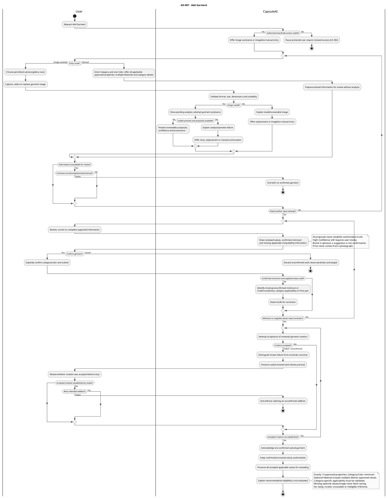
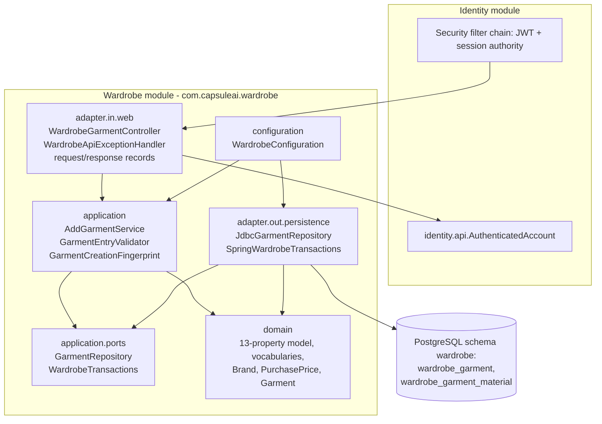
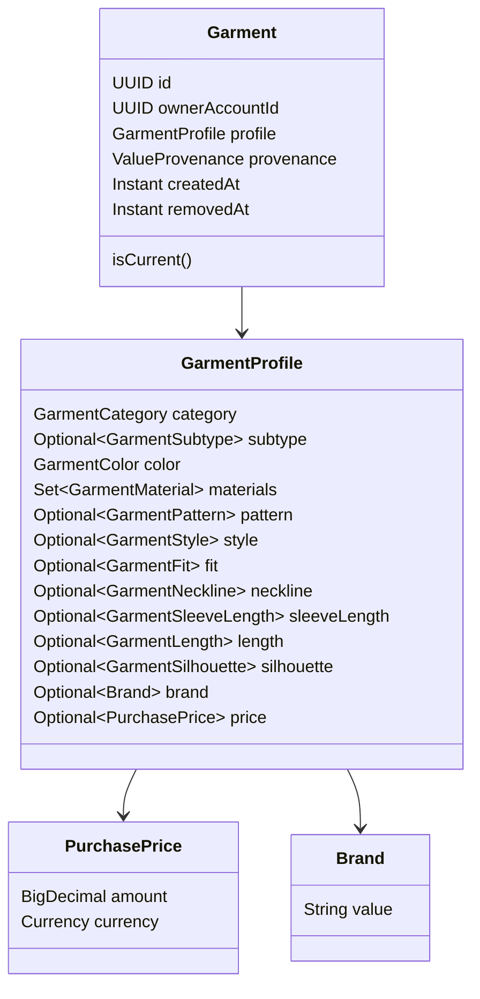
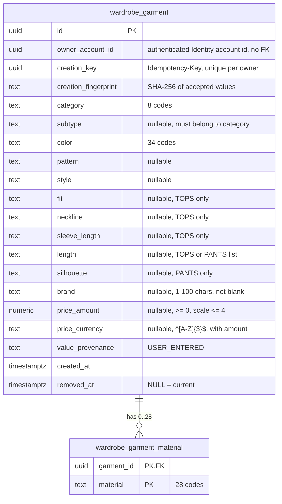

# US-GAR-001 — Add an Owned Garment Manually: Implementation Guide

| Field | Value |
| --- | --- |
| Sprint | Sprint 2 — Recover Access and Establish a Private Wardrobe |
| Story / parent PBI | US-GAR-001 — Add an owned garment manually / [PBI-006](../../../product-backlog.md#pbi-006--add-a-confirmed-garment-manually) |
| Implementation order | **2 of 4** (US-AUTH-005 → **US-GAR-001** → US-WAR-001 → US-WAR-002) |
| Starts from | "Stage 1": Stage 0 (the corrected Sprint 1 baseline, [README §3](README.md#3-repository-baseline)) plus everything in the [US-AUTH-005 guide](US-AUTH-005-guide.md) |
| Leaves | "Stage 2": the Wardrobe model, persistence and creation API that US-WAR-001 and US-WAR-002 reuse |
| Read with | [README](README.md), [shared architecture](shared-architecture.md) |
| Code status | **Proposed implementation code — compiled and its automated tests executed by the guide author in an isolated scratch copy of this repository** (Stage 2 commit: `clean verify` passed with 373 unit and 199 integration tests; full four-stage result: 382 and 228). Not applied to this repository, not run in hosted CI. US-GAR-001 is **not Done**. |

Labels: **[REQ]** requirement, **[ARCH]** architecture decision, **[TECH]** proposed technical decision of this guide, **[OPEN]** unresolved. Sections 3–8 are verbatim source text.

---

## 1. Story Overview

| Item | Content |
| --- | --- |
| Story ID / name | US-GAR-001 — Add an owned garment manually |
| Parent PBI | PBI-006 (Garment domain, Digital Wardrobe theme) |
| User value | A trustworthy, owned wardrobe entry from an explicitly confirmed Category and one dominant Color, without an image or AI; every other approved property can be added and is kept exactly. |
| Backend objective | The Wardrobe module's first real code: the 13-property model with all approved vocabularies and category applicability; validation that identifies every invalid/inapplicable value without substituting or discarding it; owner-scoped PostgreSQL persistence (Flyway V8); an authenticated, idempotent `POST /api/v1/wardrobe/garments` with at most one accepted garment per logical addition; truthful "eligibility not evaluated". |
| Hard dependencies | Usable authenticated access (Sprint 1, unchanged by Stage 1). The approved [garment-property authority](../../../../../Initial%20files/Image%20to%20Properties%20Extraction.md). US-AUTH-005 is **not** a technical prerequisite, but its Stage 1 code is the starting state. |
| Scope (backend) | Package `com.capsuleai.wardrobe` (domain, application, ports, JDBC adapter, web adapter, configuration); V8; CORS `Idempotency-Key`; OpenAPI v0.6.0; generalized contract test; CI; README. |
| Out of scope | Images, AI suggestions, editing (PBI-008), removal (PBI-016), search/filter (PBI-015), recommendation eligibility or any compatibility rule, a server-side draft store, mobile screens. |
| Expected outcome | AC-01–AC-13 backend parts implemented and verified; AC-14 (accessibility) and client draft handling remain client evidence; OPQ-013 validation choices awaiting PO confirmation. |

## 2. Repository Baseline (Stage 1)

| Existing component | Relevance |
| --- | --- |
| `backend/src/main/java/com/capsuleai/wardrobe/package-info.java` | The only Wardrobe file: module ownership documentation. No garment code, table or API exists. |
| `com.capsuleai.identity.api.AuthenticatedAccount` | Published contract giving the authenticated `accountId`; the only Identity type Wardrobe may use. |
| `IdentitySecurityConfiguration` | Default-deny: `/api/v1/wardrobe/**` is protected automatically (JWT + usable session). Its CORS bean allows `Authorization`, `Content-Type`, `Accept`. |
| `IdentityConfiguration.identityClock()` | The application's only `Clock` bean (tests replace it with `MutableClock`). |
| Spring `JdbcClient`, `PlatformTransactionManager` | Persistence and transaction infrastructure used by Identity. |
| Flyway V1–V7 | V6 moved the Sprint 1 tables into the `identity` schema; V7 added `identity.identity_password_reset`. Next free version: **V8**. |
| Schemas | `identity` (Identity's tables) and `public` (only Flyway's history). **No `wardrobe` schema exists**: this story's V8 creates it (AR-01). Wardrobe never reads, joins or references `identity.*` (AR-02–AR-04). |
| `foundation/IsolatedMigrationDatabase.java` (test) | A separate empty database for upgrade tests; `GarmentSchemaIT` upgrades from V7 to V8 on it. |
| `IdentityIntegrationTestSupport`, `IdentityTestConfiguration` | Shared real-application test context (PostgreSQL container, MockMvc, `MutableClock`, recording reset sender). |
| `IdentityOpenApiContractIT` | Checks **every** `/api/` handler against `docs/05-api/openapi.yaml`; it calls each documented operation without a token. |
| `ArchitectureDependencyTest`, `PersistenceOwnershipSqlTest`, `DatabaseSchemaOwnershipIT` | `BusinessModule` already registers `wardrobe` with schema `wardrobe`. Other modules may use only its `api`; its domain/application stay framework-free; Spring JDBC only in its persistence adapter; its SQL may name only `wardrobe.*`, always qualified; V8 may touch only the `wardrobe` schema. |
| `docs/05-api/openapi.yaml` v0.5.0 | Identity only; explicitly "does not introduce endpoints for ... wardrobe data". |


---

## 3. Original Business Requirements — Verbatim

All wording in Sections 3–8 is copied mechanically from the repository at Stage 0; nothing is paraphrased. Only the targets of links inside a quotation are rewritten, so that they open the same file and heading from this guide's folder. The link text is unchanged. The **Source** line above each quotation names its file, heading and line range.

### 3.1 Business goal, requirements and capabilities

**Source:** [BRD.md — 7. Business Goals](../../../../01-business/BRD.md#7-business-goals) · lines 140–140 at Stage 0

> | ID | Goal | Rationale | Expected Business / User Value | Related Product Capabilities |
> |---|---|---|---|---|
> | BG-01 | Reduce Wardrobe Digitization Effort | Manual setup delays access to useful wardrobe advice. | Faster access to a trustworthy digital closet with less repetitive entry. | CAP-01–CAP-04 |

**Source:** [BRD.md — 15.1 Wardrobe Digitization and Management](../../../../01-business/BRD.md#151-wardrobe-digitization-and-management) · lines 462–465 at Stage 0

> | ID | Requirement | Business Rationale | Priority | Related Goals |
> |---|---|---|---|---|
> | BR-002 | Users must retain final authority over garment information through review, confirmation, correction, and manual entry, with prediction confidence and provenance distinguished conceptually. | Reliable advice depends on trusted wardrobe information. | Must | BG-01, BG-02, BG-03, BG-04 |
> | BR-003 | Wardrobe understanding must support exactly the 13 approved properties and category applicability in Section 13.2, including optional multiple Materials, Brand and original purchase Price with explicit currency, without an image or recommendation gate. | Styling and utility assessment need richer context than basic tags. | Must | BG-01, BG-02, BG-03, BG-04 |
> | BR-004 | AI prediction failure or uncertainty must not prevent users from creating and maintaining wardrobe entries manually. | Preserve value when automation is unavailable or inaccurate. | Must | BG-01 |
> | BR-005 | Users must be able to maintain, browse, search, and filter an accurate current wardrobe, including adding, changing, and removing garments. | Decisions must reflect accessible, current possessions. | Must | BG-01, BG-02, BG-03 |

**Source:** [BRD.md — 13.1 Capability Map](../../../../01-business/BRD.md#131-capability-map) · lines 288–289 at Stage 0

> | ID | Capability | Business Purpose |
> |---|---|---|
> | CAP-03 | Wardrobe Management | Keep the wardrobe current and discoverable through maintenance, browsing, search, and filtering. |
> | CAP-04 | Garment Intelligence | Describe garment characteristics sufficiently to support styling, coverage, and purchase evaluation. |

### 3.2 BRD §13.2, referenced by BR-003

**Source:** [BRD.md — 13.2 Garment Intelligence and User Authority](../../../../01-business/BRD.md#132-garment-intelligence-and-user-authority) · lines 297–321 at Stage 0

> ### 13.2 Garment Intelligence and User Authority
>
> The current approved garment profile has exactly 13 fashion properties, with values and applicability owned by the [garment-property authority](../../../../../Initial%20files/Image%20to%20Properties%20Extraction.md). This replaces the earlier richer descriptor model; optional supporting media and technical metadata remain separate.
>
> | # | Property | Applicability | Required for Saving | Meaning / Value Authority |
> |---|---|---|---|---|
> | 1 | Category | All categories | Yes | One of eight category codes. |
> | 2 | Subtype | All categories | No | Optional category-valid selection from the complete approved list. |
> | 3 | Color | All categories | Yes | Exactly one dominant Color; Colorful is supported. |
> | 4 | Material | All categories | No | Zero, one or multiple approved materials; no semantic duplicates or invented percentages. |
> | 5 | Pattern | All categories | No | One optional approved Pattern. |
> | 6 | Style | All categories | No | Optional named Style selection; Etc is explanatory, never a value. |
> | 7 | Fit | Tops | No | Optional approved Fit. |
> | 8 | Neckline | Tops | No | Optional approved Neckline. |
> | 9 | Sleeve Length | Tops | No | Optional approved Sleeve Length. |
> | 10 | Length | Tops and Pants | No | Category-specific approved Length values. |
> | 11 | Silhouette | Pants | No | Optional approved Silhouette. |
> | 12 | Brand | All categories | No | Optional user-entered text; no enum/catalogue. |
> | 13 | Price | All categories | No | Optional amount originally paid: decimal amount and explicit ISO 4217 currency. |
>
> **AI Prediction → User Review → User Confirmation / Correction → Canonical Garment Profile**
>
> The final user-confirmed profile is the authoritative wardrobe representation. Attribute provenance must conceptually distinguish AI prediction, user confirmation, user correction, and user entry; confidence and prediction source remain meaningful. Material predictions may be uncertain. Supporting these concepts does not imply equally reliable automatic recognition for every attribute. User correction data offers a future improvement opportunity subject to privacy commitments.
>
> Exact approved vocabulary labels are maintained in the property authority. Future inference methods and storage realization remain downstream; recommendation eligibility is deferred to engine development.

## 4. Original Product Requirements — Verbatim

### 4.1 The approved garment-property authority (complete)

This file is the Product Owner-approved source of truth for the 13 properties, their applicability and every vocabulary value.

**Source:** [Image to Properties Extraction.md](../../../../../Initial%20files/Image%20to%20Properties%20Extraction.md) · complete file at Stage 0

> # CapsuleAI — Approved Garment Properties
>
> ## 1. Authority and Scope
>
> **Status: Product Owner-approved property model, 2026-11-05.** This existing file is the source of truth for the current garment properties, category applicability and explicitly listed vocabulary labels. The Product Owner approved all lists below; their previous research-candidate status is superseded. BRD/PRD/SRS, Business Rules, stories, plans and future contracts must follow this catalogue. This approval changes requirements; it does not claim implemented Wardrobe functionality or document-wide approval of downstream drafts.
>
> The current fashion-property model contains exactly the following 13 properties. Technical metadata and optional media are separate (Section 5). Category and Color require explicit user confirmation when the garment is saved; all other applicable properties are optional. All 13 applicable properties belong to the selected Sprint 2 creation/inspection scope.
>
> ## 2. Property Catalogue and Applicability
>
> | # | Property | Applicability | Required for Saving | Meaning / Value Authority |
> |---|---|---|---|---|
> | 1 | Category | All categories | Yes | One of eight category codes. |
> | 2 | Subtype | All categories | No | Optional category-valid selection from the complete approved list. |
> | 3 | Color | All categories | Yes | Exactly one dominant Color; Colorful is supported. |
> | 4 | Material | All categories | No | Zero, one or multiple approved materials; no semantic duplicates or invented percentages. |
> | 5 | Pattern | All categories | No | One optional approved Pattern. |
> | 6 | Style | All categories | No | Optional named Style selection; Etc is explanatory, never a value. |
> | 7 | Fit | Tops | No | Optional approved Fit. |
> | 8 | Neckline | Tops | No | Optional approved Neckline. |
> | 9 | Sleeve Length | Tops | No | Optional approved Sleeve Length. |
> | 10 | Length | Tops and Pants | No | Category-specific approved Length values. |
> | 11 | Silhouette | Pants | No | Optional approved Silhouette. |
> | 12 | Brand | All categories | No | Optional user-entered text; no enum/catalogue. |
> | 13 | Price | All categories | No | Optional amount originally paid: decimal amount and explicit ISO 4217 currency. |
>
> A supplied controlled value must match its approved list and category. An absent optional value is valid and does not mean an invented UNKNOWN/OTHER choice. Preserve explicitly listed actual fallback values only where defined. Do not silently substitute an invalid subtype or discard an inapplicable supplied field: identify it for correction or clearing. Subtype names that overlap another dimension do not automatically derive that dimension. MINI_DRESS and PARTY_DRESS remain subtypes; JACKET_DRESS stays distinct from OUTERWEAR and JUMPSUIT stays in the combined category.
>
> ## 3. Approved Controlled Vocabularies
>
> Labels and spelling below are authoritative product values. Category codes and the ten Dresses/Jumpsuits codes are already approved. Do not invent additional subtype identifiers or fallback values. Technical serialization/storage representations for other labels belong to selected-story JIT design and must preserve every approved label and its meaning.
>
> ### 3.1 Category and Subtype
>
> | Category Display Name | Category Identifier | Approved Subtypes |
> |---|---|---|
> | Tops | `TOPS` | T-shirts, Long Sleeve T-shirts, Sleeveless T-shirts, Polo Shirts, Tanks & Camils, Crop Tops, Blouses, Shirts, Sweatshirts, Hoodies, Sweaters, Sweater Vests, Sports Tops, Bodysuits |
> | Dresses/Jumpsuits | `DRESSES_JUMPSUITS` | Day Dress, T-Shirt Dress, Shirt Dress, Sweatshirt Dress, Sweater Dress, Jacket Dress, Suspender Dress, Jumpsuit, Party Dress, Mini Dress |
> | Pants | `PANTS` | Jeans, Trousers, Dress Pants, Track Pants, Leggings, Shorts |
> | Skirts | `SKIRTS` | Mini Skirts, Midi Skirts, Maxi Skirts |
> | Outerwear | `OUTERWEAR` | Coats, Trench Coats, Fur Coats, Shearling Coats, Blazers, Jackets, Blousons, Varsity Jackets, Trucker Jackets, Biker Jackets, Cardigans, Zip Up Hoodies, Field Jackets, Sport Jackets, Fleece Jackets, Parkas, Down Jackets, Puffer Jackets, Vests |
> | Shoes | `SHOES` | Sneakers, Slip Ons, Sports Shoes, Hiking Shoes, Boots, Combat Boots, Ugg Boots, Loafers & Loafer Mules, Boat Shoes & Moccasins, Flat Shoes, Heels, Sandals, Sandal Heels, Slides, Mule Heels |
> | Bags | `BAGS` | Tote, Shoulder, Crossbody, Waist, Canvas, Backpacks, Duffel, Clutch, Briefcases, Drawstring, Suitcases |
> | Headwear | `HEADWEAR` | Cap, Hats, Beanies, Berets, Fedoras, Sun Hats |
>
> | Dresses/Jumpsuits Subtype | Canonical Identifier |
> |---|---|
> | Day Dress | `DAY_DRESS` |
> | T-Shirt Dress | `T_SHIRT_DRESS` |
> | Shirt Dress | `SHIRT_DRESS` |
> | Sweatshirt Dress | `SWEATSHIRT_DRESS` |
> | Sweater Dress | `SWEATER_DRESS` |
> | Jacket Dress | `JACKET_DRESS` |
> | Suspender Dress | `SUSPENDER_DRESS` |
> | Jumpsuit | `JUMPSUIT` |
> | Party Dress | `PARTY_DRESS` |
> | Mini Dress | `MINI_DRESS` |
>
> ### 3.2 Globally Applicable Controlled Properties
>
> | Property | Approved Values |
> |---|---|
> | Color | White, Ivory, Beige, Light-Gray, Dark-Gray, Black, Light-Yellow, Yellow, Turmeric, Orange, Coral, Red, Pink, Hot-Pink, Light-Green, Green, Olive, Dark-Olive, Teal, Khaki, Cyan, Sky-Blue, Blue, Navy, Lavender, Purple, Burgundy, Camel, Brown, Dark-Brown, Magenta, Gold, Silver, Colorful |
> | Material | Cotton, Polyester, Nylon, Denim, Leather, Wool, Spandex (elastane), Linen, Acrylic, Silk, Rayon, Viscose, Tweed, Velvet, Chiffon, Suede, Corduroy, Lace, Fur, Down, Lyocell, Metal, Cupro, Cashmere, Mohair, Angora, Alpaca, Other Materials |
> | Pattern | Solid, Striped, Graphic, Dotted, Animal, Floral, Tropical, Paisley, Argyle, Camo, Color-Block, Repeated, Checkerboard, Plaid, Gingham, Houndstooth, Herringbone, Chevron, Tweed, Abstract, Tie Dye, Geometric, Lace, Other Patterns |
> | Style | Comfortable, Casual, Business Casual, Formal, Modern, Classic, Minimalist, Bohemian, Luxury, Sporty, Athleisure, Trendy, Kidcore, Artistic, Dressy, Feminine, Street |
>
> Color is one dominant color; Colorful is the listed value for multicolored garments. It adds no secondary-color or coordinate field. Material is an optional collection of distinct approved values; repeated selections do not create repeated semantic materials. Material percentages/proportions are neither required nor fabricated. Pattern is one optional value. Style applies to every category; the same named list was repeated for Tops, Pants and other categories in the former layout. The former word Etc was explanatory, not a fashion style, wildcard or enum member. New styles require Product Owner approval.
>
> ### 3.3 Category-Specific Controlled Properties
>
> | Property | Applicable Category | Approved Values |
> |---|---|---|
> | Fit | Tops | Slim, Regular, Loose, Oversized |
> | Neckline | Tops | Round, Scoop (U), Boat, V-Neck, Deep-V, Square, Surplice, Shirt Collar, Standup-Collar, Wide-Collar, Mockneck, Turtleneck, Strapless, Thick-Strap, Thin-Strap, Sweetheart, Off-The-Shoulder, Asymmetric, Halter, Illusion, Keyhole, Suit-Collar, Other |
> | Sleeve Length | Tops | Sleeveless, Cap Sleeve, Short Sleeve, 3/4 Sleeve, Long Sleeve |
> | Length | Tops | Cropped, Waist, Hip, Knee |
> | Length | Pants | Short, Long |
> | Silhouette | Pants | Flare, Slim, Tapered, Baggy, Skinny, Bootcut, Wide-leg |
>
> Do not apply Tops/Pants-specific fields to Dresses/Jumpsuits, Skirts, Outerwear, Shoes, Bags or Headwear. All global properties remain available for every category. Explicit labels such as Tanks & Camils are preserved as supplied; no semantic rename is introduced by this revision.
>
> ## 4. Brand, Price, Confirmation and Eligibility
>
> Brand is optional user-entered text across all categories, without a fixed enum, external catalogue or brand-recognition feature. Preserve accepted values, and represent unspecified Brand truthfully.
>
> Price is the optional user-reported amount originally paid to purchase the owned garment. When supplied it consists of a decimal amount and explicit ISO 4217 currency code. Both amount and currency must be supplied together or cleared; missing Price is unknown, not zero. Never infer currency from location, infer Price from appearance, use floating-point monetary values, or introduce conversion. This meaning is separate from market/resale/replacement/catalogue/affiliate values. Amount bounds, zero/negative handling, precision/rounding and currency-list policy remain unresolved where not otherwise approved; Brand length/normalization and Style selection cardinality need the applicable story-specific contract decision without adding vocabulary values.
>
> User-confirmed information is authoritative. Later image upload or AI suggestions cannot silently overwrite accepted properties. Future analysis is suggestion-only and must stay within this model; a Brand suggestion requires acceptance and Price never comes from the photograph alone. Missing images or AI failure never block manual creation. Preserve ownership, privacy, provenance, failed/uncertain-action distinctions and safe retries with at most one accepted garment per logical addition.
>
> Recommendation eligibility has not been evaluated. A saved garment is not invalid, unsuitable or ineligible because an engine policy is undefined or an optional property is absent. No ready/unready result, required compatibility field, fixed outfit composition or category-to-role mapping is approved for the current phase. Define composition, compatibility and sufficient-evidence policy during recommendation-engine development, using only approved properties unless the Product Owner approves a future model change. Sprint 2 exposes truthful accepted information and missing values; the smallest contract representation is selected during story-specific design, without mandating a NOT_EVALUATED enum or database field.
>
> ## 5. Technical Metadata, Images and Supersession
>
> Garment/Owner identity, timestamps, record version, ownership/confirmation state, provenance and idempotency/action-outcome information are system metadata, outside the 13 fashion properties. Keep what security, persistence, concurrency and integrity require; this catalogue does not prescribe physical columns or add a generic taxonomy framework. Images are optional supporting media, not a required fashion property.
>
> **Superseded fashion attributes:** Secondary Colors, HEX/HSL, Color Temperature, Palette Role, Pattern Density, Visual Noise, Layering Level, Bulk Index, Climate/Season Suitability and Occasion Tags are removed from the current approved garment model. Earlier conflicting subtype, color, pattern, fit and garment-style vocabularies are superseded by Section 3. They must not return as hidden fields, readiness gates or required derived attributes. User-profile style preferences, common needs, request occasion, weather context and necessary metadata remain distinct and are not removed by this garment decision.
>
> The earlier recommendation-readiness predicates and fixed TOP + BOTTOM + FOOTWEAR template/category mappings are superseded. Future outfit/purchase research remains research, not current property vocabulary or an approved compatibility algorithm. Historical findings may retain their original text when clearly marked.
>
> ## 6. Traceability and Delivery
>
> [BRD](../../../../01-business/BRD.md) BR-002/003/005 → [PRD](../../../../02-product/PRD.md) FEAT-AI-002/FEAT-GAR-001/FEAT-WAR-001 → [SRS](../../../../03-requirements/SRS.md) FR-GAR-001–013, DATA-GAR-001–005 → [Business Rules](../../../../03-requirements/business-rules.md) BRULE-GAR-001–010 → US-GAR-001, US-WAR-001/002 and UC-007/008/009 → [Sprint 2 plan](../sprint-plan.md) and [Test Strategy](../../../../07-testing/test-strategy.md).
>
> Retained superseded requirement/rule IDs preserve historical references; they do not require removed fields or readiness tests. Wardrobe remains the owning module. Exact API paths, DTOs, physical schema, normalization mechanics and transaction realization are selected-story JIT work. This documentation alignment implements no product code, migrations, AI extraction or recommendation engine.

### 4.2 Status note of the recommender research document

Only its application note applies; the research body introduces no garment property, readiness rule or algorithm for this story.

**Source:** [Solving the Strategic Purchase Recommender and Outfit Recommendation Engine.md](../../../../../Initial%20files/Solving%20the%20Strategic%20Purchase%20Recommender%20and%20Outfit%20Recommendation%20Engine.md) · lines 1–5 at Stage 0

> > **Current CapsuleAI application note — 2026-11-05.** The [approved garment-property file](../../../../../Initial%20files/Image%20to%20Properties%20Extraction.md) is the authority for exactly 13 properties, their applicability and every explicitly listed value. All its former research-candidate fashion lists are now approved. Category/one dominant Color plus confirmation save; Material supports multiple distinct selections, other applicable properties are optional, and images/metadata remain separate.
> >
> > The research body below, including findings, citations and limitations, is preserved. Its season/layer/embedding/template assumptions are research, not current garment fields or an approved compatibility algorithm. All former property-based readiness predicates and category-to-role mappings are superseded. Recommendation eligibility is not evaluated; no saved garment is declared ready, unsuitable or ineligible because a future policy is undefined. Composition/compatibility and sufficient-evidence policy are deferred to engine development.
> >
> > Brand is optional confirmed user text; Price is the original amount paid, as decimal amount plus explicit ISO 4217 currency. Neither becomes a mandatory compatibility input. Price never comes from appearance; future suggestions never overwrite confirmed properties. Preserve privacy and no personal-data training. The business Wardrobe Multiplier remains incremental unique valid outfit count on a consistent future approved evaluation basis, not a research weighted-score substitute. All applicable creation/persistence/detail properties belong to the selected Sprint 2 work; image assistance and engines remain separate future work.

### 4.3 JRN-02 and FEAT-AI-002

**Source:** [PRD.md — 8.2 JRN-02 — Garment Digitization](../../../../02-product/PRD.md#82-jrn-02--garment-digitization) · lines 202–233 at Stage 0

> ### 8.2 JRN-02 — Garment Digitization
>
> **Intent:** Turn a real owned garment into a trustworthy wardrobe entry with minimal effort.
>
> 1. From Today or Wardrobe, the user captures an image, selects one from the gallery, or chooses manual entry.
> 2. Image guidance helps avoid unclear garment photos; processing shows progress rather than a completed entry.
> 3. The user sees an available processed preview and proposed garment information, including uncertainty where relevant.
> 4. The user reviews suggestions shown as High Confidence, Needs Review, or Uncertain; confirms/corrects category and dominant color; and can use every approved category-valid subtype from the source catalogue without invented fallback choices. Manual entry does not require an image.
> 5. With confirmed Category and one approved Color, save while omitting optional fields and preserving all supplied applicable values. Recommendation eligibility is not evaluated.
>
> **Recovery:** Poor images support replacement; AI failure supports retry or manual continuation. Low confidence never silently becomes authoritative data. Canceling a draft does not create a confirmed garment.
>
> The following visualization focuses on the user's review choices and recovery paths, rather than the BRD's business processing flow.
>
> ```mermaid
> flowchart TD
>     Start["Add garment"] --> Choice{"Entry method"}
>     Choice -->|Image| Image["Capture or select"]
>     Choice -->|Manual| Manual["Enter garment information"]
>     Image --> Processing["See processing state"]
>     Processing --> Outcome{"Usable analysis?"}
>     Outcome -->|Yes| Review["Review preview and proposals"]
>     Outcome -->|No or unusable| Recovery["Retry or continue manually"]
>     Recovery -->|Retry| Image
>     Recovery -->|Manual| Manual
>     Review --> Edit["Accept or correct information"]
>     Manual --> Edit
>     Edit --> Confirm["Confirm garment profile"]
>     Confirm --> Saved["See garment in wardrobe"]
> ```
>
> A prediction can still require correction even when usable. Only the user's confirmation creates the authoritative wardrobe entry; AI availability and optional profile data are not conditions for manual completion. **Features:** FEAT-AI-001, FEAT-AI-002, FEAT-GAR-001.

**Source:** [PRD.md — 12.2 FEAT-AI-002 — Review, Confirmation, and Manual Entry](../../../../02-product/PRD.md#122-feat-ai-002--review-confirmation-and-manual-entry) · lines 506–541 at Stage 0

> ### 12.2 FEAT-AI-002 — Review, Confirmation, and Manual Entry
>
> **Purpose:** Make user-reviewed garment information authoritative.
>
> **User value:** The user can correct automation and still create useful wardrobe entries during AI failure.
>
> **Related BRD:** BR-001, BR-002, BR-003, BR-004, BR-005; CAP-02, CAP-03, CAP-04; BG-01–BG-04. **Primary users:** All personas.
>
> **Entry points / trigger:** Available analysis, uncertainty/failure recovery, or direct manual entry. **Preconditions:** Authenticated access; confirmed Primary Category and Dominant Color are the saveable minimum. A manually entered garment does not require an image.
>
> **Product behavior:**
>
> 1. Present proposals using High Confidence, Needs Review, and Uncertain; distinguish AI Suggested, User Confirmed, User Corrected, and User Entered provenance. Even high-confidence proposals remain reviewable.
> 2. Offer all 13 applicable properties from Section 13, including optional multiple Materials, category-specific details, Brand and Price; validate only supplied optional information. Category and one dominant Color plus confirmation remain the minimum.
> 3. Allow manual entry without AI success or an image. Unknown optional information stays unknown rather than fabricated.
> 4. Save after explicit confirmation of Category and Color, preserving every supplied valid applicable property. Recommendation eligibility is not evaluated and is not a save gate.
> 5. Show accepted garment information and guidance that eligibility has not been evaluated in Wardrobe; confirmed/corrected values are authoritative regardless of prior AI confidence, and later analysis cannot silently overwrite them.
>
> **User controls:** Review, edit, replace uncertain information, retry analysis, enter manually, confirm, or cancel. **Product states:** Proposal available, High Confidence, Needs Review, Uncertain, reviewing, manual entry, confirming, saved/saveable, recommendation eligibility not evaluated, save failed.
>
> **Failure / fallback:** Keep the distinction between unsaved work and confirmed data clear. Offer retry while preserving entered work where practical; do not report success after a failed confirmation.
>
> **Feature-level acceptance criteria:**
>
> - **AC-01:** The user can correct an AI-proposed category or color before confirming; the saved garment uses the correction.
> - **AC-02:** Representative AI-unavailable and low-confidence scenarios allow manual completion without a successful analysis.
> - **AC-03:** No AI proposal becomes authoritative or eligible as an owned item before confirmation.
> - **AC-04:** An uncertain material suggestion can be corrected or left unknown without a false claim of certainty.
> - **AC-05:** A later analysis does not silently replace a previously confirmed user value.
> - **AC-06:** A failed save is not shown as a successful wardrobe addition; retry does not result in an unexplained duplicate.
> - **AC-07:** Confirmed category and dominant color allow saving without subtype, Brand, Price, material, an image for manual entry, any other optional applicable property.
> - **AC-08:** Omitted subtype is valid for every category. A supplied subtype must belong to its category and the complete approved source list; unsupported pairs require correction or clearing, not silent reassignment or an invented fallback.
> - **AC-09:** A saved entry remains usable with missing optional properties. Recommendation eligibility has not been evaluated; do not label it ready, invalid, unsuitable or ineligible because an engine policy is undefined.
> - **AC-10:** High Confidence does not remove correction authority; Needs Review prompts checking, and Uncertain encourages correction/manual input without primary raw confidence numbers.
>
> **Out of scope / deferred detail:** The saveable minimum and confidence experience are resolved in Sections 13.3–13.4. Recommendation policy is deferred to engine development. Confidence thresholds, representation, save mechanics and technical retry behavior remain in their owning SRS/JIT artifacts. Rich descriptors are not all mandatory for saving.

### 4.4 FEAT-GAR-001 and its subsections

**Source:** [PRD.md — 13.1 FEAT-GAR-001 — Approved Garment Property Experience](../../../../02-product/PRD.md#131-feat-gar-001--approved-garment-property-experience) · lines 545–579 at Stage 0

> ### 13.1 FEAT-GAR-001 — Approved Garment Property Experience
>
> **Purpose / user value:** Let users create, review and inspect trustworthy garment information using the complete approved property model. Related business sources: BR-002/003/005/007/009/022; CAP-03/04; BG-01–04.
>
> The [garment-property authority](../../../../../Initial%20files/Image%20to%20Properties%20Extraction.md) owns the exact vocabulary labels and applicability. Its complete lists are approved, including every category's subtypes; earlier research-only status and older reduced vocabularies are superseded. This PRD describes behavior and references that single vocabulary authority.
>
> | # | Property | Applicability | Required for Saving | Meaning / Value Authority |
> |---|---|---|---|---|
> | 1 | Category | All categories | Yes | One of eight category codes. |
> | 2 | Subtype | All categories | No | Optional category-valid selection from the complete approved list. |
> | 3 | Color | All categories | Yes | Exactly one dominant Color; Colorful is supported. |
> | 4 | Material | All categories | No | Zero, one or multiple approved materials; no semantic duplicates or invented percentages. |
> | 5 | Pattern | All categories | No | One optional approved Pattern. |
> | 6 | Style | All categories | No | Optional named Style selection; Etc is explanatory, never a value. |
> | 7 | Fit | Tops | No | Optional approved Fit. |
> | 8 | Neckline | Tops | No | Optional approved Neckline. |
> | 9 | Sleeve Length | Tops | No | Optional approved Sleeve Length. |
> | 10 | Length | Tops and Pants | No | Category-specific approved Length values. |
> | 11 | Silhouette | Pants | No | Optional approved Silhouette. |
> | 12 | Brand | All categories | No | Optional user-entered text; no enum/catalogue. |
> | 13 | Price | All categories | No | Optional amount originally paid: decimal amount and explicit ISO 4217 currency. |
>
> **Product behavior:** Manual entry offers all applicable properties during Sprint 2. Review validates supplied values and category applicability, permits optional omissions, and explicitly confirms the accepted information. Preserve all accepted values through persistence and inspection. Unsupported/inapplicable values require correction or clearing; no silent substitution, fabricated value or additional property is allowed. Optional images and future AI suggestions stay separate from the confirmed profile.
>
> **Feature-level acceptance criteria:**
>
> - **AC-01:** Entry and inspection support all 13 applicable properties in the catalogue, with one dominant Color and optional multiple distinct Materials.
> - **AC-02:** Every supplied controlled value uses the authority's complete list and applicable category; invalid pairs/fields can be corrected or cleared without silent replacement.
> - **AC-03:** Optional Material may be empty, one or multiple values; duplicates add no semantic material and no percentages or physical-composition certainty are fabricated.
> - **AC-04:** Unknown information remains absent or qualified; it is not a confident prediction or user confirmation.
> - **AC-05:** All eight categories and all listed subtypes are supported, including exactly ten Dresses/Jumpsuits values. Preserve overlapping subtype labels without deriving another property automatically; Etc is never an accepted Style.
> - **AC-06:** Category plus one approved Color and explicit confirmation permit saving without any optional property, image, successful AI or recommendation gate. Eligibility is not evaluated, rather than ready, unsuitable or ineligible.
> - **AC-07:** Confirmation/provenance remain distinct from AI confidence; later output cannot silently replace accepted properties, including Brand/Price.
>
> **Delivery boundary:** All applicable creation properties and detail retrieval are included in the selected Sprint 2 stories. Later editing, photo/AI assistance and recommendation engines retain their separate PBIs; no whole-MVP API/schema design is required now.

**Source:** [PRD.md — 13.2 Controlled Initial Garment Subtypes](../../../../02-product/PRD.md#132-controlled-initial-garment-subtypes) · lines 581–585 at Stage 0

> ### 13.2 Controlled Initial Garment Subtypes
>
> The [approved Category/Subtype catalogue](../../../../../Initial%20files/Image%20to%20Properties%20Extraction.md#31-category-and-subtype) contains every supported subtype for TOPS, DRESSES_JUMPSUITS, PANTS, SKIRTS, OUTERWEAR, SHOES, BAGS and HEADWEAR. Use the complete lists without adding obsolete OTHER/UNKNOWN choices. The ten Dresses/Jumpsuits codes remain unchanged. Labels for other lists are the current authority; any technical representation must preserve them without inventing subtype values.
>
> Subtype is optional, but a supplied value must belong to the selected category. A category change requires review of incompatible subtype and category-specific fields. MINI_DRESS may overlap length and PARTY_DRESS occasion as concepts, but no extra Length applicability or garment Occasion property follows. JACKET_DRESS remains under Dresses/Jumpsuits; JUMPSUIT stays in that combined category. Further categories or vocabulary values require Product Owner approval.

**Source:** [PRD.md — 13.3 Saving and Deferred Recommendation Eligibility](../../../../02-product/PRD.md#133-saving-and-deferred-recommendation-eligibility) · lines 587–593 at Stage 0

> ### 13.3 Saving and Deferred Recommendation Eligibility
>
> Exactly 13 fashion properties are approved: Category, Subtype, Color, Material, Pattern, Style, Fit, Neckline, Sleeve Length, Length, Silhouette, Brand, Price. Category and one dominant Color plus explicit user confirmation form the saving minimum. All other applicable properties are optional. Material supports zero or multiple distinct selections; Pattern is single and optional. Fit, Neckline and Sleeve Length apply only to Tops; Length uses separate Tops/Pants vocabularies; Silhouette applies only to Pants. Every supplied controlled value must match the source vocabulary and category; correct or clear invalid/inapplicable input rather than silently substitute or discard it. Unknown optional information is absent, not an invented UNKNOWN/OTHER/Etc value. Preserve real listed fallbacks such as Other, Other Materials and Colorful only where defined.
>
> Recommendation eligibility has not been evaluated. A saved garment is not invalid, unsuitable or ineligible because an engine policy is undefined or an optional property is absent. No ready/unready result, required compatibility field, fixed outfit composition or category-to-role mapping is approved for the current phase. Define composition, compatibility and sufficient-evidence policy during recommendation-engine development, using only approved properties unless the Product Owner approves a future model change. Sprint 2 exposes truthful accepted information and missing values; the smallest contract representation is selected during story-specific design, without mandating a NOT_EVALUATED enum or database field.
>
> Removed fashion properties and the earlier readiness policy are explicitly superseded in the authority's Section 5. User-profile preferences, request occasion/weather and technical metadata remain separate. Their existence cannot recreate removed garment fields or a hidden compatibility gate.

**Source:** [PRD.md — 13.4 Confidence and Provenance Experience](../../../../02-product/PRD.md#134-confidence-and-provenance-experience) · lines 595–607 at Stage 0

> ### 13.4 Confidence and Provenance Experience
>
> These English labels specify semantic states; the initial UI presents understandable Vietnamese wording.
>
> | Confidence State | Expected Experience |
> |---|---|
> | High Confidence | Show the suggested value normally; review/correction authority remains with the user. |
> | Needs Review | Visually indicate the field needs checking with clear copy such as “Please check this value.” |
> | Uncertain | Explain that the attribute could not be identified confidently; encourage correction/manual entry. |
>
> Raw numerical confidence is not the primary user-facing experience. Numeric thresholds remain SRS/AI design/testing work.
>
> Provenance distinguishes **AI Suggested**, **User Confirmed**, **User Corrected**, and **User Entered**. Provenance answers how a value was established, while confidence qualifies an AI proposal. After user confirmation/correction, the user's value is authoritative regardless of the earlier AI confidence; neither confidence nor confirmation claims verified physical fabric composition.

**Source:** [PRD.md — 13.5 Optional Brand and Purchase Price](../../../../02-product/PRD.md#135-optional-brand-and-purchase-price) · lines 609–613 at Stage 0

> ### 13.5 Optional Brand and Purchase Price
>
> Brand is optional user-entered text for every category, with no enum/catalogue or recognition feature. Price is the optional amount originally paid for the garment, expressed as a decimal amount and explicit ISO 4217 currency code. Amount/currency must be supplied together or cleared; unknown Price is not zero. No location default, appearance inference, floating-point monetary value or currency conversion is introduced. Preserve accepted values through creation/detail and future editing; automated output cannot silently overwrite them.
>
> This is personal purchase information, distinct from retailer/affiliate guidance and its freshness rules. PRD OPQ-013 retains genuinely unresolved monetary-validation details. Brand bounds/normalization and technical serialization are proportional JIT work under existing conventions; they must not silently change confirmed information.

### 4.5 Approved taxonomy decisions and open follow-ups

**Source:** [PRD.md — 34.1 Approved Taxonomy Revision and Open Follow-up Decisions](../../../../02-product/PRD.md#341-approved-taxonomy-revision-and-open-follow-up-decisions) · lines 1522–1530 at Stage 0

> ### 34.1 Approved Taxonomy Revision and Open Follow-up Decisions
>
> | ID | Decision / Question | Status | Impact |
> |---|---|---|---|
> | OPQ-011 | Eight primary categories, exactly ten Dresses/Jumpsuits subtypes, optional subtype/Brand/Price; Price means user-reported purchase price with decimal amount and explicit ISO 4217 currency. | User-approved; recorded 2026-11-05 | Sections 12–14; BRD BR-002/003/005; SRS FR-GAR-001–006/011–013 and DATA-GAR-002; selected Sprint 2 wardrobe stories. |
> | OPQ-012 | Previous category-specific readiness question is superseded: all recommendation eligibility/composition/compatibility policy is deferred to engine development, without ready/ineligible claims in Sprint 2. | Resolved deferral; future design | All eight categories; no hidden garment descriptors or old category-to-role mapping. |
> | OPQ-013 | Decide monetary amount bounds, zero/negative handling, precision/rounding and supported currency-list policy; decide Brand length, blank handling and any normalization that affects user values. No location default or exchange-rate behavior is approved. | Open policy / selected-story JIT validation | Before implementing affected optional-field validation; approved meaning and optionality remain fixed. |
> | OPQ-014 | All explicitly listed category subtypes and fashion vocabularies are approved in Image to Properties Extraction.md. Overlap never implies automatic property derivation. | Resolved by final Product Owner decision | Complete vocabulary applies now; no pending Bags/Headwear subtype approval. |
> | OPQ-015 | Exactly 13 source-owned properties, all listed values approved, multiple Materials, one dominant Color, category applicability, removed obsolete attributes, deferred eligibility and all applicable properties in Sprint 2. | Final Product Owner approval, 2026-11-05 | Supersedes conflicting OPQ-003/004/011–014 property/readiness descriptions; unrelated profile/context decisions remain valid. |

## 5. Original Software Requirements — Verbatim

### 5.1 Garment ingestion (SRS §3.4) and manual-entry requirements

**Source:** [SRS.md — 3.4 Garment Ingestion](../../../../03-requirements/SRS.md#34-garment-ingestion) · lines 227–236 at Stage 0

> ### 3.4 Garment Ingestion
>
> JRN-02 starts from Add Garment. Before confirmation, image/proposal work is a draft, not an owned confirmed item.
>
> | Stimulus | Expected System Response |
> |---|---|
> | Capture/select image | Show selected input, processing, and any usable preview/proposals. |
> | Review/correct or choose manual entry | Retain user authority; permit manual saving without AI success or an image. |
> | Confirm category and dominant color | Create the authoritative owned entry and show guidance that eligibility is not evaluated. |
> | Cancel or processing fails | Do not create a confirmed item; allow appropriate replacement/retry/manual continuation. |

**Source:** [SRS.md — 3.4.1 Image Input and Preview Criteria](../../../../03-requirements/SRS.md#341-image-input-and-preview-criteria) · lines 256–263 at Stage 0

> | ID | Requirement | Scope | Source | Verification |
> |---|---|---|---|---|
> | FR-AI-003 | The system shall provide manual garment entry without requiring an image or successful automated analysis. | MVP | FEAT-AI-002; BR-004 | T: imageless/manual completion. |
> | FR-AI-008 | The system shall create a confirmed wardrobe entry only after explicit user confirmation of the saveable minimum. | MVP | FEAT-AI-002; BR-002, BR-005 | T: confirm versus draft. |
> | FR-AI-009 | The system shall leave no confirmed entry from canceled preconfirmation work. | MVP | FEAT-AI-001, FEAT-AI-002; BR-001, BR-002 | T: canceled draft absent. |
> | FR-AI-010 | The system shall acknowledge a successful addition distinctly from pending/failed work without manufacturing duplicate entries on retry. | MVP | FEAT-AI-002; BR-005 | T: successful/failed-save retry. |

### 5.2 Garment intelligence (SRS §3.5, §3.5.1)

**Source:** [SRS.md — 3.5 Garment Intelligence](../../../../03-requirements/SRS.md#35-garment-intelligence) · lines 267–277 at Stage 0

> ### 3.5 Garment Intelligence
>
> The [garment-property authority](../../../../../Initial%20files/Image%20to%20Properties%20Extraction.md) owns complete vocabularies and applicability. Exactly 13 fashion properties are supported; all applicable properties enter selected Sprint 2 implementation scope.
>
> #### 3.5.1 Saving and Deferred Recommendation Eligibility
>
> Exactly 13 fashion properties are approved: Category, Subtype, Color, Material, Pattern, Style, Fit, Neckline, Sleeve Length, Length, Silhouette, Brand, Price. Category and one dominant Color plus explicit user confirmation form the saving minimum. All other applicable properties are optional. Material supports zero or multiple distinct selections; Pattern is single and optional. Fit, Neckline and Sleeve Length apply only to Tops; Length uses separate Tops/Pants vocabularies; Silhouette applies only to Pants. Every supplied controlled value must match the source vocabulary and category; correct or clear invalid/inapplicable input rather than silently substitute or discard it. Unknown optional information is absent, not an invented UNKNOWN/OTHER/Etc value. Preserve real listed fallbacks such as Other, Other Materials and Colorful only where defined.
>
> Recommendation eligibility has not been evaluated. A saved garment is not invalid, unsuitable or ineligible because an engine policy is undefined or an optional property is absent. No ready/unready result, required compatibility field, fixed outfit composition or category-to-role mapping is approved for the current phase. Define composition, compatibility and sufficient-evidence policy during recommendation-engine development, using only approved properties unless the Product Owner approves a future model change. Sprint 2 exposes truthful accepted information and missing values; the smallest contract representation is selected during story-specific design, without mandating a NOT_EVALUATED enum or database field.
>
> The old readiness predicates are superseded. Retained superseded/deferred IDs establish no implementation obligation for removed fields. Optional absence is separate from invalid supplied input, failed persistence and lost authorization.

**Source:** [SRS.md — 3.5.1 Saving and Deferred Recommendation Eligibility](../../../../03-requirements/SRS.md#351-saving-and-deferred-recommendation-eligibility) · lines 282–294 at Stage 0

> | ID | Requirement | Scope | Source | Verification |
> |---|---|---|---|---|
> | FR-GAR-001 | The system shall support primary classification limited to TOPS, DRESSES_JUMPSUITS, PANTS, SKIRTS, OUTERWEAR, SHOES, BAGS, HEADWEAR. | MVP | FEAT-GAR-001; BR-003 | T: defined categories only. |
> | FR-GAR-002 | The system shall support every approved category-specific Subtype in the source authority, validate parent association and allow omission without invented fallback values or silent replacement. | MVP | FEAT-GAR-001, FEAT-AI-002; BR-003, BR-002 | T: defined vocabularies and subtype fallback saving. |
> | FR-GAR-003 | The system shall accept a garment with a supported Category, one supported dominant Color and explicit user confirmation, without requiring any other property, image, successful AI analysis or recommendation-eligibility gate. | MVP | FEAT-AI-002, FEAT-GAR-001; BR-002, BR-003 | T: minimum-only profile. |
> | FR-GAR-004 | The system shall distinguish valid saved ownership from recommendation eligibility that has not been evaluated, without labeling a garment ready, invalid, unsuitable or ineligible because a future policy is undefined or optional information is absent. | MVP | FEAT-GAR-001, FEAT-OUT-001; BR-003, BR-009 | T/I: valid saving, optional absence and unevaluated eligibility without invalid/unsuitable/ineligible claims. |
> | FR-GAR-005 | **Superseded — no active obligation.** The previous compatibility-field readiness prerequisites are removed by the final 13-property decision. Retain this ID for references; future engine eligibility requires approved policy and cannot reintroduce removed fields. | Superseded | FEAT-GAR-001, FEAT-OUT-001; BR-003, BR-009 | I: history only; no active readiness test. |
> | FR-GAR-006 | The system shall keep all properties except Category and Color optional for saving, enforce category applicability on supplied values and preserve valid accepted optional information without fabricating missing values. | MVP | FEAT-GAR-001; BR-003 | T: every optional omission and supplied-value/applicability case. |
> | FR-GAR-007 | The system shall support optional Fit, Neckline and Sleeve Length only for Tops, category-specific Length only for Tops/Pants, and Silhouette only for Pants, using exact approved lists and correcting or clearing inapplicable supplied fields. | MVP | FEAT-GAR-001; BR-003 | T/I: every approved category-specific detail/value and inapplicable input. |
> | FR-GAR-008 | The system shall require exactly one dominant Color from the complete approved list, including Colorful, without secondary-color or coordinate extensions. | MVP | FEAT-GAR-001; BR-003 | T: all approved single Colors; no extra color property. |
> | FR-GAR-009 | The system shall support one optional Pattern and optional named Style selection using complete source lists, without accepting Etc, arbitrary additions or deriving unsupported compatibility descriptors. | MVP | FEAT-GAR-001; BR-003 | T: every approved optional Pattern/Style; Etc and arbitrary values rejected. |
> | FR-GAR-010 | The system shall support zero, one or multiple distinct approved Material values per garment, avoiding duplicate semantic selections and fabricated percentages, proportions or verified-composition claims. | MVP | FEAT-GAR-001; BR-003 | T: uncertain material case. |
> | FR-GAR-011 | The system shall make user-confirmed/corrected/entered values authoritative and prevent later automated output from silently replacing them. | MVP | FEAT-GAR-001, FEAT-AI-002; BR-002 | T: analysis after correction. |
> | FR-GAR-012 | The system shall support optional user-entered Brand text for every supported garment category, preserve confirmed values for inspection and future editing, and keep unavailable or unaccepted suggested Brand distinct from confirmed information without a fixed brand enum or silent automated overwrite. | MVP | FEAT-GAR-001, FEAT-AI-002, FEAT-WAR-001, FEAT-WAR-002; BR-002, BR-003, BR-005 | T: absent/present Brand across eight categories, value fidelity and late-proposal protection. |
> | FR-GAR-013 | The system shall support optional user-reported purchase Price for every supported garment category as a decimal monetary amount with explicit ISO 4217 currency code when supplied, preserve it for inspection and future editing, and allow omission without save/readiness failure. It shall not fabricate Price from appearance, infer currency from location, use floating-point monetary calculations or silently overwrite confirmed Price. | MVP | FEAT-GAR-001, FEAT-AI-002, FEAT-WAR-001, FEAT-WAR-002; BR-002, BR-003, BR-005 | T: absent/present amount-and-currency, partial-pair correction, decimal fidelity and non-fabrication; Section 3.5.2 / PRD OPQ-013. |

### 5.3 Optional Brand and Purchase Price (SRS §3.5.2)

**Source:** [SRS.md — 3.5.2 Optional Brand and Purchase Price](../../../../03-requirements/SRS.md#352-optional-brand-and-purchase-price) · lines 296–300 at Stage 0

> #### 3.5.2 Optional Brand and Purchase Price
>
> Brand is optional user-entered text across all categories, without an enum/catalogue. Price is the optional amount originally paid: decimal amount plus explicit ISO 4217 currency, supplied together or cleared. Unknown Price is not zero; no appearance/location inference, floating-point monetary representation or currency conversion is permitted. Preserve confirmed values through the authorized addition and its safe-retry outcome. No AI output silently replaces them.
>
> Amount limits, zero/negative treatment, precision/rounding, currency-list maintenance and reasonable text/normalization conventions remain proportional selected-story JIT work under PRD OPQ-013; Style selection cardinality is not prescribed by a speculative wire/schema design. Resolve genuine externally visible ambiguities before dependent implementation. DATA-INT-001/004 and privacy/ownership continue to apply.

### 5.4 Authorization

**Source:** [SRS.md — 3.1.1 Authentication and Recovery Rules](../../../../03-requirements/SRS.md#311-authentication-and-recovery-rules) · lines 188–189 at Stage 0

> | ID | Requirement | Scope | Source | Verification |
> |---|---|---|---|---|
> | FR-AUTH-008 | The system shall restrict protected personal operations to an authenticated user authorized for the affected information. | MVP | FEAT-AUTH-001; BR-021 | T: signed-out/cross-user denial. |
> | FR-AUTH-009 | The system shall authenticate protected operations with a valid, unexpired JWT Access Token and the authorized session/account context. | MVP | FEAT-AUTH-001; BR-021 | T/I: absent, invalid, expired and valid JWT access; session authorization. |

### 5.5 Data requirements

**Source:** [SRS.md — 4.3 Garment & Wardrobe Data](../../../../03-requirements/SRS.md#43-garment--wardrobe-data) · lines 657–661 at Stage 0

> | ID | Requirement | Scope | Source | Verification |
> |---|---|---|---|---|
> | DATA-GAR-001 | The system shall associate each current garment and accepted profile with its authorized owner, supported Category and one confirmed approved Color, preserving confirmation and active ownership separately from future evaluation. | MVP | FEAT-GAR-001, FEAT-WAR-001; BR-003, BR-005 | T/I: owner and saveable minimum. |
> | DATA-GAR-002 | The system shall preserve exactly the 13 source-approved fashion properties and applicability, including optional multiple distinct Materials, one dominant Color, category-specific fields, Brand text and decimal purchase Price with explicit ISO 4217 currency; absent values and necessary metadata shall remain distinct. | MVP | FEAT-GAR-001; BR-003 | I/T: descriptor sets, scales, SOLID density and non-mandatory rich information. |
> | DATA-GAR-003 | The system shall associate proposals with evidence-based confidence/provenance under Section 8.1 separately from authoritative user values, without treating numeric confidence as confirmation. | MVP | FEAT-GAR-001, FEAT-AI-002; BR-002, BR-003 | T/I: default thresholds, evidence guards, calibration and confirmation. |
> | DATA-GAR-004 | The system shall associate available image/preview information with the appropriate draft or garment without requiring an image for manually saved entries. | MVP | FEAT-AI-001, FEAT-AI-002; BR-001, BR-002 | T: imageless and image entry. |
> | DATA-GAR-005 | The system shall represent active/removed ownership independently from missing optional properties and unevaluated recommendation eligibility, without requiring a readiness flag, NOT_EVALUATED enum, compatibility field or physical schema prescribed by this SRS. | MVP | FEAT-GAR-001, FEAT-WAR-002; BR-003, BR-005 | T/I: ownership and unevaluated eligibility remain distinct; no property gate. |

**Source:** [SRS.md — 4.7 Data Integrity](../../../../03-requirements/SRS.md#47-data-integrity) · lines 693–696 at Stage 0

> | ID | Requirement | Scope | Source | Verification |
> |---|---|---|---|---|
> | DATA-INT-001 | The system shall prevent an AI proposal or later analysis from silently superseding a confirmed/corrected garment value. | MVP | FEAT-AI-002, FEAT-GAR-001; BR-002 | T: authority preservation. |
> | DATA-INT-004 | The system shall keep failed/pending mutations distinct from accepted state, preventing duplicates of the same logical action without collapsing separate explicit Wear intentions. | MVP | FEAT-AI-002, FEAT-PERS-002; BR-005, BR-011 | T: interrupted additions/Wear actions; retry versus explicit same-outfit/day repeat. |

**Source:** [SRS.md — 4.10 Controlled Vocabularies and Descriptor Scales](../../../../03-requirements/SRS.md#410-controlled-vocabularies-and-descriptor-scales) · lines 715–745 at Stage 0

> ### 4.10 Controlled Vocabularies and Descriptor Scales
>
> The [garment-property authority](../../../../../Initial%20files/Image%20to%20Properties%20Extraction.md) is normative for all 13 properties, applicability and complete vocabulary labels. Its Section 3 contains all 84 Subtypes, 34 Colors, 28 Materials, 24 Patterns, 17 named Styles and every category-specific detail choice. Exactly ten Dresses/Jumpsuits identifiers remain approved. Do not maintain a reduced competing list or invent additional subtype identifiers.
>
> | # | Property | Applicability | Required for Saving | Meaning / Value Authority |
> |---|---|---|---|---|
> | 1 | Category | All categories | Yes | One of eight category codes. |
> | 2 | Subtype | All categories | No | Optional category-valid selection from the complete approved list. |
> | 3 | Color | All categories | Yes | Exactly one dominant Color; Colorful is supported. |
> | 4 | Material | All categories | No | Zero, one or multiple approved materials; no semantic duplicates or invented percentages. |
> | 5 | Pattern | All categories | No | One optional approved Pattern. |
> | 6 | Style | All categories | No | Optional named Style selection; Etc is explanatory, never a value. |
> | 7 | Fit | Tops | No | Optional approved Fit. |
> | 8 | Neckline | Tops | No | Optional approved Neckline. |
> | 9 | Sleeve Length | Tops | No | Optional approved Sleeve Length. |
> | 10 | Length | Tops and Pants | No | Category-specific approved Length values. |
> | 11 | Silhouette | Pants | No | Optional approved Silhouette. |
> | 12 | Brand | All categories | No | Optional user-entered text; no enum/catalogue. |
> | 13 | Price | All categories | No | Optional amount originally paid: decimal amount and explicit ISO 4217 currency. |
>
> Profile Style preferences and Occasion/request context are separate from garment Style; they do not add garment properties:
>
> | Context Vocabulary | Existing Values |
> |---|---|
> | Profile Style preference | `MINIMAL`, `CASUAL`, `SMART_CASUAL`, `CLASSIC`, `STREETWEAR`, `SPORTY`, `FORMAL` |
> | Request Occasion | `EVERYDAY`, `WORK`, `SCHOOL_UNIVERSITY`, `DATE`, `SOCIAL_EVENT`, `FORMAL_EVENT`, `TRAVEL`, `SPORT_ACTIVITY` |
> | Capsule Need Dimensions | Everyday / Casual; Work / Professional; School / University; Formal / Special Event; Travel; Sport / Active. |
> | AI Confidence (metadata) | High Confidence; Needs Review; Uncertain. |
> | Attribute Provenance (metadata) | AI Suggested; User Confirmed; User Corrected; User Entered. |
>
> Unknown optional information is absent, not an extra enum value. Etc is explanatory, not accepted as Style. Real fallback labels remain only where listed. Technical metadata and optional media are outside the 13 properties; no automatic cross-property inference or extra readiness field is selected.

### 5.6 Interfaces

**Source:** [SRS.md — 5.1 User Interfaces](../../../../03-requirements/SRS.md#51-user-interfaces) · lines 758–760 at Stage 0

> | ID | Requirement | Scope | Source | Verification |
> |---|---|---|---|---|
> | UI-004 | The system shall display garment identity/category/color, guidance that eligibility is not evaluated, and available image without hiding imageless manual entries. | MVP | FEAT-WAR-001, FEAT-GAR-001; BR-005, BR-003 | I: cards and minimum-only detail. |
> | UI-006 | The system shall require explicit confirmation for an authoritative garment entry and expose correction/manual controls. | MVP | FEAT-AI-002; BR-002 | D: proposal to corrected confirmation. |

**Source:** [SRS.md — 5.4 Communication Interfaces](../../../../03-requirements/SRS.md#54-communication-interfaces) · lines 788–789 at Stage 0

> | ID | Requirement | Scope | Source | Verification |
> |---|---|---|---|---|
> | COM-001 | The system shall protect private access/wardrobe/profile/history exchanges against unauthorized disclosure or alteration, preserving password values and the session/account authority defined in Section 3.1.1. | MVP | FEAT-AUTH-001; BR-021 | A/T: protected exchange; Unicode/spaces preserved; session ownership. |
> | COM-002 | The system shall distinguish interrupted communication from accepted save, access/recovery or Wear action outcomes, applying Section 9 recovery without false completion or duplicated logical actions. | MVP | FEAT-AI-002, FEAT-PERS-002, FEAT-AUTH-001; BR-005, BR-011, BR-021 | T: interrupted save/reset/refresh/Wear actions and outcome review. |

### 5.7 Error and failure requirements

**Source:** [SRS.md — 9. Error and Failure Requirements](../../../../03-requirements/SRS.md#9-error-and-failure-requirements) · lines 982–984 at Stage 0

> ## 9. Error and Failure Requirements
>
> These requirements specify recoverable outcomes, not exception types or infrastructure retry algorithms. Previously confirmed information remains authoritative. An interrupted response is not proof that an action failed; uncertain outcomes must remain distinguishable from accepted results, and recovery must not create accidental duplicate logical actions.

**Source:** [SRS.md — 9.3 Garment Completeness](../../../../03-requirements/SRS.md#93-garment-completeness) · lines 1005–1006 at Stage 0

> | ID | Failure Condition | Required System Behavior | Continuation / State Protection | Source | Verification |
> |---|---|---|---|---|---|
> | ERR-GAR-001 | Save attempted without the saveable minimum. | The system shall explain missing confirmed Primary Category or Dominant Color and retain the draft for correction rather than save it as an authoritative garment. | User supplies/changes the missing information; existing garments remain unchanged. | FEAT-AI-002, FEAT-GAR-001; BR-002, BR-003 | T: each minimum value missing. |
> | ERR-GAR-002 | Recommendation eligibility has not been evaluated. | The system shall disclose the unevaluated state without calling the garment invalid, unsuitable or ineligible; the previous missing-compatibility-field error is superseded. | Retain accepted information and ordinary wardrobe access; no enrichment gate. | FEAT-GAR-001, FEAT-WAR-001; BR-003, BR-005, BR-022 | T/I: no unsupported eligibility claim or save/browse/detail gate. |

**Source:** [SRS.md — 9.9 Communication and Partial Dependency Failure](../../../../03-requirements/SRS.md#99-communication-and-partial-dependency-failure) · lines 1048–1048 at Stage 0

> | ID | Failure Condition | Required System Behavior | Continuation / State Protection | Source | Verification |
> |---|---|---|---|---|---|
> | ERR-NET-001 | Network/communication fails during an action. | The system shall distinguish interrupted communication and uncertain mutation outcomes from confirmed success or empty data, providing applicable outcome review/retry without accidental duplicate actions. | Previously confirmed information is preserved; an already accepted action is not repeated as a new one. No general offline guarantee. | FEAT-AI-002, FEAT-PERS-002, FEAT-WAR-001; BR-005, BR-011, BR-022 | T: interruption before/after action acceptance. |

### 5.8 Security, privacy, reliability, accessibility and localization

**Source:** [SRS.md — 6.2 Security](../../../../03-requirements/SRS.md#62-security) · lines 809–810 at Stage 0

> | ID | Requirement | Scope | Source | Verification |
> |---|---|---|---|---|
> | NFR-SEC-001 | The system shall permit zero successful unauthorized cross-user wardrobe/image accesses in the agreed validation scenarios. | MVP | FEAT-AUTH-001, FEAT-WAR-001; BR-021 | T: two-account and unauthenticated attempts; MET-Q06. |
> | NFR-SEC-002 | The system shall prevent account switch or logout from exposing the preceding user's protected content, enforcing current-session logout isolation and all-Refresh-Session revocation after successful password reset. | MVP | FEAT-AUTH-001; BR-021 | T: two sessions/accounts; current logout versus account-wide reset. |

**Source:** [SRS.md — 6.3 Privacy](../../../../03-requirements/SRS.md#63-privacy) · lines 817–817 at Stage 0

> | ID | Requirement | Scope | Source | Verification |
> |---|---|---|---|---|
> | NFR-PRIV-001 | The system shall limit personal data processing to necessary functionality, personalization, wardrobe/history/utilization, validation/measurement, security and operational integrity; explain its purpose and respect omission/correction/removal/permission controls within the authorized User's private experience, with no public wardrobes, user-to-user sharing, unrestricted third-party sharing or sale of personal data. | MVP | FEAT-AUTH-001, FEAT-PROF-001, FEAT-PROF-002, FEAT-PERS-001, FEAT-PERS-002; BR-012, BR-013, BR-021 | I/D: purpose, private access, feature controls and absence of unapproved sharing/sale. |

**Source:** [SRS.md — 6.4 Reliability](../../../../03-requirements/SRS.md#64-reliability) · lines 824–824 at Stage 0

> | ID | Requirement | Scope | Source | Verification |
> |---|---|---|---|---|
> | NFR-REL-001 | The system shall preserve manual garment creation in all agreed representative AI-failure scenarios without changing confirmed information into an unconfirmed proposal. | MVP | FEAT-AI-001, FEAT-AI-002; BR-002, BR-004 | T: agreed unavailable/failed/uncertain analysis cases; MET-Q05. |

**Source:** [SRS.md — 6.7 Accessibility](../../../../03-requirements/SRS.md#67-accessibility) · lines 849–850 at Stage 0

> | ID | Requirement | Scope | Source | Verification |
> |---|---|---|---|---|
> | NFR-ACC-001 | The system shall communicate meaningful confidence, unevaluated eligibility, unavailable/outdated, hypothetical, and removed states with understandable labels rather than relying solely on color or a garment image. | MVP | FEAT-GAR-001, FEAT-WAR-001, FEAT-OUT-001, FEAT-MULT-001, FEAT-ANL-001; BR-003, BR-005, BR-006, BR-022 | I/D: labels remain meaningful without color/image cues. |
> | NFR-ACC-002 | The system shall support meaningful accessible names/roles/states, operable core journeys and accessible primary actions at text scaling up to 200%, with approximately 48 dp Android/44 pt iOS minimum primary-control touch targets; applicable core journeys shall be validated with TalkBack and VoiceOver. | MVP | FEAT-AUTH-001, FEAT-AI-002, FEAT-OUT-001, FEAT-PERS-002; BR-002, BR-011, BR-022, BR-023 | D/I: both screen readers, accessible semantics, 200% text scaling, target sizes and outcome meaning; Section 12.4; no certification claim. |

**Source:** [SRS.md — 7. Localization Requirements](../../../../03-requirements/SRS.md#7-localization-requirements) · lines 894–895 at Stage 0

> | ID | Requirement | Scope | Source | Verification |
> |---|---|---|---|---|
> | LOC-001 | The system shall provide the initial user interface, explanations, and applicable recovery guidance in Vietnamese on Android and iOS. | MVP | FEAT-AUTH-001, FEAT-OUT-001, FEAT-AI-002; BR-002, BR-022, BR-023 | I/D: initial Vietnamese journeys. |
> | LOC-002 | The system shall keep canonical category/subtype, style/occasion, confidence, and provenance semantics independent of translated display labels. | MVP | FEAT-PROF-001, FEAT-GAR-001, FEAT-AUTH-001; BR-003, BR-010, BR-023 | I/T: vocabulary-to-label mapping. |

## 6. Original Business Rules — Verbatim

**Source:** [business-rules.md — BRULE-AUTH-001 — Authorized Personal Operations](../../../../03-requirements/business-rules.md#brule-auth-001--authorized-personal-operations) · lines 80–86 at Stage 0

> ### BRULE-AUTH-001 — Authorized Personal Operations
>
> **Rule:** Personal wardrobe, profile, feedback, history, and assessment operations require authentication and authorization for the affected user's information. Unavailable authorized access is not an empty wardrobe and does not change personal state.
>
> **Applies To:** all personal domain operations.
>
> **Source:** FR-AUTH-008, ERR-AUTH-001, DATA-GAR-001.

**Source:** [business-rules.md — BRULE-AUTH-007 — Purpose-Limited Private Data Use](../../../../03-requirements/business-rules.md#brule-auth-007--purpose-limited-private-data-use) · lines 130–138 at Stage 0

> ### BRULE-AUTH-007 — Purpose-Limited Private Data Use
>
> **Rule:** Personal data is used only as necessary for CapsuleAI functionality, personalization, wardrobe/history/utilization, validation/measurement, security and operational integrity within the authorized User's private experience. MVP personal images, profiles, Wear Events, feedback and corrections are not used for AI model training/improvement. Future personal-data training requires separate explicit opt-in and an approved future product/privacy change.
>
> No public wardrobes, user-to-user wardrobe sharing, unrestricted third-party sharing or sale of personal data is introduced. External dependencies receive only purpose-minimal information: required selected weather location, email/necessary recovery-delivery information, or explicitly chosen shopping navigation without unrelated wardrobe/profile/history disclosure. Necessary active-account information and minimal history follow the retention/removal rules; this policy adds no Delete Account goal or legal certification.
>
> **Applies To:** personal information, account/profile/wardrobe/history, validation/measurement and external exchanges.
>
> **Source:** FR-AUTH-008, NFR-PRIV-001, NFR-PRIV-002, SI-002, SI-003, COM-003, FR-MET-006, DATA-RET-001, DATA-RET-002, DATA-RET-003.

**Source:** [business-rules.md — BRULE-GAR-001 — Canonical Garment Authority](../../../../03-requirements/business-rules.md#brule-gar-001--canonical-garment-authority) · lines 172–178 at Stage 0

> ### BRULE-GAR-001 — Canonical Garment Authority
>
> **Rule:** Each owned garment belongs to the authorized user's wardrobe. Automated attribute proposals are not authoritative. Applicable User Confirmed, User Corrected, or User Entered-and-confirmed values establish the canonical profile; later automated analysis cannot silently overwrite them.
>
> **Applies To:** ingestion, edits, all garment-dependent evaluations.
>
> **Source:** DATA-GAR-001, FR-GAR-011, AI-REQ-001, AI-REQ-007, DATA-INT-001.

**Source:** [business-rules.md — BRULE-GAR-002 — Saveable Minimum](../../../../03-requirements/business-rules.md#brule-gar-002--saveable-minimum) · lines 182–188 at Stage 0

> ### BRULE-GAR-002 — Saveable Minimum
>
> **Rule:** A garment is Saveable when the user explicitly confirms its supported Primary Category and Dominant Color. Manual creation requires neither an image nor successful analysis. Missing optional rich descriptors do not prevent saving; canceled or unconfirmed work does not establish a confirmed wardrobe entry.
>
> **Applies To:** assisted/manual creation and validation.
>
> **Source:** FR-GAR-003, FR-AI-003, FR-AI-008, FR-AI-009, ERR-GAR-001.

**Source:** [business-rules.md — BRULE-GAR-003 — Evaluation-Specific Recommendation-Readiness](../../../../03-requirements/business-rules.md#brule-gar-003--evaluation-specific-recommendation-readiness) · lines 192–198 at Stage 0

> ### BRULE-GAR-003 — Evaluation-Specific Recommendation-Readiness
>
> **Status: revised; old predicates superseded.**
>
> **Rule:** Recommendation eligibility has not been evaluated. A saved garment is not invalid, unsuitable or ineligible because an engine policy is undefined or an optional property is absent. No ready/unready result, required compatibility field, fixed outfit composition or category-to-role mapping is approved for the current phase. Define composition, compatibility and sufficient-evidence policy during recommendation-engine development, using only approved properties unless the Product Owner approves a future model change. Sprint 2 exposes truthful accepted information and missing values; the smallest contract representation is selected during story-specific design, without mandating a NOT_EVALUATED enum or database field.
>
> **Source:** FR-GAR-004/005, DATA-GAR-005, ERR-GAR-002; final Product Owner property-model decision.

**Source:** [business-rules.md — BRULE-GAR-004 — Controlled Classification and Context Vocabularies](../../../../03-requirements/business-rules.md#brule-gar-004--controlled-classification-and-context-vocabularies) · lines 202–208 at Stage 0

> ### BRULE-GAR-004 — Controlled Classification and Context Vocabularies
>
> **Rule:** Category is one of the eight approved codes. Every supplied optional Subtype must belong to that Category and its complete approved source list; missing Subtype is valid. No invented fallback or silent replacement is permitted. MINI_DRESS and other overlapping names remain subtypes without automatic derivation. All Bags/Headwear choices are approved, not pending research.
>
> The [garment-property authority](../../../../../Initial%20files/Image%20to%20Properties%20Extraction.md) owns garment values. Profile style preferences, request Occasion and common needs keep their separate SRS Section 4.10 vocabularies; they are not garment Style or a garment Occasion property.
>
> **Source:** FR-GAR-001/002, DATA-GAR-002; FR-PROF-002/004 for separate context.

**Source:** [business-rules.md — BRULE-GAR-005 — Bounded Garment Descriptors](../../../../03-requirements/business-rules.md#brule-gar-005--bounded-garment-descriptors) · lines 210–232 at Stage 0

> ### BRULE-GAR-005 — Bounded Garment Descriptors
>
> **Rule:** Exactly 13 fashion properties are approved: Category, Subtype, Color, Material, Pattern, Style, Fit, Neckline, Sleeve Length, Length, Silhouette, Brand, Price. Category and one dominant Color plus explicit user confirmation form the saving minimum. All other applicable properties are optional. Material supports zero or multiple distinct selections; Pattern is single and optional. Fit, Neckline and Sleeve Length apply only to Tops; Length uses separate Tops/Pants vocabularies; Silhouette applies only to Pants. Every supplied controlled value must match the source vocabulary and category; correct or clear invalid/inapplicable input rather than silently substitute or discard it. Unknown optional information is absent, not an invented UNKNOWN/OTHER/Etc value. Preserve real listed fallbacks such as Other, Other Materials and Colorful only where defined.
>
> | # | Property | Applicability | Required for Saving | Meaning / Value Authority |
> |---|---|---|---|---|
> | 1 | Category | All categories | Yes | One of eight category codes. |
> | 2 | Subtype | All categories | No | Optional category-valid selection from the complete approved list. |
> | 3 | Color | All categories | Yes | Exactly one dominant Color; Colorful is supported. |
> | 4 | Material | All categories | No | Zero, one or multiple approved materials; no semantic duplicates or invented percentages. |
> | 5 | Pattern | All categories | No | One optional approved Pattern. |
> | 6 | Style | All categories | No | Optional named Style selection; Etc is explanatory, never a value. |
> | 7 | Fit | Tops | No | Optional approved Fit. |
> | 8 | Neckline | Tops | No | Optional approved Neckline. |
> | 9 | Sleeve Length | Tops | No | Optional approved Sleeve Length. |
> | 10 | Length | Tops and Pants | No | Category-specific approved Length values. |
> | 11 | Silhouette | Pants | No | Optional approved Silhouette. |
> | 12 | Brand | All categories | No | Optional user-entered text; no enum/catalogue. |
> | 13 | Price | All categories | No | Optional amount originally paid: decimal amount and explicit ISO 4217 currency. |
>
> Complete values are in the [source authority](../../../../../Initial%20files/Image%20to%20Properties%20Extraction.md); no reduced local list, automatic compatibility descriptor or extra attribute is permitted.
>
> **Source:** FR-GAR-002/006–010/012/013, DATA-GAR-002.

**Source:** [business-rules.md — BRULE-GAR-006 — Descriptor Consistency and Unknown Information](../../../../03-requirements/business-rules.md#brule-gar-006--descriptor-consistency-and-unknown-information) · lines 234–238 at Stage 0

> ### BRULE-GAR-006 — Descriptor Consistency and Unknown Information
>
> **Rule:** Unknown optional information remains absent rather than an invented value. Material selections form distinct semantic values, without percentages/proportions. Color is one approved dominant value; Pattern is one optional value. Validate applicability and supplied labels before confirmation; correct/clear invalid or inapplicable fields without silent substitution or discard. No cross-property inference is approved merely because a subtype overlaps length, style or occasion. Etc is not a Style value. Removed descriptors cannot be reconstructed as hidden fields or readiness gates.
>
> **Source:** FR-GAR-002/006–010, DATA-GAR-002, AI-REQ-008.

**Source:** [business-rules.md — BRULE-GAR-008 — Provenance Is Distinct from Confidence](../../../../03-requirements/business-rules.md#brule-gar-008--provenance-is-distinct-from-confidence) · lines 258–264 at Stage 0

> ### BRULE-GAR-008 — Provenance Is Distinct from Confidence
>
> **Rule:** AI Suggested, User Confirmed, User Corrected, and User Entered describe how a value was established. Confidence describes proposal uncertainty and cannot substitute for confirmation. User Entered values become authoritative through confirmation. Neither confidence nor user confirmation proves physical material composition or durability; uncertain material remains qualified or unknown.
>
> **Applies To:** attribute review, explainability, candidate information.
>
> **Source:** AI-REQ-006, AI-REQ-007, AI-REQ-009, FR-GAR-010, DATA-GAR-003.

**Source:** [business-rules.md — BRULE-GAR-010 — Optional Brand and Purchase Price Authority](../../../../03-requirements/business-rules.md#brule-gar-010--optional-brand-and-purchase-price-authority) · lines 278–286 at Stage 0

> ### BRULE-GAR-010 — Optional Brand and Purchase Price Authority
>
> **Rule:** Brand is optional user-entered text across all eight categories, with no fixed enum or external catalogue. Preserve the confirmed value; unknown is not a fabricated brand. Price is the optional user-reported purchase price of the owned garment, represented by a decimal amount together with an explicit ISO 4217 currency code. An amount without currency, or currency without amount, is incomplete supplied information and must be corrected or cleared before confirmation; omitting both is valid and does not mean zero. Never infer currency from location or perform floating-point monetary calculations. This is not market/resale/replacement value or a retailer/affiliate price; no conversion feature is introduced. Neither field is a save or readiness requirement. Price must not be inferred from a photograph; any future Brand suggestion remains unconfirmed until user acceptance. Later analysis or image upload must not silently replace confirmed Brand or Price.
>
> Future edits may revise or clear these properties with explicit user confirmation. Supplied valid values participate in the same accepted garment addition and safe-retry outcome; they do not create separate ownership or duplicate accepted additions. Applicable monetary/Brand validation details remain open under PRD OPQ-013 and must be resolved before dependent implementation, without defaulting or silently altering confirmed values.
>
> **Applies To:** manual entry, inspection, future editing and assisted-review protection across all eight categories.
>
> **Source:** FR-GAR-012, FR-GAR-013, FR-GAR-011, DATA-GAR-002, DATA-GAR-003, DATA-INT-001, DATA-INT-004; PRD Sections 13.5/34.1.

## 7. Original User Story and Acceptance Criteria — Verbatim

**Source:** [US-GAR-001-add-garment-manually.md](../../../stories/garment/US-GAR-001-add-garment-manually.md) · complete file at Stage 0

> # US-GAR-001 — Add an owned garment manually
>
> **Current property-model revision — 2026-11-05:** The Product Owner approved exactly 13 garment properties and every explicitly listed vocabulary in the [garment-property authority](../../../../../Initial%20files/Image%20to%20Properties%20Extraction.md). This supersedes earlier research-only vocabulary status, removed garment attributes, fixed composition assumptions and property-based readiness gates. All applicable properties are included in the selected Sprint 2 garment stories. Recommendation eligibility is not evaluated; engine composition/compatibility policy is deferred. Stable IDs below remain traceable; superseded policies are not active implementation or acceptance obligations.
>
> ## Document Control
>
> | Field | Value |
> | --- | --- |
> | Artifact | User Story |
> | Story ID | US-GAR-001 |
> | Version | 0.5 |
> | Status | Baseline Draft |
> | Product | CapsuleAI |
> | Revision note | 2026-10-21: first focused refinement; clarified source-backed acceptance/evidence and traceability; identity, scope and Baseline Draft status preserved. 2026-10-22: linked related full-backlog drafts and explicit identity/domain metadata; existing outcome and AC retained. |
> | Parent PBI | [PBI-006](../../../product-backlog.md#pbi-006--add-a-confirmed-garment-manually) |
> | Domain | Garment |
> | Theme | Digital Wardrobe |
> | Product Goal Contribution | [Trustworthy Wardrobe Understanding](../../../product-goal.md#4-desired-product-outcomes) |
> | Product revision | 2026-11-05: Approved eight-category taxonomy and optional subtype/Brand/purchase Price synchronized. Existing story/AC IDs, parent PBI and Sprint 2 order retained; no implementation claimed. |
>
> ## 1. Story
>
> As an authenticated user, I want to enter and confirm an owned garment manually, so that I can build a trustworthy wardrobe even without an image or available AI assistance.
>
> ## 2. User Value
>
> A minimum-only manual entry provides owned inventory immediately. Review, confirmation and safe save recovery remain together because entered information has no owned-garment value until creation is accepted.
>
> ## 3. Scope
>
> Input, validation, confirmation, authorized persistence and accepted-value preservation for all 13 applicable properties: Category, Subtype, Color, Material, Pattern, Style, Fit, Neckline, Sleeve Length, Length, Silhouette, Brand, Price. The [source catalogue](../../../../../Initial%20files/Image%20to%20Properties%20Extraction.md) owns full lists/applicability. Category and one dominant Color plus explicit confirmation are the minimum; every other applicable field is optional. Images and AI are independent future routes. Preserve cancellation, failed/uncertain acceptance, safe retries and account isolation. Later editing remains PBI-008; no current property is deferred to enrichment.
>
> Recommendation eligibility has not been evaluated. A saved garment is not invalid, unsuitable or ineligible because an engine policy is undefined or an optional property is absent. No ready/unready result, required compatibility field, fixed outfit composition or category-to-role mapping is approved for the current phase. Define composition, compatibility and sufficient-evidence policy during recommendation-engine development, using only approved properties unless the Product Owner approves a future model change. Sprint 2 exposes truthful accepted information and missing values; the smallest contract representation is selected during story-specific design, without mandating a NOT_EVALUATED enum or database field.
>
> ## 4. Preconditions
>
> - I have authenticated access authorized for my wardrobe.
> - Existing garments, an image, successful automated analysis and completed optional personalization are not prerequisites.
>
> ## 5. Acceptance Criteria
>
> ### AC-01 — Create and preserve an explicitly confirmed garment
>
> **Given** authorized manual entry with supported Category, one approved dominant Color and any supplied valid applicable optional properties
>
> **When** I review and explicitly confirm them and creation is accepted
>
> **Then** exactly one owned garment is acknowledged, all accepted applicable values are durably preserved and available for rereading, and recommendation eligibility remains not evaluated.
>
> ### AC-02 — Continue independently of image and AI
>
> **Given** I choose manual entry without an image, including while image analysis is unavailable
>
> **When** I review and confirm the minimum and accepted creation completes
>
> **Then** the garment is saved through the same manual outcome without requiring image capture, upload, preview, AI proposals or successful analysis.
>
> ### AC-03 — Review and correct before confirmation
>
> **Given** I have entered category/color and any optional subtype, Brand or Price but have not submitted confirmed creation
>
> **When** I review the values and change an entered value
>
> **Then** the review reflects the latest supported values and permits explicit confirmation of that revised minimum. Merely entering or changing a draft does not establish a confirmed owned garment.
>
> ### AC-04 — Validate the complete approved classification and vocabularies
>
> **Given** I enter any of the eight approved Categories
>
> **When** I supply Subtype, Color or another controlled property
>
> **Then** use the complete source lists: every category subtype, exactly ten Dresses/Jumpsuits choices, all Colors/Materials/Patterns/named Styles and category details. Validate parent/applicability; reject unsupported selections with correction/clear guidance, without silent replacement, invented fallback or Etc value. Color is exactly one dominant selection, including Colorful.
>
> ### AC-05 — Correct a missing or unconfirmed minimum
>
> **Given** Primary Category or Dominant Color is missing or not confirmed
>
> **When** I attempt to submit the garment
>
> **Then** CapsuleAI identifies the missing confirmation/information and retains the draft for correction. No authoritative garment is created, and existing wardrobe information remains unchanged until accepted creation.
>
> ### AC-06 — Support all applicable properties while keeping optional values optional
>
> **Given** I confirm valid Category and Color
>
> **When** I omit or provide the other applicable properties
>
> **Then** omission does not block saving. Support all 13 properties in this Sprint: optional Subtype, zero or multiple distinct Materials, one optional Pattern, Style, applicable Fit/Neckline/Sleeve Length/Length/Silhouette, Brand text and purchase Price. Material duplicates add no semantic material; no percentages/proportions are fabricated. Price uses decimal amount plus explicit ISO 4217 currency together or is cleared; missing Price is unknown, not zero. Preserve all accepted values without float calculations, image/location inference or currency conversion.
>
> ### AC-07 — Apply category-specific detail validation
>
> **Given** I supply category-specific information or change Category before confirmation
>
> **When** CapsuleAI validates my entry
>
> **Then** Fit, Neckline and Sleeve Length apply only to Tops; Length uses the separate Tops/Pants lists and Silhouette applies only to Pants. Other categories receive no such fields. Invalid/inapplicable supplied information is identified for correction or clearing rather than silently discarded; applicable optional omission remains valid.
>
> ### AC-08 — Keep eligibility unevaluated without rejecting the garment
>
> **Given** my garment satisfies saving requirements
>
> **When** creation is accepted or its outcome is inspected
>
> **Then** no readiness predicate is evaluated or required. Do not label the garment ready, invalid, unsuitable or ineligible because a future engine policy is undefined or optional values are missing. Preserve normal wardrobe access and truthful missing-value information; no mandatory readiness enum/column is prescribed.
>
> ### AC-09 — Retain user authority
>
> **Given** my manual creation is accepted with entered-and-confirmed values
>
> **When** I inspect the accepted result or later automated information becomes available
>
> **Then** the accepted values remain authoritative for my garment. Provenance reflects how those values were established where relevant, and automated output cannot silently replace them; this includes Brand and Price. Price is never inferred from a photograph and a suggested Brand is never accepted automatically; this story does not require automated analysis.
>
> ### AC-10 — Cancel unconfirmed work
>
> **Given** I am reviewing an entry and have not submitted confirmed creation
>
> **When** I cancel or leave the preconfirmation work
>
> **Then** no confirmed wardrobe entry is created from that draft and my previously accepted garments remain unchanged.
>
> ### AC-11 — Handle a known failed save
>
> **Given** I submitted the confirmed minimum but creation is known not to have been accepted
>
> **When** saving fails
>
> **Then** CapsuleAI distinguishes failure from successful creation, retains useful entered work where practical, and offers a safe continuation/retry. No confirmed garment is claimed and existing accepted garments remain unchanged.
>
> ### AC-12 — Resolve an uncertain save before retry
>
> **Given** I submitted creation but interrupted communication leaves acceptance unconfirmed
>
> **When** I review the outcome or continue the intended addition
>
> **Then** CapsuleAI distinguishes pending/unconfirmed acceptance from known failure and success, preserves useful work where practical, and lets me establish whether creation was accepted before safe retry. Repeated delivery or retry of the same intended addition has at most one accepted wardrobe effect; uncertainty does not establish definite unchanged inventory.
>
> ### AC-13 — Respect authorized ownership during entry
>
> **Given** access expires, is revoked, or is not authorized for the affected wardrobe before or during the interaction
>
> **When** I attempt to continue protected entry or review an interrupted submission
>
> **Then** CapsuleAI pauses protected use, explains the need for usable authorized access, and exposes no other user's wardrobe. It does not label inaccessible data empty or an interrupted submission accepted; the goal can resume after valid authentication with outcome review where acceptance is uncertain.
>
> ### AC-14 — Understand and operate manual confirmation
>
> **Given** I use the Vietnamese manual-entry interaction with a screen reader or text scaled up to 200%
>
> **When** I review/correct the minimum, confirm, or encounter missing-field/save/guidance that eligibility is not evaluated
>
> **Then** the fields, correction and confirmation actions and result states remain operable and understandable through meaningful labels/states beyond color alone. Guidance distinguishes draft, saved ownership, failed/unconfirmed save and eligibility under a future approved policy.
>
> ## 6. Business Rules and Constraints
>
> - BRULE-AUTH-001 and BRULE-GAR-001–BRULE-GAR-006 preserve authorized ownership, entered-and-confirmed authority, the Saveable minimum, eligibility under a future approved policy and bounded vocabularies.
> - Confirmation establishes canonical information; it does not prove physical composition or make unknown compatibility information valid. All applicable optional fields remain supported; eligibility is not evaluated and no valid-outfit guarantee follows from saving.
> - The initial interface and guidance are Vietnamese on Android 10+ and iOS 15+; this specification is English. Story actions and states retain meaningful accessible names, roles and labels beyond color, operability at text scaling up to 200%, and the SRS primary touch-target criteria (approximately 48 dp on Android / 44 pt on iOS). Private information is used only for necessary authorized product purposes; MVP personal data is excluded from AI training/improvement and unrestricted sharing.
>
> ## 7. Dependencies
>
> - Parent PBI hard capability dependency: PBI-004's usable authenticated access; [US-AUTH-002](../../../stories/auth/US-AUTH-002-log-in.md) and [US-AUTH-003](../../../stories/auth/US-AUTH-003-resume-session.md) supply access and continuity where applicable.
> - PBI-007's [US-WAR-001](../../../stories/wardrobe/US-WAR-001-browse-current-wardrobe.md) and [US-WAR-002](../../../stories/wardrobe/US-WAR-002-inspect-owned-garment.md) are useful inspection paths after acceptance; creating the minimum is not conditional on completing those whole stories.
> - PBI-003 provides useful common interaction support, not an additional hard capability dependency. PBI-008 edits accepted properties later; all applicable creation fields are included here; PBI-012/PBI-013 add photo/AI routes. None is a prerequisite to manual creation.
>
> - Related drafts now document [US-GAR-002](../../../stories/garment/US-GAR-002-correct-and-enrich-garment-information.md) enrichment, [US-GAR-003](../../../stories/garment/US-GAR-003-add-photo-supported-garment.md) photo-supported input and [US-GAR-004](../../../stories/garment/US-GAR-004-review-ai-assisted-garment-proposals.md) assistance. None becomes a prerequisite to this minimum-confirmed imageless outcome.
>
> ## 8. Out of Scope
>
> All 13 applicable properties are included in manual creation. Later editing remains PBI-008. Photo capture/selection, image validation and photo-supported entry are PBI-012; AI proposals, confidence and processed preview are PBI-013. General browsing/detail are PBI-007, measurement is PBI-009, and search/removal belong to PBI-015/PBI-016. No new quota, mandatory image/AI, inventory sorting, analytics event or implementation design is added.
>
> ## 9. Traceability
>
> | Source | References |
> | --- | --- |
> | Parent PBI | [PBI-006](../../../product-backlog.md#pbi-006--add-a-confirmed-garment-manually) |
> | Business | [BRD](../../../../01-business/BRD.md): BG-01; BR-002, BR-003, BR-004, BR-005; CAP-03, CAP-04 |
> | Product | [PRD](../../../../02-product/PRD.md): JRN-02; FEAT-AI-002, FEAT-GAR-001 (manual minimum and authority) |
> | SRS | [SRS](../../../../03-requirements/SRS.md): FR-AI-003, FR-AI-008, FR-AI-009, FR-AI-010; FR-GAR-001, FR-GAR-002, FR-GAR-003, FR-GAR-004, FR-GAR-005, FR-GAR-006, FR-GAR-011, FR-AUTH-008; DATA-GAR-001, DATA-GAR-005; DATA-INT-001, DATA-INT-004; UI-004, UI-006; ERR-GAR-001, ERR-GAR-002; COM-001, COM-002; NFR-SEC-001, NFR-SEC-002, NFR-PRIV-001; NFR-ACC-001, NFR-ACC-002; LOC-001; FR-GAR-012, FR-GAR-013, DATA-GAR-002 |
> | Business Rules | [Business Rules](../../../../03-requirements/business-rules.md): BRULE-AUTH-001; BRULE-GAR-001, BRULE-GAR-002, BRULE-GAR-003, BRULE-GAR-004, BRULE-GAR-005, BRULE-GAR-006; BRULE-GAR-010 |
> | Use Cases | [UC-007 — Add Garment](../../../../03-requirements/use-cases/UC-007-add-garment.md), manual alternative and shared confirmation/save flows only |
> | Activity Diagrams | [AD-007 — Add Garment](../../../../03-requirements/activity-diagrams/AD-007-add-garment.puml), manual branch and shared confirmation/recovery only |
> | Completion / Verification | [Definition of Done](../../../definition-of-done.md), applicable common/triggered criteria; [Test Strategy](../../../../07-testing/test-strategy.md), selected-story evidence rather than foundation smoke tests alone. |
>
> ## 10. Open Refinement Notes
>
> **2026-11-05 product revision:** [PRD Section 34.1](../../../../02-product/PRD.md#341-approved-taxonomy-revision-and-open-follow-up-decisions) records the final 13-property/vocabulary approval and resolved eligibility deferral; only genuine validation/contract details remain open. Resolve applicable validation before dependent implementation; these questions do not make optional fields mandatory. Historical refinement notes below are subject to this revision. Sprint 2 selection is recorded in the [Sprint plan](../sprint-plan.md); source status remains Baseline Draft.
>
> **2026-10-21 refinement draft.** Retain manual entry, review, explicit confirmation and safe acceptance as one outcome. AC-12 makes repeated delivery/retry of one logical addition explicit without prescribing a deduplication mechanism (DATA-INT-004). Verify an imageless minimum-only saved entry, retained UNKNOWN/readiness meaning, cancellation, denied ownership and interrupted acceptance. Confirm mobile Add/acknowledgment/inspection feasibility and Developers' complexity assessment (Q-02/Q-04/Q-05). Other rich entry, images and AI remain later capabilities; the later approved optional subtype/Brand/Price extension is included here.
>
> Question details, owners and conditional planning blockers are centralized in the [focused refinement review](../../../backlog-refinement-review.md#6-open-questions-for-product-owner-and-team). These notes do not change story status, assign estimates or authorize implementation. Necessary implementation detail remains JIT for a selected story. The [full story catalogue](../../../stories/README.md) now accounts for all 41 PBIs; those additional drafts change none of this story's acceptance boundaries.
>
> ## 11. Status
>
> **Baseline Draft.** Product Owner and Scrum Team review is pending; document approval is not claimed; Sprint 2 selection is recorded separately in its plan.

## 8. Original Use Cases, Flows and Architecture Decisions — Verbatim

### 8.1 UC-007 — Add Garment (complete)

**Source:** [UC-007-add-garment.md](../../../../03-requirements/use-cases/UC-007-add-garment.md) · complete file at Stage 0

> # UC-007 — Add Garment
>
> **Current property-model revision — 2026-11-05:** The Product Owner approved exactly 13 garment properties and every explicitly listed vocabulary in the [garment-property authority](../../../../../Initial%20files/Image%20to%20Properties%20Extraction.md). This supersedes earlier research-only vocabulary status, removed garment attributes, fixed composition assumptions and property-based readiness gates. All applicable properties are included in the selected Sprint 2 garment stories. Recommendation eligibility is not evaluated; engine composition/compatibility policy is deferred. Stable IDs below remain traceable; superseded policies are not active implementation or acceptance obligations.
>
> ## 1. Use Case Summary
>
> | Field | Value |
> | --- | --- |
> | Use Case ID | UC-007 |
> | Use Case Name | Add Garment |
> | Scope | CapsuleAI |
> | Level | User Goal |
> | Primary Actor | User |
> | Supporting Actors | None |
> | Version | 0.4 |
> | Status | Baseline Draft |
> | Product revision | 2026-11-05: Approved taxonomy and optional Brand/purchase Price synchronized; goals, alternate/failure paths and ownership/retry semantics preserved. |
>
> Source authority: [BRD](../../../../01-business/BRD.md) defines business intent; [PRD](../../../../02-product/PRD.md) defines product behavior; [SRS](../../../../03-requirements/SRS.md) and [Business Rules](../../../../03-requirements/business-rules.md) constrain interaction; the [master Use Case Diagram](../../../../03-requirements/use-cases/use-case-diagram.puml) defines this goal and its actors. The [workflow](../../../../../Initial%20files/CapsuleAI_Scrum_Development_Workflow.md) governs artifact ownership and sequencing.
>
> ## 2. Goal
>
> Create a trustworthy digital representation of an owned garment through image assistance or imageless manual entry, with the User confirming the authoritative profile and understanding its readiness.
>
> ## 3. Stakeholders and Interests
>
> | Stakeholder | Interest |
> | --- | --- |
> | User | Save owned clothing despite analysis failure or incomplete optional descriptors. |
>
> ## 4. Preconditions
>
> - The User has authenticated access authorized for the wardrobe.
>
> ## 5. Trigger
>
> The User chooses Add Garment.
>
> ## 6. Main Success Scenario
>
> 1. The User requests a new garment entry.
> 2. CapsuleAI offers permitted camera/gallery input or imageless manual entry, with guidance on lighting, visibility and confusing backgrounds.
> 3. The User chooses image assistance, captures or selects a permitted image, and submits it.
> 4. CapsuleAI validates the image, displays pending analysis, then presents an available usable processed preview and reviewable attribute proposals with understandable confidence/provenance.
> 5. The User reviews the proposed information, corrects it when necessary, and supplies missing information needed for the intended profile.
> 6. CapsuleAI presents all supplied applicable property values, validates source vocabulary and category applicability (including distinct Materials and one dominant Color), and checks confirmation of the Category/Color minimum. Invalid/inapplicable input or an incomplete Price pair returns for correction or clearing; optional omissions remain valid.
> 7. The User explicitly confirms the supported Primary Category and Dominant Color and submits the garment profile.
> 8. CapsuleAI acknowledges one accepted owned garment with every supplied valid applicable value preserved for rereading; recommendation eligibility is not evaluated.
>
> ## 7. Alternative Flows
>
> ### A1 — Imageless manual entry
>
> At Main Step 3:
>
> 1. The User chooses manual entry without supplying an image or waiting for analysis.
> 2. CapsuleAI offers all 13 applicable properties from the source catalogue. Category and one approved dominant Color are required; Subtype, multiple distinct Materials, Pattern, Style, applicable category details, Brand and purchase Price are optional. Image/AI success is not required.
> 3. Resume at Main Step 5 for review and explicit confirmation; analysis success is not required.
>
> ### A2 — Camera/gallery choice or image replacement
>
> At Main Step 3:
>
> 1. The User uses an available permitted image route, declines camera access in favor of gallery/manual entry, or replaces the selected image before confirmation.
> 2. CapsuleAI keeps the work unconfirmed; resume at Main Step 3 for a replacement image or take the manual alternative.
>
> ### A3 — Needs Review or Uncertain proposals
>
> At Main Step 5:
>
> 1. CapsuleAI prompts checking for Needs Review and correction/manual supply for Uncertain information; High Confidence still requires review.
> 2. The User corrects or enters supported values, leaving unknown optional material/descriptors qualified or unknown.
> 3. Resume at Main Step 6; certainty is not a mandatory saving gate once the confirmed minimum is supplied.
>
> ### A4 — Save with optional information absent
>
> At Main Step 6:
>
> 1. The reviewed profile has valid confirmed Category and Color but omits some or all optional properties.
> 2. The User confirms saving without completing them.
> 3. CapsuleAI retains one owned garment, preserves every supplied accepted value and truthfully reports missing information. Eligibility is not evaluated; optional absence does not establish invalidity or unsuitability.
>
> ### A5 — Cancel before confirmation
>
> At Main Step 7:
>
> 1. The User cancels preconfirmation work.
> 2. CapsuleAI creates no confirmed garment from the draft and leaves existing wardrobe information unchanged.
>
> ## 8. Exception / Failure Flows
>
> ### E1 — Invalid or unsuitable image
>
> At Main Step 4:
>
> 1. CapsuleAI explains an unsupported format, file over 15 MB, shortest dimension below 512 pixels or unsuitable image without adding a garment.
> 2. The User supplies a replacement and resumes at Main Step 3, or takes the imageless manual alternative.
>
> ### E2 — Unavailable/failed analysis or unusable preview
>
> At Main Step 4:
>
> 1. CapsuleAI distinguishes analysis/preview failure from successful garment addition and explains retry/replacement/manual choices.
> 2. The User may retry image assistance or continue manually, including using helpful original-image information; no successful analysis is required to confirm the minimum.
>
> ### E3 — Missing confirmed minimum or invalid supplied information
>
> At Main Step 7:
>
> 1. CapsuleAI identifies missing/unconfirmed Primary Category or Dominant Color and retains the draft for correction.
> 2. The User supplies/reviews the needed information and resumes at Main Step 5; no authoritative entry is created yet.
>
> A supplied subtype outside its parent category or an incomplete Price amount/currency pair follows the same correction path before acceptance. The User can clear optional information and continue with the confirmed minimum; valid supplied values are retained with the accepted addition.
>
> ### E4 — Save failed or outcome uncertain
>
> At Main Step 8:
>
> 1. CapsuleAI distinguishes a known failed save from a pending/unconfirmed outcome and preserves useful entered work where practical.
> 2. The User reviews whether creation was accepted before retrying; one accepted addition cannot become unexplained duplicate entries.
>
> ### E5 — Authorized access becomes unusable
>
> At Main Step 1:
>
> 1. CapsuleAI pauses protected interaction if access expires, is revoked or is not authorized for the affected information, and explains the need to authenticate again.
> 2. The User can resume the appropriate goal after UC-002 establishes usable access. Protected information is not exposed or misrepresented as empty, and the interrupted request is not falsely reported as accepted.
>
> ## 9. Success Postconditions
>
> - One accepted garment belongs to the User's active wardrobe; confirmed/corrected/entered-and-confirmed values are authoritative.
> - Applicable confidence/provenance and unknown states remain distinct; later automated output cannot silently replace accepted values.
> - Readiness is explained separately from Saveable ownership; an imageless manual entry remains accessible.
>
> ## 10. Minimal / Failure Postconditions
>
> - Canceled/unconfirmed/rejected work creates no confirmed wardrobe entry and does not alter existing garments.
> - Known failed saving is not reported as successful; an uncertain outcome must be reviewed before safe retry.
> - Missing compatibility information is not fabricated and cannot justify an unsupported ready/valid-outfit claim.
> - Loss of access pauses protected use; inaccessible personal data is not exposed or labeled empty. Prior accepted information remains governed by its authorized state.
>
> ## 11. Business Rules
>
> The following references constrain this interaction; detailed policy remains in the [Business Rules](../../../../03-requirements/business-rules.md).
>
> | Rule ID | Relevance |
> | --- | --- |
> | `BRULE-AUTH-007` | Personal information is purpose-limited/private; MVP personal data is not used for AI training/improvement or unrestricted external sharing. |
> | `BRULE-AUTH-001` | Personal information/actions require authorized access for the affected User. |
> | `BRULE-GAR-001` | User-confirmed information establishes authority. |
> | `BRULE-GAR-010` | Optional Brand and purchase Price; supplied values, missing information, currency and confirmed authority. |
> | `BRULE-GAR-002` | Confirmed Primary Category and Dominant Color permit saving; manual entry needs no image/analysis. |
> | `BRULE-GAR-003` | Readiness is evaluation-specific and distinct from Saveable status. |
> | `BRULE-GAR-004` | Eight primary categories and category-valid optional subtypes preserve approved classification. |
> | `BRULE-GAR-005` | Supported rich descriptors use the approved values/scales. |
> | `BRULE-GAR-006` | Unknown fields and SOLID/NONE consistency remain meaningful. |
> | `BRULE-GAR-007` | Evidence-guarded High Confidence, Needs Review and Uncertain never replace confirmation. |
> | `BRULE-GAR-008` | Provenance and confidence differ; material inference is not physical verification. |
>
> ## 12. Requirements Traceability
>
> | Source Type | IDs |
> | --- | --- |
> | [Journeys](../../../../02-product/PRD.md) | `JRN-02` |
> | [Product Features](../../../../02-product/PRD.md) | `FEAT-AI-001`, `FEAT-AI-002`, `FEAT-GAR-001` |
> | [Software Requirements — Functional](../../../../03-requirements/SRS.md) | `FR-AI-001`, `FR-AI-002`, `FR-AI-003`, `FR-AI-004`, `FR-AI-005`, `FR-AI-006`, `FR-AI-007`, `FR-AI-008`, `FR-AI-009`, `FR-AI-010`, `FR-AI-011`, `FR-AI-012`, `FR-GAR-001`, `FR-GAR-002`, `FR-GAR-003`, `FR-GAR-004`, `FR-GAR-005`, `FR-GAR-006`, `FR-GAR-007`, `FR-GAR-008`, `FR-GAR-009`, `FR-GAR-010`, `FR-GAR-011`, `FR-AUTH-008`; `FR-GAR-012`, `FR-GAR-013` |
> | [Software Requirements — Data](../../../../03-requirements/SRS.md) | `DATA-GAR-001`, `DATA-GAR-002`, `DATA-GAR-003`, `DATA-GAR-004`, `DATA-GAR-005`, `DATA-INT-001`, `DATA-INT-004` |
> | [Software Requirements — Failure / Recovery](../../../../03-requirements/SRS.md) | `ERR-AI-001`, `ERR-AI-002`, `ERR-GAR-001`, `ERR-GAR-002`, `ERR-AUTH-001`, `ERR-AUTH-003`, `ERR-NET-001` |
> | [Software Requirements — Interfaces](../../../../03-requirements/SRS.md) | `UI-004`, `UI-005`, `UI-006`, `SI-001`, `HW-001`, `HW-002`, `COM-002`, `COM-001` |
> | [Software Requirements — Quality / Localization](../../../../03-requirements/SRS.md) | `NFR-PERF-001`, `NFR-REL-001`, `NFR-USE-002`, `NFR-ACC-001`, `LOC-001`, `LOC-002`, `NFR-USE-001`, `NFR-ACC-002`, `NFR-PRIV-001`, `NFR-PRIV-002`, `NFR-TEST-003` |
> | [Software Requirements — AI Behavior](../../../../03-requirements/SRS.md) | `AI-REQ-001`, `AI-REQ-002`, `AI-REQ-003`, `AI-REQ-004`, `AI-REQ-005`, `AI-REQ-006`, `AI-REQ-007`, `AI-REQ-008`, `AI-REQ-009`, `AI-REQ-012`, `AI-REQ-013` |
> | [Business Rules](../../../../03-requirements/business-rules.md) | `BRULE-AUTH-001`, `BRULE-GAR-001`, `BRULE-GAR-002`, `BRULE-GAR-003`, `BRULE-GAR-004`, `BRULE-GAR-005`, `BRULE-GAR-006`, `BRULE-GAR-007`, `BRULE-GAR-008`, `BRULE-AUTH-007` |
> | [Business Requirements](../../../../01-business/BRD.md) | `BR-001`, `BR-002`, `BR-003`, `BR-004`, `BR-005`, `BR-021`, `BR-022` |
> | [Capabilities](../../../../01-business/BRD.md) | `CAP-02`, `CAP-03`, `CAP-04` |
>
> ## 13. Special Requirements / Constraints
>
> Exactly 13 fashion properties are approved: Category, Subtype, Color, Material, Pattern, Style, Fit, Neckline, Sleeve Length, Length, Silhouette, Brand, Price. Category and one dominant Color plus explicit user confirmation form the saving minimum. All other applicable properties are optional. Material supports zero or multiple distinct selections; Pattern is single and optional. Fit, Neckline and Sleeve Length apply only to Tops; Length uses separate Tops/Pants vocabularies; Silhouette applies only to Pants. Every supplied controlled value must match the source vocabulary and category; correct or clear invalid/inapplicable input rather than silently substitute or discard it. Unknown optional information is absent, not an invented UNKNOWN/OTHER/Etc value. Preserve real listed fallbacks such as Other, Other Materials and Colorful only where defined.
>
> Recommendation eligibility has not been evaluated. A saved garment is not invalid, unsuitable or ineligible because an engine policy is undefined or an optional property is absent. No ready/unready result, required compatibility field, fixed outfit composition or category-to-role mapping is approved for the current phase. Define composition, compatibility and sufficient-evidence policy during recommendation-engine development, using only approved properties unless the Product Owner approves a future model change. Sprint 2 exposes truthful accepted information and missing values; the smallest contract representation is selected during story-specific design, without mandating a NOT_EVALUATED enum or database field.
>
> The [property authority](../../../../../Initial%20files/Image%20to%20Properties%20Extraction.md) owns every vocabulary label; all applicable properties belong to Sprint 2 manual creation and detail. Metadata/provenance/media are separate. Price is the original amount paid with decimal amount and explicit currency; Brand is text. No future AI output silently overwrites accepted values.
>
> - Image formats are JPEG/JPG, PNG and HEIC/HEIF, with maximum 15 MB and shortest dimension at least 512 pixels. A plain/white background is not required.
> - A usable preview identifies the garment, preserves major regions and supports review despite non-obstructive background; preview quality and attribute certainty are distinct.
> - NFR-PERF-001 targets p95 ≤5 seconds after image transfer and accepted analysis through usable preview plus reviewable proposals, under the reference conditions in SRS Sections 2.3/12.3. Pending work is not a saved garment.
> - Images, confirmed/entered attributes and corrections support garment functionality and authorized validation; personal garment data is not used for MVP AI training/improvement. Future training needs separate explicit opt-in and approved product/privacy change.
> - Formal timing validation uses the SRS reference devices/network, 5 warm-ups then ≥100 measured executions and no exclusion of legitimate slow runs. The p95 ≤5-second start/end boundary is unchanged.
>
> ## 14. Related Use Cases
>
> Related goals do not imply UML include relationships. The master diagram defines the optional UC-023 extension of UC-021; no other UML dependency is introduced here.
>
> - [UC-008 — View Wardrobe](../../../../03-requirements/use-cases/UC-008-view-wardrobe.md): Inspect the confirmed entry.
> - [UC-009 — Edit Garment](../../../../03-requirements/use-cases/UC-009-edit-garment.md): Enrich or correct an existing garment later.
> - [UC-011 — Get Outfit Recommendations](../../../../03-requirements/use-cases/UC-011-get-outfit-recommendations.md): Use only applicable owned garments evaluated under a future approved policy in daily advice.
> - [UC-002 — Log In](../../../../03-requirements/use-cases/UC-002-log-in.md): Reestablish usable authorized access if it is lost.
>
> ## 15. Open Issues
>
> PRD OPQ-012–014 now track unresolved category readiness/composition and optional-field/subtype policies. Earlier issue review below predates this revision.
>
> The earlier review recorded no Use Case-specific blocker. The current revision must resolve applicable optional-field validation before dependent implementation; unresolved recommendation policy does not prevent minimum saving or inspection.
>
> ## 16. Focused Use Case Diagram
>
> Focused diagram is not present in this checkout; see the [master Use Case Diagram](../../../../03-requirements/use-cases/use-case-diagram.puml) and this textual specification
>
> The master diagram retains the actor/goal boundary; the textual specification and linked existing Activity Diagram, where present, define workflow behavior. This revision creates no replacement focused diagram.
>
> ## 17. Activity Diagram
>
> [Activity Diagram](../../../../03-requirements/activity-diagrams/AD-007-add-garment.puml)
>
> This diagram visualizes the established main, alternative, and failure flows of this Use Case; the textual specification remains the normative behavioral source.

### 8.2 AD-007 — Add Garment activity diagram (complete PlantUML source)

**Source:** [AD-007-add-garment.puml](../../../../03-requirements/activity-diagrams/AD-007-add-garment.puml) · complete file at Stage 0



### 8.3 Applicable architecture decisions

**Source:** [selected-architecture-decisions.md — ADA-009 — Logical-action idempotency and accepted effects](../../../../04-architecture/selected-architecture-decisions.md#ada-009--logical-action-idempotency-and-accepted-effects) · lines 142–150 at Stage 0

> ## ADA-009 — Logical-action idempotency and accepted effects
>
> **Selected Option:** Option A — Database-backed logical-action coordination and coherent effects
>
> **Selection Basis:** Accepted the [ADA-009 recommendation](../../../../04-architecture/architecture-decision-analysis.md). Durable action identity/outcome supports safe retry after uncertain completion or restart. Coherent accepted effects must preserve explicit repeated Wear intentions and survivor semantics.
>
> **Backend Developer Impact:** Coordinate logical actions and authoritative effects in the database, using local ACID where correctness requires it and owner operations through public boundaries. Keep new same-outfit/day Wear reports distinct from retries. Review cross-context transaction coupling for future extraction; external effects need recoverable coordination.
>
> **Status:** Selected

**Source:** [selected-architecture-decisions.md — ADA-015 — Internal Module Architecture](../../../../04-architecture/selected-architecture-decisions.md#ada-015--internal-module-architecture) · lines 202–210 at Stage 0

> ## ADA-015 — Internal Module Architecture
>
> **Selected Option:** Option B — Pragmatic Clean Architecture inside each business module
>
> **Selection Basis:** Accepted the [ADA-015 recommendation](../../../../04-architecture/architecture-decision-analysis.md). Dependency isolation protects shared domain meaning and independent tests from framework/provider changes. The analyzed approach remains small enough for simple behavior and explicit transaction coordination.
>
> **Backend Developer Impact:** Use pragmatic Clean Architecture inside each business module, with adapters implementing needed ports and configuration at the edge. Keep Spring/JPA, HTTP and provider types outside the domain/application core. Avoid interfaces for every class, generic repositories and empty layers; exact packages and mappings remain downstream.
>
> **Status:** Selected

**Source:** [selected-architecture-decisions.md — ADA-016 — Context Data Ownership](../../../../04-architecture/selected-architecture-decisions.md#ada-016--context-data-ownership) · lines 212–220 at Stage 0

> ## ADA-016 — Context Data Ownership
>
> **Selected Option:** Option B — One PostgreSQL database initially with explicit context-owned logical persistence boundaries
>
> **Selection Basis:** Accepted the [ADA-016 recommendation](../../../../04-architecture/architecture-decision-analysis.md). Privacy, accepted-state and same-basis obligations need explicit mutation/lifecycle owners. Those logical boundaries are compatible with one physical database and useful local transactions.
>
> **Backend Developer Impact:** Another context must not bypass an owner through private repository/entity/table/schema access by default. Collaborate through published owner boundaries; any justified exception needs purpose, invariant/lifecycle impact, coupling and review evidence in the owning design/ADR. Final contexts, schemas and FK/access rules remain downstream.
>
> **Status:** Selected

**Source:** [selected-architecture-decisions.md — ADA-017 — Inter-Context Communication](../../../../04-architecture/selected-architecture-decisions.md#ada-017--inter-context-communication) · lines 222–230 at Stage 0

> ## ADA-017 — Inter-Context Communication
>
> **Selected Option:** Option B — Explicit published module contracts, choosing synchronous local interaction or event-based interaction according to business semantics
>
> **Selection Basis:** Accepted the [ADA-017 recommendation](../../../../04-architecture/architecture-decision-analysis.md). Immediate exclusion/revocation, coherent accepted effects and current assessments require deliberate collaboration semantics. Independent reactions can use events where delayed effects are permitted or immediate obligations remain preserved.
>
> **Backend Developer Impact:** Use narrow published contracts for authoritative information and coordinated acceptance. An event does not automatically mean asynchronous or durable delivery. Do not introduce internal HTTP or a broker to imitate future services; exact contracts, events, transaction phases and sequences remain downstream.
>
> **Status:** Selected

**Source:** [selected-architecture-decisions.md — ADA-018 — Context Model Isolation and Anti-Corruption](../../../../04-architecture/selected-architecture-decisions.md#ada-018--context-model-isolation-and-anti-corruption) · lines 232–240 at Stage 0

> ## ADA-018 — Context Model Isolation and Anti-Corruption
>
> **Selected Option:** Option B — Published contracts + Anti-Corruption Layer translation at meaningful semantic boundaries
>
> **Selection Basis:** Accepted the [ADA-018 recommendation](../../../../04-architecture/architecture-decision-analysis.md). Confirmed/proposed, current/historical/hypothetical and optional-commerce meanings need explicit protection across boundaries. Focused translation reduces model coupling without duplicating authoritative stores.
>
> **Backend Developer Impact:** Keep internal/context/provider models private; publish needed language and translate into consuming meanings where appropriate. Ports define dependencies, adapters realize access and ACLs protect interpretation; ACL does not imply a snapshot/projection. Preserve required minimal historical snapshots separately, and avoid one universal domain model or independently drifting validity/identity rules.
>
> **Status:** Selected

**Source:** [selected-architecture-decisions.md — 8. Approved Architecture Refinement AR-01–AR-08 — Context-Owned Schemas](../../../../04-architecture/selected-architecture-decisions.md#8-approved-architecture-refinement-ar-01ar-08--context-owned-schemas) · lines 286–351 at Stage 0

> ## 8. Approved Architecture Refinement AR-01–AR-08 — Context-Owned Schemas
>
> ### 8.1 Refinement Record
>
> | Field | Value |
> | --- | --- |
> | Refinement IDs | AR-01–AR-08 |
> | Refines | ADA-016 (primary), ADA-017 and ADA-018; consistent with ADA-001, ADA-003, ADA-009, ADA-012 and ADA-015 |
> | Approved By | Product Owner |
> | Approval Date | 2026-11-06 |
> | Status | Approved; realized for the implemented Identity module (Flyway V6) and enforced by automated tests (Section 8.5) |
> | Nature | A stricter, explicit realization of the selected options. ADA-016 selected logical, context-owned persistence inside one PostgreSQL database and left "final contexts, schemas and FK/access rules" downstream. ADD Section 9.4 likewise left "exact schema/FK/joins/access rules" downstream "rather than a universal cross-context FK ban". This refinement decides those details. It changes no selected option, selection basis, backend impact or historical revision above, and it was not in force when ADA-016 was selected. |
>
> ### 8.2 Rules
>
> | ID | Rule | Consequence for code, SQL and migrations |
> | --- | --- | --- |
> | AR-01 | **One PostgreSQL schema per persistence owner.** Every business module that persists its own state owns exactly one dedicated schema inside the single CapsuleAI database (ADA-003 unchanged). | The schema name is the module name in snake_case (Section 8.3). Tables are named `<schema>_<name>` and are always referenced as `<schema>.<schema>_<name>`. A module's schema is created by the migration of the first story that persists its state; no empty or speculative schema or table is created in advance. Flyway's default schema holds only Flyway's own `flyway_schema_history`. |
> | AR-02 | **No cross-context SQL joins.** A query joins only tables of its own owner's schema, even though every schema is in the same database. | Information owned elsewhere is obtained through the owner's published API and combined in application code, or through a deliberately designed published read contract. |
> | AR-03 | **No direct cross-context persistence access.** A module does not query, modify or depend on another owner's tables, table layout, JDBC repositories, persistence models or private domain models. No database view, function, trigger or rule bypasses an owner. | Only a module's own persistence adapter (`adapter.out.persistence`) issues SQL against its schema. A repository never becomes a generic repository for another context's data. |
> | AR-04 | **No cross-context foreign keys.** Foreign keys stay inside one owner's schema. | A reference to another owner's entity (for example `wardrobe.wardrobe_garment.owner_account_id`) is a plain identifier. Its validity comes from the owner's published contract at the time of the operation, not from the database. Section 8.4 states the lifecycle consequences. |
> | AR-05 | **Published module APIs.** Inter-context collaboration uses the owner's `api` package. | Authenticated requests reuse Identity's `AuthenticatedAccount` principal, which the security chain verifies against the persistent session; no per-request account lookup is added. A contract such as an account-existence lookup is created only when a real use case needs it. |
> | AR-06 | **No internal HTTP.** Modules call each other's published Java APIs in-process (ADA-001, ADA-017). | HTTP remains for real external boundaries (mobile clients, providers). |
> | AR-07 | **Deliberate transactional consistency.** One database still allows local ACID transactions, but a module never joins another owner's transaction by touching its tables. | A transaction spanning owners is coordinated explicitly through the owners' published operations. Its invariant and participants are documented with their service-extraction coupling (ADA-009, ADD Section 9.2), and partial failure is never hidden. The business requirement decides whether owners communicate by synchronous call or by event (ADA-017); this rule does not. |
> | AR-08 | **Automated enforcement.** The rules are verified by build-time tests (Section 8.5), not only by naming. | The application uses one database role with access to every schema. **Database privileges therefore do not enforce context isolation at runtime**; code ownership, published contracts and the tests do. Dedicated per-owner roles and data sources are not selected; they would add configuration and transaction complexity without a current requirement. |
>
> ### 8.3 Persistence Owners and Schemas
>
> The owners are the five logical contexts of the accepted [Logical View](../../../../04-architecture/views/logical-view.puml) and the Product Measurement supporting capability. The [Implementation View](../../../../04-architecture/views/implementation-view.puml) gives Product Measurement its own measurement persistence and lifecycle. No other context is introduced.
>
> | Owner (package) | Schema / table prefix | Owned state (Data View) | Published contracts | May depend on (published APIs only) | Status |
> | --- | --- | --- | --- | --- | --- |
> | Identity (`identity`) | `identity` / `identity_` | Account, credentials, persistent sessions, refresh tokens, password-reset interactions | `AuthenticatedAccount`, `SessionAuthority` (implemented) | None | **Implemented:** `identity.identity_account`, `identity.identity_session`, `identity.identity_refresh_token` (moved by V6) |
> | Personal Context (`personalcontext`) | `personal_context` / `personal_context_` | Profile, declared preferences and needs, selected location, translated environmental evidence | Declared, current and limited context | Identity | Not implemented; no schema yet |
> | Wardrobe (`wardrobe`) | `wardrobe` / `wardrobe_` | Confirmed garments and their properties, Materials, media associations, garment action outcomes, minimal removed-garment snapshots | Confirmed properties and current ownership | Identity | Not implemented; Sprint 2 (US-GAR-001) creates the schema |
> | Outfit Advice and Use (`outfitadviceanduse`) | `outfit_advice_and_use` / `outfit_advice_and_use_` | Feedback, Wear events, history, effective evidence, advice action outcomes | Advice, feedback, Wear and reported use; Outfit Evaluation Semantics | Identity, Wardrobe, Personal Context | Not implemented |
> | Wardrobe Intelligence (`wardrobeintelligence`) | `wardrobe_intelligence` / `wardrobe_intelligence_` | Only justified owned source/action/work state; no result store mandated | Coverage, Gaps, candidate utility, shopping | Identity, Wardrobe, Personal Context, Outfit Evaluation Semantics | Not implemented |
> | Product Measurement (`productmeasurement`, supporting) | `product_measurement` / `product_measurement_` | Purpose-limited, user-linked measurement evidence with its own retention | Measurement intake (local events) | Identity; receives facts from other owners | Not implemented |
>
> ### 8.4 Cross-Owner Lifecycle Consistency
>
> Because AR-04 forbids cross-schema foreign keys, the database neither prevents nor cascades a reference to another owner's entity. Consistency is an application responsibility:
>
> - **Creation and use:** an owner stores another owner's identifier only as the result of that owner's published contract in the same operation, for example the authenticated account from `AuthenticatedAccount`. The identifier alone does not prove the referenced entity still exists.
> - **Removal or deletion:** no account-deletion capability is selected today. A future one must be an explicit, durable and resumable application process (ADA-012). Identity publishes the lifecycle fact or operation. Every owner removes or de-identifies its own data through its own application services and persistence, within the applicable retention rules (DATA-RET-001–003, ADD Section 9.3). Cross-schema `ON DELETE CASCADE` is not available, and one owner must not imitate it by deleting another owner's rows.
> - **Verification:** where a real use case needs to confirm another owner's entity, that owner publishes a narrow contract for it (AR-05).
>
> ### 8.5 Enforcement and Its Limits
>
> | Check | Verifies |
> | --- | --- |
> | `ArchitectureDependencyTest` (ArchUnit) | Modules use each other only through `api`; published APIs expose no private domain or application model; Spring JDBC stays in persistence adapters and configuration; no dependency cycle between modules; domain and application code stay framework-free; every module package is registered with its schema. Deliberate-violation fixtures prove that each rule fails when broken. |
> | `PersistenceOwnershipSqlTest` | Production SQL (Java string literals and text blocks) names only its own module's schema and always schema-qualifies owner tables. Every migration after V6 changes exactly one owner schema, so it cannot create a cross-schema foreign key, view or join. It is a focused scanner, not a SQL parser; its conventions are listed in the test. |
> | `DatabaseSchemaOwnershipIT` | On the fully migrated database, through the PostgreSQL catalog: only registered owner schemas exist besides Flyway's default schema; that schema holds only `flyway_schema_history`; every table is in its owner's schema; no foreign key or view crosses schemas; owner schemas hold no routines. |
> | `IdentitySchemaRelocationIT` | V6 on a realistic Sprint 1 database: every row, index and constraint survives, the adapters work on the upgraded data, the history remains valid, and a restart applies nothing. |
>
> These checks run in `mvnw clean verify`, and the CI report guard requires them. They detect violations at build time; they do not restrict a running application, because the single database role can access every schema (AR-08).
>
> ### 8.6 Realization for the Implemented Identity Module
>
> V1–V5 created the Identity tables unqualified in Flyway's default schema. They have been applied to persistent databases and are never edited. The forward migration `V6__move_identity_tables_into_identity_schema.sql` creates the `identity` schema and moves the three tables with `ALTER TABLE ${flyway:defaultSchema}.<table> SET SCHEMA identity`:
>
> - It keeps every row, index, constraint and foreign key, copies nothing, and runs in one transaction.
> - Flyway's configuration and history location are unchanged, so V1–V5 are not re-applied.
> - All Identity SQL is now schema-qualified.
> - V6 needs the migrating role to own the three tables (a requirement of `SET SCHEMA`) and to hold `CREATE` on the database. This is true wherever the same role ran V1–V5; otherwise V6 fails without changing anything.

### 8.4 Who implements each flow step

| UC-007 flow | Backend (this guide) | Mobile client | Other story / future PBI |
| --- | --- | --- | --- |
| Main 1–2: request entry; offer camera/gallery/manual | — | Add Garment entry, manual route | Image routes: PBI-012 |
| Main 3–5, A2, A3: image, analysis, proposals | — | — | PBI-012/013 (not in Sprint 2) |
| A1: imageless manual entry, all 13 properties | Accepts any subset of the approved properties with the required minimum | Fields, vocabularies (codes + Vietnamese labels) | — |
| Main 6: validate vocabulary, applicability, Price pair | `GarmentEntryValidator` + V8 constraints; every problem reported in `fieldErrors` | Inline correction; keeps the draft | — |
| Main 7: explicit confirmation | `confirmed: true` required | Confirmation control | — |
| Main 8: acknowledge one accepted garment; eligibility not evaluated | 201 with the stored garment and `recommendationEligibility: NOT_EVALUATED` | Acknowledgement | Browse/detail: US-WAR-001/002 |
| A4: save with optional information absent | Absent values stored as NULL / no material rows | — | — |
| A5: cancel before confirmation | Nothing to do: drafts are never sent or stored | Cancel/leave | — |
| E3: missing minimum or invalid information | 400 `VALIDATION_FAILED`, nothing stored | Keeps the draft | — |
| E4: failed or uncertain save | 503 (rolled back, nothing stored); retry with the same `Idempotency-Key` returns the accepted garment (200) or creates it once (201) | Outcome review / retry | — |
| E5: access unusable | 401 from the filter chain; nothing stored | Re-authenticate, resume | US-AUTH-002/003/005 |


---

## 9. Engineering Interpretation

### 9.1 Responsibilities

| Responsibility | Owner |
| --- | --- |
| Approved vocabularies, applicability, confirmation, exact persistence, idempotent acceptance, owner isolation, truthful eligibility/provenance, error semantics | **Backend (this guide)** |
| Draft editing, review screen, Vietnamese labels for codes, keeping work after a failure, cancel, outcome review, accessibility | **Mobile client** |
| Images, AI proposals, confidence | Future PBI-012/013 (not Sprint 2) |
| Browsing and detail | US-WAR-001 / US-WAR-002 |

### 9.2 What each Acceptance Criterion means for the backend

| AC | Backend realization | Residual |
| --- | --- | --- |
| AC-01 | One INSERT per accepted addition; every supplied value stored exactly and returned; `recommendationEligibility: NOT_EVALUATED` | Human review/confirmation presentation |
| AC-02 | No image field, upload or analysis anywhere in the manual path | — |
| AC-03 | Nothing persists before `POST` with `confirmed: true`; the stored values are exactly the last submitted ones | Draft editing and review (client-held) |
| AC-04 | Complete source lists as enums (checked against the authority); parent/applicability validation; `UNSUPPORTED_VALUE` / `NOT_IN_CATEGORY` instead of replacement; no Etc; Color single-valued | Vietnamese labels |
| AC-05 | Missing/unconfirmed Category/Color → 400 with every field listed; no write | Draft retained by the client |
| AC-06 | All 13 properties supported and optional except the minimum; repeated Materials collapse; Price amount+currency together, exact decimal string, no conversion | — |
| AC-07 | `NOT_APPLICABLE` for Tops-only/Pants-only fields outside their category; `NOT_IN_CATEGORY` for a Length from the other list; nothing discarded | Category-change review UI |
| AC-08 | No readiness predicate, column or field except the constant `NOT_EVALUATED` | Explanation wording |
| AC-09 | `provenance: USER_ENTERED`; no code path can overwrite accepted values (no update operation exists); Brand/Price never inferred | Future AI-overwrite regression when AI exists |
| AC-10 | Cancelling sends nothing; nothing to undo | Cancel/leave controls |
| AC-11 | Known failure → transaction rollback → 503 (or 400 for invalid input); earlier garments untouched | Keeping entered work |
| AC-12 | `Idempotency-Key` + unique (owner, key) + value fingerprint: a retry returns the accepted garment (200), a duplicate delivery cannot create a second one | Outcome-review presentation |
| AC-13 | Default-deny filter chain with session authority; owner from the token, never from the body | Re-authentication and resume |
| AC-14 | Stable codes for every outcome | **Client/device evidence** |

### 9.3 Contradictions, ambiguities and treatment

| # | Statements (source) | Treatment |
| --- | --- | --- |
| C-1 | FR-GAR-005 is retained but "Superseded — no active obligation" (SRS §3.5.1) | Not implemented; no readiness gate anywhere. |
| C-2 | PRD FEAT-WAR-001 item 2: "distinguish saveable entries needing additional compatibility information from recommendation-garments evaluated under a future approved policy" versus the authority §4 / BRULE-GAR-003 / OPQ-015 ("No ready/unready result … is approved") | The 2026-11-05 authority and OPQ-015 supersede the older wording. Nothing is labelled as "needing compatibility information" ([OPEN] OPEN-S2-11: the PRD text should be aligned by the PO/BA). |
| C-3 | DATA-GAR-002's verification column still mentions "SOLID density", a removed attribute | Stale verification note; Pattern Density is not implemented ([OPEN] OPEN-S2-12). |
| C-4 | Authority §4 and PRD OPQ-013 leave Price bounds, zero/negative, precision/rounding and currency list, and Brand length/blank/normalization unresolved | **Product decision still open** ([OPEN] OPEN-S2-01). This guide implements the smallest defensible policy ([TECH] TD-S2-11/TD-S2-12), each kept in one class. It must be confirmed before the story is accepted. |
| C-5 | Style: "Optional named Style selection" without a stated cardinality; authority §4 says cardinality "need[s] the applicable story-specific contract decision" | [TECH] TD-S2-13: **one** optional Style, read as the singular "selection", the way Pattern is single. [OPEN] OPEN-S2-08: if the PO wants several, add a child table like Materials and change `style` to `styles`. |
| C-6 | Only the ten Dresses/Jumpsuits subtypes have approved identifiers; authority §3: other representations "belong to selected-story JIT design" | [TECH] TD-S2-10: codes derived mechanically from labels (`Tanks & Camils` → `TANKS_AND_CAMILS`); every label kept exactly via `label()`. |
| C-7 | Listed fallbacks (Neckline "Other", "Other Materials", "Other Patterns", "Colorful") versus "no invented UNKNOWN/OTHER" | Listed fallbacks are ordinary values; any other `OTHER`/`UNKNOWN`/`ETC` is `UNSUPPORTED_VALUE`. |
| C-8 | SRS §3.5 has a stray `\|---\|---\|` line before the FR-GAR table header | Formatting defect only; the verbatim quotation above starts at the real header. |

---

## 10. Just-in-Time Detailed Design

### 10.1 Module structure



Wardrobe depends on Identity **only** through `identity.api` (enforced by `ArchitectureDependencyTest`). Domain and application import no Spring, JDBC or Jackson types.

### 10.2 Domain model



`GarmentProfile` is exactly the 13 approved properties; nothing else is a fashion property. Identity, owner, timestamps, provenance and removal are **metadata** (authority §5).

### 10.3 Vocabulary representation

| Vocabulary | Values | Applies to | Java type |
| --- | --- | --- | --- |
| Category | 8 | all (required) | `GarmentCategory` |
| Subtype | 84 (14/10/6/3/19/15/11/6 per category) | its category | `GarmentSubtype(category, label)` |
| Color | 34 | all (required, exactly one) | `GarmentColor` |
| Material | 28 | all (0..n distinct) | `GarmentMaterial` |
| Pattern | 24 | all (0..1) | `GarmentPattern` |
| Style | 17 | all (0..1, TD-S2-13) | `GarmentStyle` |
| Fit / Neckline / Sleeve Length | 4 / 23 / 5 | TOPS | `GarmentFit` / `GarmentNeckline` / `GarmentSleeveLength` |
| Length | 4 (TOPS) + 2 (PANTS) | TOPS, PANTS | `GarmentLength(category, label)` |
| Silhouette | 7 | PANTS | `GarmentSilhouette` |

API and database carry the **code** (the enum constant name); `label()` returns the exact approved label for clients and documentation. OpenAPI lists every code with its label as `oneOf: [{const, title}]`.

### 10.4 Data model (V8)

Both tables live in Wardrobe's own schema, which V8 creates as the first Wardrobe migration (`CREATE SCHEMA IF NOT EXISTS wardrobe`): `wardrobe.wardrobe_garment` and `wardrobe.wardrobe_garment_material` ([ARCH] AR-01). The only foreign key, material → garment, stays inside `wardrobe`; `owner_account_id` is a plain identifier taken from the authenticated principal, with no foreign key into `identity` ([ARCH] AR-04). Every statement in `JdbcGarmentRepository` names `wardrobe.<table>`; no Wardrobe SQL names an `identity` table ([ARCH] AR-02, AR-03).



Index `ix_wardrobe_garment_owner_current (owner_account_id, created_at DESC, id) WHERE removed_at IS NULL` serves US-WAR-001.

### 10.5 API contract

`POST /api/v1/wardrobe/garments`, protected (Bearer access token with a usable session), header `Idempotency-Key: <UUID>` (required).

```json
{
  "confirmed": true,
  "category": "TOPS",
  "subtype": "T_SHIRTS",
  "color": "NAVY",
  "materials": ["COTTON", "SPANDEX_ELASTANE"],
  "pattern": "STRIPED",
  "style": "CASUAL",
  "fit": "REGULAR",
  "neckline": "ROUND",
  "sleeveLength": "SHORT_SLEEVE",
  "length": "HIP",
  "silhouette": null,
  "brand": "Uniqlo",
  "price": { "amount": "299000", "currency": "VND" }
}
```

| Status | Meaning | Body |
| --- | --- | --- |
| 201 | This request created the garment | `Garment`: every field present, null when absent or not applicable, `materials: []` when none, `provenance: USER_ENTERED`, `recommendationEligibility: NOT_EVALUATED`, `createdAt` |
| 200 | The same logical addition was already accepted | The same `Garment` |
| 400 | `VALIDATION_FAILED` (with `fieldErrors[{field, code}]`) or `MALFORMED_REQUEST` | Problem; nothing stored |
| 401 | Missing/invalid/expired token or unusable session | Problem `AUTHENTICATION_REQUIRED`; nothing stored |
| 422 | `IDEMPOTENCY_KEY_REUSED` | Problem; nothing changed |
| 503 | `TEMPORARILY_UNAVAILABLE` | Problem; nothing stored, outcome to be checked or retried with the same key |

### 10.6 Idempotency, transactions and concurrency

```mermaid
sequenceDiagram
    autonumber
    participant App as Mobile client
    participant API as WardrobeGarmentController
    participant Svc as AddGarmentService
    participant DB as PostgreSQL
    App->>API: POST /garments (Idempotency-Key K, body)
    API->>Svc: add(owner from token, K, body)
    Svc->>Svc: validate every field; fingerprint F
    Svc->>DB: BEGIN; INSERT garment (owner, K, F) ON CONFLICT (owner, K) DO NOTHING
    alt inserted
        Svc->>DB: INSERT materials; COMMIT
        API-->>App: 201 Garment
    else key already used
        Svc->>DB: SELECT garment by (owner, K)
        alt same fingerprint
            API-->>App: 200 the accepted Garment (retry, nothing new)
        else different fingerprint
            Svc->>DB: ROLLBACK
            API-->>App: 422 IDEMPOTENCY_KEY_REUSED
        end
    end
```

| Situation | Outcome | Evidence |
| --- | --- | --- |
| Response lost after commit; client retries with the same key | 200, same garment, one row | `AddGarmentApiIT.aRetryOfTheSameAdditionReturnsTheAlreadyAcceptedGarment` |
| Four concurrent deliveries of one addition | One INSERT wins; the others wait on the unique index, then find it; exactly one row | `ConcurrentGarmentCreationIT.concurrentDeliveriesOfOneAdditionCreateExactlyOneGarment` |
| Two separate intentions with identical values | Two garments | `twoSeparateAdditionsOfIdenticalLookingGarmentsAreBothKept`, `concurrentSeparateAdditionsOfTheSameGarmentAreAllKept` |
| Key reused for different values | 422; original unchanged | `reusingAKeyForADifferentGarmentIsRejectedAndChangesNothing` |
| Connection lost after the garment INSERT | Rollback; 503; retry creates it once (201) | `WardrobeFailureIT.aFailedSaveIsRolledBackAndNotReportedAsCreatedAndTheRetryCreatesItOnce` |
| Same key used by two accounts | Independent additions | `theOwnerIsAlwaysTheAuthenticatedAccountAndKeysAreScopedPerOwner` |

No row is locked explicitly: the unique constraint is the serialization point, and `INSERT … ON CONFLICT DO NOTHING` waits for a concurrent uncommitted insert with the same key before deciding, so READ COMMITTED is sufficient.

### 10.7 Security and privacy

- `/api/v1/wardrobe/**` is protected by the existing default-deny chain; no security rule is added. Every request needs a valid JWT **and** a usable persistent session, so logged-out, expired and reset-revoked credentials are refused (`AddGarmentApiIT.unusableAccessIsDeniedAndSavesNothing`).
- The owner is taken from `AuthenticatedAccount`; the body has no owner field, and an `ownerAccountId` sent anyway is ignored.
- Error bodies never echo submitted values; logs record only the failure.
- Browser clients: the CORS configuration now allows the `Idempotency-Key` header (`CorsSecurityIT.garmentAdditionPreflightMayCarryTheIdempotencyKey`).
- Only the user's own entered data is stored; nothing is sent to any third party; no personal data is used for training (BRULE-AUTH-007).

### 10.8 Important design decisions and alternatives

| Decision | Chosen | Alternatives | Rationale |
| --- | --- | --- | --- |
| Vocabulary storage (TD-S2-10) | Text codes + CHECK constraints generated with the enums | Lookup tables with FKs; PostgreSQL ENUM types | One migration, no seed data to keep in sync, readable rows; adding approved values later is a forward migration replacing a constraint. ENUM types cannot drop values and complicate tests. |
| Material storage | Child table, PK (garment, material) | Text array column; JSON | Enforces "distinct" in the database and stays queryable for future search (PBI-015). |
| Logical-action identity (TD-S2-14) | Client `Idempotency-Key` header (UUID), unique per owner, plus value fingerprint | Body field; server-generated draft id; dedupe by values | A header follows the IETF idempotency-key draft and keeps the body equal to the garment. Deduplicating by values would merge two genuinely separate similar garments, which AC-12 and the plan forbid. |
| Price on the wire (TD-S2-11) | Decimal **string** | JSON number | JSON numbers are parsed as binary floating point by most clients, which the requirements forbid. |
| Absent and inapplicable fields (TD-S2-15) | Always present, `null` | Omit inapplicable fields | Matches the existing contract convention ("every returned field is always present"), enforced by `IdentityOpenApiContractIT`; the category tells which fields apply. |
| Owner integrity (TD-S2-09) | No FK into Identity | FK to `identity.identity_account` | ADA-016 and [ARCH] AR-04: contexts own their persistence; ownership comes from the published authenticated identity. |
| Physical placement ([ARCH] AR-01) | Own schema `wardrobe`, created by V8 | Tables in `public` next to Flyway's history; one shared business schema | Required by the approved refinement: the schema expresses ownership, and the SQL and metadata tests can verify it. |
| Confirmation (TD-S2-17) | Explicit `confirmed: true` | Implied by the POST | AC-05 distinguishes "missing" from "not confirmed"; an explicit flag lets the client prove the user confirmed. |
| Provenance (TD-S2-16) | One `value_provenance = USER_ENTERED` per garment | Provenance per attribute | Manual creation establishes every value the same way; per-attribute provenance is needed only when AI suggestions exist (PBI-013). |
| Eligibility (TD-S2-15) | Constant `recommendationEligibility: NOT_EVALUATED` in responses, no column | Readiness enum/column | The SRS forbids requiring a readiness field; a response constant is the smallest truthful contract. |


---

## 11. File Change Matrix

Every file this story adds or modifies, in implementation order (Stage 1 → Stage 2). Nothing is removed.

| # | Action | File | Layer | Purpose | Related requirements |
|---|---|---|---|---|---|
| P1 | [ADD] | `backend/src/main/resources/db/migration/V8__create_wardrobe_garment.sql` | Persistence (Flyway) | Creates Wardrobe's own schema `wardrobe` with `wardrobe.wardrobe_garment` and `wardrobe.wardrobe_garment_material`, including vocabulary, applicability, Price, Brand and one-addition-per-key constraints. | DATA-GAR-001, DATA-GAR-002, DATA-GAR-005, DATA-INT-004, FR-GAR-001–013, BRULE-GAR-002/004/005/006/010, ADA-009, ADA-016 |
| P2 | [ADD] | `backend/src/main/java/com/capsuleai/wardrobe/domain/ControlledValue.java` | Domain | Common contract of every vocabulary enum: code (`name()`), approved label, exact-code lookup without fallback. | BRULE-GAR-004, BRULE-GAR-005, BRULE-GAR-006 |
| P3 | [ADD] | `backend/src/main/java/com/capsuleai/wardrobe/domain/CategorySpecificProperty.java` | Domain | Names the five category-specific properties. | FR-GAR-007 |
| P4 | [ADD] | `backend/src/main/java/com/capsuleai/wardrobe/domain/GarmentCategory.java` | Domain | The eight categories and the applicability rule `accepts(CategorySpecificProperty)`. | FR-GAR-001, FR-GAR-007, BRULE-GAR-004, BRULE-GAR-005 |
| P5 | [ADD] | `backend/src/main/java/com/capsuleai/wardrobe/domain/GarmentSubtype.java` | Domain | All 84 approved subtypes, each with its parent category. | FR-GAR-002, BRULE-GAR-004, OPQ-014 |
| P6 | [ADD] | `backend/src/main/java/com/capsuleai/wardrobe/domain/GarmentColor.java` | Domain | All 34 approved dominant Colors, including Colorful. | FR-GAR-008 |
| P7 | [ADD] | `backend/src/main/java/com/capsuleai/wardrobe/domain/GarmentMaterial.java` | Domain | All 28 approved Materials. | FR-GAR-010 |
| P8 | [ADD] | `backend/src/main/java/com/capsuleai/wardrobe/domain/GarmentPattern.java` | Domain | All 24 approved Patterns. | FR-GAR-009 |
| P9 | [ADD] | `backend/src/main/java/com/capsuleai/wardrobe/domain/GarmentStyle.java` | Domain | All 17 named Styles (Etc is not a value). | FR-GAR-009 |
| P10 | [ADD] | `backend/src/main/java/com/capsuleai/wardrobe/domain/GarmentFit.java` | Domain | The 4 Fits (Tops only). | FR-GAR-007 |
| P11 | [ADD] | `backend/src/main/java/com/capsuleai/wardrobe/domain/GarmentNeckline.java` | Domain | The 23 Necklines (Tops only). | FR-GAR-007 |
| P12 | [ADD] | `backend/src/main/java/com/capsuleai/wardrobe/domain/GarmentSleeveLength.java` | Domain | The 5 Sleeve Lengths (Tops only). | FR-GAR-007 |
| P13 | [ADD] | `backend/src/main/java/com/capsuleai/wardrobe/domain/GarmentLength.java` | Domain | The Tops (4) and Pants (2) Lengths, each with its category. | FR-GAR-007 |
| P14 | [ADD] | `backend/src/main/java/com/capsuleai/wardrobe/domain/GarmentSilhouette.java` | Domain | The 7 Silhouettes (Pants only). | FR-GAR-007 |
| P15 | [ADD] | `backend/src/main/java/com/capsuleai/wardrobe/domain/GarmentValueProblem.java` | Domain | Stable field-error codes of the Wardrobe API. | ERR-GAR-001, AC-04, AC-05, AC-07 |
| P16 | [ADD] | `backend/src/main/java/com/capsuleai/wardrobe/domain/InvalidGarmentValueException.java` | Domain | A Brand or Price value broke a rule; never echoes the value. | AC-06 |
| P17 | [ADD] | `backend/src/main/java/com/capsuleai/wardrobe/domain/Brand.java` | Domain | Optional exact Brand text, at most 100 code points, blank = not supplied. | FR-GAR-012, BRULE-GAR-010, OPQ-013 |
| P18 | [ADD] | `backend/src/main/java/com/capsuleai/wardrobe/domain/PurchasePrice.java` | Domain | Optional purchase Price as an exact `BigDecimal` plus `java.util.Currency`; parsing rules for amount and currency. | FR-GAR-013, BRULE-GAR-010, OPQ-013 |
| P19 | [ADD] | `backend/src/main/java/com/capsuleai/wardrobe/domain/GarmentProfile.java` | Domain | The accepted values of exactly the 13 properties, with applicability invariants and distinct Materials in catalogue order. | DATA-GAR-002, BRULE-GAR-005, BRULE-GAR-006, FR-GAR-006, FR-GAR-007, FR-GAR-010 |
| P20 | [ADD] | `backend/src/main/java/com/capsuleai/wardrobe/domain/ValueProvenance.java` | Domain | How accepted values were established; Sprint 2 has only `USER_ENTERED`. | BRULE-GAR-008, AC-09, SRS §4.10 |
| P21 | [ADD] | `backend/src/main/java/com/capsuleai/wardrobe/domain/Garment.java` | Domain | One confirmed garment: id, owner, profile, provenance, creation time and current/removed state. | DATA-GAR-001, DATA-GAR-005, BRULE-GAR-001 |
| P22 | [ADD] | `backend/src/main/java/com/capsuleai/wardrobe/application/ports/WardrobeTransactions.java` | Application port | Wardrobe's own transaction boundary (it must not use Identity's private port). | ADA-009, ADA-015, ADA-016 |
| P23 | [ADD] | `backend/src/main/java/com/capsuleai/wardrobe/application/ports/RecordedGarmentCreation.java` | Application port (value) | The garment an earlier addition created plus its value fingerprint. | ADA-009, AC-12 |
| P24 | [ADD] | `backend/src/main/java/com/capsuleai/wardrobe/application/ports/GarmentRepository.java` | Application port | Atomic "add unless this key was used" and lookup by key. | DATA-INT-004, ADA-009, AC-01, AC-12 |
| P25 | [ADD] | `backend/src/main/java/com/capsuleai/wardrobe/application/AddGarmentCommand.java` | Application | The submitted entry exactly as received, plus owner and key. | FR-AI-003, FR-AI-008 |
| P26 | [ADD] | `backend/src/main/java/com/capsuleai/wardrobe/application/GarmentFieldViolation.java` | Application | One rejected field (body path or header name). | ERR-GAR-001, AC-05 |
| P27 | [ADD] | `backend/src/main/java/com/capsuleai/wardrobe/application/GarmentValidationException.java` | Application | Every field problem at once; nothing stored. | ERR-GAR-001, AC-05, AC-11 |
| P28 | [ADD] | `backend/src/main/java/com/capsuleai/wardrobe/application/IdempotencyKeyReusedException.java` | Application | A key reused for different values; nothing changed. | ADA-009, AC-12 |
| P29 | [ADD] | `backend/src/main/java/com/capsuleai/wardrobe/application/GarmentCreation.java` | Application | Accepted garment and whether this request created it. | FR-AI-010, AC-01, AC-12 |
| P30 | [ADD] | `backend/src/main/java/com/capsuleai/wardrobe/application/GarmentEntryValidator.java` | Application | Field-by-field validation of the 13 properties, confirmation and key; collects every problem; never substitutes or discards. | FR-GAR-002/003/006–010/012/013, BRULE-GAR-004–006/010, AC-03–AC-07, ERR-GAR-001 |
| P31 | [ADD] | `backend/src/main/java/com/capsuleai/wardrobe/application/GarmentCreationFingerprint.java` | Application | SHA-256 of the accepted values, used to tell a retry from a key reused for a different garment. | ADA-009, AC-12 |
| P32 | [ADD] | `backend/src/main/java/com/capsuleai/wardrobe/application/AddGarmentService.java` | Application (use case) | Validates, then inserts garment + materials + key atomically, or returns the garment an earlier delivery of the same addition created. | FR-AI-003, FR-AI-008, FR-AI-010, FR-GAR-003, DATA-INT-004, AC-01, AC-02, AC-05, AC-11, AC-12 |
| P33 | [ADD] | `backend/src/main/java/com/capsuleai/wardrobe/adapter/out/persistence/SpringWardrobeTransactions.java` | Outbound adapter | `TransactionTemplate` implementation of the port. | ADA-015 |
| P34 | [ADD] | `backend/src/main/java/com/capsuleai/wardrobe/adapter/out/persistence/JdbcGarmentRepository.java` | Outbound adapter | PostgreSQL implementation: `INSERT ... ON CONFLICT DO NOTHING`, material rows, and one-statement reads with `ARRAY(...)` of materials. | DATA-GAR-001/002, DATA-INT-004 |
| P35 | [ADD] | `backend/src/main/java/com/capsuleai/wardrobe/adapter/in/web/PriceRequest.java` | Inbound adapter (web) | Price `{amount: string, currency}`. | FR-GAR-013 |
| P36 | [ADD] | `backend/src/main/java/com/capsuleai/wardrobe/adapter/in/web/GarmentCreationRequest.java` | Inbound adapter (web) | JSON body: confirmation plus the 13 properties as codes; no owner field. | FR-GAR-001–013, AC-01, AC-13 |
| P37 | [ADD] | `backend/src/main/java/com/capsuleai/wardrobe/adapter/in/web/PriceResponse.java` | Inbound adapter (web) | Price with the exact amount string. | FR-GAR-013 |
| P38 | [ADD] | `backend/src/main/java/com/capsuleai/wardrobe/adapter/in/web/GarmentResponse.java` | Inbound adapter (web) | One garment with every accepted value; every field always present, null when absent or inapplicable; `recommendationEligibility: NOT_EVALUATED`. | FR-GAR-004, DATA-GAR-002, DATA-GAR-005, AC-01, AC-08, AC-09 |
| P39 | [ADD] | `backend/src/main/java/com/capsuleai/wardrobe/adapter/in/web/WardrobeGarmentController.java` | Inbound adapter (web) | The cohesive Wardrobe garment API at `/api/v1/wardrobe/garments`; this story adds `POST`. | FR-AUTH-008, AC-01, AC-12, AC-13, Backend conventions §1 |
| P40 | [ADD] | `backend/src/main/java/com/capsuleai/wardrobe/adapter/in/web/WardrobeApiExceptionHandler.java` | Inbound adapter (web) | Wardrobe-scoped RFC 9457 problems: 400 VALIDATION_FAILED, 422 IDEMPOTENCY_KEY_REUSED, 400 MALFORMED_REQUEST, 503 TEMPORARILY_UNAVAILABLE. | ERR-GAR-001, ERR-NET-001, AC-05, AC-11, AC-12 |
| P41 | [ADD] | `backend/src/main/java/com/capsuleai/wardrobe/configuration/WardrobeConfiguration.java` | Configuration | Wires repository, transactions and `AddGarmentService`, reusing the single application `Clock`. | ADA-015 |
| P42 | [MODIFY] | `backend/src/main/java/com/capsuleai/identity/configuration/IdentitySecurityConfiguration.java` | Configuration — existing | Allows the `Idempotency-Key` request header in CORS so browser clients can add garments. | AC-12; CORS configuration of the previous task |
| P43 | [MODIFY] | `docs/05-api/openapi.yaml` | API contract — existing | Documents `POST /api/v1/wardrobe/garments`, the vocabularies (code + approved label), Price, Garment and new errors; version 0.6.0. | DoD §5 API contract |
| P44 | [MODIFY] | `.github/workflows/backend-ci.yml` | CI — existing | Requires every new US-GAR-001 report. | DoD §4 Build and CI |
| P45 | [MODIFY] | `backend/README.md` | Documentation — existing | Mentions manual garment creation, the Idempotency-Key CORS header and the Wardrobe test suites. | DoD §4 Documentation |
| T1 | [ADD] | `backend/src/test/java/com/capsuleai/wardrobe/domain/ApprovedGarmentVocabularyTest.java` | Domain unit test | Compares every vocabulary with the approved property file itself: labels, order, counts, dress identifiers, applicability, no Etc/UNKNOWN. | FR-GAR-001/002/007–010, BRULE-GAR-004/005, OPQ-014, AC-04 |
| T2 | [ADD] | `backend/src/test/java/com/capsuleai/wardrobe/domain/GarmentProfileTest.java` | Domain unit test | Minimum, Material ordering/immutability, applicability invariants. | BRULE-GAR-005/006 |
| T3 | [ADD] | `backend/src/test/java/com/capsuleai/wardrobe/domain/BrandTest.java` | Domain unit test | Exact value, blank, 100/101 code points, malformed Unicode. | FR-GAR-012 |
| T4 | [ADD] | `backend/src/test/java/com/capsuleai/wardrobe/domain/PurchasePriceTest.java` | Domain unit test | Accepted/rejected amounts, minor units, currencies; trailing zeros kept. | FR-GAR-013, OPQ-013 |
| T5 | [ADD] | `backend/src/test/java/com/capsuleai/wardrobe/application/InMemoryGarmentRepository.java` | Test double | In-memory `GarmentRepository`. | — |
| T6 | [ADD] | `backend/src/test/java/com/capsuleai/wardrobe/application/ImmediateWardrobeTransactions.java` | Test double | Runs work directly, counts transactions. | — |
| T7 | [ADD] | `backend/src/test/java/com/capsuleai/wardrobe/application/GarmentEntryValidatorTest.java` | Application unit test | Every category minimum, every subtype under its category, wrong-category, missing/unconfirmed, unsupported, materials, applicability, Length lists, Price pairs, key, Brand. | AC-03–AC-07, ERR-GAR-001 |
| T8 | [ADD] | `backend/src/test/java/com/capsuleai/wardrobe/application/AddGarmentServiceTest.java` | Application unit test | One garment, replay, separate additions, key reuse, owner-scoped keys, no transaction for invalid input, failed commit. | AC-01, AC-11, AC-12 |
| T9 | [ADD] | `backend/src/test/java/com/capsuleai/wardrobe/support/WardrobeIntegrationTestSupport.java` | Test infrastructure | Wardrobe ITs on the shared real application: empties the `wardrobe` tables, adds garments through the protected API. | — |
| T10 | [ADD] | `backend/src/test/java/com/capsuleai/wardrobe/adapter/out/persistence/GarmentSchemaIT.java` | PostgreSQL integration test | Every V8 constraint on its own, Wardrobe tables only in the `wardrobe` schema, and upgrade from V7 with existing Identity data on a separate database. | DATA-GAR-002, DATA-INT-004, DoD §5 schema |
| T11 | [ADD] | `backend/src/test/java/com/capsuleai/wardrobe/adapter/out/persistence/JdbcGarmentRepositoryIT.java` | PostgreSQL integration test | Every vocabulary value, all 28 Materials, Brand and Price round-trip exactly. | DATA-GAR-002, AC-01, AC-06 |
| T12 | [ADD] | `backend/src/test/java/com/capsuleai/wardrobe/adapter/in/web/AddGarmentApiIT.java` | HTTP/security integration test | Minimum in all eight categories, full Top/Pants, inapplicable/missing/unsupported values, retry/reuse/separate additions, key, owner, unusable access, malformed JSON. | AC-01, AC-02, AC-04–AC-08, AC-10–AC-13 |
| T13 | [ADD] | `backend/src/test/java/com/capsuleai/wardrobe/application/ConcurrentGarmentCreationIT.java` | Concurrency integration test | Concurrent deliveries of one addition create one garment; separate additions all kept. | AC-12, DATA-INT-004 |
| T14 | [ADD] | `backend/src/test/java/com/capsuleai/wardrobe/adapter/in/web/WardrobeFailureIT.java` | Failure-injection integration test | A connection lost after the insert rolls everything back, is not reported as created, and the retry creates it once. | AC-11, AC-12, ERR-NET-001 |
| T15 | [MODIFY] | `backend/src/test/java/com/capsuleai/identity/adapter/in/security/CorsSecurityIT.java` | Security integration test — existing | New case: a browser preflight for a garment addition may carry `Idempotency-Key`. | AC-12 |
| T16 | [MODIFY] | `backend/src/test/java/com/capsuleai/identity/adapter/in/web/IdentityOpenApiContractIT.java` | Contract test — existing | Calls protected operations that have a body with a real token and a new Idempotency-Key, so required-field enforcement is checked for Wardrobe too. | DoD §5 API contract |

## 12. Complete Production Implementation

Implement in order. The vocabulary enums (Steps P4–P14) must match the authority character for character; copy them exactly. Step T1's test reads the authority file and will tell you if anything differs. `Initial files/Image to Properties Extraction.md` must stay at its current path, because that test reads it from `../Initial files/`.

There is no new configuration property or secret in this story. The migration (Step P1) is applied automatically by Flyway at startup and by every integration test.

### Step P1 — [ADD] `V8__create_wardrobe_garment.sql`

**Action:** [ADD]  
**Path:** `backend/src/main/resources/db/migration/V8__create_wardrobe_garment.sql`  
**Layer:** Persistence (Flyway)

**Purpose:** Creates Wardrobe's own schema `wardrobe` with `wardrobe.wardrobe_garment` and `wardrobe.wardrobe_garment_material`, including vocabulary, applicability, Price, Brand and one-addition-per-key constraints.

**Requirement references:** DATA-GAR-001, DATA-GAR-002, DATA-GAR-005, DATA-INT-004, FR-GAR-001–013, BRULE-GAR-002/004/005/006/010, ADA-009, ADA-016

**Dependencies:** V7 (version order only; no object of another schema)

**Significant choices.**

- *Own schema* ([ARCH] AR-01). As the first Wardrobe migration, V8 creates the module's schema with `CREATE SCHEMA IF NOT EXISTS wardrobe` and qualifies every object. `PersistenceOwnershipSqlTest` rejects a reference to any other schema, and `DatabaseSchemaOwnershipIT` checks the result in the PostgreSQL catalog.
- *No foreign key to `identity.identity_account`* ([ARCH] ADA-016, AR-04, TD-S2-09). Wardrobe receives the owner only through the published `AuthenticatedAccount` contract and owns its tables. Ownership integrity comes from deriving `owner_account_id` from the authenticated session on every write and filtering by it on every read.
- *CHECK constraints instead of lookup tables.* Each vocabulary is a CHECK `IN (...)`. Subtype-to-category consistency is one `CASE category WHEN ... THEN subtype IN (...)` constraint, and applicability is expressed per column (for example `fit IS NULL OR (category = 'TOPS' AND fit IN (...))`). The lists are generated from the same table as the Java enums, and `JdbcGarmentRepositoryIT` writes every value through the real repository, so Java and SQL cannot drift unnoticed.
- *`NUMERIC` without scale* for `price_amount`: PostgreSQL then keeps the scale as entered (`12.50` stays `12.50`); CHECKs bound it to non-negative, under 10¹², at most 4 decimals, and amount/currency together.
- *`UNIQUE (owner_account_id, creation_key)`* makes "at most one accepted garment per logical addition" a database fact.
- *`removed_at`* represents current versus no-longer-current ownership without any removal feature (removal is PBI-016).
- *Materials* live in a child table whose primary key `(garment_id, material)` makes a repeated material impossible; no percentage column exists.

**Complete file:**

```sql
-- US-GAR-001: Wardrobe-owned confirmed garments (ADA-016, DATA-GAR-001/002/005).
-- A row exists only for an explicitly confirmed addition; drafts are never stored.
-- Codes are the enum constant names of com.capsuleai.wardrobe.domain; each maps to
-- one approved label of the garment-property authority. owner_account_id is the
-- authenticated Identity account id: Wardrobe receives it through the published
-- AuthenticatedAccount contract and deliberately has no foreign key into Identity's
-- private tables (ADA-016, AR-04). removed_at NULL means "in the owner's current wardrobe".
--
-- Owner: Wardrobe. This first Wardrobe migration creates the module's own schema
-- (AR-01); every object below is in it, and no object refers to another schema.
CREATE SCHEMA IF NOT EXISTS wardrobe;

CREATE TABLE wardrobe.wardrobe_garment (
    id                   UUID        PRIMARY KEY,
    owner_account_id     UUID        NOT NULL,
    creation_key         UUID        NOT NULL,
    creation_fingerprint TEXT        NOT NULL,
    category             TEXT        NOT NULL,
    subtype              TEXT        NULL,
    color                TEXT        NOT NULL,
    pattern              TEXT        NULL,
    style                TEXT        NULL,
    fit                  TEXT        NULL,
    neckline             TEXT        NULL,
    sleeve_length        TEXT        NULL,
    length               TEXT        NULL,
    silhouette           TEXT        NULL,
    brand                TEXT        NULL,
    price_amount         NUMERIC     NULL,
    price_currency       TEXT        NULL,
    value_provenance     TEXT        NOT NULL,
    created_at           TIMESTAMPTZ NOT NULL,
    removed_at           TIMESTAMPTZ NULL,

    -- One accepted garment per logical addition (ADA-009, DATA-INT-004).
    CONSTRAINT uq_wardrobe_garment_creation_key UNIQUE (owner_account_id, creation_key),
    CONSTRAINT ck_wardrobe_garment_creation_fingerprint_format
        CHECK (creation_fingerprint ~ '^[0-9a-f]{64}$'),

    CONSTRAINT ck_wardrobe_garment_category CHECK (category IN (
        'TOPS', 'DRESSES_JUMPSUITS', 'PANTS', 'SKIRTS', 'OUTERWEAR', 'SHOES',
        'BAGS', 'HEADWEAR')),
    CONSTRAINT ck_wardrobe_garment_subtype_in_category CHECK (subtype IS NULL OR CASE category
            WHEN 'TOPS' THEN subtype IN (
                'T_SHIRTS', 'LONG_SLEEVE_T_SHIRTS', 'SLEEVELESS_T_SHIRTS', 'POLO_SHIRTS',
                'TANKS_AND_CAMILS', 'CROP_TOPS', 'BLOUSES', 'SHIRTS', 'SWEATSHIRTS', 'HOODIES',
                'SWEATERS', 'SWEATER_VESTS', 'SPORTS_TOPS', 'BODYSUITS')
            WHEN 'DRESSES_JUMPSUITS' THEN subtype IN (
                'DAY_DRESS', 'T_SHIRT_DRESS', 'SHIRT_DRESS', 'SWEATSHIRT_DRESS', 'SWEATER_DRESS',
                'JACKET_DRESS', 'SUSPENDER_DRESS', 'JUMPSUIT', 'PARTY_DRESS', 'MINI_DRESS')
            WHEN 'PANTS' THEN subtype IN (
                'JEANS', 'TROUSERS', 'DRESS_PANTS', 'TRACK_PANTS', 'LEGGINGS', 'SHORTS')
            WHEN 'SKIRTS' THEN subtype IN (
                'MINI_SKIRTS', 'MIDI_SKIRTS', 'MAXI_SKIRTS')
            WHEN 'OUTERWEAR' THEN subtype IN (
                'COATS', 'TRENCH_COATS', 'FUR_COATS', 'SHEARLING_COATS', 'BLAZERS', 'JACKETS',
                'BLOUSONS', 'VARSITY_JACKETS', 'TRUCKER_JACKETS', 'BIKER_JACKETS', 'CARDIGANS',
                'ZIP_UP_HOODIES', 'FIELD_JACKETS', 'SPORT_JACKETS', 'FLEECE_JACKETS', 'PARKAS',
                'DOWN_JACKETS', 'PUFFER_JACKETS', 'VESTS')
            WHEN 'SHOES' THEN subtype IN (
                'SNEAKERS', 'SLIP_ONS', 'SPORTS_SHOES', 'HIKING_SHOES', 'BOOTS', 'COMBAT_BOOTS',
                'UGG_BOOTS', 'LOAFERS_AND_LOAFER_MULES', 'BOAT_SHOES_AND_MOCCASINS', 'FLAT_SHOES',
                'HEELS', 'SANDALS', 'SANDAL_HEELS', 'SLIDES', 'MULE_HEELS')
            WHEN 'BAGS' THEN subtype IN (
                'TOTE', 'SHOULDER', 'CROSSBODY', 'WAIST', 'CANVAS', 'BACKPACKS', 'DUFFEL',
                'CLUTCH', 'BRIEFCASES', 'DRAWSTRING', 'SUITCASES')
            WHEN 'HEADWEAR' THEN subtype IN (
                'CAP', 'HATS', 'BEANIES', 'BERETS', 'FEDORAS', 'SUN_HATS')
            ELSE FALSE
        END),
    CONSTRAINT ck_wardrobe_garment_color CHECK (color IN (
        'WHITE', 'IVORY', 'BEIGE', 'LIGHT_GRAY', 'DARK_GRAY', 'BLACK', 'LIGHT_YELLOW',
        'YELLOW', 'TURMERIC', 'ORANGE', 'CORAL', 'RED', 'PINK', 'HOT_PINK', 'LIGHT_GREEN',
        'GREEN', 'OLIVE', 'DARK_OLIVE', 'TEAL', 'KHAKI', 'CYAN', 'SKY_BLUE', 'BLUE',
        'NAVY', 'LAVENDER', 'PURPLE', 'BURGUNDY', 'CAMEL', 'BROWN', 'DARK_BROWN',
        'MAGENTA', 'GOLD', 'SILVER', 'COLORFUL')),
    CONSTRAINT ck_wardrobe_garment_pattern CHECK (pattern IS NULL OR pattern IN (
        'SOLID', 'STRIPED', 'GRAPHIC', 'DOTTED', 'ANIMAL', 'FLORAL', 'TROPICAL', 'PAISLEY',
        'ARGYLE', 'CAMO', 'COLOR_BLOCK', 'REPEATED', 'CHECKERBOARD', 'PLAID', 'GINGHAM',
        'HOUNDSTOOTH', 'HERRINGBONE', 'CHEVRON', 'TWEED', 'ABSTRACT', 'TIE_DYE',
        'GEOMETRIC', 'LACE', 'OTHER_PATTERNS')),
    CONSTRAINT ck_wardrobe_garment_style CHECK (style IS NULL OR style IN (
        'COMFORTABLE', 'CASUAL', 'BUSINESS_CASUAL', 'FORMAL', 'MODERN', 'CLASSIC',
        'MINIMALIST', 'BOHEMIAN', 'LUXURY', 'SPORTY', 'ATHLEISURE', 'TRENDY', 'KIDCORE',
        'ARTISTIC', 'DRESSY', 'FEMININE', 'STREET')),

    -- Category applicability (FR-GAR-007): Fit, Neckline, Sleeve Length only for Tops;
    -- Length from the Tops or Pants list only for that category; Silhouette only for Pants.
    CONSTRAINT ck_wardrobe_garment_fit CHECK (fit IS NULL OR (category = 'TOPS' AND fit IN (
        'SLIM', 'REGULAR', 'LOOSE', 'OVERSIZED'))),
    CONSTRAINT ck_wardrobe_garment_neckline CHECK (neckline IS NULL OR (category = 'TOPS' AND neckline IN (
        'ROUND', 'SCOOP_U', 'BOAT', 'V_NECK', 'DEEP_V', 'SQUARE', 'SURPLICE',
        'SHIRT_COLLAR', 'STANDUP_COLLAR', 'WIDE_COLLAR', 'MOCKNECK', 'TURTLENECK',
        'STRAPLESS', 'THICK_STRAP', 'THIN_STRAP', 'SWEETHEART', 'OFF_THE_SHOULDER',
        'ASYMMETRIC', 'HALTER', 'ILLUSION', 'KEYHOLE', 'SUIT_COLLAR', 'OTHER'))),
    CONSTRAINT ck_wardrobe_garment_sleeve_length CHECK (sleeve_length IS NULL OR (category = 'TOPS' AND sleeve_length IN (
        'SLEEVELESS', 'CAP_SLEEVE', 'SHORT_SLEEVE', 'THREE_QUARTER_SLEEVE', 'LONG_SLEEVE'))),
    CONSTRAINT ck_wardrobe_garment_length CHECK (length IS NULL
        OR (category = 'TOPS' AND length IN ('CROPPED', 'WAIST', 'HIP', 'KNEE'))
        OR (category = 'PANTS' AND length IN ('SHORT', 'LONG'))),
    CONSTRAINT ck_wardrobe_garment_silhouette CHECK (silhouette IS NULL OR (category = 'PANTS' AND silhouette IN (
        'FLARE', 'SLIM', 'TAPERED', 'BAGGY', 'SKINNY', 'BOOTCUT', 'WIDE_LEG'))),

    -- Optional Brand text (FR-GAR-012): never blank, at most 100 characters.
    CONSTRAINT ck_wardrobe_garment_brand
        CHECK (brand IS NULL OR (char_length(brand) BETWEEN 1 AND 100 AND brand ~ '\S')),

    -- Optional purchase Price (FR-GAR-013): amount and currency together or neither;
    -- an exact non-negative decimal with an upper-case ISO 4217 code. NUMERIC without
    -- a declared scale keeps the scale as entered, so 12.50 is read back as 12.50.
    CONSTRAINT ck_wardrobe_garment_price_complete
        CHECK ((price_amount IS NULL) = (price_currency IS NULL)),
    CONSTRAINT ck_wardrobe_garment_price_amount
        CHECK (price_amount IS NULL
               OR (price_amount >= 0 AND price_amount < 1000000000000 AND scale(price_amount) <= 4)),
    CONSTRAINT ck_wardrobe_garment_price_currency
        CHECK (price_currency IS NULL OR price_currency ~ '^[A-Z]{3}$'),

    CONSTRAINT ck_wardrobe_garment_value_provenance CHECK (value_provenance IN ('USER_ENTERED')),
    CONSTRAINT ck_wardrobe_garment_removed_after_created
        CHECK (removed_at IS NULL OR removed_at >= created_at)
);

-- The owner's current wardrobe, newest first (US-WAR-001).
CREATE INDEX ix_wardrobe_garment_owner_current
    ON wardrobe.wardrobe_garment (owner_account_id, created_at DESC, id)
    WHERE removed_at IS NULL;

-- Zero, one or several distinct Materials per garment (FR-GAR-010). The primary
-- key makes a repeated selection impossible; no percentage is stored.
CREATE TABLE wardrobe.wardrobe_garment_material (
    garment_id UUID NOT NULL REFERENCES wardrobe.wardrobe_garment (id) ON DELETE CASCADE,
    material   TEXT NOT NULL,
    CONSTRAINT pk_wardrobe_garment_material PRIMARY KEY (garment_id, material),
    CONSTRAINT ck_wardrobe_garment_material CHECK (material IN (
        'COTTON', 'POLYESTER', 'NYLON', 'DENIM', 'LEATHER', 'WOOL', 'SPANDEX_ELASTANE',
        'LINEN', 'ACRYLIC', 'SILK', 'RAYON', 'VISCOSE', 'TWEED', 'VELVET', 'CHIFFON',
        'SUEDE', 'CORDUROY', 'LACE', 'FUR', 'DOWN', 'LYOCELL', 'METAL', 'CUPRO',
        'CASHMERE', 'MOHAIR', 'ANGORA', 'ALPACA', 'OTHER_MATERIALS'))
);
```

### Step P2 — [ADD] `ControlledValue.java`

**Action:** [ADD]  
**Path:** `backend/src/main/java/com/capsuleai/wardrobe/domain/ControlledValue.java`  
**Layer:** Domain

**Purpose:** Common contract of every vocabulary enum: code (`name()`), approved label, exact-code lookup without fallback.

**Requirement references:** BRULE-GAR-004, BRULE-GAR-005, BRULE-GAR-006

**Dependencies:** None

**Complete file:**

```java
package com.capsuleai.wardrobe.domain;

import java.util.Arrays;
import java.util.Optional;

/**
 * A value of an approved garment vocabulary. The enum constant name is the
 * stable code used in the API and the database; {@link #label()} is the exact
 * approved label it stands for (BRULE-GAR-004/005).
 */
public interface ControlledValue {

    String name();

    String label();

    /**
     * Finds the value whose code equals {@code code} exactly. No case folding,
     * trimming or fallback: an unknown code is simply absent (no invented OTHER).
     */
    static <E extends Enum<E> & ControlledValue> Optional<E> fromCode(Class<E> vocabulary, String code) {
        return Arrays.stream(vocabulary.getEnumConstants())
                .filter(value -> value.name().equals(code))
                .findFirst();
    }
}
```

### Step P3 — [ADD] `CategorySpecificProperty.java`

**Action:** [ADD]  
**Path:** `backend/src/main/java/com/capsuleai/wardrobe/domain/CategorySpecificProperty.java`  
**Layer:** Domain

**Purpose:** Names the five category-specific properties.

**Requirement references:** FR-GAR-007

**Dependencies:** None

**Complete file:**

```java
package com.capsuleai.wardrobe.domain;

/**
 * The approved properties that apply only to some categories (FR-GAR-007);
 * see {@link GarmentCategory#accepts(CategorySpecificProperty)}.
 */
public enum CategorySpecificProperty {
    FIT,
    NECKLINE,
    SLEEVE_LENGTH,
    LENGTH,
    SILHOUETTE
}
```

### Step P4 — [ADD] `GarmentCategory.java`

**Action:** [ADD]  
**Path:** `backend/src/main/java/com/capsuleai/wardrobe/domain/GarmentCategory.java`  
**Layer:** Domain

**Purpose:** The eight categories and the applicability rule `accepts(CategorySpecificProperty)`.

**Requirement references:** FR-GAR-001, FR-GAR-007, BRULE-GAR-004, BRULE-GAR-005

**Dependencies:** `CategorySpecificProperty`

**Generated from the authority, checked against it.** The constant name is the stable code used by the API and the database; `label()` is the exact approved label. Codes are derived mechanically (upper-case words joined by `_`, `&` → `AND`, `3/4` → `THREE_QUARTER`), except the ten Dresses/Jumpsuits identifiers, which are the approved canonical ones. `ApprovedGarmentVocabularyTest` parses `Initial files/Image to Properties Extraction.md` and fails the build if any label, order or count differs.

**Complete file:**

```java
package com.capsuleai.wardrobe.domain;

/**
 * Primary garment classification: exactly eight categories (FR-GAR-001,
 * BRULE-GAR-004). The constant name is the approved category identifier.
 */
public enum GarmentCategory implements ControlledValue {

    TOPS("Tops"),
    DRESSES_JUMPSUITS("Dresses/Jumpsuits"),
    PANTS("Pants"),
    SKIRTS("Skirts"),
    OUTERWEAR("Outerwear"),
    SHOES("Shoes"),
    BAGS("Bags"),
    HEADWEAR("Headwear");

    private final String label;

    GarmentCategory(String label) {
        this.label = label;
    }

    @Override
    public String label() {
        return label;
    }

    /**
     * Whether a category-specific property may be supplied for this category
     * (FR-GAR-007): Fit, Neckline and Sleeve Length for Tops, Length for Tops and
     * Pants, Silhouette for Pants. Global properties apply to every category.
     */
    public boolean accepts(CategorySpecificProperty property) {
        return switch (property) {
            case FIT, NECKLINE, SLEEVE_LENGTH -> this == TOPS;
            case LENGTH -> this == TOPS || this == PANTS;
            case SILHOUETTE -> this == PANTS;
        };
    }
}
```

### Step P5 — [ADD] `GarmentSubtype.java`

**Action:** [ADD]  
**Path:** `backend/src/main/java/com/capsuleai/wardrobe/domain/GarmentSubtype.java`  
**Layer:** Domain

**Purpose:** All 84 approved subtypes, each with its parent category.

**Requirement references:** FR-GAR-002, BRULE-GAR-004, OPQ-014

**Dependencies:** `GarmentCategory`

**Generated from the authority, checked against it.** The constant name is the stable code used by the API and the database; `label()` is the exact approved label. Codes are derived mechanically (upper-case words joined by `_`, `&` → `AND`, `3/4` → `THREE_QUARTER`), except the ten Dresses/Jumpsuits identifiers, which are the approved canonical ones. `ApprovedGarmentVocabularyTest` parses `Initial files/Image to Properties Extraction.md` and fails the build if any label, order or count differs.

**Complete file:**

```java
package com.capsuleai.wardrobe.domain;

/**
 * Optional subtype; each belongs to exactly one category (FR-GAR-002,
 * BRULE-GAR-004). All 84 approved subtypes are listed. Overlapping names such as
 * MINI_DRESS or PARTY_DRESS do not derive any other property.
 *
 * <p>Labels are the approved values of the garment-property authority
 * ({@code Initial files/Image to Properties Extraction.md}, Section 3). The ten
 * Dresses/Jumpsuits constant names are the approved canonical identifiers.
 */
public enum GarmentSubtype implements ControlledValue {

    // Tops
    T_SHIRTS(GarmentCategory.TOPS, "T-shirts"),
    LONG_SLEEVE_T_SHIRTS(GarmentCategory.TOPS, "Long Sleeve T-shirts"),
    SLEEVELESS_T_SHIRTS(GarmentCategory.TOPS, "Sleeveless T-shirts"),
    POLO_SHIRTS(GarmentCategory.TOPS, "Polo Shirts"),
    TANKS_AND_CAMILS(GarmentCategory.TOPS, "Tanks & Camils"),
    CROP_TOPS(GarmentCategory.TOPS, "Crop Tops"),
    BLOUSES(GarmentCategory.TOPS, "Blouses"),
    SHIRTS(GarmentCategory.TOPS, "Shirts"),
    SWEATSHIRTS(GarmentCategory.TOPS, "Sweatshirts"),
    HOODIES(GarmentCategory.TOPS, "Hoodies"),
    SWEATERS(GarmentCategory.TOPS, "Sweaters"),
    SWEATER_VESTS(GarmentCategory.TOPS, "Sweater Vests"),
    SPORTS_TOPS(GarmentCategory.TOPS, "Sports Tops"),
    BODYSUITS(GarmentCategory.TOPS, "Bodysuits"),

    // Dresses/Jumpsuits
    DAY_DRESS(GarmentCategory.DRESSES_JUMPSUITS, "Day Dress"),
    T_SHIRT_DRESS(GarmentCategory.DRESSES_JUMPSUITS, "T-Shirt Dress"),
    SHIRT_DRESS(GarmentCategory.DRESSES_JUMPSUITS, "Shirt Dress"),
    SWEATSHIRT_DRESS(GarmentCategory.DRESSES_JUMPSUITS, "Sweatshirt Dress"),
    SWEATER_DRESS(GarmentCategory.DRESSES_JUMPSUITS, "Sweater Dress"),
    JACKET_DRESS(GarmentCategory.DRESSES_JUMPSUITS, "Jacket Dress"),
    SUSPENDER_DRESS(GarmentCategory.DRESSES_JUMPSUITS, "Suspender Dress"),
    JUMPSUIT(GarmentCategory.DRESSES_JUMPSUITS, "Jumpsuit"),
    PARTY_DRESS(GarmentCategory.DRESSES_JUMPSUITS, "Party Dress"),
    MINI_DRESS(GarmentCategory.DRESSES_JUMPSUITS, "Mini Dress"),

    // Pants
    JEANS(GarmentCategory.PANTS, "Jeans"),
    TROUSERS(GarmentCategory.PANTS, "Trousers"),
    DRESS_PANTS(GarmentCategory.PANTS, "Dress Pants"),
    TRACK_PANTS(GarmentCategory.PANTS, "Track Pants"),
    LEGGINGS(GarmentCategory.PANTS, "Leggings"),
    SHORTS(GarmentCategory.PANTS, "Shorts"),

    // Skirts
    MINI_SKIRTS(GarmentCategory.SKIRTS, "Mini Skirts"),
    MIDI_SKIRTS(GarmentCategory.SKIRTS, "Midi Skirts"),
    MAXI_SKIRTS(GarmentCategory.SKIRTS, "Maxi Skirts"),

    // Outerwear
    COATS(GarmentCategory.OUTERWEAR, "Coats"),
    TRENCH_COATS(GarmentCategory.OUTERWEAR, "Trench Coats"),
    FUR_COATS(GarmentCategory.OUTERWEAR, "Fur Coats"),
    SHEARLING_COATS(GarmentCategory.OUTERWEAR, "Shearling Coats"),
    BLAZERS(GarmentCategory.OUTERWEAR, "Blazers"),
    JACKETS(GarmentCategory.OUTERWEAR, "Jackets"),
    BLOUSONS(GarmentCategory.OUTERWEAR, "Blousons"),
    VARSITY_JACKETS(GarmentCategory.OUTERWEAR, "Varsity Jackets"),
    TRUCKER_JACKETS(GarmentCategory.OUTERWEAR, "Trucker Jackets"),
    BIKER_JACKETS(GarmentCategory.OUTERWEAR, "Biker Jackets"),
    CARDIGANS(GarmentCategory.OUTERWEAR, "Cardigans"),
    ZIP_UP_HOODIES(GarmentCategory.OUTERWEAR, "Zip Up Hoodies"),
    FIELD_JACKETS(GarmentCategory.OUTERWEAR, "Field Jackets"),
    SPORT_JACKETS(GarmentCategory.OUTERWEAR, "Sport Jackets"),
    FLEECE_JACKETS(GarmentCategory.OUTERWEAR, "Fleece Jackets"),
    PARKAS(GarmentCategory.OUTERWEAR, "Parkas"),
    DOWN_JACKETS(GarmentCategory.OUTERWEAR, "Down Jackets"),
    PUFFER_JACKETS(GarmentCategory.OUTERWEAR, "Puffer Jackets"),
    VESTS(GarmentCategory.OUTERWEAR, "Vests"),

    // Shoes
    SNEAKERS(GarmentCategory.SHOES, "Sneakers"),
    SLIP_ONS(GarmentCategory.SHOES, "Slip Ons"),
    SPORTS_SHOES(GarmentCategory.SHOES, "Sports Shoes"),
    HIKING_SHOES(GarmentCategory.SHOES, "Hiking Shoes"),
    BOOTS(GarmentCategory.SHOES, "Boots"),
    COMBAT_BOOTS(GarmentCategory.SHOES, "Combat Boots"),
    UGG_BOOTS(GarmentCategory.SHOES, "Ugg Boots"),
    LOAFERS_AND_LOAFER_MULES(GarmentCategory.SHOES, "Loafers & Loafer Mules"),
    BOAT_SHOES_AND_MOCCASINS(GarmentCategory.SHOES, "Boat Shoes & Moccasins"),
    FLAT_SHOES(GarmentCategory.SHOES, "Flat Shoes"),
    HEELS(GarmentCategory.SHOES, "Heels"),
    SANDALS(GarmentCategory.SHOES, "Sandals"),
    SANDAL_HEELS(GarmentCategory.SHOES, "Sandal Heels"),
    SLIDES(GarmentCategory.SHOES, "Slides"),
    MULE_HEELS(GarmentCategory.SHOES, "Mule Heels"),

    // Bags
    TOTE(GarmentCategory.BAGS, "Tote"),
    SHOULDER(GarmentCategory.BAGS, "Shoulder"),
    CROSSBODY(GarmentCategory.BAGS, "Crossbody"),
    WAIST(GarmentCategory.BAGS, "Waist"),
    CANVAS(GarmentCategory.BAGS, "Canvas"),
    BACKPACKS(GarmentCategory.BAGS, "Backpacks"),
    DUFFEL(GarmentCategory.BAGS, "Duffel"),
    CLUTCH(GarmentCategory.BAGS, "Clutch"),
    BRIEFCASES(GarmentCategory.BAGS, "Briefcases"),
    DRAWSTRING(GarmentCategory.BAGS, "Drawstring"),
    SUITCASES(GarmentCategory.BAGS, "Suitcases"),

    // Headwear
    CAP(GarmentCategory.HEADWEAR, "Cap"),
    HATS(GarmentCategory.HEADWEAR, "Hats"),
    BEANIES(GarmentCategory.HEADWEAR, "Beanies"),
    BERETS(GarmentCategory.HEADWEAR, "Berets"),
    FEDORAS(GarmentCategory.HEADWEAR, "Fedoras"),
    SUN_HATS(GarmentCategory.HEADWEAR, "Sun Hats");

    private final GarmentCategory category;
    private final String label;

    GarmentSubtype(GarmentCategory category, String label) {
        this.category = category;
        this.label = label;
    }

    public GarmentCategory category() {
        return category;
    }

    @Override
    public String label() {
        return label;
    }
}
```

### Step P6 — [ADD] `GarmentColor.java`

**Action:** [ADD]  
**Path:** `backend/src/main/java/com/capsuleai/wardrobe/domain/GarmentColor.java`  
**Layer:** Domain

**Purpose:** All 34 approved dominant Colors, including Colorful.

**Requirement references:** FR-GAR-008

**Dependencies:** None

**Generated from the authority, checked against it.** The constant name is the stable code used by the API and the database; `label()` is the exact approved label. Codes are derived mechanically (upper-case words joined by `_`, `&` → `AND`, `3/4` → `THREE_QUARTER`), except the ten Dresses/Jumpsuits identifiers, which are the approved canonical ones. `ApprovedGarmentVocabularyTest` parses `Initial files/Image to Properties Extraction.md` and fails the build if any label, order or count differs.

**Complete file:**

```java
package com.capsuleai.wardrobe.domain;

/**
 * Garment Color: Exactly one dominant Color per garment; Colorful is the listed value for multicolored garments (FR-GAR-008).
 * Labels are the approved values of the garment-property authority
 * ({@code Initial files/Image to Properties Extraction.md}, Section 3).
 */
public enum GarmentColor implements ControlledValue {

    WHITE("White"),
    IVORY("Ivory"),
    BEIGE("Beige"),
    LIGHT_GRAY("Light-Gray"),
    DARK_GRAY("Dark-Gray"),
    BLACK("Black"),
    LIGHT_YELLOW("Light-Yellow"),
    YELLOW("Yellow"),
    TURMERIC("Turmeric"),
    ORANGE("Orange"),
    CORAL("Coral"),
    RED("Red"),
    PINK("Pink"),
    HOT_PINK("Hot-Pink"),
    LIGHT_GREEN("Light-Green"),
    GREEN("Green"),
    OLIVE("Olive"),
    DARK_OLIVE("Dark-Olive"),
    TEAL("Teal"),
    KHAKI("Khaki"),
    CYAN("Cyan"),
    SKY_BLUE("Sky-Blue"),
    BLUE("Blue"),
    NAVY("Navy"),
    LAVENDER("Lavender"),
    PURPLE("Purple"),
    BURGUNDY("Burgundy"),
    CAMEL("Camel"),
    BROWN("Brown"),
    DARK_BROWN("Dark-Brown"),
    MAGENTA("Magenta"),
    GOLD("Gold"),
    SILVER("Silver"),
    COLORFUL("Colorful");

    private final String label;

    GarmentColor(String label) {
        this.label = label;
    }

    @Override
    public String label() {
        return label;
    }
}
```

### Step P7 — [ADD] `GarmentMaterial.java`

**Action:** [ADD]  
**Path:** `backend/src/main/java/com/capsuleai/wardrobe/domain/GarmentMaterial.java`  
**Layer:** Domain

**Purpose:** All 28 approved Materials.

**Requirement references:** FR-GAR-010

**Dependencies:** None

**Generated from the authority, checked against it.** The constant name is the stable code used by the API and the database; `label()` is the exact approved label. Codes are derived mechanically (upper-case words joined by `_`, `&` → `AND`, `3/4` → `THREE_QUARTER`), except the ten Dresses/Jumpsuits identifiers, which are the approved canonical ones. `ApprovedGarmentVocabularyTest` parses `Initial files/Image to Properties Extraction.md` and fails the build if any label, order or count differs.

**Complete file:**

```java
package com.capsuleai.wardrobe.domain;

/**
 * Garment Material: Zero, one or several distinct values per garment, without percentages (FR-GAR-010).
 * Labels are the approved values of the garment-property authority
 * ({@code Initial files/Image to Properties Extraction.md}, Section 3).
 */
public enum GarmentMaterial implements ControlledValue {

    COTTON("Cotton"),
    POLYESTER("Polyester"),
    NYLON("Nylon"),
    DENIM("Denim"),
    LEATHER("Leather"),
    WOOL("Wool"),
    SPANDEX_ELASTANE("Spandex (elastane)"),
    LINEN("Linen"),
    ACRYLIC("Acrylic"),
    SILK("Silk"),
    RAYON("Rayon"),
    VISCOSE("Viscose"),
    TWEED("Tweed"),
    VELVET("Velvet"),
    CHIFFON("Chiffon"),
    SUEDE("Suede"),
    CORDUROY("Corduroy"),
    LACE("Lace"),
    FUR("Fur"),
    DOWN("Down"),
    LYOCELL("Lyocell"),
    METAL("Metal"),
    CUPRO("Cupro"),
    CASHMERE("Cashmere"),
    MOHAIR("Mohair"),
    ANGORA("Angora"),
    ALPACA("Alpaca"),
    OTHER_MATERIALS("Other Materials");

    private final String label;

    GarmentMaterial(String label) {
        this.label = label;
    }

    @Override
    public String label() {
        return label;
    }
}
```

### Step P8 — [ADD] `GarmentPattern.java`

**Action:** [ADD]  
**Path:** `backend/src/main/java/com/capsuleai/wardrobe/domain/GarmentPattern.java`  
**Layer:** Domain

**Purpose:** All 24 approved Patterns.

**Requirement references:** FR-GAR-009

**Dependencies:** None

**Generated from the authority, checked against it.** The constant name is the stable code used by the API and the database; `label()` is the exact approved label. Codes are derived mechanically (upper-case words joined by `_`, `&` → `AND`, `3/4` → `THREE_QUARTER`), except the ten Dresses/Jumpsuits identifiers, which are the approved canonical ones. `ApprovedGarmentVocabularyTest` parses `Initial files/Image to Properties Extraction.md` and fails the build if any label, order or count differs.

**Complete file:**

```java
package com.capsuleai.wardrobe.domain;

/**
 * Garment Pattern: One optional value per garment (FR-GAR-009).
 * Labels are the approved values of the garment-property authority
 * ({@code Initial files/Image to Properties Extraction.md}, Section 3).
 */
public enum GarmentPattern implements ControlledValue {

    SOLID("Solid"),
    STRIPED("Striped"),
    GRAPHIC("Graphic"),
    DOTTED("Dotted"),
    ANIMAL("Animal"),
    FLORAL("Floral"),
    TROPICAL("Tropical"),
    PAISLEY("Paisley"),
    ARGYLE("Argyle"),
    CAMO("Camo"),
    COLOR_BLOCK("Color-Block"),
    REPEATED("Repeated"),
    CHECKERBOARD("Checkerboard"),
    PLAID("Plaid"),
    GINGHAM("Gingham"),
    HOUNDSTOOTH("Houndstooth"),
    HERRINGBONE("Herringbone"),
    CHEVRON("Chevron"),
    TWEED("Tweed"),
    ABSTRACT("Abstract"),
    TIE_DYE("Tie Dye"),
    GEOMETRIC("Geometric"),
    LACE("Lace"),
    OTHER_PATTERNS("Other Patterns");

    private final String label;

    GarmentPattern(String label) {
        this.label = label;
    }

    @Override
    public String label() {
        return label;
    }
}
```

### Step P9 — [ADD] `GarmentStyle.java`

**Action:** [ADD]  
**Path:** `backend/src/main/java/com/capsuleai/wardrobe/domain/GarmentStyle.java`  
**Layer:** Domain

**Purpose:** All 17 named Styles (Etc is not a value).

**Requirement references:** FR-GAR-009

**Dependencies:** None

**Generated from the authority, checked against it.** The constant name is the stable code used by the API and the database; `label()` is the exact approved label. Codes are derived mechanically (upper-case words joined by `_`, `&` → `AND`, `3/4` → `THREE_QUARTER`), except the ten Dresses/Jumpsuits identifiers, which are the approved canonical ones. `ApprovedGarmentVocabularyTest` parses `Initial files/Image to Properties Extraction.md` and fails the build if any label, order or count differs.

**Complete file:**

```java
package com.capsuleai.wardrobe.domain;

/**
 * Garment Style: Optional named Style for every category; Etc is explanatory, never a value (FR-GAR-009).
 * Labels are the approved values of the garment-property authority
 * ({@code Initial files/Image to Properties Extraction.md}, Section 3).
 */
public enum GarmentStyle implements ControlledValue {

    COMFORTABLE("Comfortable"),
    CASUAL("Casual"),
    BUSINESS_CASUAL("Business Casual"),
    FORMAL("Formal"),
    MODERN("Modern"),
    CLASSIC("Classic"),
    MINIMALIST("Minimalist"),
    BOHEMIAN("Bohemian"),
    LUXURY("Luxury"),
    SPORTY("Sporty"),
    ATHLEISURE("Athleisure"),
    TRENDY("Trendy"),
    KIDCORE("Kidcore"),
    ARTISTIC("Artistic"),
    DRESSY("Dressy"),
    FEMININE("Feminine"),
    STREET("Street");

    private final String label;

    GarmentStyle(String label) {
        this.label = label;
    }

    @Override
    public String label() {
        return label;
    }
}
```

### Step P10 — [ADD] `GarmentFit.java`

**Action:** [ADD]  
**Path:** `backend/src/main/java/com/capsuleai/wardrobe/domain/GarmentFit.java`  
**Layer:** Domain

**Purpose:** The 4 Fits (Tops only).

**Requirement references:** FR-GAR-007

**Dependencies:** None

**Generated from the authority, checked against it.** The constant name is the stable code used by the API and the database; `label()` is the exact approved label. Codes are derived mechanically (upper-case words joined by `_`, `&` → `AND`, `3/4` → `THREE_QUARTER`), except the ten Dresses/Jumpsuits identifiers, which are the approved canonical ones. `ApprovedGarmentVocabularyTest` parses `Initial files/Image to Properties Extraction.md` and fails the build if any label, order or count differs.

**Complete file:**

```java
package com.capsuleai.wardrobe.domain;

/**
 * Garment Fit: Optional; applies only to Tops (FR-GAR-007).
 * Labels are the approved values of the garment-property authority
 * ({@code Initial files/Image to Properties Extraction.md}, Section 3).
 */
public enum GarmentFit implements ControlledValue {

    SLIM("Slim"),
    REGULAR("Regular"),
    LOOSE("Loose"),
    OVERSIZED("Oversized");

    private final String label;

    GarmentFit(String label) {
        this.label = label;
    }

    @Override
    public String label() {
        return label;
    }
}
```

### Step P11 — [ADD] `GarmentNeckline.java`

**Action:** [ADD]  
**Path:** `backend/src/main/java/com/capsuleai/wardrobe/domain/GarmentNeckline.java`  
**Layer:** Domain

**Purpose:** The 23 Necklines (Tops only).

**Requirement references:** FR-GAR-007

**Dependencies:** None

**Generated from the authority, checked against it.** The constant name is the stable code used by the API and the database; `label()` is the exact approved label. Codes are derived mechanically (upper-case words joined by `_`, `&` → `AND`, `3/4` → `THREE_QUARTER`), except the ten Dresses/Jumpsuits identifiers, which are the approved canonical ones. `ApprovedGarmentVocabularyTest` parses `Initial files/Image to Properties Extraction.md` and fails the build if any label, order or count differs.

**Complete file:**

```java
package com.capsuleai.wardrobe.domain;

/**
 * Garment Neckline: Optional; applies only to Tops (FR-GAR-007).
 * Labels are the approved values of the garment-property authority
 * ({@code Initial files/Image to Properties Extraction.md}, Section 3).
 */
public enum GarmentNeckline implements ControlledValue {

    ROUND("Round"),
    SCOOP_U("Scoop (U)"),
    BOAT("Boat"),
    V_NECK("V-Neck"),
    DEEP_V("Deep-V"),
    SQUARE("Square"),
    SURPLICE("Surplice"),
    SHIRT_COLLAR("Shirt Collar"),
    STANDUP_COLLAR("Standup-Collar"),
    WIDE_COLLAR("Wide-Collar"),
    MOCKNECK("Mockneck"),
    TURTLENECK("Turtleneck"),
    STRAPLESS("Strapless"),
    THICK_STRAP("Thick-Strap"),
    THIN_STRAP("Thin-Strap"),
    SWEETHEART("Sweetheart"),
    OFF_THE_SHOULDER("Off-The-Shoulder"),
    ASYMMETRIC("Asymmetric"),
    HALTER("Halter"),
    ILLUSION("Illusion"),
    KEYHOLE("Keyhole"),
    SUIT_COLLAR("Suit-Collar"),
    OTHER("Other");

    private final String label;

    GarmentNeckline(String label) {
        this.label = label;
    }

    @Override
    public String label() {
        return label;
    }
}
```

### Step P12 — [ADD] `GarmentSleeveLength.java`

**Action:** [ADD]  
**Path:** `backend/src/main/java/com/capsuleai/wardrobe/domain/GarmentSleeveLength.java`  
**Layer:** Domain

**Purpose:** The 5 Sleeve Lengths (Tops only).

**Requirement references:** FR-GAR-007

**Dependencies:** None

**Generated from the authority, checked against it.** The constant name is the stable code used by the API and the database; `label()` is the exact approved label. Codes are derived mechanically (upper-case words joined by `_`, `&` → `AND`, `3/4` → `THREE_QUARTER`), except the ten Dresses/Jumpsuits identifiers, which are the approved canonical ones. `ApprovedGarmentVocabularyTest` parses `Initial files/Image to Properties Extraction.md` and fails the build if any label, order or count differs.

**Complete file:**

```java
package com.capsuleai.wardrobe.domain;

/**
 * Garment Sleeve Length: Optional; applies only to Tops (FR-GAR-007).
 * Labels are the approved values of the garment-property authority
 * ({@code Initial files/Image to Properties Extraction.md}, Section 3).
 */
public enum GarmentSleeveLength implements ControlledValue {

    SLEEVELESS("Sleeveless"),
    CAP_SLEEVE("Cap Sleeve"),
    SHORT_SLEEVE("Short Sleeve"),
    THREE_QUARTER_SLEEVE("3/4 Sleeve"),
    LONG_SLEEVE("Long Sleeve");

    private final String label;

    GarmentSleeveLength(String label) {
        this.label = label;
    }

    @Override
    public String label() {
        return label;
    }
}
```

### Step P13 — [ADD] `GarmentLength.java`

**Action:** [ADD]  
**Path:** `backend/src/main/java/com/capsuleai/wardrobe/domain/GarmentLength.java`  
**Layer:** Domain

**Purpose:** The Tops (4) and Pants (2) Lengths, each with its category.

**Requirement references:** FR-GAR-007

**Dependencies:** `GarmentCategory`

**Generated from the authority, checked against it.** The constant name is the stable code used by the API and the database; `label()` is the exact approved label. Codes are derived mechanically (upper-case words joined by `_`, `&` → `AND`, `3/4` → `THREE_QUARTER`), except the ten Dresses/Jumpsuits identifiers, which are the approved canonical ones. `ApprovedGarmentVocabularyTest` parses `Initial files/Image to Properties Extraction.md` and fails the build if any label, order or count differs.

**Complete file:**

```java
package com.capsuleai.wardrobe.domain;

/**
 * Optional Length with separate Tops and Pants vocabularies (FR-GAR-007). Each
 * value belongs to one category.
 * Labels are the approved values of the garment-property authority
 * ({@code Initial files/Image to Properties Extraction.md}, Section 3).
 */
public enum GarmentLength implements ControlledValue {

    // Tops
    CROPPED(GarmentCategory.TOPS, "Cropped"),
    WAIST(GarmentCategory.TOPS, "Waist"),
    HIP(GarmentCategory.TOPS, "Hip"),
    KNEE(GarmentCategory.TOPS, "Knee"),

    // Pants
    SHORT(GarmentCategory.PANTS, "Short"),
    LONG(GarmentCategory.PANTS, "Long");

    private final GarmentCategory category;
    private final String label;

    GarmentLength(GarmentCategory category, String label) {
        this.category = category;
        this.label = label;
    }

    public GarmentCategory category() {
        return category;
    }

    @Override
    public String label() {
        return label;
    }
}
```

### Step P14 — [ADD] `GarmentSilhouette.java`

**Action:** [ADD]  
**Path:** `backend/src/main/java/com/capsuleai/wardrobe/domain/GarmentSilhouette.java`  
**Layer:** Domain

**Purpose:** The 7 Silhouettes (Pants only).

**Requirement references:** FR-GAR-007

**Dependencies:** None

**Generated from the authority, checked against it.** The constant name is the stable code used by the API and the database; `label()` is the exact approved label. Codes are derived mechanically (upper-case words joined by `_`, `&` → `AND`, `3/4` → `THREE_QUARTER`), except the ten Dresses/Jumpsuits identifiers, which are the approved canonical ones. `ApprovedGarmentVocabularyTest` parses `Initial files/Image to Properties Extraction.md` and fails the build if any label, order or count differs.

**Complete file:**

```java
package com.capsuleai.wardrobe.domain;

/**
 * Garment Silhouette: Optional; applies only to Pants (FR-GAR-007).
 * Labels are the approved values of the garment-property authority
 * ({@code Initial files/Image to Properties Extraction.md}, Section 3).
 */
public enum GarmentSilhouette implements ControlledValue {

    FLARE("Flare"),
    SLIM("Slim"),
    TAPERED("Tapered"),
    BAGGY("Baggy"),
    SKINNY("Skinny"),
    BOOTCUT("Bootcut"),
    WIDE_LEG("Wide-leg");

    private final String label;

    GarmentSilhouette(String label) {
        this.label = label;
    }

    @Override
    public String label() {
        return label;
    }
}
```

### Step P15 — [ADD] `GarmentValueProblem.java`

**Action:** [ADD]  
**Path:** `backend/src/main/java/com/capsuleai/wardrobe/domain/GarmentValueProblem.java`  
**Layer:** Domain

**Purpose:** Stable field-error codes of the Wardrobe API.

**Requirement references:** ERR-GAR-001, AC-04, AC-05, AC-07

**Dependencies:** None

**Complete file:**

```java
package com.capsuleai.wardrobe.domain;

/**
 * Why a submitted garment value was rejected.
 *
 * <p>The constant names are part of the published API contract (field error
 * codes), so rename one only together with a contract change.
 */
public enum GarmentValueProblem {

    /** A required value (Category, Color, confirmation, Idempotency-Key) is missing. */
    REQUIRED,

    /** The user did not explicitly confirm the garment (confirmed was false). */
    NOT_CONFIRMED,

    /** The value is not a code of the approved vocabulary. */
    UNSUPPORTED_VALUE,

    /** The Subtype or Length belongs to another category's approved list. */
    NOT_IN_CATEGORY,

    /** A category-specific property was supplied for a category it does not apply to. */
    NOT_APPLICABLE,

    /** Only one of Price amount and currency was supplied. */
    INCOMPLETE_PRICE,

    /** The Price amount is not a non-negative decimal of at most 12 integer digits. */
    INVALID_AMOUNT,

    /** The Price amount has more decimals than the currency allows. */
    TOO_MANY_DECIMALS,

    /** The currency is not an upper-case ISO 4217 code of a real currency. */
    UNSUPPORTED_CURRENCY,

    /** The Brand is longer than 100 characters. */
    TOO_LONG,

    /** The Brand contains malformed Unicode. */
    INVALID_CHARACTERS,

    /** The Idempotency-Key is not a UUID. */
    INVALID_FORMAT
}
```

### Step P16 — [ADD] `InvalidGarmentValueException.java`

**Action:** [ADD]  
**Path:** `backend/src/main/java/com/capsuleai/wardrobe/domain/InvalidGarmentValueException.java`  
**Layer:** Domain

**Purpose:** A Brand or Price value broke a rule; never echoes the value.

**Requirement references:** AC-06

**Dependencies:** `GarmentValueProblem`

**Complete file:**

```java
package com.capsuleai.wardrobe.domain;

/** Signals that a submitted garment value breaks a Wardrobe rule. The message never echoes the value. */
public final class InvalidGarmentValueException extends RuntimeException {

    private final GarmentValueProblem problem;

    public InvalidGarmentValueException(GarmentValueProblem problem) {
        super("Garment value rejected: " + problem);
        this.problem = problem;
    }

    public GarmentValueProblem problem() {
        return problem;
    }
}
```

### Step P17 — [ADD] `Brand.java`

**Action:** [ADD]  
**Path:** `backend/src/main/java/com/capsuleai/wardrobe/domain/Brand.java`  
**Layer:** Domain

**Purpose:** Optional exact Brand text, at most 100 code points, blank = not supplied.

**Requirement references:** FR-GAR-012, BRULE-GAR-010, OPQ-013

**Dependencies:** `InvalidGarmentValueException`

**[TECH]/[OPEN] choices (TD-S2-12, OPEN-S2-01).** The value is preserved exactly, like the existing `DisplayName`; blank means "not supplied"; 100 code points is a proposed technical bound. These follow "existing conventions" (PRD §13.5) but Brand length/blank/normalization is still PRD OPQ-013: confirm with the PO/BA before merging.

**Complete file:**

```java
package com.capsuleai.wardrobe.domain;

import java.util.Optional;

/**
 * Optional user-entered Brand text for any category (FR-GAR-012, BRULE-GAR-010).
 * No enum, catalogue or recognition.
 *
 * <p>A supplied Brand is kept exactly as entered, including case, diacritics and
 * spaces, following the existing Display Name convention. Blank input means
 * "not supplied". The length bound is a proposed technical limit pending PRD
 * OPQ-013.
 */
public record Brand(String value) {

    /** Proposed technical bound in Unicode code points; see Sprint 2 shared architecture, OPQ-013. */
    public static final int MAX_LENGTH = 100;

    public Brand {
        if (value == null || value.isBlank()) {
            throw new IllegalArgumentException("A brand value is required");
        }
    }

    /** Returns empty when no Brand was supplied, otherwise the exact value. */
    public static Optional<Brand> optional(String rawBrand) {
        if (rawBrand == null || rawBrand.isBlank()) {
            return Optional.empty();
        }
        if (!isWellFormedUnicode(rawBrand)) {
            throw new InvalidGarmentValueException(GarmentValueProblem.INVALID_CHARACTERS);
        }
        if (rawBrand.codePointCount(0, rawBrand.length()) > MAX_LENGTH) {
            throw new InvalidGarmentValueException(GarmentValueProblem.TOO_LONG);
        }
        return Optional.of(new Brand(rawBrand));
    }

    /** Rejects unpaired UTF-16 surrogates, which PostgreSQL text cannot store faithfully. */
    private static boolean isWellFormedUnicode(String candidate) {
        for (int index = 0; index < candidate.length(); index++) {
            char current = candidate.charAt(index);
            if (Character.isHighSurrogate(current)) {
                boolean followedByLowSurrogate = index + 1 < candidate.length()
                        && Character.isLowSurrogate(candidate.charAt(index + 1));
                if (!followedByLowSurrogate) {
                    return false;
                }
                index++;
            } else if (Character.isLowSurrogate(current)) {
                return false;
            }
        }
        return true;
    }
}
```

### Step P18 — [ADD] `PurchasePrice.java`

**Action:** [ADD]  
**Path:** `backend/src/main/java/com/capsuleai/wardrobe/domain/PurchasePrice.java`  
**Layer:** Domain

**Purpose:** Optional purchase Price as an exact `BigDecimal` plus `java.util.Currency`; parsing rules for amount and currency.

**Requirement references:** FR-GAR-013, BRULE-GAR-010, OPQ-013

**Dependencies:** `InvalidGarmentValueException`

**[TECH]/[OPEN] validation (TD-S2-11, OPEN-S2-01).** The *meaning* is approved (amount originally paid, decimal, explicit ISO 4217, together or cleared, no float, no conversion). The *bounds* are not (PRD OPQ-013), so this class proposes the smallest defensible policy and keeps it in one place:

- amount is a plain decimal **string** `0|[1-9][0-9]{0,11}` with an optional fraction: non-negative, no exponent, no grouping, at most 12 integer digits; **zero is accepted** as an explicit "paid nothing" distinct from absent;
- decimals may not exceed the currency's ISO minor unit (VND 0, USD 2, BHD 3): excess precision is **rejected, never rounded**;
- currency must be upper-case `[A-Z]{3}` and a real currency known to the JDK's ISO 4217 table with a minor unit (metals/test codes such as XAU are rejected); lower case is rejected rather than silently changed.

If the PO decides differently (for example "zero is not allowed"), only `PurchasePrice` and its test change.

**Complete file:**

```java
package com.capsuleai.wardrobe.domain;

import java.math.BigDecimal;
import java.util.Currency;
import java.util.Objects;
import java.util.regex.Pattern;

/**
 * Optional user-reported purchase Price: the amount originally paid, as an exact
 * decimal with an explicit ISO 4217 currency (FR-GAR-013, BRULE-GAR-010). Never
 * floating point, never converted, never inferred from location or appearance.
 *
 * <p>Proposed validation pending PRD OPQ-013 (Sprint 2 shared architecture):
 * the amount is a plain non-negative decimal string with at most 12 integer
 * digits and no more decimals than the currency's ISO minor unit (no rounding);
 * the currency is an upper-case ISO 4217 code that names a real currency (codes
 * without a minor unit, such as XAU, are rejected). The exact amount text,
 * including trailing zeros, is preserved.
 */
public record PurchasePrice(BigDecimal amount, Currency currency) {

    private static final Pattern PLAIN_DECIMAL = Pattern.compile("(0|[1-9][0-9]{0,11})(\\.[0-9]+)?");
    private static final Pattern CURRENCY_CODE = Pattern.compile("[A-Z]{3}");

    public PurchasePrice {
        Objects.requireNonNull(amount, "amount");
        Objects.requireNonNull(currency, "currency");
        if (amount.signum() < 0) {
            throw new IllegalArgumentException("A purchase price cannot be negative");
        }
    }

    /**
     * Parses a supplied amount and currency, both present.
     *
     * @throws InvalidGarmentValueException with INVALID_AMOUNT, TOO_MANY_DECIMALS or UNSUPPORTED_CURRENCY
     */
    public static PurchasePrice of(String amountText, String currencyCode) {
        Currency currency = supportedCurrency(currencyCode);
        if (amountText == null || !PLAIN_DECIMAL.matcher(amountText).matches()) {
            throw new InvalidGarmentValueException(GarmentValueProblem.INVALID_AMOUNT);
        }
        BigDecimal amount = new BigDecimal(amountText);
        if (amount.scale() > currency.getDefaultFractionDigits()) {
            throw new InvalidGarmentValueException(GarmentValueProblem.TOO_MANY_DECIMALS);
        }
        return new PurchasePrice(amount, currency);
    }

    /** The exact amount as entered, for example {@code "1250000"} or {@code "12.50"}. */
    public String amountText() {
        return amount.toPlainString();
    }

    public String currencyCode() {
        return currency.getCurrencyCode();
    }

    private static Currency supportedCurrency(String currencyCode) {
        if (currencyCode == null || !CURRENCY_CODE.matcher(currencyCode).matches()) {
            throw new InvalidGarmentValueException(GarmentValueProblem.UNSUPPORTED_CURRENCY);
        }
        try {
            Currency currency = Currency.getInstance(currencyCode);
            if (currency.getDefaultFractionDigits() < 0) {
                throw new InvalidGarmentValueException(GarmentValueProblem.UNSUPPORTED_CURRENCY);
            }
            return currency;
        } catch (IllegalArgumentException unknownCurrency) {
            throw new InvalidGarmentValueException(GarmentValueProblem.UNSUPPORTED_CURRENCY);
        }
    }
}
```

### Step P19 — [ADD] `GarmentProfile.java`

**Action:** [ADD]  
**Path:** `backend/src/main/java/com/capsuleai/wardrobe/domain/GarmentProfile.java`  
**Layer:** Domain

**Purpose:** The accepted values of exactly the 13 properties, with applicability invariants and distinct Materials in catalogue order.

**Requirement references:** DATA-GAR-002, BRULE-GAR-005, BRULE-GAR-006, FR-GAR-006, FR-GAR-007, FR-GAR-010

**Dependencies:** All vocabulary types, `Brand`, `PurchasePrice`

**Complete file:**

```java
package com.capsuleai.wardrobe.domain;

import java.util.Collection;
import java.util.Collections;
import java.util.EnumSet;
import java.util.Objects;
import java.util.Optional;
import java.util.Set;

/**
 * The accepted, user-confirmed values of exactly the 13 approved garment
 * properties (DATA-GAR-002, BRULE-GAR-005). Category and Color are required;
 * every other property is optional, and an absent value is {@code Optional.empty()}
 * or an empty Material set, never an invented UNKNOWN.
 *
 * <p>The constructor enforces category applicability; user input is validated
 * before construction so that invalid entries can be reported field by field.
 * Materials are a set in catalogue order, so repeated selections collapse.
 */
public record GarmentProfile(
        GarmentCategory category,
        Optional<GarmentSubtype> subtype,
        GarmentColor color,
        Set<GarmentMaterial> materials,
        Optional<GarmentPattern> pattern,
        Optional<GarmentStyle> style,
        Optional<GarmentFit> fit,
        Optional<GarmentNeckline> neckline,
        Optional<GarmentSleeveLength> sleeveLength,
        Optional<GarmentLength> length,
        Optional<GarmentSilhouette> silhouette,
        Optional<Brand> brand,
        Optional<PurchasePrice> price) {

    public GarmentProfile {
        Objects.requireNonNull(category, "category");
        Objects.requireNonNull(subtype, "subtype must be Optional.empty() when absent");
        Objects.requireNonNull(color, "color");
        Objects.requireNonNull(materials, "materials must be empty when absent");
        Objects.requireNonNull(pattern, "pattern must be Optional.empty() when absent");
        Objects.requireNonNull(style, "style must be Optional.empty() when absent");
        Objects.requireNonNull(fit, "fit must be Optional.empty() when absent");
        Objects.requireNonNull(neckline, "neckline must be Optional.empty() when absent");
        Objects.requireNonNull(sleeveLength, "sleeveLength must be Optional.empty() when absent");
        Objects.requireNonNull(length, "length must be Optional.empty() when absent");
        Objects.requireNonNull(silhouette, "silhouette must be Optional.empty() when absent");
        Objects.requireNonNull(brand, "brand must be Optional.empty() when absent");
        Objects.requireNonNull(price, "price must be Optional.empty() when absent");

        if (subtype.isPresent() && subtype.get().category() != category) {
            throw new IllegalArgumentException("The subtype belongs to another category");
        }
        requireApplicable(category, CategorySpecificProperty.FIT, fit);
        requireApplicable(category, CategorySpecificProperty.NECKLINE, neckline);
        requireApplicable(category, CategorySpecificProperty.SLEEVE_LENGTH, sleeveLength);
        requireApplicable(category, CategorySpecificProperty.LENGTH, length);
        requireApplicable(category, CategorySpecificProperty.SILHOUETTE, silhouette);
        if (length.isPresent() && length.get().category() != category) {
            throw new IllegalArgumentException("The length belongs to another category's list");
        }
        materials = distinctInCatalogueOrder(materials);
    }

    /** A profile with only the Saveable minimum (BRULE-GAR-002). */
    public static GarmentProfile minimum(GarmentCategory category, GarmentColor color) {
        return new GarmentProfile(category, Optional.empty(), color, Set.of(), Optional.empty(), Optional.empty(),
                Optional.empty(), Optional.empty(), Optional.empty(), Optional.empty(), Optional.empty(),
                Optional.empty(), Optional.empty());
    }

    private static void requireApplicable(
            GarmentCategory category, CategorySpecificProperty property, Optional<?> value) {
        if (value.isPresent() && !category.accepts(property)) {
            throw new IllegalArgumentException(property + " does not apply to " + category);
        }
    }

    private static Set<GarmentMaterial> distinctInCatalogueOrder(Collection<GarmentMaterial> materials) {
        EnumSet<GarmentMaterial> distinct = EnumSet.noneOf(GarmentMaterial.class);
        distinct.addAll(materials);
        return Collections.unmodifiableSet(distinct);
    }
}
```

### Step P20 — [ADD] `ValueProvenance.java`

**Action:** [ADD]  
**Path:** `backend/src/main/java/com/capsuleai/wardrobe/domain/ValueProvenance.java`  
**Layer:** Domain

**Purpose:** How accepted values were established; Sprint 2 has only `USER_ENTERED`.

**Requirement references:** BRULE-GAR-008, AC-09, SRS §4.10

**Dependencies:** None

**Complete file:**

```java
package com.capsuleai.wardrobe.domain;

/**
 * How a garment's accepted values were established (BRULE-GAR-008, SRS §4.10).
 * Sprint 2 has only manual creation, so every accepted value is User Entered and
 * confirmed. AI Suggested, User Confirmed and User Corrected arrive with the
 * assisted-entry PBIs; no automated value can replace an accepted one (FR-GAR-011).
 */
public enum ValueProvenance {

    /** Entered by the user and explicitly confirmed on manual creation. */
    USER_ENTERED
}
```

### Step P21 — [ADD] `Garment.java`

**Action:** [ADD]  
**Path:** `backend/src/main/java/com/capsuleai/wardrobe/domain/Garment.java`  
**Layer:** Domain

**Purpose:** One confirmed garment: id, owner, profile, provenance, creation time and current/removed state.

**Requirement references:** DATA-GAR-001, DATA-GAR-005, BRULE-GAR-001

**Dependencies:** `GarmentProfile`, `ValueProvenance`

**Complete file:**

```java
package com.capsuleai.wardrobe.domain;

import java.time.Instant;
import java.util.Objects;
import java.util.UUID;

/**
 * One confirmed garment owned by one account (DATA-GAR-001, BRULE-GAR-001).
 * Only accepted creation produces a Garment; drafts never do.
 *
 * <p>{@code removedAt} is null while the garment is in the owner's current
 * wardrobe. Ownership is independent of optional properties and of
 * recommendation eligibility, which is not evaluated (DATA-GAR-005).
 */
public record Garment(
        UUID id,
        UUID ownerAccountId,
        GarmentProfile profile,
        ValueProvenance provenance,
        Instant createdAt,
        Instant removedAt) {

    public Garment {
        Objects.requireNonNull(id, "id");
        Objects.requireNonNull(ownerAccountId, "ownerAccountId");
        Objects.requireNonNull(profile, "profile");
        Objects.requireNonNull(provenance, "provenance");
        Objects.requireNonNull(createdAt, "createdAt");
        if (removedAt != null && removedAt.isBefore(createdAt)) {
            throw new IllegalArgumentException("A garment cannot be removed before it was created");
        }
    }

    /** A newly confirmed manual entry: user-entered values, currently owned. */
    public static Garment confirmManualEntry(UUID id, UUID ownerAccountId, GarmentProfile profile, Instant createdAt) {
        return new Garment(id, ownerAccountId, profile, ValueProvenance.USER_ENTERED, createdAt, null);
    }

    public boolean isCurrent() {
        return removedAt == null;
    }

    public boolean isOwnedBy(UUID accountId) {
        return ownerAccountId.equals(accountId);
    }
}
```

### Step P22 — [ADD] `WardrobeTransactions.java`

**Action:** [ADD]  
**Path:** `backend/src/main/java/com/capsuleai/wardrobe/application/ports/WardrobeTransactions.java`  
**Layer:** Application port

**Purpose:** Wardrobe's own transaction boundary (it must not use Identity's private port).

**Requirement references:** ADA-009, ADA-015, ADA-016

**Dependencies:** None

**Complete file:**

```java
package com.capsuleai.wardrobe.application.ports;

import java.util.function.Supplier;

/**
 * Runs Wardrobe work in one database transaction: everything commits together,
 * or nothing does if the work throws (ADA-009, ADA-015). Wardrobe owns this port;
 * it does not borrow Identity's private transaction port.
 */
public interface WardrobeTransactions {

    <T> T inTransaction(Supplier<T> work);
}
```

### Step P23 — [ADD] `RecordedGarmentCreation.java`

**Action:** [ADD]  
**Path:** `backend/src/main/java/com/capsuleai/wardrobe/application/ports/RecordedGarmentCreation.java`  
**Layer:** Application port (value)

**Purpose:** The garment an earlier addition created plus its value fingerprint.

**Requirement references:** ADA-009, AC-12

**Dependencies:** `Garment`

**Complete file:**

```java
package com.capsuleai.wardrobe.application.ports;

import com.capsuleai.wardrobe.domain.Garment;
import java.util.Objects;

/**
 * The garment an earlier accepted addition created, with the fingerprint of the
 * values it was submitted with, so a retry can be told apart from a new intention.
 */
public record RecordedGarmentCreation(Garment garment, String creationFingerprint) {

    public RecordedGarmentCreation {
        Objects.requireNonNull(garment, "garment");
        Objects.requireNonNull(creationFingerprint, "creationFingerprint");
    }
}
```

### Step P24 — [ADD] `GarmentRepository.java`

**Action:** [ADD]  
**Path:** `backend/src/main/java/com/capsuleai/wardrobe/application/ports/GarmentRepository.java`  
**Layer:** Application port

**Purpose:** Atomic "add unless this key was used" and lookup by key.

**Requirement references:** DATA-INT-004, ADA-009, AC-01, AC-12

**Dependencies:** `Garment`, `RecordedGarmentCreation`

**Complete file:**

```java
package com.capsuleai.wardrobe.application.ports;

import com.capsuleai.wardrobe.domain.Garment;
import java.util.Optional;
import java.util.UUID;

/** Wardrobe-owned persistence of confirmed garments (DATA-GAR-001/002, ADA-016). */
public interface GarmentRepository {

    /**
     * Stores the garment, its materials and its logical-action key only if the
     * owner has not used that key before (ADA-009, DATA-INT-004).
     *
     * <p>Must be atomic under concurrency: of several additions with the same owner
     * and key running at the same time, exactly one may return {@code true}. Call
     * inside {@link WardrobeTransactions} so the garment and its materials commit together.
     *
     * @return {@code true} if stored; {@code false} if the key was already used (nothing changed)
     */
    boolean addIfCreationKeyUnused(Garment garment, UUID creationKey, String creationFingerprint);

    /** @return the garment the owner's earlier addition with this key created, if any */
    Optional<RecordedGarmentCreation> findCreation(UUID ownerAccountId, UUID creationKey);
}
```

### Step P25 — [ADD] `AddGarmentCommand.java`

**Action:** [ADD]  
**Path:** `backend/src/main/java/com/capsuleai/wardrobe/application/AddGarmentCommand.java`  
**Layer:** Application

**Purpose:** The submitted entry exactly as received, plus owner and key.

**Requirement references:** FR-AI-003, FR-AI-008

**Dependencies:** None

**Complete file:**

```java
package com.capsuleai.wardrobe.application;

import java.util.List;
import java.util.UUID;

/**
 * One manual garment addition exactly as submitted. Missing values arrive as null.
 * {@code ownerAccountId} comes from the authenticated session, never from the body;
 * {@code idempotencyKey} identifies the user's logical addition across retries.
 */
public record AddGarmentCommand(
        UUID ownerAccountId,
        String idempotencyKey,
        Boolean confirmed,
        String category,
        String subtype,
        String color,
        List<String> materials,
        String pattern,
        String style,
        String fit,
        String neckline,
        String sleeveLength,
        String length,
        String silhouette,
        String brand,
        String priceAmount,
        String priceCurrency) {
}
```

### Step P26 — [ADD] `GarmentFieldViolation.java`

**Action:** [ADD]  
**Path:** `backend/src/main/java/com/capsuleai/wardrobe/application/GarmentFieldViolation.java`  
**Layer:** Application

**Purpose:** One rejected field (body path or header name).

**Requirement references:** ERR-GAR-001, AC-05

**Dependencies:** `GarmentValueProblem`

**Complete file:**

```java
package com.capsuleai.wardrobe.application;

import com.capsuleai.wardrobe.domain.GarmentValueProblem;

/**
 * One rejected input, named as in the HTTP request: a body field such as
 * {@code subtype}, {@code materials[1]} or {@code price.amount}, or the
 * {@code Idempotency-Key} header.
 */
public record GarmentFieldViolation(String field, GarmentValueProblem problem) {
}
```

### Step P27 — [ADD] `GarmentValidationException.java`

**Action:** [ADD]  
**Path:** `backend/src/main/java/com/capsuleai/wardrobe/application/GarmentValidationException.java`  
**Layer:** Application

**Purpose:** Every field problem at once; nothing stored.

**Requirement references:** ERR-GAR-001, AC-05, AC-11

**Dependencies:** `GarmentFieldViolation`

**Complete file:**

```java
package com.capsuleai.wardrobe.application;

import java.util.List;

/**
 * The garment entry was rejected before anything was stored (ERR-GAR-001, AC-05).
 * Carries every field problem so the client can show all corrections at once
 * and keep the draft.
 */
public final class GarmentValidationException extends RuntimeException {

    private final List<GarmentFieldViolation> violations;

    public GarmentValidationException(List<GarmentFieldViolation> violations) {
        super("Garment entry rejected with " + violations.size() + " field violation(s)");
        this.violations = List.copyOf(violations);
    }

    public List<GarmentFieldViolation> violations() {
        return violations;
    }
}
```

### Step P28 — [ADD] `IdempotencyKeyReusedException.java`

**Action:** [ADD]  
**Path:** `backend/src/main/java/com/capsuleai/wardrobe/application/IdempotencyKeyReusedException.java`  
**Layer:** Application

**Purpose:** A key reused for different values; nothing changed.

**Requirement references:** ADA-009, AC-12

**Dependencies:** None

**Complete file:**

```java
package com.capsuleai.wardrobe.application;

/**
 * The Idempotency-Key was already used by this owner for an addition with
 * different values. A different intended addition needs a new key. Nothing changed.
 */
public final class IdempotencyKeyReusedException extends RuntimeException {

    public IdempotencyKeyReusedException() {
        super("The Idempotency-Key was already used for a different garment addition");
    }
}
```

### Step P29 — [ADD] `GarmentCreation.java`

**Action:** [ADD]  
**Path:** `backend/src/main/java/com/capsuleai/wardrobe/application/GarmentCreation.java`  
**Layer:** Application

**Purpose:** Accepted garment and whether this request created it.

**Requirement references:** FR-AI-010, AC-01, AC-12

**Dependencies:** `Garment`

**Complete file:**

```java
package com.capsuleai.wardrobe.application;

import com.capsuleai.wardrobe.domain.Garment;
import java.util.Objects;

/**
 * Outcome of an accepted addition: the owned garment, and whether this call
 * created it ({@code true}) or found it created by an earlier delivery of the
 * same logical addition ({@code false}). Either way there is exactly one garment.
 */
public record GarmentCreation(Garment garment, boolean newlyCreated) {

    public GarmentCreation {
        Objects.requireNonNull(garment, "garment");
    }
}
```

### Step P30 — [ADD] `GarmentEntryValidator.java`

**Action:** [ADD]  
**Path:** `backend/src/main/java/com/capsuleai/wardrobe/application/GarmentEntryValidator.java`  
**Layer:** Application

**Purpose:** Field-by-field validation of the 13 properties, confirmation and key; collects every problem; never substitutes or discards.

**Requirement references:** FR-GAR-002/003/006–010/012/013, BRULE-GAR-004–006/010, AC-03–AC-07, ERR-GAR-001

**Dependencies:** All domain types

**Rules applied, in order of the request fields.**

| Input | Accepted | Rejected with |
| --- | --- | --- |
| `Idempotency-Key` header | canonical UUID | `REQUIRED`, `INVALID_FORMAT` |
| `confirmed` | `true` | `REQUIRED` (missing), `NOT_CONFIRMED` (`false`) |
| `category`, `color` | an approved code | `REQUIRED`, `UNSUPPORTED_VALUE` |
| `subtype` | a code of the selected category | `UNSUPPORTED_VALUE`, `NOT_IN_CATEGORY` |
| `materials[i]` | approved codes; repeats collapse | `UNSUPPORTED_VALUE` at its position |
| `pattern`, `style` | an approved code | `UNSUPPORTED_VALUE` (`ETC`, `UNKNOWN`, lower case…) |
| `fit`, `neckline`, `sleeveLength` | an approved code, TOPS only | `NOT_APPLICABLE`, `UNSUPPORTED_VALUE` |
| `length` | TOPS or PANTS list of that category | `NOT_APPLICABLE`, `NOT_IN_CATEGORY`, `UNSUPPORTED_VALUE` |
| `silhouette` | an approved code, PANTS only | `NOT_APPLICABLE`, `UNSUPPORTED_VALUE` |
| `brand` | see `Brand` | `TOO_LONG`, `INVALID_CHARACTERS` |
| `price` | amount and currency together | `INCOMPLETE_PRICE` (`price`), `INVALID_AMOUNT` / `TOO_MANY_DECIMALS` (`price.amount`), `UNSUPPORTED_CURRENCY` (`price.currency`) |

Blank optional values mean "not supplied". When the category is missing or unknown, category-dependent checks are skipped so the client gets one clear message to fix first.

**Complete file:**

```java
package com.capsuleai.wardrobe.application;

import com.capsuleai.wardrobe.domain.Brand;
import com.capsuleai.wardrobe.domain.CategorySpecificProperty;
import com.capsuleai.wardrobe.domain.ControlledValue;
import com.capsuleai.wardrobe.domain.GarmentCategory;
import com.capsuleai.wardrobe.domain.GarmentColor;
import com.capsuleai.wardrobe.domain.GarmentFit;
import com.capsuleai.wardrobe.domain.GarmentLength;
import com.capsuleai.wardrobe.domain.GarmentMaterial;
import com.capsuleai.wardrobe.domain.GarmentNeckline;
import com.capsuleai.wardrobe.domain.GarmentPattern;
import com.capsuleai.wardrobe.domain.GarmentProfile;
import com.capsuleai.wardrobe.domain.GarmentSilhouette;
import com.capsuleai.wardrobe.domain.GarmentSleeveLength;
import com.capsuleai.wardrobe.domain.GarmentStyle;
import com.capsuleai.wardrobe.domain.GarmentSubtype;
import com.capsuleai.wardrobe.domain.GarmentValueProblem;
import com.capsuleai.wardrobe.domain.InvalidGarmentValueException;
import com.capsuleai.wardrobe.domain.PurchasePrice;
import java.util.ArrayList;
import java.util.EnumSet;
import java.util.List;
import java.util.Optional;
import java.util.Set;
import java.util.UUID;
import java.util.regex.Pattern;

/**
 * Turns a submitted manual entry into an accepted profile, or reports every
 * problem at once (FR-GAR-002/003/006–010/012/013, BRULE-GAR-004–006/010).
 *
 * <p>Nothing is silently replaced, discarded or invented: an unsupported value,
 * a Subtype or Length from another category's list, or a category-specific
 * property supplied for a category it does not apply to is reported for
 * correction or clearing. Blank optional values mean "not supplied".
 */
final class GarmentEntryValidator {

    static final String IDEMPOTENCY_KEY_FIELD = "Idempotency-Key";

    private static final Pattern CANONICAL_UUID =
            Pattern.compile("[0-9a-fA-F]{8}-[0-9a-fA-F]{4}-[0-9a-fA-F]{4}-[0-9a-fA-F]{4}-[0-9a-fA-F]{12}");

    private final List<GarmentFieldViolation> violations = new ArrayList<>();

    private GarmentEntryValidator() {
    }

    /** A validated logical-action key and the accepted profile. */
    record ValidatedGarmentEntry(UUID creationKey, GarmentProfile profile) {
    }

    /** @throws GarmentValidationException listing every problem; nothing was stored */
    static ValidatedGarmentEntry validate(AddGarmentCommand command) {
        return new GarmentEntryValidator().validateEntry(command);
    }

    private ValidatedGarmentEntry validateEntry(AddGarmentCommand command) {
        UUID creationKey = creationKey(command.idempotencyKey());
        requireConfirmation(command.confirmed());

        Optional<GarmentCategory> category = required(GarmentCategory.class, "category", command.category());
        Optional<GarmentColor> color = required(GarmentColor.class, "color", command.color());
        Optional<GarmentSubtype> subtype = subtype(command.subtype(), category);
        Set<GarmentMaterial> materials = materials(command.materials());
        Optional<GarmentPattern> pattern = optional(GarmentPattern.class, "pattern", command.pattern());
        Optional<GarmentStyle> style = optional(GarmentStyle.class, "style", command.style());
        Optional<GarmentFit> fit = categorySpecific(
                GarmentFit.class, "fit", command.fit(), CategorySpecificProperty.FIT, category);
        Optional<GarmentNeckline> neckline = categorySpecific(
                GarmentNeckline.class, "neckline", command.neckline(), CategorySpecificProperty.NECKLINE, category);
        Optional<GarmentSleeveLength> sleeveLength = categorySpecific(GarmentSleeveLength.class, "sleeveLength",
                command.sleeveLength(), CategorySpecificProperty.SLEEVE_LENGTH, category);
        Optional<GarmentLength> length = length(command.length(), category);
        Optional<GarmentSilhouette> silhouette = categorySpecific(GarmentSilhouette.class, "silhouette",
                command.silhouette(), CategorySpecificProperty.SILHOUETTE, category);
        Optional<Brand> brand = brand(command.brand());
        Optional<PurchasePrice> price = price(command.priceAmount(), command.priceCurrency());

        if (!violations.isEmpty()) {
            throw new GarmentValidationException(violations);
        }
        GarmentProfile profile = new GarmentProfile(category.orElseThrow(), subtype, color.orElseThrow(), materials,
                pattern, style, fit, neckline, sleeveLength, length, silhouette, brand, price);
        return new ValidatedGarmentEntry(creationKey, profile);
    }

    private UUID creationKey(String idempotencyKey) {
        if (isBlank(idempotencyKey)) {
            reject(IDEMPOTENCY_KEY_FIELD, GarmentValueProblem.REQUIRED);
            return null;
        }
        if (!CANONICAL_UUID.matcher(idempotencyKey).matches()) {
            reject(IDEMPOTENCY_KEY_FIELD, GarmentValueProblem.INVALID_FORMAT);
            return null;
        }
        return UUID.fromString(idempotencyKey);
    }

    /** AC-05: a draft is never authoritative; only explicit confirmation creates a garment. */
    private void requireConfirmation(Boolean confirmed) {
        if (confirmed == null) {
            reject("confirmed", GarmentValueProblem.REQUIRED);
        } else if (!confirmed) {
            reject("confirmed", GarmentValueProblem.NOT_CONFIRMED);
        }
    }

    private <E extends Enum<E> & ControlledValue> Optional<E> required(Class<E> vocabulary, String field, String code) {
        if (isBlank(code)) {
            reject(field, GarmentValueProblem.REQUIRED);
            return Optional.empty();
        }
        return optional(vocabulary, field, code);
    }

    private <E extends Enum<E> & ControlledValue> Optional<E> optional(Class<E> vocabulary, String field, String code) {
        if (isBlank(code)) {
            return Optional.empty();
        }
        Optional<E> value = ControlledValue.fromCode(vocabulary, code);
        if (value.isEmpty()) {
            reject(field, GarmentValueProblem.UNSUPPORTED_VALUE);
        }
        return value;
    }

    private Optional<GarmentSubtype> subtype(String code, Optional<GarmentCategory> category) {
        Optional<GarmentSubtype> subtype = optional(GarmentSubtype.class, "subtype", code);
        if (subtype.isPresent() && category.isPresent() && subtype.get().category() != category.get()) {
            reject("subtype", GarmentValueProblem.NOT_IN_CATEGORY);
            return Optional.empty();
        }
        return subtype;
    }

    /** Distinct approved Materials; repeated selections collapse into one (FR-GAR-010). */
    private Set<GarmentMaterial> materials(List<String> codes) {
        Set<GarmentMaterial> materials = EnumSet.noneOf(GarmentMaterial.class);
        if (codes == null) {
            return materials;
        }
        for (int index = 0; index < codes.size(); index++) {
            Optional<GarmentMaterial> material = ControlledValue.fromCode(GarmentMaterial.class, codes.get(index));
            if (material.isPresent()) {
                materials.add(material.get());
            } else {
                reject("materials[" + index + "]", GarmentValueProblem.UNSUPPORTED_VALUE);
            }
        }
        return materials;
    }

    private <E extends Enum<E> & ControlledValue> Optional<E> categorySpecific(Class<E> vocabulary, String field,
            String code, CategorySpecificProperty property, Optional<GarmentCategory> category) {
        if (isBlank(code)) {
            return Optional.empty();
        }
        if (category.isPresent() && !category.get().accepts(property)) {
            reject(field, GarmentValueProblem.NOT_APPLICABLE);
            return Optional.empty();
        }
        return optional(vocabulary, field, code);
    }

    private Optional<GarmentLength> length(String code, Optional<GarmentCategory> category) {
        Optional<GarmentLength> length = categorySpecific(
                GarmentLength.class, "length", code, CategorySpecificProperty.LENGTH, category);
        if (length.isPresent() && category.isPresent() && length.get().category() != category.get()) {
            reject("length", GarmentValueProblem.NOT_IN_CATEGORY);
            return Optional.empty();
        }
        return length;
    }

    private Optional<Brand> brand(String rawBrand) {
        try {
            return Brand.optional(rawBrand);
        } catch (InvalidGarmentValueException rejected) {
            reject("brand", rejected.problem());
            return Optional.empty();
        }
    }

    /** Amount and currency together, or neither (BRULE-GAR-010); a missing Price is unknown, not zero. */
    private Optional<PurchasePrice> price(String amount, String currency) {
        boolean amountSupplied = !isBlank(amount);
        boolean currencySupplied = !isBlank(currency);
        if (!amountSupplied && !currencySupplied) {
            return Optional.empty();
        }
        if (amountSupplied != currencySupplied) {
            reject("price", GarmentValueProblem.INCOMPLETE_PRICE);
            return Optional.empty();
        }
        try {
            return Optional.of(PurchasePrice.of(amount, currency));
        } catch (InvalidGarmentValueException rejected) {
            String field = rejected.problem() == GarmentValueProblem.UNSUPPORTED_CURRENCY
                    ? "price.currency"
                    : "price.amount";
            reject(field, rejected.problem());
            return Optional.empty();
        }
    }

    private void reject(String field, GarmentValueProblem problem) {
        violations.add(new GarmentFieldViolation(field, problem));
    }

    private static boolean isBlank(String value) {
        return value == null || value.isBlank();
    }
}
```

### Step P31 — [ADD] `GarmentCreationFingerprint.java`

**Action:** [ADD]  
**Path:** `backend/src/main/java/com/capsuleai/wardrobe/application/GarmentCreationFingerprint.java`  
**Layer:** Application

**Purpose:** SHA-256 of the accepted values, used to tell a retry from a key reused for a different garment.

**Requirement references:** ADA-009, AC-12

**Dependencies:** `GarmentProfile`

**Complete file:**

```java
package com.capsuleai.wardrobe.application;

import com.capsuleai.wardrobe.domain.Brand;
import com.capsuleai.wardrobe.domain.ControlledValue;
import com.capsuleai.wardrobe.domain.GarmentMaterial;
import com.capsuleai.wardrobe.domain.GarmentProfile;
import java.nio.charset.StandardCharsets;
import java.security.MessageDigest;
import java.security.NoSuchAlgorithmException;
import java.util.HexFormat;
import java.util.Optional;
import java.util.stream.Collectors;

/**
 * SHA-256 of the accepted values of one addition. A retry with the same
 * Idempotency-Key must carry the same values; a different fingerprint means the
 * client reused a key for a different garment, which is rejected (ADA-009).
 */
final class GarmentCreationFingerprint {

    private GarmentCreationFingerprint() {
    }

    static String of(GarmentProfile profile) {
        String canonical = String.join("|",
                "category=" + profile.category().name(),
                "subtype=" + code(profile.subtype()),
                "color=" + profile.color().name(),
                "materials=" + profile.materials().stream().map(GarmentMaterial::name).collect(Collectors.joining(",")),
                "pattern=" + code(profile.pattern()),
                "style=" + code(profile.style()),
                "fit=" + code(profile.fit()),
                "neckline=" + code(profile.neckline()),
                "sleeveLength=" + code(profile.sleeveLength()),
                "length=" + code(profile.length()),
                "silhouette=" + code(profile.silhouette()),
                // Length-prefixed, so brand text containing '|' cannot be confused with another field.
                "brand=" + profile.brand().map(Brand::value).map(value -> value.length() + ":" + value).orElse(""),
                "price=" + profile.price().map(price -> price.amountText() + " " + price.currencyCode()).orElse(""));
        try {
            byte[] digest = MessageDigest.getInstance("SHA-256").digest(canonical.getBytes(StandardCharsets.UTF_8));
            return HexFormat.of().formatHex(digest);
        } catch (NoSuchAlgorithmException impossible) {
            throw new IllegalStateException("SHA-256 is required on every Java platform", impossible);
        }
    }

    private static String code(Optional<? extends ControlledValue> value) {
        return value.map(ControlledValue::name).orElse("");
    }
}
```

### Step P32 — [ADD] `AddGarmentService.java`

**Action:** [ADD]  
**Path:** `backend/src/main/java/com/capsuleai/wardrobe/application/AddGarmentService.java`  
**Layer:** Application (use case)

**Purpose:** Validates, then inserts garment + materials + key atomically, or returns the garment an earlier delivery of the same addition created.

**Requirement references:** FR-AI-003, FR-AI-008, FR-AI-010, FR-GAR-003, DATA-INT-004, AC-01, AC-02, AC-05, AC-11, AC-12

**Dependencies:** Ports, validator, fingerprint, `Clock`

**Retry semantics (AC-12).**

| Situation | Result |
| --- | --- |
| New key | 201, one new garment |
| Same key, same values (lost response, duplicate delivery) | 200, the same garment, nothing new |
| Same key, different values | 422 `IDEMPOTENCY_KEY_REUSED`, nothing changed |
| New key, identical-looking values | 201, a second garment (a separate intention) |
| Concurrent deliveries of one key | exactly one INSERT wins on the unique constraint; the others wait for its commit, find it and return it |

The owner always comes from the authenticated session (`AddGarmentCommand.ownerAccountId`), never from the body.

**Complete file:**

```java
package com.capsuleai.wardrobe.application;

import com.capsuleai.wardrobe.application.GarmentEntryValidator.ValidatedGarmentEntry;
import com.capsuleai.wardrobe.application.ports.GarmentRepository;
import com.capsuleai.wardrobe.application.ports.RecordedGarmentCreation;
import com.capsuleai.wardrobe.application.ports.WardrobeTransactions;
import com.capsuleai.wardrobe.domain.Garment;
import java.time.Clock;
import java.time.Instant;
import java.time.temporal.ChronoUnit;
import java.util.Objects;
import java.util.UUID;

/**
 * US-GAR-001 — accepts one explicitly confirmed manual garment for the
 * authenticated owner (FR-AI-003/008/010, FR-GAR-003, DATA-INT-004, ADA-009).
 *
 * <p>The client's Idempotency-Key names the logical addition. The garment, its
 * materials and the key commit together, so repeating the same addition (a
 * retry after a lost response, a duplicated delivery) returns the garment that
 * was already accepted instead of creating a second one. A new key is a new
 * intention, so two genuinely separate additions of similar garments both succeed.
 */
public final class AddGarmentService {

    private final GarmentRepository garments;
    private final WardrobeTransactions transactions;
    private final Clock clock;

    public AddGarmentService(GarmentRepository garments, WardrobeTransactions transactions, Clock clock) {
        this.garments = Objects.requireNonNull(garments, "garments");
        this.transactions = Objects.requireNonNull(transactions, "transactions");
        this.clock = Objects.requireNonNull(clock, "clock");
    }

    /**
     * @throws GarmentValidationException    if the entry is unconfirmed, incomplete or invalid (nothing stored)
     * @throws IdempotencyKeyReusedException if the key was used for different values (nothing changed)
     */
    public GarmentCreation add(AddGarmentCommand command) {
        UUID owner = Objects.requireNonNull(command.ownerAccountId(), "ownerAccountId");
        ValidatedGarmentEntry entry = GarmentEntryValidator.validate(command);
        String fingerprint = GarmentCreationFingerprint.of(entry.profile());
        Instant now = clock.instant().truncatedTo(ChronoUnit.MICROS);
        Garment candidate = Garment.confirmManualEntry(UUID.randomUUID(), owner, entry.profile(), now);

        return transactions.inTransaction(() -> {
            if (garments.addIfCreationKeyUnused(candidate, entry.creationKey(), fingerprint)) {
                return new GarmentCreation(candidate, true);
            }
            RecordedGarmentCreation earlier = garments.findCreation(owner, entry.creationKey())
                    .orElseThrow(() -> new IllegalStateException("A used creation key has no recorded garment"));
            if (!earlier.creationFingerprint().equals(fingerprint)) {
                throw new IdempotencyKeyReusedException();
            }
            return new GarmentCreation(earlier.garment(), false);
        });
    }
}
```

### Step P33 — [ADD] `SpringWardrobeTransactions.java`

**Action:** [ADD]  
**Path:** `backend/src/main/java/com/capsuleai/wardrobe/adapter/out/persistence/SpringWardrobeTransactions.java`  
**Layer:** Outbound adapter

**Purpose:** `TransactionTemplate` implementation of the port.

**Requirement references:** ADA-015

**Dependencies:** Spring transaction manager

**Complete file:**

```java
package com.capsuleai.wardrobe.adapter.out.persistence;

import com.capsuleai.wardrobe.application.ports.WardrobeTransactions;
import java.util.function.Supplier;
import org.springframework.transaction.PlatformTransactionManager;
import org.springframework.transaction.support.TransactionTemplate;

/**
 * {@link WardrobeTransactions} backed by Spring's {@link TransactionTemplate}.
 * Uses PostgreSQL's default READ COMMITTED isolation. A RuntimeException thrown
 * by the work rolls everything back.
 */
public final class SpringWardrobeTransactions implements WardrobeTransactions {

    private final TransactionTemplate transactionTemplate;

    public SpringWardrobeTransactions(PlatformTransactionManager transactionManager) {
        this.transactionTemplate = new TransactionTemplate(transactionManager);
    }

    @Override
    public <T> T inTransaction(Supplier<T> work) {
        return transactionTemplate.execute(status -> work.get());
    }
}
```

### Step P34 — [ADD] `JdbcGarmentRepository.java`

**Action:** [ADD]  
**Path:** `backend/src/main/java/com/capsuleai/wardrobe/adapter/out/persistence/JdbcGarmentRepository.java`  
**Layer:** Outbound adapter

**Purpose:** PostgreSQL implementation: `INSERT ... ON CONFLICT DO NOTHING`, material rows, and one-statement reads with `ARRAY(...)` of materials.

**Requirement references:** DATA-GAR-001/002, DATA-INT-004

**Dependencies:** V8, `GarmentRepository`

**Complete file:**

```java
package com.capsuleai.wardrobe.adapter.out.persistence;

import com.capsuleai.wardrobe.application.ports.GarmentRepository;
import com.capsuleai.wardrobe.application.ports.RecordedGarmentCreation;
import com.capsuleai.wardrobe.domain.Brand;
import com.capsuleai.wardrobe.domain.ControlledValue;
import com.capsuleai.wardrobe.domain.Garment;
import com.capsuleai.wardrobe.domain.GarmentCategory;
import com.capsuleai.wardrobe.domain.GarmentColor;
import com.capsuleai.wardrobe.domain.GarmentFit;
import com.capsuleai.wardrobe.domain.GarmentLength;
import com.capsuleai.wardrobe.domain.GarmentMaterial;
import com.capsuleai.wardrobe.domain.GarmentNeckline;
import com.capsuleai.wardrobe.domain.GarmentPattern;
import com.capsuleai.wardrobe.domain.GarmentProfile;
import com.capsuleai.wardrobe.domain.GarmentSilhouette;
import com.capsuleai.wardrobe.domain.GarmentSleeveLength;
import com.capsuleai.wardrobe.domain.GarmentStyle;
import com.capsuleai.wardrobe.domain.GarmentSubtype;
import com.capsuleai.wardrobe.domain.PurchasePrice;
import com.capsuleai.wardrobe.domain.ValueProvenance;
import java.math.BigDecimal;
import java.sql.Array;
import java.sql.ResultSet;
import java.sql.SQLException;
import java.sql.Types;
import java.time.Instant;
import java.time.OffsetDateTime;
import java.time.ZoneOffset;
import java.util.Arrays;
import java.util.Currency;
import java.util.EnumSet;
import java.util.Optional;
import java.util.Set;
import java.util.UUID;
import org.springframework.jdbc.core.simple.JdbcClient;

/** PostgreSQL implementation of {@link GarmentRepository}. */
public final class JdbcGarmentRepository implements GarmentRepository {

    /** Every garment column plus its materials, read in one statement for a consistent snapshot. */
    static final String SELECT_GARMENT = """
            SELECT g.id, g.owner_account_id, g.creation_fingerprint, g.category, g.subtype, g.color,
                   g.pattern, g.style, g.fit, g.neckline, g.sleeve_length, g.length, g.silhouette,
                   g.brand, g.price_amount, g.price_currency, g.value_provenance, g.created_at, g.removed_at,
                   ARRAY(SELECT m.material FROM wardrobe.wardrobe_garment_material m WHERE m.garment_id = g.id) AS materials
            FROM wardrobe.wardrobe_garment g
            """;

    private final JdbcClient jdbc;

    public JdbcGarmentRepository(JdbcClient jdbc) {
        this.jdbc = jdbc;
    }

    @Override
    public boolean addIfCreationKeyUnused(Garment garment, UUID creationKey, String creationFingerprint) {
        GarmentProfile profile = garment.profile();
        int inserted = jdbc.sql("""
                        INSERT INTO wardrobe.wardrobe_garment (
                            id, owner_account_id, creation_key, creation_fingerprint, category, subtype, color,
                            pattern, style, fit, neckline, sleeve_length, length, silhouette, brand,
                            price_amount, price_currency, value_provenance, created_at)
                        VALUES (
                            :id, :ownerAccountId, :creationKey, :creationFingerprint, :category, :subtype, :color,
                            :pattern, :style, :fit, :neckline, :sleeveLength, :length, :silhouette, :brand,
                            :priceAmount, :priceCurrency, :valueProvenance, :createdAt)
                        ON CONFLICT (owner_account_id, creation_key) DO NOTHING
                        """)
                .param("id", garment.id())
                .param("ownerAccountId", garment.ownerAccountId())
                .param("creationKey", creationKey)
                .param("creationFingerprint", creationFingerprint)
                .param("category", profile.category().name())
                .param("subtype", code(profile.subtype()), Types.VARCHAR)
                .param("color", profile.color().name())
                .param("pattern", code(profile.pattern()), Types.VARCHAR)
                .param("style", code(profile.style()), Types.VARCHAR)
                .param("fit", code(profile.fit()), Types.VARCHAR)
                .param("neckline", code(profile.neckline()), Types.VARCHAR)
                .param("sleeveLength", code(profile.sleeveLength()), Types.VARCHAR)
                .param("length", code(profile.length()), Types.VARCHAR)
                .param("silhouette", code(profile.silhouette()), Types.VARCHAR)
                .param("brand", profile.brand().map(Brand::value).orElse(null), Types.VARCHAR)
                .param("priceAmount", profile.price().map(PurchasePrice::amount).orElse(null), Types.NUMERIC)
                .param("priceCurrency", profile.price().map(PurchasePrice::currencyCode).orElse(null), Types.VARCHAR)
                .param("valueProvenance", garment.provenance().name())
                .param("createdAt", toDatabase(garment.createdAt()))
                .update();
        if (inserted == 0) {
            return false;
        }
        for (GarmentMaterial material : profile.materials()) {
            jdbc.sql("INSERT INTO wardrobe.wardrobe_garment_material (garment_id, material) VALUES (:garmentId, :material)")
                    .param("garmentId", garment.id())
                    .param("material", material.name())
                    .update();
        }
        return true;
    }

    @Override
    public Optional<RecordedGarmentCreation> findCreation(UUID ownerAccountId, UUID creationKey) {
        return jdbc.sql(SELECT_GARMENT + "WHERE g.owner_account_id = :ownerAccountId AND g.creation_key = :creationKey")
                .param("ownerAccountId", ownerAccountId)
                .param("creationKey", creationKey)
                .query((row, rowNumber) ->
                        new RecordedGarmentCreation(mapGarment(row), row.getString("creation_fingerprint")))
                .optional();
    }

    static Garment mapGarment(ResultSet row) throws SQLException {
        BigDecimal priceAmount = row.getBigDecimal("price_amount");
        Optional<PurchasePrice> price = priceAmount == null
                ? Optional.empty()
                : Optional.of(new PurchasePrice(priceAmount, Currency.getInstance(row.getString("price_currency"))));
        GarmentProfile profile = new GarmentProfile(
                required(GarmentCategory.class, row.getString("category")),
                optional(GarmentSubtype.class, row.getString("subtype")),
                required(GarmentColor.class, row.getString("color")),
                materials(row.getArray("materials")),
                optional(GarmentPattern.class, row.getString("pattern")),
                optional(GarmentStyle.class, row.getString("style")),
                optional(GarmentFit.class, row.getString("fit")),
                optional(GarmentNeckline.class, row.getString("neckline")),
                optional(GarmentSleeveLength.class, row.getString("sleeve_length")),
                optional(GarmentLength.class, row.getString("length")),
                optional(GarmentSilhouette.class, row.getString("silhouette")),
                Optional.ofNullable(row.getString("brand")).map(Brand::new),
                price);
        return new Garment(
                row.getObject("id", UUID.class),
                row.getObject("owner_account_id", UUID.class),
                profile,
                ValueProvenance.valueOf(row.getString("value_provenance")),
                fromDatabase(row, "created_at"),
                fromDatabase(row, "removed_at"));
    }

    private static Set<GarmentMaterial> materials(Array column) throws SQLException {
        Set<GarmentMaterial> materials = EnumSet.noneOf(GarmentMaterial.class);
        Arrays.stream((String[]) column.getArray())
                .map(code -> required(GarmentMaterial.class, code))
                .forEach(materials::add);
        return materials;
    }

    private static <E extends Enum<E> & ControlledValue> E required(Class<E> vocabulary, String code) {
        return ControlledValue.fromCode(vocabulary, code)
                .orElseThrow(() -> new IllegalStateException("Stored " + vocabulary.getSimpleName() + " is unknown"));
    }

    private static <E extends Enum<E> & ControlledValue> Optional<E> optional(Class<E> vocabulary, String code) {
        return code == null ? Optional.empty() : Optional.of(required(vocabulary, code));
    }

    private static String code(Optional<? extends ControlledValue> value) {
        return value.map(ControlledValue::name).orElse(null);
    }

    private static OffsetDateTime toDatabase(Instant instant) {
        return instant.atOffset(ZoneOffset.UTC);
    }

    private static Instant fromDatabase(ResultSet row, String column) throws SQLException {
        OffsetDateTime value = row.getObject(column, OffsetDateTime.class);
        return value == null ? null : value.toInstant();
    }
}
```

### Step P35 — [ADD] `PriceRequest.java`

**Action:** [ADD]  
**Path:** `backend/src/main/java/com/capsuleai/wardrobe/adapter/in/web/PriceRequest.java`  
**Layer:** Inbound adapter (web)

**Purpose:** Price `{amount: string, currency}`.

**Requirement references:** FR-GAR-013

**Dependencies:** None

**Complete file:**

```java
package com.capsuleai.wardrobe.adapter.in.web;

/**
 * Optional purchase Price in a request: the amount as a decimal STRING (for
 * example {@code "1250000"} or {@code "12.50"}) so no client parses it as a
 * floating-point number, and an ISO 4217 currency code.
 */
public record PriceRequest(String amount, String currency) {
}
```

### Step P36 — [ADD] `GarmentCreationRequest.java`

**Action:** [ADD]  
**Path:** `backend/src/main/java/com/capsuleai/wardrobe/adapter/in/web/GarmentCreationRequest.java`  
**Layer:** Inbound adapter (web)

**Purpose:** JSON body: confirmation plus the 13 properties as codes; no owner field.

**Requirement references:** FR-GAR-001–013, AC-01, AC-13

**Dependencies:** `AddGarmentCommand`

**Complete file:**

```java
package com.capsuleai.wardrobe.adapter.in.web;

import com.capsuleai.wardrobe.application.AddGarmentCommand;
import java.util.List;
import java.util.UUID;

/**
 * JSON body of POST /api/v1/wardrobe/garments: the 13 approved properties plus
 * the explicit confirmation. Controlled values are codes; missing fields arrive
 * as null. There is no owner field: the owner is the authenticated account.
 */
public record GarmentCreationRequest(
        Boolean confirmed,
        String category,
        String subtype,
        String color,
        List<String> materials,
        String pattern,
        String style,
        String fit,
        String neckline,
        String sleeveLength,
        String length,
        String silhouette,
        String brand,
        PriceRequest price) {

    AddGarmentCommand toCommand(UUID ownerAccountId, String idempotencyKey) {
        return new AddGarmentCommand(ownerAccountId, idempotencyKey, confirmed, category, subtype, color,
                materials, pattern, style, fit, neckline, sleeveLength, length, silhouette, brand,
                price == null ? null : price.amount(),
                price == null ? null : price.currency());
    }
}
```

### Step P37 — [ADD] `PriceResponse.java`

**Action:** [ADD]  
**Path:** `backend/src/main/java/com/capsuleai/wardrobe/adapter/in/web/PriceResponse.java`  
**Layer:** Inbound adapter (web)

**Purpose:** Price with the exact amount string.

**Requirement references:** FR-GAR-013

**Dependencies:** `PurchasePrice`

**Complete file:**

```java
package com.capsuleai.wardrobe.adapter.in.web;

import com.capsuleai.wardrobe.domain.PurchasePrice;

/** The user-reported purchase Price, with the amount exactly as accepted (a decimal string). */
public record PriceResponse(String amount, String currency) {

    static PriceResponse from(PurchasePrice price) {
        return new PriceResponse(price.amountText(), price.currencyCode());
    }
}
```

### Step P38 — [ADD] `GarmentResponse.java`

**Action:** [ADD]  
**Path:** `backend/src/main/java/com/capsuleai/wardrobe/adapter/in/web/GarmentResponse.java`  
**Layer:** Inbound adapter (web)

**Purpose:** One garment with every accepted value; every field always present, null when absent or inapplicable; `recommendationEligibility: NOT_EVALUATED`.

**Requirement references:** FR-GAR-004, DATA-GAR-002, DATA-GAR-005, AC-01, AC-08, AC-09

**Dependencies:** `Garment`

**Complete file:**

```java
package com.capsuleai.wardrobe.adapter.in.web;

import com.capsuleai.wardrobe.domain.Brand;
import com.capsuleai.wardrobe.domain.ControlledValue;
import com.capsuleai.wardrobe.domain.Garment;
import com.capsuleai.wardrobe.domain.GarmentProfile;
import java.util.List;
import java.util.Optional;
import java.util.UUID;

/**
 * One owned garment with every accepted property. Every field is always present:
 * an optional property that was not supplied, or does not apply to the category
 * (Fit, Neckline, Sleeve Length outside Tops; Length outside Tops and Pants;
 * Silhouette outside Pants), is {@code null}, and no Material is {@code []}.
 * Nothing is filled in to make the profile look complete (DATA-GAR-002, AC-08).
 *
 * <p>{@code recommendationEligibility} is always {@code NOT_EVALUATED}: no
 * eligibility policy is approved, so none is stored or computed (FR-GAR-004).
 */
public record GarmentResponse(
        UUID id,
        String category,
        String subtype,
        String color,
        List<String> materials,
        String pattern,
        String style,
        String fit,
        String neckline,
        String sleeveLength,
        String length,
        String silhouette,
        String brand,
        PriceResponse price,
        String provenance,
        String recommendationEligibility,
        String createdAt) {

    static final String ELIGIBILITY_NOT_EVALUATED = "NOT_EVALUATED";

    static GarmentResponse from(Garment garment) {
        GarmentProfile profile = garment.profile();
        return new GarmentResponse(
                garment.id(),
                profile.category().name(),
                code(profile.subtype()),
                profile.color().name(),
                profile.materials().stream().map(Enum::name).toList(),
                code(profile.pattern()),
                code(profile.style()),
                code(profile.fit()),
                code(profile.neckline()),
                code(profile.sleeveLength()),
                code(profile.length()),
                code(profile.silhouette()),
                profile.brand().map(Brand::value).orElse(null),
                profile.price().map(PriceResponse::from).orElse(null),
                garment.provenance().name(),
                ELIGIBILITY_NOT_EVALUATED,
                garment.createdAt().toString());
    }

    private static String code(Optional<? extends ControlledValue> value) {
        return value.map(ControlledValue::name).orElse(null);
    }
}
```

### Step P39 — [ADD] `WardrobeGarmentController.java`

**Action:** [ADD]  
**Path:** `backend/src/main/java/com/capsuleai/wardrobe/adapter/in/web/WardrobeGarmentController.java`  
**Layer:** Inbound adapter (web)

**Purpose:** The cohesive Wardrobe garment API at `/api/v1/wardrobe/garments`; this story adds `POST`.

**Requirement references:** FR-AUTH-008, AC-01, AC-12, AC-13, Backend conventions §1

**Dependencies:** `AddGarmentService`

**Complete file:**

```java
package com.capsuleai.wardrobe.adapter.in.web;

import com.capsuleai.identity.api.AuthenticatedAccount;
import com.capsuleai.wardrobe.application.AddGarmentService;
import com.capsuleai.wardrobe.application.GarmentCreation;
import org.springframework.http.HttpStatus;
import org.springframework.http.ResponseEntity;
import org.springframework.security.core.annotation.AuthenticationPrincipal;
import org.springframework.web.bind.annotation.PostMapping;
import org.springframework.web.bind.annotation.RequestBody;
import org.springframework.web.bind.annotation.RequestHeader;
import org.springframework.web.bind.annotation.RequestMapping;
import org.springframework.web.bind.annotation.RestController;

/**
 * Wardrobe garment API: the authenticated user's own garments.
 *
 * <p>Every operation is protected by the application's default-deny filter
 * chain (JWT plus usable persistent session). The owner is always the
 * authenticated account; no request names another owner (FR-AUTH-008).
 */
@RestController
@RequestMapping("/api/v1/wardrobe/garments")
public class WardrobeGarmentController {

    static final String IDEMPOTENCY_KEY_HEADER = "Idempotency-Key";

    private final AddGarmentService addGarmentService;

    public WardrobeGarmentController(AddGarmentService addGarmentService) {
        this.addGarmentService = addGarmentService;
    }

    /**
     * US-GAR-001 — accepts one explicitly confirmed manual garment. 201 when this
     * request created it; 200 with the same garment when the same logical
     * addition (same Idempotency-Key and values) was already accepted.
     */
    @PostMapping
    public ResponseEntity<GarmentResponse> addGarment(
            @AuthenticationPrincipal AuthenticatedAccount owner,
            @RequestHeader(name = IDEMPOTENCY_KEY_HEADER, required = false) String idempotencyKey,
            @RequestBody GarmentCreationRequest request) {
        GarmentCreation creation = addGarmentService.add(request.toCommand(owner.accountId(), idempotencyKey));
        HttpStatus status = creation.newlyCreated() ? HttpStatus.CREATED : HttpStatus.OK;
        return ResponseEntity.status(status).body(GarmentResponse.from(creation.garment()));
    }
}
```

### Step P40 — [ADD] `WardrobeApiExceptionHandler.java`

**Action:** [ADD]  
**Path:** `backend/src/main/java/com/capsuleai/wardrobe/adapter/in/web/WardrobeApiExceptionHandler.java`  
**Layer:** Inbound adapter (web)

**Purpose:** Wardrobe-scoped RFC 9457 problems: 400 VALIDATION_FAILED, 422 IDEMPOTENCY_KEY_REUSED, 400 MALFORMED_REQUEST, 503 TEMPORARILY_UNAVAILABLE.

**Requirement references:** ERR-GAR-001, ERR-NET-001, AC-05, AC-11, AC-12

**Dependencies:** Application exceptions

**Complete file:**

```java
package com.capsuleai.wardrobe.adapter.in.web;

import com.capsuleai.wardrobe.application.GarmentFieldViolation;
import com.capsuleai.wardrobe.application.GarmentValidationException;
import com.capsuleai.wardrobe.application.IdempotencyKeyReusedException;
import java.sql.SQLException;
import java.util.LinkedHashMap;
import java.util.List;
import java.util.Map;
import org.slf4j.Logger;
import org.slf4j.LoggerFactory;
import org.springframework.dao.DataAccessException;
import org.springframework.dao.DataAccessResourceFailureException;
import org.springframework.dao.TransientDataAccessResourceException;
import org.springframework.http.HttpStatus;
import org.springframework.http.MediaType;
import org.springframework.http.ProblemDetail;
import org.springframework.http.ResponseEntity;
import org.springframework.http.converter.HttpMessageNotReadableException;
import org.springframework.transaction.CannotCreateTransactionException;
import org.springframework.web.bind.annotation.ExceptionHandler;
import org.springframework.web.bind.annotation.RestControllerAdvice;

/**
 * Translates Wardrobe outcomes into RFC 9457 problem responses with a stable
 * {@code code}, using the same body shape as Identity. Scoped to Wardrobe's web
 * package; no body echoes submitted values. A failure is never reported as an
 * empty wardrobe or as a saved garment (AC-11, AC-12, ERR-NET-001).
 */
@RestControllerAdvice(basePackageClasses = WardrobeApiExceptionHandler.class)
public class WardrobeApiExceptionHandler {

    private static final Logger log = LoggerFactory.getLogger(WardrobeApiExceptionHandler.class);

    @ExceptionHandler(GarmentValidationException.class)
    public ResponseEntity<ProblemDetail> handleValidation(GarmentValidationException exception) {
        ProblemDetail problem = problem(HttpStatus.BAD_REQUEST, "VALIDATION_FAILED",
                "Some garment values are missing, unconfirmed or not allowed. Correct or clear them and confirm again; "
                        + "nothing was saved.");
        problem.setProperty("fieldErrors", fieldErrors(exception.violations()));
        return respond(problem);
    }

    @ExceptionHandler(IdempotencyKeyReusedException.class)
    public ResponseEntity<ProblemDetail> handleIdempotencyKeyReused(IdempotencyKeyReusedException exception) {
        return respond(problem(HttpStatus.UNPROCESSABLE_CONTENT, "IDEMPOTENCY_KEY_REUSED",
                "This Idempotency-Key was already used for a different garment. Use a new key for a new garment; "
                        + "nothing was saved."));
    }

    @ExceptionHandler(HttpMessageNotReadableException.class)
    public ResponseEntity<ProblemDetail> handleUnreadableBody(HttpMessageNotReadableException exception) {
        return respond(problem(HttpStatus.BAD_REQUEST, "MALFORMED_REQUEST",
                "The request body is missing or is not valid JSON."));
    }

    /**
     * Only an unreachable database becomes 503. Other data-access errors (for
     * example invalid SQL) are programming errors and stay 500.
     */
    @ExceptionHandler({DataAccessResourceFailureException.class, TransientDataAccessResourceException.class})
    public ResponseEntity<ProblemDetail> handleDataAccess(DataAccessException exception) {
        log.error("Wardrobe persistence operation failed", exception);
        return outcomeNotConfirmed();
    }

    /** A transaction that could not start because of a database connection problem is the same outage. */
    @ExceptionHandler(CannotCreateTransactionException.class)
    public ResponseEntity<ProblemDetail> handleTransactionNotStarted(CannotCreateTransactionException exception) {
        if (!(exception.getCause() instanceof SQLException)) {
            throw exception;
        }
        log.error("Wardrobe transaction could not be started", exception);
        return outcomeNotConfirmed();
    }

    private static List<Map<String, String>> fieldErrors(List<GarmentFieldViolation> violations) {
        return violations.stream()
                .map(violation -> {
                    Map<String, String> error = new LinkedHashMap<>();
                    error.put("field", violation.field());
                    error.put("code", violation.problem().name());
                    return error;
                })
                .toList();
    }

    private static ResponseEntity<ProblemDetail> outcomeNotConfirmed() {
        return respond(problem(HttpStatus.SERVICE_UNAVAILABLE, "TEMPORARILY_UNAVAILABLE",
                "The wardrobe could not be reached, so the outcome is not confirmed. Retry; repeating a garment "
                        + "addition with the same Idempotency-Key never adds it twice."));
    }

    private static ProblemDetail problem(HttpStatus status, String code, String detail) {
        ProblemDetail problem = ProblemDetail.forStatusAndDetail(status, detail);
        problem.setProperty("code", code);
        return problem;
    }

    private static ResponseEntity<ProblemDetail> respond(ProblemDetail problem) {
        return ResponseEntity.status(problem.getStatus())
                .contentType(MediaType.APPLICATION_PROBLEM_JSON)
                .body(problem);
    }
}
```

### Step P41 — [ADD] `WardrobeConfiguration.java`

**Action:** [ADD]  
**Path:** `backend/src/main/java/com/capsuleai/wardrobe/configuration/WardrobeConfiguration.java`  
**Layer:** Configuration

**Purpose:** Wires repository, transactions and `AddGarmentService`, reusing the single application `Clock`.

**Requirement references:** ADA-015

**Dependencies:** Spring `JdbcClient`, transaction manager

**Complete file:**

```java
package com.capsuleai.wardrobe.configuration;

import com.capsuleai.wardrobe.adapter.out.persistence.JdbcGarmentRepository;
import com.capsuleai.wardrobe.adapter.out.persistence.SpringWardrobeTransactions;
import com.capsuleai.wardrobe.application.AddGarmentService;
import com.capsuleai.wardrobe.application.ports.GarmentRepository;
import com.capsuleai.wardrobe.application.ports.WardrobeTransactions;
import java.time.Clock;
import org.springframework.context.annotation.Bean;
import org.springframework.context.annotation.Configuration;
import org.springframework.jdbc.core.simple.JdbcClient;
import org.springframework.transaction.PlatformTransactionManager;

/**
 * Wires the Wardrobe module's private implementations. It reuses the
 * application's single {@link Clock} bean; declaring a second Clock would make
 * every Clock injection ambiguous.
 */
@Configuration(proxyBeanMethods = false)
public class WardrobeConfiguration {

    @Bean
    GarmentRepository garmentRepository(JdbcClient jdbcClient) {
        return new JdbcGarmentRepository(jdbcClient);
    }

    @Bean
    WardrobeTransactions wardrobeTransactions(PlatformTransactionManager transactionManager) {
        return new SpringWardrobeTransactions(transactionManager);
    }

    @Bean
    AddGarmentService addGarmentService(GarmentRepository garments, WardrobeTransactions transactions, Clock clock) {
        return new AddGarmentService(garments, transactions, clock);
    }
}
```

### Step P42 — [MODIFY] `IdentitySecurityConfiguration.java`

**Action:** [MODIFY]  
**Path:** `backend/src/main/java/com/capsuleai/identity/configuration/IdentitySecurityConfiguration.java`  
**Layer:** Configuration — existing

**Purpose:** Allows the `Idempotency-Key` request header in CORS so browser clients can add garments.

**Requirement references:** AC-12; CORS configuration of the previous task

**Dependencies:** Existing CORS bean

**Verified path at this stage:** `backend/src/main/java/com/capsuleai/identity/configuration/IdentitySecurityConfiguration.java` (state after US-AUTH-005). Apply every change below; everything outside the shown hunks stays exactly as it is.

**Change 1 of 2** — state after US-AUTH-005, starting at line 38. Unique anchor in the current file: `/** How long a browser may reuse a granted preflight before asking again. */`

BEFORE

```java

    /** How long a browser may reuse a granted preflight before asking again. */
    static final Duration CORS_PREFLIGHT_MAX_AGE = Duration.ofMinutes(30);

    /**
     * Operations anyone may call. Renewal is public because the refresh token in
     * the body is its credential; requiring a still-valid access token would make
     * renewal at access expiry impossible (Sprint plan §4). Password recovery is
```

AFTER

```java

    /** How long a browser may reuse a granted preflight before asking again. */
    static final Duration CORS_PREFLIGHT_MAX_AGE = Duration.ofMinutes(30);

    /** Request header naming one logical garment addition (US-GAR-001); browsers must be allowed to send it. */
    static final String IDEMPOTENCY_KEY_HEADER = "Idempotency-Key";

    /**
     * Operations anyone may call. Renewal is public because the refresh token in
     * the body is its credential; requiring a still-valid access token would make
     * renewal at access expiry impossible (Sprint plan §4). Password recovery is
```

**Change 2 of 2** — state after US-AUTH-005, starting at line 93. Unique anchor in the current file: `UrlBasedCorsConfigurationSource corsConfigurationSource(CorsProperties corsProperties) {`

BEFORE

```java
    UrlBasedCorsConfigurationSource corsConfigurationSource(CorsProperties corsProperties) {
        CorsConfiguration corsConfiguration = new CorsConfiguration();
        corsConfiguration.setAllowedOrigins(corsProperties.allowedOrigins());
        corsConfiguration.setAllowedMethods(List.of(HttpMethod.GET.name(), HttpMethod.POST.name()));
        corsConfiguration.setAllowedHeaders(
                List.of(HttpHeaders.AUTHORIZATION, HttpHeaders.CONTENT_TYPE, HttpHeaders.ACCEPT));
        corsConfiguration.setAllowCredentials(false);
        corsConfiguration.setMaxAge(CORS_PREFLIGHT_MAX_AGE);
        UrlBasedCorsConfigurationSource corsConfigurationSource = new UrlBasedCorsConfigurationSource();
        corsConfigurationSource.registerCorsConfiguration("/**", corsConfiguration);
```

AFTER

```java
    UrlBasedCorsConfigurationSource corsConfigurationSource(CorsProperties corsProperties) {
        CorsConfiguration corsConfiguration = new CorsConfiguration();
        corsConfiguration.setAllowedOrigins(corsProperties.allowedOrigins());
        corsConfiguration.setAllowedMethods(List.of(HttpMethod.GET.name(), HttpMethod.POST.name()));
        corsConfiguration.setAllowedHeaders(List.of(
                HttpHeaders.AUTHORIZATION, HttpHeaders.CONTENT_TYPE, HttpHeaders.ACCEPT, IDEMPOTENCY_KEY_HEADER));
        corsConfiguration.setAllowCredentials(false);
        corsConfiguration.setMaxAge(CORS_PREFLIGHT_MAX_AGE);
        UrlBasedCorsConfigurationSource corsConfigurationSource = new UrlBasedCorsConfigurationSource();
        corsConfigurationSource.registerCorsConfiguration("/**", corsConfiguration);
```

### Step P43 — [MODIFY] `openapi.yaml`

**Action:** [MODIFY]  
**Path:** `docs/05-api/openapi.yaml`  
**Layer:** API contract — existing

**Purpose:** Documents `POST /api/v1/wardrobe/garments`, the vocabularies (code + approved label), Price, Garment and new errors; version 0.6.0.

**Requirement references:** DoD §5 API contract

**Dependencies:** `IdentityOpenApiContractIT`

**Verified path at this stage:** `docs/05-api/openapi.yaml` (state after US-AUTH-005). Apply every change below; everything outside the shown hunks stays exactly as it is.

**Change 1 of 10** — state after US-AUTH-005, starting at line 1. Unique anchor in the current file: `openapi: 3.1.0`

BEFORE

```yaml
openapi: 3.1.0

info:
  title: CapsuleAI Identity API
  version: 0.5.0
  description: |
    CapsuleAI Sprint 1 — Secure Account Access, extended in Sprint 2
    (Backend Only).
```

AFTER

```yaml
openapi: 3.1.0

info:
  title: CapsuleAI API
  version: 0.6.0
  description: |
    CapsuleAI Sprint 1 — Secure Account Access, extended in Sprint 2
    (Backend Only).
```

**Change 2 of 10** — state after US-AUTH-005, starting at line 12. Unique anchor in the current file: `- US-AUTH-002: Log in to a private account`

BEFORE

```yaml
      - US-AUTH-002: Log in to a private account
      - US-AUTH-004: Log out of the current session
      - US-AUTH-003: Resume access through refresh-token rotation
      - US-AUTH-005: Recover account access through email

    Authentication model:
      - Access tokens are HS256-signed JWTs.
      - Access tokens last at most 15 minutes.
```

AFTER

```yaml
      - US-AUTH-002: Log in to a private account
      - US-AUTH-004: Log out of the current session
      - US-AUTH-003: Resume access through refresh-token rotation
      - US-AUTH-005: Recover account access through email
      - US-GAR-001: Add an owned garment manually

    Authentication model:
      - Access tokens are HS256-signed JWTs.
      - Access tokens last at most 15 minutes.
```

**Change 3 of 10** — state after US-AUTH-005, starting at line 41. Unique anchor in the current file: `Editor, can call the API only from origins the server is`

BEFORE

```yaml
    Editor, can call the API only from origins the server is
    configured to allow (see "Browser access (CORS)" in the
    backend README). CORS does not replace authentication.

    This specification does not introduce endpoints for
    session listing, all-device logout,
    wardrobe data, or user profiles.

servers:
  - url: http://localhost:8080
```

AFTER

```yaml
    Editor, can call the API only from origins the server is
    configured to allow (see "Browser access (CORS)" in the
    backend README). CORS does not replace authentication.

    Wardrobe operations act only on the authenticated account's
    own garments. Every garment has exactly the 13 approved
    properties; controlled values are codes whose approved labels
    are listed in the vocabulary schemas. Recommendation
    eligibility is not evaluated in this release, and no garment
    image is stored.

    This specification does not introduce endpoints for
    session listing, all-device logout, garment editing or
    removal, garment images, search,
    wardrobe data, or user profiles.

servers:
  - url: http://localhost:8080
```

**Change 4 of 10** — state after US-AUTH-005, starting at line 52. Unique anchor in the current file: `- name: Identity`

BEFORE

```yaml

tags:
  - name: Identity
    description: Account registration and authentication lifecycle

# Every endpoint requires bearer authentication unless it
# explicitly overrides this requirement with security: [].
security:
```

AFTER

```yaml

tags:
  - name: Identity
    description: Account registration and authentication lifecycle
  - name: Wardrobe
    description: The authenticated user's own confirmed garments

# Every endpoint requires bearer authentication unless it
# explicitly overrides this requirement with security: [].
security:
```

**Change 5 of 10** — state after US-AUTH-005, starting at line 536. Unique anchor in the current file: `components:`

BEFORE

```yaml

        "503":
          $ref: "#/components/responses/Unavailable"

components:
  securitySchemes:
    bearerAuth:
      type: http
      scheme: bearer
```

AFTER

```yaml

        "503":
          $ref: "#/components/responses/Unavailable"

  /api/v1/wardrobe/garments:
    post:
      tags:
        - Wardrobe
      operationId: addGarment
      summary: Add one explicitly confirmed garment manually
      description: |
        US-GAR-001 (FR-AI-003/008/010, FR-GAR-001–013, BRULE-GAR-001–006/010).

        Saves one garment for the authenticated account when the
        user explicitly confirmed (confirmed: true) a supported
        Category and one dominant Color. Every other property is
        optional; an image or AI analysis is never required.

        Supplied values must be codes of the approved vocabularies
        and apply to the category: Fit, Neckline and Sleeve Length
        only for TOPS; Length from the TOPS or PANTS list only for
        that category; Silhouette only for PANTS. An invalid or
        inapplicable value is reported in fieldErrors for
        correction or clearing; nothing is replaced, discarded or
        saved. Repeated Materials collapse into one.

        Price, when supplied, is the amount originally paid as a
        decimal string plus an ISO 4217 currency, both together;
        it is never converted or rounded.

        The Idempotency-Key header names the logical addition.
        Repeating the same addition (same key and values), for
        example after a lost response, returns 200 with the garment
        that was already saved; it never creates a second one. A
        new key is a new addition, so identical-looking garments
        can be added separately. Reusing a key with different
        values is rejected with 422.

      parameters:
        - $ref: "#/components/parameters/IdempotencyKey"

      requestBody:
        required: true
        content:
          application/json:
            schema:
              $ref: "#/components/schemas/GarmentCreationRequest"
            examples:
              fullTop:
                summary: A Top with every applicable property
                value:
                  confirmed: true
                  category: "TOPS"
                  subtype: "T_SHIRTS"
                  color: "NAVY"
                  materials:
                    - "COTTON"
                    - "SPANDEX_ELASTANE"
                  pattern: "STRIPED"
                  style: "CASUAL"
                  fit: "REGULAR"
                  neckline: "ROUND"
                  sleeveLength: "SHORT_SLEEVE"
                  length: "HIP"
                  brand: "Uniqlo"
                  price:
                    amount: "299000"
                    currency: "VND"
              minimum:
                summary: The confirmed Saveable minimum
                value:
                  confirmed: true
                  category: "SHOES"
                  color: "BLACK"

      responses:
        "201":
          description: The garment was created by this request.
          content:
            application/json:
              schema:
                $ref: "#/components/schemas/Garment"
              example:
                id: "4b9f3c7e-2a1d-4c8e-9f6a-1e2d3c4b5a69"
                category: "SHOES"
                subtype: null
                color: "BLACK"
                materials: []
                pattern: null
                style: null
                fit: null
                neckline: null
                sleeveLength: null
                length: null
                silhouette: null
                brand: null
                price: null
                provenance: "USER_ENTERED"
                recommendationEligibility: "NOT_EVALUATED"
                createdAt: "2026-11-05T09:30:00.123456Z"

        "200":
          description: |
            The same logical addition was already accepted; this is
            that garment. Nothing new was created.
          content:
            application/json:
              schema:
                $ref: "#/components/schemas/Garment"

        "400":
          $ref: "#/components/responses/GarmentRejected"

        "401":
          $ref: "#/components/responses/Unauthorized"

        "422":
          $ref: "#/components/responses/IdempotencyKeyReused"

        "503":
          $ref: "#/components/responses/Unavailable"

components:
  parameters:
    IdempotencyKey:
      name: Idempotency-Key
      in: header
      required: true
      description: |
        A UUID the client generates once per intended garment
        addition and repeats unchanged on every retry of it.
      schema:
        type: string
        format: uuid
      example: "6f1c2a8e-9b3d-4e5f-a1b2-c3d4e5f60718"

  securitySchemes:
    bearerAuth:
      type: http
      scheme: bearer
```

**Change 6 of 10** — state after US-AUTH-005, starting at line 837. Unique anchor in the current file: `12–128 Unicode characters, kept exactly as entered:`

BEFORE

```yaml
          description: |
            12–128 Unicode characters, kept exactly as entered:
            no trimming, normalization or character-class rules.

    FieldError:
      type: object
      description: A validation failure associated with a request field.
      required:
```

AFTER

```yaml
          description: |
            12–128 Unicode characters, kept exactly as entered:
            no trimming, normalization or character-class rules.

    GarmentCreationRequest:
      type: object
      description: |
        A manual garment entry. Omit an optional property, or send
        null, when it was not supplied; blank strings count as not
        supplied. There is no owner field: the owner is the
        authenticated account.
      required:
        - confirmed
        - category
        - color
      properties:
        confirmed:
          type: boolean
          description: Must be true. false or missing creates nothing.
        category:
          $ref: "#/components/schemas/GarmentCategoryCode"
        subtype:
          anyOf:
            - $ref: "#/components/schemas/GarmentSubtypeCode"
            - type: "null"
        color:
          $ref: "#/components/schemas/GarmentColorCode"
        materials:
          type: array
          description: Zero or more Materials; repeated values collapse into one.
          items:
            $ref: "#/components/schemas/GarmentMaterialCode"
        pattern:
          anyOf:
            - $ref: "#/components/schemas/GarmentPatternCode"
            - type: "null"
        style:
          anyOf:
            - $ref: "#/components/schemas/GarmentStyleCode"
            - type: "null"
        fit:
          anyOf:
            - $ref: "#/components/schemas/GarmentFitCode"
            - type: "null"
        neckline:
          anyOf:
            - $ref: "#/components/schemas/GarmentNecklineCode"
            - type: "null"
        sleeveLength:
          anyOf:
            - $ref: "#/components/schemas/GarmentSleeveLengthCode"
            - type: "null"
        length:
          anyOf:
            - $ref: "#/components/schemas/GarmentLengthCode"
            - type: "null"
        silhouette:
          anyOf:
            - $ref: "#/components/schemas/GarmentSilhouetteCode"
            - type: "null"
        brand:
          type: [string, "null"]
          maxLength: 100
          description: Kept exactly as entered. Blank means not supplied.
        price:
          anyOf:
            - $ref: "#/components/schemas/Price"
            - type: "null"

    Price:
      type: object
      description: |
        The user-reported amount originally paid. Never a market,
        resale or retailer value; never converted.
      required:
        - amount
        - currency
      properties:
        amount:
          type: string
          pattern: "^(0|[1-9][0-9]{0,11})(\\.[0-9]+)?$"
          description: |
            Exact non-negative decimal string, at most 12 integer
            digits and no more decimals than the currency's ISO
            4217 minor unit (VND 0, USD 2). Never rounded.
          examples:
            - "299000"
            - "12.50"
        currency:
          type: string
          pattern: "^[A-Z]{3}$"
          description: Upper-case ISO 4217 code of a real currency.
          examples:
            - "VND"

    Garment:
      type: object
      description: |
        One garment owned by the authenticated account, with every
        accepted value. Every field is always present: a property
        that was not supplied, or does not apply to the category,
        is null, and no Material is []. Codes are those of the
        vocabulary schemas.
      required:
        - id
        - category
        - subtype
        - color
        - materials
        - pattern
        - style
        - fit
        - neckline
        - sleeveLength
        - length
        - silhouette
        - brand
        - price
        - provenance
        - recommendationEligibility
        - createdAt
      properties:
        id:
          type: string
          format: uuid
        category:
          $ref: "#/components/schemas/GarmentCategoryCode"
        subtype:
          anyOf:
            - $ref: "#/components/schemas/GarmentSubtypeCode"
            - type: "null"
        color:
          $ref: "#/components/schemas/GarmentColorCode"
        materials:
          type: array
          description: Distinct Materials in catalogue order.
          items:
            $ref: "#/components/schemas/GarmentMaterialCode"
        pattern:
          anyOf:
            - $ref: "#/components/schemas/GarmentPatternCode"
            - type: "null"
        style:
          anyOf:
            - $ref: "#/components/schemas/GarmentStyleCode"
            - type: "null"
        fit:
          anyOf:
            - $ref: "#/components/schemas/GarmentFitCode"
            - type: "null"
        neckline:
          anyOf:
            - $ref: "#/components/schemas/GarmentNecklineCode"
            - type: "null"
        sleeveLength:
          anyOf:
            - $ref: "#/components/schemas/GarmentSleeveLengthCode"
            - type: "null"
        length:
          anyOf:
            - $ref: "#/components/schemas/GarmentLengthCode"
            - type: "null"
        silhouette:
          anyOf:
            - $ref: "#/components/schemas/GarmentSilhouetteCode"
            - type: "null"
        brand:
          type: [string, "null"]
        price:
          anyOf:
            - $ref: "#/components/schemas/Price"
            - type: "null"
        provenance:
          type: string
          const: USER_ENTERED
          description: Every accepted value was entered and confirmed by the user.
        recommendationEligibility:
          type: string
          const: NOT_EVALUATED
          description: |
            No recommendation-eligibility policy is approved yet. A
            garment is never called ready, unsuitable or ineligible.
        createdAt:
          type: string
          format: date-time

    GarmentCategoryCode:
      type: string
      description: |
        One of the eight approved categories.
      oneOf:
        - const: TOPS
          title: "Tops"
        - const: DRESSES_JUMPSUITS
          title: "Dresses/Jumpsuits"
        - const: PANTS
          title: "Pants"
        - const: SKIRTS
          title: "Skirts"
        - const: OUTERWEAR
          title: "Outerwear"
        - const: SHOES
          title: "Shoes"
        - const: BAGS
          title: "Bags"
        - const: HEADWEAR
          title: "Headwear"

    GarmentSubtypeCode:
      type: string
      description: |
        Optional; must belong to the garment's category (84 approved values).
      oneOf:
        - const: T_SHIRTS
          title: "T-shirts"
        - const: LONG_SLEEVE_T_SHIRTS
          title: "Long Sleeve T-shirts"
        - const: SLEEVELESS_T_SHIRTS
          title: "Sleeveless T-shirts"
        - const: POLO_SHIRTS
          title: "Polo Shirts"
        - const: TANKS_AND_CAMILS
          title: "Tanks & Camils"
        - const: CROP_TOPS
          title: "Crop Tops"
        - const: BLOUSES
          title: "Blouses"
        - const: SHIRTS
          title: "Shirts"
        - const: SWEATSHIRTS
          title: "Sweatshirts"
        - const: HOODIES
          title: "Hoodies"
        - const: SWEATERS
          title: "Sweaters"
        - const: SWEATER_VESTS
          title: "Sweater Vests"
        - const: SPORTS_TOPS
          title: "Sports Tops"
        - const: BODYSUITS
          title: "Bodysuits"
        - const: DAY_DRESS
          title: "Day Dress"
        - const: T_SHIRT_DRESS
          title: "T-Shirt Dress"
        - const: SHIRT_DRESS
          title: "Shirt Dress"
        - const: SWEATSHIRT_DRESS
          title: "Sweatshirt Dress"
        - const: SWEATER_DRESS
          title: "Sweater Dress"
        - const: JACKET_DRESS
          title: "Jacket Dress"
        - const: SUSPENDER_DRESS
          title: "Suspender Dress"
        - const: JUMPSUIT
          title: "Jumpsuit"
        - const: PARTY_DRESS
          title: "Party Dress"
        - const: MINI_DRESS
          title: "Mini Dress"
        - const: JEANS
          title: "Jeans"
        - const: TROUSERS
          title: "Trousers"
        - const: DRESS_PANTS
          title: "Dress Pants"
        - const: TRACK_PANTS
          title: "Track Pants"
        - const: LEGGINGS
          title: "Leggings"
        - const: SHORTS
          title: "Shorts"
        - const: MINI_SKIRTS
          title: "Mini Skirts"
        - const: MIDI_SKIRTS
          title: "Midi Skirts"
        - const: MAXI_SKIRTS
          title: "Maxi Skirts"
        - const: COATS
          title: "Coats"
        - const: TRENCH_COATS
          title: "Trench Coats"
        - const: FUR_COATS
          title: "Fur Coats"
        - const: SHEARLING_COATS
          title: "Shearling Coats"
        - const: BLAZERS
          title: "Blazers"
        - const: JACKETS
          title: "Jackets"
        - const: BLOUSONS
          title: "Blousons"
        - const: VARSITY_JACKETS
          title: "Varsity Jackets"
        - const: TRUCKER_JACKETS
          title: "Trucker Jackets"
        - const: BIKER_JACKETS
          title: "Biker Jackets"
        - const: CARDIGANS
          title: "Cardigans"
        - const: ZIP_UP_HOODIES
          title: "Zip Up Hoodies"
        - const: FIELD_JACKETS
          title: "Field Jackets"
        - const: SPORT_JACKETS
          title: "Sport Jackets"
        - const: FLEECE_JACKETS
          title: "Fleece Jackets"
        - const: PARKAS
          title: "Parkas"
        - const: DOWN_JACKETS
          title: "Down Jackets"
        - const: PUFFER_JACKETS
          title: "Puffer Jackets"
        - const: VESTS
          title: "Vests"
        - const: SNEAKERS
          title: "Sneakers"
        - const: SLIP_ONS
          title: "Slip Ons"
        - const: SPORTS_SHOES
          title: "Sports Shoes"
        - const: HIKING_SHOES
          title: "Hiking Shoes"
        - const: BOOTS
          title: "Boots"
        - const: COMBAT_BOOTS
          title: "Combat Boots"
        - const: UGG_BOOTS
          title: "Ugg Boots"
        - const: LOAFERS_AND_LOAFER_MULES
          title: "Loafers & Loafer Mules"
        - const: BOAT_SHOES_AND_MOCCASINS
          title: "Boat Shoes & Moccasins"
        - const: FLAT_SHOES
          title: "Flat Shoes"
        - const: HEELS
          title: "Heels"
        - const: SANDALS
          title: "Sandals"
        - const: SANDAL_HEELS
          title: "Sandal Heels"
        - const: SLIDES
          title: "Slides"
        - const: MULE_HEELS
          title: "Mule Heels"
        - const: TOTE
          title: "Tote"
        - const: SHOULDER
          title: "Shoulder"
        - const: CROSSBODY
          title: "Crossbody"
        - const: WAIST
          title: "Waist"
        - const: CANVAS
          title: "Canvas"
        - const: BACKPACKS
          title: "Backpacks"
        - const: DUFFEL
          title: "Duffel"
        - const: CLUTCH
          title: "Clutch"
        - const: BRIEFCASES
          title: "Briefcases"
        - const: DRAWSTRING
          title: "Drawstring"
        - const: SUITCASES
          title: "Suitcases"
        - const: CAP
          title: "Cap"
        - const: HATS
          title: "Hats"
        - const: BEANIES
          title: "Beanies"
        - const: BERETS
          title: "Berets"
        - const: FEDORAS
          title: "Fedoras"
        - const: SUN_HATS
          title: "Sun Hats"

    GarmentColorCode:
      type: string
      description: |
        Exactly one dominant Color; COLORFUL for multicolored.
      oneOf:
        - const: WHITE
          title: "White"
        - const: IVORY
          title: "Ivory"
        - const: BEIGE
          title: "Beige"
        - const: LIGHT_GRAY
          title: "Light-Gray"
        - const: DARK_GRAY
          title: "Dark-Gray"
        - const: BLACK
          title: "Black"
        - const: LIGHT_YELLOW
          title: "Light-Yellow"
        - const: YELLOW
          title: "Yellow"
        - const: TURMERIC
          title: "Turmeric"
        - const: ORANGE
          title: "Orange"
        - const: CORAL
          title: "Coral"
        - const: RED
          title: "Red"
        - const: PINK
          title: "Pink"
        - const: HOT_PINK
          title: "Hot-Pink"
        - const: LIGHT_GREEN
          title: "Light-Green"
        - const: GREEN
          title: "Green"
        - const: OLIVE
          title: "Olive"
        - const: DARK_OLIVE
          title: "Dark-Olive"
        - const: TEAL
          title: "Teal"
        - const: KHAKI
          title: "Khaki"
        - const: CYAN
          title: "Cyan"
        - const: SKY_BLUE
          title: "Sky-Blue"
        - const: BLUE
          title: "Blue"
        - const: NAVY
          title: "Navy"
        - const: LAVENDER
          title: "Lavender"
        - const: PURPLE
          title: "Purple"
        - const: BURGUNDY
          title: "Burgundy"
        - const: CAMEL
          title: "Camel"
        - const: BROWN
          title: "Brown"
        - const: DARK_BROWN
          title: "Dark-Brown"
        - const: MAGENTA
          title: "Magenta"
        - const: GOLD
          title: "Gold"
        - const: SILVER
          title: "Silver"
        - const: COLORFUL
          title: "Colorful"

    GarmentMaterialCode:
      type: string
      description: |
        One approved Material.
      oneOf:
        - const: COTTON
          title: "Cotton"
        - const: POLYESTER
          title: "Polyester"
        - const: NYLON
          title: "Nylon"
        - const: DENIM
          title: "Denim"
        - const: LEATHER
          title: "Leather"
        - const: WOOL
          title: "Wool"
        - const: SPANDEX_ELASTANE
          title: "Spandex (elastane)"
        - const: LINEN
          title: "Linen"
        - const: ACRYLIC
          title: "Acrylic"
        - const: SILK
          title: "Silk"
        - const: RAYON
          title: "Rayon"
        - const: VISCOSE
          title: "Viscose"
        - const: TWEED
          title: "Tweed"
        - const: VELVET
          title: "Velvet"
        - const: CHIFFON
          title: "Chiffon"
        - const: SUEDE
          title: "Suede"
        - const: CORDUROY
          title: "Corduroy"
        - const: LACE
          title: "Lace"
        - const: FUR
          title: "Fur"
        - const: DOWN
          title: "Down"
        - const: LYOCELL
          title: "Lyocell"
        - const: METAL
          title: "Metal"
        - const: CUPRO
          title: "Cupro"
        - const: CASHMERE
          title: "Cashmere"
        - const: MOHAIR
          title: "Mohair"
        - const: ANGORA
          title: "Angora"
        - const: ALPACA
          title: "Alpaca"
        - const: OTHER_MATERIALS
          title: "Other Materials"

    GarmentPatternCode:
      type: string
      description: |
        One optional Pattern.
      oneOf:
        - const: SOLID
          title: "Solid"
        - const: STRIPED
          title: "Striped"
        - const: GRAPHIC
          title: "Graphic"
        - const: DOTTED
          title: "Dotted"
        - const: ANIMAL
          title: "Animal"
        - const: FLORAL
          title: "Floral"
        - const: TROPICAL
          title: "Tropical"
        - const: PAISLEY
          title: "Paisley"
        - const: ARGYLE
          title: "Argyle"
        - const: CAMO
          title: "Camo"
        - const: COLOR_BLOCK
          title: "Color-Block"
        - const: REPEATED
          title: "Repeated"
        - const: CHECKERBOARD
          title: "Checkerboard"
        - const: PLAID
          title: "Plaid"
        - const: GINGHAM
          title: "Gingham"
        - const: HOUNDSTOOTH
          title: "Houndstooth"
        - const: HERRINGBONE
          title: "Herringbone"
        - const: CHEVRON
          title: "Chevron"
        - const: TWEED
          title: "Tweed"
        - const: ABSTRACT
          title: "Abstract"
        - const: TIE_DYE
          title: "Tie Dye"
        - const: GEOMETRIC
          title: "Geometric"
        - const: LACE
          title: "Lace"
        - const: OTHER_PATTERNS
          title: "Other Patterns"

    GarmentStyleCode:
      type: string
      description: |
        One optional named Style (Etc is not a value).
      oneOf:
        - const: COMFORTABLE
          title: "Comfortable"
        - const: CASUAL
          title: "Casual"
        - const: BUSINESS_CASUAL
          title: "Business Casual"
        - const: FORMAL
          title: "Formal"
        - const: MODERN
          title: "Modern"
        - const: CLASSIC
          title: "Classic"
        - const: MINIMALIST
          title: "Minimalist"
        - const: BOHEMIAN
          title: "Bohemian"
        - const: LUXURY
          title: "Luxury"
        - const: SPORTY
          title: "Sporty"
        - const: ATHLEISURE
          title: "Athleisure"
        - const: TRENDY
          title: "Trendy"
        - const: KIDCORE
          title: "Kidcore"
        - const: ARTISTIC
          title: "Artistic"
        - const: DRESSY
          title: "Dressy"
        - const: FEMININE
          title: "Feminine"
        - const: STREET
          title: "Street"

    GarmentFitCode:
      type: string
      description: |
        TOPS only.
      oneOf:
        - const: SLIM
          title: "Slim"
        - const: REGULAR
          title: "Regular"
        - const: LOOSE
          title: "Loose"
        - const: OVERSIZED
          title: "Oversized"

    GarmentNecklineCode:
      type: string
      description: |
        TOPS only.
      oneOf:
        - const: ROUND
          title: "Round"
        - const: SCOOP_U
          title: "Scoop (U)"
        - const: BOAT
          title: "Boat"
        - const: V_NECK
          title: "V-Neck"
        - const: DEEP_V
          title: "Deep-V"
        - const: SQUARE
          title: "Square"
        - const: SURPLICE
          title: "Surplice"
        - const: SHIRT_COLLAR
          title: "Shirt Collar"
        - const: STANDUP_COLLAR
          title: "Standup-Collar"
        - const: WIDE_COLLAR
          title: "Wide-Collar"
        - const: MOCKNECK
          title: "Mockneck"
        - const: TURTLENECK
          title: "Turtleneck"
        - const: STRAPLESS
          title: "Strapless"
        - const: THICK_STRAP
          title: "Thick-Strap"
        - const: THIN_STRAP
          title: "Thin-Strap"
        - const: SWEETHEART
          title: "Sweetheart"
        - const: OFF_THE_SHOULDER
          title: "Off-The-Shoulder"
        - const: ASYMMETRIC
          title: "Asymmetric"
        - const: HALTER
          title: "Halter"
        - const: ILLUSION
          title: "Illusion"
        - const: KEYHOLE
          title: "Keyhole"
        - const: SUIT_COLLAR
          title: "Suit-Collar"
        - const: OTHER
          title: "Other"

    GarmentSleeveLengthCode:
      type: string
      description: |
        TOPS only.
      oneOf:
        - const: SLEEVELESS
          title: "Sleeveless"
        - const: CAP_SLEEVE
          title: "Cap Sleeve"
        - const: SHORT_SLEEVE
          title: "Short Sleeve"
        - const: THREE_QUARTER_SLEEVE
          title: "3/4 Sleeve"
        - const: LONG_SLEEVE
          title: "Long Sleeve"

    GarmentLengthCode:
      type: string
      description: |
        CROPPED, WAIST, HIP, KNEE for TOPS; SHORT, LONG for PANTS.
      oneOf:
        - const: CROPPED
          title: "Cropped"
        - const: WAIST
          title: "Waist"
        - const: HIP
          title: "Hip"
        - const: KNEE
          title: "Knee"
        - const: SHORT
          title: "Short"
        - const: LONG
          title: "Long"

    GarmentSilhouetteCode:
      type: string
      description: |
        PANTS only.
      oneOf:
        - const: FLARE
          title: "Flare"
        - const: SLIM
          title: "Slim"
        - const: TAPERED
          title: "Tapered"
        - const: BAGGY
          title: "Baggy"
        - const: SKINNY
          title: "Skinny"
        - const: BOOTCUT
          title: "Bootcut"
        - const: WIDE_LEG
          title: "Wide-leg"

    FieldError:
      type: object
      description: A validation failure associated with a request field.
      required:
```

**Change 7 of 10** — state after US-AUTH-005, starting at line 846. Unique anchor in the current file: `field:`

BEFORE

```yaml
        - code
      properties:
        field:
          type: string
          description: Name of the invalid request field.
          examples:
            - "email"

        code:
          type: string
          description: |
```

AFTER

```yaml
        - code
      properties:
        field:
          type: string
          description: |
            Name of the invalid request field, a position such as
            materials[1] or price.amount, or the Idempotency-Key
            header.
          examples:
            - "email"
            - "price.amount"

        code:
          type: string
          description: |
```

**Change 8 of 10** — state after US-AUTH-005, starting at line 863. Unique anchor in the current file: `- TOO_SHORT`

BEFORE

```yaml
            - TOO_SHORT
            - TOO_LONG
            - INVALID_CHARACTERS
            - MISMATCH

    Problem:
      type: object
      description: |
```

AFTER

```yaml
            - TOO_SHORT
            - TOO_LONG
            - INVALID_CHARACTERS
            - MISMATCH
            - NOT_CONFIRMED
            - UNSUPPORTED_VALUE
            - NOT_IN_CATEGORY
            - NOT_APPLICABLE
            - INCOMPLETE_PRICE
            - INVALID_AMOUNT
            - TOO_MANY_DECIMALS
            - UNSUPPORTED_CURRENCY

    Problem:
      type: object
      description: |
```

**Change 9 of 10** — state after US-AUTH-005, starting at line 925. Unique anchor in the current file: `- "MALFORMED_REQUEST"`

BEFORE

```yaml
            - "MALFORMED_REQUEST"
            - "INVALID_CREDENTIALS"
            - "AUTHENTICATION_REQUIRED"
            - "PASSWORD_RESET_INVALID"
            - "TEMPORARILY_UNAVAILABLE"

        fieldErrors:
          type: array
```

AFTER

```yaml
            - "MALFORMED_REQUEST"
            - "INVALID_CREDENTIALS"
            - "AUTHENTICATION_REQUIRED"
            - "PASSWORD_RESET_INVALID"
            - "IDEMPOTENCY_KEY_REUSED"
            - "TEMPORARILY_UNAVAILABLE"

        fieldErrors:
          type: array
```

**Change 10 of 10** — state after US-AUTH-005, starting at line 946. Unique anchor in the current file: `code: "PASSWORD_RESET_INVALID"`

BEFORE

```yaml
        instance: "/api/v1/auth/password-reset/complete"
        code: "PASSWORD_RESET_INVALID"

  responses:
    BadRequest:
      description: |
        Request validation failed or the JSON request
        could not be parsed. Every invalid field is listed;
```

AFTER

```yaml
        instance: "/api/v1/auth/password-reset/complete"
        code: "PASSWORD_RESET_INVALID"

  responses:
    GarmentRejected:
      description: |
        The entry was not saved. VALIDATION_FAILED lists every
        missing, unconfirmed, unsupported or inapplicable value so
        the client can keep the draft and correct or clear them;
        MALFORMED_REQUEST means the body is not valid JSON.
      content:
        application/problem+json:
          schema:
            $ref: "#/components/schemas/Problem"
          examples:
            inapplicableDetail:
              summary: A Tops-only detail on Shoes
              value:
                title: "Bad Request"
                status: 400
                detail: "Some garment values are missing, unconfirmed or not allowed. Correct or clear them and confirm again; nothing was saved."
                instance: "/api/v1/wardrobe/garments"
                code: "VALIDATION_FAILED"
                fieldErrors:
                  - field: "fit"
                    code: "NOT_APPLICABLE"

    IdempotencyKeyReused:
      description: |
        The Idempotency-Key was already used for a garment with
        different values. Nothing was saved; use a new key for a
        new garment.
      content:
        application/problem+json:
          schema:
            $ref: "#/components/schemas/Problem"
          example:
            title: "Unprocessable Content"
            status: 422
            detail: "This Idempotency-Key was already used for a different garment. Use a new key for a new garment; nothing was saved."
            instance: "/api/v1/wardrobe/garments"
            code: "IDEMPOTENCY_KEY_REUSED"

    BadRequest:
      description: |
        Request validation failed or the JSON request
        could not be parsed. Every invalid field is listed;
```

### Step P44 — [MODIFY] `backend-ci.yml`

**Action:** [MODIFY]  
**Path:** `.github/workflows/backend-ci.yml`  
**Layer:** CI — existing

**Purpose:** Requires every new US-GAR-001 report.

**Requirement references:** DoD §4 Build and CI

**Dependencies:** Test classes

**Verified path at this stage:** `.github/workflows/backend-ci.yml` (state after US-AUTH-005). Apply every change below; everything outside the shown hunks stays exactly as it is.

**Change 1 of 2** — state after US-AUTH-005, starting at line 65. Unique anchor in the current file: `'surefire-reports/TEST-com.capsuleai.identity.adapter.in.web.IdentityApiExceptionHandlerTest.xml' = 5`

BEFORE

```yaml
            'surefire-reports/TEST-com.capsuleai.identity.adapter.in.web.IdentityApiExceptionHandlerTest.xml' = 5
            'failsafe-reports/TEST-com.capsuleai.identity.adapter.in.security.SessionAuthorityOutageIT.xml' = 11
            'failsafe-reports/TEST-com.capsuleai.identity.adapter.in.web.IdentityOpenApiContractIT.xml' = 5
            'surefire-reports/TEST-com.capsuleai.identity.configuration.CorsPropertiesTest.xml' = 23
            'failsafe-reports/TEST-com.capsuleai.identity.adapter.in.security.CorsSecurityIT.xml' = 25
            'surefire-reports/TEST-com.capsuleai.identity.domain.PasswordResetTokenTest.xml' = 7
            'surefire-reports/TEST-com.capsuleai.identity.domain.PasswordResetTokenHashTest.xml' = 4
            'surefire-reports/TEST-com.capsuleai.identity.application.RequestPasswordResetServiceTest.xml' = 8
            'surefire-reports/TEST-com.capsuleai.identity.application.CheckPasswordResetServiceTest.xml' = 4
```

AFTER

```yaml
            'surefire-reports/TEST-com.capsuleai.identity.adapter.in.web.IdentityApiExceptionHandlerTest.xml' = 5
            'failsafe-reports/TEST-com.capsuleai.identity.adapter.in.security.SessionAuthorityOutageIT.xml' = 11
            'failsafe-reports/TEST-com.capsuleai.identity.adapter.in.web.IdentityOpenApiContractIT.xml' = 5
            'surefire-reports/TEST-com.capsuleai.identity.configuration.CorsPropertiesTest.xml' = 23
            'failsafe-reports/TEST-com.capsuleai.identity.adapter.in.security.CorsSecurityIT.xml' = 26
            'surefire-reports/TEST-com.capsuleai.identity.domain.PasswordResetTokenTest.xml' = 7
            'surefire-reports/TEST-com.capsuleai.identity.domain.PasswordResetTokenHashTest.xml' = 4
            'surefire-reports/TEST-com.capsuleai.identity.application.RequestPasswordResetServiceTest.xml' = 8
            'surefire-reports/TEST-com.capsuleai.identity.application.CheckPasswordResetServiceTest.xml' = 4
```

**Change 2 of 2** — state after US-AUTH-005, starting at line 80. Unique anchor in the current file: `'failsafe-reports/TEST-com.capsuleai.identity.adapter.out.email.SmtpPasswordResetInstructionSenderIT.xml' = 3`

BEFORE

```yaml
            'failsafe-reports/TEST-com.capsuleai.identity.adapter.out.email.SmtpPasswordResetInstructionSenderIT.xml' = 3
            'failsafe-reports/TEST-com.capsuleai.identity.application.ConcurrentPasswordResetIT.xml' = 3
            'failsafe-reports/TEST-com.capsuleai.identity.application.PasswordResetFailureIT.xml' = 2
            'failsafe-reports/TEST-com.capsuleai.identity.application.PasswordResetLoginRaceIT.xml' = 2
          }

          foreach ($entry in $required.GetEnumerator()) {
            $path = Join-Path 'target' $entry.Key
```

AFTER

```yaml
            'failsafe-reports/TEST-com.capsuleai.identity.adapter.out.email.SmtpPasswordResetInstructionSenderIT.xml' = 3
            'failsafe-reports/TEST-com.capsuleai.identity.application.ConcurrentPasswordResetIT.xml' = 3
            'failsafe-reports/TEST-com.capsuleai.identity.application.PasswordResetFailureIT.xml' = 2
            'failsafe-reports/TEST-com.capsuleai.identity.application.PasswordResetLoginRaceIT.xml' = 2
            'surefire-reports/TEST-com.capsuleai.wardrobe.domain.ApprovedGarmentVocabularyTest.xml' = 14
            'surefire-reports/TEST-com.capsuleai.wardrobe.domain.GarmentProfileTest.xml' = 6
            'surefire-reports/TEST-com.capsuleai.wardrobe.domain.BrandTest.xml' = 5
            'surefire-reports/TEST-com.capsuleai.wardrobe.domain.PurchasePriceTest.xml' = 27
            'surefire-reports/TEST-com.capsuleai.wardrobe.application.GarmentEntryValidatorTest.xml' = 105
            'surefire-reports/TEST-com.capsuleai.wardrobe.application.AddGarmentServiceTest.xml' = 7
            'failsafe-reports/TEST-com.capsuleai.wardrobe.adapter.out.persistence.GarmentSchemaIT.xml' = 10
            'failsafe-reports/TEST-com.capsuleai.wardrobe.adapter.out.persistence.JdbcGarmentRepositoryIT.xml' = 7
            'failsafe-reports/TEST-com.capsuleai.wardrobe.adapter.in.web.AddGarmentApiIT.xml' = 20
            'failsafe-reports/TEST-com.capsuleai.wardrobe.adapter.in.web.WardrobeFailureIT.xml' = 2
            'failsafe-reports/TEST-com.capsuleai.wardrobe.application.ConcurrentGarmentCreationIT.xml' = 2
          }

          foreach ($entry in $required.GetEnumerator()) {
            $path = Join-Path 'target' $entry.Key
```

### Step P45 — [MODIFY] `README.md`

**Action:** [MODIFY]  
**Path:** `backend/README.md`  
**Layer:** Documentation — existing

**Purpose:** Mentions manual garment creation, the Idempotency-Key CORS header and the Wardrobe test suites.

**Requirement references:** DoD §4 Documentation

**Dependencies:** None

**Verified path at this stage:** `backend/README.md` (state after US-AUTH-005). Apply every change below; everything outside the shown hunks stays exactly as it is.

**Change 1 of 5** — state after US-AUTH-005, starting at line 5. Unique anchor in the current file: `CapsuleAI helps users understand their wardrobe, choose outfits and evaluate wardrobe improvements. This backend is its Java/Spring Boot business core, organized as one **Modular Monolith**.`

BEFORE

```markdown
CapsuleAI helps users understand their wardrobe, choose outfits and evaluate wardrobe improvements. This backend is its Java/Spring Boot business core, organized as one **Modular Monolith**.

The **Pre-Sprint Engineering Baseline is implemented and merged into `main`** through [PR #1](https://github.com/luubinhdeptrai/CapsuleAI/pull/1). It provides the application/build foundation, six documented module boundaries, PostgreSQL configuration, Flyway migrations, automated smoke/dependency tests and GitHub Actions verification.

**Sprint 1 Identity authentication is implemented** (US-AUTH-001–004): registration, login, persistent login sessions with HS256 JWT access tokens, refresh-token rotation with reuse detection and current-session logout, under `/api/v1/auth` ([OpenAPI contract](../docs/05-api/openapi.yaml)). **Sprint 2 adds email password recovery** (US-AUTH-005) under `/api/v1/auth/password-reset/*`, delivered through SMTP. Garments, outfits, Wear/history, Coverage/Multiplier, shopping and other real provider integrations remain selected-story work. This is not a production deployment or a completed product Increment; story completion follows the Definition of Done.

## 2. Technology stack

Versions come from [pom.xml](pom.xml), [Wrapper configuration](.mvn/wrapper/maven-wrapper.properties), [Compose](../compose.yaml) and Boot's [4.1.1 dependency BOM](https://repo.maven.apache.org/maven2/org/springframework/boot/spring-boot-dependencies/4.1.1/spring-boot-dependencies-4.1.1.pom).
```

AFTER

```markdown
CapsuleAI helps users understand their wardrobe, choose outfits and evaluate wardrobe improvements. This backend is its Java/Spring Boot business core, organized as one **Modular Monolith**.

The **Pre-Sprint Engineering Baseline is implemented and merged into `main`** through [PR #1](https://github.com/luubinhdeptrai/CapsuleAI/pull/1). It provides the application/build foundation, six documented module boundaries, PostgreSQL configuration, Flyway migrations, automated smoke/dependency tests and GitHub Actions verification.

**Sprint 1 Identity authentication is implemented** (US-AUTH-001–004): registration, login, persistent login sessions with HS256 JWT access tokens, refresh-token rotation with reuse detection and current-session logout, under `/api/v1/auth` ([OpenAPI contract](../docs/05-api/openapi.yaml)). **Sprint 2 adds email password recovery** (US-AUTH-005) under `/api/v1/auth/password-reset/*`, delivered through SMTP, and **manual garment creation** (US-GAR-001) with all 13 approved properties under `/api/v1/wardrobe/garments`. Garment browsing/detail, outfits, Wear/history, Coverage/Multiplier, shopping and other real provider integrations remain selected-story work. This is not a production deployment or a completed product Increment; story completion follows the Definition of Done.

## 2. Technology stack

Versions come from [pom.xml](pom.xml), [Wrapper configuration](.mvn/wrapper/maven-wrapper.properties), [Compose](../compose.yaml) and Boot's [4.1.1 dependency BOM](https://repo.maven.apache.org/maven2/org/springframework/boot/spring-boot-dependencies/4.1.1/spring-boot-dependencies-4.1.1.pom).
```

**Change 2 of 5** — state after US-AUTH-005, starting at line 304. Unique anchor in the current file: `| 'local' profile | 'https://editor.swagger.io', unless 'CAPSULE_CORS_ALLOWED_ORIGINS' replaces the list |`

BEFORE

````markdown
| `local` profile | `https://editor.swagger.io`, unless `CAPSULE_CORS_ALLOWED_ORIGINS` replaces the list |

Write each entry exactly as the browser sends it, `scheme://host[:port]`: no path, trailing slash, wildcard or default port (`:443`, `:80`). Startup fails on anything else. Native Android/iOS apps send no `Origin` header and need no entry.

A granted origin may use `GET` and `POST` with the `Authorization`, `Content-Type` and `Accept` request headers; browsers may cache a granted preflight for 30 minutes. Credentials mode (cookies) stays off: send the access token as `Authorization: Bearer …`. CORS only lets the page *read* responses. Every request is still authenticated exactly as from any other client, and an unlisted origin gets `403 Invalid CORS request` with no grant.

To also allow a browser frontend during development, list its real dev-server origin next to the editor in the launching terminal, then start Boot (`5173` is only an example):

```powershell
````

AFTER

````markdown
| `local` profile | `https://editor.swagger.io`, unless `CAPSULE_CORS_ALLOWED_ORIGINS` replaces the list |

Write each entry exactly as the browser sends it, `scheme://host[:port]`: no path, trailing slash, wildcard or default port (`:443`, `:80`). Startup fails on anything else. Native Android/iOS apps send no `Origin` header and need no entry.

A granted origin may use `GET` and `POST` with the `Authorization`, `Content-Type`, `Accept` and `Idempotency-Key` request headers; browsers may cache a granted preflight for 30 minutes. Credentials mode (cookies) stays off: send the access token as `Authorization: Bearer …`. CORS only lets the page *read* responses. Every request is still authenticated exactly as from any other client, and an unlisted origin gets `403 Invalid CORS request` with no grant.

To also allow a browser frontend during development, list its real dev-server origin next to the editor in the launching terminal, then start Boot (`5173` is only an example):

```powershell
````

**Change 3 of 5** — state after US-AUTH-005, starting at line 329. Unique anchor in the current file: `## 10. Database migrations`

BEFORE

````markdown
## 10. Database migrations

The Boot Flyway starter, PostgreSQL Flyway module and JDBC driver apply real migrations on configured startup. Common properties select `classpath:db/migration` and disable Flyway clean.

`V1__foundation.sql` establishes migration plumbing. V2–V5 create and evolve the Identity tables `identity_account`, `identity_session` and `identity_refresh_token` in Flyway's default schema. `V6__move_identity_tables_into_identity_schema.sql` moves those three tables, with all their rows, indexes and constraints, into the `identity` schema (AR-01); it copies and drops nothing. `V7__create_identity_password_reset.sql` (US-AUTH-005) adds `identity.identity_password_reset` and the `PASSWORD_RESET` session-revocation reason. Flyway maintains `flyway_schema_history`, which stays in the default schema. After successful startup, inspect it from root:

```powershell
Set-Location 'D:\CapsuleAI'
docker compose --env-file .env exec postgres psql -U capsuleai_dev -d capsuleai_dev -c 'SELECT version, description, success FROM flyway_schema_history ORDER BY installed_rank;'
```

Expect successful rows for versions `1` to `7`. Restart Boot using the same settings and confirm each remains applied once. List the Identity tables in their schema:

```powershell
docker compose --env-file .env exec postgres psql -U capsuleai_dev -d capsuleai_dev -c '\dt identity.*'
```
````

AFTER

````markdown
## 10. Database migrations

The Boot Flyway starter, PostgreSQL Flyway module and JDBC driver apply real migrations on configured startup. Common properties select `classpath:db/migration` and disable Flyway clean.

`V1__foundation.sql` establishes migration plumbing. V2–V5 create and evolve the Identity tables `identity_account`, `identity_session` and `identity_refresh_token` in Flyway's default schema. `V6__move_identity_tables_into_identity_schema.sql` moves those three tables, with all their rows, indexes and constraints, into the `identity` schema (AR-01); it copies and drops nothing. `V7__create_identity_password_reset.sql` (US-AUTH-005) adds `identity.identity_password_reset` and the `PASSWORD_RESET` session-revocation reason. `V8__create_wardrobe_garment.sql` (US-GAR-001) creates the `wardrobe` schema with `wardrobe.wardrobe_garment` and `wardrobe.wardrobe_garment_material`. Flyway maintains `flyway_schema_history`, which stays in the default schema. After successful startup, inspect it from root:

```powershell
Set-Location 'D:\CapsuleAI'
docker compose --env-file .env exec postgres psql -U capsuleai_dev -d capsuleai_dev -c 'SELECT version, description, success FROM flyway_schema_history ORDER BY installed_rank;'
```

Expect successful rows for versions `1` to `8`. Restart Boot using the same settings and confirm each remains applied once. List the Identity tables in their schema:

```powershell
docker compose --env-file .env exec postgres psql -U capsuleai_dev -d capsuleai_dev -c '\dt identity.*'
```
````

**Change 4 of 5** — state after US-AUTH-005, starting at line 365. Unique anchor in the current file: `| Identity unit — 'identity/**/*Test' | Email, password, display-name, session and rotation policies; use cases with in-memory fakes; JWT converter and error translation; CORS origin validation ('CorsPropertiesTest') | No database or Docker |`

BEFORE

```markdown
| Identity unit — `identity/**/*Test` | Email, password, display-name, session and rotation policies; use cases with in-memory fakes; JWT converter and error translation; CORS origin validation (`CorsPropertiesTest`) | No database or Docker |
| Integration — `DatabaseSmokeIT` | Boot wiring, real SQL and no pending migration | Docker; disposable PostgreSQL |
| Schema ownership — `DatabaseSchemaOwnershipIT` | On the migrated database: only owner schemas besides `public`; `public` holds only Flyway's history; tables in their owner's schema; no cross-schema foreign key or view | Docker; PostgreSQL catalog |
| Identity relocation — `IdentitySchemaRelocationIT` | V6 on a realistic V1–V5 database with accepted accounts, sessions and refresh tokens: rows, indexes and constraints survive, adapters work, history stays valid, a restart applies nothing; fresh databases migrate completely | Docker; a separate database per test (`IsolatedMigrationDatabase`) |
| Identity integration — `identity/**/*IT` | Schema constraints; registration/login/logout/refresh APIs; security chain; cross-origin browser access (`CorsSecurityIT`); concurrency; session-authority outage (`SessionAuthorityOutageIT`); OpenAPI contract (`IdentityOpenApiContractIT`) | Docker; real application, filter chain and PostgreSQL |

JUnit Jupiter runs the tests; AssertJ expresses outcomes and Mockito controls selected dependencies.
```

AFTER

```markdown
| Identity unit — `identity/**/*Test` | Email, password, display-name, session and rotation policies; use cases with in-memory fakes; JWT converter and error translation; CORS origin validation (`CorsPropertiesTest`) | No database or Docker |
| Integration — `DatabaseSmokeIT` | Boot wiring, real SQL and no pending migration | Docker; disposable PostgreSQL |
| Schema ownership — `DatabaseSchemaOwnershipIT` | On the migrated database: only owner schemas besides `public`; `public` holds only Flyway's history; tables in their owner's schema; no cross-schema foreign key or view | Docker; PostgreSQL catalog |
| Identity relocation — `IdentitySchemaRelocationIT` | V6 on a realistic V1–V5 database with accepted accounts, sessions and refresh tokens: rows, indexes and constraints survive, adapters work, history stays valid, a restart applies nothing; fresh databases migrate completely | Docker; a separate database per test (`IsolatedMigrationDatabase`) |
| Wardrobe unit — `wardrobe/**/*Test` | Vocabularies checked against the approved property catalogue, Brand/Price rules, field-by-field entry validation, idempotent addition with fakes | No database or Docker |
| Wardrobe integration — `wardrobe/**/*IT` | V8 constraints, schema placement and upgrade, every vocabulary value round-trip, protected API, owner isolation, retries/concurrency, injected failures | Docker; real application, filter chain and PostgreSQL |
| Identity integration — `identity/**/*IT` | Schema constraints; registration/login/logout/refresh APIs; security chain; cross-origin browser access (`CorsSecurityIT`); concurrency; session-authority outage (`SessionAuthorityOutageIT`); OpenAPI contract (`IdentityOpenApiContractIT`) | Docker; real application, filter chain and PostgreSQL |

JUnit Jupiter runs the tests; AssertJ expresses outcomes and Mockito controls selected dependencies.
```

**Change 5 of 5** — state after US-AUTH-005, starting at line 460. Unique anchor in the current file: `Stage with 'git add -- <actual-intended-path>' before inspecting the staged change. Exclude private .env, generated target output and secrets. Story AC plus the [Definition of Done](../docs/06-scrum/definition-of-done.md) govern completion; foundation completion does not mark product stories Done.`

BEFORE

```markdown
Stage with `git add -- <actual-intended-path>` before inspecting the staged change. Exclude private .env, generated target output and secrets. Story AC plus the [Definition of Done](../docs/06-scrum/definition-of-done.md) govern completion; foundation completion does not mark product stories Done.

## 15. Current limitations and next steps

Production source contains Identity's Sprint 1 authentication: registration, login, JWT plus persistent session authority on every protected request, refresh rotation and current-session logout. Sprint 2 adds email password recovery with account-wide session revocation. Wardrobe and all other business endpoints and tables, Python/media/provider integrations and production deployment remain unimplemented; recovery has been verified against Mailpit, not against a chosen production email provider.

Architecture tests protect module boundaries, SQL ownership and schema placement at build time; database privileges do not separate schemas at runtime. The local-password fallback noted in Section 9 remains a configuration caveat; explicitly supply private credentials and check setup on each actual environment.

After normal foundation handoff, follow **Backlog Refinement → Sprint Planning → selected-story JIT design and automated implementation**. Add only needed APIs/data detail/interaction/state models. Do not predesign the whole MVP or duplicate baseline decisions into ADR files; ADA/Selected Decisions already record them.
```

AFTER

```markdown
Stage with `git add -- <actual-intended-path>` before inspecting the staged change. Exclude private .env, generated target output and secrets. Story AC plus the [Definition of Done](../docs/06-scrum/definition-of-done.md) govern completion; foundation completion does not mark product stories Done.

## 15. Current limitations and next steps

Production source contains Identity's Sprint 1 authentication: registration, login, JWT plus persistent session authority on every protected request, refresh rotation and current-session logout. Sprint 2 adds email password recovery with account-wide session revocation. It also adds manual garment creation. Wardrobe browsing and detail, garment editing/removal/images and all other business endpoints, Python/media/provider integrations and production deployment remain unimplemented; recovery has been verified against Mailpit, not against a chosen production email provider.

Architecture tests protect module boundaries, SQL ownership and schema placement at build time; database privileges do not separate schemas at runtime. The local-password fallback noted in Section 9 remains a configuration caveat; explicitly supply private credentials and check setup on each actual environment.

After normal foundation handoff, follow **Backlog Refinement → Sprint Planning → selected-story JIT design and automated implementation**. Add only needed APIs/data detail/interaction/state models. Do not predesign the whole MVP or duplicate baseline decisions into ADR files; ADA/Selected Decisions already record them.
```

## 13. Complete Automated Test Implementation

| Level | Classes | What they establish |
| --- | --- | --- |
| Domain unit | `ApprovedGarmentVocabularyTest`, `GarmentProfileTest`, `BrandTest`, `PurchasePriceTest` | Exact vocabularies against the authority; profile invariants; Brand/Price rules |
| Application unit | `GarmentEntryValidatorTest`, `AddGarmentServiceTest` (+ two fakes) | Every validation outcome; idempotent acceptance semantics |
| PostgreSQL | `GarmentSchemaIT`, `JdbcGarmentRepositoryIT` | Constraints on their own; every value round-trips exactly; V7 → V8 upgrade |
| HTTP/security | `AddGarmentApiIT`, `CorsSecurityIT` (modified) | Real protected API, owner isolation, retries, unusable access, CORS header |
| Concurrency / failure | `ConcurrentGarmentCreationIT`, `WardrobeFailureIT` | One effect per logical addition; rollback on a lost connection |
| Contract | `IdentityOpenApiContractIT` (modified) | OpenAPI matches the Wardrobe handler, schemas and required fields |

`WardrobeIntegrationTestSupport` extends the existing Identity support, so Wardrobe ITs run in the **same** Spring context and PostgreSQL container (no extra startup), except `WardrobeFailureIT`, which imports a test-only repository wrapper and therefore gets its own context.

### Step T1 — [ADD] `ApprovedGarmentVocabularyTest.java`

**Action:** [ADD]  
**Path:** `backend/src/test/java/com/capsuleai/wardrobe/domain/ApprovedGarmentVocabularyTest.java`  
**Layer:** Domain unit test

**Purpose:** Compares every vocabulary with the approved property file itself: labels, order, counts, dress identifiers, applicability, no Etc/UNKNOWN.

**Requirement references:** FR-GAR-001/002/007–010, BRULE-GAR-004/005, OPQ-014, AC-04

**Dependencies:** Steps P2–P14

**Complete file:**

```java
package com.capsuleai.wardrobe.domain;

import java.io.IOException;
import java.nio.charset.StandardCharsets;
import java.nio.file.Files;
import java.nio.file.Path;
import java.util.Arrays;
import java.util.List;
import java.util.Map;
import java.util.function.Predicate;
import java.util.stream.Collectors;
import java.util.stream.Stream;
import org.junit.jupiter.api.BeforeAll;
import org.junit.jupiter.api.Test;
import org.junit.jupiter.params.ParameterizedTest;
import org.junit.jupiter.params.provider.EnumSource;

import static org.assertj.core.api.Assertions.assertThat;

/**
 * Compares every Wardrobe vocabulary with the Product Owner-approved
 * garment-property authority itself, so a typo, a missing value or an invented
 * value fails the build (BRULE-GAR-004/005, SRS §4.10).
 */
class ApprovedGarmentVocabularyTest {

    private static final Path AUTHORITY = Path.of("..", "Initial files", "Image to Properties Extraction.md");

    private static List<String> authorityLines;

    @BeforeAll
    static void readAuthority() throws IOException {
        assertThat(AUTHORITY).as("garment-property authority location").isRegularFile();
        authorityLines = Files.readAllLines(AUTHORITY, StandardCharsets.UTF_8);
    }

    @Test
    void theEightCategoriesMatchTheApprovedIdentifiersAndLabels() {
        Map<String, String> approved = categoryRows().stream()
                .collect(Collectors.toMap(row -> unquote(row.get(1)), row -> row.get(0)));

        assertThat(GarmentCategory.values()).hasSize(8);
        for (GarmentCategory category : GarmentCategory.values()) {
            assertThat(approved).containsEntry(category.name(), category.label());
        }
    }

    @ParameterizedTest
    @EnumSource(GarmentCategory.class)
    void eachCategoryHasExactlyItsApprovedSubtypesInOrder(GarmentCategory category) {
        List<String> approved = categoryRows().stream()
                .filter(row -> unquote(row.get(1)).equals(category.name()))
                .map(row -> values(row.get(2)))
                .findFirst()
                .orElseThrow();

        assertThat(Arrays.stream(GarmentSubtype.values())
                .filter(subtype -> subtype.category() == category)
                .map(GarmentSubtype::label))
                .containsExactlyElementsOf(approved);
    }

    @Test
    void thereAre84SubtypesAndTheTenDressIdentifiersAreTheApprovedOnes() {
        assertThat(GarmentSubtype.values()).hasSize(84);
        List<String> approvedDressIdentifiers = authorityLines.stream()
                .filter(line -> line.matches("\\| [A-Za-z -]+ \\| `[A-Z_]+` \\|"))
                .map(line -> unquote(cells(line).get(1)))
                .toList();

        assertThat(approvedDressIdentifiers).hasSize(10);
        assertThat(Arrays.stream(GarmentSubtype.values())
                .filter(subtype -> subtype.category() == GarmentCategory.DRESSES_JUMPSUITS)
                .map(Enum::name))
                .containsExactlyElementsOf(approvedDressIdentifiers);
    }

    @Test
    void globalVocabulariesMatchTheApprovedListsExactly() {
        assertVocabulary(GarmentColor.values(), globalRow("Color"), 34);
        assertVocabulary(GarmentMaterial.values(), globalRow("Material"), 28);
        assertVocabulary(GarmentPattern.values(), globalRow("Pattern"), 24);
        assertVocabulary(GarmentStyle.values(), globalRow("Style"), 17);
    }

    @Test
    void categorySpecificVocabulariesMatchTheApprovedListsExactly() {
        assertVocabulary(GarmentFit.values(), specificRow("Fit", "Tops"), 4);
        assertVocabulary(GarmentNeckline.values(), specificRow("Neckline", "Tops"), 23);
        assertVocabulary(GarmentSleeveLength.values(), specificRow("Sleeve Length", "Tops"), 5);
        assertVocabulary(GarmentSilhouette.values(), specificRow("Silhouette", "Pants"), 7);
        assertThat(lengthLabels(GarmentCategory.TOPS)).containsExactlyElementsOf(specificRow("Length", "Tops"));
        assertThat(lengthLabels(GarmentCategory.PANTS)).containsExactlyElementsOf(specificRow("Length", "Pants"));
        assertThat(GarmentLength.values()).hasSize(6);
    }

    @Test
    void etcIsNotAStyleAndNoUnknownFallbackWasInvented() {
        assertThat(Arrays.stream(GarmentStyle.values()).map(GarmentStyle::label)).doesNotContain("Etc");
        Stream.of(GarmentSubtype.values(), GarmentColor.values(), GarmentPattern.values(), GarmentStyle.values())
                .flatMap(Arrays::stream)
                .map(Enum::name)
                .forEach(code -> assertThat(code).isNotIn("UNKNOWN", "OTHER_SUBTYPE", "NONE"));
    }

    @Test
    void categorySpecificPropertiesApplyOnlyToTheirApprovedCategories() {
        for (GarmentCategory category : GarmentCategory.values()) {
            assertThat(category.accepts(CategorySpecificProperty.FIT)).isEqualTo(category == GarmentCategory.TOPS);
            assertThat(category.accepts(CategorySpecificProperty.NECKLINE)).isEqualTo(category == GarmentCategory.TOPS);
            assertThat(category.accepts(CategorySpecificProperty.SLEEVE_LENGTH))
                    .isEqualTo(category == GarmentCategory.TOPS);
            assertThat(category.accepts(CategorySpecificProperty.LENGTH))
                    .isEqualTo(category == GarmentCategory.TOPS || category == GarmentCategory.PANTS);
            assertThat(category.accepts(CategorySpecificProperty.SILHOUETTE))
                    .isEqualTo(category == GarmentCategory.PANTS);
        }
    }

    private static <E extends ControlledValue> void assertVocabulary(E[] values, List<String> approved, int count) {
        assertThat(Arrays.stream(values).map(ControlledValue::label)).containsExactlyElementsOf(approved);
        assertThat(values).hasSize(count);
    }

    private static List<String> lengthLabels(GarmentCategory category) {
        return Arrays.stream(GarmentLength.values())
                .filter(length -> length.category() == category)
                .map(GarmentLength::label)
                .toList();
    }

    /** Rows of the Section 3.1 table: display name, `IDENTIFIER`, comma-separated subtypes. */
    private static List<List<String>> categoryRows() {
        return authorityLines.stream()
                .filter(line -> line.matches("\\| [A-Za-z/]+ \\| `[A-Z_]+` \\| .+ \\|"))
                .map(ApprovedGarmentVocabularyTest::cells)
                .toList();
    }

    private static List<String> globalRow(String property) {
        return rowValues(cells -> cells.size() == 2 && cells.get(0).equals(property), 1);
    }

    private static List<String> specificRow(String property, String category) {
        return rowValues(cells -> cells.size() == 3 && cells.get(0).equals(property) && cells.get(1).equals(category), 2);
    }

    private static List<String> rowValues(Predicate<List<String>> rowMatches, int valueColumn) {
        return authorityLines.stream()
                .filter(line -> line.startsWith("| "))
                .map(ApprovedGarmentVocabularyTest::cells)
                .filter(rowMatches)
                .map(cells -> values(cells.get(valueColumn)))
                .findFirst()
                .orElseThrow(() -> new AssertionError("Row not found in the authority"));
    }

    private static List<String> cells(String tableLine) {
        String inner = tableLine.substring(1, tableLine.length() - 1);
        return Arrays.stream(inner.split("\\|")).map(String::strip).toList();
    }

    private static List<String> values(String commaSeparated) {
        return Arrays.stream(commaSeparated.split(",")).map(String::strip).toList();
    }

    private static String unquote(String identifier) {
        return identifier.replace("`", "");
    }
}
```

### Step T2 — [ADD] `GarmentProfileTest.java`

**Action:** [ADD]  
**Path:** `backend/src/test/java/com/capsuleai/wardrobe/domain/GarmentProfileTest.java`  
**Layer:** Domain unit test

**Purpose:** Minimum, Material ordering/immutability, applicability invariants.

**Requirement references:** BRULE-GAR-005/006

**Dependencies:** Step P19

**Complete file:**

```java
package com.capsuleai.wardrobe.domain;

import java.util.List;
import java.util.Optional;
import java.util.Set;
import org.junit.jupiter.api.Test;

import static org.assertj.core.api.Assertions.assertThat;
import static org.assertj.core.api.Assertions.assertThatThrownBy;

class GarmentProfileTest {

    @Test
    void theMinimumHasOnlyCategoryAndColorAndNothingInvented() {
        GarmentProfile minimum = GarmentProfile.minimum(GarmentCategory.SHOES, GarmentColor.BLACK);

        assertThat(minimum.category()).isEqualTo(GarmentCategory.SHOES);
        assertThat(minimum.color()).isEqualTo(GarmentColor.BLACK);
        assertThat(minimum.materials()).isEmpty();
        assertThat(List.of(minimum.subtype(), minimum.pattern(), minimum.style(), minimum.fit(), minimum.neckline(),
                minimum.sleeveLength(), minimum.length(), minimum.silhouette(), minimum.brand(), minimum.price()))
                .allSatisfy(absent -> assertThat(absent).isEmpty());
    }

    @Test
    void materialsAreDistinctInCatalogueOrderAndCannotBeChangedAfterwards() {
        GarmentProfile profile = profile(GarmentCategory.TOPS, Optional.empty(),
                List.of(GarmentMaterial.SPANDEX_ELASTANE, GarmentMaterial.COTTON));

        assertThat(profile.materials()).containsExactly(GarmentMaterial.COTTON, GarmentMaterial.SPANDEX_ELASTANE);
        assertThatThrownBy(() -> profile.materials().add(GarmentMaterial.WOOL))
                .isInstanceOf(UnsupportedOperationException.class);
    }

    @Test
    void aSubtypeFromAnotherCategoryIsRefused() {
        assertThatThrownBy(() -> profile(GarmentCategory.PANTS, Optional.of(GarmentSubtype.T_SHIRTS), List.of()))
                .isInstanceOf(IllegalArgumentException.class);
    }

    @Test
    void topsOnlyPropertiesAreRefusedOutsideTops() {
        assertThatThrownBy(() -> new GarmentProfile(GarmentCategory.DRESSES_JUMPSUITS, Optional.empty(),
                GarmentColor.RED, Set.of(), Optional.empty(), Optional.empty(), Optional.of(GarmentFit.SLIM),
                Optional.empty(), Optional.empty(), Optional.empty(), Optional.empty(), Optional.empty(),
                Optional.empty()))
                .isInstanceOf(IllegalArgumentException.class);
    }

    @Test
    void lengthMustComeFromTheCategoryList() {
        assertThatThrownBy(() -> new GarmentProfile(GarmentCategory.PANTS, Optional.empty(), GarmentColor.BLUE,
                Set.of(), Optional.empty(), Optional.empty(), Optional.empty(), Optional.empty(), Optional.empty(),
                Optional.of(GarmentLength.CROPPED), Optional.empty(), Optional.empty(), Optional.empty()))
                .isInstanceOf(IllegalArgumentException.class);
        assertThatThrownBy(() -> new GarmentProfile(GarmentCategory.SKIRTS, Optional.empty(), GarmentColor.BLUE,
                Set.of(), Optional.empty(), Optional.empty(), Optional.empty(), Optional.empty(), Optional.empty(),
                Optional.of(GarmentLength.LONG), Optional.empty(), Optional.empty(), Optional.empty()))
                .isInstanceOf(IllegalArgumentException.class);
    }

    @Test
    void silhouetteIsOnlyForPants() {
        assertThatThrownBy(() -> new GarmentProfile(GarmentCategory.SKIRTS, Optional.empty(), GarmentColor.BLUE,
                Set.of(), Optional.empty(), Optional.empty(), Optional.empty(), Optional.empty(), Optional.empty(),
                Optional.empty(), Optional.of(GarmentSilhouette.FLARE), Optional.empty(), Optional.empty()))
                .isInstanceOf(IllegalArgumentException.class);
    }

    private static GarmentProfile profile(
            GarmentCategory category, Optional<GarmentSubtype> subtype, List<GarmentMaterial> materials) {
        return new GarmentProfile(category, subtype, GarmentColor.NAVY, Set.copyOf(materials), Optional.empty(),
                Optional.empty(), Optional.empty(), Optional.empty(), Optional.empty(), Optional.empty(),
                Optional.empty(), Optional.empty(), Optional.empty());
    }
}
```

### Step T3 — [ADD] `BrandTest.java`

**Action:** [ADD]  
**Path:** `backend/src/test/java/com/capsuleai/wardrobe/domain/BrandTest.java`  
**Layer:** Domain unit test

**Purpose:** Exact value, blank, 100/101 code points, malformed Unicode.

**Requirement references:** FR-GAR-012

**Dependencies:** Step P17

**Complete file:**

```java
package com.capsuleai.wardrobe.domain;

import org.junit.jupiter.api.Test;
import org.junit.jupiter.params.ParameterizedTest;
import org.junit.jupiter.params.provider.ValueSource;

import static org.assertj.core.api.Assertions.assertThat;
import static org.assertj.core.api.Assertions.assertThatThrownBy;

class BrandTest {

    @Test
    void aSuppliedBrandIsKeptExactlyAsEntered() {
        assertThat(Brand.optional(" Thời Trang Việt ")).map(Brand::value).contains(" Thời Trang Việt ");
        assertThat(Brand.optional("uniqlo")).map(Brand::value).contains("uniqlo");
    }

    @ParameterizedTest
    @ValueSource(strings = {"", "   "})
    void blankMeansNoBrandWasSupplied(String blank) {
        assertThat(Brand.optional(blank)).isEmpty();
        assertThat(Brand.optional(null)).isEmpty();
    }

    @Test
    void oneHundredCharactersAreAcceptedAndOneHundredAndOneAreNot() {
        assertThat(Brand.optional("b".repeat(100))).isPresent();
        // Code points, not UTF-16 units: 100 emoji are 100 characters.
        assertThat(Brand.optional("👜".repeat(100))).isPresent();

        assertThatThrownBy(() -> Brand.optional("b".repeat(101)))
                .isInstanceOfSatisfying(InvalidGarmentValueException.class,
                        rejected -> assertThat(rejected.problem()).isEqualTo(GarmentValueProblem.TOO_LONG));
    }

    @Test
    void malformedUnicodeIsRejected() {
        assertThatThrownBy(() -> Brand.optional("Brand\uD83D"))
                .isInstanceOfSatisfying(InvalidGarmentValueException.class,
                        rejected -> assertThat(rejected.problem()).isEqualTo(GarmentValueProblem.INVALID_CHARACTERS));
    }
}
```

### Step T4 — [ADD] `PurchasePriceTest.java`

**Action:** [ADD]  
**Path:** `backend/src/test/java/com/capsuleai/wardrobe/domain/PurchasePriceTest.java`  
**Layer:** Domain unit test

**Purpose:** Accepted/rejected amounts, minor units, currencies; trailing zeros kept.

**Requirement references:** FR-GAR-013, OPQ-013

**Dependencies:** Step P18

**Complete file:**

```java
package com.capsuleai.wardrobe.domain;

import java.math.BigDecimal;
import org.junit.jupiter.api.Test;
import org.junit.jupiter.params.ParameterizedTest;
import org.junit.jupiter.params.provider.CsvSource;
import org.junit.jupiter.params.provider.ValueSource;

import static org.assertj.core.api.Assertions.assertThat;
import static org.assertj.core.api.Assertions.assertThatThrownBy;

class PurchasePriceTest {

    @ParameterizedTest
    @CsvSource({
            "1250000, VND",
            "0, VND",
            "12.50, USD",
            "12.5, USD",
            "999999999999, JPY",
            "1.234, BHD"})
    void anExactNonNegativeAmountWithinTheCurrencyMinorUnitIsAccepted(String amount, String currency) {
        PurchasePrice price = PurchasePrice.of(amount, currency);

        assertThat(price.amountText()).isEqualTo(amount);
        assertThat(price.currencyCode()).isEqualTo(currency);
    }

    @Test
    void trailingZerosAreKeptExactlyAsEntered() {
        assertThat(PurchasePrice.of("12.50", "USD").amount()).isEqualByComparingTo(new BigDecimal("12.5"));
        assertThat(PurchasePrice.of("12.50", "USD").amountText()).isEqualTo("12.50");
    }

    @ParameterizedTest
    @ValueSource(strings = {"-1", "1e3", "1,000", " 12", "12.", ".5", "012", "1000000000000", "twelve", ""})
    void anythingButAPlainNonNegativeDecimalIsAnInvalidAmount(String amount) {
        assertThatThrownBy(() -> PurchasePrice.of(amount, "USD"))
                .isInstanceOfSatisfying(InvalidGarmentValueException.class,
                        rejected -> assertThat(rejected.problem()).isEqualTo(GarmentValueProblem.INVALID_AMOUNT));
    }

    @ParameterizedTest
    @CsvSource({"150000.5, VND", "1.5, JPY", "12.505, USD"})
    void moreDecimalsThanTheCurrencyAllowsAreRejectedNotRounded(String amount, String currency) {
        assertThatThrownBy(() -> PurchasePrice.of(amount, currency))
                .isInstanceOfSatisfying(InvalidGarmentValueException.class,
                        rejected -> assertThat(rejected.problem()).isEqualTo(GarmentValueProblem.TOO_MANY_DECIMALS));
    }

    @ParameterizedTest
    @ValueSource(strings = {"vnd", "Usd", "XYZ", "XAU", "US", "USDT", ""})
    void lowerCaseUnknownAndNonMonetaryCodesAreUnsupportedCurrencies(String currency) {
        assertThatThrownBy(() -> PurchasePrice.of("10", currency))
                .isInstanceOfSatisfying(InvalidGarmentValueException.class,
                        rejected -> assertThat(rejected.problem()).isEqualTo(GarmentValueProblem.UNSUPPORTED_CURRENCY));
    }
}
```

### Step T5 — [ADD] `InMemoryGarmentRepository.java`

**Action:** [ADD]  
**Path:** `backend/src/test/java/com/capsuleai/wardrobe/application/InMemoryGarmentRepository.java`  
**Layer:** Test double

**Purpose:** In-memory `GarmentRepository`.

**Requirement references:** —

**Dependencies:** Step P24

**Complete file:**

```java
package com.capsuleai.wardrobe.application;

import com.capsuleai.wardrobe.application.ports.GarmentRepository;
import com.capsuleai.wardrobe.application.ports.RecordedGarmentCreation;
import com.capsuleai.wardrobe.domain.Garment;
import java.util.LinkedHashMap;
import java.util.List;
import java.util.Map;
import java.util.Optional;
import java.util.UUID;

/** In-memory fake of {@link GarmentRepository} for application tests. */
final class InMemoryGarmentRepository implements GarmentRepository {

    private record CreationKey(UUID ownerAccountId, UUID key) {
    }

    private final Map<CreationKey, RecordedGarmentCreation> creations = new LinkedHashMap<>();

    @Override
    public synchronized boolean addIfCreationKeyUnused(Garment garment, UUID creationKey, String creationFingerprint) {
        return creations.putIfAbsent(new CreationKey(garment.ownerAccountId(), creationKey),
                new RecordedGarmentCreation(garment, creationFingerprint)) == null;
    }

    @Override
    public synchronized Optional<RecordedGarmentCreation> findCreation(UUID ownerAccountId, UUID creationKey) {
        return Optional.ofNullable(creations.get(new CreationKey(ownerAccountId, creationKey)));
    }

    synchronized List<Garment> all() {
        return creations.values().stream().map(RecordedGarmentCreation::garment).toList();
    }
}
```

### Step T6 — [ADD] `ImmediateWardrobeTransactions.java`

**Action:** [ADD]  
**Path:** `backend/src/test/java/com/capsuleai/wardrobe/application/ImmediateWardrobeTransactions.java`  
**Layer:** Test double

**Purpose:** Runs work directly, counts transactions.

**Requirement references:** —

**Dependencies:** Step P22

**Complete file:**

```java
package com.capsuleai.wardrobe.application;

import com.capsuleai.wardrobe.application.ports.WardrobeTransactions;
import java.util.function.Supplier;

/** Fake transaction boundary: runs the work directly and counts how often it was used. */
final class ImmediateWardrobeTransactions implements WardrobeTransactions {

    private int transactions;

    @Override
    public synchronized <T> T inTransaction(Supplier<T> work) {
        transactions++;
        return work.get();
    }

    synchronized int count() {
        return transactions;
    }
}
```

### Step T7 — [ADD] `GarmentEntryValidatorTest.java`

**Action:** [ADD]  
**Path:** `backend/src/test/java/com/capsuleai/wardrobe/application/GarmentEntryValidatorTest.java`  
**Layer:** Application unit test

**Purpose:** Every category minimum, every subtype under its category, wrong-category, missing/unconfirmed, unsupported, materials, applicability, Length lists, Price pairs, key, Brand.

**Requirement references:** AC-03–AC-07, ERR-GAR-001

**Dependencies:** Step P30

**Complete file:**

```java
package com.capsuleai.wardrobe.application;

import com.capsuleai.wardrobe.application.GarmentEntryValidator.ValidatedGarmentEntry;
import com.capsuleai.wardrobe.domain.GarmentCategory;
import com.capsuleai.wardrobe.domain.GarmentColor;
import com.capsuleai.wardrobe.domain.GarmentLength;
import com.capsuleai.wardrobe.domain.GarmentMaterial;
import com.capsuleai.wardrobe.domain.GarmentProfile;
import com.capsuleai.wardrobe.domain.GarmentSubtype;
import com.capsuleai.wardrobe.domain.GarmentValueProblem;
import java.util.Arrays;
import java.util.List;
import java.util.UUID;
import java.util.function.UnaryOperator;
import org.junit.jupiter.api.Test;
import org.junit.jupiter.params.ParameterizedTest;
import org.junit.jupiter.params.provider.EnumSource;

import static org.assertj.core.api.Assertions.assertThat;
import static org.assertj.core.api.Assertions.assertThatThrownBy;

class GarmentEntryValidatorTest {

    private static final String KEY = "6f1c2a8e-9b3d-4e5f-a1b2-c3d4e5f60718";

    @ParameterizedTest
    @EnumSource(GarmentCategory.class)
    void theConfirmedMinimumIsAcceptedForEveryCategory(GarmentCategory category) {
        ValidatedGarmentEntry entry = GarmentEntryValidator.validate(entry(category.name(), "BLACK", c -> c));

        assertThat(entry.creationKey()).isEqualTo(UUID.fromString(KEY));
        assertThat(entry.profile()).isEqualTo(GarmentProfile.minimum(category, GarmentColor.BLACK));
    }

    @ParameterizedTest
    @EnumSource(GarmentSubtype.class)
    void everyApprovedSubtypeIsAcceptedUnderItsOwnCategory(GarmentSubtype subtype) {
        GarmentProfile profile = GarmentEntryValidator.validate(entry(subtype.category().name(), "WHITE",
                c -> with(c, "subtype", subtype.name()))).profile();

        assertThat(profile.subtype()).contains(subtype);
    }

    @Test
    void aSubtypeFromAnotherCategoryIsIdentifiedNotReplaced() {
        assertViolations(entry("PANTS", "BLUE", c -> with(c, "subtype", "T_SHIRTS")),
                new GarmentFieldViolation("subtype", GarmentValueProblem.NOT_IN_CATEGORY));
    }

    @Test
    void missingCategoryColorAndConfirmationAreAllReported() {
        AddGarmentCommand incomplete = new AddGarmentCommand(UUID.randomUUID(), KEY, null, null, null, " ",
                null, null, null, null, null, null, null, null, null, null, null);

        assertViolations(incomplete,
                new GarmentFieldViolation("confirmed", GarmentValueProblem.REQUIRED),
                new GarmentFieldViolation("category", GarmentValueProblem.REQUIRED),
                new GarmentFieldViolation("color", GarmentValueProblem.REQUIRED));
    }

    @Test
    void anUnconfirmedEntryIsNotSaveable() {
        AddGarmentCommand draft = new AddGarmentCommand(UUID.randomUUID(), KEY, false, "TOPS", null, "RED",
                null, null, null, null, null, null, null, null, null, null, null);

        assertViolations(draft, new GarmentFieldViolation("confirmed", GarmentValueProblem.NOT_CONFIRMED));
    }

    @Test
    void unsupportedCodesAreRejectedIncludingEtcLowerCaseAndUnknown() {
        assertViolations(entry("TOPS", "red", c -> with(with(c, "style", "ETC"), "pattern", "UNKNOWN")),
                new GarmentFieldViolation("color", GarmentValueProblem.UNSUPPORTED_VALUE),
                new GarmentFieldViolation("pattern", GarmentValueProblem.UNSUPPORTED_VALUE),
                new GarmentFieldViolation("style", GarmentValueProblem.UNSUPPORTED_VALUE));
        assertViolations(entry("SOCKS", "RED", c -> c),
                new GarmentFieldViolation("category", GarmentValueProblem.UNSUPPORTED_VALUE));
    }

    @Test
    void colorfulIsTheOneListedValueForMulticoloredGarments() {
        assertThat(GarmentEntryValidator.validate(entry("BAGS", "COLORFUL", c -> c)).profile().color())
                .isEqualTo(GarmentColor.COLORFUL);
    }

    @Test
    void repeatedMaterialsAddNoSecondSemanticMaterial() {
        GarmentProfile profile = GarmentEntryValidator.validate(entry("TOPS", "WHITE",
                c -> withMaterials(c, List.of("LINEN", "COTTON", "LINEN")))).profile();

        assertThat(profile.materials()).containsExactly(GarmentMaterial.COTTON, GarmentMaterial.LINEN);
    }

    @Test
    void eachUnsupportedMaterialIsIdentifiedByItsPosition() {
        assertViolations(entry("TOPS", "WHITE", c -> withMaterials(c, Arrays.asList("COTTON", "PLASTIC", null))),
                new GarmentFieldViolation("materials[1]", GarmentValueProblem.UNSUPPORTED_VALUE),
                new GarmentFieldViolation("materials[2]", GarmentValueProblem.UNSUPPORTED_VALUE));
    }

    @Test
    void topsOnlyAndPantsOnlyDetailsAreRejectedOutsideTheirCategory() {
        AddGarmentCommand skirt = new AddGarmentCommand(UUID.randomUUID(), KEY, true, "SKIRTS", null, "BLACK",
                null, null, null, "SLIM", "ROUND", "LONG_SLEEVE", "KNEE", "FLARE", null, null, null);

        assertViolations(skirt,
                new GarmentFieldViolation("fit", GarmentValueProblem.NOT_APPLICABLE),
                new GarmentFieldViolation("neckline", GarmentValueProblem.NOT_APPLICABLE),
                new GarmentFieldViolation("sleeveLength", GarmentValueProblem.NOT_APPLICABLE),
                new GarmentFieldViolation("length", GarmentValueProblem.NOT_APPLICABLE),
                new GarmentFieldViolation("silhouette", GarmentValueProblem.NOT_APPLICABLE));
    }

    @Test
    void lengthUsesTheSeparateTopsAndPantsLists() {
        assertViolations(entry("PANTS", "BLACK", c -> with(c, "length", "CROPPED")),
                new GarmentFieldViolation("length", GarmentValueProblem.NOT_IN_CATEGORY));
        assertViolations(entry("TOPS", "BLACK", c -> with(c, "length", "LONG")),
                new GarmentFieldViolation("length", GarmentValueProblem.NOT_IN_CATEGORY));
        assertThat(GarmentEntryValidator.validate(entry("PANTS", "BLACK", c -> with(c, "length", "SHORT")))
                .profile().length()).contains(GarmentLength.SHORT);
    }

    @Test
    void halfAPriceIsIncompleteAndBothHalvesTogetherAreAccepted() {
        assertViolations(entry("SHOES", "WHITE", c -> withPrice(c, "1250000", null)),
                new GarmentFieldViolation("price", GarmentValueProblem.INCOMPLETE_PRICE));
        assertViolations(entry("SHOES", "WHITE", c -> withPrice(c, null, "VND")),
                new GarmentFieldViolation("price", GarmentValueProblem.INCOMPLETE_PRICE));
        assertThat(GarmentEntryValidator.validate(entry("SHOES", "WHITE", c -> withPrice(c, "1250000", "VND")))
                .profile().price()).hasValueSatisfying(price -> assertThat(price.amountText()).isEqualTo("1250000"));
    }

    @Test
    void priceProblemsNameTheAmountOrTheCurrency() {
        assertViolations(entry("SHOES", "WHITE", c -> withPrice(c, "-5", "USD")),
                new GarmentFieldViolation("price.amount", GarmentValueProblem.INVALID_AMOUNT));
        assertViolations(entry("SHOES", "WHITE", c -> withPrice(c, "5.5", "VND")),
                new GarmentFieldViolation("price.amount", GarmentValueProblem.TOO_MANY_DECIMALS));
        assertViolations(entry("SHOES", "WHITE", c -> withPrice(c, "5", "DONG")),
                new GarmentFieldViolation("price.currency", GarmentValueProblem.UNSUPPORTED_CURRENCY));
    }

    @Test
    void theIdempotencyKeyMustBeACanonicalUuid() {
        assertViolations(withKey(null), new GarmentFieldViolation("Idempotency-Key", GarmentValueProblem.REQUIRED));
        assertViolations(withKey("1-1-1-1-1"),
                new GarmentFieldViolation("Idempotency-Key", GarmentValueProblem.INVALID_FORMAT));
    }

    @Test
    void aTooLongBrandIsIdentified() {
        assertViolations(entry("BAGS", "BLACK", c -> with(c, "brand", "b".repeat(101))),
                new GarmentFieldViolation("brand", GarmentValueProblem.TOO_LONG));
    }

    private static void assertViolations(AddGarmentCommand command, GarmentFieldViolation... expected) {
        assertThatThrownBy(() -> GarmentEntryValidator.validate(command))
                .isInstanceOfSatisfying(GarmentValidationException.class,
                        rejected -> assertThat(rejected.violations()).containsExactly(expected));
    }

    private static AddGarmentCommand entry(String category, String color, UnaryOperator<AddGarmentCommand> change) {
        return change.apply(new AddGarmentCommand(UUID.randomUUID(), KEY, true, category, null, color,
                null, null, null, null, null, null, null, null, null, null, null));
    }

    private static AddGarmentCommand withKey(String idempotencyKey) {
        return new AddGarmentCommand(UUID.randomUUID(), idempotencyKey, true, "TOPS", null, "RED",
                null, null, null, null, null, null, null, null, null, null, null);
    }

    private static AddGarmentCommand with(AddGarmentCommand c, String field, String value) {
        return new AddGarmentCommand(c.ownerAccountId(), c.idempotencyKey(), c.confirmed(), c.category(),
                field.equals("subtype") ? value : c.subtype(), c.color(), c.materials(),
                field.equals("pattern") ? value : c.pattern(),
                field.equals("style") ? value : c.style(),
                c.fit(), c.neckline(), c.sleeveLength(),
                field.equals("length") ? value : c.length(),
                c.silhouette(),
                field.equals("brand") ? value : c.brand(),
                c.priceAmount(), c.priceCurrency());
    }

    private static AddGarmentCommand withMaterials(AddGarmentCommand c, List<String> materials) {
        return new AddGarmentCommand(c.ownerAccountId(), c.idempotencyKey(), c.confirmed(), c.category(),
                c.subtype(), c.color(), materials, c.pattern(), c.style(), c.fit(), c.neckline(), c.sleeveLength(),
                c.length(), c.silhouette(), c.brand(), c.priceAmount(), c.priceCurrency());
    }

    private static AddGarmentCommand withPrice(AddGarmentCommand c, String amount, String currency) {
        return new AddGarmentCommand(c.ownerAccountId(), c.idempotencyKey(), c.confirmed(), c.category(),
                c.subtype(), c.color(), c.materials(), c.pattern(), c.style(), c.fit(), c.neckline(),
                c.sleeveLength(), c.length(), c.silhouette(), c.brand(), amount, currency);
    }
}
```

### Step T8 — [ADD] `AddGarmentServiceTest.java`

**Action:** [ADD]  
**Path:** `backend/src/test/java/com/capsuleai/wardrobe/application/AddGarmentServiceTest.java`  
**Layer:** Application unit test

**Purpose:** One garment, replay, separate additions, key reuse, owner-scoped keys, no transaction for invalid input, failed commit.

**Requirement references:** AC-01, AC-11, AC-12

**Dependencies:** Step P32

**Complete file:**

```java
package com.capsuleai.wardrobe.application;

import com.capsuleai.identity.support.MutableClock;
import com.capsuleai.wardrobe.application.ports.WardrobeTransactions;
import com.capsuleai.wardrobe.domain.Garment;
import com.capsuleai.wardrobe.domain.GarmentCategory;
import com.capsuleai.wardrobe.domain.GarmentColor;
import com.capsuleai.wardrobe.domain.ValueProvenance;
import java.util.List;
import java.util.UUID;
import java.util.function.Supplier;
import org.junit.jupiter.api.Test;

import static org.assertj.core.api.Assertions.assertThat;
import static org.assertj.core.api.Assertions.assertThatThrownBy;

class AddGarmentServiceTest {

    private final InMemoryGarmentRepository garments = new InMemoryGarmentRepository();
    private final ImmediateWardrobeTransactions transactions = new ImmediateWardrobeTransactions();
    private final MutableClock clock = new MutableClock(MutableClock.DEFAULT_START);
    private final AddGarmentService service = new AddGarmentService(garments, transactions, clock);

    private final UUID owner = UUID.randomUUID();

    @Test
    void aConfirmedEntryBecomesOneOwnedUserEnteredGarment() {
        GarmentCreation creation = service.add(command(owner, UUID.randomUUID().toString(), "SHOES", "BLACK"));

        Garment garment = creation.garment();
        assertThat(creation.newlyCreated()).isTrue();
        assertThat(garments.all()).containsExactly(garment);
        assertThat(garment.ownerAccountId()).isEqualTo(owner);
        assertThat(garment.profile().category()).isEqualTo(GarmentCategory.SHOES);
        assertThat(garment.profile().color()).isEqualTo(GarmentColor.BLACK);
        assertThat(garment.provenance()).isEqualTo(ValueProvenance.USER_ENTERED);
        assertThat(garment.createdAt()).isEqualTo(MutableClock.DEFAULT_START);
        assertThat(garment.isCurrent()).isTrue();
    }

    @Test
    void repeatingTheSameAdditionReturnsTheAcceptedGarmentWithoutASecondOne() {
        String key = UUID.randomUUID().toString();
        GarmentCreation first = service.add(command(owner, key, "SHOES", "BLACK"));

        GarmentCreation retry = service.add(command(owner, key, "SHOES", "BLACK"));

        assertThat(retry.newlyCreated()).isFalse();
        assertThat(retry.garment()).isEqualTo(first.garment());
        assertThat(garments.all()).hasSize(1);
    }

    @Test
    void twoSeparateAdditionsOfIdenticalGarmentsAreTwoGarments() {
        service.add(command(owner, UUID.randomUUID().toString(), "SHOES", "BLACK"));
        service.add(command(owner, UUID.randomUUID().toString(), "SHOES", "BLACK"));

        assertThat(garments.all()).hasSize(2);
    }

    @Test
    void reusingAKeyForDifferentValuesIsRejectedAndChangesNothing() {
        String key = UUID.randomUUID().toString();
        Garment accepted = service.add(command(owner, key, "SHOES", "BLACK")).garment();

        assertThatThrownBy(() -> service.add(command(owner, key, "SHOES", "WHITE")))
                .isInstanceOf(IdempotencyKeyReusedException.class);
        assertThat(garments.all()).containsExactly(accepted);
    }

    @Test
    void theSameKeyFromAnotherOwnerIsAnIndependentAddition() {
        String key = UUID.randomUUID().toString();
        service.add(command(owner, key, "SHOES", "BLACK"));

        GarmentCreation other = service.add(command(UUID.randomUUID(), key, "SHOES", "BLACK"));

        assertThat(other.newlyCreated()).isTrue();
        assertThat(garments.all()).hasSize(2);
    }

    @Test
    void anInvalidEntryIsRejectedBeforeAnyTransaction() {
        assertThatThrownBy(() -> service.add(command(owner, UUID.randomUUID().toString(), "TOPS", null)))
                .isInstanceOf(GarmentValidationException.class);

        assertThat(transactions.count()).isZero();
        assertThat(garments.all()).isEmpty();
    }

    @Test
    void aFailedCommitIsNotReportedAsACreatedGarment() {
        AddGarmentService failingCommit = new AddGarmentService(garments, new FailingCommit(), clock);

        assertThatThrownBy(() -> failingCommit.add(command(owner, UUID.randomUUID().toString(), "SHOES", "BLACK")))
                .isInstanceOf(IllegalStateException.class);
    }

    private static AddGarmentCommand command(UUID owner, String key, String category, String color) {
        return new AddGarmentCommand(owner, key, true, category, null, color, List.of(), null, null, null, null,
                null, null, null, null, null, null);
    }

    /** A transaction boundary whose commit fails, as when the database connection is lost. */
    private static final class FailingCommit implements WardrobeTransactions {

        @Override
        public <T> T inTransaction(Supplier<T> work) {
            work.get();
            throw new IllegalStateException("commit failed");
        }
    }
}
```

### Step T9 — [ADD] `WardrobeIntegrationTestSupport.java`

**Action:** [ADD]  
**Path:** `backend/src/test/java/com/capsuleai/wardrobe/support/WardrobeIntegrationTestSupport.java`  
**Layer:** Test infrastructure

**Purpose:** Wardrobe ITs on the shared real application: empties the `wardrobe` tables, adds garments through the protected API.

**Requirement references:** —

**Dependencies:** Identity test support

**Complete file:**

```java
package com.capsuleai.wardrobe.support;

import com.capsuleai.identity.support.IdentityIntegrationTestSupport;
import com.jayway.jsonpath.JsonPath;
import java.nio.charset.StandardCharsets;
import java.util.LinkedHashMap;
import java.util.Map;
import java.util.UUID;
import org.junit.jupiter.api.BeforeEach;
import org.springframework.http.HttpHeaders;
import org.springframework.http.MediaType;
import org.springframework.test.web.servlet.ResultActions;
import org.springframework.test.web.servlet.request.MockHttpServletRequestBuilder;
import tools.jackson.databind.json.JsonMapper;

import static org.springframework.test.web.servlet.request.MockMvcRequestBuilders.post;
import static org.springframework.test.web.servlet.result.MockMvcResultMatchers.status;

/**
 * Base class for Wardrobe integration tests: the same real application, filter
 * chain, PostgreSQL container and controllable clock as Identity's tests, plus
 * helpers that add garments through the real protected API.
 *
 * <p>Wardrobe tables have no foreign key into Identity (ADA-016), so Identity's
 * cleanup does not cascade into them; they are emptied here before every test.
 */
public abstract class WardrobeIntegrationTestSupport extends IdentityIntegrationTestSupport {

    protected static final String GARMENTS = "/api/v1/wardrobe/garments";
    protected static final String IDEMPOTENCY_KEY = "Idempotency-Key";

    private static final JsonMapper JSON = JsonMapper.builder().build();

    @BeforeEach
    protected void resetWardrobeState() {
        jdbc.sql("TRUNCATE TABLE wardrobe.wardrobe_garment_material, wardrobe.wardrobe_garment").update();
    }

    /** POSTs one addition with the given logical-action key. */
    protected ResultActions addGarment(String accessToken, String idempotencyKey, Map<String, ?> body)
            throws Exception {
        MockHttpServletRequestBuilder request = post(GARMENTS)
                .header(HttpHeaders.AUTHORIZATION, "Bearer " + accessToken)
                .contentType(MediaType.APPLICATION_JSON)
                .content(JSON.writeValueAsString(body));
        if (idempotencyKey != null) {
            request.header(IDEMPOTENCY_KEY, idempotencyKey);
        }
        return mockMvc.perform(request);
    }

    /** Adds a garment as a new logical addition, expects 201 and returns its id. */
    protected UUID addGarmentAndReturnId(String accessToken, Map<String, ?> body) throws Exception {
        String response = addGarment(accessToken, UUID.randomUUID().toString(), body)
                .andExpect(status().isCreated())
                .andReturn()
                .getResponse()
                .getContentAsString(StandardCharsets.UTF_8);
        return UUID.fromString(JsonPath.read(response, "$.id"));
    }

    /** The confirmed Saveable minimum: Category and one dominant Color. */
    protected static Map<String, Object> minimumGarment(String category, String color) {
        Map<String, Object> body = new LinkedHashMap<>();
        body.put("confirmed", true);
        body.put("category", category);
        body.put("color", color);
        return body;
    }

    /** The minimum plus extra fields, given as alternating name/value pairs. */
    protected static Map<String, Object> garment(String category, String color, Object... extraNamesAndValues) {
        Map<String, Object> body = minimumGarment(category, color);
        for (int index = 0; index < extraNamesAndValues.length; index += 2) {
            body.put((String) extraNamesAndValues[index], extraNamesAndValues[index + 1]);
        }
        return body;
    }

    protected long countGarmentsOf(UUID ownerAccountId) {
        return jdbc.sql("SELECT count(*) FROM wardrobe.wardrobe_garment WHERE owner_account_id = :owner")
                .param("owner", ownerAccountId)
                .query(Long.class)
                .single();
    }
}
```

### Step T10 — [ADD] `GarmentSchemaIT.java`

**Action:** [ADD]  
**Path:** `backend/src/test/java/com/capsuleai/wardrobe/adapter/out/persistence/GarmentSchemaIT.java`  
**Layer:** PostgreSQL integration test

**Purpose:** Every V8 constraint on its own, Wardrobe tables only in the `wardrobe` schema, and upgrade from V7 with existing Identity data on a separate database.

**Requirement references:** DATA-GAR-002, DATA-INT-004, DoD §5 schema

**Dependencies:** Step P1

**Complete file:**

```java
package com.capsuleai.wardrobe.adapter.out.persistence;

import com.capsuleai.foundation.IsolatedMigrationDatabase;
import com.capsuleai.wardrobe.support.WardrobeIntegrationTestSupport;
import java.math.BigDecimal;
import java.util.LinkedHashMap;
import java.util.Map;
import java.util.List;
import java.util.UUID;
import org.flywaydb.core.Flyway;
import org.junit.jupiter.api.Test;
import org.springframework.beans.factory.annotation.Autowired;
import org.springframework.dao.DataIntegrityViolationException;
import org.springframework.jdbc.core.simple.JdbcClient;
import org.testcontainers.postgresql.PostgreSQLContainer;

import static org.assertj.core.api.Assertions.assertThat;
import static org.assertj.core.api.Assertions.assertThatThrownBy;

/**
 * The V8 constraints on their own, without the application: the database
 * refuses invalid vocabulary, applicability, Price, Brand and duplicate-addition
 * rows even if a future code path skipped validation (defence in depth).
 */
class GarmentSchemaIT extends WardrobeIntegrationTestSupport {

    private static final String WARDROBE_VERSION = "8";

    @Autowired
    private Flyway flyway;

    @Autowired
    private PostgreSQLContainer server;

    @Test
    void wardrobeMigrationIsApplied() {
        assertThat(flyway.info().applied())
                .extracting(migration -> migration.getVersion().getVersion())
                .contains(WARDROBE_VERSION);
        assertThat(flyway.info().pending()).isEmpty();
    }

    @Test
    void aValidMinimumRowIsAccepted() {
        insertGarment(Map.of());

        assertThat(countRows("wardrobe.wardrobe_garment")).isOne();
    }

    @Test
    void categoryAndColorMustBeApprovedCodes() {
        assertRejected(Map.of("category", "SOCKS"));
        assertRejected(Map.of("color", "red"));
        assertRejected(Map.of("style", "ETC"));
    }

    @Test
    void aSubtypeMustBelongToTheCategory() {
        assertRejected(Map.of("category", "PANTS", "subtype", "T_SHIRTS"));
        insertGarment(Map.of("category", "PANTS", "subtype", "JEANS"));
    }

    @Test
    void categorySpecificColumnsAreRefusedOutsideTheirCategories() {
        assertRejected(Map.of("category", "PANTS", "fit", "SLIM"));
        assertRejected(Map.of("category", "SHOES", "neckline", "ROUND"));
        assertRejected(Map.of("category", "SKIRTS", "sleeve_length", "SHORT_SLEEVE"));
        assertRejected(Map.of("category", "PANTS", "length", "CROPPED"));
        assertRejected(Map.of("category", "SKIRTS", "silhouette", "FLARE"));
        insertGarment(Map.of("category", "PANTS", "length", "LONG", "silhouette", "WIDE_LEG"));
    }

    @Test
    void priceIsCompleteNonNegativeAndExact() {
        assertRejected(Map.of("price_amount", new BigDecimal("10")));
        assertRejected(Map.of("price_currency", "USD"));
        assertRejected(Map.of("price_amount", new BigDecimal("-1"), "price_currency", "USD"));
        assertRejected(Map.of("price_amount", new BigDecimal("1.23456"), "price_currency", "USD"));
        assertRejected(Map.of("price_amount", new BigDecimal("10"), "price_currency", "usd"));

        UUID id = insertGarment(Map.of("price_amount", new BigDecimal("12.50"), "price_currency", "USD"));
        assertThat(jdbc.sql("SELECT price_amount::text FROM wardrobe.wardrobe_garment WHERE id = :id")
                .param("id", id).query(String.class).single()).isEqualTo("12.50");
    }

    @Test
    void brandIsNeverBlankAndAtMostOneHundredCharacters() {
        assertRejected(Map.of("brand", "   "));
        assertRejected(Map.of("brand", "b".repeat(101)));
        insertGarment(Map.of("brand", "b".repeat(100)));
    }

    @Test
    void aMaterialCannotBeRepeatedOnOneGarment() {
        UUID garmentId = insertGarment(Map.of());
        insertMaterial(garmentId, "COTTON");

        assertThatThrownBy(() -> insertMaterial(garmentId, "COTTON")).isInstanceOf(DataIntegrityViolationException.class);
        assertThatThrownBy(() -> insertMaterial(garmentId, "PLASTIC")).isInstanceOf(DataIntegrityViolationException.class);
    }

    @Test
    void aCreationKeyIsUsedOncePerOwnerButIndependentlyAcrossOwners() {
        UUID owner = UUID.randomUUID();
        UUID key = UUID.randomUUID();
        insertGarment(Map.of("owner_account_id", owner, "creation_key", key));

        assertRejected(Map.of("owner_account_id", owner, "creation_key", key));
        insertGarment(Map.of("owner_account_id", UUID.randomUUID(), "creation_key", key));
    }

    @Test
    void wardrobeTablesLiveOnlyInTheWardrobeSchema() {
        assertThat(jdbc.sql("SELECT tablename FROM pg_tables WHERE schemaname = 'wardrobe' ORDER BY tablename")
                .query(String.class).list())
                .containsExactly("wardrobe_garment", "wardrobe_garment_material");
        assertThat(jdbc.sql("SELECT count(*) FROM pg_tables WHERE tablename LIKE 'wardrobe\\_%' AND schemaname <> 'wardrobe'")
                .query(Long.class).single()).isZero();
    }

    /**
     * A database in the state before this story (Sprint 1 and US-AUTH-005, V1-V7) is
     * upgraded by exactly the Wardrobe migration, which creates Wardrobe's own schema and
     * leaves Identity's data untouched.
     */
    @Test
    void existingIdentityDataSurvivesTheUpgradeFromV7() {
        try (IsolatedMigrationDatabase database = IsolatedMigrationDatabase.create(server, jdbc)) {
            database.migrateTo("7");
            JdbcClient existing = database.jdbc();
            UUID accountId = UUID.randomUUID();
            existing.sql("INSERT INTO identity.identity_account (id, email, password_hash, created_at) "
                            + "VALUES (:id, 'existing@example.com', '{test}hash', now())")
                    .param("id", accountId).update();
            assertThat(existing.sql("SELECT to_regnamespace('wardrobe') IS NULL").query(Boolean.class).single())
                    .as("no Wardrobe schema before its first story").isTrue();

            assertThat(database.migrateTo(WARDROBE_VERSION).migrationsExecuted).isOne();

            assertThat(existing.sql("SELECT count(*) FROM identity.identity_account WHERE id = :id")
                    .param("id", accountId).query(Long.class).single()).isOne();
            assertThat(existing.sql("SELECT count(*) FROM wardrobe.wardrobe_garment").query(Long.class).single())
                    .isZero();
            List<String> crossSchemaForeignKeys = existing.sql("""
                            SELECT k.conname FROM pg_constraint k
                            JOIN pg_class src ON src.oid = k.conrelid
                            JOIN pg_class dst ON dst.oid = k.confrelid
                            WHERE k.contype = 'f' AND src.relnamespace <> dst.relnamespace
                            """).query(String.class).list();
            assertThat(crossSchemaForeignKeys).isEmpty();
        }
    }

    private void assertRejected(Map<String, Object> overrides) {
        assertThatThrownBy(() -> insertGarment(overrides))
                .as("row with %s", overrides)
                .isInstanceOf(DataIntegrityViolationException.class);
    }

    private UUID insertGarment(Map<String, Object> overrides) {
        Map<String, Object> columns = new LinkedHashMap<>();
        UUID id = UUID.randomUUID();
        columns.put("id", id);
        columns.put("owner_account_id", UUID.randomUUID());
        columns.put("creation_key", UUID.randomUUID());
        columns.put("creation_fingerprint", "0".repeat(64));
        columns.put("category", "TOPS");
        columns.put("color", "NAVY");
        columns.put("value_provenance", "USER_ENTERED");
        columns.putAll(overrides);
        String names = String.join(", ", columns.keySet());
        String values = String.join(", ", columns.keySet().stream().map(name -> ":" + name).toList());
        var statement = jdbc.sql("INSERT INTO wardrobe.wardrobe_garment (" + names + ", created_at) VALUES ("
                + values + ", now())");
        for (Map.Entry<String, Object> column : columns.entrySet()) {
            statement = statement.param(column.getKey(), column.getValue());
        }
        statement.update();
        return (UUID) columns.get("id");
    }

    private void insertMaterial(UUID garmentId, String material) {
        jdbc.sql("INSERT INTO wardrobe.wardrobe_garment_material (garment_id, material) VALUES (:garmentId, :material)")
                .param("garmentId", garmentId)
                .param("material", material)
                .update();
    }
}
```

### Step T11 — [ADD] `JdbcGarmentRepositoryIT.java`

**Action:** [ADD]  
**Path:** `backend/src/test/java/com/capsuleai/wardrobe/adapter/out/persistence/JdbcGarmentRepositoryIT.java`  
**Layer:** PostgreSQL integration test

**Purpose:** Every vocabulary value, all 28 Materials, Brand and Price round-trip exactly.

**Requirement references:** DATA-GAR-002, AC-01, AC-06

**Dependencies:** Step P34

**Complete file:**

```java
package com.capsuleai.wardrobe.adapter.out.persistence;

import com.capsuleai.wardrobe.application.ports.GarmentRepository;
import com.capsuleai.wardrobe.application.ports.WardrobeTransactions;
import com.capsuleai.wardrobe.domain.Brand;
import com.capsuleai.wardrobe.domain.Garment;
import com.capsuleai.wardrobe.domain.GarmentCategory;
import com.capsuleai.wardrobe.domain.GarmentColor;
import com.capsuleai.wardrobe.domain.GarmentFit;
import com.capsuleai.wardrobe.domain.GarmentLength;
import com.capsuleai.wardrobe.domain.GarmentMaterial;
import com.capsuleai.wardrobe.domain.GarmentNeckline;
import com.capsuleai.wardrobe.domain.GarmentPattern;
import com.capsuleai.wardrobe.domain.GarmentProfile;
import com.capsuleai.wardrobe.domain.GarmentSilhouette;
import com.capsuleai.wardrobe.domain.GarmentSleeveLength;
import com.capsuleai.wardrobe.domain.GarmentStyle;
import com.capsuleai.wardrobe.domain.GarmentSubtype;
import com.capsuleai.wardrobe.domain.PurchasePrice;
import com.capsuleai.wardrobe.support.WardrobeIntegrationTestSupport;
import java.time.Instant;
import java.time.temporal.ChronoUnit;
import java.util.EnumSet;
import java.util.Optional;
import java.util.Set;
import java.util.UUID;
import org.junit.jupiter.api.Test;
import org.springframework.beans.factory.annotation.Autowired;

import static org.assertj.core.api.Assertions.assertThat;

/**
 * Every approved vocabulary value survives a real PostgreSQL round trip exactly,
 * which also proves the V8 CHECK lists and the Java vocabularies agree.
 */
class JdbcGarmentRepositoryIT extends WardrobeIntegrationTestSupport {

    private static final Instant CREATED = Instant.parse("2026-01-05T08:00:00.123456Z");

    @Autowired
    private GarmentRepository garments;

    @Autowired
    private WardrobeTransactions transactions;

    private final UUID owner = UUID.randomUUID();

    @Test
    void everyCategoryWithItsMinimumRoundTrips() {
        for (GarmentCategory category : GarmentCategory.values()) {
            assertRoundTrip(GarmentProfile.minimum(category, GarmentColor.BLACK));
        }
    }

    @Test
    void everyApprovedSubtypeRoundTrips() {
        for (GarmentSubtype subtype : GarmentSubtype.values()) {
            assertRoundTrip(profile(subtype.category(), Optional.of(subtype), GarmentColor.WHITE, Set.of(),
                    Optional.empty(), Optional.empty(), Optional.empty(), Optional.empty(), Optional.empty(),
                    Optional.empty(), Optional.empty()));
        }
    }

    @Test
    void everyColorPatternAndStyleRoundTrips() {
        for (GarmentColor color : GarmentColor.values()) {
            assertRoundTrip(GarmentProfile.minimum(GarmentCategory.BAGS, color));
        }
        for (GarmentPattern pattern : GarmentPattern.values()) {
            assertRoundTrip(profile(GarmentCategory.HEADWEAR, Optional.empty(), GarmentColor.RED, Set.of(),
                    Optional.of(pattern), Optional.empty(), Optional.empty(), Optional.empty(), Optional.empty(),
                    Optional.empty(), Optional.empty()));
        }
        for (GarmentStyle style : GarmentStyle.values()) {
            assertRoundTrip(profile(GarmentCategory.OUTERWEAR, Optional.empty(), GarmentColor.RED, Set.of(),
                    Optional.empty(), Optional.of(style), Optional.empty(), Optional.empty(), Optional.empty(),
                    Optional.empty(), Optional.empty()));
        }
    }

    @Test
    void allTwentyEightMaterialsOnOneGarmentRoundTripInCatalogueOrder() {
        Garment stored = assertRoundTrip(profile(GarmentCategory.TOPS, Optional.empty(), GarmentColor.NAVY,
                EnumSet.allOf(GarmentMaterial.class), Optional.empty(), Optional.empty(), Optional.empty(),
                Optional.empty(), Optional.empty(), Optional.empty(), Optional.empty()));

        assertThat(stored.profile().materials()).containsExactly(GarmentMaterial.values());
    }

    @Test
    void everyTopsDetailRoundTrips() {
        for (GarmentFit fit : GarmentFit.values()) {
            assertRoundTrip(tops(Optional.of(fit), Optional.empty(), Optional.empty(), Optional.empty()));
        }
        for (GarmentNeckline neckline : GarmentNeckline.values()) {
            assertRoundTrip(tops(Optional.empty(), Optional.of(neckline), Optional.empty(), Optional.empty()));
        }
        for (GarmentSleeveLength sleeveLength : GarmentSleeveLength.values()) {
            assertRoundTrip(tops(Optional.empty(), Optional.empty(), Optional.of(sleeveLength), Optional.empty()));
        }
    }

    @Test
    void everyLengthAndSilhouetteRoundTripsUnderItsCategory() {
        for (GarmentLength length : GarmentLength.values()) {
            assertRoundTrip(profile(length.category(), Optional.empty(), GarmentColor.BLUE, Set.of(),
                    Optional.empty(), Optional.empty(), Optional.empty(), Optional.empty(), Optional.empty(),
                    Optional.of(length), Optional.empty()));
        }
        for (GarmentSilhouette silhouette : GarmentSilhouette.values()) {
            assertRoundTrip(profile(GarmentCategory.PANTS, Optional.empty(), GarmentColor.BLUE, Set.of(),
                    Optional.empty(), Optional.empty(), Optional.empty(), Optional.empty(), Optional.empty(),
                    Optional.empty(), Optional.of(silhouette)));
        }
    }

    @Test
    void brandAndPriceAreKeptExactlyIncludingTrailingZerosAndDiacritics() {
        GarmentProfile withBrandAndPrice = new GarmentProfile(GarmentCategory.SHOES, Optional.empty(),
                GarmentColor.WHITE, Set.of(), Optional.empty(), Optional.empty(), Optional.empty(), Optional.empty(),
                Optional.empty(), Optional.empty(), Optional.empty(), Brand.optional(" Giày Việt "),
                Optional.of(PurchasePrice.of("12.50", "USD")));

        Garment stored = assertRoundTrip(withBrandAndPrice);

        assertThat(stored.profile().brand()).map(Brand::value).contains(" Giày Việt ");
        assertThat(stored.profile().price()).map(PurchasePrice::amountText).contains("12.50");
    }

    private Garment assertRoundTrip(GarmentProfile profile) {
        Garment garment = Garment.confirmManualEntry(UUID.randomUUID(), owner, profile,
                CREATED.truncatedTo(ChronoUnit.MICROS));
        UUID creationKey = UUID.randomUUID();
        boolean stored = transactions.inTransaction(
                () -> garments.addIfCreationKeyUnused(garment, creationKey, "a".repeat(64)));

        assertThat(stored).isTrue();
        Garment reread = garments.findCreation(owner, creationKey).orElseThrow().garment();
        assertThat(reread).isEqualTo(garment);
        return reread;
    }

    private static GarmentProfile tops(Optional<GarmentFit> fit, Optional<GarmentNeckline> neckline,
                                       Optional<GarmentSleeveLength> sleeveLength, Optional<GarmentLength> length) {
        return new GarmentProfile(GarmentCategory.TOPS, Optional.empty(), GarmentColor.NAVY, Set.of(),
                Optional.empty(), Optional.empty(), fit, neckline, sleeveLength, length, Optional.empty(),
                Optional.empty(), Optional.empty());
    }

    private static GarmentProfile profile(GarmentCategory category, Optional<GarmentSubtype> subtype,
                                          GarmentColor color, Set<GarmentMaterial> materials,
                                          Optional<GarmentPattern> pattern, Optional<GarmentStyle> style,
                                          Optional<GarmentFit> fit, Optional<GarmentNeckline> neckline,
                                          Optional<GarmentSleeveLength> sleeveLength, Optional<GarmentLength> length,
                                          Optional<GarmentSilhouette> silhouette) {
        return new GarmentProfile(category, subtype, color, materials, pattern, style, fit, neckline, sleeveLength,
                length, silhouette, Optional.empty(), Optional.empty());
    }
}
```

### Step T12 — [ADD] `AddGarmentApiIT.java`

**Action:** [ADD]  
**Path:** `backend/src/test/java/com/capsuleai/wardrobe/adapter/in/web/AddGarmentApiIT.java`  
**Layer:** HTTP/security integration test

**Purpose:** Minimum in all eight categories, full Top/Pants, inapplicable/missing/unsupported values, retry/reuse/separate additions, key, owner, unusable access, malformed JSON.

**Requirement references:** AC-01, AC-02, AC-04–AC-08, AC-10–AC-13

**Dependencies:** Steps P35–P41

**Complete file:**

```java
package com.capsuleai.wardrobe.adapter.in.web;

import com.capsuleai.wardrobe.domain.GarmentCategory;
import com.capsuleai.wardrobe.support.WardrobeIntegrationTestSupport;
import java.nio.charset.StandardCharsets;
import java.time.Duration;
import java.util.List;
import java.util.Map;
import java.util.UUID;
import org.junit.jupiter.api.Test;
import org.junit.jupiter.params.ParameterizedTest;
import org.junit.jupiter.params.provider.EnumSource;
import org.springframework.http.HttpHeaders;
import org.springframework.http.MediaType;

import static org.assertj.core.api.Assertions.assertThat;
import static org.hamcrest.Matchers.nullValue;
import static org.hamcrest.Matchers.startsWith;
import static org.springframework.test.web.servlet.request.MockMvcRequestBuilders.post;
import static org.springframework.test.web.servlet.result.MockMvcResultMatchers.header;
import static org.springframework.test.web.servlet.result.MockMvcResultMatchers.jsonPath;
import static org.springframework.test.web.servlet.result.MockMvcResultMatchers.status;

/** US-GAR-001 through the real protected HTTP API, filter chain and PostgreSQL. */
class AddGarmentApiIT extends WardrobeIntegrationTestSupport {

    @ParameterizedTest
    @EnumSource(GarmentCategory.class)
    void theConfirmedMinimumSavesOneImagelessGarmentInEveryCategory(GarmentCategory category) throws Exception {
        IssuedTokens tokens = registerAndLogIn("minimum@example.com");

        addGarment(tokens.accessToken(), UUID.randomUUID().toString(), minimumGarment(category.name(), "BLACK"))
                .andExpect(status().isCreated())
                .andExpect(jsonPath("$.id").isNotEmpty())
                .andExpect(jsonPath("$.category").value(category.name()))
                .andExpect(jsonPath("$.color").value("BLACK"))
                .andExpect(jsonPath("$.subtype").value(nullValue()))
                .andExpect(jsonPath("$.materials").isEmpty())
                .andExpect(jsonPath("$.pattern").value(nullValue()))
                .andExpect(jsonPath("$.style").value(nullValue()))
                .andExpect(jsonPath("$.fit").value(nullValue()))
                .andExpect(jsonPath("$.length").value(nullValue()))
                .andExpect(jsonPath("$.brand").value(nullValue()))
                .andExpect(jsonPath("$.price").value(nullValue()))
                .andExpect(jsonPath("$.provenance").value("USER_ENTERED"))
                .andExpect(jsonPath("$.recommendationEligibility").value("NOT_EVALUATED"))
                .andExpect(jsonPath("$.image").doesNotExist());

        assertThat(countGarmentsOf(tokens.accountId())).isOne();
    }

    @Test
    void aFullyDescribedTopKeepsEveryAcceptedValueExactly() throws Exception {
        IssuedTokens tokens = registerAndLogIn("tops@example.com");
        Map<String, Object> body = garment("TOPS", "NAVY",
                "subtype", "TANKS_AND_CAMILS",
                "materials", List.of("SPANDEX_ELASTANE", "COTTON"),
                "pattern", "STRIPED",
                "style", "BUSINESS_CASUAL",
                "fit", "OVERSIZED",
                "neckline", "SCOOP_U",
                "sleeveLength", "THREE_QUARTER_SLEEVE",
                "length", "CROPPED",
                "brand", " Thời Trang Việt ",
                "price", Map.of("amount", "299000", "currency", "VND"));

        addGarment(tokens.accessToken(), UUID.randomUUID().toString(), body)
                .andExpect(status().isCreated())
                .andExpect(jsonPath("$.subtype").value("TANKS_AND_CAMILS"))
                .andExpect(jsonPath("$.materials[0]").value("COTTON"))
                .andExpect(jsonPath("$.materials[1]").value("SPANDEX_ELASTANE"))
                .andExpect(jsonPath("$.pattern").value("STRIPED"))
                .andExpect(jsonPath("$.style").value("BUSINESS_CASUAL"))
                .andExpect(jsonPath("$.fit").value("OVERSIZED"))
                .andExpect(jsonPath("$.neckline").value("SCOOP_U"))
                .andExpect(jsonPath("$.sleeveLength").value("THREE_QUARTER_SLEEVE"))
                .andExpect(jsonPath("$.length").value("CROPPED"))
                .andExpect(jsonPath("$.silhouette").value(nullValue()))
                .andExpect(jsonPath("$.brand").value(" Thời Trang Việt "))
                .andExpect(jsonPath("$.price.amount").value("299000"))
                .andExpect(jsonPath("$.price.currency").value("VND"));
    }

    @Test
    void aFullyDescribedPairOfPantsUsesThePantsLengthAndSilhouette() throws Exception {
        IssuedTokens tokens = registerAndLogIn("pants@example.com");

        addGarment(tokens.accessToken(), UUID.randomUUID().toString(), garment("PANTS", "KHAKI",
                "subtype", "TROUSERS", "length", "LONG", "silhouette", "WIDE_LEG",
                "price", Map.of("amount", "12.50", "currency", "USD")))
                .andExpect(status().isCreated())
                .andExpect(jsonPath("$.length").value("LONG"))
                .andExpect(jsonPath("$.silhouette").value("WIDE_LEG"))
                .andExpect(jsonPath("$.fit").value(nullValue()))
                .andExpect(jsonPath("$.price.amount").value("12.50"));
    }

    @Test
    void inapplicableDetailsAreIdentifiedForCorrectionAndNothingIsSaved() throws Exception {
        IssuedTokens tokens = registerAndLogIn("shoes@example.com");

        addGarment(tokens.accessToken(), UUID.randomUUID().toString(),
                garment("SHOES", "WHITE", "fit", "SLIM", "silhouette", "FLARE"))
                .andExpect(status().isBadRequest())
                .andExpect(jsonPath("$.code").value("VALIDATION_FAILED"))
                .andExpect(jsonPath("$.fieldErrors[0].field").value("fit"))
                .andExpect(jsonPath("$.fieldErrors[0].code").value("NOT_APPLICABLE"))
                .andExpect(jsonPath("$.fieldErrors[1].field").value("silhouette"));

        assertThat(countGarmentsOf(tokens.accountId())).isZero();
    }

    @Test
    void aMissingOrUnconfirmedMinimumCreatesNoGarment() throws Exception {
        IssuedTokens tokens = registerAndLogIn("draft@example.com");

        addGarment(tokens.accessToken(), UUID.randomUUID().toString(), Map.of("materials", List.of("WOOL")))
                .andExpect(status().isBadRequest())
                .andExpect(jsonPath("$.fieldErrors.length()").value(3));
        addGarment(tokens.accessToken(), UUID.randomUUID().toString(),
                Map.of("confirmed", false, "category", "TOPS", "color", "RED"))
                .andExpect(status().isBadRequest())
                .andExpect(jsonPath("$.fieldErrors[0].code").value("NOT_CONFIRMED"));

        assertThat(countGarmentsOf(tokens.accountId())).isZero();
    }

    @Test
    void unsupportedValuesAreNotSilentlyReplaced() throws Exception {
        IssuedTokens tokens = registerAndLogIn("vocabulary@example.com");

        addGarment(tokens.accessToken(), UUID.randomUUID().toString(),
                garment("PANTS", "BLUE", "subtype", "T_SHIRTS", "style", "ETC", "price",
                        Map.of("amount", "100")))
                .andExpect(status().isBadRequest())
                .andExpect(jsonPath("$.fieldErrors[0].field").value("subtype"))
                .andExpect(jsonPath("$.fieldErrors[0].code").value("NOT_IN_CATEGORY"))
                .andExpect(jsonPath("$.fieldErrors[1].field").value("style"))
                .andExpect(jsonPath("$.fieldErrors[1].code").value("UNSUPPORTED_VALUE"))
                .andExpect(jsonPath("$.fieldErrors[2].field").value("price"))
                .andExpect(jsonPath("$.fieldErrors[2].code").value("INCOMPLETE_PRICE"));
    }

    @Test
    void aRetryOfTheSameAdditionReturnsTheAlreadyAcceptedGarment() throws Exception {
        IssuedTokens tokens = registerAndLogIn("retry@example.com");
        String key = UUID.randomUUID().toString();
        Map<String, Object> body = garment("SKIRTS", "PINK", "subtype", "MIDI_SKIRTS");

        String first = addGarment(tokens.accessToken(), key, body)
                .andExpect(status().isCreated())
                .andReturn().getResponse().getContentAsString(StandardCharsets.UTF_8);
        String retry = addGarment(tokens.accessToken(), key, body)
                .andExpect(status().isOk())
                .andReturn().getResponse().getContentAsString(StandardCharsets.UTF_8);

        assertThat(retry).isEqualTo(first);
        assertThat(countGarmentsOf(tokens.accountId())).isOne();
    }

    @Test
    void reusingAKeyForADifferentGarmentIsRejectedAndChangesNothing() throws Exception {
        IssuedTokens tokens = registerAndLogIn("reuse@example.com");
        String key = UUID.randomUUID().toString();
        addGarment(tokens.accessToken(), key, minimumGarment("BAGS", "BLACK")).andExpect(status().isCreated());

        addGarment(tokens.accessToken(), key, minimumGarment("BAGS", "BROWN"))
                .andExpect(status().isUnprocessableContent())
                .andExpect(jsonPath("$.code").value("IDEMPOTENCY_KEY_REUSED"));

        assertThat(jdbc.sql("SELECT color FROM wardrobe.wardrobe_garment WHERE owner_account_id = :owner")
                .param("owner", tokens.accountId()).query(String.class).list()).containsExactly("BLACK");
    }

    @Test
    void twoSeparateAdditionsOfIdenticalLookingGarmentsAreBothKept() throws Exception {
        IssuedTokens tokens = registerAndLogIn("twins@example.com");

        addGarmentAndReturnId(tokens.accessToken(), minimumGarment("TOPS", "WHITE"));
        addGarmentAndReturnId(tokens.accessToken(), minimumGarment("TOPS", "WHITE"));

        assertThat(countGarmentsOf(tokens.accountId())).isEqualTo(2);
    }

    @Test
    void anAdditionWithoutAnIdempotencyKeyIsRejected() throws Exception {
        IssuedTokens tokens = registerAndLogIn("no-key@example.com");

        addGarment(tokens.accessToken(), null, minimumGarment("TOPS", "WHITE"))
                .andExpect(status().isBadRequest())
                .andExpect(jsonPath("$.fieldErrors[0].field").value("Idempotency-Key"))
                .andExpect(jsonPath("$.fieldErrors[0].code").value("REQUIRED"));

        assertThat(countGarmentsOf(tokens.accountId())).isZero();
    }

    @Test
    void theOwnerIsAlwaysTheAuthenticatedAccountAndKeysAreScopedPerOwner() throws Exception {
        IssuedTokens alice = registerAndLogIn("alice@example.com");
        IssuedTokens bob = registerAndLogIn("bob@example.com");
        String sharedKey = UUID.randomUUID().toString();
        Map<String, Object> body = garment("HEADWEAR", "BEIGE", "ownerAccountId", bob.accountId().toString());

        addGarment(alice.accessToken(), sharedKey, body).andExpect(status().isCreated());
        addGarment(bob.accessToken(), sharedKey, minimumGarment("HEADWEAR", "BEIGE")).andExpect(status().isCreated());

        assertThat(countGarmentsOf(alice.accountId())).isOne();
        assertThat(countGarmentsOf(bob.accountId())).isOne();
    }

    @Test
    void unusableAccessIsDeniedAndSavesNothing() throws Exception {
        IssuedTokens loggedOut = registerAndLogIn("logged-out@example.com");
        mockMvc.perform(post("/api/v1/auth/logout")
                        .header(HttpHeaders.AUTHORIZATION, "Bearer " + loggedOut.accessToken()))
                .andExpect(status().isNoContent());
        IssuedTokens resetRevoked = registerAndLogIn("reset@example.com");
        completePasswordReset(requestPasswordResetToken("reset@example.com"), "a brand new passphrase")
                .andExpect(status().isNoContent());
        for (IssuedTokens revokedButUnexpired : List.of(loggedOut, resetRevoked)) {
            expectAuthenticationRequired(revokedButUnexpired.accessToken());
        }

        IssuedTokens expired = registerAndLogIn("expired@example.com");
        clock.advance(Duration.ofMinutes(15));
        expectAuthenticationRequired(expired.accessToken());

        mockMvc.perform(post(GARMENTS).contentType(MediaType.APPLICATION_JSON)
                        .content("{\"confirmed\":true,\"category\":\"TOPS\",\"color\":\"RED\"}"))
                .andExpect(status().isUnauthorized());

        assertThat(countRows("wardrobe.wardrobe_garment")).isZero();
    }

    private void expectAuthenticationRequired(String accessToken) throws Exception {
        addGarment(accessToken, UUID.randomUUID().toString(), minimumGarment("TOPS", "RED"))
                .andExpect(status().isUnauthorized())
                .andExpect(header().string(HttpHeaders.WWW_AUTHENTICATE, startsWith("Bearer")))
                .andExpect(jsonPath("$.code").value("AUTHENTICATION_REQUIRED"));
    }

    @Test
    void malformedJsonIsReportedAsSuch() throws Exception {
        IssuedTokens tokens = registerAndLogIn("malformed@example.com");

        mockMvc.perform(post(GARMENTS)
                        .header(HttpHeaders.AUTHORIZATION, "Bearer " + tokens.accessToken())
                        .header(IDEMPOTENCY_KEY, UUID.randomUUID().toString())
                        .contentType(MediaType.APPLICATION_JSON)
                        .content("{\"confirmed\":true,"))
                .andExpect(status().isBadRequest())
                .andExpect(jsonPath("$.code").value("MALFORMED_REQUEST"));
    }
}
```

### Step T13 — [ADD] `ConcurrentGarmentCreationIT.java`

**Action:** [ADD]  
**Path:** `backend/src/test/java/com/capsuleai/wardrobe/application/ConcurrentGarmentCreationIT.java`  
**Layer:** Concurrency integration test

**Purpose:** Concurrent deliveries of one addition create one garment; separate additions all kept.

**Requirement references:** AC-12, DATA-INT-004

**Dependencies:** Step P32

**Complete file:**

```java
package com.capsuleai.wardrobe.application;

import com.capsuleai.wardrobe.support.WardrobeIntegrationTestSupport;
import java.util.ArrayList;
import java.util.List;
import java.util.UUID;
import java.util.concurrent.Callable;
import java.util.concurrent.CountDownLatch;
import java.util.concurrent.ExecutorService;
import java.util.concurrent.Executors;
import java.util.concurrent.Future;
import java.util.concurrent.TimeUnit;
import org.junit.jupiter.api.Test;
import org.springframework.beans.factory.annotation.Autowired;

import static org.assertj.core.api.Assertions.assertThat;

/**
 * US-GAR-001 AC-12 on real PostgreSQL: duplicated deliveries of one logical
 * addition race on the unique (owner, creation key) constraint; separate
 * intentions never collapse.
 */
class ConcurrentGarmentCreationIT extends WardrobeIntegrationTestSupport {

    @Autowired
    private AddGarmentService addGarmentService;

    @Test
    void concurrentDeliveriesOfOneAdditionCreateExactlyOneGarment() throws Exception {
        UUID owner = registerAccount("duplicate-delivery@example.com", PASSWORD);
        String key = UUID.randomUUID().toString();
        Callable<Object> delivery = () -> addGarmentService.add(command(owner, key));

        List<Object> outcomes = runConcurrently(List.of(delivery, delivery, delivery, delivery));

        assertThat(outcomes).allMatch(GarmentCreation.class::isInstance);
        List<GarmentCreation> creations = outcomes.stream().map(GarmentCreation.class::cast).toList();
        assertThat(creations).filteredOn(GarmentCreation::newlyCreated).hasSize(1);
        assertThat(creations).extracting(creation -> creation.garment().id()).containsOnly(
                creations.get(0).garment().id());
        assertThat(countGarmentsOf(owner)).isOne();
    }

    @Test
    void concurrentSeparateAdditionsOfTheSameGarmentAreAllKept() throws Exception {
        UUID owner = registerAccount("separate-additions@example.com", PASSWORD);
        List<Callable<Object>> separateAdditions = List.of(
                () -> addGarmentService.add(command(owner, UUID.randomUUID().toString())),
                () -> addGarmentService.add(command(owner, UUID.randomUUID().toString())),
                () -> addGarmentService.add(command(owner, UUID.randomUUID().toString())));

        List<Object> outcomes = runConcurrently(separateAdditions);

        assertThat(outcomes).allMatch(outcome -> outcome instanceof GarmentCreation creation && creation.newlyCreated());
        assertThat(countGarmentsOf(owner)).isEqualTo(3);
    }

    private static AddGarmentCommand command(UUID owner, String key) {
        return new AddGarmentCommand(owner, key, true, "TOPS", "T_SHIRTS", "WHITE", List.of("COTTON"), null, null,
                null, null, null, null, null, null, null, null);
    }

    /** Starts all actions together; returns each result or the RuntimeException it threw. */
    private static List<Object> runConcurrently(List<? extends Callable<?>> actions) throws Exception {
        ExecutorService executor = Executors.newFixedThreadPool(actions.size());
        CountDownLatch ready = new CountDownLatch(actions.size());
        CountDownLatch start = new CountDownLatch(1);
        try {
            List<Future<Object>> futures = new ArrayList<>();
            for (Callable<?> action : actions) {
                futures.add(executor.submit(() -> {
                    ready.countDown();
                    start.await();
                    try {
                        return action.call();
                    } catch (RuntimeException failure) {
                        return failure;
                    }
                }));
            }
            assertThat(ready.await(10, TimeUnit.SECONDS)).isTrue();
            start.countDown();
            List<Object> outcomes = new ArrayList<>();
            for (Future<Object> future : futures) {
                outcomes.add(future.get(30, TimeUnit.SECONDS));
            }
            return outcomes;
        } finally {
            executor.shutdownNow();
        }
    }
}
```

### Step T14 — [ADD] `WardrobeFailureIT.java`

**Action:** [ADD]  
**Path:** `backend/src/test/java/com/capsuleai/wardrobe/adapter/in/web/WardrobeFailureIT.java`  
**Layer:** Failure-injection integration test

**Purpose:** A connection lost after the insert rolls everything back, is not reported as created, and the retry creates it once.

**Requirement references:** AC-11, AC-12, ERR-NET-001

**Dependencies:** Steps P32, P40

**Complete file:**

```java
package com.capsuleai.wardrobe.adapter.in.web;

import com.capsuleai.wardrobe.adapter.out.persistence.JdbcGarmentRepository;
import com.capsuleai.wardrobe.application.ports.GarmentRepository;
import com.capsuleai.wardrobe.application.ports.RecordedGarmentCreation;
import com.capsuleai.wardrobe.domain.Garment;
import com.capsuleai.wardrobe.support.WardrobeIntegrationTestSupport;
import java.util.Optional;
import java.util.UUID;
import java.util.concurrent.atomic.AtomicBoolean;
import org.junit.jupiter.api.AfterEach;
import org.junit.jupiter.api.Test;
import org.springframework.beans.factory.annotation.Autowired;
import org.springframework.boot.test.context.TestConfiguration;
import org.springframework.context.annotation.Bean;
import org.springframework.context.annotation.Import;
import org.springframework.context.annotation.Primary;
import org.springframework.dao.DataAccessResourceFailureException;
import org.springframework.jdbc.core.simple.JdbcClient;

import static org.assertj.core.api.Assertions.assertThat;
import static org.springframework.test.web.servlet.result.MockMvcResultMatchers.jsonPath;
import static org.springframework.test.web.servlet.result.MockMvcResultMatchers.status;

/**
 * Known Wardrobe failures through the real API: the database connection is lost
 * after part of the work ran. Authentication still works (it uses Identity's own
 * repositories), so this isolates Wardrobe's rollback and error translation.
 */
@Import(WardrobeFailureIT.FailureInjectionConfiguration.class)
class WardrobeFailureIT extends WardrobeIntegrationTestSupport {

    @Autowired
    private FailingGarmentRepository failingGarmentRepository;

    @TestConfiguration(proxyBeanMethods = false)
    static class FailureInjectionConfiguration {

        @Bean
        @Primary
        FailingGarmentRepository failingGarmentRepository(JdbcClient jdbcClient) {
            return new FailingGarmentRepository(new JdbcGarmentRepository(jdbcClient));
        }
    }

    /**
     * TEST-ONLY. The real repository, which can be told to lose the database
     * connection right after it has written the garment row.
     */
    static final class FailingGarmentRepository implements GarmentRepository {

        private final GarmentRepository delegate;
        private final AtomicBoolean failAfterWrite = new AtomicBoolean();

        FailingGarmentRepository(GarmentRepository delegate) {
            this.delegate = delegate;
        }

        void failNextWriteAfterItRan() {
            failAfterWrite.set(true);
        }

        void reset() {
            failAfterWrite.set(false);
        }

        @Override
        public boolean addIfCreationKeyUnused(Garment garment, UUID creationKey, String creationFingerprint) {
            boolean stored = delegate.addIfCreationKeyUnused(garment, creationKey, creationFingerprint);
            if (failAfterWrite.getAndSet(false)) {
                throw new DataAccessResourceFailureException("connection lost after the insert (simulated)");
            }
            return stored;
        }

        @Override
        public Optional<RecordedGarmentCreation> findCreation(UUID ownerAccountId, UUID creationKey) {
            return delegate.findCreation(ownerAccountId, creationKey);
        }
    }

    @AfterEach
    void stopInjectingFailures() {
        failingGarmentRepository.reset();
    }

    @Test
    void aFailedSaveIsRolledBackAndNotReportedAsCreatedAndTheRetryCreatesItOnce() throws Exception {
        IssuedTokens tokens = registerAndLogIn("failed-save@example.com");
        String key = UUID.randomUUID().toString();
        failingGarmentRepository.failNextWriteAfterItRan();

        addGarment(tokens.accessToken(), key, minimumGarment("OUTERWEAR", "CAMEL"))
                .andExpect(status().isServiceUnavailable())
                .andExpect(jsonPath("$.code").value("TEMPORARILY_UNAVAILABLE"))
                .andExpect(jsonPath("$.id").doesNotExist());
        assertThat(countGarmentsOf(tokens.accountId())).isZero();
        assertThat(countRows("wardrobe.wardrobe_garment_material")).isZero();

        addGarment(tokens.accessToken(), key, minimumGarment("OUTERWEAR", "CAMEL")).andExpect(status().isCreated());
        assertThat(countGarmentsOf(tokens.accountId())).isOne();
    }

    @Test
    void earlierAcceptedGarmentsAreUntouchedByALaterFailedSave() throws Exception {
        IssuedTokens tokens = registerAndLogIn("existing-garments@example.com");
        UUID existing = addGarmentAndReturnId(tokens.accessToken(), minimumGarment("SHOES", "BLACK"));
        failingGarmentRepository.failNextWriteAfterItRan();

        addGarment(tokens.accessToken(), UUID.randomUUID().toString(), minimumGarment("SHOES", "WHITE"))
                .andExpect(status().isServiceUnavailable());

        assertThat(jdbc.sql("SELECT id FROM wardrobe.wardrobe_garment WHERE owner_account_id = :owner")
                .param("owner", tokens.accountId()).query(UUID.class).list()).containsExactly(existing);
    }
}
```

### Step T15 — [MODIFY] `CorsSecurityIT.java`

**Action:** [MODIFY]  
**Path:** `backend/src/test/java/com/capsuleai/identity/adapter/in/security/CorsSecurityIT.java`  
**Layer:** Security integration test — existing

**Purpose:** New case: a browser preflight for a garment addition may carry `Idempotency-Key`.

**Requirement references:** AC-12

**Dependencies:** Step P42

**Verified path at this stage:** `backend/src/test/java/com/capsuleai/identity/adapter/in/security/CorsSecurityIT.java` (state after US-AUTH-005). Apply every change below; everything outside the shown hunks stays exactly as it is.

**Change 1 of 1** — state after US-AUTH-005, starting at line 72. Unique anchor in the current file: `.andExpect(header().doesNotExist(WWW_AUTHENTICATE))`

BEFORE

```java
                .andExpect(header().doesNotExist(WWW_AUTHENTICATE))
                .andExpect(content().string(""));
    }

    @Test
    void protectedOperationPreflightNeedsNoTokenButTheActualRequestStillDoes() throws Exception {
        mockMvc.perform(preflight(PROTECTED_PROBE, SWAGGER_EDITOR, "GET", "authorization"))
                .andExpect(status().isOk())
```

AFTER

```java
                .andExpect(header().doesNotExist(WWW_AUTHENTICATE))
                .andExpect(content().string(""));
    }

    /** US-GAR-001: a browser client must be allowed to send the Idempotency-Key of a garment addition. */
    @Test
    void garmentAdditionPreflightMayCarryTheIdempotencyKey() throws Exception {
        mockMvc.perform(preflight("/api/v1/wardrobe/garments", WEB_CLIENT, "POST",
                        "authorization,content-type,idempotency-key"))
                .andExpect(status().isOk())
                .andExpect(header().string(ACCESS_CONTROL_ALLOW_ORIGIN, WEB_CLIENT))
                .andExpect(header().string(ACCESS_CONTROL_ALLOW_HEADERS, containsString("idempotency-key")))
                .andExpect(header().doesNotExist(WWW_AUTHENTICATE));
    }

    @Test
    void protectedOperationPreflightNeedsNoTokenButTheActualRequestStillDoes() throws Exception {
        mockMvc.perform(preflight(PROTECTED_PROBE, SWAGGER_EDITOR, "GET", "authorization"))
                .andExpect(status().isOk())
```

### Step T16 — [MODIFY] `IdentityOpenApiContractIT.java`

**Action:** [MODIFY]  
**Path:** `backend/src/test/java/com/capsuleai/identity/adapter/in/web/IdentityOpenApiContractIT.java`  
**Layer:** Contract test — existing

**Purpose:** Calls protected operations that have a body with a real token and a new Idempotency-Key, so required-field enforcement is checked for Wardrobe too.

**Requirement references:** DoD §5 API contract

**Dependencies:** Step P43

**Verified path at this stage:** `backend/src/test/java/com/capsuleai/identity/adapter/in/web/IdentityOpenApiContractIT.java` (state after US-AUTH-005). Apply every change below; everything outside the shown hunks stays exactly as it is.

**Change 1 of 4** — state after US-AUTH-005, starting at line 15. Unique anchor in the current file: `import java.util.List;`

BEFORE

```java
import java.util.List;
import java.util.Locale;
import java.util.Map;
import java.util.Set;
import java.util.stream.Collectors;
import org.junit.jupiter.api.BeforeEach;
import org.junit.jupiter.api.Test;
import org.springframework.beans.factory.annotation.Autowired;
```

AFTER

```java
import java.util.List;
import java.util.Locale;
import java.util.Map;
import java.util.Set;
import java.util.UUID;
import java.util.stream.Collectors;
import org.junit.jupiter.api.BeforeEach;
import org.junit.jupiter.api.Test;
import org.springframework.beans.factory.annotation.Autowired;
```

**Change 2 of 4** — state after US-AUTH-005, starting at line 59. Unique anchor in the current file: `private Map<String, Object> specification;`

BEFORE

```java

    private Map<String, Object> specification;
    private Map<String, DocumentedOperation> documentedOperations;
    private Map<String, HandlerMethod> implementedOperations;

    /** One documented path + method, keyed like {@code "POST /api/v1/auth/login"}. */
    private record DocumentedOperation(String method, String path, Map<String, Object> definition) {
```

AFTER

```java

    private Map<String, Object> specification;
    private Map<String, DocumentedOperation> documentedOperations;
    private Map<String, HandlerMethod> implementedOperations;
    private String contractAccessToken;

    /** One documented path + method, keyed like {@code "POST /api/v1/auth/login"}. */
    private record DocumentedOperation(String method, String path, Map<String, Object> definition) {
```

**Change 3 of 4** — state after US-AUTH-005, starting at line 173. Unique anchor in the current file: `for (String requiredField : requiredFields(requestSchemaOf(operation))) {`

BEFORE

```java
            for (String requiredField : requiredFields(requestSchemaOf(operation))) {
                Map<String, Object> withoutRequiredField = new LinkedHashMap<>(documentedExample);
                withoutRequiredField.remove(requiredField);

                MockHttpServletResponse response = perform(operation, withoutRequiredField);
                String body = response.getContentAsString(StandardCharsets.UTF_8);

                assertThat(response.getStatus())
                        .as("%s without required %s", operation.key(), requiredField)
```

AFTER

```java
            for (String requiredField : requiredFields(requestSchemaOf(operation))) {
                Map<String, Object> withoutRequiredField = new LinkedHashMap<>(documentedExample);
                withoutRequiredField.remove(requiredField);

                MockHttpServletResponse response = operation.isPublic()
                        ? perform(operation, withoutRequiredField)
                        : performAuthenticated(operation, withoutRequiredField);
                String body = response.getContentAsString(StandardCharsets.UTF_8);

                assertThat(response.getStatus())
                        .as("%s without required %s", operation.key(), requiredField)
```

**Change 4 of 4** — state after US-AUTH-005, starting at line 197. Unique anchor in the current file: `.andReturn()`

BEFORE

```java
                .andReturn()
                .getResponse();
    }

    private HandlerMethod handlerFor(DocumentedOperation operation) {
        HandlerMethod handlerMethod = implementedOperations.get(operation.key());
        assertThat(handlerMethod).as("%s is documented but not served", operation.key()).isNotNull();
        return handlerMethod;
```

AFTER

```java
                .andReturn()
                .getResponse();
    }

    /**
     * Calls a protected operation as a freshly registered user with a new
     * Idempotency-Key, so that only the request body is under test.
     */
    private MockHttpServletResponse performAuthenticated(DocumentedOperation operation, Map<String, Object> body)
            throws Exception {
        if (contractAccessToken == null) {
            contractAccessToken = registerAndLogIn("openapi-contract@example.com").accessToken();
        }
        return mockMvc.perform(request(HttpMethod.valueOf(operation.method().toUpperCase(Locale.ROOT)),
                                operation.path())
                        .header(HttpHeaders.AUTHORIZATION, "Bearer " + contractAccessToken)
                        .header("Idempotency-Key", UUID.randomUUID().toString())
                        .contentType(MediaType.APPLICATION_JSON)
                        .content(JSON.writeValueAsString(body)))
                .andReturn()
                .getResponse();
    }

    private HandlerMethod handlerFor(DocumentedOperation operation) {
        HandlerMethod handlerMethod = implementedOperations.get(operation.key());
        assertThat(handlerMethod).as("%s is documented but not served", operation.key()).isNotNull();
        return handlerMethod;
```

### 13.1 Commands

```powershell
Set-Location 'D:\CapsuleAI\backend'

# Unit tests (no Docker)
.\mvnw.cmd '-Dtest=ApprovedGarmentVocabularyTest,GarmentProfileTest,BrandTest,PurchasePriceTest,GarmentEntryValidatorTest,AddGarmentServiceTest' test

# Wardrobe integration tests + the modified Identity ITs (Docker)
.\mvnw.cmd '-Dtest=HarnessSmokeTest' '-Dit.test=GarmentSchemaIT,JdbcGarmentRepositoryIT,AddGarmentApiIT,ConcurrentGarmentCreationIT,WardrobeFailureIT,CorsSecurityIT,IdentityOpenApiContractIT' verify

# Full regression as CI runs it
.\mvnw.cmd --batch-mode --no-transfer-progress clean verify
```

**Regression after this stage:** every Identity suite (including all US-AUTH-005 suites), `ArchitectureDependencyTest` and `PersistenceOwnershipSqlTest` (which now have real Wardrobe classes and SQL to check) and `DatabaseSchemaOwnershipIT` (which now sees the `wardrobe` schema). Expected: zero failures, errors or skips; read the counts from the reports.


---

## 14. Manual Verification

Start PostgreSQL and Boot as in [backend README](../../../../../backend/README.md) §8–§9, then in a second terminal:

```powershell
$auth = 'http://localhost:8080/api/v1/auth'
$garments = 'http://localhost:8080/api/v1/wardrobe/garments'
$json = 'application/json'
Invoke-RestMethod -Method Post -Uri "$auth/registrations" -ContentType $json -Body '{"email":"wardrobe.demo@example.com","password":"correct horse battery staple","confirmPassword":"correct horse battery staple"}'
$login = Invoke-RestMethod -Method Post -Uri "$auth/login" -ContentType $json -Body '{"email":"wardrobe.demo@example.com","password":"correct horse battery staple"}'
$headers = @{ Authorization = "Bearer $($login.accessToken)" }

# 1. Minimum only (Category + Color + confirmation), imageless
$key = [guid]::NewGuid().ToString()
$minimum = '{"confirmed":true,"category":"SHOES","color":"BLACK"}'
Invoke-WebRequest -Method Post -Uri $garments -ContentType $json -Headers ($headers + @{'Idempotency-Key'=$key}) -Body $minimum | Select-Object StatusCode, Content   # 201

# 2. Same key again (simulated lost response): 200 with the same id, still one garment
Invoke-WebRequest -Method Post -Uri $garments -ContentType $json -Headers ($headers + @{'Idempotency-Key'=$key}) -Body $minimum | Select-Object StatusCode, Content

# 3. Every applicable property of a Top
$top = '{"confirmed":true,"category":"TOPS","subtype":"TANKS_AND_CAMILS","color":"NAVY","materials":["COTTON","SPANDEX_ELASTANE","COTTON"],"pattern":"STRIPED","style":"CASUAL","fit":"REGULAR","neckline":"SCOOP_U","sleeveLength":"THREE_QUARTER_SLEEVE","length":"HIP","brand":"Uniqlo","price":{"amount":"299000","currency":"VND"}}'
Invoke-RestMethod -Method Post -Uri $garments -ContentType $json -Headers ($headers + @{'Idempotency-Key'=[guid]::NewGuid().ToString()}) -Body $top

# 4. Rejected inputs: inapplicable Fit on Shoes, half a Price, unconfirmed
$bad = '{"confirmed":false,"category":"SHOES","color":"WHITE","fit":"SLIM","price":{"amount":"100"}}'
try { Invoke-RestMethod -Method Post -Uri $garments -ContentType $json -Headers ($headers + @{'Idempotency-Key'=[guid]::NewGuid().ToString()}) -Body $bad } catch { $_.ErrorDetails.Message }
```

Expected for step 4: `VALIDATION_FAILED` listing `confirmed` `NOT_CONFIRMED`, `fit` `NOT_APPLICABLE`, `price` `INCOMPLETE_PRICE`; no new row.

```powershell
Set-Location 'D:\CapsuleAI'
docker compose --env-file .env exec postgres psql -U capsuleai_dev -d capsuleai_dev -c "SELECT category, subtype, color, brand, price_amount::text, price_currency, removed_at FROM wardrobe.wardrobe_garment ORDER BY created_at;"
docker compose --env-file .env exec postgres psql -U capsuleai_dev -d capsuleai_dev -c "SELECT material FROM wardrobe.wardrobe_garment_material;"
```

Expected: two garments (the retry did not add one); `price_amount` is exactly `299000`; materials `COTTON` and `SPANDEX_ELASTANE` once each.

## 15. Acceptance Criteria Verification Matrix

### 15.1 Acceptance Criteria

| AC | Backend verification (automated) | Outstanding non-backend evidence |
| --- | --- | --- |
| AC-01 | `AddGarmentApiIT.aFullyDescribedTopKeepsEveryAcceptedValueExactly`, `theConfirmedMinimumSavesOneImagelessGarmentInEveryCategory`; `JdbcGarmentRepositoryIT` (all methods); `AddGarmentServiceTest.aConfirmedEntryBecomesOneOwnedUserEnteredGarment` | Review/confirmation presentation |
| AC-02 | `AddGarmentApiIT.theConfirmedMinimumSavesOneImagelessGarmentInEveryCategory` (no image field, no analysis dependency) | — |
| AC-03 | `GarmentEntryValidatorTest` (the stored profile is exactly the submitted values); no draft endpoint exists | Draft editing/review (client) |
| AC-04 | `ApprovedGarmentVocabularyTest` (all methods); `GarmentEntryValidatorTest.everyApprovedSubtypeIsAcceptedUnderItsOwnCategory`, `aSubtypeFromAnotherCategoryIsIdentifiedNotReplaced`, `unsupportedCodesAreRejectedIncludingEtcLowerCaseAndUnknown`, `colorfulIsTheOneListedValueForMulticoloredGarments`; `JdbcGarmentRepositoryIT.everyApprovedSubtypeRoundTrips`, `everyColorPatternAndStyleRoundTrips`; `GarmentSchemaIT.categoryAndColorMustBeApprovedCodes`, `aSubtypeMustBelongToTheCategory`; `AddGarmentApiIT.unsupportedValuesAreNotSilentlyReplaced` | Vietnamese labels |
| AC-05 | `GarmentEntryValidatorTest.missingCategoryColorAndConfirmationAreAllReported`, `anUnconfirmedEntryIsNotSaveable`; `AddGarmentApiIT.aMissingOrUnconfirmedMinimumCreatesNoGarment` | Draft retention (client) |
| AC-06 | `GarmentEntryValidatorTest.repeatedMaterialsAddNoSecondSemanticMaterial`, `halfAPriceIsIncompleteAndBothHalvesTogetherAreAccepted`, `priceProblemsNameTheAmountOrTheCurrency`; `PurchasePriceTest` (all); `BrandTest` (all); `JdbcGarmentRepositoryIT.allTwentyEightMaterialsOnOneGarmentRoundTripInCatalogueOrder`, `brandAndPriceAreKeptExactlyIncludingTrailingZerosAndDiacritics`; `GarmentSchemaIT.priceIsCompleteNonNegativeAndExact`, `aMaterialCannotBeRepeatedOnOneGarment` | — |
| AC-07 | `GarmentEntryValidatorTest.topsOnlyAndPantsOnlyDetailsAreRejectedOutsideTheirCategory`, `lengthUsesTheSeparateTopsAndPantsLists`; `GarmentProfileTest` (applicability); `GarmentSchemaIT.categorySpecificColumnsAreRefusedOutsideTheirCategories`; `JdbcGarmentRepositoryIT.everyTopsDetailRoundTrips`, `everyLengthAndSilhouetteRoundTripsUnderItsCategory`; `AddGarmentApiIT.inapplicableDetailsAreIdentifiedForCorrectionAndNothingIsSaved`, `aFullyDescribedPairOfPantsUsesThePantsLengthAndSilhouette` | Category-change review UI |
| AC-08 | `AddGarmentApiIT.theConfirmedMinimumSavesOneImagelessGarmentInEveryCategory` (`recommendationEligibility: NOT_EVALUATED`, nothing else) | Explanation wording |
| AC-09 | `AddGarmentServiceTest.aConfirmedEntryBecomesOneOwnedUserEnteredGarment` (`USER_ENTERED`); `AddGarmentApiIT` (`provenance`); no update path exists | Future AI-overwrite regression (PBI-013) |
| AC-10 | Nothing is stored without an accepted `POST` (`AddGarmentServiceTest.anInvalidEntryIsRejectedBeforeAnyTransaction`) | Cancel/leave (client) |
| AC-11 | `WardrobeFailureIT.aFailedSaveIsRolledBackAndNotReportedAsCreatedAndTheRetryCreatesItOnce`, `earlierAcceptedGarmentsAreUntouchedByALaterFailedSave`; `AddGarmentServiceTest.aFailedCommitIsNotReportedAsACreatedGarment` | Keeping entered work (client) |
| AC-12 | `AddGarmentApiIT.aRetryOfTheSameAdditionReturnsTheAlreadyAcceptedGarment`, `reusingAKeyForADifferentGarmentIsRejectedAndChangesNothing`, `twoSeparateAdditionsOfIdenticalLookingGarmentsAreBothKept`, `anAdditionWithoutAnIdempotencyKeyIsRejected`; `ConcurrentGarmentCreationIT` (both); `GarmentSchemaIT.aCreationKeyIsUsedOncePerOwnerButIndependentlyAcrossOwners` | Outcome review UI |
| AC-13 | `AddGarmentApiIT.unusableAccessIsDeniedAndSavesNothing` (logged out, reset-revoked, expired, no token), `theOwnerIsAlwaysTheAuthenticatedAccountAndKeysAreScopedPerOwner` | Re-authentication/resume UI |
| AC-14 | Distinct stable codes only | **Vietnamese assistive-technology and 200% text evidence** |

### 15.2 Requirement-to-test traceability

| Requirement ID | AC | Test scenario | Test class | Test method | Level |
| --- | --- | --- | --- | --- | --- |
| FR-GAR-001, BRULE-GAR-004 | AC-04 | Eight categories exactly | `ApprovedGarmentVocabularyTest` | `theEightCategoriesMatchTheApprovedIdentifiersAndLabels` | Domain unit |
| FR-GAR-002, OPQ-014 | AC-04 | 84 subtypes, parent category, dress identifiers | `ApprovedGarmentVocabularyTest`, `GarmentEntryValidatorTest` | `eachCategoryHasExactlyItsApprovedSubtypesInOrder`, `thereAre84SubtypesAndTheTenDressIdentifiersAreTheApprovedOnes`, `everyApprovedSubtypeIsAcceptedUnderItsOwnCategory`, `aSubtypeFromAnotherCategoryIsIdentifiedNotReplaced` | Unit |
| FR-GAR-003, BRULE-GAR-002, FR-AI-003, FR-AI-008 | AC-01, AC-02, AC-05 | Confirmed minimum, imageless, each category | `AddGarmentApiIT`, `GarmentEntryValidatorTest` | `theConfirmedMinimumSavesOneImagelessGarmentInEveryCategory`, `theConfirmedMinimumIsAcceptedForEveryCategory`, `missingCategoryColorAndConfirmationAreAllReported` | HTTP IT / unit |
| FR-GAR-004, ERR-GAR-002, BRULE-GAR-003 | AC-08 | Eligibility not evaluated | `AddGarmentApiIT` | `theConfirmedMinimumSavesOneImagelessGarmentInEveryCategory` | HTTP IT |
| FR-GAR-006, FR-GAR-007, BRULE-GAR-005/006 | AC-06, AC-07 | Optional omission; applicability | `GarmentEntryValidatorTest`, `GarmentSchemaIT`, `AddGarmentApiIT` | `topsOnlyAndPantsOnlyDetailsAreRejectedOutsideTheirCategory`, `lengthUsesTheSeparateTopsAndPantsLists`, `categorySpecificColumnsAreRefusedOutsideTheirCategories`, `inapplicableDetailsAreIdentifiedForCorrectionAndNothingIsSaved` | Unit / PostgreSQL IT / HTTP IT |
| FR-GAR-008 | AC-04 | One dominant Color incl. Colorful | `ApprovedGarmentVocabularyTest`, `GarmentEntryValidatorTest` | `globalVocabulariesMatchTheApprovedListsExactly`, `colorfulIsTheOneListedValueForMulticoloredGarments` | Unit |
| FR-GAR-009 | AC-04 | Pattern/Style complete lists, Etc rejected | `ApprovedGarmentVocabularyTest`, `GarmentEntryValidatorTest` | `etcIsNotAStyleAndNoUnknownFallbackWasInvented`, `unsupportedCodesAreRejectedIncludingEtcLowerCaseAndUnknown` | Unit |
| FR-GAR-010 | AC-06 | 0..n distinct Materials, no percentages | `GarmentEntryValidatorTest`, `JdbcGarmentRepositoryIT`, `GarmentSchemaIT` | `repeatedMaterialsAddNoSecondSemanticMaterial`, `allTwentyEightMaterialsOnOneGarmentRoundTripInCatalogueOrder`, `aMaterialCannotBeRepeatedOnOneGarment` | Unit / PostgreSQL IT |
| FR-GAR-011, BRULE-GAR-001/008 | AC-09 | User-entered authority, provenance | `AddGarmentServiceTest` | `aConfirmedEntryBecomesOneOwnedUserEnteredGarment` | Unit |
| FR-GAR-012, BRULE-GAR-010 | AC-06 | Brand exact, bounds | `BrandTest`, `JdbcGarmentRepositoryIT` | all `BrandTest`, `brandAndPriceAreKeptExactlyIncludingTrailingZerosAndDiacritics` | Unit / PostgreSQL IT |
| FR-GAR-013, BRULE-GAR-010 | AC-06 | Price pair, exact decimal, currency | `PurchasePriceTest`, `GarmentEntryValidatorTest`, `GarmentSchemaIT` | all `PurchasePriceTest`, `halfAPriceIsIncompleteAndBothHalvesTogetherAreAccepted`, `priceIsCompleteNonNegativeAndExact` | Unit / PostgreSQL IT |
| DATA-GAR-001, DATA-GAR-002 | AC-01 | Exact persistence of every value | `JdbcGarmentRepositoryIT` | all 7 methods | PostgreSQL IT |
| DATA-INT-004, ADA-009, FR-AI-010 | AC-12 | One effect per logical addition | `ConcurrentGarmentCreationIT`, `AddGarmentApiIT`, `AddGarmentServiceTest` | `concurrentDeliveriesOfOneAdditionCreateExactlyOneGarment`, `aRetryOfTheSameAdditionReturnsTheAlreadyAcceptedGarment`, `repeatingTheSameAdditionReturnsTheAcceptedGarmentWithoutASecondOne` | Concurrency / HTTP IT / unit |
| ERR-NET-001, COM-002 | AC-11, AC-12 | Lost connection rolls back; retry safe | `WardrobeFailureIT` | `aFailedSaveIsRolledBackAndNotReportedAsCreatedAndTheRetryCreatesItOnce` | Failure IT |
| FR-AUTH-008, NFR-SEC-001, BRULE-AUTH-001 | AC-13 | Owner isolation, unusable access | `AddGarmentApiIT` | `theOwnerIsAlwaysTheAuthenticatedAccountAndKeysAreScopedPerOwner`, `unusableAccessIsDeniedAndSavesNothing` | Security IT |
| DoD §5 schema | — | V8 constraints and upgrade | `GarmentSchemaIT` | all 11 methods | PostgreSQL IT |
| ADA-016, AR-01–AR-04 | — | Wardrobe tables only in `wardrobe`; no cross-schema foreign key; Wardrobe SQL names only `wardrobe.*` | `GarmentSchemaIT`, `DatabaseSchemaOwnershipIT`, `PersistenceOwnershipSqlTest` | `wardrobeTablesLiveOnlyInTheWardrobeSchema`, `existingIdentityDataSurvivesTheUpgradeFromV7`; all methods | PostgreSQL IT / unit |
| DoD §5 API contract | — | OpenAPI = handlers | `IdentityOpenApiContractIT` | all 5 methods | Contract IT |
| ADA-015, ADA-016 | — | Wardrobe uses only `identity.api`; framework-free core | `ArchitectureDependencyTest` | all methods | Architecture |

## 16. Definition of Done

**Source:** [definition-of-done.md — 4. Common Definition of Done](../../../definition-of-done.md#4-common-definition-of-done) · lines 27–45 at Stage 0

> ## 4. Common Definition of Done
>
> These conditions apply to every item contributing to the Increment, interpreted for its scope.
>
> | Area | Done Condition |
> | --- | --- |
> | Acceptance and scope | All applicable Acceptance Criteria pass, and the defined outcome complies with its authoritative requirements and business rules. No unapproved scope or weakened requirement is introduced. |
> | Implementation completeness | The scoped behavior is implemented, including required state transitions and failure paths. No placeholder, bypass or unfinished contributor task prevents that outcome from working. |
> | Automated tests | Required automated unit, integration and regression tests pass. Tests cover the changed behavior, relevant boundaries and negative cases, and protect affected existing behavior. Tests do not merely repeat implementation details. |
> | Integration behavior | Relevant interactions between delivered contributors and dependencies are verified, including required fallback behavior. Mocks alone do not establish that an actual required integration works. |
> | Security and authorization | Affected access boundaries and secret handling satisfy the SRS. Relevant unauthorized and cross-account attempts are checked; no protected content or secrets are exposed to unauthorized parties. |
> | Privacy and isolation | Affected collection, processing, storage, external exchange and evidence remain purpose-limited and private. User isolation and applicable lifecycle obligations are preserved; MVP personal data is excluded from AI training/improvement and unrestricted sharing. |
> | Errors and recovery | Applicable cancellation, rejection, dependency failure and interrupted/uncertain outcomes are verified. Accepted state is protected, outcome review/retry is safe, and unavailable data is not misrepresented as success, emptiness or evaluated zero. |
> | Build and CI | Changed software builds reproducibly, and all required configured CI checks pass for the version integrated into the Increment. Failing required checks are resolved; a local success alone does not establish CI success. |
> | Review and defects | Code/change review is completed by the appropriate contributor, blocking findings are resolved, and no unresolved Critical defect affects the Increment. Any defect that violates required behavior or another DoD condition blocks Done regardless of its label. |
> | Documentation and traceability | Change impact is reviewed. Affected authoritative requirements, rules, interaction models, story references and design documentation accurately reflect the delivered truth, preserving stable IDs. Unaffected documents need no edits. |
> | Increment integration | Completed work is integrated into the shared product baseline and verified with existing completed capabilities. The scoped outcome is usable and demonstrable; an isolated backend, mobile or AI task does not establish completion of the whole story. |
>
> Privacy, recovery, accessibility and other applicable constraints accompany each delivered capability. Later cross-MVP verification PBIs extend evidence; their backlog position does not postpone those obligations.

Triggered conditional criteria: **HTTP API contract** (OpenAPI v0.6.0), **database schema** (V8 and upgrade test), **authorization/sensitive data** (owner isolation), **reliability/concurrency** (idempotency and failure tests).

| DoD area | Evidence for US-GAR-001 |
| --- | --- |
| Acceptance and scope | Section 15; AC-14 and client parts outstanding; OPQ-013 choices confirmed by the PO |
| Implementation completeness | Sections 11–12 |
| Automated tests | Section 13; `clean verify` green |
| Integration behavior | Real filter chain, real PostgreSQL |
| Security and authorization | Owner from session; cross-account and unusable-access tests |
| Privacy and isolation | No third-party exchange; owner-scoped data |
| Errors and recovery | Rollback, retry, key reuse, malformed input |
| Build and CI | Hosted CI on the PR with the updated report guard |
| Review and defects | Code review; no Critical defect |
| Documentation and traceability | OpenAPI 0.6.0, README, this guide |
| Increment integration | Mobile manual-entry journey |

## 17. Troubleshooting

| Symptom | Cause / action |
| --- | --- |
| `relation "wardrobe_garment" does not exist` | Unqualified SQL: write `wardrobe.wardrobe_garment` (and `wardrobe.wardrobe_garment_material`). |
| `PersistenceOwnershipSqlTest` fails | A statement names an unqualified or foreign table, or V8 names another schema. The message gives file, line and the qualified name; Wardrobe obtains Identity information only through `identity.api`. |
| `DatabaseSchemaOwnershipIT`: table in the wrong schema | V8 created a table without `wardrobe.`; fix the migration before it is applied anywhere. |
| `ApprovedGarmentVocabularyTest` fails with a label difference | An enum label was retyped. Copy it exactly from Step P4–P14 (watch `Tanks & Camils`, `Spandex (elastane)`, `Scoop (U)`, `3/4 Sleeve`, `Wide-leg`). |
| `ApprovedGarmentVocabularyTest`: authority file not found | Tests run from `backend`; the file must be at `../Initial files/Image to Properties Extraction.md`. |
| `JdbcGarmentRepositoryIT` fails with a CHECK violation | The V8 value list and the enum differ; regenerate neither by hand, compare both with the authority. |
| 401 on `POST /garments` with a fresh token | Missing `Bearer ` prefix, or the session was revoked (logout/reset). |
| 400 `Idempotency-Key` `REQUIRED` from a browser | CORS must allow the header (Step P42); check the preflight's `Access-Control-Allow-Headers`. |
| 422 `IDEMPOTENCY_KEY_REUSED` | The client reused a key for a different garment; generate one key per intended addition and reuse it only for retries. |
| `price.amount` `TOO_MANY_DECIMALS` for VND | VND has no minor unit; send `"150000"`, not `"150000.00"`. |
| Two `Clock` beans / ambiguous injection at startup | Do not declare a Clock in `WardrobeConfiguration`; reuse the existing one. |
| Contract IT fails "documented but not served" | The OpenAPI path or method differs from the controller mapping. |

## 18. Final Implementation Checklist

### 18.1 Implementation checklist

- [ ] P1 `V8__create_wardrobe_garment.sql`
- [ ] P2–P14 `ControlledValue`, `CategorySpecificProperty` and the eleven vocabulary enums (copied exactly)
- [ ] P15–P21 `GarmentValueProblem`, `InvalidGarmentValueException`, `Brand`, `PurchasePrice`, `GarmentProfile`, `ValueProvenance`, `Garment`
- [ ] P22–P24 ports
- [ ] P25–P32 application classes and `AddGarmentService`
- [ ] P33–P34 JDBC adapter and transactions
- [ ] P35–P40 web records, controller, exception handler
- [ ] P41 `WardrobeConfiguration`
- [ ] P42 CORS `Idempotency-Key`
- [ ] P43 OpenAPI 0.6.0
- [ ] P44 CI report guard
- [ ] P45 README

### 18.2 Testing checklist

- [ ] T1–T16 exactly as in Section 13
- [ ] Unit, focused IT and `clean verify` commands green; reports inspected
- [ ] Manual verification (Section 14)
- [ ] Hosted CI green on the pull request

### 18.3 Acceptance Criteria checklist

- [ ] AC-01 · [ ] AC-02 · [ ] AC-03 · [ ] AC-04 · [ ] AC-05 · [ ] AC-06 · [ ] AC-07
- [ ] AC-08 · [ ] AC-09 · [ ] AC-10 · [ ] AC-11 · [ ] AC-12 · [ ] AC-13 (backend parts)
- [ ] AC-14 and client parts (client evidence)
- [ ] PO decision on OPQ-013 (Price/Brand validation) and Style cardinality recorded

### 18.4 Definition of Done checklist

- [ ] Every row of Section 16 has evidence on the integrated revision

### 18.5 Known limitations

- Price/Brand validation bounds and single-valued Style are provisional ([OPEN] OPEN-S2-01, OPEN-S2-08).
- No image, editing, removal or search (other PBIs); removal state exists only as `removed_at`, set by test fixtures.
- Per-attribute provenance and AI-overwrite protection are only structurally prepared (no update path exists).
