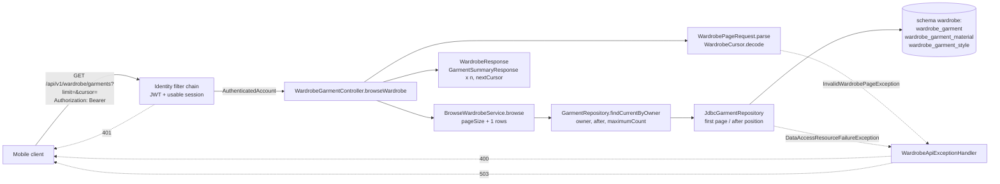
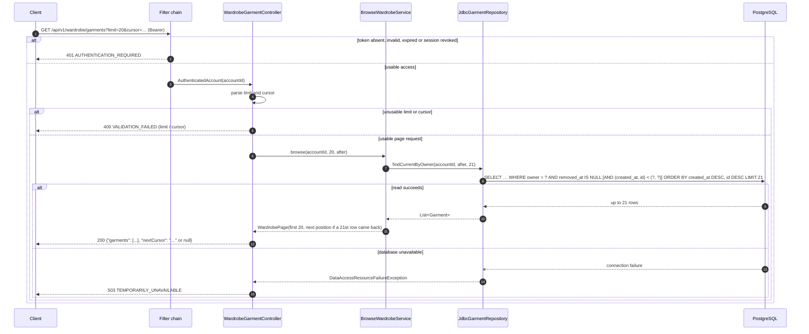

# US-WAR-001 — Browse My Current Wardrobe: Implementation Guide

| Field | Value |
| --- | --- |
| Sprint | Sprint 2 — Recover Access and Establish a Private Wardrobe |
| Story / parent PBI | US-WAR-001 — Browse my current wardrobe / [PBI-007](../../../product-backlog.md#pbi-007--browse-current-wardrobe-and-inspect-owned-garments) |
| Implementation order | **3 of 4** (US-AUTH-005 → US-GAR-001 → **US-WAR-001** → US-WAR-002) |
| Starts from | "Stage 2": Stage 0 (`sprint_02` at `90d3237`, [README §3](README.md#3-repository-baseline)) plus the [US-AUTH-005](US-AUTH-005-guide.md) and [US-GAR-001](US-GAR-001-guide.md) guides |
| Leaves | "Stage 3": the authenticated current-wardrobe overview that US-WAR-002's detail is selected from |
| Read with | [README](README.md), [shared architecture](shared-architecture.md) |
| Code status | **Proposed implementation code — compiled and its automated tests executed by the guide author on 2026-11-07 in an isolated scratch copy of this repository, after the Product Owner decisions of that day were incorporated** (Stage 3 commit: `clean verify` passed with 454 unit and 239 integration tests; full four-stage result: 461 and 258). Not applied to this repository's `backend/` (⏳ BACKEND IMPLEMENTATION PENDING), not run in hosted CI. US-WAR-001 is **not Done**. |

Labels: **[REQ]** requirement, **[ARCH]** architecture decision, **[TECH]** proposed technical decision of this guide, **[OPEN]** unresolved (none remains after the Product Owner decisions of 2026-11-07). Sections 3–8 are verbatim source text. Status markers: ✅ APPROVED AND INCORPORATED INTO GUIDES · ⏳ BACKEND IMPLEMENTATION PENDING · ⚠️ EXTERNAL VERIFICATION PENDING · 🟡 DEFERRED BY APPROVED DECISION.

---

## 1. Story Overview

| Item | Content |
| --- | --- |
| Story ID / name | US-WAR-001 — Browse my current wardrobe |
| Parent PBI | PBI-007 (Wardrobe domain, Digital Wardrobe theme), shared with US-WAR-002 |
| User value | The user recognizes what they own: every current confirmed garment, in any of the eight categories, identified by Category, Color and (when supplied) Subtype and Brand, even without an image or optional details. A genuinely empty wardrobe is told apart from loading, failure and lost access. |
| Backend objective | One authenticated, read-only operation, `GET /api/v1/wardrobe/garments?limit=&cursor=`, that returns only the caller's **current** (`removed_at IS NULL`) garments, newest first, as identifying summaries in keyset (cursor) pages (OPEN-S2-10 option B). It distinguishes a genuinely empty wardrobe (200 `[]`) from unusable access (401), an unusable page request (400) and unavailable data (503), and it never writes anything. |
| Hard dependencies | Authenticated access (Sprint 1). The Wardrobe model, V8 table and `GarmentRepository` from US-GAR-001 (Stage 2). |
| Scope (backend) | `WardrobePosition`, the keyset `GarmentRepository.findCurrentByOwner` and its JDBC implementation, `WardrobePage`, `BrowseWardrobeService`, the cursor and page-request parsing, two response records, one controller method, the 400 mapping, configuration wiring, OpenAPI v0.7.0, CI guard, README. **No migration**: the partial index this story reads through was created in V8 (Stage 2). |
| Out of scope | Detail (US-WAR-002), search/filter (PBI-015), user-selectable sorting (the story excludes it), removal (PBI-016), images, any client screen, loading indicators and "load more" (client concerns), Add Garment (US-GAR-001). |
| Expected outcome | Backend parts of AC-01, AC-02, AC-04, AC-05, AC-07–AC-10 and AC-12 implemented and verified. AC-03 (loading), AC-06 (Add Garment handoff), AC-11 (accessibility) and the client part of AC-12 are client evidence. |

## 2. Repository Baseline (Stage 2)

| Existing component (after US-GAR-001) | Relevance |
| --- | --- |
| `wardrobe.wardrobe_garment` (V8) with `removed_at` (NULL = current) and `ix_wardrobe_garment_owner_current` on `(owner_account_id, created_at DESC, id DESC) WHERE removed_at IS NULL` | Exactly the keyset access path this story needs; nothing to migrate. |
| `wardrobe.wardrobe_garment_material`, `wardrobe.wardrobe_garment_style` | Materials and Styles are loaded by the shared `SELECT_GARMENT` statement, although the summary does not show them. |
| Schema ownership (AR-01–AR-04) | Both tables are in Wardrobe's schema `wardrobe`. This story reads only them; it never reads or joins `identity.*`, and `ArchitectureDependencyTest`, `PersistenceOwnershipSqlTest` and `DatabaseSchemaOwnershipIT` must keep passing. |
| `Garment`, `GarmentProfile`, `Brand`, `GarmentSubtype` | Read model; `Garment.isCurrent()` already exists. |
| `GarmentRepository` (`addIfCreationKeyUnused`, `findCreation`) and `JdbcGarmentRepository` (`SELECT_GARMENT`, `mapGarment`) | Extended with one query. |
| `WardrobeGarmentController` (`POST`) | The cohesive controller for `/api/v1/wardrobe/garments` (one controller per base path); gains `GET`. |
| `GarmentResponse.ELIGIBILITY_NOT_EVALUATED` | Reused by the summary so both representations say the same thing. |
| `WardrobeApiExceptionHandler` | Already maps lost database connections to 503 `TEMPORARILY_UNAVAILABLE`; gains the 400 mapping for an unusable page request. |
| `WardrobeConfiguration` | Wires services; gains one bean. |
| `InMemoryGarmentRepository`, `WardrobeIntegrationTestSupport`, `WardrobeFailureIT` (with its failing repository wrapper) | Test infrastructure extended here. |
| `IdentityOpenApiContractIT` | Requires every `/api/` handler to be documented, calls each documented operation without a token (a protected one must answer 401) and compares success schemas with the returned records. The new `GET` is therefore checked automatically; the test needs no change in this story. |
| `docs/05-api/openapi.yaml` v0.6.0 | Gains the overview operation. |


---

## 3. Original Business Requirements — Verbatim

All wording in Sections 3–8 is copied mechanically from the repository at Stage 0; nothing is paraphrased. Only the targets of links inside a quotation are rewritten, so that they open the same file and heading from this guide's folder. The link text is unchanged. The **Source** line above each quotation names its file, heading and line range.

**Source:** [BRD.md — 15.1 Wardrobe Digitization and Management](../../../../01-business/BRD.md#151-wardrobe-digitization-and-management) · lines 464–466 at Stage 0

> | ID | Requirement | Business Rationale | Priority | Related Goals |
> |---|---|---|---|---|
> | BR-003 | Wardrobe understanding must support exactly the 13 approved properties and category applicability in Section 13.2, including optional multiple Materials, Brand and original purchase Price with explicit currency, without an image or recommendation gate. | Styling and utility assessment need richer context than basic tags. | Must | BG-01, BG-02, BG-03, BG-04 |
> | BR-005 | Users must be able to maintain, browse, search, and filter an accurate current wardrobe, including adding, changing, and removing garments. | Decisions must reflect accessible, current possessions. | Must | BG-01, BG-02, BG-03 |

**Source:** [BRD.md — 15.4 Privacy, Trust, and Evolution](../../../../01-business/BRD.md#154-privacy-trust-and-evolution) · lines 497–498 at Stage 0

> | ID | Requirement | Business Rationale | Priority | Related Goals |
> |---|---|---|---|---|
> | BR-021 | Personal images, wardrobes, profile information, and behavior must remain private to authorized access, with understandable user control over their information. | Trust is necessary for participation across the value loop. | Must | BG-01, BG-02, BG-03, BG-04 |
> | BR-022 | Users must be able to understand the basis and limitations of recommendations, coverage, and utility estimates, including insufficient data or unavailable context. | Enable informed choices and avoid false certainty. | Must | BG-02, BG-03, BG-04 |

**Source:** [BRD.md — 13.1 Capability Map](../../../../01-business/BRD.md#131-capability-map) · lines 289–290 at Stage 0

> | ID | Capability | Business Purpose |
> |---|---|---|
> | CAP-03 | Wardrobe Management | Keep the wardrobe current and discoverable through maintenance, browsing, search, and filtering. |
> | CAP-04 | Garment Intelligence | Describe garment characteristics sufficiently to support styling, coverage, and purchase evaluation. |

## 4. Original Product Requirements — Verbatim

**Source:** [PRD.md — 8.3 JRN-03 — Wardrobe Management](../../../../02-product/PRD.md#83-jrn-03--wardrobe-management) · lines 236–246 at Stage 0

> ### 8.3 JRN-03 — Wardrobe Management
>
> **Intent:** Keep the product aligned with what the user currently owns.
>
> 1. The user browses garment cards or searches/filters the wardrobe.
> 2. Garment detail presents confirmed information and recorded utilization without implying observed physical wear.
> 3. The user edits inaccurate or changed information and confirms the revision.
> 4. The user can remove a garment through an explicit, understandable removal action.
> 5. Subsequent recommendations and assessments reflect the current confirmed wardrobe; removed garments cannot remain selectable as owned items.
>
> **Recovery:** Empty wardrobes prompt Add Garment; no search results offer changes to the search/filter; failed edits/removals retain a clear unconfirmed state and retry. Historical Wear Events/outfit records preserve understandable snapshots, labeling a removed garment “Removed from wardrobe” rather than treating it as currently owned. **Features:** FEAT-WAR-001–FEAT-WAR-003, FEAT-ANL-001.

**Source:** [PRD.md — 14.1 FEAT-WAR-001 — Wardrobe Overview and Garment Detail](../../../../02-product/PRD.md#141-feat-war-001--wardrobe-overview-and-garment-detail) · lines 618–651 at Stage 0

> ### 14.1 FEAT-WAR-001 — Wardrobe Overview and Garment Detail
>
> **Purpose:** Make the confirmed owned wardrobe understandable and accessible.
>
> **User value:** Users can find what they own and check the information behind recommendations.
>
> **Related BRD:** BR-005, BR-006, BR-021, BR-022; CAP-03, CAP-07; BG-01–BG-03. **Primary users:** All personas; especially Fashion-Conscious Minimalist.
>
> **Entry points / trigger:** Wardrobe, completed ingestion, or garment selection from an outfit/insight. **Preconditions:** Authenticated access; a populated wardrobe is not required to open the area.
>
> **Product behavior:**
>
> 1. Show owned garment cards with an available image/visual, category/subtype, and dominant color; manually created garments remain accessible without an image.
> 2. Present every confirmed garment as owned and saved, with the truthful statement that recommendation eligibility has not been evaluated. Do not classify garments as ready, unready, suitable or unsuitable, and do not ask for additional compatibility information: composition, compatibility and sufficient-evidence policy belong to future recommendation-engine development (OPQ-015).
> 3. Offer relevant recorded-use indicators with clear meaning, including no recorded Wear Events.
> 4. Open garment detail for confirmed information across all eight categories, including available subtype, Brand and purchase Price with currency (Section 13.5), useful provenance/uncertainty, guidance that eligibility is not evaluated, and utilization. Unknown optional fields remain unknown and never hide an owned garment.
> 5. Provide Add Garment and access to search/filter/edit/remove actions.
> 6. Distinguish empty wardrobe from loading, unavailable information, and no matching search results.
> 7. Present a large wardrobe page by page in a stable newest-first order, with an explicit way to continue, so that no garment that stays current is omitted or repeated (OPQ-018).
>
> **User controls:** Browse, open/return from detail, add, and move to management or insights. **Product states:** Loading, empty, populated, detail available, load failed.
>
> **Failure / fallback:** A load failure offers retry rather than falsely claiming zero possessions. Missing images do not conceal otherwise available confirmed garment information.
>
> **Feature-level acceptance criteria:**
>
> - **AC-01:** Confirmed additions appear in the user's wardrobe and open their corresponding details.
> - **AC-02:** Garment cards identify category/color usefully; detail presents the current confirmed profile.
> - **AC-03:** Empty wardrobes explain the value of adding garments and provide an Add Garment action.
> - **AC-04:** No recorded wear is labeled as missing history rather than proof that a garment is never worn.
> - **AC-05:** A data-loading failure is distinguishable from an empty wardrobe.
> - **AC-06:** A manually saved garment without an image remains identifiable/accessibly displayed; an incomplete entry provides useful guidance that eligibility is not evaluated.
>
> **Out of scope / deferred detail:** Pixel layout, collection organization, advanced (user-selectable) sorting and storage are not defined here. Shared/public wardrobes are outside MVP.

**Source:** [PRD.md — 13.3 Saving and Deferred Recommendation Eligibility](../../../../02-product/PRD.md#133-saving-and-deferred-recommendation-eligibility) · lines 588–594 at Stage 0

> ### 13.3 Saving and Deferred Recommendation Eligibility
>
> Exactly 13 fashion properties are approved: Category, Subtype, Color, Material, Pattern, Style, Fit, Neckline, Sleeve Length, Length, Silhouette, Brand, Price. Category and one dominant Color plus explicit user confirmation form the saving minimum. All other applicable properties are optional. Material and Style each support zero or multiple distinct selections; Pattern is single and optional. Fit, Neckline and Sleeve Length apply only to Tops; Length uses separate Tops/Pants vocabularies; Silhouette applies only to Pants. Every supplied controlled value must match the source vocabulary and category; correct or clear invalid/inapplicable input rather than silently substitute or discard it. Unknown optional information is absent, not an invented UNKNOWN/OTHER/Etc value. Preserve real listed fallbacks such as Other, Other Materials and Colorful only where defined.
>
> Recommendation eligibility has not been evaluated. A saved garment is not invalid, unsuitable or ineligible because an engine policy is undefined or an optional property is absent. No ready/unready result, required compatibility field, fixed outfit composition or category-to-role mapping is approved for the current phase. Define composition, compatibility and sufficient-evidence policy during recommendation-engine development, using only approved properties unless the Product Owner approves a future model change. Sprint 2 exposes truthful accepted information and missing values; the smallest contract representation is selected during story-specific design, without mandating a NOT_EVALUATED enum or database field.
>
> Removed fashion properties and the earlier readiness policy are explicitly superseded in the authority's Section 5. User-profile preferences, request occasion/weather and technical metadata remain separate. Their existence cannot recreate removed garment fields or a hidden compatibility gate.

## 5. Original Software Requirements — Verbatim

### 5.1 Wardrobe management (SRS §3.6, complete table)

Only FR-WAR-001 and FR-WAR-008 (empty/loading/unavailable) belong to this story; the other rows are quoted so the boundary is visible.

**Source:** [SRS.md — 3.6 Wardrobe Management](../../../../03-requirements/SRS.md#36-wardrobe-management) · lines 305–318 at Stage 0

> ### 3.6 Wardrobe Management
>
> JRN-03 operates on the current owned wardrobe; historical information remains distinct.
>
> | ID | Requirement | Scope | Source | Verification |
> |---|---|---|---|---|
> | FR-WAR-001 | The system shall present identifiable current confirmed garments across all eight categories, page by page in a stable newest-first order with explicit continuation that neither omits nor repeats garments remaining current, and retrieve all available applicable accepted properties in detail, including multiple Materials and Styles and optional Brand/Price, without requiring an image or every detail field in collection summaries. | MVP | FEAT-WAR-001; BR-005 | T: browse, pagination and imageless detail. |
> | FR-WAR-002 | The system shall truthfully communicate that recommendation eligibility has not been evaluated and distinguish absent optional information from invalid/unavailable data; supported recorded-use information shall not equate no recorded use with proven nonuse. | MVP | FEAT-WAR-001, FEAT-ANL-001; BR-005, BR-006 | I: readiness and usage labels. |
> | FR-WAR-003 | The system shall allow explicit confirmation/cancellation of supported garment-profile edits. | MVP | FEAT-WAR-002; BR-002, BR-005 | T: edit/confirm/cancel. |
> | FR-WAR-004 | The system shall allow deliberate confirmation/cancellation of garment removal from active ownership. | MVP | FEAT-WAR-002; BR-005 | T: remove/confirm/cancel. |
> | FR-WAR-005 | The system shall immediately exclude a removed garment from active ownership and current recommendation/coverage/multiplier inputs, retaining only minimal understandable historical snapshots and physically deleting its original image/nonessential removed personal data within 30 days. | MVP | FEAT-WAR-002; BR-005 | T/I: immediate current exclusion, minimal historical fields and deletion within 30 days. |
> | FR-WAR-006 | The system shall refresh or mark affected prior advice for reevaluation after relevant edits/removal. | MVP | FEAT-WAR-002; BR-005 | T: affected assessment state. |
> | FR-WAR-007 | The system shall provide descriptor search and category/color filtering of confirmed garments with visible conditions and reset. | MVP | FEAT-WAR-003; BR-005 | T: match, filter, clear. |
> | FR-WAR-008 | The system shall distinguish an empty wardrobe, no matching results, loading, and unavailable data with applicable Add Garment or reset/retry actions. | MVP | FEAT-WAR-001, FEAT-WAR-003; BR-005 | T: empty/no-match/failure states. |

### 5.2 Garment intelligence and authorization

**Source:** [SRS.md — 3.5.1 Saving and Deferred Recommendation Eligibility](../../../../03-requirements/SRS.md#351-saving-and-deferred-recommendation-eligibility) · lines 285–297 at Stage 0

> | ID | Requirement | Scope | Source | Verification |
> |---|---|---|---|---|
> | FR-GAR-001 | The system shall support primary classification limited to TOPS, DRESSES_JUMPSUITS, PANTS, SKIRTS, OUTERWEAR, SHOES, BAGS, HEADWEAR. | MVP | FEAT-GAR-001; BR-003 | T: defined categories only. |
> | FR-GAR-002 | The system shall support every approved category-specific Subtype in the source authority, validate parent association and allow omission without invented fallback values or silent replacement. | MVP | FEAT-GAR-001, FEAT-AI-002; BR-003, BR-002 | T: defined vocabularies and subtype fallback saving. |
> | FR-GAR-004 | The system shall distinguish valid saved ownership from recommendation eligibility that has not been evaluated, without labeling a garment ready, invalid, unsuitable or ineligible because a future policy is undefined or optional information is absent. | MVP | FEAT-GAR-001, FEAT-OUT-001; BR-003, BR-009 | T/I: valid saving, optional absence and unevaluated eligibility without invalid/unsuitable/ineligible claims. |
> | FR-GAR-012 | The system shall support optional user-entered Brand text of at most 100 Unicode code points for every supported garment category, treat a blank value as unspecified, preserve accepted nonblank text exactly (no trimming, case change, accent removal or whitespace normalization) for inspection and future editing, and keep unavailable or unaccepted suggested Brand distinct from confirmed information without a fixed brand enum or silent automated overwrite. | MVP | FEAT-GAR-001, FEAT-AI-002, FEAT-WAR-001, FEAT-WAR-002; BR-002, BR-003, BR-005 | T: absent/blank/present Brand across eight categories, length boundary, exact value fidelity and late-proposal protection. |
> | FR-GAR-013 | The system shall support optional user-reported purchase Price for every supported garment category as an exact decimal monetary amount with an explicit valid upper-case ISO 4217 currency code when supplied, preserve it for inspection and future editing, and allow omission without save/readiness failure. Zero is a valid known amount distinct from a missing Price; negative amounts, more than 12 integer digits and more fractional digits than the currency's minor unit are rejected, never rounded. It shall not fabricate Price from appearance, infer currency from location, use floating-point monetary calculations, convert currencies or silently overwrite confirmed Price. | MVP | FEAT-GAR-001, FEAT-AI-002, FEAT-WAR-001, FEAT-WAR-002; BR-002, BR-003, BR-005 | T: absent/present amount-and-currency, zero, negative, precision per currency, partial-pair correction, decimal fidelity and non-fabrication; Section 3.5.2 / PRD OPQ-013 (resolved). |

**Source:** [SRS.md — 3.1.1 Authentication and Recovery Rules](../../../../03-requirements/SRS.md#311-authentication-and-recovery-rules) · lines 189–190 at Stage 0

> | ID | Requirement | Scope | Source | Verification |
> |---|---|---|---|---|
> | FR-AUTH-008 | The system shall restrict protected personal operations to an authenticated user authorized for the affected information. | MVP | FEAT-AUTH-001; BR-021 | T: signed-out/cross-user denial. |
> | FR-AUTH-009 | The system shall authenticate protected operations with a valid, unexpired JWT Access Token and the authorized session/account context. | MVP | FEAT-AUTH-001; BR-021 | T/I: absent, invalid, expired and valid JWT access; session authorization. |

### 5.3 Data requirements

**Source:** [SRS.md — 4.3 Garment & Wardrobe Data](../../../../03-requirements/SRS.md#43-garment--wardrobe-data) · lines 661–665 at Stage 0

> | ID | Requirement | Scope | Source | Verification |
> |---|---|---|---|---|
> | DATA-GAR-001 | The system shall associate each current garment and accepted profile with its authorized owner, supported Category and one confirmed approved Color, preserving confirmation and active ownership separately from future evaluation. | MVP | FEAT-GAR-001, FEAT-WAR-001; BR-003, BR-005 | T/I: owner and saveable minimum. |
> | DATA-GAR-002 | The system shall preserve exactly the 13 source-approved fashion properties and applicability, including optional multiple distinct Materials and Styles, one dominant Color, category-specific fields, Brand text and decimal purchase Price with explicit ISO 4217 currency; absent values and necessary metadata shall remain distinct. | MVP | FEAT-GAR-001; BR-003 | I/T: every approved value, distinct Material and Style sets, category applicability and non-mandatory rich information. |
> | DATA-GAR-004 | The system shall associate available image/preview information with the appropriate draft or garment without requiring an image for manually saved entries. | MVP | FEAT-AI-001, FEAT-AI-002; BR-001, BR-002 | T: imageless and image entry. |
> | DATA-GAR-005 | The system shall represent active/removed ownership independently from missing optional properties and unevaluated recommendation eligibility, without requiring a readiness flag, NOT_EVALUATED enum, compatibility field or physical schema prescribed by this SRS. | MVP | FEAT-GAR-001, FEAT-WAR-002; BR-003, BR-005 | T/I: ownership and unevaluated eligibility remain distinct; no property gate. |

**Source:** [SRS.md — 4.8 Historical Data](../../../../03-requirements/SRS.md#48-historical-data) · lines 707–707 at Stage 0

> | ID | Requirement | Scope | Source | Verification |
> |---|---|---|---|---|
> | DATA-HIST-002 | The system shall identify removed garments in historical presentation as Removed from wardrobe without treating the snapshot as an active item. | MVP | FEAT-ANL-001; BR-006, BR-022 | I/A: removed snapshot. |

### 5.4 Interfaces

**Source:** [SRS.md — 5.1 User Interfaces](../../../../03-requirements/SRS.md#51-user-interfaces) · lines 759–762 at Stage 0

> | ID | Requirement | Scope | Source | Verification |
> |---|---|---|---|---|
> | UI-001 | The system shall make Today, Wardrobe, Insights, and Profile responsibilities reachable with Add Garment and applicable detail/return paths. | MVP | FEAT-WAR-001, FEAT-OUT-001, FEAT-PROF-001; BR-005, BR-007, BR-010 | D: navigation through JRN-01–JRN-07. |
> | UI-003 | The system shall distinguish loading, empty, no-match, pending, confirmed and failed states plus Exact/Evaluated Zero/Incomplete/Unavailable/Outdated multiplier states where applicable. | MVP | FEAT-WAR-001, FEAT-OUT-001, FEAT-MULT-001; BR-005, BR-016, BR-022 | T/I: generic state inventory and five multiplier result states. |
> | UI-004 | The system shall display garment identity/category/color, guidance that eligibility is not evaluated, and available image without hiding imageless manual entries. | MVP | FEAT-WAR-001, FEAT-GAR-001; BR-005, BR-003 | I: cards and minimum-only detail. |

**Source:** [SRS.md — 5.4 Communication Interfaces](../../../../03-requirements/SRS.md#54-communication-interfaces) · lines 792–792 at Stage 0

> | ID | Requirement | Scope | Source | Verification |
> |---|---|---|---|---|
> | COM-001 | The system shall protect private access/wardrobe/profile/history exchanges against unauthorized disclosure or alteration, preserving password values and the session/account authority defined in Section 3.1.1. | MVP | FEAT-AUTH-001; BR-021 | A/T: protected exchange; Unicode/spaces preserved; session ownership. |

### 5.5 Error and failure requirements

**Source:** [SRS.md — 9.1 Access and Recovery](../../../../03-requirements/SRS.md#91-access-and-recovery) · lines 994–994 at Stage 0

> | ID | Failure Condition | Required System Behavior | Continuation / State Protection | Source | Verification |
> |---|---|---|---|---|---|
> | ERR-AUTH-001 | Invalid or unusable login information. | The system shall deny invalid credentials or unavailable authorized session access with useful correction/recovery guidance without exposing private content or representing the wardrobe as empty. | User may correct input or initiate recovery; personal state is not changed. | FEAT-AUTH-001; BR-021 | T: incorrect credentials, token expiry and revoked session. |

**Source:** [SRS.md — 9.9 Communication and Partial Dependency Failure](../../../../03-requirements/SRS.md#99-communication-and-partial-dependency-failure) · lines 1052–1052 at Stage 0

> | ID | Failure Condition | Required System Behavior | Continuation / State Protection | Source | Verification |
> |---|---|---|---|---|---|
> | ERR-NET-001 | Network/communication fails during an action. | The system shall distinguish interrupted communication and uncertain mutation outcomes from confirmed success or empty data, providing applicable outcome review/retry without accidental duplicate actions. | Previously confirmed information is preserved; an already accepted action is not repeated as a new one. No general offline guarantee. | FEAT-AI-002, FEAT-PERS-002, FEAT-WAR-001; BR-005, BR-011, BR-022 | T: interruption before/after action acceptance. |

### 5.6 Security, privacy, accessibility and localization

**Source:** [SRS.md — 6.2 Security](../../../../03-requirements/SRS.md#62-security) · lines 813–814 at Stage 0

> | ID | Requirement | Scope | Source | Verification |
> |---|---|---|---|---|
> | NFR-SEC-001 | The system shall permit zero successful unauthorized cross-user wardrobe/image accesses in the agreed validation scenarios. | MVP | FEAT-AUTH-001, FEAT-WAR-001; BR-021 | T: two-account and unauthenticated attempts; MET-Q06. |
> | NFR-SEC-002 | The system shall prevent account switch or logout from exposing the preceding user's protected content, enforcing current-session logout isolation and all-Refresh-Session revocation after successful password reset. | MVP | FEAT-AUTH-001; BR-021 | T: two sessions/accounts; current logout versus account-wide reset. |

**Source:** [SRS.md — 6.3 Privacy](../../../../03-requirements/SRS.md#63-privacy) · lines 821–821 at Stage 0

> | ID | Requirement | Scope | Source | Verification |
> |---|---|---|---|---|
> | NFR-PRIV-001 | The system shall limit personal data processing to necessary functionality, personalization, wardrobe/history/utilization, validation/measurement, security and operational integrity; explain its purpose and respect omission/correction/removal/permission controls within the authorized User's private experience, with no public wardrobes, user-to-user sharing, unrestricted third-party sharing or sale of personal data. | MVP | FEAT-AUTH-001, FEAT-PROF-001, FEAT-PROF-002, FEAT-PERS-001, FEAT-PERS-002; BR-012, BR-013, BR-021 | I/D: purpose, private access, feature controls and absence of unapproved sharing/sale. |

**Source:** [SRS.md — 6.7 Accessibility](../../../../03-requirements/SRS.md#67-accessibility) · lines 853–854 at Stage 0

> | ID | Requirement | Scope | Source | Verification |
> |---|---|---|---|---|
> | NFR-ACC-001 | The system shall communicate meaningful confidence, unevaluated eligibility, unavailable/outdated, hypothetical, and removed states with understandable labels rather than relying solely on color or a garment image. | MVP | FEAT-GAR-001, FEAT-WAR-001, FEAT-OUT-001, FEAT-MULT-001, FEAT-ANL-001; BR-003, BR-005, BR-006, BR-022 | I/D: labels remain meaningful without color/image cues. |
> | NFR-ACC-002 | The system shall support meaningful accessible names/roles/states, operable core journeys and accessible primary actions at text scaling up to 200%, with approximately 48 dp Android/44 pt iOS minimum primary-control touch targets; applicable core journeys shall be validated with TalkBack and VoiceOver. | MVP | FEAT-AUTH-001, FEAT-AI-002, FEAT-OUT-001, FEAT-PERS-002; BR-002, BR-011, BR-022, BR-023 | D/I: both screen readers, accessible semantics, 200% text scaling, target sizes and outcome meaning; Section 12.4; no certification claim. |

**Source:** [SRS.md — 7. Localization Requirements](../../../../03-requirements/SRS.md#7-localization-requirements) · lines 898–898 at Stage 0

> | ID | Requirement | Scope | Source | Verification |
> |---|---|---|---|---|
> | LOC-001 | The system shall provide the initial user interface, explanations, and applicable recovery guidance in Vietnamese on Android and iOS. | MVP | FEAT-AUTH-001, FEAT-OUT-001, FEAT-AI-002; BR-002, BR-022, BR-023 | I/D: initial Vietnamese journeys. |

## 6. Original Business Rules — Verbatim

**Source:** [business-rules.md — BRULE-AUTH-001 — Authorized Personal Operations](../../../../03-requirements/business-rules.md#brule-auth-001--authorized-personal-operations) · lines 81–87 at Stage 0

> ### BRULE-AUTH-001 — Authorized Personal Operations
>
> **Rule:** Personal wardrobe, profile, feedback, history, and assessment operations require authentication and authorization for the affected user's information. Unavailable authorized access is not an empty wardrobe and does not change personal state.
>
> **Applies To:** all personal domain operations.
>
> **Source:** FR-AUTH-008, ERR-AUTH-001, DATA-GAR-001.

**Source:** [business-rules.md — BRULE-AUTH-007 — Purpose-Limited Private Data Use](../../../../03-requirements/business-rules.md#brule-auth-007--purpose-limited-private-data-use) · lines 131–139 at Stage 0

> ### BRULE-AUTH-007 — Purpose-Limited Private Data Use
>
> **Rule:** Personal data is used only as necessary for CapsuleAI functionality, personalization, wardrobe/history/utilization, validation/measurement, security and operational integrity within the authorized User's private experience. MVP personal images, profiles, Wear Events, feedback and corrections are not used for AI model training/improvement. Future personal-data training requires separate explicit opt-in and an approved future product/privacy change.
>
> No public wardrobes, user-to-user wardrobe sharing, unrestricted third-party sharing or sale of personal data is introduced. External dependencies receive only purpose-minimal information: required selected weather location, email/necessary recovery-delivery information, or explicitly chosen shopping navigation without unrelated wardrobe/profile/history disclosure. Necessary active-account information and minimal history follow the retention/removal rules; this policy adds no Delete Account goal or legal certification.
>
> **Applies To:** personal information, account/profile/wardrobe/history, validation/measurement and external exchanges.
>
> **Source:** FR-AUTH-008, NFR-PRIV-001, NFR-PRIV-002, SI-002, SI-003, COM-003, FR-MET-006, DATA-RET-001, DATA-RET-002, DATA-RET-003.

**Source:** [business-rules.md — BRULE-GAR-001 — Canonical Garment Authority](../../../../03-requirements/business-rules.md#brule-gar-001--canonical-garment-authority) · lines 173–179 at Stage 0

> ### BRULE-GAR-001 — Canonical Garment Authority
>
> **Rule:** Each owned garment belongs to the authorized user's wardrobe. Automated attribute proposals are not authoritative. Applicable User Confirmed, User Corrected, or User Entered-and-confirmed values establish the canonical profile; later automated analysis cannot silently overwrite them.
>
> **Applies To:** ingestion, edits, all garment-dependent evaluations.
>
> **Source:** DATA-GAR-001, FR-GAR-011, AI-REQ-001, AI-REQ-007, DATA-INT-001.

**Source:** [business-rules.md — BRULE-GAR-002 — Saveable Minimum](../../../../03-requirements/business-rules.md#brule-gar-002--saveable-minimum) · lines 183–189 at Stage 0

> ### BRULE-GAR-002 — Saveable Minimum
>
> **Rule:** A garment is Saveable when the user explicitly confirms its supported Primary Category and Dominant Color. Manual creation requires neither an image nor successful analysis. Missing optional rich descriptors do not prevent saving; canceled or unconfirmed work does not establish a confirmed wardrobe entry.
>
> **Applies To:** assisted/manual creation and validation.
>
> **Source:** FR-GAR-003, FR-AI-003, FR-AI-008, FR-AI-009, ERR-GAR-001.

**Source:** [business-rules.md — BRULE-GAR-003 — Evaluation-Specific Recommendation-Readiness](../../../../03-requirements/business-rules.md#brule-gar-003--evaluation-specific-recommendation-readiness) · lines 193–199 at Stage 0

> ### BRULE-GAR-003 — Evaluation-Specific Recommendation-Readiness
>
> **Status: revised; old predicates superseded.**
>
> **Rule:** Recommendation eligibility has not been evaluated. A saved garment is not invalid, unsuitable or ineligible because an engine policy is undefined or an optional property is absent. No ready/unready result, required compatibility field, fixed outfit composition or category-to-role mapping is approved for the current phase. Define composition, compatibility and sufficient-evidence policy during recommendation-engine development, using only approved properties unless the Product Owner approves a future model change. Sprint 2 exposes truthful accepted information and missing values; the smallest contract representation is selected during story-specific design, without mandating a NOT_EVALUATED enum or database field.
>
> **Source:** FR-GAR-004/005, DATA-GAR-005, ERR-GAR-002; final Product Owner property-model decision.

**Source:** [business-rules.md — BRULE-GAR-004 — Controlled Classification and Context Vocabularies](../../../../03-requirements/business-rules.md#brule-gar-004--controlled-classification-and-context-vocabularies) · lines 203–209 at Stage 0

> ### BRULE-GAR-004 — Controlled Classification and Context Vocabularies
>
> **Rule:** Category is one of the eight approved codes. Every supplied optional Subtype must belong to that Category and its complete approved source list; missing Subtype is valid. No invented fallback or silent replacement is permitted. MINI_DRESS and other overlapping names remain subtypes without automatic derivation. All Bags/Headwear choices are approved, not pending research.
>
> The [garment-property authority](../../../../../Initial%20files/Image%20to%20Properties%20Extraction.md) owns garment values. Profile style preferences, request Occasion and common needs keep their separate SRS Section 4.10 vocabularies; they are not garment Style or a garment Occasion property.
>
> **Source:** FR-GAR-001/002, DATA-GAR-002; FR-PROF-002/004 for separate context.

**Source:** [business-rules.md — BRULE-GAR-010 — Optional Brand and Purchase Price Authority](../../../../03-requirements/business-rules.md#brule-gar-010--optional-brand-and-purchase-price-authority) · lines 279–287 at Stage 0

> ### BRULE-GAR-010 — Optional Brand and Purchase Price Authority
>
> **Rule:** Brand is optional user-entered text across all eight categories, with no fixed enum or external catalogue. Preserve the confirmed value; unknown is not a fabricated brand. Price is the optional user-reported purchase price of the owned garment, represented by a decimal amount together with an explicit ISO 4217 currency code. An amount without currency, or currency without amount, is incomplete supplied information and must be corrected or cleared before confirmation; omitting both is valid and does not mean zero. Never infer currency from location or perform floating-point monetary calculations. This is not market/resale/replacement value or a retailer/affiliate price; no conversion feature is introduced. Neither field is a save or readiness requirement. Price must not be inferred from a photograph; any future Brand suggestion remains unconfirmed until user acceptance. Later analysis or image upload must not silently replace confirmed Brand or Price.
>
> Future edits may revise or clear these properties with explicit user confirmation. Supplied valid values participate in the same accepted garment addition and safe-retry outcome; they do not create separate ownership or duplicate accepted additions. Approved validation (PRD OPQ-013, resolved 2026-11-07): Brand has at most 100 Unicode code points, a blank Brand is unspecified, and accepted Brand text is kept exactly. A Price of zero is a known amount, not a missing one; negative amounts, more than 12 integer digits and more fractional digits than the currency's ISO 4217 minor unit are rejected, never rounded; the currency is a valid upper-case ISO 4217 code. Nothing is defaulted or silently altered.
>
> **Applies To:** manual entry, inspection, future editing and assisted-review protection across all eight categories.
>
> **Source:** FR-GAR-012, FR-GAR-013, FR-GAR-011, DATA-GAR-002, DATA-GAR-003, DATA-INT-001, DATA-INT-004; PRD Sections 13.5/34.1.

**Source:** [business-rules.md — BRULE-HIST-001 — Recorded Use Is Reported Evidence](../../../../03-requirements/business-rules.md#brule-hist-001--recorded-use-is-reported-evidence) · lines 537–543 at Stage 0

> ### BRULE-HIST-001 — Recorded Use Is Reported Evidence
>
> **Rule:** Use frequency, recency, variety, and overlooked-item information derives from accepted effective Wear Events. Legitimate same-day reports remain separately understandable even when ranking normalizes them. No recorded use does not prove physical nonuse; incomplete logging and no-events states must not produce fabricated statistics.
>
> **Applies To:** wardrobe use/history and relevant personalization.
>
> **Source:** FR-ANL-002, FR-ANL-003, FR-ANL-004, FR-ANL-005, FR-WAR-002.

**Source:** [business-rules.md — BRULE-HIST-002 — Historical Snapshots vs Current Wardrobe](../../../../03-requirements/business-rules.md#brule-hist-002--historical-snapshots-vs-current-wardrobe) · lines 545–551 at Stage 0

> ### BRULE-HIST-002 — Historical Snapshots vs Current Wardrobe
>
> **Rule:** Historical outfit/garment representations remain understandable after garment removal and are labeled Removed from wardrobe where applicable. Such snapshots do not establish active ownership or enter new current outfits, Coverage, or the Multiplier baseline. Historical views preserve original event-local time rather than travel-based re-dating. Retain only the minimal snapshot needed to understand past records. Original removed-garment images and other nonessential removed personal data are not required historical evidence and follow the 30-day physical-deletion boundary.
>
> **Applies To:** history inspection and active inventory boundaries.
>
> **Source:** FR-ANL-001, FR-ANL-006, FR-WAR-005, DATA-HIST-001, DATA-HIST-002, DATA-RET-002.

## 7. Original User Story and Acceptance Criteria — Verbatim

**Source:** [US-WAR-001-browse-current-wardrobe.md](../../../stories/wardrobe/US-WAR-001-browse-current-wardrobe.md) · complete file at Stage 0

> # US-WAR-001 — Browse my current wardrobe
>
> **Current property-model revision — 2026-11-05:** The Product Owner approved exactly 13 garment properties and every explicitly listed vocabulary in the [garment-property authority](../../../../../Initial%20files/Image%20to%20Properties%20Extraction.md). This supersedes earlier research-only vocabulary status, removed garment attributes, fixed composition assumptions and property-based readiness gates. All applicable properties are included in the selected Sprint 2 garment stories. Recommendation eligibility is not evaluated; engine composition/compatibility policy is deferred. Stable IDs below remain traceable; superseded policies are not active implementation or acceptance obligations.
>
> ## Document Control
>
> | Field | Value |
> | --- | --- |
> | Artifact | User Story |
> | Story ID | US-WAR-001 |
> | Version | 0.5 |
> | Status | Baseline Draft |
> | Product | CapsuleAI |
> | Revision note | 2026-10-21: first focused refinement; clarified source-backed acceptance/evidence and traceability; identity, scope and Baseline Draft status preserved. 2026-10-22: linked related full-backlog drafts and explicit identity/domain metadata; existing outcome and AC retained. |
> | Parent PBI | [PBI-007](../../../product-backlog.md#pbi-007--browse-current-wardrobe-and-inspect-owned-garments) |
> | Domain | Wardrobe |
> | Theme | Digital Wardrobe |
> | Product Goal Contribution | [Trustworthy Wardrobe Understanding](../../../product-goal.md#4-desired-product-outcomes) |
> | Product revision | 2026-11-05: Approved eight-category taxonomy and optional subtype/Brand/purchase Price synchronized. Existing story/AC IDs, parent PBI and Sprint 2 order retained; no implementation claimed. |
>
> ## 1. Story
>
> As an authenticated user, I want to browse my current confirmed wardrobe, so that I can recognize what I own and choose a garment to inspect or start adding one.
>
> ## 2. User Value
>
> The collection overview helps me recognize my possessions even before any outfit or reported-use capability is available. Genuine emptiness, loading and unavailable retrieval are outcomes of the same browsing goal, rather than separate stories.
>
> ## 3. Scope
>
> Read-only current wardrobe browsing with identifiable summaries, visible imageless/incomplete entries, eligibility under a future approved policy meaning, loading/empty/unavailable distinctions, Add Garment access and selection of an owned garment for detail.
>
> ## 4. Preconditions
>
> - I have authenticated access authorized for my wardrobe.
> - An empty wardrobe is permitted; saved garments, completed onboarding, images and reported-use capabilities are not prerequisites.
>
> ## 5. Acceptance Criteria
>
> ### AC-01 — Recognize current confirmed possessions across all categories
>
> **Given** my current wardrobe contains confirmed active garments in any of the eight approved categories
>
> **When** authorized retrieval succeeds
>
> **Then** summaries identify the correct possessions using accepted Category, Color and available identifying information such as Subtype/image. Missing optional properties or images never hide a saved item. Detail can retrieve all available applicable accepted properties; the collection need not return every detailed property.
>
> ### AC-02 — Keep minimum-only and imageless garments visible
>
> **Given** an owned garment has no image or only the confirmed Category/Color minimum
>
> **When** the overview loads
>
> **Then** it remains identifiable and selectable. Eligibility is not evaluated; do not infer ready, invalid, unsuitable or ineligible from missing optional information or undefined future engine policy.
>
> ### AC-03 — Distinguish loading from loaded emptiness
>
> **Given** authorized wardrobe retrieval has not yet established the available current inventory
>
> **When** I wait for the requested overview
>
> **Then** CapsuleAI identifies loading and does not claim that I own no garments. A pending request is not a completed empty result.
>
> ### AC-04 — Understand a genuinely empty wardrobe
>
> **Given** authorized retrieval succeeds and my current confirmed wardrobe has no active garments
>
> **When** the overview is presented
>
> **Then** CapsuleAI explains the confirmed empty state and the value of adding garments, offers Add Garment, and lets me leave without a fixed garment-quota requirement.
>
> ### AC-05 — Recover from unavailable retrieval
>
> **Given** wardrobe retrieval fails or usable data cannot be established
>
> **When** I review the overview outcome
>
> **Then** CapsuleAI identifies unavailable data and offers retry or return to usable prior context. It does not replace the failure with an empty wardrobe/no-match claim or delete/change accepted garments; retry can present the actual inventory when retrieval succeeds.
>
> ### AC-06 — Start adding without a browsing quota
>
> **Given** I am in a usable empty or populated overview
>
> **When** I choose Add Garment
>
> **Then** CapsuleAI hands off to the established garment-entry goal, including the available manual route. The handoff itself creates no garment and does not impose a quota or optional-profile completion gate; manual creation is covered by US-GAR-001.
>
> ### AC-07 — Select the corresponding detail
>
> **Given** a current confirmed entry is presented
>
> **When** I choose it for inspection
>
> **Then** CapsuleAI hands off that garment to US-WAR-002's detail outcome and provides a return path to browsing. Selection alone changes no accepted garment information or ownership.
>
> ### AC-08 — Separate current ownership from other representations
>
> **Given** unconfirmed drafts, hypothetical candidates or removed historical snapshots exist alongside accepted inventory
>
> **When** the current overview is loaded
>
> **Then** only confirmed active owned garments are presented as current possessions. A retained historical snapshot does not restore ownership, and hypothetical or unconfirmed information is not treated as an accepted addition; creating/removing those other representations is outside this story.
>
> ### AC-09 — Pause browsing when access is unusable
>
> **Given** my access expires, is revoked or is not authorized for the requested wardrobe
>
> **When** I open or continue browsing
>
> **Then** CapsuleAI pauses protected use, gives renewed-authentication guidance and does not expose another account's entries or label inaccessible inventory empty. After usable authorized access is established, I may resume browsing the correct account.
>
> ### AC-10 — Preserve accepted state while viewing
>
> **Given** my current wardrobe is available
>
> **When** I browse entries, return from detail or leave the overview without a separate mutating action
>
> **Then** browsing creates no addition, edit, removal, Wear Event or preference feedback and does not change accepted inventory or use evidence.
>
> ### AC-11 — Operate and understand the wardrobe overview
>
> **Given** I use the Vietnamese overview with a screen reader or text scaled up to 200%
>
> **When** I identify an entry, open detail, choose Add Garment or follow empty/loading/unavailable guidance
>
> **Then** these entries, actions and states remain operable and understandable through meaningful accessible names/roles/states and information beyond image or color alone; missing image, unevaluated eligibility and unavailable retrieval retain their distinct meanings.
>
> ### AC-12 — Browse a large wardrobe page by page
>
> **Given** my current wardrobe holds more garments than one overview page shows
>
> **When** I browse and ask for more
>
> **Then** CapsuleAI shows my current garments newest first, one page at a time, and says whether more remain. Continuing never repeats or omits a garment that stays current; a garment I remove in the meantime simply no longer appears, and a garment added in the meantime appears when I start again from the first page. Pages contain only my own current garments. *(Added 2026-11-07, Product Owner decision OPEN-S2-10; FR-WAR-001.)*
>
> ## 6. Business Rules and Constraints
>
> - BRULE-AUTH-001 and BRULE-GAR-001–BRULE-GAR-003 constrain authorized current ownership, confirmed information and retention of Saveable entries despite unevaluated eligibility fields.
> - BRULE-HIST-002 keeps removed historical meaning separate from active inventory. Where reported-use information is displayed, BRULE-HIST-001 prohibits interpreting no recorded use as physical nonuse; detailed conditional use presentation is covered by US-WAR-002.
> - The initial interface and guidance are Vietnamese on Android 10+ and iOS 15+; this specification is English. Story actions and states retain meaningful accessible names, roles and labels beyond color, operability at text scaling up to 200%, and the SRS primary touch-target criteria (approximately 48 dp on Android / 44 pt on iOS). Private information is used only for necessary authorized product purposes; MVP personal data is excluded from AI training/improvement and unrestricted sharing.
>
> ## 7. Dependencies
>
> - Parent PBI hard capability dependency: PBI-004's authenticated access. [US-AUTH-002](../../../stories/auth/US-AUTH-002-log-in.md) and [US-AUTH-003](../../../stories/auth/US-AUTH-003-resume-session.md) provide entry/continuity where applicable.
> - [US-WAR-002](../../../stories/wardrobe/US-WAR-002-inspect-owned-garment.md) supplies selected-garment detail. The overview and empty-state value do not require an existing garment or completion of detail first.
> - PBI-006 / [US-GAR-001](../../../stories/garment/US-GAR-001-add-garment-manually.md) provide useful populated examples and the manual Add Garment destination; PBI-006 is useful sequencing rather than an additional hard dependency for browsing.
> - PBI-003 supplies useful common navigation/accessibility support. PBI-008/PBI-015/PBI-016/PBI-025 add separate future capabilities; their completion does not gate basic browsing.
>
> - Related drafts [US-WAR-003](../../../stories/wardrobe/US-WAR-003-find-garments-with-search-and-filters.md) discovery, [US-GAR-005](../../../stories/garment/US-GAR-005-remove-current-garment-preserve-minimal-history.md) garment removal and [US-ANL-001](../../../stories/analytics/US-ANL-001-understand-reported-wardrobe-utilization.md) utilization retain their separate PBI boundaries; their existence does not gate base browsing.
>
> ## 8. Out of Scope
>
> Garment creation is PBI-006; the selected profile/detail is US-WAR-002. Rich entry and editing are PBI-008, measurement PBI-009, photo/AI entry PBI-012/PBI-013, search/filter conditions and no-match/reset behavior PBI-015, removal/retention enforcement PBI-016, and utilization analytics PBI-025. This story introduces no user-selectable sorting, archive/restore, wear-reporting action, new event or universal offline guarantee; the overview is paged newest first (AC-12).
>
> ## 9. Traceability
>
> | Source | References |
> | --- | --- |
> | Parent PBI | [PBI-007](../../../product-backlog.md#pbi-007--browse-current-wardrobe-and-inspect-owned-garments) |
> | Business | [BRD](../../../../01-business/BRD.md): BR-003, BR-005, BR-021, BR-022; CAP-03, CAP-04 |
> | Product | [PRD](../../../../02-product/PRD.md): JRN-03; FEAT-WAR-001 (overview and entry/return paths) |
> | SRS | [SRS](../../../../03-requirements/SRS.md): FR-WAR-001, FR-WAR-008 (empty/loading/unavailable only), FR-GAR-004, FR-AUTH-008; DATA-GAR-001, DATA-GAR-004, DATA-GAR-005; UI-001, UI-003, UI-004; ERR-AUTH-001, ERR-NET-001; COM-001; NFR-SEC-001, NFR-SEC-002, NFR-PRIV-001; NFR-ACC-001, NFR-ACC-002; LOC-001; FR-GAR-001, FR-GAR-002, FR-GAR-012, FR-GAR-013, DATA-GAR-002 |
> | Business Rules | [Business Rules](../../../../03-requirements/business-rules.md): BRULE-AUTH-001, BRULE-AUTH-007; BRULE-GAR-001, BRULE-GAR-002, BRULE-GAR-003; BRULE-HIST-002; BRULE-GAR-004, BRULE-GAR-010 |
> | Use Cases | [UC-008 — View Wardrobe](../../../../03-requirements/use-cases/UC-008-view-wardrobe.md), browsing/empty/retrieval/access branches; [UC-007 — Add Garment](../../../../03-requirements/use-cases/UC-007-add-garment.md), entry handoff only |
> | Activity Diagrams | No current dedicated Activity Diagram for UC-008; the textual specification governs this slice. |
> | Completion / Verification | [Definition of Done](../../../definition-of-done.md), applicable common/triggered criteria; [Test Strategy](../../../../07-testing/test-strategy.md), selected-story evidence rather than foundation smoke tests alone. |
>
> ## 10. Open Refinement Notes
>
> **2026-11-07 Product Owner decisions.** The overview is paged with an explicit continuation (OPEN-S2-10, AC-12). No image field (X-3); eligibility stays `NOT_EVALUATED` (X-1); removed garments are excluded using `removed_at` fixtures, with no removal endpoint (X-4). See the [decision implementation notes](../decision-implementation-notes.md).
>
> **2026-11-05 product revision:** [PRD Section 34.1](../../../../02-product/PRD.md#341-approved-taxonomy-revision-and-open-follow-up-decisions) records the final 13-property/vocabulary approval and resolved eligibility deferral; only genuine validation/contract details remain open. Resolve applicable validation before dependent implementation; these questions do not make optional fields mandatory. Historical refinement notes below are subject to this revision. Sprint 2 selection is recorded in the [Sprint plan](../sprint-plan.md); source status remains Baseline Draft.
>
> **2026-10-21 refinement draft.** Retain browsing and its empty-state value separately from garment detail. The existing criteria already distinguish accepted entries, loading/unavailable data, unusable access and genuinely empty inventory; no new browsing behavior is needed. Agree representative empty and populated account fixtures, previous-account isolation and Add/detail handoff evidence with Developers (Q-02/Q-04/Q-05). PBI-006 supplies useful populated examples, not a hard prerequisite to empty browsing; future search/filtering and use analytics remain excluded.
>
> Question details, owners and conditional planning blockers are centralized in the [focused refinement review](../../../backlog-refinement-review.md#6-open-questions-for-product-owner-and-team). These notes do not change story status, assign estimates or authorize implementation. Necessary implementation detail remains JIT for a selected story. The [full story catalogue](../../../stories/README.md) now accounts for all 41 PBIs; those additional drafts change none of this story's acceptance boundaries.
>
> ## 11. Status
>
> **Baseline Draft.** Product Owner and Scrum Team review is pending; document approval is not claimed; Sprint 2 selection is recorded separately in its plan.

## 8. Original Use Cases, Flows and Architecture Decisions — Verbatim

### 8.1 UC-008 — View Wardrobe (complete)

The story states: "No current dedicated Activity Diagram for UC-008; the textual specification governs this slice." UC-008 is shared with US-WAR-002; this story implements its browsing, empty, retrieval-failure and access branches.

**Source:** [UC-008-view-wardrobe.md](../../../../03-requirements/use-cases/UC-008-view-wardrobe.md) · complete file at Stage 0

> # UC-008 — View Wardrobe
>
> **Current property-model revision — 2026-11-05:** The Product Owner approved exactly 13 garment properties and every explicitly listed vocabulary in the [garment-property authority](../../../../../Initial%20files/Image%20to%20Properties%20Extraction.md). This supersedes earlier research-only vocabulary status, removed garment attributes, fixed composition assumptions and property-based readiness gates. All applicable properties are included in the selected Sprint 2 garment stories. Recommendation eligibility is not evaluated; engine composition/compatibility policy is deferred. Stable IDs below remain traceable; superseded policies are not active implementation or acceptance obligations.
>
> ## 1. Use Case Summary
>
> | Field | Value |
> | --- | --- |
> | Use Case ID | UC-008 |
> | Use Case Name | View Wardrobe |
> | Scope | CapsuleAI |
> | Level | User Goal |
> | Primary Actor | User |
> | Supporting Actors | None |
> | Version | 0.4 |
> | Status | Baseline Draft |
> | Product revision | 2026-11-05: Approved taxonomy and optional Brand/purchase Price synchronized; goals, alternate/failure paths and ownership/retry semantics preserved. |
>
> Source authority: [BRD](../../../../01-business/BRD.md) defines business intent; [PRD](../../../../02-product/PRD.md) defines product behavior; [SRS](../../../../03-requirements/SRS.md) and [Business Rules](../../../../03-requirements/business-rules.md) constrain interaction; the [master Use Case Diagram](../../../../03-requirements/use-cases/use-case-diagram.puml) defines this goal and its actors. The [workflow](../../../../../Initial%20files/CapsuleAI_Scrum_Development_Workflow.md) governs artifact ownership and sequencing.
>
> ## 2. Goal
>
> Browse and find current owned garments, inspect their confirmed details and unevaluated recommendation eligibility and understand available reported-use information without changing wardrobe ownership.
>
> ## 3. Stakeholders and Interests
>
> | Stakeholder | Interest |
> | --- | --- |
> | User | Find accurate possessions, including imageless/incomplete entries. |
>
> ## 4. Preconditions
>
> - The User has authenticated access authorized for the wardrobe; an empty wardrobe is permitted.
>
> ## 5. Trigger
>
> The User opens the wardrobe or requests garment search/detail.
>
> ## 6. Main Success Scenario
>
> 1. The User requests the current wardrobe.
> 2. CapsuleAI distinguishes loading from loaded data and presents identifiable current confirmed garments, including entries without images.
> 3. The User browses or enters descriptor search and category/color filter conditions.
> 4. CapsuleAI shows active conditions and the matching current garments.
> 5. The User selects a garment to inspect.
> 6. CapsuleAI presents all available applicable accepted properties from the source catalogue, including multiple distinct Materials, one dominant Color, category-specific details, Brand and original purchase Price with currency; available image/provenance remain separate. Missing optional values are not fabricated and eligibility is not evaluated. Collection summaries need only sufficient identifying information, not the complete detail payload.
> 7. The User returns to browsing or chooses a separate supported maintenance/insight action.
>
> ## 7. Alternative Flows
>
> ### A1 — Unfiltered browsing/reset
>
> At Main Step 3:
>
> 1. The User supplies no conditions or clears existing search/filter conditions.
> 2. CapsuleAI restores the unfiltered current wardrobe; continue at Main Step 5 if the User selects an item.
>
> ### A2 — No matching results
>
> At Main Step 4:
>
> 1. CapsuleAI explains that the current conditions match no garments, without calling the wardrobe empty.
> 2. The User adjusts or resets conditions and resumes at Main Step 3.
>
> ### A3 — Genuinely empty wardrobe
>
> At Main Step 2:
>
> 1. CapsuleAI explains the confirmed empty state and offers Add Garment.
> 2. The User may start UC-007 or leave the wardrobe without a fixed garment-quota requirement.
>
> ### A4 — Imageless, minimum-only or no-recorded-use entry
>
> At Main Step 6:
>
> 1. CapsuleAI keeps the entry identifiable without an image, explains missing eligibility under a future approved policy fields and labels missing reports as no recorded use.
> 2. The User can inspect/enrich the garment without an inference that it has never been physically worn.
>
> ### A5 — Large wardrobe
>
> At Main Step 2 (PO decision 2026-11-07, FR-WAR-001):
>
> 1. CapsuleAI presents the first page of current garments, newest first, and indicates whether more are available.
> 2. The User asks for more; CapsuleAI continues after the last presented garment without repeating or omitting garments that remain current. Garments added after browsing began appear when the User starts again from the first page.
>
> ## 8. Exception / Failure Flows
>
> ### E1 — Wardrobe/search/detail retrieval fails
>
> At Main Step 2:
>
> 1. CapsuleAI identifies unavailable data and offers retry or return to usable prior context.
> 2. It does not display an empty wardrobe/no matches as a substitute for a failed retrieval; accepted inventory is unchanged.
>
> ### E2 — Selected garment is no longer current
>
> At Main Step 6:
>
> 1. CapsuleAI explains the changed/removed item and refreshes the current wardrobe where possible.
> 2. The User returns to current browsing; historical snapshots remain separate and do not restore ownership.
>
> ### E3 — Authorized access becomes unusable
>
> At Main Step 1:
>
> 1. CapsuleAI pauses protected interaction if access expires, is revoked or is not authorized for the affected information, and explains the need to authenticate again.
> 2. The User can resume the appropriate goal after UC-002 establishes usable access. Protected information is not exposed or misrepresented as empty, and the interrupted request is not falsely reported as accepted.
>
> ## 9. Success Postconditions
>
> - Displayed inventory/details match the available current confirmed wardrobe and visible search/filter conditions.
> - Unevaluated eligibility and recorded-use limitations are understandable, and no item is added/edited/removed by viewing.
>
> ## 10. Minimal / Failure Postconditions
>
> - Failed browsing/search/detail does not delete or change accepted garments.
> - Unavailable access/data is distinct from a true empty or no-match result; removed items are not restored as current.
> - Loss of access pauses protected use; inaccessible personal data is not exposed or labeled empty. Prior accepted information remains governed by its authorized state.
>
> ## 11. Business Rules
>
> The following references constrain this interaction; detailed policy remains in the [Business Rules](../../../../03-requirements/business-rules.md).
>
> | Rule ID | Relevance |
> | --- | --- |
> | `BRULE-AUTH-007` | Personal information is purpose-limited/private; MVP personal data is not used for AI training/improvement or unrestricted external sharing. |
> | `BRULE-AUTH-001` | Personal information/actions require authorized access for the affected User. |
> | `BRULE-GAR-001` | Confirmed garment values govern displayed current information. |
> | `BRULE-GAR-010` | Optional Brand and purchase Price; supplied values, missing information, currency and confirmed authority. |
> | `BRULE-GAR-003` | Show that recommendation eligibility is not evaluated, without hiding any saveable entry or labelling it ready or unready. |
> | `BRULE-HIST-001` | Usage indicators are reported evidence, not verified physical behavior. |
> | `BRULE-HIST-002` | Historical removed snapshots do not enter current inventory. |
>
> ## 12. Requirements Traceability
>
> | Source Type | IDs |
> | --- | --- |
> | [Journeys](../../../../02-product/PRD.md) | `JRN-03` |
> | [Product Features](../../../../02-product/PRD.md) | `FEAT-WAR-001`, `FEAT-WAR-003`, `FEAT-GAR-001`, `FEAT-ANL-001` |
> | [Software Requirements — Functional](../../../../03-requirements/SRS.md) | `FR-WAR-001`, `FR-WAR-002`, `FR-WAR-007`, `FR-WAR-008`, `FR-GAR-004`, `FR-ANL-004`, `FR-AUTH-008`; `FR-GAR-001`, `FR-GAR-002`, `FR-GAR-012`, `FR-GAR-013` |
> | [Software Requirements — Data](../../../../03-requirements/SRS.md) | `DATA-GAR-001`, `DATA-GAR-004`, `DATA-GAR-005`, `DATA-HIST-002`, `DATA-HIST-001`, `DATA-RET-002` |
> | [Software Requirements — Failure / Recovery](../../../../03-requirements/SRS.md) | `ERR-AUTH-001`, `ERR-AUTH-003`, `ERR-NET-001` |
> | [Software Requirements — Interfaces](../../../../03-requirements/SRS.md) | `UI-001`, `UI-003`, `UI-004`, `UI-008`, `COM-001`, `COM-002` |
> | [Software Requirements — Quality / Localization](../../../../03-requirements/SRS.md) | `NFR-ACC-001`, `LOC-001`, `LOC-002`, `NFR-USE-001`, `NFR-ACC-002`, `NFR-PRIV-001`, `NFR-PRIV-002` |
> | [Business Rules](../../../../03-requirements/business-rules.md) | `BRULE-AUTH-001`, `BRULE-GAR-001`, `BRULE-GAR-003`, `BRULE-HIST-001`, `BRULE-HIST-002`, `BRULE-AUTH-007` |
> | [Business Requirements](../../../../01-business/BRD.md) | `BR-003`, `BR-005`, `BR-006`, `BR-021`, `BR-022` |
> | [Capabilities](../../../../01-business/BRD.md) | `CAP-03`, `CAP-04`, `CAP-07` |
>
> ## 13. Special Requirements / Constraints
>
> Exactly 13 fashion properties are approved: Category, Subtype, Color, Material, Pattern, Style, Fit, Neckline, Sleeve Length, Length, Silhouette, Brand, Price. Category and one dominant Color plus explicit user confirmation form the saving minimum. All other applicable properties are optional. Material supports zero or multiple distinct selections; Pattern is single and optional. Fit, Neckline and Sleeve Length apply only to Tops; Length uses separate Tops/Pants vocabularies; Silhouette applies only to Pants. Every supplied controlled value must match the source vocabulary and category; correct or clear invalid/inapplicable input rather than silently substitute or discard it. Unknown optional information is absent, not an invented UNKNOWN/OTHER/Etc value. Preserve real listed fallbacks such as Other, Other Materials and Colorful only where defined.
>
> Recommendation eligibility has not been evaluated. A saved garment is not invalid, unsuitable or ineligible because an engine policy is undefined or an optional property is absent. No ready/unready result, required compatibility field, fixed outfit composition or category-to-role mapping is approved for the current phase. Define composition, compatibility and sufficient-evidence policy during recommendation-engine development, using only approved properties unless the Product Owner approves a future model change. Sprint 2 exposes truthful accepted information and missing values; the smallest contract representation is selected during story-specific design, without mandating a NOT_EVALUATED enum or database field.
>
> The [property authority](../../../../../Initial%20files/Image%20to%20Properties%20Extraction.md) owns every vocabulary label; all applicable properties belong to Sprint 2 manual creation and detail. Metadata/provenance/media are separate. Price is the original amount paid with decimal amount and explicit currency; Brand is text. No future AI output silently overwrites accepted values.
>
> - No image, no recorded use, unevaluated eligibility, loading and unavailable data remain distinct meanings.
> - Viewing is confined to the current authorized wardrobe. Historical references retain only necessary meaning and do not expose indefinitely retained original removed-garment images.
>
> ## 14. Related Use Cases
>
> Related goals do not imply UML include relationships. The master diagram defines the optional UC-023 extension of UC-021; no other UML dependency is introduced here.
>
> - [UC-007 — Add Garment](../../../../03-requirements/use-cases/UC-007-add-garment.md): Add an owned garment.
> - [UC-009 — Edit Garment](../../../../03-requirements/use-cases/UC-009-edit-garment.md): Confirm edits to a selected current garment.
> - [UC-010 — Remove Garment](../../../../03-requirements/use-cases/UC-010-remove-garment.md): Deliberately remove a current garment.
> - [UC-018 — View Wardrobe Utilization](../../../../03-requirements/use-cases/UC-018-view-wardrobe-utilization.md): Inspect reported utilization in more detail.
> - [UC-002 — Log In](../../../../03-requirements/use-cases/UC-002-log-in.md): Reestablish usable authorized access if it is lost.
>
> ## 15. Open Issues
>
> PRD OPQ-012 defers readiness/composition to engine development; OPQ-013 (Brand/Price validation) and OPQ-014 are resolved, and OPQ-016–018 (multiple Styles, Tanks & Camis, paged overview) were decided on 2026-11-07. Earlier issue review below predates this revision.
>
> The earlier review recorded no Use Case-specific blocker. The current revision must resolve applicable optional-field validation before dependent implementation; unresolved recommendation policy does not prevent minimum saving or inspection.
>
> ## 16. Focused Use Case Diagram
>
> Focused diagram is not present in this checkout; see the [master Use Case Diagram](../../../../03-requirements/use-cases/use-case-diagram.puml) and this textual specification
>
> The master diagram retains the actor/goal boundary; the textual specification and linked existing Activity Diagram, where present, define workflow behavior. This revision creates no replacement focused diagram.

### 8.2 Applicable architecture decisions

**Source:** [selected-architecture-decisions.md — ADA-015 — Internal Module Architecture](../../../../04-architecture/selected-architecture-decisions.md#ada-015--internal-module-architecture) · lines 202–210 at Stage 0

> ## ADA-015 — Internal Module Architecture
>
> **Selected Option:** Option B — Pragmatic Clean Architecture inside each business module
>
> **Selection Basis:** Accepted the [ADA-015 recommendation](../../../../04-architecture/architecture-decision-analysis.md). Dependency isolation protects shared domain meaning and independent tests from framework/provider changes. The analyzed approach remains small enough for simple behavior and explicit transaction coordination.
>
> **Backend Developer Impact:** Use pragmatic Clean Architecture inside each business module, with adapters implementing needed ports and configuration at the edge. Keep Spring/JPA, HTTP and provider types outside the domain/application core. Avoid interfaces for every class, generic repositories and empty layers; exact packages and mappings remain downstream.
>
> **Status:** Selected

**Source:** [selected-architecture-decisions.md — ADA-016 — Context Data Ownership](../../../../04-architecture/selected-architecture-decisions.md#ada-016--context-data-ownership) · lines 212–220 at Stage 0

> ## ADA-016 — Context Data Ownership
>
> **Selected Option:** Option B — One PostgreSQL database initially with explicit context-owned logical persistence boundaries
>
> **Selection Basis:** Accepted the [ADA-016 recommendation](../../../../04-architecture/architecture-decision-analysis.md). Privacy, accepted-state and same-basis obligations need explicit mutation/lifecycle owners. Those logical boundaries are compatible with one physical database and useful local transactions.
>
> **Backend Developer Impact:** Another context must not bypass an owner through private repository/entity/table/schema access by default. Collaborate through published owner boundaries; any justified exception needs purpose, invariant/lifecycle impact, coupling and review evidence in the owning design/ADR. Final contexts, schemas and FK/access rules remain downstream.
>
> **Status:** Selected

**Source:** [selected-architecture-decisions.md — ADA-018 — Context Model Isolation and Anti-Corruption](../../../../04-architecture/selected-architecture-decisions.md#ada-018--context-model-isolation-and-anti-corruption) · lines 232–240 at Stage 0

> ## ADA-018 — Context Model Isolation and Anti-Corruption
>
> **Selected Option:** Option B — Published contracts + Anti-Corruption Layer translation at meaningful semantic boundaries
>
> **Selection Basis:** Accepted the [ADA-018 recommendation](../../../../04-architecture/architecture-decision-analysis.md). Confirmed/proposed, current/historical/hypothetical and optional-commerce meanings need explicit protection across boundaries. Focused translation reduces model coupling without duplicating authoritative stores.
>
> **Backend Developer Impact:** Keep internal/context/provider models private; publish needed language and translate into consuming meanings where appropriate. Ports define dependencies, adapters realize access and ACLs protect interpretation; ACL does not imply a snapshot/projection. Preserve required minimal historical snapshots separately, and avoid one universal domain model or independently drifting validity/identity rules.
>
> **Status:** Selected

**Source:** [selected-architecture-decisions.md — 8. Approved Architecture Refinement AR-01–AR-08 — Context-Owned Schemas](../../../../04-architecture/selected-architecture-decisions.md#8-approved-architecture-refinement-ar-01ar-08--context-owned-schemas) · lines 286–353 at Stage 0

> ## 8. Approved Architecture Refinement AR-01–AR-08 — Context-Owned Schemas
>
> ### 8.1 Refinement Record
>
> | Field | Value |
> | --- | --- |
> | Refinement IDs | AR-01–AR-08 |
> | Refines | ADA-016 (primary), ADA-017 and ADA-018; consistent with ADA-001, ADA-003, ADA-009, ADA-012 and ADA-015 |
> | Approved By | Product Owner |
> | Approval Date | 2026-11-06 |
> | Status | Approved; realized for the implemented Identity module (Flyway V6) and enforced by automated tests (Section 8.5) |
> | Nature | A stricter, explicit realization of the selected options. ADA-016 selected logical, context-owned persistence inside one PostgreSQL database and left "final contexts, schemas and FK/access rules" downstream. ADD Section 9.4 likewise left "exact schema/FK/joins/access rules" downstream "rather than a universal cross-context FK ban". This refinement decides those details. It changes no selected option, selection basis, backend impact or historical revision above, and it was not in force when ADA-016 was selected. |
>
> ### 8.2 Rules
>
> | ID | Rule | Consequence for code, SQL and migrations |
> | --- | --- | --- |
> | AR-01 | **One PostgreSQL schema per persistence owner.** Every business module that persists its own state owns exactly one dedicated schema inside the single CapsuleAI database (ADA-003 unchanged). | The schema name is the module name in snake_case (Section 8.3). Tables are named `<schema>_<name>` and are always referenced as `<schema>.<schema>_<name>`. A module's schema is created by the migration of the first story that persists its state; no empty or speculative schema or table is created in advance. Flyway's default schema holds only Flyway's own `flyway_schema_history`. |
> | AR-02 | **No cross-context SQL joins.** A query joins only tables of its own owner's schema, even though every schema is in the same database. | Information owned elsewhere is obtained through the owner's published API and combined in application code, or through a deliberately designed published read contract. |
> | AR-03 | **No direct cross-context persistence access.** A module does not query, modify or depend on another owner's tables, table layout, JDBC repositories, persistence models or private domain models. No database view, function, trigger or rule bypasses an owner. | Only a module's own persistence adapter (`adapter.out.persistence`) issues SQL against its schema. A repository never becomes a generic repository for another context's data. |
> | AR-04 | **No cross-context foreign keys.** Foreign keys stay inside one owner's schema. | A reference to another owner's entity (for example `wardrobe.wardrobe_garment.owner_account_id`) is a plain identifier. Its validity comes from the owner's published contract at the time of the operation, not from the database. Section 8.4 states the lifecycle consequences. |
> | AR-05 | **Published module APIs.** Inter-context collaboration uses the owner's `api` package. | Authenticated requests reuse Identity's `AuthenticatedAccount` principal, which the security chain verifies against the persistent session; no per-request account lookup is added. A contract such as an account-existence lookup is created only when a real use case needs it. |
> | AR-06 | **No internal HTTP.** Modules call each other's published Java APIs in-process (ADA-001, ADA-017). | HTTP remains for real external boundaries (mobile clients, providers). |
> | AR-07 | **Deliberate transactional consistency.** One database still allows local ACID transactions, but a module never joins another owner's transaction by touching its tables. | A transaction spanning owners is coordinated explicitly through the owners' published operations. Its invariant and participants are documented with their service-extraction coupling (ADA-009, ADD Section 9.2), and partial failure is never hidden. The business requirement decides whether owners communicate by synchronous call or by event (ADA-017); this rule does not. |
> | AR-08 | **Automated enforcement.** The rules are verified by build-time tests (Section 8.5), not only by naming. | The application uses one database role with access to every schema. **Database privileges therefore do not enforce context isolation at runtime**; code ownership, published contracts and the tests do. Dedicated per-owner roles and data sources are not selected; they would add configuration and transaction complexity without a current requirement. |
>
> ### 8.3 Persistence Owners and Schemas
>
> The owners are the five logical contexts of the accepted [Logical View](../../../../04-architecture/views/logical-view.puml) and the Product Measurement supporting capability. The [Implementation View](../../../../04-architecture/views/implementation-view.puml) gives Product Measurement its own measurement persistence and lifecycle. No other context is introduced.
>
> | Owner (package) | Schema / table prefix | Owned state (Data View) | Published contracts | May depend on (published APIs only) | Status |
> | --- | --- | --- | --- | --- | --- |
> | Identity (`identity`) | `identity` / `identity_` | Account, credentials, persistent sessions, refresh tokens, password-reset interactions | `AuthenticatedAccount`, `SessionAuthority` (implemented) | None | **Implemented:** `identity.identity_account`, `identity.identity_session`, `identity.identity_refresh_token` (moved by V6) |
> | Personal Context (`personalcontext`) | `personal_context` / `personal_context_` | Profile, declared preferences and needs, selected location, translated environmental evidence | Declared, current and limited context | Identity | Not implemented; no schema yet |
> | Wardrobe (`wardrobe`) | `wardrobe` / `wardrobe_` | Confirmed garments and their properties, Materials, media associations, garment action outcomes, minimal removed-garment snapshots | Confirmed properties and current ownership | Identity | Not implemented; Sprint 2 (US-GAR-001) creates the schema |
> | Outfit Advice and Use (`outfitadviceanduse`) | `outfit_advice_and_use` / `outfit_advice_and_use_` | Feedback, Wear events, history, effective evidence, advice action outcomes | Advice, feedback, Wear and reported use; Outfit Evaluation Semantics | Identity, Wardrobe, Personal Context | Not implemented |
> | Wardrobe Intelligence (`wardrobeintelligence`) | `wardrobe_intelligence` / `wardrobe_intelligence_` | Only justified owned source/action/work state; no result store mandated | Coverage, Gaps, candidate utility, shopping | Identity, Wardrobe, Personal Context, Outfit Evaluation Semantics | Not implemented |
> | Product Measurement (`productmeasurement`, supporting) | `product_measurement` / `product_measurement_` | Purpose-limited, user-linked measurement evidence with its own retention | Measurement intake (local events) | Identity; receives facts from other owners | Not implemented |
>
> ### 8.4 Cross-Owner Lifecycle Consistency
>
> Because AR-04 forbids cross-schema foreign keys, the database neither prevents nor cascades a reference to another owner's entity. Consistency is an application responsibility:
>
> - **Creation and use:** an owner stores another owner's identifier only as the result of that owner's published contract in the same operation, for example the authenticated account from `AuthenticatedAccount`. The identifier alone does not prove the referenced entity still exists.
> - **Removal or deletion:** no account-deletion capability is selected today. A future one must be an explicit, durable and resumable application process (ADA-012). Identity publishes the lifecycle fact or operation. Every owner removes or de-identifies its own data through its own application services and persistence, within the applicable retention rules (DATA-RET-001–003, ADD Section 9.3). Cross-schema `ON DELETE CASCADE` is not available, and one owner must not imitate it by deleting another owner's rows.
> - **Verification:** where a real use case needs to confirm another owner's entity, that owner publishes a narrow contract for it (AR-05).
>
> ### 8.5 Enforcement and Its Limits
>
> | Check | Verifies |
> | --- | --- |
> | `ArchitectureDependencyTest` (ArchUnit) | Modules use each other only through `api`; published APIs expose no private domain or application model; Spring JDBC stays in persistence adapters and configuration; no dependency cycle between modules; domain and application code stay framework-free; every module package is registered with its schema. Deliberate-violation fixtures prove that each rule fails when broken. |
> | `PersistenceOwnershipSqlTest` | Production SQL (Java string literals and text blocks) names only its own module's schema and always schema-qualifies owner tables. Every migration after V6 changes exactly one owner schema, so it cannot create a cross-schema foreign key, view or join. It is a focused scanner, not a SQL parser; its conventions are listed in the test. |
> | `DatabaseSchemaOwnershipIT` | On the fully migrated database, through the PostgreSQL catalog: only registered owner schemas exist besides Flyway's default schema; that schema holds only `flyway_schema_history`; every table is in its owner's schema; no foreign key or view crosses schemas; owner schemas hold no routines. |
> | `IdentitySchemaRelocationIT` | V6 on a realistic Sprint 1 database: every row, index and constraint survives, the adapters work on the upgraded data, the history remains valid, and a restart applies nothing. |
>
> These checks run in `mvnw clean verify`, and the CI report guard requires them. They detect violations at build time; they do not restrict a running application, because the single database role can access every schema (AR-08).
>
> **Product Owner confirmation, 2026-11-07 (REVIEW-DB-ROLE).** Keep the single application DataSource and database role with these build-time checks; do not introduce per-context runtime roles now. Separate runtime roles may be reconsidered only through a future architecture decision.
>
> ### 8.6 Realization for the Implemented Identity Module
>
> V1–V5 created the Identity tables unqualified in Flyway's default schema. They have been applied to persistent databases and are never edited. The forward migration `V6__move_identity_tables_into_identity_schema.sql` creates the `identity` schema and moves the three tables with `ALTER TABLE ${flyway:defaultSchema}.<table> SET SCHEMA identity`:
>
> - It keeps every row, index, constraint and foreign key, copies nothing, and runs in one transaction.
> - Flyway's configuration and history location are unchanged, so V1–V5 are not re-applied.
> - All Identity SQL is now schema-qualified.
> - V6 needs the migrating role to own the three tables (a requirement of `SET SCHEMA`) and to hold `CREATE` on the database. This is true wherever the same role ran V1–V5; otherwise V6 fails without changing anything.

### 8.3 Who implements each flow step

| UC-008 flow (browsing slice) | Backend (this guide) | Mobile client | Other story / future PBI |
| --- | --- | --- | --- |
| Main 1–2: request the current wardrobe; loading vs loaded; identifiable current garments incl. imageless | `GET /api/v1/wardrobe/garments` → 200 summaries, newest first, first page | Wardrobe tab, list rendering, loading indicator (AC-03) | — |
| Main 3–4: search and filter conditions | Not implemented: browsing is always unfiltered in this release | — | Search/filter: PBI-015 |
| Main 5: select a garment to inspect | Every summary carries the garment `id` used by the detail operation | Navigation to detail and back (AC-07) | — |
| Main 6–7: detail, return | — | — | US-WAR-002 |
| A1: unfiltered browsing/reset | The only mode that exists | — | Reset of conditions: PBI-015 |
| A2: no matching results | Not applicable (no filter exists) | — | PBI-015 |
| A3: genuinely empty wardrobe | 200 with `garments: []` only after a successful read | Empty-state explanation, Add Garment (AC-04, AC-06) | Add: US-GAR-001 |
| A4: imageless / minimum-only / no-recorded-use entry | Listed like any other garment, `recommendationEligibility: NOT_EVALUATED`, no invented value | Category/Color placeholder | Recorded use: US-WAR-002 (detail only) |
| A5: large wardrobe | Keyset pages: `limit` 1–100 (default 20), `nextCursor` until `null`; no repeats or gaps while the wardrobe changes | "Load more" while scrolling; reload from the first page after a change | — |
| E1: retrieval fails | 503 `TEMPORARILY_UNAVAILABLE`, never 200 `[]`; nothing changed | Retry / return | — |
| E2: selected garment no longer current | Removed garments never appear in the overview | Refresh | Detail outcome: US-WAR-002 (410) |
| E3: access unusable | 401 from the filter chain; no summary of any account | Re-authenticate, resume | US-AUTH-002/003/005 |


---

## 9. Engineering Interpretation

### 9.1 Responsibilities

| Responsibility | Owner |
| --- | --- |
| Return exactly the caller's current confirmed garments, one keyset page at a time; identifying summary fields; truthful `NOT_EVALUATED`; deterministic order; 200 `[]` only for a genuinely empty wardrobe; 400/401/503 never presented as empty or as the end; no mutation | **Backend (this guide)** |
| Loading indicator, empty-state explanation, Add Garment entry, retry, placeholder for imageless entries, Vietnamese labels, loading the next page, reloading from the first page, navigation to detail and back, accessibility | **Mobile client** |
| Detail of the selected garment | US-WAR-002 |
| Search/filter, user-selectable sorting, removal, images | PBI-015, PBI-016, PBI-012/013 |

### 9.2 What each Acceptance Criterion means for the backend

| AC | Backend realization | Residual |
| --- | --- | --- |
| AC-01 | Every current garment of the owner in all eight categories, each with `id`, `category`, `subtype`, `color`, `brand`, `createdAt`; no optional value hides an item; following `nextCursor` reaches every one | Image: none exists in Sprint 2 (placeholder in the client) |
| AC-02 | A minimum-only garment is listed like any other with `subtype: null`, `brand: null` and `recommendationEligibility: NOT_EVALUATED`; nothing is inferred | Explanation wording |
| AC-03 | Each page read completes before its response; there is no "partial" success. A pending HTTP request **is** the loading state | **Client** loading indicator |
| AC-04 | 200 with `garments: []` and `nextCursor: null` on the first page is returned only after a successful read that found no current garment | Empty-state guidance, Add Garment (client) |
| AC-05 | A database failure is 503 `TEMPORARILY_UNAVAILABLE` (never 200 `[]`, never a last page), nothing is changed, and a retry with the same `cursor` returns the real page | Retry/return UI |
| AC-06 | Nothing (the handoff is to `POST /garments`, US-GAR-001) | **Client** |
| AC-07 | Each summary's `id` is the identifier accepted by `GET /garments/{garmentId}` | Navigation (client); detail in US-WAR-002 |
| AC-08 | `removed_at IS NULL` filter; drafts are never stored server-side; no hypothetical-candidate data exists | — |
| AC-09 | Default-deny filter chain: no, expired, revoked or reset-revoked tokens → 401 with no body data; owner taken from the token, never from the request or the cursor | Re-authentication/resume UI |
| AC-10 | `GET` only; one SELECT per page; no write, event or feedback | — |
| AC-11 | Stable codes and distinct statuses for empty (200 `[]`), unavailable (503), unusable access (401) and an unusable page request (400) | **Client/device evidence** |
| AC-12 | Keyset pages: `limit` (default 20, at most 100), opaque `cursor`/`nextCursor`; no current garment repeated or skipped while the wardrobe changes between pages | "Load more" and refresh (client) |

### 9.3 Contradictions, ambiguities and treatment

| # | Statements (source) | Treatment |
| --- | --- | --- |
| C-1 | The previous revision returned the whole wardrobe unpaged (former TD-S2-19, OPEN-S2-10) | Decided: OPEN-S2-10 option B, **cursor pagination in Sprint 2**. US-WAR-001 AC-12, FR-WAR-001, PRD FEAT-WAR-001 item 7 and UC-008 A5 now require it. The order stays a fixed, non-selectable `created_at DESC, id DESC` ([TECH] TD-S2-19). ✅ ⏳ |
| C-2 | AC-01 "Subtype/image" versus Sprint 2 having no image capability (PBI-012) | Confirmed (X-3): no image field at all ([TECH] TD-S2-15). The OpenAPI tells clients to show a category/color placeholder. ✅ ⏳ |
| C-3 | PRD FEAT-WAR-001 item 2 used to speak of entries "needing additional compatibility information" | Resolved (OPEN-S2-11): the PRD now says eligibility is not evaluated; the constant `NOT_EVALUATED` is returned (X-1). ✅ |
| C-4 | UC-008 A4 used to say "Imageless, unready …" | Resolved: UC-008 A4 is now "Imageless, minimum-only or no-recorded-use entry". ✅ |
| C-5 | AC-08 "removed historical snapshots exist alongside accepted inventory" versus no removal capability in Sprint 2 (PBI-016) | Confirmed (X-4): the `removed_at` column already exists (V8); tests create the removed state with a controlled fixture (`UPDATE … SET removed_at`). No removal API is introduced. ✅ ⏳ |
| C-6 | AC-03 (loading) is a presentation state | The backend has no "loading" representation; its obligation is never to answer an empty success before the read has succeeded. |
| C-7 | AC-12 and FR-WAR-001 fix neither the page sizes nor the cursor format | [TECH] TD-S2-19/TD-S2-29: default 20, maximum 100; an opaque, canonical base64url cursor; unusable values are rejected with 400. |

---

## 10. Just-in-Time Detailed Design

### 10.1 Architecture



Dependency direction is unchanged: the web adapter depends on the application service, the service on the port, the JDBC adapter implements the port. The cursor format belongs to the web adapter; the application knows only a `WardrobePosition`. Only `identity.api.AuthenticatedAccount` crosses the module boundary (ADA-015, ADA-018); `ArchitectureDependencyTest` enforces it.

### 10.2 The overview representation

| Field | Source | Present when | Meaning |
| --- | --- | --- | --- |
| `garments[].id` | `wardrobe.wardrobe_garment.id` | always | Identifier for the detail operation (US-WAR-002) |
| `garments[].category` | `category` code | always | Confirmed Category (one of eight codes) |
| `garments[].subtype` | `subtype` code | `null` when not supplied | Identifying information when available |
| `garments[].color` | `color` code | always | Confirmed dominant Color |
| `garments[].brand` | `brand` exact text | `null` when not supplied | Identifying information when available (BRULE-GAR-010: user-reported, never inferred) |
| `garments[].recommendationEligibility` | constant | always `NOT_EVALUATED` | FR-GAR-004 / ERR-GAR-002 |
| `garments[].createdAt` | `created_at` (ISO-8601 UTC) | always | Explains the order; lets a client show "recently added" |
| `nextCursor` | the last garment's position, encoded | `null` on the last page | Send it back as `cursor` for the next page |

Every field is always present (null when absent), exactly like `GarmentResponse` ([TECH] TD-S2-15). Materials, Pattern, Styles, category-specific details and Price are detail-only (AC-01: "the collection need not return every detailed property").

### 10.3 API contract

| Item | Value |
| --- | --- |
| Operation | `GET /api/v1/wardrobe/garments` (`operationId: browseWardrobe`) |
| Security | Bearer JWT with usable session (default-deny chain; no change to security configuration) |
| `limit` (query, optional) | Garments per page, integer 1–100, default **20**. `0`, negatives and more than 100 → `OUT_OF_RANGE`; anything that is not an integer (empty, `1.5`, `ten`, `+5`) → `INVALID_FORMAT` |
| `cursor` (query, optional) | The previous page's `nextCursor`, unchanged. Absent = first page. Anything this API did not issue → `INVALID_FORMAT` |
| Request body | None. The owner is the authenticated account. |
| 200 | `{"garments": [GarmentSummary, ...], "nextCursor": "…" or null}`, newest first; `[]` on the first page only for a genuinely empty wardrobe |
| 400 | `VALIDATION_FAILED` with `fieldErrors` for `limit` and/or `cursor`, detail "This page of the wardrobe cannot be loaded. Load the wardrobe again from the first page." No garment is read |
| 401 | `AUTHENTICATION_REQUIRED` (existing Identity entry point) — no wardrobe data |
| 503 | `TEMPORARILY_UNAVAILABLE` — the read failed; nothing changed; retry the same request |

```json
{
  "garments": [
    {"id": "4b9f3c7e-2a1d-4c8e-9f6a-1e2d3c4b5a69", "category": "TOPS", "subtype": "T_SHIRTS", "color": "NAVY",
     "brand": "Uniqlo", "recommendationEligibility": "NOT_EVALUATED", "createdAt": "2026-11-05T09:31:00.123456Z"},
    {"id": "9a8b7c6d-5e4f-4a3b-8c2d-1e0f9a8b7c6d", "category": "SHOES", "subtype": null, "color": "BLACK",
     "brand": null, "recommendationEligibility": "NOT_EVALUATED", "createdAt": "2026-11-05T09:30:00.123456Z"}
  ],
  "nextCursor": "djF8MjAyNi0xMS0wNVQwOTozMDowMC4xMjM0NTZafDlhOGI3YzZkLTVlNGYtNGEzYi04YzJkLTFlMGY5YThiN2M2ZA"
}
```

### 10.4 Cursor ([TECH] TD-S2-29)

| Property | Design |
| --- | --- |
| Content | base64url without padding of `v1|<createdAt ISO-8601>|<garment id>`: the position of the last garment of the page |
| Opaque | Clients must not build, parse or change it; the format may change (a new version prefix), and an old cursor is then rejected with 400 so the client reloads from the first page |
| Canonical | `decode` accepts only the exact text `encode` would produce: a padded, re-encoded, upper-case-UUID or non-canonical-instant variant is `INVALID_FORMAT`. One position has exactly one cursor. Longer than 200 characters is rejected unread |
| Not a secret, not an authority | It contains only what the client already received. Every page is filtered by the authenticated owner, so another account's cursor only moves the position inside the caller's own wardrobe (`BrowseWardrobeApiIT.anotherAccountsCursorNeverRevealsThatAccountsGarments`). No signature or key management is needed |
| Lifetime | No expiry: a cursor stays meaningful as long as the format version is accepted, because it names a position, not a server-side state |

### 10.5 Data access

```sql
-- first page
SELECT g.id, ..., ARRAY(...) AS materials, ARRAY(...) AS styles
FROM wardrobe.wardrobe_garment g
WHERE g.owner_account_id = :ownerAccountId AND g.removed_at IS NULL
ORDER BY g.created_at DESC, g.id DESC
LIMIT :maximumCount

-- a later page
... WHERE g.owner_account_id = :ownerAccountId AND g.removed_at IS NULL
      AND (g.created_at, g.id) < (:afterCreatedAt, :afterGarmentId)
ORDER BY g.created_at DESC, g.id DESC
LIMIT :maximumCount
```

- **One extra row.** `BrowseWardrobeService` asks for `pageSize + 1`. If more than `pageSize` rows come back, it returns `pageSize` of them and the position of the last returned one; otherwise this is the last page (`nextCursor: null`). No count query; an exactly full last page produces no empty extra page.
- **Index:** `ix_wardrobe_garment_owner_current (owner_account_id, created_at DESC, id DESC) WHERE removed_at IS NULL`, created in V8 by US-GAR-001. Its order is exactly the query's order, so PostgreSQL reads one index range and stops after `LIMIT` rows. `CurrentWardrobePageIT.aLaterPageIsReadInIndexOrderWithoutSorting` asserts that the plan uses this index and contains no sort. **No migration is added by this story.**
- **Tie-break:** two garments saved in the same microsecond are ordered by `id DESC`, using PostgreSQL's own `uuid` order on both sides of the row comparison, so each is visited exactly once (`CurrentWardrobePageIT.creationTimeTiesFollowTheDatabaseIdOrderAndEveryGarmentIsVisitedOnce`).
- **Mapping:** the shared `SELECT_GARMENT` and `mapGarment` are reused, so overview and detail cannot disagree about a stored value.
- **Cost per page:** at most 101 rows plus their Material and Style rows through primary-key lookups; independent of the wardrobe's size and of how far the client has paged (no `OFFSET`).

### 10.6 Transactions and consistency

Each page is a single SELECT in auto-commit mode. Under PostgreSQL's READ COMMITTED isolation, one statement sees one snapshot, including the correlated Material and Style subqueries, so a concurrently committing `POST` is either fully visible or not visible on that page.

Across pages there is no shared snapshot, and none is needed:

| Change between two page requests | Effect on the next page |
| --- | --- |
| A garment is added | It is newer than every position already handed out, so it does not appear on later pages; it appears when the client reloads from the first page |
| A garment that was already shown is removed | Nothing: later pages start after the cursor |
| A garment not yet shown is removed | It is not returned |
| Nothing changes | Pages are disjoint and together list every current garment exactly once |

No current garment is ever repeated or skipped (`BrowseWardrobeApiIT.garmentsAddedOrRemovedBetweenPagesAreNeitherRepeatedNorSkipped`). An offset would shift every later item when a garment is added or removed, which is why it was rejected.

### 10.7 Failure and concurrency analysis

| Situation | Outcome |
| --- | --- |
| Database connection lost / pool exhausted | `DataAccessResourceFailureException` or `CannotCreateTransactionException` → 503 `TEMPORARILY_UNAVAILABLE` (existing handler). Never 200 `[]`, never a last page. The same request can be retried (`WardrobeFailureIT.aFailedLaterPageIsUnavailableNotTheEndAndTheSameCursorWorksOnRetry`). |
| Unusable `limit` or `cursor` | 400 `VALIDATION_FAILED` before any read; never an empty page and never a silent restart |
| Garment added concurrently | Appears in this or a later first page, never half-loaded (statement snapshot) |
| Garment removed between overview and detail | Detail answers 410 (US-WAR-002); the overview no longer lists it |
| Token expired / revoked by logout or password reset | 401 before the controller runs; no data |
| Two accounts browse simultaneously | Each statement is bound to its own `ownerAccountId`; no shared mutable state |

### 10.8 Security and privacy

- **Owner isolation (FR-AUTH-008, BRULE-AUTH-001):** the only owner input is `AuthenticatedAccount.accountId()` from the verified token. Neither `limit` nor `cursor` can select another account.
- **No enumeration:** the response never reveals other accounts' counts or identifiers; a cursor carries only the caller's own last garment.
- **Private data (NFR-PRIV-001, BRULE-AUTH-007):** summaries (including Brand) are returned only to their owner and are not logged. Spring Security's default response headers, which this application does not disable, mark authenticated responses `Cache-Control: no-cache, no-store` (framework default; not separately tested here).
- **Bounded work:** `limit` is capped at 100 and the cursor at 200 characters, so one request cannot ask for an unbounded result.
- **Cross-module:** Wardrobe stores the owner id without a foreign key into Identity and never reads or joins an `identity` table; the owner comes only from the published `AuthenticatedAccount` (ADA-016, AR-02–AR-05, TD-S2-09).

### 10.9 Mobile client expectations

| Situation | Client behaviour |
| --- | --- |
| Open the wardrobe | `GET /garments` without `cursor` (optionally `limit`) |
| More garments exist | `nextCursor` is a string: request the next page with `cursor=<nextCursor>` when the user scrolls |
| Last page | `nextCursor` is `null`: stop |
| Pull to refresh, or after adding or removing a garment | Start again without `cursor`; discard older cursors |
| 400 on a page request | Reload from the first page (an app update or a stored cursor from another format version) |
| 503 | Show the retry state and retry the **same** request; keep the pages already shown |
| 401 | Re-authenticate; then reload from the first page |
| Never | Build, parse, persist across sessions, or share cursors between accounts |

### 10.10 Sequence



### 10.11 Important design decisions and alternatives

| Decision | Chosen | Alternatives considered | Why |
| --- | --- | --- | --- |
| Endpoint shape | `GET` on the same base path as `POST`, in the same controller | `/api/v1/wardrobe` or a separate `WardrobeBrowseController` | One controller per cohesive base path (project convention); REST collection semantics |
| Order ([TECH] TD-S2-19) | Fixed `created_at DESC, id DESC` | Unordered; alphabetical by category; client-chosen sort | Deterministic responses and tests; "recently added first" helps recognition; the story excludes a user-selectable sort |
| Pagination ([TECH] TD-S2-19, OPEN-S2-10 option B) | Keyset (cursor) pages, default 20, maximum 100 | The whole wardrobe unpaged (former decision); offset/page numbers | Offsets repeat or skip garments when the wardrobe changes and get slower with depth; a keyset page is one index range |
| Cursor ([TECH] TD-S2-29) | Opaque canonical base64url `v1|createdAt|id`, unsigned | Signed/encrypted token; raw query parameters (`afterCreatedAt`, `afterId`) | Opaque lets the format change; signing protects nothing because pages are owner-scoped |
| Unusable cursor | 400 `INVALID_FORMAT` | Silently restart at the first page | Restarting would show duplicates and hide a client bug |
| Summary content | id, category, subtype, color, brand, eligibility, createdAt | Full `GarmentResponse` per item | AC-01 asks for identification, not the whole profile; a smaller payload keeps detail the single place for every property |
| Data loading | Reuse `SELECT_GARMENT` (with Materials and Styles) | Dedicated summary projection | One mapping for all reads; the extra columns are cheap with at most 101 rows per page. A projection is a local optimization if measurements require it. |
| Failure representation | 503 `TEMPORARILY_UNAVAILABLE` (existing) | 500; 200 with a flag | AC-05 requires unavailable ≠ empty; 503 is retryable and matches US-GAR-001 |
| Removed garments ([TECH] TD-S2-18) | Excluded by `removed_at IS NULL`; tests set the column directly | Add a removal endpoint now | Removal belongs to PBI-016 (X-4) |


---

## 11. File Change Matrix

Every file this story adds or modifies, in implementation order (Stage 2 → Stage 3). Nothing is removed, and no migration is added.

| # | Action | File | Layer | Purpose | Related requirements |
|---|---|---|---|---|---|
| P1 | [ADD] | `backend/src/main/java/com/capsuleai/wardrobe/application/ports/WardrobePosition.java` | Application port (value) | A keyset position: the creation time and id of the last garment of a page. | FR-WAR-001, AC-12, OPEN-S2-10 |
| P2 | [MODIFY] | `backend/src/main/java/com/capsuleai/wardrobe/application/ports/GarmentRepository.java` | Application port — existing | Adds `findCurrentByOwner(owner, after, maximumCount)`: one keyset page of current garments. | FR-WAR-001, BRULE-HIST-002, AC-01, AC-08, AC-12 |
| P3 | [MODIFY] | `backend/src/main/java/com/capsuleai/wardrobe/adapter/out/persistence/JdbcGarmentRepository.java` | Outbound adapter — existing | Two owner-scoped statements, first page and after a position, newest first by `created_at DESC, id DESC`, Materials and Styles included. | FR-WAR-001, AC-01, AC-08, AC-10, AC-12 |
| P4 | [ADD] | `backend/src/main/java/com/capsuleai/wardrobe/application/WardrobePage.java` | Application | One page of garments and the position to continue after, present exactly when another page follows. | FR-WAR-001, AC-12 |
| P5 | [ADD] | `backend/src/main/java/com/capsuleai/wardrobe/application/BrowseWardrobeService.java` | Application (use case) | Read-only current wardrobe of the authenticated owner, one page at a time (default 20, at most 100); failures propagate, never become an empty list. | FR-WAR-001, FR-WAR-008, AC-01, AC-04, AC-05, AC-10, AC-12 |
| P6 | [ADD] | `backend/src/main/java/com/capsuleai/wardrobe/adapter/in/web/GarmentSummaryResponse.java` | Inbound adapter (web) | What identifies a garment in the overview: id, category, subtype, color, brand, eligibility NOT_EVALUATED, createdAt. | FR-WAR-001, UI-004, AC-01, AC-02 |
| P7 | [ADD] | `backend/src/main/java/com/capsuleai/wardrobe/adapter/in/web/WardrobeCursor.java` | Inbound adapter (web) | Encodes a position as an opaque base64url cursor and decodes only cursors this API issued. | AC-12, OPEN-S2-10, TD-S2-29 |
| P8 | [ADD] | `backend/src/main/java/com/capsuleai/wardrobe/adapter/in/web/InvalidWardrobePageException.java` | Inbound adapter (web) | An unusable `limit` or `cursor`, with one field error per parameter. | AC-12, OPEN-S2-10 |
| P9 | [ADD] | `backend/src/main/java/com/capsuleai/wardrobe/adapter/in/web/WardrobePageRequest.java` | Inbound adapter (web) | Parses `limit` (default 20; 1–100 else `OUT_OF_RANGE`; not an integer `INVALID_FORMAT`) and `cursor` (`INVALID_FORMAT` unless issued), reporting every problem at once. | AC-12, OPEN-S2-10, TD-S2-29 |
| P10 | [ADD] | `backend/src/main/java/com/capsuleai/wardrobe/adapter/in/web/WardrobeResponse.java` | Inbound adapter (web) | `{garments: [...], nextCursor}`; `[]` on the first page only for a genuinely empty wardrobe; `nextCursor` `null` on the last page. | FR-WAR-008, AC-04, AC-12 |
| P11 | [MODIFY] | `backend/src/main/java/com/capsuleai/wardrobe/adapter/in/web/WardrobeGarmentController.java` | Inbound adapter (web) — existing | Adds `GET /api/v1/wardrobe/garments?limit=&cursor=` to the cohesive controller. | FR-AUTH-008, AC-01, AC-09, AC-12 |
| P12 | [MODIFY] | `backend/src/main/java/com/capsuleai/wardrobe/adapter/in/web/WardrobeApiExceptionHandler.java` | Inbound adapter (web) — existing | Maps `InvalidWardrobePageException` to 400 `VALIDATION_FAILED` with `limit`/`cursor` field errors; never an empty or restarted page. | AC-05, AC-12 |
| P13 | [MODIFY] | `backend/src/main/java/com/capsuleai/wardrobe/configuration/WardrobeConfiguration.java` | Configuration — existing | Wires `BrowseWardrobeService`. | ADA-015 |
| P14 | [MODIFY] | `docs/05-api/openapi.yaml` | API contract — existing | Documents the paged overview (`limit`, `cursor`, `nextCursor`, `PageRequestRejected`, `OUT_OF_RANGE`) and its schemas; version 0.7.0. | DoD §5 API contract |
| P15 | [MODIFY] | `.github/workflows/backend-ci.yml` | CI — existing | Requires the new US-WAR-001 reports. | DoD §4 Build and CI |
| P16 | [MODIFY] | `backend/README.md` | Documentation — existing | Mentions current-wardrobe browsing in cursor pages. | DoD §4 Documentation |
| T1 | [MODIFY] | `backend/src/test/java/com/capsuleai/wardrobe/application/InMemoryGarmentRepository.java` | Test double — existing | Implements the keyset `findCurrentByOwner` in the same order as the SQL and adds a direct `add` helper. | — |
| T2 | [ADD] | `backend/src/test/java/com/capsuleai/wardrobe/application/BrowseWardrobeServiceTest.java` | Application unit test | Empty last page; only the owner's current garments, newest first; consecutive pages without gaps or repeats; an exactly full last page; same-instant garments each once; page-size bounds. | AC-01, AC-04, AC-08, AC-12 |
| T3 | [ADD] | `backend/src/test/java/com/capsuleai/wardrobe/adapter/in/web/WardrobeCursorTest.java` | Adapter unit test | Round trip (microseconds, whole seconds, nanoseconds); every value this API did not issue is rejected. | AC-12, TD-S2-29 |
| T4 | [ADD] | `backend/src/test/java/com/capsuleai/wardrobe/adapter/in/web/WardrobePageRequestTest.java` | Adapter unit test | Defaults, accepted limits, `OUT_OF_RANGE` and `INVALID_FORMAT` limits, issued and unusable cursors, every problem at once. | AC-12, TD-S2-29 |
| T5 | [ADD] | `backend/src/test/java/com/capsuleai/wardrobe/adapter/in/web/BrowseWardrobeApiIT.java` | HTTP/security integration test | Empty, all categories newest first, minimum-only identifiable, subtype/brand, owner isolation, removed fixture, read-only, unusable access, return after login, page-by-page browsing, default and maximum page, additions/removals between pages, same-instant order, unusable page requests, another account's cursor. | AC-01, AC-02, AC-04, AC-07–AC-10, AC-12 |
| T6 | [ADD] | `backend/src/test/java/com/capsuleai/wardrobe/adapter/out/persistence/CurrentWardrobePageIT.java` | PostgreSQL integration test | Ties broken by PostgreSQL's id order with every garment visited once; a later page read through the overview index without a sort. | AC-12, OPEN-S2-10 |
| T7 | [MODIFY] | `backend/src/test/java/com/capsuleai/wardrobe/adapter/in/web/WardrobeFailureIT.java` | Failure-injection integration test — existing | Wrapper fails reads on demand; new cases: a failed first page is 503, not empty, and a retry shows the real wardrobe; a failed later page is 503, not the end, and the same cursor works on retry. | AC-05, AC-12 |

## 12. Complete Production Implementation

Implement in order: the position and the port (P1–P2), the JDBC adapter (P3), the page and the service (P4–P5), the representation, cursor and page-request parsing (P6–P10), the controller and its 400 mapping (P11–P12), wiring (P13), then contract, CI and README (P14–P16). After P2 the test source set does not compile until T1 adapts `InMemoryGarmentRepository` and T7 adapts `WardrobeFailureIT`'s wrapper to the new method. Do P2, T1 and T7 together if you compile in between.

There is no new configuration property, secret, dependency or migration in this story. The page sizes are constants of `BrowseWardrobeService` (`DEFAULT_PAGE_SIZE = 20`, `MAXIMUM_PAGE_SIZE = 100`).

### Step P1 — [ADD] `WardrobePosition.java`

**Action:** [ADD]  
**Path:** `backend/src/main/java/com/capsuleai/wardrobe/application/ports/WardrobePosition.java`  
**Layer:** Application port (value)

**Purpose:** A keyset position: the creation time and id of the last garment of a page.

**Requirement references:** FR-WAR-001, AC-12, OPEN-S2-10

**Dependencies:** `Garment`

**Complete file:**

```java
package com.capsuleai.wardrobe.application.ports;

import com.capsuleai.wardrobe.domain.Garment;
import java.time.Instant;
import java.util.Objects;
import java.util.UUID;

/**
 * A place in the newest-first order of the current wardrobe: the creation time and id
 * of the last garment a page returned (keyset pagination, OPEN-S2-10). Ids are unique,
 * so the order (createdAt descending, id descending) is total and a position is exact.
 */
public record WardrobePosition(Instant createdAt, UUID garmentId) {

    public WardrobePosition {
        Objects.requireNonNull(createdAt, "createdAt");
        Objects.requireNonNull(garmentId, "garmentId");
    }

    public static WardrobePosition of(Garment garment) {
        return new WardrobePosition(garment.createdAt(), garment.id());
    }
}
```

### Step P2 — [MODIFY] `GarmentRepository.java`

**Action:** [MODIFY]  
**Path:** `backend/src/main/java/com/capsuleai/wardrobe/application/ports/GarmentRepository.java`  
**Layer:** Application port — existing

**Purpose:** Adds `findCurrentByOwner(owner, after, maximumCount)`: one keyset page of current garments.

**Requirement references:** FR-WAR-001, BRULE-HIST-002, AC-01, AC-08, AC-12

**Dependencies:** US-GAR-001 port, `WardrobePosition`

**Verified path at this stage:** `backend/src/main/java/com/capsuleai/wardrobe/application/ports/GarmentRepository.java` (state after US-GAR-001). Apply every change below; everything outside the shown hunks stays exactly as it is.

**Change 1 of 2** — state after US-GAR-001, starting at line 1. Unique anchor in the current file: `package com.capsuleai.wardrobe.application.ports;`

BEFORE

```java
package com.capsuleai.wardrobe.application.ports;

import com.capsuleai.wardrobe.domain.Garment;
import java.util.Optional;
import java.util.UUID;

/** Wardrobe-owned persistence of confirmed garments (DATA-GAR-001/002, ADA-016). */
```

AFTER

```java
package com.capsuleai.wardrobe.application.ports;

import com.capsuleai.wardrobe.domain.Garment;
import java.util.List;
import java.util.Optional;
import java.util.UUID;

/** Wardrobe-owned persistence of confirmed garments (DATA-GAR-001/002, ADA-016). */
```

**Change 2 of 2** — state after US-GAR-001, starting at line 20. Unique anchor in the current file: `boolean addIfCreationKeyUnused(Garment garment, UUID creationKey, String creationFingerprint);`

BEFORE

```java
    boolean addIfCreationKeyUnused(Garment garment, UUID creationKey, String creationFingerprint);

    /** @return the garment the owner's earlier addition with this key created, if any */
    Optional<RecordedGarmentCreation> findCreation(UUID ownerAccountId, UUID creationKey);
}
```

AFTER

```java
    boolean addIfCreationKeyUnused(Garment garment, UUID creationKey, String creationFingerprint);

    /** @return the garment the owner's earlier addition with this key created, if any */
    Optional<RecordedGarmentCreation> findCreation(UUID ownerAccountId, UUID creationKey);

    /**
     * One page of the owner's current garments (not removed), newest first with ties broken
     * by id, descending (US-WAR-001, OPEN-S2-10): at most {@code maximumCount} garments that
     * come strictly after {@code after} in that order, or from the newest when {@code after}
     * is empty. Read-only; one statement, so a page is one consistent snapshot.
     *
     * @return an empty list when no current garment follows the position
     */
    List<Garment> findCurrentByOwner(UUID ownerAccountId, Optional<WardrobePosition> after, int maximumCount);
}
```

### Step P3 — [MODIFY] `JdbcGarmentRepository.java`

**Action:** [MODIFY]  
**Path:** `backend/src/main/java/com/capsuleai/wardrobe/adapter/out/persistence/JdbcGarmentRepository.java`  
**Layer:** Outbound adapter — existing

**Purpose:** Two owner-scoped statements, first page and after a position, newest first by `created_at DESC, id DESC`, Materials and Styles included.

**Requirement references:** FR-WAR-001, AC-01, AC-08, AC-10, AC-12

**Dependencies:** V8 index `ix_wardrobe_garment_owner_current`

**Why a row comparison.** `(g.created_at, g.id) < (:afterCreatedAt, :afterGarmentId)` selects exactly the garments after the position in the index order `(owner_account_id, created_at DESC, id DESC)`, so PostgreSQL reads one index range and stops after `LIMIT` rows; no `OFFSET` and no sort of the whole wardrobe (`CurrentWardrobePageIT.aLaterPageIsReadInIndexOrderWithoutSorting` checks the plan). The id breaks ties between garments saved in the same microsecond, using PostgreSQL's own `uuid` order on both sides of the comparison.

**Verified path at this stage:** `backend/src/main/java/com/capsuleai/wardrobe/adapter/out/persistence/JdbcGarmentRepository.java` (state after US-GAR-001). Apply every change below; everything outside the shown hunks stays exactly as it is.

**Change 1 of 4** — state after US-GAR-001, starting at line 1. Unique anchor in the current file: `package com.capsuleai.wardrobe.adapter.out.persistence;`

BEFORE

```java
package com.capsuleai.wardrobe.adapter.out.persistence;

import com.capsuleai.wardrobe.application.ports.GarmentRepository;
import com.capsuleai.wardrobe.application.ports.RecordedGarmentCreation;
import com.capsuleai.wardrobe.domain.Brand;
import com.capsuleai.wardrobe.domain.ControlledValue;
import com.capsuleai.wardrobe.domain.Garment;
import com.capsuleai.wardrobe.domain.GarmentCategory;
```

AFTER

```java
package com.capsuleai.wardrobe.adapter.out.persistence;

import com.capsuleai.wardrobe.application.ports.GarmentRepository;
import com.capsuleai.wardrobe.application.ports.RecordedGarmentCreation;
import com.capsuleai.wardrobe.application.ports.WardrobePosition;
import com.capsuleai.wardrobe.domain.Brand;
import com.capsuleai.wardrobe.domain.ControlledValue;
import com.capsuleai.wardrobe.domain.Garment;
import com.capsuleai.wardrobe.domain.GarmentCategory;
```

**Change 2 of 4** — state after US-GAR-001, starting at line 29. Unique anchor in the current file: `import java.time.ZoneOffset;`

BEFORE

```java
import java.time.ZoneOffset;
import java.util.Arrays;
import java.util.Currency;
import java.util.EnumSet;
import java.util.Optional;
import java.util.Set;
import java.util.UUID;
import org.springframework.jdbc.core.simple.JdbcClient;
```

AFTER

```java
import java.time.ZoneOffset;
import java.util.Arrays;
import java.util.Currency;
import java.util.EnumSet;
import java.util.List;
import java.util.Optional;
import java.util.Set;
import java.util.UUID;
import org.springframework.jdbc.core.simple.JdbcClient;
```

**Change 3 of 4** — state after US-GAR-001, starting at line 47. Unique anchor in the current file: `ARRAY(SELECT s.style FROM wardrobe.wardrobe_garment_style s WHERE s.garment_id = g.id) AS styles`

BEFORE

```java
                   ARRAY(SELECT s.style FROM wardrobe.wardrobe_garment_style s WHERE s.garment_id = g.id) AS styles
            FROM wardrobe.wardrobe_garment g
            """;

    private final JdbcClient jdbc;

    public JdbcGarmentRepository(JdbcClient jdbc) {
        this.jdbc = jdbc;
```

AFTER

```java
                   ARRAY(SELECT s.style FROM wardrobe.wardrobe_garment_style s WHERE s.garment_id = g.id) AS styles
            FROM wardrobe.wardrobe_garment g
            """;

    /**
     * The first page of the owner's current wardrobe. The order matches the partial index
     * ix_wardrobe_garment_owner_current, so PostgreSQL reads one index range and stops after
     * maximumCount rows, without sorting the whole wardrobe.
     */
    static final String SELECT_CURRENT_FIRST_PAGE = SELECT_GARMENT + """
            WHERE g.owner_account_id = :ownerAccountId AND g.removed_at IS NULL
            ORDER BY g.created_at DESC, g.id DESC
            LIMIT :maximumCount
            """;

    /** A later page: strictly after the (created_at, id) position, in the same order. */
    static final String SELECT_CURRENT_PAGE_AFTER = SELECT_GARMENT + """
            WHERE g.owner_account_id = :ownerAccountId AND g.removed_at IS NULL
              AND (g.created_at, g.id) < (:afterCreatedAt, :afterGarmentId)
            ORDER BY g.created_at DESC, g.id DESC
            LIMIT :maximumCount
            """;

    private final JdbcClient jdbc;

    public JdbcGarmentRepository(JdbcClient jdbc) {
        this.jdbc = jdbc;
```

**Change 4 of 4** — state after US-GAR-001, starting at line 114. Unique anchor in the current file: `new RecordedGarmentCreation(mapGarment(row), row.getString("creation_fingerprint")))`

BEFORE

```java
                        new RecordedGarmentCreation(mapGarment(row), row.getString("creation_fingerprint")))
                .optional();
    }

    static Garment mapGarment(ResultSet row) throws SQLException {
        BigDecimal priceAmount = row.getBigDecimal("price_amount");
        Optional<PurchasePrice> price = priceAmount == null
                ? Optional.empty()
```

AFTER

```java
                        new RecordedGarmentCreation(mapGarment(row), row.getString("creation_fingerprint")))
                .optional();
    }

    @Override
    public List<Garment> findCurrentByOwner(UUID ownerAccountId, Optional<WardrobePosition> after, int maximumCount) {
        if (after.isEmpty()) {
            return jdbc.sql(SELECT_CURRENT_FIRST_PAGE)
                    .param("ownerAccountId", ownerAccountId)
                    .param("maximumCount", maximumCount)
                    .query((row, rowNumber) -> mapGarment(row))
                    .list();
        }
        return jdbc.sql(SELECT_CURRENT_PAGE_AFTER)
                .param("ownerAccountId", ownerAccountId)
                .param("afterCreatedAt", toDatabase(after.get().createdAt()))
                .param("afterGarmentId", after.get().garmentId())
                .param("maximumCount", maximumCount)
                .query((row, rowNumber) -> mapGarment(row))
                .list();
    }

    static Garment mapGarment(ResultSet row) throws SQLException {
        BigDecimal priceAmount = row.getBigDecimal("price_amount");
        Optional<PurchasePrice> price = priceAmount == null
                ? Optional.empty()
```

### Step P4 — [ADD] `WardrobePage.java`

**Action:** [ADD]  
**Path:** `backend/src/main/java/com/capsuleai/wardrobe/application/WardrobePage.java`  
**Layer:** Application

**Purpose:** One page of garments and the position to continue after, present exactly when another page follows.

**Requirement references:** FR-WAR-001, AC-12

**Dependencies:** `WardrobePosition`

**Complete file:**

```java
package com.capsuleai.wardrobe.application;

import com.capsuleai.wardrobe.application.ports.WardrobePosition;
import com.capsuleai.wardrobe.domain.Garment;
import java.util.List;
import java.util.Objects;
import java.util.Optional;

/**
 * One page of the current wardrobe, newest first. {@code next} is present exactly when
 * at least one more current garment followed this page when it was read; it is the
 * position to continue after (OPEN-S2-10).
 */
public record WardrobePage(List<Garment> garments, Optional<WardrobePosition> next) {

    public WardrobePage {
        garments = List.copyOf(garments);
        Objects.requireNonNull(next, "next must be Optional.empty() on the last page");
    }
}
```

### Step P5 — [ADD] `BrowseWardrobeService.java`

**Action:** [ADD]  
**Path:** `backend/src/main/java/com/capsuleai/wardrobe/application/BrowseWardrobeService.java`  
**Layer:** Application (use case)

**Purpose:** Read-only current wardrobe of the authenticated owner, one page at a time (default 20, at most 100); failures propagate, never become an empty list.

**Requirement references:** FR-WAR-001, FR-WAR-008, AC-01, AC-04, AC-05, AC-10, AC-12

**Dependencies:** `GarmentRepository`, `WardrobePage`

**One extra row.** The service asks for `pageSize + 1` garments. If it gets more than `pageSize`, it returns `pageSize` and the position of the last one; otherwise the page is the last one. This needs no count query, and a wardrobe that fills its last page exactly does not produce an empty extra page.

**Complete file:**

```java
package com.capsuleai.wardrobe.application;

import com.capsuleai.wardrobe.application.ports.GarmentRepository;
import com.capsuleai.wardrobe.application.ports.WardrobePosition;
import com.capsuleai.wardrobe.domain.Garment;
import java.util.List;
import java.util.Objects;
import java.util.Optional;
import java.util.UUID;

/**
 * US-WAR-001 — the authenticated owner's current confirmed garments, one page at a
 * time, newest first (FR-WAR-001, FR-WAR-008, BRULE-HIST-002, OPEN-S2-10).
 *
 * <p>Read-only: browsing changes no garment, records no Wear Event and evaluates no
 * eligibility. An empty first page means the owner genuinely has no current garment;
 * a retrieval failure propagates as an exception and is never turned into an empty
 * wardrobe (AC-04, AC-05).
 *
 * <p>Pages follow a keyset position, not an offset: a garment added while the owner
 * pages is newer than every position already handed out, so it appears when the
 * overview is loaded again from the first page; a garment removed meanwhile is simply
 * absent. No still-current garment is repeated or skipped (AC-12).
 */
public final class BrowseWardrobeService {

    /** Garments per page when the client does not ask for a size (TD-S2-19, OPEN-S2-10). */
    public static final int DEFAULT_PAGE_SIZE = 20;

    /** The largest page a client may ask for. */
    public static final int MAXIMUM_PAGE_SIZE = 100;

    private final GarmentRepository garments;

    public BrowseWardrobeService(GarmentRepository garments) {
        this.garments = Objects.requireNonNull(garments, "garments");
    }

    /**
     * @param pageSize from 1 to {@link #MAXIMUM_PAGE_SIZE}
     * @param after    the {@code next} position of the previous page; empty for the first page
     */
    public WardrobePage browse(UUID ownerAccountId, int pageSize, Optional<WardrobePosition> after) {
        Objects.requireNonNull(ownerAccountId, "ownerAccountId");
        Objects.requireNonNull(after, "after must be Optional.empty() for the first page");
        if (pageSize < 1 || pageSize > MAXIMUM_PAGE_SIZE) {
            throw new IllegalArgumentException("pageSize must be from 1 to " + MAXIMUM_PAGE_SIZE);
        }
        // One extra row tells whether another page follows, without a second query or a count.
        List<Garment> found = garments.findCurrentByOwner(ownerAccountId, after, pageSize + 1);
        if (found.size() <= pageSize) {
            return new WardrobePage(found, Optional.empty());
        }
        List<Garment> page = found.subList(0, pageSize);
        return new WardrobePage(page, Optional.of(WardrobePosition.of(page.getLast())));
    }
}
```

### Step P6 — [ADD] `GarmentSummaryResponse.java`

**Action:** [ADD]  
**Path:** `backend/src/main/java/com/capsuleai/wardrobe/adapter/in/web/GarmentSummaryResponse.java`  
**Layer:** Inbound adapter (web)

**Purpose:** What identifies a garment in the overview: id, category, subtype, color, brand, eligibility NOT_EVALUATED, createdAt.

**Requirement references:** FR-WAR-001, UI-004, AC-01, AC-02

**Dependencies:** `Garment`

**Complete file:**

```java
package com.capsuleai.wardrobe.adapter.in.web;

import com.capsuleai.wardrobe.domain.Brand;
import com.capsuleai.wardrobe.domain.Garment;
import com.capsuleai.wardrobe.domain.GarmentSubtype;
import java.util.UUID;

/**
 * One garment in the wardrobe overview: enough to recognize and select it
 * (US-WAR-001 AC-01/AC-02). Category and Color are always present, so a
 * minimum-only, imageless garment is still identifiable; the client can draw a
 * category/color placeholder. Subtype and Brand are null when not supplied.
 * Detail (US-WAR-002) returns every accepted property.
 */
public record GarmentSummaryResponse(
        UUID id,
        String category,
        String subtype,
        String color,
        String brand,
        String recommendationEligibility,
        String createdAt) {

    static GarmentSummaryResponse from(Garment garment) {
        return new GarmentSummaryResponse(
                garment.id(),
                garment.profile().category().name(),
                garment.profile().subtype().map(GarmentSubtype::name).orElse(null),
                garment.profile().color().name(),
                garment.profile().brand().map(Brand::value).orElse(null),
                GarmentResponse.ELIGIBILITY_NOT_EVALUATED,
                garment.createdAt().toString());
    }
}
```

### Step P7 — [ADD] `WardrobeCursor.java`

**Action:** [ADD]  
**Path:** `backend/src/main/java/com/capsuleai/wardrobe/adapter/in/web/WardrobeCursor.java`  
**Layer:** Inbound adapter (web)

**Purpose:** Encodes a position as an opaque base64url cursor and decodes only cursors this API issued.

**Requirement references:** AC-12, OPEN-S2-10, TD-S2-29

**Dependencies:** `WardrobePosition`

**Opaque, canonical, not secret.** The cursor is base64url (no padding) of `v1|<createdAt>|<garment id>`. Decoding accepts only the exact text `encode` would produce, so altered, padded or re-encoded variants are rejected instead of being interpreted. It is not signed: it carries nothing the client did not already receive, and every page is restricted to the authenticated owner's current garments, so another account's cursor can only move the position inside the caller's own wardrobe (`BrowseWardrobeApiIT.anotherAccountsCursorNeverRevealsThatAccountsGarments`). The `v1` prefix lets a later format reject old cursors cleanly; a client then reloads from the first page.

**Complete file:**

```java
package com.capsuleai.wardrobe.adapter.in.web;

import com.capsuleai.wardrobe.application.ports.WardrobePosition;
import java.nio.charset.StandardCharsets;
import java.time.Instant;
import java.time.format.DateTimeParseException;
import java.util.Base64;
import java.util.Optional;
import java.util.UUID;
import java.util.regex.Pattern;

/**
 * The opaque {@code cursor} of the wardrobe overview (OPEN-S2-10): base64url, without
 * padding, of {@code v1|<createdAt>|<garment id>} for the last garment of a page.
 *
 * <p>Clients must treat it as opaque: send back exactly what {@code nextCursor} gave.
 * It is neither a secret nor an authorization. Every page is still restricted to the
 * authenticated owner's current garments, so an altered or foreign cursor can only
 * move the position within the caller's own wardrobe. Only the canonical encoding is
 * accepted, so each position has exactly one cursor.
 */
final class WardrobeCursor {

    /** Far above any canonical cursor (about 90 characters); longer input is rejected unread. */
    static final int MAXIMUM_LENGTH = 200;

    private static final String VERSION = "v1";
    private static final Pattern CANONICAL_UUID =
            Pattern.compile("[0-9a-f]{8}-[0-9a-f]{4}-[0-9a-f]{4}-[0-9a-f]{4}-[0-9a-f]{12}");

    private WardrobeCursor() {
    }

    static String encode(WardrobePosition position) {
        String text = VERSION + "|" + position.createdAt() + "|" + position.garmentId();
        return Base64.getUrlEncoder().withoutPadding().encodeToString(text.getBytes(StandardCharsets.UTF_8));
    }

    /** @return the position, or empty when the value is not a cursor this API issued */
    static Optional<WardrobePosition> decode(String cursor) {
        if (cursor == null || cursor.isEmpty() || cursor.length() > MAXIMUM_LENGTH) {
            return Optional.empty();
        }
        try {
            String text = new String(Base64.getUrlDecoder().decode(cursor), StandardCharsets.UTF_8);
            String[] parts = text.split("\\|", -1);
            if (parts.length != 3 || !parts[0].equals(VERSION) || !CANONICAL_UUID.matcher(parts[2]).matches()) {
                return Optional.empty();
            }
            WardrobePosition position = new WardrobePosition(Instant.parse(parts[1]), UUID.fromString(parts[2]));
            return encode(position).equals(cursor) ? Optional.of(position) : Optional.empty();
        } catch (IllegalArgumentException | DateTimeParseException notACursor) {
            return Optional.empty();
        }
    }
}
```

### Step P8 — [ADD] `InvalidWardrobePageException.java`

**Action:** [ADD]  
**Path:** `backend/src/main/java/com/capsuleai/wardrobe/adapter/in/web/InvalidWardrobePageException.java`  
**Layer:** Inbound adapter (web)

**Purpose:** An unusable `limit` or `cursor`, with one field error per parameter.

**Requirement references:** AC-12, OPEN-S2-10

**Dependencies:** None

**Complete file:**

```java
package com.capsuleai.wardrobe.adapter.in.web;

import java.util.List;

/** The overview's {@code limit} or {@code cursor} query parameter is unusable; nothing was read. */
final class InvalidWardrobePageException extends RuntimeException {

    /** One rejected query parameter and its stable field-error code. */
    record FieldError(String field, String code) {
    }

    private final List<FieldError> errors;

    InvalidWardrobePageException(List<FieldError> errors) {
        super("Wardrobe page request rejected with " + errors.size() + " parameter error(s)");
        this.errors = List.copyOf(errors);
    }

    List<FieldError> errors() {
        return errors;
    }
}
```

### Step P9 — [ADD] `WardrobePageRequest.java`

**Action:** [ADD]  
**Path:** `backend/src/main/java/com/capsuleai/wardrobe/adapter/in/web/WardrobePageRequest.java`  
**Layer:** Inbound adapter (web)

**Purpose:** Parses `limit` (default 20; 1–100 else `OUT_OF_RANGE`; not an integer `INVALID_FORMAT`) and `cursor` (`INVALID_FORMAT` unless issued), reporting every problem at once.

**Requirement references:** AC-12, OPEN-S2-10, TD-S2-29

**Dependencies:** `WardrobeCursor`, `BrowseWardrobeService`

**Complete file:**

```java
package com.capsuleai.wardrobe.adapter.in.web;

import com.capsuleai.wardrobe.application.BrowseWardrobeService;
import com.capsuleai.wardrobe.application.ports.WardrobePosition;
import java.util.ArrayList;
import java.util.List;
import java.util.Optional;
import java.util.regex.Pattern;

/**
 * The optional {@code limit} and {@code cursor} query parameters of the overview
 * (OPEN-S2-10). A missing limit means {@link BrowseWardrobeService#DEFAULT_PAGE_SIZE};
 * a missing cursor means the first page. Every problem is reported at once and nothing
 * is guessed: an unusable cursor is never treated as "start again" or as an empty page.
 */
record WardrobePageRequest(int pageSize, Optional<WardrobePosition> after) {

    static final String LIMIT = "limit";
    static final String CURSOR = "cursor";

    private static final Pattern INTEGER = Pattern.compile("-?[0-9]{1,9}");

    static WardrobePageRequest parse(String limit, String cursor) {
        List<InvalidWardrobePageException.FieldError> errors = new ArrayList<>();
        int pageSize = BrowseWardrobeService.DEFAULT_PAGE_SIZE;
        if (limit != null) {
            if (!INTEGER.matcher(limit).matches()) {
                errors.add(new InvalidWardrobePageException.FieldError(LIMIT, "INVALID_FORMAT"));
            } else {
                pageSize = Integer.parseInt(limit);
                if (pageSize < 1 || pageSize > BrowseWardrobeService.MAXIMUM_PAGE_SIZE) {
                    errors.add(new InvalidWardrobePageException.FieldError(LIMIT, "OUT_OF_RANGE"));
                }
            }
        }
        Optional<WardrobePosition> after = Optional.empty();
        if (cursor != null) {
            after = WardrobeCursor.decode(cursor);
            if (after.isEmpty()) {
                errors.add(new InvalidWardrobePageException.FieldError(CURSOR, "INVALID_FORMAT"));
            }
        }
        if (!errors.isEmpty()) {
            throw new InvalidWardrobePageException(errors);
        }
        return new WardrobePageRequest(pageSize, after);
    }
}
```

### Step P10 — [ADD] `WardrobeResponse.java`

**Action:** [ADD]  
**Path:** `backend/src/main/java/com/capsuleai/wardrobe/adapter/in/web/WardrobeResponse.java`  
**Layer:** Inbound adapter (web)

**Purpose:** `{garments: [...], nextCursor}`; `[]` on the first page only for a genuinely empty wardrobe; `nextCursor` `null` on the last page.

**Requirement references:** FR-WAR-008, AC-04, AC-12

**Dependencies:** `GarmentSummaryResponse`, `WardrobeCursor`

**Complete file:**

```java
package com.capsuleai.wardrobe.adapter.in.web;

import com.capsuleai.wardrobe.application.WardrobePage;
import java.util.List;

/**
 * One page of the current wardrobe overview, newest first. {@code garments} is
 * {@code []} on the first page only when the owner genuinely has no current garment
 * (US-WAR-001 AC-04). {@code nextCursor} is {@code null} on the last page; otherwise
 * the client sends it back as {@code cursor} to load the next page (AC-12).
 */
public record WardrobeResponse(List<GarmentSummaryResponse> garments, String nextCursor) {

    static WardrobeResponse from(WardrobePage page) {
        return new WardrobeResponse(page.garments().stream().map(GarmentSummaryResponse::from).toList(),
                page.next().map(WardrobeCursor::encode).orElse(null));
    }
}
```

### Step P11 — [MODIFY] `WardrobeGarmentController.java`

**Action:** [MODIFY]  
**Path:** `backend/src/main/java/com/capsuleai/wardrobe/adapter/in/web/WardrobeGarmentController.java`  
**Layer:** Inbound adapter (web) — existing

**Purpose:** Adds `GET /api/v1/wardrobe/garments?limit=&cursor=` to the cohesive controller.

**Requirement references:** FR-AUTH-008, AC-01, AC-09, AC-12

**Dependencies:** `BrowseWardrobeService`, `WardrobePageRequest`

**Verified path at this stage:** `backend/src/main/java/com/capsuleai/wardrobe/adapter/in/web/WardrobeGarmentController.java` (state after US-GAR-001). Apply every change below; everything outside the shown hunks stays exactly as it is.

**Change 1 of 3** — state after US-GAR-001, starting at line 1. Unique anchor in the current file: `package com.capsuleai.wardrobe.adapter.in.web;`

BEFORE

```java
package com.capsuleai.wardrobe.adapter.in.web;

import com.capsuleai.identity.api.AuthenticatedAccount;
import com.capsuleai.wardrobe.application.AddGarmentService;
import com.capsuleai.wardrobe.application.GarmentCreation;
import org.springframework.http.HttpStatus;
import org.springframework.http.ResponseEntity;
import org.springframework.security.core.annotation.AuthenticationPrincipal;
import org.springframework.web.bind.annotation.PostMapping;
import org.springframework.web.bind.annotation.RequestBody;
import org.springframework.web.bind.annotation.RequestHeader;
import org.springframework.web.bind.annotation.RequestMapping;
import org.springframework.web.bind.annotation.RestController;

/**
```

AFTER

```java
package com.capsuleai.wardrobe.adapter.in.web;

import com.capsuleai.identity.api.AuthenticatedAccount;
import com.capsuleai.wardrobe.application.AddGarmentService;
import com.capsuleai.wardrobe.application.BrowseWardrobeService;
import com.capsuleai.wardrobe.application.GarmentCreation;
import org.springframework.http.HttpStatus;
import org.springframework.http.ResponseEntity;
import org.springframework.security.core.annotation.AuthenticationPrincipal;
import org.springframework.web.bind.annotation.GetMapping;
import org.springframework.web.bind.annotation.PostMapping;
import org.springframework.web.bind.annotation.RequestBody;
import org.springframework.web.bind.annotation.RequestHeader;
import org.springframework.web.bind.annotation.RequestParam;
import org.springframework.web.bind.annotation.RequestMapping;
import org.springframework.web.bind.annotation.RestController;

/**
```

**Change 2 of 3** — state after US-GAR-001, starting at line 25. Unique anchor in the current file: `static final String IDEMPOTENCY_KEY_HEADER = "Idempotency-Key";`

BEFORE

```java

    static final String IDEMPOTENCY_KEY_HEADER = "Idempotency-Key";

    private final AddGarmentService addGarmentService;

    public WardrobeGarmentController(AddGarmentService addGarmentService) {
        this.addGarmentService = addGarmentService;
    }

    /**
     * US-GAR-001 — accepts one explicitly confirmed manual garment. 201 when this
```

AFTER

```java

    static final String IDEMPOTENCY_KEY_HEADER = "Idempotency-Key";

    private final AddGarmentService addGarmentService;
    private final BrowseWardrobeService browseWardrobeService;

    public WardrobeGarmentController(AddGarmentService addGarmentService,
                                     BrowseWardrobeService browseWardrobeService) {
        this.addGarmentService = addGarmentService;
        this.browseWardrobeService = browseWardrobeService;
    }

    /**
     * US-GAR-001 — accepts one explicitly confirmed manual garment. 201 when this
```

**Change 3 of 3** — state after US-GAR-001, starting at line 44. Unique anchor in the current file: `GarmentCreation creation = addGarmentService.add(request.toCommand(owner.accountId(), idempotencyKey));`

BEFORE

```java
        GarmentCreation creation = addGarmentService.add(request.toCommand(owner.accountId(), idempotencyKey));
        HttpStatus status = creation.newlyCreated() ? HttpStatus.CREATED : HttpStatus.OK;
        return ResponseEntity.status(status).body(GarmentResponse.from(creation.garment()));
    }
}
```

AFTER

```java
        GarmentCreation creation = addGarmentService.add(request.toCommand(owner.accountId(), idempotencyKey));
        HttpStatus status = creation.newlyCreated() ? HttpStatus.CREATED : HttpStatus.OK;
        return ResponseEntity.status(status).body(GarmentResponse.from(creation.garment()));
    }

    /**
     * US-WAR-001 — one page of the current wardrobe, newest first. A genuinely empty
     * wardrobe is 200 with an empty list; a failure or an unusable page request is never
     * turned into an empty list.
     */
    @GetMapping
    public WardrobeResponse browseWardrobe(@AuthenticationPrincipal AuthenticatedAccount owner,
                                           @RequestParam(name = WardrobePageRequest.LIMIT, required = false)
                                           String limit,
                                           @RequestParam(name = WardrobePageRequest.CURSOR, required = false)
                                           String cursor) {
        WardrobePageRequest page = WardrobePageRequest.parse(limit, cursor);
        return WardrobeResponse.from(browseWardrobeService.browse(owner.accountId(), page.pageSize(), page.after()));
    }
}
```

### Step P12 — [MODIFY] `WardrobeApiExceptionHandler.java`

**Action:** [MODIFY]  
**Path:** `backend/src/main/java/com/capsuleai/wardrobe/adapter/in/web/WardrobeApiExceptionHandler.java`  
**Layer:** Inbound adapter (web) — existing

**Purpose:** Maps `InvalidWardrobePageException` to 400 `VALIDATION_FAILED` with `limit`/`cursor` field errors; never an empty or restarted page.

**Requirement references:** AC-05, AC-12

**Dependencies:** `InvalidWardrobePageException`

**Verified path at this stage:** `backend/src/main/java/com/capsuleai/wardrobe/adapter/in/web/WardrobeApiExceptionHandler.java` (state after US-GAR-001). Apply every change below; everything outside the shown hunks stays exactly as it is.

**Change 1 of 1** — state after US-GAR-001, starting at line 40. Unique anchor in the current file: `problem.setProperty("fieldErrors", fieldErrors(exception.violations()));`

BEFORE

```java
        problem.setProperty("fieldErrors", fieldErrors(exception.violations()));
        return respond(problem);
    }

    @ExceptionHandler(IdempotencyKeyReusedException.class)
    public ResponseEntity<ProblemDetail> handleIdempotencyKeyReused(IdempotencyKeyReusedException exception) {
        return respond(problem(HttpStatus.UNPROCESSABLE_CONTENT, "IDEMPOTENCY_KEY_REUSED",
                "This Idempotency-Key was already used for a different garment. Use a new key for a new garment; "
```

AFTER

```java
        problem.setProperty("fieldErrors", fieldErrors(exception.violations()));
        return respond(problem);
    }

    /** OPEN-S2-10: an unusable limit or cursor is a client error, never an empty or restarted page. */
    @ExceptionHandler(InvalidWardrobePageException.class)
    public ResponseEntity<ProblemDetail> handleInvalidPage(InvalidWardrobePageException exception) {
        ProblemDetail problem = problem(HttpStatus.BAD_REQUEST, "VALIDATION_FAILED",
                "This page of the wardrobe cannot be loaded. Load the wardrobe again from the first page.");
        problem.setProperty("fieldErrors", exception.errors().stream()
                .map(error -> {
                    Map<String, String> fieldError = new LinkedHashMap<>();
                    fieldError.put("field", error.field());
                    fieldError.put("code", error.code());
                    return fieldError;
                })
                .toList());
        return respond(problem);
    }

    @ExceptionHandler(IdempotencyKeyReusedException.class)
    public ResponseEntity<ProblemDetail> handleIdempotencyKeyReused(IdempotencyKeyReusedException exception) {
        return respond(problem(HttpStatus.UNPROCESSABLE_CONTENT, "IDEMPOTENCY_KEY_REUSED",
                "This Idempotency-Key was already used for a different garment. Use a new key for a new garment; "
```

### Step P13 — [MODIFY] `WardrobeConfiguration.java`

**Action:** [MODIFY]  
**Path:** `backend/src/main/java/com/capsuleai/wardrobe/configuration/WardrobeConfiguration.java`  
**Layer:** Configuration — existing

**Purpose:** Wires `BrowseWardrobeService`.

**Requirement references:** ADA-015

**Dependencies:** Step P3

**Verified path at this stage:** `backend/src/main/java/com/capsuleai/wardrobe/configuration/WardrobeConfiguration.java` (state after US-GAR-001). Apply every change below; everything outside the shown hunks stays exactly as it is.

**Change 1 of 2** — state after US-GAR-001, starting at line 2. Unique anchor in the current file: `import com.capsuleai.wardrobe.adapter.out.persistence.JdbcGarmentRepository;`

BEFORE

```java

import com.capsuleai.wardrobe.adapter.out.persistence.JdbcGarmentRepository;
import com.capsuleai.wardrobe.adapter.out.persistence.SpringWardrobeTransactions;
import com.capsuleai.wardrobe.application.AddGarmentService;
import com.capsuleai.wardrobe.application.ports.GarmentRepository;
import com.capsuleai.wardrobe.application.ports.WardrobeTransactions;
import java.time.Clock;
import org.springframework.context.annotation.Bean;
```

AFTER

```java

import com.capsuleai.wardrobe.adapter.out.persistence.JdbcGarmentRepository;
import com.capsuleai.wardrobe.adapter.out.persistence.SpringWardrobeTransactions;
import com.capsuleai.wardrobe.application.AddGarmentService;
import com.capsuleai.wardrobe.application.BrowseWardrobeService;
import com.capsuleai.wardrobe.application.ports.GarmentRepository;
import com.capsuleai.wardrobe.application.ports.WardrobeTransactions;
import java.time.Clock;
import org.springframework.context.annotation.Bean;
```

**Change 2 of 2** — state after US-GAR-001, starting at line 32. Unique anchor in the current file: `AddGarmentService addGarmentService(GarmentRepository garments, WardrobeTransactions transactions, Clock clock) {`

BEFORE

```java
    @Bean
    AddGarmentService addGarmentService(GarmentRepository garments, WardrobeTransactions transactions, Clock clock) {
        return new AddGarmentService(garments, transactions, clock);
    }
}
```

AFTER

```java
    @Bean
    AddGarmentService addGarmentService(GarmentRepository garments, WardrobeTransactions transactions, Clock clock) {
        return new AddGarmentService(garments, transactions, clock);
    }

    @Bean
    BrowseWardrobeService browseWardrobeService(GarmentRepository garments) {
        return new BrowseWardrobeService(garments);
    }
}
```

### Step P14 — [MODIFY] `openapi.yaml`

**Action:** [MODIFY]  
**Path:** `docs/05-api/openapi.yaml`  
**Layer:** API contract — existing

**Purpose:** Documents the paged overview (`limit`, `cursor`, `nextCursor`, `PageRequestRejected`, `OUT_OF_RANGE`) and its schemas; version 0.7.0.

**Requirement references:** DoD §5 API contract

**Dependencies:** `IdentityOpenApiContractIT`

**Verified path at this stage:** `docs/05-api/openapi.yaml` (state after US-GAR-001). Apply every change below; everything outside the shown hunks stays exactly as it is.

**Change 1 of 7** — state after US-GAR-001, starting at line 1. Unique anchor in the current file: `openapi: 3.1.0`

BEFORE

```yaml
openapi: 3.1.0

info:
  title: CapsuleAI API
  version: 0.6.0
  description: |
    CapsuleAI Sprint 1 — Secure Account Access, extended in Sprint 2
    (Backend Only).
```

AFTER

```yaml
openapi: 3.1.0

info:
  title: CapsuleAI API
  version: 0.7.0
  description: |
    CapsuleAI Sprint 1 — Secure Account Access, extended in Sprint 2
    (Backend Only).
```

**Change 2 of 7** — state after US-GAR-001, starting at line 13. Unique anchor in the current file: `- US-AUTH-004: Log out of the current session`

BEFORE

```yaml
      - US-AUTH-004: Log out of the current session
      - US-AUTH-003: Resume access through refresh-token rotation
      - US-AUTH-005: Recover account access through email
      - US-GAR-001: Add an owned garment manually

    Authentication model:
      - Access tokens are HS256-signed JWTs.
      - Access tokens last at most 15 minutes.
```

AFTER

```yaml
      - US-AUTH-004: Log out of the current session
      - US-AUTH-003: Resume access through refresh-token rotation
      - US-AUTH-005: Recover account access through email
      - US-GAR-001: Add an owned garment manually
      - US-WAR-001: Browse my current wardrobe

    Authentication model:
      - Access tokens are HS256-signed JWTs.
      - Access tokens last at most 15 minutes.
```

**Change 3 of 7** — state after US-GAR-001, starting at line 567. Unique anchor in the current file: `/api/v1/wardrobe/garments:`

BEFORE

```yaml
        "503":
          $ref: "#/components/responses/Unavailable"

  /api/v1/wardrobe/garments:
    post:
      tags:
        - Wardrobe
      operationId: addGarment
```

AFTER

```yaml
        "503":
          $ref: "#/components/responses/Unavailable"

  /api/v1/wardrobe/garments:
    get:
      tags:
        - Wardrobe
      operationId: browseWardrobe
      summary: List the current wardrobe
      description: |
        US-WAR-001 (FR-WAR-001, FR-WAR-008, BRULE-HIST-002).

        Returns one page of the authenticated account's current
        confirmed garments, newest first (created time, then id,
        both descending). Each summary identifies the
        garment through Category, Color and, when supplied,
        Subtype and Brand; a minimum-only garment is listed like
        any other. No image is stored in this release, so clients
        show a category/color placeholder. Removed garments, other
        accounts' garments and unconfirmed drafts never appear.

        Pages (OPEN-S2-10): omit cursor for the first page. When
        nextCursor is a string, send it back unchanged as cursor
        to load the following page; null means this is the last
        page. The cursor is opaque: do not build, parse or store
        it beyond the current browsing session. A garment added
        while paging appears when the overview is loaded again
        from the first page; a removed garment disappears; no
        current garment is repeated or skipped.

        200 with an empty first page means the wardrobe is
        genuinely empty. A 400, 401 or 503 is never an empty
        wardrobe. Browsing changes nothing. There is no sorting
        option, filter or search in this release.

      parameters:
        - name: limit
          in: query
          required: false
          description: Garments per page, from 1 to 100. Default 20.
          schema:
            type: integer
            minimum: 1
            maximum: 100
            default: 20
        - name: cursor
          in: query
          required: false
          description: |
            The nextCursor of the previous page, unchanged. An
            altered or unknown value is rejected with 400; it
            never restarts or ends the overview silently.
          schema:
            type: string
            maxLength: 200
            pattern: "^[A-Za-z0-9_-]+$"

      responses:
        "200":
          description: The current wardrobe.
          content:
            application/json:
              schema:
                $ref: "#/components/schemas/WardrobeOverview"
              examples:
                populated:
                  summary: A first page (limit=2) with more garments to follow
                  value:
                    garments:
                      - id: "4b9f3c7e-2a1d-4c8e-9f6a-1e2d3c4b5a69"
                        category: "TOPS"
                        subtype: "T_SHIRTS"
                        color: "NAVY"
                        brand: "Uniqlo"
                        recommendationEligibility: "NOT_EVALUATED"
                        createdAt: "2026-11-05T09:31:00.123456Z"
                      - id: "9a8b7c6d-5e4f-4a3b-8c2d-1e0f9a8b7c6d"
                        category: "SHOES"
                        subtype: null
                        color: "BLACK"
                        brand: null
                        recommendationEligibility: "NOT_EVALUATED"
                        createdAt: "2026-11-05T09:30:00.123456Z"
                    nextCursor: "djF8MjAyNi0xMS0wNVQwOTozMDowMC4xMjM0NTZafDlhOGI3YzZkLTVlNGYtNGEzYi04YzJkLTFlMGY5YThiN2M2ZA"
                empty:
                  summary: A genuinely empty wardrobe
                  value:
                    garments: []
                    nextCursor: null

        "400":
          $ref: "#/components/responses/PageRequestRejected"

        "401":
          $ref: "#/components/responses/Unauthorized"

        "503":
          $ref: "#/components/responses/Unavailable"

    post:
      tags:
        - Wardrobe
      operationId: addGarment
```

**Change 4 of 7** — state after US-GAR-001, starting at line 1191. Unique anchor in the current file: `createdAt:`

BEFORE

```yaml
        createdAt:
          type: string
          format: date-time

    GarmentCategoryCode:
      type: string
      description: |
        One of the eight approved categories.
```

AFTER

```yaml
        createdAt:
          type: string
          format: date-time

    WardrobeOverview:
      type: object
      description: One page of the current wardrobe, newest first.
      required:
        - garments
        - nextCursor
      properties:
        garments:
          type: array
          maxItems: 100
          description: |
            Current garments, newest first; [] on the first page
            only when the wardrobe is empty.
          items:
            $ref: "#/components/schemas/GarmentSummary"
        nextCursor:
          type: [string, "null"]
          description: |
            Opaque position after the last garment of this page.
            Send it as cursor to load the next page; null on the
            last page.

    GarmentSummary:
      type: object
      description: |
        Enough to recognize and select a garment. Subtype and
        Brand are null when not supplied. Detail returns every
        accepted property.
      required:
        - id
        - category
        - subtype
        - color
        - brand
        - recommendationEligibility
        - createdAt
      properties:
        id:
          type: string
          format: uuid
        category:
          $ref: "#/components/schemas/GarmentCategoryCode"
        subtype:
          anyOf:
            - $ref: "#/components/schemas/GarmentSubtypeCode"
            - type: "null"
        color:
          $ref: "#/components/schemas/GarmentColorCode"
        brand:
          type: [string, "null"]
        recommendationEligibility:
          type: string
          const: NOT_EVALUATED
        createdAt:
          type: string
          format: date-time

    GarmentCategoryCode:
      type: string
      description: |
        One of the eight approved categories.
```

**Change 5 of 7** — state after US-GAR-001, starting at line 1749. Unique anchor in the current file: `field:`

BEFORE

```yaml
        field:
          type: string
          description: |
            Name of the invalid request field, a position such as
            materials[1], styles[0] or price.amount, or the Idempotency-Key
            header.
          examples:
            - "email"
            - "price.amount"
```

AFTER

```yaml
        field:
          type: string
          description: |
            Name of the invalid request field, a position such as
            materials[1], styles[0] or price.amount, the
            Idempotency-Key header, or the limit or cursor query
            parameter.
          examples:
            - "email"
            - "price.amount"
```

**Change 6 of 7** — state after US-GAR-001, starting at line 1776. Unique anchor in the current file: `- INCOMPLETE_PRICE`

BEFORE

```yaml
            - INCOMPLETE_PRICE
            - INVALID_AMOUNT
            - TOO_MANY_DECIMALS
            - UNSUPPORTED_CURRENCY

    Problem:
      type: object
      description: |
```

AFTER

```yaml
            - INCOMPLETE_PRICE
            - INVALID_AMOUNT
            - TOO_MANY_DECIMALS
            - UNSUPPORTED_CURRENCY
            - OUT_OF_RANGE

    Problem:
      type: object
      description: |
```

**Change 7 of 7** — state after US-GAR-001, starting at line 1907. Unique anchor in the current file: `- field: "fit"`

BEFORE

```yaml
                fieldErrors:
                  - field: "fit"
                    code: "NOT_APPLICABLE"

    IdempotencyKeyReused:
      description: |
        The Idempotency-Key was already used for a garment with
        different values. Nothing was saved; use a new key for a
```

AFTER

```yaml
                fieldErrors:
                  - field: "fit"
                    code: "NOT_APPLICABLE"

    PageRequestRejected:
      description: |
        The limit is not an integer from 1 to 100, or the cursor
        is not a nextCursor this API issued (INVALID_FORMAT). No
        garment was read; load the wardrobe again from the first
        page.
      content:
        application/problem+json:
          schema:
            $ref: "#/components/schemas/Problem"
          example:
            title: "Bad Request"
            status: 400
            detail: "This page of the wardrobe cannot be loaded. Load the wardrobe again from the first page."
            instance: "/api/v1/wardrobe/garments"
            code: "VALIDATION_FAILED"
            fieldErrors:
              - field: "cursor"
                code: "INVALID_FORMAT"

    IdempotencyKeyReused:
      description: |
        The Idempotency-Key was already used for a garment with
        different values. Nothing was saved; use a new key for a
```

### Step P15 — [MODIFY] `backend-ci.yml`

**Action:** [MODIFY]  
**Path:** `.github/workflows/backend-ci.yml`  
**Layer:** CI — existing

**Purpose:** Requires the new US-WAR-001 reports.

**Requirement references:** DoD §4 Build and CI

**Dependencies:** Test classes

**Verified path at this stage:** `.github/workflows/backend-ci.yml` (state after US-GAR-001). Apply every change below; everything outside the shown hunks stays exactly as it is.

**Change 1 of 1** — state after US-GAR-001, starting at line 98. Unique anchor in the current file: `'surefire-reports/TEST-com.capsuleai.wardrobe.application.GarmentCreationFingerprintTest.xml' = 2`

BEFORE

```yaml
            'surefire-reports/TEST-com.capsuleai.wardrobe.application.GarmentCreationFingerprintTest.xml' = 2
            'failsafe-reports/TEST-com.capsuleai.wardrobe.adapter.out.persistence.GarmentSchemaIT.xml' = 12
            'failsafe-reports/TEST-com.capsuleai.wardrobe.adapter.out.persistence.JdbcGarmentRepositoryIT.xml' = 9
            'failsafe-reports/TEST-com.capsuleai.wardrobe.adapter.in.web.AddGarmentApiIT.xml' = 22
            'failsafe-reports/TEST-com.capsuleai.wardrobe.adapter.in.web.WardrobeFailureIT.xml' = 2
            'failsafe-reports/TEST-com.capsuleai.wardrobe.application.ConcurrentGarmentCreationIT.xml' = 2
          }

          foreach ($entry in $required.GetEnumerator()) {
            $path = Join-Path 'target' $entry.Key
```

AFTER

```yaml
            'surefire-reports/TEST-com.capsuleai.wardrobe.application.GarmentCreationFingerprintTest.xml' = 2
            'failsafe-reports/TEST-com.capsuleai.wardrobe.adapter.out.persistence.GarmentSchemaIT.xml' = 12
            'failsafe-reports/TEST-com.capsuleai.wardrobe.adapter.out.persistence.JdbcGarmentRepositoryIT.xml' = 9
            'failsafe-reports/TEST-com.capsuleai.wardrobe.adapter.in.web.AddGarmentApiIT.xml' = 22
            'failsafe-reports/TEST-com.capsuleai.wardrobe.adapter.in.web.WardrobeFailureIT.xml' = 4
            'failsafe-reports/TEST-com.capsuleai.wardrobe.application.ConcurrentGarmentCreationIT.xml' = 2
            'surefire-reports/TEST-com.capsuleai.wardrobe.application.BrowseWardrobeServiceTest.xml' = 6
            'surefire-reports/TEST-com.capsuleai.wardrobe.adapter.in.web.WardrobeCursorTest.xml' = 15
            'surefire-reports/TEST-com.capsuleai.wardrobe.adapter.in.web.WardrobePageRequestTest.xml' = 20
            'failsafe-reports/TEST-com.capsuleai.wardrobe.adapter.in.web.BrowseWardrobeApiIT.xml' = 15
            'failsafe-reports/TEST-com.capsuleai.wardrobe.adapter.out.persistence.CurrentWardrobePageIT.xml' = 2
          }

          foreach ($entry in $required.GetEnumerator()) {
            $path = Join-Path 'target' $entry.Key
```

### Step P16 — [MODIFY] `README.md`

**Action:** [MODIFY]  
**Path:** `backend/README.md`  
**Layer:** Documentation — existing

**Purpose:** Mentions current-wardrobe browsing in cursor pages.

**Requirement references:** DoD §4 Documentation

**Dependencies:** None

**Verified path at this stage:** `backend/README.md` (state after US-GAR-001). Apply every change below; everything outside the shown hunks stays exactly as it is.

**Change 1 of 2** — state after US-GAR-001, starting at line 5. Unique anchor in the current file: `CapsuleAI helps users understand their wardrobe, choose outfits and evaluate wardrobe improvements. This backend is its Java/Spring Boot business core, organized as one **Modular Monolith**.`

BEFORE

```markdown
CapsuleAI helps users understand their wardrobe, choose outfits and evaluate wardrobe improvements. This backend is its Java/Spring Boot business core, organized as one **Modular Monolith**.

The **Pre-Sprint Engineering Baseline is implemented and merged into `main`** through [PR #1](https://github.com/luubinhdeptrai/CapsuleAI/pull/1). It provides the application/build foundation, six documented module boundaries, PostgreSQL configuration, Flyway migrations, automated smoke/dependency tests and GitHub Actions verification.

**Sprint 1 Identity authentication is implemented** (US-AUTH-001–004): registration, login, persistent login sessions with HS256 JWT access tokens, refresh-token rotation with reuse detection and current-session logout, under `/api/v1/auth` ([OpenAPI contract](../docs/05-api/openapi.yaml)). **Sprint 2 adds email password recovery** (US-AUTH-005) under `/api/v1/auth/password-reset/*`, delivered through SMTP, and **manual garment creation** (US-GAR-001) with all 13 approved properties under `/api/v1/wardrobe/garments`. Garment browsing/detail, outfits, Wear/history, Coverage/Multiplier, shopping and other real provider integrations remain selected-story work. This is not a production deployment or a completed product Increment; story completion follows the Definition of Done.

## 2. Technology stack

Versions come from [pom.xml](pom.xml), [Wrapper configuration](.mvn/wrapper/maven-wrapper.properties), [Compose](../compose.yaml) and Boot's [4.1.1 dependency BOM](https://repo.maven.apache.org/maven2/org/springframework/boot/spring-boot-dependencies/4.1.1/spring-boot-dependencies-4.1.1.pom).
```

AFTER

```markdown
CapsuleAI helps users understand their wardrobe, choose outfits and evaluate wardrobe improvements. This backend is its Java/Spring Boot business core, organized as one **Modular Monolith**.

The **Pre-Sprint Engineering Baseline is implemented and merged into `main`** through [PR #1](https://github.com/luubinhdeptrai/CapsuleAI/pull/1). It provides the application/build foundation, six documented module boundaries, PostgreSQL configuration, Flyway migrations, automated smoke/dependency tests and GitHub Actions verification.

**Sprint 1 Identity authentication is implemented** (US-AUTH-001–004): registration, login, persistent login sessions with HS256 JWT access tokens, refresh-token rotation with reuse detection and current-session logout, under `/api/v1/auth` ([OpenAPI contract](../docs/05-api/openapi.yaml)). **Sprint 2 adds email password recovery** (US-AUTH-005) under `/api/v1/auth/password-reset/*`, delivered through SMTP, and **manual garment creation** (US-GAR-001) with all 13 approved properties under `/api/v1/wardrobe/garments`. **Browsing the current wardrobe** (US-WAR-001) uses the same path and returns cursor pages, newest first (`limit` 1–100, default 20; send `nextCursor` back as `cursor`). Garment detail, outfits, Wear/history, Coverage/Multiplier, shopping and other real provider integrations remain selected-story work. This is not a production deployment or a completed product Increment; story completion follows the Definition of Done.

## 2. Technology stack

Versions come from [pom.xml](pom.xml), [Wrapper configuration](.mvn/wrapper/maven-wrapper.properties), [Compose](../compose.yaml) and Boot's [4.1.1 dependency BOM](https://repo.maven.apache.org/maven2/org/springframework/boot/spring-boot-dependencies/4.1.1/spring-boot-dependencies-4.1.1.pom).
```

**Change 2 of 2** — state after US-GAR-001, starting at line 471. Unique anchor in the current file: `Stage with 'git add -- <actual-intended-path>' before inspecting the staged change. Exclude private .env, generated target output and secrets. Story AC plus the [Definition of Done](../docs/06-scrum/definition-of-done.md) govern completion; foundation completion does not mark product stories Done.`

BEFORE

```markdown
Stage with `git add -- <actual-intended-path>` before inspecting the staged change. Exclude private .env, generated target output and secrets. Story AC plus the [Definition of Done](../docs/06-scrum/definition-of-done.md) govern completion; foundation completion does not mark product stories Done.

## 15. Current limitations and next steps

Production source contains Identity's Sprint 1 authentication: registration, login, JWT plus persistent session authority on every protected request, refresh rotation and current-session logout. Sprint 2 adds email password recovery with account-wide session revocation. It also adds manual garment creation. Wardrobe browsing and detail, garment editing/removal/images and all other business endpoints, Python/media/provider integrations and production deployment remain unimplemented; recovery has been verified against Mailpit, not against a chosen production email provider, and real delivery evidence is still required before release.

Architecture tests protect module boundaries, SQL ownership and schema placement at build time; database privileges do not separate schemas at runtime. The local-password fallback noted in Section 9 remains a configuration caveat; explicitly supply private credentials and check setup on each actual environment.

After normal foundation handoff, follow **Backlog Refinement → Sprint Planning → selected-story JIT design and automated implementation**. Add only needed APIs/data detail/interaction/state models. Do not predesign the whole MVP or duplicate baseline decisions into ADR files; ADA/Selected Decisions already record them.
```

AFTER

```markdown
Stage with `git add -- <actual-intended-path>` before inspecting the staged change. Exclude private .env, generated target output and secrets. Story AC plus the [Definition of Done](../docs/06-scrum/definition-of-done.md) govern completion; foundation completion does not mark product stories Done.

## 15. Current limitations and next steps

Production source contains Identity's Sprint 1 authentication: registration, login, JWT plus persistent session authority on every protected request, refresh rotation and current-session logout. Sprint 2 adds email password recovery with account-wide session revocation. It also adds manual garment creation. It also adds current-wardrobe browsing. Garment detail, garment editing/removal/images and all other business endpoints, Python/media/provider integrations and production deployment remain unimplemented; recovery has been verified against Mailpit, not against a chosen production email provider, and real delivery evidence is still required before release.

Architecture tests protect module boundaries, SQL ownership and schema placement at build time; database privileges do not separate schemas at runtime. The local-password fallback noted in Section 9 remains a configuration caveat; explicitly supply private credentials and check setup on each actual environment.

After normal foundation handoff, follow **Backlog Refinement → Sprint Planning → selected-story JIT design and automated implementation**. Add only needed APIs/data detail/interaction/state models. Do not predesign the whole MVP or duplicate baseline decisions into ADR files; ADA/Selected Decisions already record them.
```

## 13. Complete Automated Test Implementation

| Level | Classes | What they establish |
| --- | --- | --- |
| Application unit | `BrowseWardrobeServiceTest` (with `InMemoryGarmentRepository`) | Empty last page; only the owner's current garments, newest first; consecutive pages; exactly full last page; same-instant garments; page-size bounds |
| Adapter unit | `WardrobeCursorTest`, `WardrobePageRequestTest` | Cursor round trip and rejection of every value this API did not issue; `limit` defaults, bounds and formats; every problem at once |
| HTTP/security (real PostgreSQL) | `BrowseWardrobeApiIT` | Empty vs populated, every category, minimum-only/imageless, Subtype/Brand, owner isolation, removed fixture, read-only (including Styles), unusable access (logout, reset, expiry, none), resume after login, page by page, default and maximum page, changes between pages, same-instant order, unusable page requests, another account's cursor |
| PostgreSQL | `CurrentWardrobePageIT` | Ties follow PostgreSQL's id order; a later page is read through the index without a sort |
| Failure | `WardrobeFailureIT` (modified) | A failed first or later page is 503, not an empty wardrobe or the end; a retry (with the same cursor) shows the real inventory |
| Contract (unchanged) | `IdentityOpenApiContractIT` | The new operation, `WardrobeOverview` and `GarmentSummary` match the handler and records |

Time is controlled with the shared `MutableClock` (`clock.advance(...)`), so the expiry and "newest first" cases need no sleep.

### Step T1 — [MODIFY] `InMemoryGarmentRepository.java`

**Action:** [MODIFY]  
**Path:** `backend/src/test/java/com/capsuleai/wardrobe/application/InMemoryGarmentRepository.java`  
**Layer:** Test double — existing

**Purpose:** Implements the keyset `findCurrentByOwner` in the same order as the SQL and adds a direct `add` helper.

**Requirement references:** —

**Dependencies:** Port `GarmentRepository`

**Verified path at this stage:** `backend/src/test/java/com/capsuleai/wardrobe/application/InMemoryGarmentRepository.java` (state after US-GAR-001). Apply every change below; everything outside the shown hunks stays exactly as it is.

**Change 1 of 3** — state after US-GAR-001, starting at line 1. Unique anchor in the current file: `package com.capsuleai.wardrobe.application;`

BEFORE

```java
package com.capsuleai.wardrobe.application;

import com.capsuleai.wardrobe.application.ports.GarmentRepository;
import com.capsuleai.wardrobe.application.ports.RecordedGarmentCreation;
import com.capsuleai.wardrobe.domain.Garment;
import java.util.LinkedHashMap;
import java.util.List;
import java.util.Map;
import java.util.Optional;
```

AFTER

```java
package com.capsuleai.wardrobe.application;

import com.capsuleai.wardrobe.application.ports.GarmentRepository;
import com.capsuleai.wardrobe.application.ports.RecordedGarmentCreation;
import com.capsuleai.wardrobe.application.ports.WardrobePosition;
import com.capsuleai.wardrobe.domain.Garment;
import java.util.Comparator;
import java.util.LinkedHashMap;
import java.util.List;
import java.util.Map;
import java.util.Optional;
```

**Change 2 of 3** — state after US-GAR-001, starting at line 14. Unique anchor in the current file: `private record CreationKey(UUID ownerAccountId, UUID key) {`

BEFORE

```java

    private record CreationKey(UUID ownerAccountId, UUID key) {
    }

    private final Map<CreationKey, RecordedGarmentCreation> creations = new LinkedHashMap<>();

    @Override
    public synchronized boolean addIfCreationKeyUnused(Garment garment, UUID creationKey, String creationFingerprint) {
```

AFTER

```java

    private record CreationKey(UUID ownerAccountId, UUID key) {
    }

    /** The repository contract's order: creation time, then id, both descending. */
    private static final Comparator<Garment> NEWEST_FIRST =
            Comparator.comparing(Garment::createdAt).thenComparing(Garment::id).reversed();

    private final Map<CreationKey, RecordedGarmentCreation> creations = new LinkedHashMap<>();

    @Override
    public synchronized boolean addIfCreationKeyUnused(Garment garment, UUID creationKey, String creationFingerprint) {
```

**Change 3 of 3** — state after US-GAR-001, starting at line 27. Unique anchor in the current file: `public synchronized Optional<RecordedGarmentCreation> findCreation(UUID ownerAccountId, UUID creationKey) {`

BEFORE

```java
    public synchronized Optional<RecordedGarmentCreation> findCreation(UUID ownerAccountId, UUID creationKey) {
        return Optional.ofNullable(creations.get(new CreationKey(ownerAccountId, creationKey)));
    }

    synchronized List<Garment> all() {
        return creations.values().stream().map(RecordedGarmentCreation::garment).toList();
    }
}
```

AFTER

```java
    public synchronized Optional<RecordedGarmentCreation> findCreation(UUID ownerAccountId, UUID creationKey) {
        return Optional.ofNullable(creations.get(new CreationKey(ownerAccountId, creationKey)));
    }

    @Override
    public synchronized List<Garment> findCurrentByOwner(
            UUID ownerAccountId, Optional<WardrobePosition> after, int maximumCount) {
        return all().stream()
                .filter(garment -> garment.isOwnedBy(ownerAccountId) && garment.isCurrent())
                .filter(garment -> after.map(position -> comesAfter(garment, position)).orElse(true))
                .sorted(NEWEST_FIRST)
                .limit(maximumCount)
                .toList();
    }

    /** Strictly after the position in {@link #NEWEST_FIRST} order, like the SQL keyset. */
    private static boolean comesAfter(Garment garment, WardrobePosition position) {
        int byTime = garment.createdAt().compareTo(position.createdAt());
        return byTime < 0 || (byTime == 0 && garment.id().compareTo(position.garmentId()) < 0);
    }

    synchronized void add(Garment garment) {
        creations.put(new CreationKey(garment.ownerAccountId(), UUID.randomUUID()),
                new RecordedGarmentCreation(garment, "0".repeat(64)));
    }

    synchronized List<Garment> all() {
        return creations.values().stream().map(RecordedGarmentCreation::garment).toList();
    }
}
```

### Step T2 — [ADD] `BrowseWardrobeServiceTest.java`

**Action:** [ADD]  
**Path:** `backend/src/test/java/com/capsuleai/wardrobe/application/BrowseWardrobeServiceTest.java`  
**Layer:** Application unit test

**Purpose:** Empty last page; only the owner's current garments, newest first; consecutive pages without gaps or repeats; an exactly full last page; same-instant garments each once; page-size bounds.

**Requirement references:** AC-01, AC-04, AC-08, AC-12

**Dependencies:** `BrowseWardrobeService`

**Complete file:**

```java
package com.capsuleai.wardrobe.application;

import com.capsuleai.wardrobe.application.ports.WardrobePosition;
import com.capsuleai.wardrobe.domain.Garment;
import com.capsuleai.wardrobe.domain.GarmentCategory;
import com.capsuleai.wardrobe.domain.GarmentColor;
import com.capsuleai.wardrobe.domain.GarmentProfile;
import com.capsuleai.wardrobe.domain.ValueProvenance;
import java.time.Duration;
import java.time.Instant;
import java.util.ArrayList;
import java.util.List;
import java.util.Optional;
import java.util.UUID;
import org.junit.jupiter.api.Test;

import static org.assertj.core.api.Assertions.assertThat;
import static org.assertj.core.api.Assertions.assertThatThrownBy;

class BrowseWardrobeServiceTest {

    private static final Instant START = Instant.parse("2026-01-05T08:00:00Z");

    private final InMemoryGarmentRepository garments = new InMemoryGarmentRepository();
    private final BrowseWardrobeService service = new BrowseWardrobeService(garments);
    private final UUID owner = UUID.randomUUID();

    @Test
    void aWardrobeWithNoGarmentIsAnEmptyLastPage() {
        WardrobePage page = firstPage(BrowseWardrobeService.DEFAULT_PAGE_SIZE);

        assertThat(page.garments()).isEmpty();
        assertThat(page.next()).isEmpty();
    }

    @Test
    void onlyTheOwnersCurrentGarmentsAreReturnedNewestFirst() {
        Garment older = garment(owner, START, null);
        Garment newer = garment(owner, START.plus(Duration.ofMinutes(1)), null);
        Garment removed = garment(owner, START, START.plus(Duration.ofHours(1)));
        Garment someoneElses = garment(UUID.randomUUID(), START, null);
        for (Garment garment : new Garment[] {older, newer, removed, someoneElses}) {
            garments.add(garment);
        }

        assertThat(firstPage(BrowseWardrobeService.DEFAULT_PAGE_SIZE).garments()).containsExactly(newer, older);
    }

    @Test
    void pagesFollowEachOtherWithoutGapsOrRepeatsAndTheLastPageHasNoNext() {
        List<Garment> oldestFirst = addOneMinuteApart(5);

        WardrobePage first = firstPage(2);
        WardrobePage second = service.browse(owner, 2, first.next());
        WardrobePage third = service.browse(owner, 2, second.next());

        assertThat(first.garments()).containsExactly(oldestFirst.get(4), oldestFirst.get(3));
        assertThat(first.next()).contains(WardrobePosition.of(oldestFirst.get(3)));
        assertThat(second.garments()).containsExactly(oldestFirst.get(2), oldestFirst.get(1));
        assertThat(third.garments()).containsExactly(oldestFirst.get(0));
        assertThat(third.next()).isEmpty();
    }

    @Test
    void aWardrobeThatFillsItsLastPageExactlyEndsWithoutAnEmptyExtraPage() {
        addOneMinuteApart(4);

        WardrobePage second = service.browse(owner, 2, firstPage(2).next());

        assertThat(second.garments()).hasSize(2);
        assertThat(second.next()).isEmpty();
    }

    @Test
    void garmentsCreatedAtTheSameInstantAreEachListedExactlyOnce() {
        List<Garment> sameInstant = new ArrayList<>();
        for (int count = 0; count < 3; count++) {
            Garment garment = garment(owner, START, null);
            garments.add(garment);
            sameInstant.add(garment);
        }

        List<Garment> visited = new ArrayList<>();
        Optional<WardrobePosition> after = Optional.empty();
        do {
            WardrobePage page = service.browse(owner, 1, after);
            visited.addAll(page.garments());
            after = page.next();
        } while (after.isPresent());

        assertThat(visited).hasSize(3).containsExactlyInAnyOrderElementsOf(sameInstant);
    }

    @Test
    void thePageSizeMustBeFromOneToTheMaximum() {
        assertThatThrownBy(() -> firstPage(0)).isInstanceOf(IllegalArgumentException.class);
        assertThatThrownBy(() -> firstPage(BrowseWardrobeService.MAXIMUM_PAGE_SIZE + 1))
                .isInstanceOf(IllegalArgumentException.class);
        assertThat(firstPage(BrowseWardrobeService.MAXIMUM_PAGE_SIZE).garments()).isEmpty();
    }

    private WardrobePage firstPage(int pageSize) {
        return service.browse(owner, pageSize, Optional.empty());
    }

    private List<Garment> addOneMinuteApart(int count) {
        List<Garment> oldestFirst = new ArrayList<>();
        for (int minute = 0; minute < count; minute++) {
            Garment garment = garment(owner, START.plus(Duration.ofMinutes(minute)), null);
            garments.add(garment);
            oldestFirst.add(garment);
        }
        return oldestFirst;
    }

    private static Garment garment(UUID owner, Instant createdAt, Instant removedAt) {
        return new Garment(UUID.randomUUID(), owner, GarmentProfile.minimum(GarmentCategory.TOPS, GarmentColor.RED),
                ValueProvenance.USER_ENTERED, createdAt, removedAt);
    }
}
```

### Step T3 — [ADD] `WardrobeCursorTest.java`

**Action:** [ADD]  
**Path:** `backend/src/test/java/com/capsuleai/wardrobe/adapter/in/web/WardrobeCursorTest.java`  
**Layer:** Adapter unit test

**Purpose:** Round trip (microseconds, whole seconds, nanoseconds); every value this API did not issue is rejected.

**Requirement references:** AC-12, TD-S2-29

**Dependencies:** `WardrobeCursor`

**Complete file:**

```java
package com.capsuleai.wardrobe.adapter.in.web;

import com.capsuleai.wardrobe.application.ports.WardrobePosition;
import java.nio.charset.StandardCharsets;
import java.time.Instant;
import java.util.Base64;
import java.util.UUID;
import java.util.stream.Stream;
import org.junit.jupiter.api.Test;
import org.junit.jupiter.params.ParameterizedTest;
import org.junit.jupiter.params.provider.MethodSource;

import static org.assertj.core.api.Assertions.assertThat;

class WardrobeCursorTest {

    private static final String ID = "4b9f3c7e-2a1d-4c8e-9f6a-1e2d3c4b5a69";
    private static final WardrobePosition POSITION =
            new WardrobePosition(Instant.parse("2026-11-05T09:30:00.123456Z"), UUID.fromString(ID));

    @Test
    void anIssuedCursorIsUrlSafeAndDecodesToExactlyItsPosition() {
        String cursor = WardrobeCursor.encode(POSITION);

        assertThat(cursor).matches("[A-Za-z0-9_-]+").hasSizeLessThan(WardrobeCursor.MAXIMUM_LENGTH);
        assertThat(WardrobeCursor.decode(cursor)).contains(POSITION);
    }

    @Test
    void wholeSecondsAndNanosecondsRoundTripToo() {
        for (String instant : new String[] {"2026-11-05T09:30:00Z", "2026-11-05T09:30:00.123456789Z"}) {
            WardrobePosition position = new WardrobePosition(Instant.parse(instant), UUID.fromString(ID));
            assertThat(WardrobeCursor.decode(WardrobeCursor.encode(position))).contains(position);
        }
    }

    @ParameterizedTest
    @MethodSource("valuesThatAreNotIssuedCursors")
    void anythingThisApiDidNotIssueIsNotACursor(String candidate) {
        assertThat(WardrobeCursor.decode(candidate)).isEmpty();
    }

    static Stream<String> valuesThatAreNotIssuedCursors() {
        String issued = WardrobeCursor.encode(POSITION);
        return Stream.of(
                "",
                "not-a-cursor",
                "!!!!",
                issued + "==",
                issued.substring(0, issued.length() - 2),
                base64url("v2|2026-11-05T09:30:00.123456Z|" + ID),
                base64url("v1|yesterday|" + ID),
                base64url("v1|2026-11-05T09:30:00.000Z|" + ID),
                base64url("v1|2026-11-05T09:30:00Z|" + ID.toUpperCase()),
                base64url("v1|2026-11-05T09:30:00Z|not-a-uuid"),
                base64url("v1|2026-11-05T09:30:00Z"),
                base64url("v1|2026-11-05T09:30:00Z|" + ID + "|extra"),
                "A".repeat(WardrobeCursor.MAXIMUM_LENGTH + 1));
    }

    private static String base64url(String text) {
        return Base64.getUrlEncoder().withoutPadding().encodeToString(text.getBytes(StandardCharsets.UTF_8));
    }
}
```

### Step T4 — [ADD] `WardrobePageRequestTest.java`

**Action:** [ADD]  
**Path:** `backend/src/test/java/com/capsuleai/wardrobe/adapter/in/web/WardrobePageRequestTest.java`  
**Layer:** Adapter unit test

**Purpose:** Defaults, accepted limits, `OUT_OF_RANGE` and `INVALID_FORMAT` limits, issued and unusable cursors, every problem at once.

**Requirement references:** AC-12, TD-S2-29

**Dependencies:** `WardrobePageRequest`

**Complete file:**

```java
package com.capsuleai.wardrobe.adapter.in.web;

import com.capsuleai.wardrobe.application.BrowseWardrobeService;
import com.capsuleai.wardrobe.application.ports.WardrobePosition;
import java.time.Instant;
import java.util.UUID;
import org.junit.jupiter.api.Test;
import org.junit.jupiter.params.ParameterizedTest;
import org.junit.jupiter.params.provider.ValueSource;

import static org.assertj.core.api.Assertions.assertThat;
import static org.assertj.core.api.Assertions.assertThatThrownBy;

class WardrobePageRequestTest {

    @Test
    void noParametersMeanTheFirstPageOfTheDefaultSize() {
        WardrobePageRequest request = WardrobePageRequest.parse(null, null);

        assertThat(request.pageSize()).isEqualTo(BrowseWardrobeService.DEFAULT_PAGE_SIZE).isEqualTo(20);
        assertThat(request.after()).isEmpty();
    }

    @ParameterizedTest
    @ValueSource(strings = {"1", "20", "100", "007"})
    void aLimitFromOneToOneHundredIsThePageSize(String limit) {
        assertThat(WardrobePageRequest.parse(limit, null).pageSize()).isEqualTo(Integer.parseInt(limit));
    }

    @ParameterizedTest
    @ValueSource(strings = {"0", "-1", "101", "999999999"})
    void aLimitOutsideOneToOneHundredIsOutOfRange(String limit) {
        assertRejected(limit, null, new InvalidWardrobePageException.FieldError("limit", "OUT_OF_RANGE"));
    }

    @ParameterizedTest
    @ValueSource(strings = {"", " ", "ten", "1.5", "1e2", "+5", "1,2", "9999999999"})
    void aLimitThatIsNotAnIntegerHasAnInvalidFormat(String limit) {
        assertRejected(limit, null, new InvalidWardrobePageException.FieldError("limit", "INVALID_FORMAT"));
    }

    @Test
    void anIssuedCursorContinuesAfterItsPosition() {
        WardrobePosition position = new WardrobePosition(Instant.parse("2026-11-05T09:30:00Z"), UUID.randomUUID());

        assertThat(WardrobePageRequest.parse("5", WardrobeCursor.encode(position)).after()).contains(position);
    }

    @Test
    void anUnusableCursorIsRejectedRatherThanTreatedAsTheFirstPage() {
        assertRejected(null, "", new InvalidWardrobePageException.FieldError("cursor", "INVALID_FORMAT"));
        assertRejected(null, "abc", new InvalidWardrobePageException.FieldError("cursor", "INVALID_FORMAT"));
    }

    @Test
    void everyProblemIsReportedAtOnce() {
        assertRejected("0", "abc",
                new InvalidWardrobePageException.FieldError("limit", "OUT_OF_RANGE"),
                new InvalidWardrobePageException.FieldError("cursor", "INVALID_FORMAT"));
    }

    private static void assertRejected(String limit, String cursor, InvalidWardrobePageException.FieldError... expected) {
        assertThatThrownBy(() -> WardrobePageRequest.parse(limit, cursor))
                .isInstanceOfSatisfying(InvalidWardrobePageException.class,
                        rejected -> assertThat(rejected.errors()).containsExactly(expected));
    }
}
```

### Step T5 — [ADD] `BrowseWardrobeApiIT.java`

**Action:** [ADD]  
**Path:** `backend/src/test/java/com/capsuleai/wardrobe/adapter/in/web/BrowseWardrobeApiIT.java`  
**Layer:** HTTP/security integration test

**Purpose:** Empty, all categories newest first, minimum-only identifiable, subtype/brand, owner isolation, removed fixture, read-only, unusable access, return after login, page-by-page browsing, default and maximum page, additions/removals between pages, same-instant order, unusable page requests, another account's cursor.

**Requirement references:** AC-01, AC-02, AC-04, AC-07–AC-10, AC-12

**Dependencies:** Controller, exception handler, test support

**Complete file:**

```java
package com.capsuleai.wardrobe.adapter.in.web;

import com.capsuleai.wardrobe.domain.GarmentCategory;
import com.capsuleai.wardrobe.support.WardrobeIntegrationTestSupport;
import com.jayway.jsonpath.JsonPath;
import java.nio.charset.StandardCharsets;
import java.time.Duration;
import java.util.ArrayList;
import java.util.List;
import java.util.Map;
import java.util.UUID;
import org.junit.jupiter.api.Test;
import org.springframework.http.HttpHeaders;
import org.springframework.test.web.servlet.ResultActions;
import org.springframework.test.web.servlet.request.MockHttpServletRequestBuilder;

import static org.assertj.core.api.Assertions.assertThat;
import static org.hamcrest.Matchers.nullValue;
import static org.hamcrest.Matchers.startsWith;
import static org.springframework.test.web.servlet.request.MockMvcRequestBuilders.get;
import static org.springframework.test.web.servlet.request.MockMvcRequestBuilders.post;
import static org.springframework.test.web.servlet.result.MockMvcResultMatchers.header;
import static org.springframework.test.web.servlet.result.MockMvcResultMatchers.jsonPath;
import static org.springframework.test.web.servlet.result.MockMvcResultMatchers.status;

/** US-WAR-001 through the real protected HTTP API, filter chain and PostgreSQL, page by page (AC-12). */
class BrowseWardrobeApiIT extends WardrobeIntegrationTestSupport {

    @Test
    void aGenuinelyEmptyWardrobeIsASuccessfulEmptyList() throws Exception {
        IssuedTokens tokens = registerAndLogIn("empty@example.com");

        browse(tokens.accessToken())
                .andExpect(status().isOk())
                .andExpect(jsonPath("$.garments").isArray())
                .andExpect(jsonPath("$.garments").isEmpty())
                .andExpect(jsonPath("$.nextCursor").value(nullValue()));
    }

    @Test
    void garmentsInEveryCategoryAreListedNewestFirstWithIdentifyingInformation() throws Exception {
        IssuedTokens tokens = registerAndLogIn("all-categories@example.com");
        GarmentCategory[] categories = GarmentCategory.values();
        UUID[] ids = new UUID[categories.length];
        for (int index = 0; index < categories.length; index++) {
            ids[index] = addGarmentAndReturnId(tokens.accessToken(), minimumGarment(categories[index].name(), "OLIVE"));
            clock.advance(Duration.ofSeconds(1));
        }

        ResultActions overview = browse(tokens.accessToken())
                .andExpect(status().isOk())
                .andExpect(jsonPath("$.garments.length()").value(categories.length));
        for (int position = 0; position < categories.length; position++) {
            int newestFirst = categories.length - 1 - position;
            overview.andExpect(jsonPath("$.garments[" + position + "].id").value(ids[newestFirst].toString()))
                    .andExpect(jsonPath("$.garments[" + position + "].category")
                            .value(categories[newestFirst].name()))
                    .andExpect(jsonPath("$.garments[" + position + "].color").value("OLIVE"));
        }
    }

    @Test
    void aMinimumOnlyImagelessGarmentStaysIdentifiableWithoutAnyInventedValue() throws Exception {
        IssuedTokens tokens = registerAndLogIn("minimum-only@example.com");
        UUID id = addGarmentAndReturnId(tokens.accessToken(), minimumGarment("HEADWEAR", "BEIGE"));

        browse(tokens.accessToken())
                .andExpect(jsonPath("$.garments[0].id").value(id.toString()))
                .andExpect(jsonPath("$.garments[0].category").value("HEADWEAR"))
                .andExpect(jsonPath("$.garments[0].color").value("BEIGE"))
                .andExpect(jsonPath("$.garments[0].subtype").value(nullValue()))
                .andExpect(jsonPath("$.garments[0].brand").value(nullValue()))
                .andExpect(jsonPath("$.garments[0].recommendationEligibility").value("NOT_EVALUATED"))
                .andExpect(jsonPath("$.garments[0].image").doesNotExist());
    }

    @Test
    void subtypeAndBrandAreShownWhenSupplied() throws Exception {
        IssuedTokens tokens = registerAndLogIn("described@example.com");
        addGarmentAndReturnId(tokens.accessToken(),
                garment("DRESSES_JUMPSUITS", "BURGUNDY", "subtype", "JACKET_DRESS", "brand", "Zara"));

        browse(tokens.accessToken())
                .andExpect(jsonPath("$.garments[0].subtype").value("JACKET_DRESS"))
                .andExpect(jsonPath("$.garments[0].brand").value("Zara"));
    }

    @Test
    void eachAccountSeesOnlyItsOwnGarments() throws Exception {
        IssuedTokens alice = registerAndLogIn("alice@example.com");
        IssuedTokens bob = registerAndLogIn("bob@example.com");
        UUID alicesGarment = addGarmentAndReturnId(alice.accessToken(), minimumGarment("TOPS", "RED"));
        addGarmentAndReturnId(bob.accessToken(), minimumGarment("PANTS", "BLUE"));

        browse(alice.accessToken())
                .andExpect(jsonPath("$.garments.length()").value(1))
                .andExpect(jsonPath("$.garments[0].id").value(alicesGarment.toString()));
    }

    @Test
    void aRemovedGarmentIsNotPresentedAsACurrentPossession() throws Exception {
        IssuedTokens tokens = registerAndLogIn("removed@example.com");
        UUID kept = addGarmentAndReturnId(tokens.accessToken(), minimumGarment("SKIRTS", "BLACK"));
        UUID removed = addGarmentAndReturnId(tokens.accessToken(), minimumGarment("SKIRTS", "WHITE"));
        // Controlled fixture: Sprint 2 has no removal feature (PBI-016), only the stored meaning.
        markRemoved(removed);

        browse(tokens.accessToken())
                .andExpect(jsonPath("$.garments.length()").value(1))
                .andExpect(jsonPath("$.garments[0].id").value(kept.toString()));
    }

    @Test
    void browsingChangesNothing() throws Exception {
        IssuedTokens tokens = registerAndLogIn("read-only@example.com");
        addGarmentAndReturnId(tokens.accessToken(),
                garment("TOPS", "NAVY", "materials", List.of("WOOL"), "styles", List.of("CLASSIC", "MINIMALIST")));
        List<Map<String, Object>> before = snapshot();

        browse(tokens.accessToken()).andExpect(status().isOk());
        browse(tokens.accessToken()).andExpect(status().isOk());

        assertThat(snapshot()).isEqualTo(before);
    }

    @Test
    void aLargeWardrobeIsBrowsedPageByPageNewestFirstWithoutGapsOrRepeats() throws Exception {
        IssuedTokens tokens = registerAndLogIn("large@example.com");
        List<String> newestFirst = addGarments(tokens.accessToken(), 7);

        List<String> seen = new ArrayList<>();
        String cursor = null;
        int pages = 0;
        do {
            String body = body(page(tokens.accessToken(), "3", cursor));
            seen.addAll(JsonPath.read(body, "$.garments[*].id"));
            cursor = JsonPath.read(body, "$.nextCursor");
            pages++;
        } while (cursor != null);

        assertThat(seen).containsExactlyElementsOf(newestFirst);
        assertThat(pages).isEqualTo(3);
    }

    @Test
    void theDefaultPageHoldsTwentyGarmentsAndAPageHoldsAtMostOneHundred() throws Exception {
        IssuedTokens tokens = registerAndLogIn("default-page@example.com");
        addGarments(tokens.accessToken(), 21);

        browse(tokens.accessToken())
                .andExpect(status().isOk())
                .andExpect(jsonPath("$.garments.length()").value(20))
                .andExpect(jsonPath("$.nextCursor").isString());
        page(tokens.accessToken(), "100", null)
                .andExpect(status().isOk())
                .andExpect(jsonPath("$.garments.length()").value(21))
                .andExpect(jsonPath("$.nextCursor").value(nullValue()));
    }

    @Test
    void garmentsAddedOrRemovedBetweenPagesAreNeitherRepeatedNorSkipped() throws Exception {
        IssuedTokens tokens = registerAndLogIn("changing@example.com");
        List<String> newestFirst = addGarments(tokens.accessToken(), 4);
        String firstPage = body(page(tokens.accessToken(), "2", null));
        assertThat(ids(firstPage)).containsExactly(newestFirst.get(0), newestFirst.get(1));

        String addedMeanwhile = addGarmentAndReturnId(tokens.accessToken(), minimumGarment("BAGS", "RED")).toString();
        markRemoved(UUID.fromString(newestFirst.get(2)));

        String secondPage = body(page(tokens.accessToken(), "2", JsonPath.read(firstPage, "$.nextCursor")));
        assertThat(ids(secondPage)).containsExactly(newestFirst.get(3));
        assertThat((Object) JsonPath.read(secondPage, "$.nextCursor")).isNull();

        String reloaded = body(page(tokens.accessToken(), "2", null));
        assertThat(ids(reloaded)).containsExactly(addedMeanwhile, newestFirst.get(0));
    }

    @Test
    void garmentsSavedAtTheSameInstantArePagedInTheStableIdOrder() throws Exception {
        IssuedTokens tokens = registerAndLogIn("same-instant@example.com");
        for (int count = 0; count < 3; count++) {
            // The test clock does not move, so all three share created_at and only the id orders them.
            addGarmentAndReturnId(tokens.accessToken(), minimumGarment("SHOES", "WHITE"));
        }
        List<String> databaseOrder = jdbc.sql("""
                        SELECT id::text FROM wardrobe.wardrobe_garment
                        WHERE owner_account_id = :owner ORDER BY created_at DESC, id DESC
                        """)
                .param("owner", tokens.accountId()).query(String.class).list();

        List<String> seen = new ArrayList<>();
        String cursor = null;
        do {
            String body = body(page(tokens.accessToken(), "1", cursor));
            seen.addAll(ids(body));
            cursor = JsonPath.read(body, "$.nextCursor");
        } while (cursor != null);

        assertThat(seen).hasSize(3).containsExactlyElementsOf(databaseOrder);
    }

    @Test
    void anUnusablePageRequestIsRejectedAndNeverShownAsAnEmptyWardrobe() throws Exception {
        IssuedTokens tokens = registerAndLogIn("bad-page@example.com");
        addGarmentAndReturnId(tokens.accessToken(), minimumGarment("TOPS", "RED"));

        for (String limit : List.of("0", "-1", "101")) {
            page(tokens.accessToken(), limit, null)
                    .andExpect(status().isBadRequest())
                    .andExpect(jsonPath("$.code").value("VALIDATION_FAILED"))
                    .andExpect(jsonPath("$.fieldErrors[0].field").value("limit"))
                    .andExpect(jsonPath("$.fieldErrors[0].code").value("OUT_OF_RANGE"))
                    .andExpect(jsonPath("$.garments").doesNotExist());
        }
        page(tokens.accessToken(), "ten", "not-a-cursor")
                .andExpect(status().isBadRequest())
                .andExpect(jsonPath("$.fieldErrors.length()").value(2))
                .andExpect(jsonPath("$.fieldErrors[0].field").value("limit"))
                .andExpect(jsonPath("$.fieldErrors[0].code").value("INVALID_FORMAT"))
                .andExpect(jsonPath("$.fieldErrors[1].field").value("cursor"))
                .andExpect(jsonPath("$.fieldErrors[1].code").value("INVALID_FORMAT"))
                .andExpect(jsonPath("$.garments").doesNotExist());
    }

    @Test
    void anotherAccountsCursorNeverRevealsThatAccountsGarments() throws Exception {
        IssuedTokens alice = registerAndLogIn("alice@example.com");
        IssuedTokens bob = registerAndLogIn("bob@example.com");
        List<String> bobs = addGarments(bob.accessToken(), 2);
        List<String> alices = addGarments(alice.accessToken(), 3);
        String alicesCursor = JsonPath.read(body(page(alice.accessToken(), "1", null)), "$.nextCursor");

        String bobsView = body(page(bob.accessToken(), "100", alicesCursor));

        assertThat(ids(bobsView)).containsExactlyElementsOf(bobs).doesNotContainAnyElementsOf(alices);
    }

    @Test
    void unusableAccessIsNeverReportedAsAnEmptyWardrobe() throws Exception {
        IssuedTokens loggedOut = registerAndLogIn("logged-out@example.com");
        addGarmentAndReturnId(loggedOut.accessToken(), minimumGarment("SHOES", "RED"));
        mockMvc.perform(post("/api/v1/auth/logout")
                        .header(HttpHeaders.AUTHORIZATION, "Bearer " + loggedOut.accessToken()))
                .andExpect(status().isNoContent());
        IssuedTokens resetRevoked = registerAndLogIn("reset@example.com");
        completePasswordReset(requestPasswordResetToken("reset@example.com"), "a brand new passphrase")
                .andExpect(status().isNoContent());

        for (IssuedTokens revoked : List.of(loggedOut, resetRevoked)) {
            expectAuthenticationRequired(browse(revoked.accessToken()));
        }
        IssuedTokens expired = registerAndLogIn("expired@example.com");
        clock.advance(Duration.ofMinutes(15));
        expectAuthenticationRequired(browse(expired.accessToken()));
        expectAuthenticationRequired(mockMvc.perform(get(GARMENTS)));
    }

    @Test
    void afterLoggingInAgainTheSameAccountSeesItsWardrobe() throws Exception {
        IssuedTokens first = registerAndLogIn("returning@example.com");
        UUID garmentId = addGarmentAndReturnId(first.accessToken(), minimumGarment("BAGS", "TEAL"));
        clock.advance(Duration.ofMinutes(15));

        IssuedTokens again = logIn("returning@example.com", PASSWORD);

        browse(again.accessToken()).andExpect(jsonPath("$.garments[0].id").value(garmentId.toString()));
    }

    private ResultActions browse(String accessToken) throws Exception {
        return mockMvc.perform(get(GARMENTS).header(HttpHeaders.AUTHORIZATION, "Bearer " + accessToken));
    }

    private ResultActions page(String accessToken, String limit, String cursor) throws Exception {
        MockHttpServletRequestBuilder request = get(GARMENTS).header(HttpHeaders.AUTHORIZATION, "Bearer " + accessToken);
        if (limit != null) {
            request = request.queryParam("limit", limit);
        }
        if (cursor != null) {
            request = request.queryParam("cursor", cursor);
        }
        return mockMvc.perform(request);
    }

    private static String body(ResultActions response) throws Exception {
        return response.andExpect(status().isOk()).andReturn().getResponse().getContentAsString(StandardCharsets.UTF_8);
    }

    private static List<String> ids(String body) {
        return JsonPath.read(body, "$.garments[*].id");
    }

    /** Adds minimum garments one second apart; returns their ids newest first. */
    private List<String> addGarments(String accessToken, int count) throws Exception {
        List<String> newestFirst = new ArrayList<>();
        for (int index = 0; index < count; index++) {
            newestFirst.addFirst(addGarmentAndReturnId(accessToken, minimumGarment("TOPS", "LIGHT_GRAY")).toString());
            clock.advance(Duration.ofSeconds(1));
        }
        return newestFirst;
    }

    private static void expectAuthenticationRequired(ResultActions response) throws Exception {
        response.andExpect(status().isUnauthorized())
                .andExpect(header().string(HttpHeaders.WWW_AUTHENTICATE, startsWith("Bearer")))
                .andExpect(jsonPath("$.code").value("AUTHENTICATION_REQUIRED"))
                .andExpect(jsonPath("$.garments").doesNotExist());
    }

    private void markRemoved(UUID garmentId) {
        jdbc.sql("UPDATE wardrobe.wardrobe_garment SET removed_at = created_at WHERE id = :id").param("id", garmentId).update();
    }

    private List<Map<String, Object>> snapshot() {
        return jdbc.sql("""
                        SELECT g.*, (SELECT string_agg(material, ',' ORDER BY material)
                                     FROM wardrobe.wardrobe_garment_material m WHERE m.garment_id = g.id) AS materials,
                               (SELECT string_agg(style, ',' ORDER BY style)
                                     FROM wardrobe.wardrobe_garment_style s WHERE s.garment_id = g.id) AS styles
                        FROM wardrobe.wardrobe_garment g ORDER BY g.id
                        """)
                .query()
                .listOfRows();
    }
}
```

### Step T6 — [ADD] `CurrentWardrobePageIT.java`

**Action:** [ADD]  
**Path:** `backend/src/test/java/com/capsuleai/wardrobe/adapter/out/persistence/CurrentWardrobePageIT.java`  
**Layer:** PostgreSQL integration test

**Purpose:** Ties broken by PostgreSQL's id order with every garment visited once; a later page read through the overview index without a sort.

**Requirement references:** AC-12, OPEN-S2-10

**Dependencies:** `JdbcGarmentRepository`, V8 index

**Complete file:**

```java
package com.capsuleai.wardrobe.adapter.out.persistence;

import com.capsuleai.wardrobe.application.ports.GarmentRepository;
import com.capsuleai.wardrobe.application.ports.WardrobePosition;
import com.capsuleai.wardrobe.application.ports.WardrobeTransactions;
import com.capsuleai.wardrobe.domain.Garment;
import com.capsuleai.wardrobe.domain.GarmentCategory;
import com.capsuleai.wardrobe.domain.GarmentColor;
import com.capsuleai.wardrobe.domain.GarmentProfile;
import com.capsuleai.wardrobe.support.WardrobeIntegrationTestSupport;
import java.time.Instant;
import java.time.OffsetDateTime;
import java.util.ArrayList;
import java.util.List;
import java.util.Optional;
import java.util.UUID;
import org.junit.jupiter.api.Test;
import org.springframework.beans.factory.annotation.Autowired;

import static org.assertj.core.api.Assertions.assertThat;

/**
 * The keyset query at the SQL level (OPEN-S2-10): PostgreSQL's own uuid order breaks
 * creation-time ties, and a page is read through the current-wardrobe index in index
 * order, so the database never sorts the whole wardrobe to return one page.
 */
class CurrentWardrobePageIT extends WardrobeIntegrationTestSupport {

    @Autowired
    private GarmentRepository garments;

    @Autowired
    private WardrobeTransactions transactions;

    private final UUID owner = UUID.randomUUID();

    @Test
    void creationTimeTiesFollowTheDatabaseIdOrderAndEveryGarmentIsVisitedOnce() {
        Instant sameInstant = Instant.parse("2026-01-05T08:00:00.123456Z");
        for (int count = 0; count < 5; count++) {
            store(sameInstant);
        }
        List<UUID> databaseOrder = jdbc.sql("""
                        SELECT id::text FROM wardrobe.wardrobe_garment
                        WHERE owner_account_id = :owner ORDER BY created_at DESC, id DESC
                        """)
                .param("owner", owner).query(String.class).list().stream().map(UUID::fromString).toList();

        List<UUID> visited = new ArrayList<>();
        Optional<WardrobePosition> after = Optional.empty();
        List<Garment> page;
        do {
            page = garments.findCurrentByOwner(owner, after, 2);
            page.forEach(garment -> visited.add(garment.id()));
            after = page.isEmpty() ? after : Optional.of(WardrobePosition.of(page.getLast()));
        } while (page.size() == 2);

        assertThat(visited).containsExactlyElementsOf(databaseOrder);
    }

    @Test
    void aLaterPageIsReadInIndexOrderWithoutSorting() {
        Instant start = Instant.parse("2026-01-05T08:00:00Z");
        for (int second = 0; second < 50; second++) {
            store(start.plusSeconds(second));
        }
        jdbc.sql("ANALYZE wardrobe.wardrobe_garment").update();

        List<String> plan = transactions.inTransaction(() -> {
            // Rule out the sequential scan a 50-row test table would otherwise invite.
            jdbc.sql("SET LOCAL enable_seqscan = off").update();
            return jdbc.sql("EXPLAIN " + JdbcGarmentRepository.SELECT_CURRENT_PAGE_AFTER)
                    .param("ownerAccountId", owner)
                    .param("afterCreatedAt", OffsetDateTime.parse("2026-01-05T08:00:30Z"))
                    .param("afterGarmentId", UUID.randomUUID())
                    .param("maximumCount", 21)
                    .query(String.class)
                    .list();
        });

        assertThat(String.join("\n", plan))
                .contains("ix_wardrobe_garment_owner_current")
                .doesNotContain("Sort");
    }

    private void store(Instant createdAt) {
        Garment garment = Garment.confirmManualEntry(UUID.randomUUID(), owner,
                GarmentProfile.minimum(GarmentCategory.TOPS, GarmentColor.RED), createdAt);
        transactions.inTransaction(() -> garments.addIfCreationKeyUnused(garment, UUID.randomUUID(), "a".repeat(64)));
    }
}
```

### Step T7 — [MODIFY] `WardrobeFailureIT.java`

**Action:** [MODIFY]  
**Path:** `backend/src/test/java/com/capsuleai/wardrobe/adapter/in/web/WardrobeFailureIT.java`  
**Layer:** Failure-injection integration test — existing

**Purpose:** Wrapper fails reads on demand; new cases: a failed first page is 503, not empty, and a retry shows the real wardrobe; a failed later page is 503, not the end, and the same cursor works on retry.

**Requirement references:** AC-05, AC-12

**Dependencies:** Port `GarmentRepository`

**Verified path at this stage:** `backend/src/test/java/com/capsuleai/wardrobe/adapter/in/web/WardrobeFailureIT.java` (state after US-GAR-001). Apply every change below; everything outside the shown hunks stays exactly as it is.

**Change 1 of 6** — state after US-GAR-001, starting at line 2. Unique anchor in the current file: `import com.capsuleai.wardrobe.adapter.out.persistence.JdbcGarmentRepository;`

BEFORE

```java

import com.capsuleai.wardrobe.adapter.out.persistence.JdbcGarmentRepository;
import com.capsuleai.wardrobe.application.ports.GarmentRepository;
import com.capsuleai.wardrobe.application.ports.RecordedGarmentCreation;
import com.capsuleai.wardrobe.domain.Garment;
import com.capsuleai.wardrobe.support.WardrobeIntegrationTestSupport;
import java.util.List;
import java.util.Map;
import java.util.Optional;
import java.util.UUID;
```

AFTER

```java

import com.capsuleai.wardrobe.adapter.out.persistence.JdbcGarmentRepository;
import com.capsuleai.wardrobe.application.ports.GarmentRepository;
import com.capsuleai.wardrobe.application.ports.RecordedGarmentCreation;
import com.capsuleai.wardrobe.application.ports.WardrobePosition;
import com.capsuleai.wardrobe.domain.Garment;
import com.capsuleai.wardrobe.support.WardrobeIntegrationTestSupport;
import com.jayway.jsonpath.JsonPath;
import java.time.Duration;
import java.util.List;
import java.util.Map;
import java.util.Optional;
import java.util.UUID;
```

**Change 2 of 6** — state after US-GAR-001, starting at line 17. Unique anchor in the current file: `import org.springframework.context.annotation.Bean;`

BEFORE

```java
import org.springframework.context.annotation.Bean;
import org.springframework.context.annotation.Import;
import org.springframework.context.annotation.Primary;
import org.springframework.dao.DataAccessResourceFailureException;
import org.springframework.jdbc.core.simple.JdbcClient;

import static org.assertj.core.api.Assertions.assertThat;
import static org.springframework.test.web.servlet.result.MockMvcResultMatchers.jsonPath;
import static org.springframework.test.web.servlet.result.MockMvcResultMatchers.status;

/**
```

AFTER

```java
import org.springframework.context.annotation.Bean;
import org.springframework.context.annotation.Import;
import org.springframework.context.annotation.Primary;
import org.springframework.dao.DataAccessResourceFailureException;
import org.springframework.http.HttpHeaders;
import org.springframework.jdbc.core.simple.JdbcClient;

import static org.assertj.core.api.Assertions.assertThat;
import static org.springframework.test.web.servlet.request.MockMvcRequestBuilders.get;
import static org.springframework.test.web.servlet.result.MockMvcResultMatchers.jsonPath;
import static org.springframework.test.web.servlet.result.MockMvcResultMatchers.status;

/**
```

**Change 3 of 6** — state after US-GAR-001, starting at line 52. Unique anchor in the current file: `static final class FailingGarmentRepository implements GarmentRepository {`

BEFORE

```java
    static final class FailingGarmentRepository implements GarmentRepository {

        private final GarmentRepository delegate;
        private final AtomicBoolean failAfterWrite = new AtomicBoolean();

        FailingGarmentRepository(GarmentRepository delegate) {
            this.delegate = delegate;
        }
```

AFTER

```java
    static final class FailingGarmentRepository implements GarmentRepository {

        private final GarmentRepository delegate;
        private final AtomicBoolean failAfterWrite = new AtomicBoolean();
        private final AtomicBoolean failReads = new AtomicBoolean();

        FailingGarmentRepository(GarmentRepository delegate) {
            this.delegate = delegate;
        }
```

**Change 4 of 6** — state after US-GAR-001, starting at line 61. Unique anchor in the current file: `void failNextWriteAfterItRan() {`

BEFORE

```java
        void failNextWriteAfterItRan() {
            failAfterWrite.set(true);
        }

        void reset() {
            failAfterWrite.set(false);
        }

        @Override
        public boolean addIfCreationKeyUnused(Garment garment, UUID creationKey, String creationFingerprint) {
```

AFTER

```java
        void failNextWriteAfterItRan() {
            failAfterWrite.set(true);
        }

        void failReadsUntilReset() {
            failReads.set(true);
        }

        void reset() {
            failAfterWrite.set(false);
            failReads.set(false);
        }

        @Override
        public boolean addIfCreationKeyUnused(Garment garment, UUID creationKey, String creationFingerprint) {
```

**Change 5 of 6** — state after US-GAR-001, starting at line 78. Unique anchor in the current file: `public Optional<RecordedGarmentCreation> findCreation(UUID ownerAccountId, UUID creationKey) {`

BEFORE

```java
        @Override
        public Optional<RecordedGarmentCreation> findCreation(UUID ownerAccountId, UUID creationKey) {
            return delegate.findCreation(ownerAccountId, creationKey);
        }
    }

    @AfterEach
    void stopInjectingFailures() {
```

AFTER

```java
        @Override
        public Optional<RecordedGarmentCreation> findCreation(UUID ownerAccountId, UUID creationKey) {
            return delegate.findCreation(ownerAccountId, creationKey);
        }

        @Override
        public List<Garment> findCurrentByOwner(
                UUID ownerAccountId, Optional<WardrobePosition> after, int maximumCount) {
            failReadIfRequested();
            return delegate.findCurrentByOwner(ownerAccountId, after, maximumCount);
        }

        private void failReadIfRequested() {
            if (failReads.get()) {
                throw new DataAccessResourceFailureException("connection lost during the read (simulated)");
            }
        }
    }

    @AfterEach
    void stopInjectingFailures() {
```

**Change 6 of 6** — state after US-GAR-001, starting at line 107. Unique anchor in the current file: `assertThat(countGarmentsOf(tokens.accountId())).isOne();`

BEFORE

```java
        assertThat(countGarmentsOf(tokens.accountId())).isOne();
        assertThat(countRows("wardrobe.wardrobe_garment_style")).isEqualTo(2);
    }

    @Test
    void earlierAcceptedGarmentsAreUntouchedByALaterFailedSave() throws Exception {
        IssuedTokens tokens = registerAndLogIn("existing-garments@example.com");
        UUID existing = addGarmentAndReturnId(tokens.accessToken(), minimumGarment("SHOES", "BLACK"));
```

AFTER

```java
        assertThat(countGarmentsOf(tokens.accountId())).isOne();
        assertThat(countRows("wardrobe.wardrobe_garment_style")).isEqualTo(2);
    }

    /** US-WAR-001 AC-05: unavailable data is not an empty wardrobe, and retry shows the real one. */
    @Test
    void aFailedOverviewIsUnavailableNotEmptyAndARetryShowsTheActualWardrobe() throws Exception {
        IssuedTokens tokens = registerAndLogIn("failed-overview@example.com");
        UUID garmentId = addGarmentAndReturnId(tokens.accessToken(), minimumGarment("BAGS", "GOLD"));
        failingGarmentRepository.failReadsUntilReset();

        mockMvc.perform(get(GARMENTS).header(HttpHeaders.AUTHORIZATION, "Bearer " + tokens.accessToken()))
                .andExpect(status().isServiceUnavailable())
                .andExpect(jsonPath("$.code").value("TEMPORARILY_UNAVAILABLE"))
                .andExpect(jsonPath("$.garments").doesNotExist());

        failingGarmentRepository.reset();
        mockMvc.perform(get(GARMENTS).header(HttpHeaders.AUTHORIZATION, "Bearer " + tokens.accessToken()))
                .andExpect(status().isOk())
                .andExpect(jsonPath("$.garments[0].id").value(garmentId.toString()));
        assertThat(countGarmentsOf(tokens.accountId())).isOne();
    }

    /** OPEN-S2-10: a later page that cannot be read is unavailable, and the same cursor works on retry. */
    @Test
    void aFailedLaterPageIsUnavailableNotTheEndAndTheSameCursorWorksOnRetry() throws Exception {
        IssuedTokens tokens = registerAndLogIn("failed-page@example.com");
        UUID older = addGarmentAndReturnId(tokens.accessToken(), minimumGarment("SHOES", "BROWN"));
        clock.advance(Duration.ofSeconds(1));
        addGarmentAndReturnId(tokens.accessToken(), minimumGarment("SHOES", "WHITE"));
        String cursor = JsonPath.read(mockMvc.perform(get(GARMENTS).queryParam("limit", "1")
                        .header(HttpHeaders.AUTHORIZATION, "Bearer " + tokens.accessToken()))
                .andExpect(status().isOk())
                .andReturn().getResponse().getContentAsString(), "$.nextCursor");
        failingGarmentRepository.failReadsUntilReset();

        mockMvc.perform(get(GARMENTS).queryParam("limit", "1").queryParam("cursor", cursor)
                        .header(HttpHeaders.AUTHORIZATION, "Bearer " + tokens.accessToken()))
                .andExpect(status().isServiceUnavailable())
                .andExpect(jsonPath("$.code").value("TEMPORARILY_UNAVAILABLE"))
                .andExpect(jsonPath("$.garments").doesNotExist())
                .andExpect(jsonPath("$.nextCursor").doesNotExist());

        failingGarmentRepository.reset();
        mockMvc.perform(get(GARMENTS).queryParam("limit", "1").queryParam("cursor", cursor)
                        .header(HttpHeaders.AUTHORIZATION, "Bearer " + tokens.accessToken()))
                .andExpect(status().isOk())
                .andExpect(jsonPath("$.garments[0].id").value(older.toString()));
    }

    @Test
    void earlierAcceptedGarmentsAreUntouchedByALaterFailedSave() throws Exception {
        IssuedTokens tokens = registerAndLogIn("existing-garments@example.com");
        UUID existing = addGarmentAndReturnId(tokens.accessToken(), minimumGarment("SHOES", "BLACK"));
```

### 13.1 Commands

```powershell
Set-Location 'D:\CapsuleAI\backend'

# Unit test (no Docker)
.\mvnw.cmd '-Dtest=BrowseWardrobeServiceTest,WardrobeCursorTest,WardrobePageRequestTest' test

# Story integration tests and the contract test (Docker)
.\mvnw.cmd '-Dtest=HarnessSmokeTest' '-Dit.test=BrowseWardrobeApiIT,CurrentWardrobePageIT,WardrobeFailureIT,IdentityOpenApiContractIT' verify

# Full regression as CI runs it
.\mvnw.cmd --batch-mode --no-transfer-progress clean verify
```

**Regression after this stage:** every US-AUTH-005 and US-GAR-001 suite, all Sprint 1 suites, `ArchitectureDependencyTest`, `PersistenceOwnershipSqlTest` and `DatabaseSchemaOwnershipIT`. Expected: zero failures, errors or skips; read the counts from `target/surefire-reports` and `target/failsafe-reports` (the guide author measured 454 unit and 239 integration tests and 66 of 66 required reports at Stage 3 on 2026-11-07).


---

## 14. Manual Verification

Start PostgreSQL and Boot as in [backend README](../../../../../backend/README.md) §8–§9, then in a second terminal (synthetic data only):

```powershell
$auth = 'http://localhost:8080/api/v1/auth'
$garments = 'http://localhost:8080/api/v1/wardrobe/garments'
$json = 'application/json'
Invoke-RestMethod -Method Post -Uri "$auth/registrations" -ContentType $json -Body '{"email":"browse.demo@example.com","password":"correct horse battery staple","confirmPassword":"correct horse battery staple"}'
$login = Invoke-RestMethod -Method Post -Uri "$auth/login" -ContentType $json -Body '{"email":"browse.demo@example.com","password":"correct horse battery staple"}'
$headers = @{ Authorization = "Bearer $($login.accessToken)" }

# 1. Genuinely empty wardrobe: 200 with an empty list
Invoke-WebRequest -Uri $garments -Headers $headers | Select-Object StatusCode, Content

# 2. Add a minimum-only garment and a described one (US-GAR-001), then browse
Invoke-RestMethod -Method Post -Uri $garments -ContentType $json -Headers ($headers + @{'Idempotency-Key'=[guid]::NewGuid().ToString()}) -Body '{"confirmed":true,"category":"SHOES","color":"BLACK"}'
Invoke-RestMethod -Method Post -Uri $garments -ContentType $json -Headers ($headers + @{'Idempotency-Key'=[guid]::NewGuid().ToString()}) -Body '{"confirmed":true,"category":"TOPS","subtype":"T_SHIRTS","color":"NAVY","brand":"Uniqlo"}'
(Invoke-RestMethod -Uri $garments -Headers $headers).garments | Format-Table id, category, subtype, color, brand, recommendationEligibility, createdAt

# 3. Page by page: one garment per page; follow nextCursor until it is null
$page = Invoke-RestMethod -Uri "$($garments)?limit=1" -Headers $headers
$page.garments.category; $page.nextCursor
$page = Invoke-RestMethod -Uri "$($garments)?limit=1&cursor=$($page.nextCursor)" -Headers $headers
$page.garments.category; $page.nextCursor          # SHOES, then nothing (null)

# 4. Unusable page requests: 400, never an empty page
try { Invoke-RestMethod -Uri "$($garments)?limit=101" -Headers $headers } catch { $_.Exception.Response.StatusCode; $_.ErrorDetails.Message }
try { Invoke-RestMethod -Uri "$($garments)?cursor=not-a-cursor" -Headers $headers } catch { $_.ErrorDetails.Message }

# 5. No token: 401, never an empty list
try { Invoke-RestMethod -Uri $garments } catch { $_.Exception.Response.StatusCode; $_.ErrorDetails.Message }

# 6. A second account sees only its own (empty) wardrobe
Invoke-RestMethod -Method Post -Uri "$auth/registrations" -ContentType $json -Body '{"email":"other.demo@example.com","password":"correct horse battery staple","confirmPassword":"correct horse battery staple"}'
$other = Invoke-RestMethod -Method Post -Uri "$auth/login" -ContentType $json -Body '{"email":"other.demo@example.com","password":"correct horse battery staple"}'
Invoke-RestMethod -Uri $garments -Headers @{ Authorization = "Bearer $($other.accessToken)" }
```

Expected:

1. `200` with `{"garments":[],"nextCursor":null}`.
2. Two summaries, the Top first. The Shoes summary shows `subtype` and `brand` as null, and both show `NOT_EVALUATED`.
3. First `TOPS` and a cursor string, then `SHOES` and no cursor.
4. `BadRequest`: `VALIDATION_FAILED` with `limit` `OUT_OF_RANGE`, then with `cursor` `INVALID_FORMAT`.
5. `Unauthorized`, with `code` `AUTHENTICATION_REQUIRED`.
6. `garments` is empty.

**Removed-garment fixture (local database only; there is no removal API):**

```powershell
Set-Location 'D:\CapsuleAI'
docker compose --env-file .env exec postgres psql -U capsuleai_dev -d capsuleai_dev -c "UPDATE wardrobe.wardrobe_garment SET removed_at = now() WHERE category = 'SHOES' AND removed_at IS NULL;"
```

Browse again: only the Top is listed. Then confirm that no read changed anything: `SELECT count(*) FROM wardrobe.wardrobe_garment;` gives the same number before and after browsing.

**Unavailable data** is verified by the automated `WardrobeFailureIT`, which makes the repository read fail on demand. Do not test it manually by stopping PostgreSQL: the filter chain also checks the session in PostgreSQL, so the request fails before this story's code runs, and the outcome does not show this story's behaviour.

## 15. Acceptance Criteria Verification Matrix

### 15.1 Acceptance Criteria

| AC | Backend verification (automated) | Outstanding non-backend evidence |
| --- | --- | --- |
| AC-01 | `BrowseWardrobeApiIT.garmentsInEveryCategoryAreListedNewestFirstWithIdentifyingInformation`, `subtypeAndBrandAreShownWhenSupplied`, `aLargeWardrobeIsBrowsedPageByPageNewestFirstWithoutGapsOrRepeats`; `BrowseWardrobeServiceTest.onlyTheOwnersCurrentGarmentsAreReturnedNewestFirst` | Image presentation (no image capability in Sprint 2) |
| AC-02 | `BrowseWardrobeApiIT.aMinimumOnlyImagelessGarmentStaysIdentifiableWithoutAnyInventedValue` | Eligibility explanation wording |
| AC-03 | — (no backend state; the read completes before any response) | **Client loading indicator** |
| AC-04 | `BrowseWardrobeApiIT.aGenuinelyEmptyWardrobeIsASuccessfulEmptyList`; `BrowseWardrobeServiceTest.aWardrobeWithNoGarmentIsAnEmptyLastPage` | Empty-state guidance, Add Garment |
| AC-05 | `WardrobeFailureIT.aFailedOverviewIsUnavailableNotEmptyAndARetryShowsTheActualWardrobe`, `aFailedLaterPageIsUnavailableNotTheEndAndTheSameCursorWorksOnRetry`; `BrowseWardrobeApiIT.anUnusablePageRequestIsRejectedAndNeverShownAsAnEmptyWardrobe` | Retry/return UI |
| AC-06 | — | **Client handoff to US-GAR-001** |
| AC-07 | `GarmentDetailApiIT.theDetailOfAGarmentChosenFromTheOverviewIsThatGarment` (added by US-WAR-002); the summary `id` is asserted in every `BrowseWardrobeApiIT` case | Navigation and return path |
| AC-08 | `BrowseWardrobeApiIT.aRemovedGarmentIsNotPresentedAsACurrentPossession`; `BrowseWardrobeServiceTest.onlyTheOwnersCurrentGarmentsAreReturnedNewestFirst` | — |
| AC-09 | `BrowseWardrobeApiIT.unusableAccessIsNeverReportedAsAnEmptyWardrobe`, `eachAccountSeesOnlyItsOwnGarments`, `afterLoggingInAgainTheSameAccountSeesItsWardrobe`, `anotherAccountsCursorNeverRevealsThatAccountsGarments` | Re-authentication UI |
| AC-10 | `BrowseWardrobeApiIT.browsingChangesNothing` | — |
| AC-11 | Distinct statuses/codes only | **Vietnamese assistive-technology and 200% text evidence** |
| AC-12 | `BrowseWardrobeApiIT.aLargeWardrobeIsBrowsedPageByPageNewestFirstWithoutGapsOrRepeats`, `theDefaultPageHoldsTwentyGarmentsAndAPageHoldsAtMostOneHundred`, `garmentsAddedOrRemovedBetweenPagesAreNeitherRepeatedNorSkipped`, `garmentsSavedAtTheSameInstantArePagedInTheStableIdOrder`, `anUnusablePageRequestIsRejectedAndNeverShownAsAnEmptyWardrobe`; `BrowseWardrobeServiceTest.pagesFollowEachOtherWithoutGapsOrRepeatsAndTheLastPageHasNoNext`, `aWardrobeThatFillsItsLastPageExactlyEndsWithoutAnEmptyExtraPage`, `garmentsCreatedAtTheSameInstantAreEachListedExactlyOnce`, `thePageSizeMustBeFromOneToTheMaximum`; `WardrobeCursorTest` (all); `WardrobePageRequestTest` (all); `CurrentWardrobePageIT` (both) | "Load more" and refresh behaviour (client) |

### 15.2 Requirement-to-test traceability

| Requirement ID | AC | Test scenario | Test class | Test method | Level |
| --- | --- | --- | --- | --- | --- |
| FR-WAR-001, FR-GAR-001, UI-004 | AC-01 | Every category identifiable, newest first | `BrowseWardrobeApiIT` | `garmentsInEveryCategoryAreListedNewestFirstWithIdentifyingInformation` | HTTP IT |
| FR-WAR-001, FR-GAR-002, FR-GAR-012 | AC-01 | Subtype and Brand when supplied | `BrowseWardrobeApiIT` | `subtypeAndBrandAreShownWhenSupplied` | HTTP IT |
| FR-GAR-004, ERR-GAR-002, DATA-GAR-004, DATA-GAR-005 | AC-02 | Minimum-only, imageless, not evaluated, nothing invented | `BrowseWardrobeApiIT` | `aMinimumOnlyImagelessGarmentStaysIdentifiableWithoutAnyInventedValue` | HTTP IT |
| FR-WAR-008, UI-003 | AC-04 | Genuinely empty = 200 `[]` | `BrowseWardrobeApiIT`, `BrowseWardrobeServiceTest` | `aGenuinelyEmptyWardrobeIsASuccessfulEmptyList`, `aWardrobeWithNoGarmentIsAnEmptyLastPage` | HTTP IT / unit |
| FR-WAR-008, ERR-NET-001, COM-001 | AC-05 | Failure = 503 on any page, retry shows inventory | `WardrobeFailureIT` | `aFailedOverviewIsUnavailableNotEmptyAndARetryShowsTheActualWardrobe`, `aFailedLaterPageIsUnavailableNotTheEndAndTheSameCursorWorksOnRetry` | Failure IT |
| FR-WAR-001, OPEN-S2-10 | AC-12 | Keyset pages: default/maximum size, no gaps or repeats, changes between pages, ties, unusable requests, owner-scoped cursor | `BrowseWardrobeApiIT`, `BrowseWardrobeServiceTest`, `WardrobeCursorTest`, `WardrobePageRequestTest` | `aLargeWardrobeIsBrowsedPageByPageNewestFirstWithoutGapsOrRepeats`, `theDefaultPageHoldsTwentyGarmentsAndAPageHoldsAtMostOneHundred`, `garmentsAddedOrRemovedBetweenPagesAreNeitherRepeatedNorSkipped`, `garmentsSavedAtTheSameInstantArePagedInTheStableIdOrder`, `anUnusablePageRequestIsRejectedAndNeverShownAsAnEmptyWardrobe`, `anotherAccountsCursorNeverRevealsThatAccountsGarments`; all `WardrobeCursorTest` and `WardrobePageRequestTest` | HTTP IT / unit |
| FR-WAR-001 (performance), OPEN-S2-10 | AC-12 | A page is one index range without a sort; ties in PostgreSQL's order | `CurrentWardrobePageIT` | `aLaterPageIsReadInIndexOrderWithoutSorting`, `creationTimeTiesFollowTheDatabaseIdOrderAndEveryGarmentIsVisitedOnce` | PostgreSQL IT |
| BRULE-HIST-002, DATA-GAR-005 | AC-08 | Removed garment not current | `BrowseWardrobeApiIT`, `BrowseWardrobeServiceTest` | `aRemovedGarmentIsNotPresentedAsACurrentPossession`, `onlyTheOwnersCurrentGarmentsAreReturnedNewestFirst` | HTTP IT / unit |
| FR-AUTH-008, FR-AUTH-009, ERR-AUTH-001, NFR-SEC-001 | AC-09 | Logout/reset/expired/no token → 401 | `BrowseWardrobeApiIT` | `unusableAccessIsNeverReportedAsAnEmptyWardrobe` | Security IT |
| FR-AUTH-008, BRULE-AUTH-001, NFR-PRIV-001 | AC-09 | Owner isolation | `BrowseWardrobeApiIT` | `eachAccountSeesOnlyItsOwnGarments` | Security IT |
| FR-AUTH-009 | AC-09 | Resume after a new login | `BrowseWardrobeApiIT` | `afterLoggingInAgainTheSameAccountSeesItsWardrobe` | HTTP IT |
| FR-WAR-001 (read-only) | AC-10 | No mutation | `BrowseWardrobeApiIT` | `browsingChangesNothing` | HTTP IT |
| DoD §5 API contract | — | OpenAPI = handler and records | `IdentityOpenApiContractIT` | all methods | Contract IT |
| ADA-015, ADA-018 | — | Wardrobe uses only `identity.api` | `ArchitectureDependencyTest` | all methods | Architecture |

## 16. Definition of Done

**Source:** [definition-of-done.md — 4. Common Definition of Done](../../../definition-of-done.md#4-common-definition-of-done) · lines 27–45 at Stage 0

> ## 4. Common Definition of Done
>
> These conditions apply to every item contributing to the Increment, interpreted for its scope.
>
> | Area | Done Condition |
> | --- | --- |
> | Acceptance and scope | All applicable Acceptance Criteria pass, and the defined outcome complies with its authoritative requirements and business rules. No unapproved scope or weakened requirement is introduced. |
> | Implementation completeness | The scoped behavior is implemented, including required state transitions and failure paths. No placeholder, bypass or unfinished contributor task prevents that outcome from working. |
> | Automated tests | Required automated unit, integration and regression tests pass. Tests cover the changed behavior, relevant boundaries and negative cases, and protect affected existing behavior. Tests do not merely repeat implementation details. |
> | Integration behavior | Relevant interactions between delivered contributors and dependencies are verified, including required fallback behavior. Mocks alone do not establish that an actual required integration works. |
> | Security and authorization | Affected access boundaries and secret handling satisfy the SRS. Relevant unauthorized and cross-account attempts are checked; no protected content or secrets are exposed to unauthorized parties. |
> | Privacy and isolation | Affected collection, processing, storage, external exchange and evidence remain purpose-limited and private. User isolation and applicable lifecycle obligations are preserved; MVP personal data is excluded from AI training/improvement and unrestricted sharing. |
> | Errors and recovery | Applicable cancellation, rejection, dependency failure and interrupted/uncertain outcomes are verified. Accepted state is protected, outcome review/retry is safe, and unavailable data is not misrepresented as success, emptiness or evaluated zero. |
> | Build and CI | Changed software builds reproducibly, and all required configured CI checks pass for the version integrated into the Increment. Failing required checks are resolved; a local success alone does not establish CI success. |
> | Review and defects | Code/change review is completed by the appropriate contributor, blocking findings are resolved, and no unresolved Critical defect affects the Increment. Any defect that violates required behavior or another DoD condition blocks Done regardless of its label. |
> | Documentation and traceability | Change impact is reviewed. Affected authoritative requirements, rules, interaction models, story references and design documentation accurately reflect the delivered truth, preserving stable IDs. Unaffected documents need no edits. |
> | Increment integration | Completed work is integrated into the shared product baseline and verified with existing completed capabilities. The scoped outcome is usable and demonstrable; an isolated backend, mobile or AI task does not establish completion of the whole story. |
>
> Privacy, recovery, accessibility and other applicable constraints accompany each delivered capability. Later cross-MVP verification PBIs extend evidence; their backlog position does not postpone those obligations.

Triggered conditional criteria: **HTTP API contract** (OpenAPI v0.7.0), **authorization/sensitive data** (owner isolation, owner-scoped cursor) and **reliability/concurrency** (pages while the wardrobe changes). No schema change.

### 15.3 Product Owner decisions applied in this guide

| Decision | What this guide does | Status |
| --- | --- | --- |
| OPEN-S2-10 option B (TD-S2-19, TD-S2-29) | Keyset pages on `created_at DESC, id DESC`; `limit`, opaque `cursor`, `nextCursor`; 400 for unusable requests; owner isolation; current garments only; index-ordered reads | ✅ ⏳ (mobile "load more" ⏳ client) |
| X-1 | Constant `recommendationEligibility: NOT_EVALUATED` in every summary | ✅ ⏳ |
| X-3, X-4 | No image field; removed state only through test fixtures | ✅ ⏳ |
| OPEN-S2-11 | PRD FEAT-WAR-001 and UC-008 no longer speak of readiness; nothing to implement | ✅ |

| DoD area | Evidence for US-WAR-001 |
| --- | --- |
| Acceptance and scope | Section 15; AC-03, AC-06 and AC-11 need client evidence |
| Implementation completeness | Sections 11–12 |
| Automated tests | Section 13; `clean verify` green |
| Integration behavior | Real filter chain and PostgreSQL; detail handoff tested in US-WAR-002 |
| Security and authorization | Owner from the token; cross-account and unusable-access tests |
| Privacy and isolation | Owner-only data; nothing logged |
| Errors and recovery | 503 ≠ empty or end; 400 ≠ empty; retry tests on the first and a later page |
| Build and CI | Hosted CI on the PR into `sprint_02` with the updated report guard |
| Review and defects | Code review; no Critical defect |
| Documentation and traceability | OpenAPI 0.7.0, README, this guide |
| Increment integration | Mobile Wardrobe tab against this API, including "load more" and refresh (Section 10.9) |

## 17. Troubleshooting

| Symptom | Cause / action |
| --- | --- |
| Test sources fail to compile after P2 | `InMemoryGarmentRepository` does not implement the new `findCurrentByOwner(owner, after, maximumCount)` yet; apply T1. |
| `WardrobeFailureIT` fails to compile | Its `FailingGarmentRepository` implements the port too; apply T7. |
| Contract IT: `WardrobeOverview` mismatch | The schema must list and require exactly `garments` and `nextCursor`, the components of `WardrobeResponse`. |
| A page repeats or skips a garment | The `ORDER BY` and the row comparison disagree, or the index lost `id DESC`; both must be `created_at DESC, id DESC`. |
| `cursor` `INVALID_FORMAT` for a cursor the API returned | The client changed it (URL-decoding twice, trimming, adding padding). Send it back byte for byte. |
| `CurrentWardrobePageIT` reports a `Sort` node | The index or the query order changed; restore `(owner_account_id, created_at DESC, id DESC) WHERE removed_at IS NULL`. |
| Contract IT: "documented but not served" or schema mismatch | The OpenAPI `GarmentSummary` properties must equal the record components of `GarmentSummaryResponse` exactly, and all must be `required`. |
| Overview order differs between runs | The `ORDER BY` is missing `g.id DESC`, or tests created garments without advancing `MutableClock`. |
| A removed fixture still appears | The query lost `AND g.removed_at IS NULL`. |
| `200 []` while the database is down | The exception is being caught and turned into an empty list; let it propagate to `WardrobeApiExceptionHandler`. |
| 401 with a token that just worked | The access token expired (15 minutes), or logout or a password reset revoked its session. |

## 18. Final Implementation Checklist

### 18.1 Implementation checklist

- [ ] P1–P2 `WardrobePosition`, `GarmentRepository.findCurrentByOwner(owner, after, maximumCount)`
- [ ] P3 `JdbcGarmentRepository` first-page and after-position queries
- [ ] P4–P5 `WardrobePage`, `BrowseWardrobeService`
- [ ] P6–P10 `GarmentSummaryResponse`, `WardrobeCursor`, `InvalidWardrobePageException`, `WardrobePageRequest`, `WardrobeResponse`
- [ ] P11–P12 `WardrobeGarmentController.browseWardrobe`, `WardrobeApiExceptionHandler` 400 mapping
- [ ] P13 `WardrobeConfiguration`
- [ ] P14 OpenAPI 0.7.0
- [ ] P15 CI report guard
- [ ] P16 README

### 18.2 Testing checklist

- [ ] T1–T7 exactly as in Section 13
- [ ] Unit, focused IT and `clean verify` commands green; reports inspected
- [ ] Manual verification (Section 14)
- [ ] Hosted CI green on the pull request

### 18.3 Acceptance Criteria checklist

- [ ] AC-01 · [ ] AC-02 · [ ] AC-04 · [ ] AC-05 · [ ] AC-07 · [ ] AC-08 · [ ] AC-09 · [ ] AC-10 · [ ] AC-12 (backend parts)
- [ ] AC-03, AC-06, AC-11 and the client part of AC-12 (client evidence)

### 18.4 Definition of Done checklist

- [ ] Every row of Section 16 has evidence on the integrated revision

### 18.5 Known limitations

- No user-selectable sorting, search or filter; the order is fixed (newest first).
- A garment added while the user pages appears only after reloading from the first page (by design, Section 10.6).
- No image in summaries (no image capability in Sprint 2).
- The removed state is produced only by test fixtures until PBI-016 adds removal.
