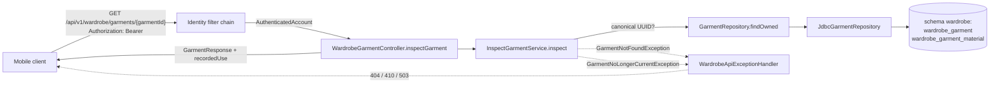
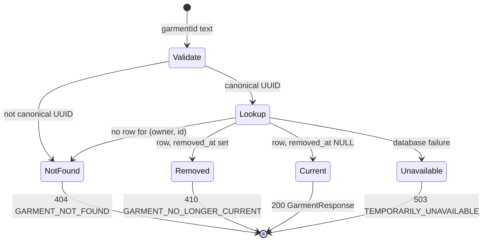
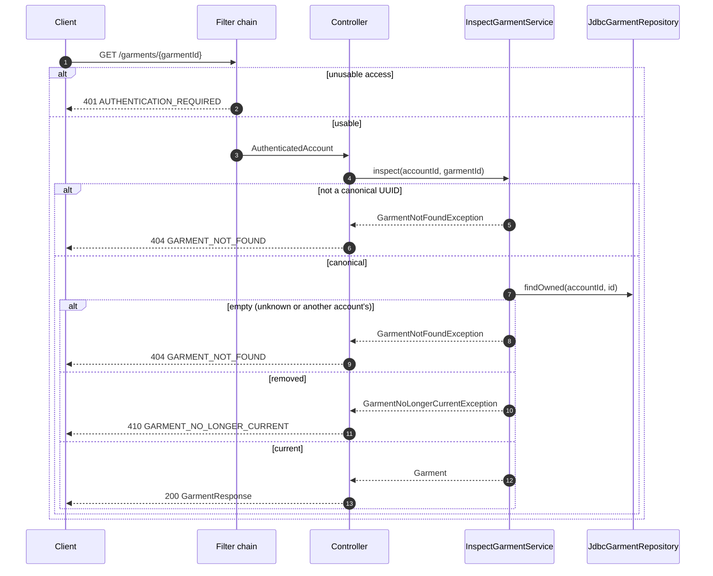

# US-WAR-002 — Inspect an Owned Garment: Implementation Guide

| Field | Value |
| --- | --- |
| Sprint | Sprint 2 — Recover Access and Establish a Private Wardrobe |
| Story / parent PBI | US-WAR-002 — Inspect an owned garment / [PBI-007](../../../product-backlog.md#pbi-007--browse-current-wardrobe-and-inspect-owned-garments) |
| Implementation order | **4 of 4** (US-AUTH-005 → US-GAR-001 → US-WAR-001 → **US-WAR-002**) |
| Starts from | "Stage 3": Stage 0 (`sprint_02` at `90d3237`, [README §3](README.md#3-repository-baseline)) plus the [US-AUTH-005](US-AUTH-005-guide.md), [US-GAR-001](US-GAR-001-guide.md) and [US-WAR-001](US-WAR-001-guide.md) guides |
| Leaves | "Stage 4": the complete Sprint 2 backend increment, including the cross-story test of recovery followed by wardrobe access |
| Read with | [README](README.md), [shared architecture](shared-architecture.md) |
| Code status | **Proposed implementation code — compiled and its automated tests executed by the guide author on 2026-11-07 in an isolated scratch copy of this repository, after the Product Owner decisions of that day were incorporated** (Stage 4 commit; full `clean verify`: 461 unit and 258 integration tests passed; CI report guard passed with 69 required reports). Not applied to this repository's `backend/` (⏳ BACKEND IMPLEMENTATION PENDING), not run in hosted CI. US-WAR-002 is **not Done**. |

Labels: **[REQ]** requirement, **[ARCH]** architecture decision, **[TECH]** proposed technical decision of this guide, **[OPEN]** unresolved (none remains after the Product Owner decisions of 2026-11-07). Sections 3–8 are verbatim source text. Status markers: ✅ APPROVED AND INCORPORATED INTO GUIDES · ⏳ BACKEND IMPLEMENTATION PENDING · ⚠️ EXTERNAL VERIFICATION PENDING · 🟡 DEFERRED BY APPROVED DECISION.

---

## 1. Story Overview

| Item | Content |
| --- | --- |
| Story ID / name | US-WAR-002 — Inspect an owned garment |
| Parent PBI | PBI-007 (Wardrobe domain, Digital Wardrobe theme), shared with US-WAR-001 |
| User value | One possession explained exactly: every accepted applicable property (including several Materials, several Styles, Brand and the reported purchase Price with currency), truthful "eligibility not evaluated", and an honest statement that reported use cannot be shown yet. Nothing is invented, and a garment that is no longer current is not shown as owned. |
| Backend objective | `GET /api/v1/wardrobe/garments/{garmentId}` returns the owner's **current** garment with every stored property (absent values as `null`), `provenance`, `recommendationEligibility: NOT_EVALUATED` and `recordedUse: {availability: UNAVAILABLE}`. Unknown, malformed and other accounts' ids are indistinguishable (404 `GARMENT_NOT_FOUND`); the owner's removed garment is 410 `GARMENT_NO_LONGER_CURRENT`; a failure is 503, never "deleted". Read-only. |
| Hard dependencies | Authenticated access (Sprint 1); the Wardrobe model and V8 (US-GAR-001). The overview (US-WAR-001) supplies the selection and return path but is not a technical prerequisite of the detail operation. |
| Scope (backend) | `GarmentRepository.findOwned`, its JDBC implementation, `InspectGarmentService` with two exceptions, `RecordedUseResponse`, `GarmentResponse.recordedUse`, the detail handler, 404/410 mappings, wiring, OpenAPI v0.8.0, contract-test path parameters, the cross-story IT, CI guard, README. **No migration.** |
| Out of scope | Editing/enrichment (PBI-008), removal (PBI-016), images (PBI-012/013), Wear reporting and utilization (PBI-021/PBI-025), historical views of removed garments, client screens. |
| Expected outcome | Backend parts of AC-01–AC-05, AC-07, AC-09–AC-11 implemented and verified. AC-06 has no evidence source yet (no Wear capability), so only its "unavailable" counterpart (AC-07) applies. AC-08 loading and AC-12 accessibility are client evidence. |

## 2. Repository Baseline (Stage 3)

| Existing component (after US-WAR-001) | Relevance |
| --- | --- |
| `GarmentRepository` (`addIfCreationKeyUnused`, `findCreation`, the keyset `findCurrentByOwner`) and `JdbcGarmentRepository.SELECT_GARMENT` / `mapGarment` (Materials and Styles included) | Extended with one owner-scoped lookup by id that also returns a removed garment, so "removed" can be told apart from "not yours". |
| `Garment.isCurrent()` | Distinguishes current (`removed_at` NULL) from removed. |
| `GarmentResponse` (used by `POST`) | Already the complete flat representation of one garment; gains `recordedUse` so creation and detail return the same shape. |
| `WardrobeGarmentController` (`POST`, `GET`) | Gains `GET /{garmentId}`. |
| `WardrobeApiExceptionHandler` | Has 400/422/503 mappings; gains 404 and 410. |
| `WardrobeConfiguration` | Gains one bean. |
| `IdentityOpenApiContractIT` | Builds request URIs from documented paths; it cannot call a path with `{garmentId}` until it fills path parameters. |
| `WardrobeFailureIT.FailingGarmentRepository` | Implements the port; must implement `findOwned` and fail it on demand. |
| `IdentityIntegrationTestSupport.requestPasswordResetToken` / `completePasswordReset` (US-AUTH-005) | Used by the cross-story IT. |
| `docs/05-api/openapi.yaml` v0.7.0 | Gains the detail operation, `RecordedUse`, 404/410 responses. |


---

## 3. Original Business Requirements — Verbatim

All wording in Sections 3–8 is copied mechanically from the repository at Stage 0; nothing is paraphrased. Only the targets of links inside a quotation are rewritten, so that they open the same file and heading from this guide's folder. The link text is unchanged. The **Source** line above each quotation names its file, heading and line range.

**Source:** [BRD.md — 15.1 Wardrobe Digitization and Management](../../../../01-business/BRD.md#151-wardrobe-digitization-and-management) · lines 464–467 at Stage 0

> | ID | Requirement | Business Rationale | Priority | Related Goals |
> |---|---|---|---|---|
> | BR-003 | Wardrobe understanding must support exactly the 13 approved properties and category applicability in Section 13.2, including optional multiple Materials, Brand and original purchase Price with explicit currency, without an image or recommendation gate. | Styling and utility assessment need richer context than basic tags. | Must | BG-01, BG-02, BG-03, BG-04 |
> | BR-005 | Users must be able to maintain, browse, search, and filter an accurate current wardrobe, including adding, changing, and removing garments. | Decisions must reflect accessible, current possessions. | Must | BG-01, BG-02, BG-03 |
> | BR-006 | Users must be able to understand recorded garment use and discover overlooked clothing and combinations. | Encourage greater value from items already owned. | Must | BG-03 |

**Source:** [BRD.md — 15.4 Privacy, Trust, and Evolution](../../../../01-business/BRD.md#154-privacy-trust-and-evolution) · lines 497–498 at Stage 0

> | ID | Requirement | Business Rationale | Priority | Related Goals |
> |---|---|---|---|---|
> | BR-021 | Personal images, wardrobes, profile information, and behavior must remain private to authorized access, with understandable user control over their information. | Trust is necessary for participation across the value loop. | Must | BG-01, BG-02, BG-03, BG-04 |
> | BR-022 | Users must be able to understand the basis and limitations of recommendations, coverage, and utility estimates, including insufficient data or unavailable context. | Enable informed choices and avoid false certainty. | Must | BG-02, BG-03, BG-04 |

**Source:** [BRD.md — 13.1 Capability Map](../../../../01-business/BRD.md#131-capability-map) · lines 289–290 at Stage 0

> | ID | Capability | Business Purpose |
> |---|---|---|
> | CAP-03 | Wardrobe Management | Keep the wardrobe current and discoverable through maintenance, browsing, search, and filtering. |
> | CAP-04 | Garment Intelligence | Describe garment characteristics sufficiently to support styling, coverage, and purchase evaluation. |

## 4. Original Product Requirements — Verbatim

**Source:** [PRD.md — 8.3 JRN-03 — Wardrobe Management](../../../../02-product/PRD.md#83-jrn-03--wardrobe-management) · lines 236–246 at Stage 0

> ### 8.3 JRN-03 — Wardrobe Management
>
> **Intent:** Keep the product aligned with what the user currently owns.
>
> 1. The user browses garment cards or searches/filters the wardrobe.
> 2. Garment detail presents confirmed information and recorded utilization without implying observed physical wear.
> 3. The user edits inaccurate or changed information and confirms the revision.
> 4. The user can remove a garment through an explicit, understandable removal action.
> 5. Subsequent recommendations and assessments reflect the current confirmed wardrobe; removed garments cannot remain selectable as owned items.
>
> **Recovery:** Empty wardrobes prompt Add Garment; no search results offer changes to the search/filter; failed edits/removals retain a clear unconfirmed state and retry. Historical Wear Events/outfit records preserve understandable snapshots, labeling a removed garment “Removed from wardrobe” rather than treating it as currently owned. **Features:** FEAT-WAR-001–FEAT-WAR-003, FEAT-ANL-001.

**Source:** [PRD.md — 14.1 FEAT-WAR-001 — Wardrobe Overview and Garment Detail](../../../../02-product/PRD.md#141-feat-war-001--wardrobe-overview-and-garment-detail) · lines 618–651 at Stage 0

> ### 14.1 FEAT-WAR-001 — Wardrobe Overview and Garment Detail
>
> **Purpose:** Make the confirmed owned wardrobe understandable and accessible.
>
> **User value:** Users can find what they own and check the information behind recommendations.
>
> **Related BRD:** BR-005, BR-006, BR-021, BR-022; CAP-03, CAP-07; BG-01–BG-03. **Primary users:** All personas; especially Fashion-Conscious Minimalist.
>
> **Entry points / trigger:** Wardrobe, completed ingestion, or garment selection from an outfit/insight. **Preconditions:** Authenticated access; a populated wardrobe is not required to open the area.
>
> **Product behavior:**
>
> 1. Show owned garment cards with an available image/visual, category/subtype, and dominant color; manually created garments remain accessible without an image.
> 2. Present every confirmed garment as owned and saved, with the truthful statement that recommendation eligibility has not been evaluated. Do not classify garments as ready, unready, suitable or unsuitable, and do not ask for additional compatibility information: composition, compatibility and sufficient-evidence policy belong to future recommendation-engine development (OPQ-015).
> 3. Offer relevant recorded-use indicators with clear meaning, including no recorded Wear Events.
> 4. Open garment detail for confirmed information across all eight categories, including available subtype, Brand and purchase Price with currency (Section 13.5), useful provenance/uncertainty, guidance that eligibility is not evaluated, and utilization. Unknown optional fields remain unknown and never hide an owned garment.
> 5. Provide Add Garment and access to search/filter/edit/remove actions.
> 6. Distinguish empty wardrobe from loading, unavailable information, and no matching search results.
> 7. Present a large wardrobe page by page in a stable newest-first order, with an explicit way to continue, so that no garment that stays current is omitted or repeated (OPQ-018).
>
> **User controls:** Browse, open/return from detail, add, and move to management or insights. **Product states:** Loading, empty, populated, detail available, load failed.
>
> **Failure / fallback:** A load failure offers retry rather than falsely claiming zero possessions. Missing images do not conceal otherwise available confirmed garment information.
>
> **Feature-level acceptance criteria:**
>
> - **AC-01:** Confirmed additions appear in the user's wardrobe and open their corresponding details.
> - **AC-02:** Garment cards identify category/color usefully; detail presents the current confirmed profile.
> - **AC-03:** Empty wardrobes explain the value of adding garments and provide an Add Garment action.
> - **AC-04:** No recorded wear is labeled as missing history rather than proof that a garment is never worn.
> - **AC-05:** A data-loading failure is distinguishable from an empty wardrobe.
> - **AC-06:** A manually saved garment without an image remains identifiable/accessibly displayed; an incomplete entry provides useful guidance that eligibility is not evaluated.
>
> **Out of scope / deferred detail:** Pixel layout, collection organization, advanced (user-selectable) sorting and storage are not defined here. Shared/public wardrobes are outside MVP.

**Source:** [PRD.md — 13.3 Saving and Deferred Recommendation Eligibility](../../../../02-product/PRD.md#133-saving-and-deferred-recommendation-eligibility) · lines 588–594 at Stage 0

> ### 13.3 Saving and Deferred Recommendation Eligibility
>
> Exactly 13 fashion properties are approved: Category, Subtype, Color, Material, Pattern, Style, Fit, Neckline, Sleeve Length, Length, Silhouette, Brand, Price. Category and one dominant Color plus explicit user confirmation form the saving minimum. All other applicable properties are optional. Material and Style each support zero or multiple distinct selections; Pattern is single and optional. Fit, Neckline and Sleeve Length apply only to Tops; Length uses separate Tops/Pants vocabularies; Silhouette applies only to Pants. Every supplied controlled value must match the source vocabulary and category; correct or clear invalid/inapplicable input rather than silently substitute or discard it. Unknown optional information is absent, not an invented UNKNOWN/OTHER/Etc value. Preserve real listed fallbacks such as Other, Other Materials and Colorful only where defined.
>
> Recommendation eligibility has not been evaluated. A saved garment is not invalid, unsuitable or ineligible because an engine policy is undefined or an optional property is absent. No ready/unready result, required compatibility field, fixed outfit composition or category-to-role mapping is approved for the current phase. Define composition, compatibility and sufficient-evidence policy during recommendation-engine development, using only approved properties unless the Product Owner approves a future model change. Sprint 2 exposes truthful accepted information and missing values; the smallest contract representation is selected during story-specific design, without mandating a NOT_EVALUATED enum or database field.
>
> Removed fashion properties and the earlier readiness policy are explicitly superseded in the authority's Section 5. User-profile preferences, request occasion/weather and technical metadata remain separate. Their existence cannot recreate removed garment fields or a hidden compatibility gate.

**Source:** [PRD.md — 13.4 Confidence and Provenance Experience](../../../../02-product/PRD.md#134-confidence-and-provenance-experience) · lines 596–608 at Stage 0

> ### 13.4 Confidence and Provenance Experience
>
> These English labels specify semantic states; the initial UI presents understandable Vietnamese wording.
>
> | Confidence State | Expected Experience |
> |---|---|
> | High Confidence | Show the suggested value normally; review/correction authority remains with the user. |
> | Needs Review | Visually indicate the field needs checking with clear copy such as “Please check this value.” |
> | Uncertain | Explain that the attribute could not be identified confidently; encourage correction/manual entry. |
>
> Raw numerical confidence is not the primary user-facing experience. Numeric thresholds remain SRS/AI design/testing work.
>
> Provenance distinguishes **AI Suggested**, **User Confirmed**, **User Corrected**, and **User Entered**. Provenance answers how a value was established, while confidence qualifies an AI proposal. After user confirmation/correction, the user's value is authoritative regardless of the earlier AI confidence; neither confidence nor confirmation claims verified physical fabric composition.

**Source:** [PRD.md — 13.5 Optional Brand and Purchase Price](../../../../02-product/PRD.md#135-optional-brand-and-purchase-price) · lines 610–614 at Stage 0

> ### 13.5 Optional Brand and Purchase Price
>
> Brand is optional user-entered text for every category, with no enum/catalogue or recognition feature. Price is the optional amount originally paid for the garment, expressed as a decimal amount and explicit ISO 4217 currency code. Amount/currency must be supplied together or cleared; unknown Price is not zero. No location default, appearance inference, floating-point monetary value or currency conversion is introduced. Preserve accepted values through creation/detail and future editing; automated output cannot silently overwrite them.
>
> This is personal purchase information, distinct from retailer/affiliate guidance and its freshness rules. Approved validation (OPQ-013, resolved 2026-11-07): Brand has at most 100 Unicode code points, a blank Brand means unspecified, and accepted Brand text is kept exactly (no trimming, case change, accent removal or whitespace normalization). A Price of zero is a valid known amount and differs from a missing Price; negative amounts are invalid; amounts have at most 12 integer digits and no more fractional digits than the currency's ISO 4217 minor unit, and excess precision is rejected rather than rounded; the currency is a valid upper-case ISO 4217 code.

**Source:** [PRD.md — 17.1 FEAT-ANL-001 — Recorded History and Utilization](../../../../02-product/PRD.md#171-feat-anl-001--recorded-history-and-utilization) · lines 935–967 at Stage 0

> ### 17.1 FEAT-ANL-001 — Recorded History and Utilization
>
> **Purpose:** Help users understand time-aware Wear Events, recorded garment use, and overlooked clothing.
>
> **User value:** The user can find opportunities to use existing possessions more effectively.
>
> **Related BRD:** BR-006, BR-011, BR-022, BR-024; CAP-07, CAP-06; BG-03. **Primary users:** Especially Fashion-Conscious Minimalist.
>
> **Entry points / trigger:** Insights, recorded history, or garment detail. **Preconditions:** Confirmed wardrobe for current garment views; Wear Events and understandable historical snapshots for history-derived measures.
>
> **Product behavior:**
>
> 1. Present Wear Events with local date/time and available occasion/recommendation context; multiple events within a day remain separately inspectable, including intentional repeated use of the same outfit.
> 2. Show useful recorded utilization/frequency/recency and little/no-recorded-use indicators without accidental duplicate inflation.
> 3. Let users inspect/correct/remove an individual event; removal does not delete its Outfit/Garments or unrelated events.
> 4. Preserve historical outfit/garment snapshots sufficient to understand past reports. Label garments removed from the active wardrobe “Removed from wardrobe,” without implying current ownership.
> 5. Help users discover variety/overlooked clothing without purchase pressure; missing reports are limitations, not proof of nonuse. Current wardrobe/coverage/multiplier exclude removed garments even when history retains them.
>
> **User controls:** Inspect dated/timed events and garment use, open historical detail, correct an accidental event, or remove an individual event. **Product states:** No Wear Events, one event, multiple events in a day, available insight, correction/removal pending, event removed, unavailable, historical garment removed from wardrobe.
>
> **Failure / fallback:** No history explains Wear This Today and shows no invented usage statistics. Failed retrieval is separate from a genuine absence of records.
>
> **Feature-level acceptance criteria:**
>
> - **AC-01:** A reported selection is visible in history and associated garment-use views.
> - **AC-02:** Like/Dislike or recommendation views do not inflate wear utilization.
> - **AC-03:** A user with no reported selections sees a no-history explanation without fabricated diversity or wear measures.
> - **AC-04:** Overlooked/no-recorded-use indicators disclose recording limitations.
> - **AC-05:** Historical records preserve understandable snapshots and show “Removed from wardrobe” for removed garments, while current ownership/coverage/multiplier exclude them.
> - **AC-06:** Multiple same-day Wear Events are individually visible with local date/time; a later report does not replace an earlier report.
> - **AC-07:** Correcting/removing one event updates relevant history/utilization without deleting its Outfit/Garments or unrelated events.
>
> **Out of scope / deferred detail:** Utilization windows/statistical definitions, snapshot storage/implementation, retention/privacy/deletion rules, and correction validation belong downstream; preserving understandable history and removed-state labeling are settled product behavior. Automated wear detection, forecasting, and new calendar/planning features are excluded.

## 5. Original Software Requirements — Verbatim

### 5.1 Wardrobe management

**Source:** [SRS.md — 3.6 Wardrobe Management](../../../../03-requirements/SRS.md#36-wardrobe-management) · lines 311–312 at Stage 0

> | ID | Requirement | Scope | Source | Verification |
> |---|---|---|---|---|
> | FR-WAR-001 | The system shall present identifiable current confirmed garments across all eight categories, page by page in a stable newest-first order with explicit continuation that neither omits nor repeats garments remaining current, and retrieve all available applicable accepted properties in detail, including multiple Materials and Styles and optional Brand/Price, without requiring an image or every detail field in collection summaries. | MVP | FEAT-WAR-001; BR-005 | T: browse, pagination and imageless detail. |
> | FR-WAR-002 | The system shall truthfully communicate that recommendation eligibility has not been evaluated and distinguish absent optional information from invalid/unavailable data; supported recorded-use information shall not equate no recorded use with proven nonuse. | MVP | FEAT-WAR-001, FEAT-ANL-001; BR-005, BR-006 | I: readiness and usage labels. |

### 5.2 Garment intelligence and authorization

**Source:** [SRS.md — 3.5.1 Saving and Deferred Recommendation Eligibility](../../../../03-requirements/SRS.md#351-saving-and-deferred-recommendation-eligibility) · lines 285–297 at Stage 0

> | ID | Requirement | Scope | Source | Verification |
> |---|---|---|---|---|
> | FR-GAR-001 | The system shall support primary classification limited to TOPS, DRESSES_JUMPSUITS, PANTS, SKIRTS, OUTERWEAR, SHOES, BAGS, HEADWEAR. | MVP | FEAT-GAR-001; BR-003 | T: defined categories only. |
> | FR-GAR-002 | The system shall support every approved category-specific Subtype in the source authority, validate parent association and allow omission without invented fallback values or silent replacement. | MVP | FEAT-GAR-001, FEAT-AI-002; BR-003, BR-002 | T: defined vocabularies and subtype fallback saving. |
> | FR-GAR-004 | The system shall distinguish valid saved ownership from recommendation eligibility that has not been evaluated, without labeling a garment ready, invalid, unsuitable or ineligible because a future policy is undefined or optional information is absent. | MVP | FEAT-GAR-001, FEAT-OUT-001; BR-003, BR-009 | T/I: valid saving, optional absence and unevaluated eligibility without invalid/unsuitable/ineligible claims. |
> | FR-GAR-005 | **Superseded — no active obligation.** The previous compatibility-field readiness prerequisites are removed by the final 13-property decision. Retain this ID for references; future engine eligibility requires approved policy and cannot reintroduce removed fields. | Superseded | FEAT-GAR-001, FEAT-OUT-001; BR-003, BR-009 | I: history only; no active readiness test. |
> | FR-GAR-006 | The system shall keep all properties except Category and Color optional for saving, enforce category applicability on supplied values and preserve valid accepted optional information without fabricating missing values. | MVP | FEAT-GAR-001; BR-003 | T: every optional omission and supplied-value/applicability case. |
> | FR-GAR-012 | The system shall support optional user-entered Brand text of at most 100 Unicode code points for every supported garment category, treat a blank value as unspecified, preserve accepted nonblank text exactly (no trimming, case change, accent removal or whitespace normalization) for inspection and future editing, and keep unavailable or unaccepted suggested Brand distinct from confirmed information without a fixed brand enum or silent automated overwrite. | MVP | FEAT-GAR-001, FEAT-AI-002, FEAT-WAR-001, FEAT-WAR-002; BR-002, BR-003, BR-005 | T: absent/blank/present Brand across eight categories, length boundary, exact value fidelity and late-proposal protection. |
> | FR-GAR-013 | The system shall support optional user-reported purchase Price for every supported garment category as an exact decimal monetary amount with an explicit valid upper-case ISO 4217 currency code when supplied, preserve it for inspection and future editing, and allow omission without save/readiness failure. Zero is a valid known amount distinct from a missing Price; negative amounts, more than 12 integer digits and more fractional digits than the currency's minor unit are rejected, never rounded. It shall not fabricate Price from appearance, infer currency from location, use floating-point monetary calculations, convert currencies or silently overwrite confirmed Price. | MVP | FEAT-GAR-001, FEAT-AI-002, FEAT-WAR-001, FEAT-WAR-002; BR-002, BR-003, BR-005 | T: absent/present amount-and-currency, zero, negative, precision per currency, partial-pair correction, decimal fidelity and non-fabrication; Section 3.5.2 / PRD OPQ-013 (resolved). |

**Source:** [SRS.md — 3.1.1 Authentication and Recovery Rules](../../../../03-requirements/SRS.md#311-authentication-and-recovery-rules) · lines 189–190 at Stage 0

> | ID | Requirement | Scope | Source | Verification |
> |---|---|---|---|---|
> | FR-AUTH-008 | The system shall restrict protected personal operations to an authenticated user authorized for the affected information. | MVP | FEAT-AUTH-001; BR-021 | T: signed-out/cross-user denial. |
> | FR-AUTH-009 | The system shall authenticate protected operations with a valid, unexpired JWT Access Token and the authorized session/account context. | MVP | FEAT-AUTH-001; BR-021 | T/I: absent, invalid, expired and valid JWT access; session authorization. |

### 5.3 Data requirements

**Source:** [SRS.md — 4.3 Garment & Wardrobe Data](../../../../03-requirements/SRS.md#43-garment--wardrobe-data) · lines 661–665 at Stage 0

> | ID | Requirement | Scope | Source | Verification |
> |---|---|---|---|---|
> | DATA-GAR-001 | The system shall associate each current garment and accepted profile with its authorized owner, supported Category and one confirmed approved Color, preserving confirmation and active ownership separately from future evaluation. | MVP | FEAT-GAR-001, FEAT-WAR-001; BR-003, BR-005 | T/I: owner and saveable minimum. |
> | DATA-GAR-002 | The system shall preserve exactly the 13 source-approved fashion properties and applicability, including optional multiple distinct Materials and Styles, one dominant Color, category-specific fields, Brand text and decimal purchase Price with explicit ISO 4217 currency; absent values and necessary metadata shall remain distinct. | MVP | FEAT-GAR-001; BR-003 | I/T: every approved value, distinct Material and Style sets, category applicability and non-mandatory rich information. |
> | DATA-GAR-003 | The system shall associate proposals with evidence-based confidence/provenance under Section 8.1 separately from authoritative user values, without treating numeric confidence as confirmation. | MVP | FEAT-GAR-001, FEAT-AI-002; BR-002, BR-003 | T/I: default thresholds, evidence guards, calibration and confirmation. |
> | DATA-GAR-004 | The system shall associate available image/preview information with the appropriate draft or garment without requiring an image for manually saved entries. | MVP | FEAT-AI-001, FEAT-AI-002; BR-001, BR-002 | T: imageless and image entry. |
> | DATA-GAR-005 | The system shall represent active/removed ownership independently from missing optional properties and unevaluated recommendation eligibility, without requiring a readiness flag, NOT_EVALUATED enum, compatibility field or physical schema prescribed by this SRS. | MVP | FEAT-GAR-001, FEAT-WAR-002; BR-003, BR-005 | T/I: ownership and unevaluated eligibility remain distinct; no property gate. |

**Source:** [SRS.md — 4.8 Historical Data](../../../../03-requirements/SRS.md#48-historical-data) · lines 706–707 at Stage 0

> | ID | Requirement | Scope | Source | Verification |
> |---|---|---|---|---|
> | DATA-HIST-001 | The system shall retain the minimal meaningful past event/outfit/garment snapshot and original event-local time context needed to understand history after garment removal, travel or ranking expiry, without indefinitely retaining original removed-garment images or nonessential removed personal data. | MVP | FEAT-ANL-001; BR-006 | T/I: minimal snapshot, >90-day retained history, original timezone and removed-image/nonessential-data deletion within 30 days. |
> | DATA-HIST-002 | The system shall identify removed garments in historical presentation as Removed from wardrobe without treating the snapshot as an active item. | MVP | FEAT-ANL-001; BR-006, BR-022 | I/A: removed snapshot. |

### 5.4 Interfaces

**Source:** [SRS.md — 5.1 User Interfaces](../../../../03-requirements/SRS.md#51-user-interfaces) · lines 762–762 at Stage 0

> | ID | Requirement | Scope | Source | Verification |
> |---|---|---|---|---|
> | UI-004 | The system shall display garment identity/category/color, guidance that eligibility is not evaluated, and available image without hiding imageless manual entries. | MVP | FEAT-WAR-001, FEAT-GAR-001; BR-005, BR-003 | I: cards and minimum-only detail. |

**Source:** [SRS.md — 5.4 Communication Interfaces](../../../../03-requirements/SRS.md#54-communication-interfaces) · lines 792–792 at Stage 0

> | ID | Requirement | Scope | Source | Verification |
> |---|---|---|---|---|
> | COM-001 | The system shall protect private access/wardrobe/profile/history exchanges against unauthorized disclosure or alteration, preserving password values and the session/account authority defined in Section 3.1.1. | MVP | FEAT-AUTH-001; BR-021 | A/T: protected exchange; Unicode/spaces preserved; session ownership. |

### 5.5 Error and failure requirements

**Source:** [SRS.md — 9.3 Garment Completeness](../../../../03-requirements/SRS.md#93-garment-completeness) · lines 1010–1010 at Stage 0

> | ID | Failure Condition | Required System Behavior | Continuation / State Protection | Source | Verification |
> |---|---|---|---|---|---|
> | ERR-GAR-002 | Recommendation eligibility has not been evaluated. | The system shall disclose the unevaluated state without calling the garment invalid, unsuitable or ineligible; the previous missing-compatibility-field error is superseded. | Retain accepted information and ordinary wardrobe access; no enrichment gate. | FEAT-GAR-001, FEAT-WAR-001; BR-003, BR-005, BR-022 | T/I: no unsupported eligibility claim or save/browse/detail gate. |

**Source:** [SRS.md — 9.1 Access and Recovery](../../../../03-requirements/SRS.md#91-access-and-recovery) · lines 994–994 at Stage 0

> | ID | Failure Condition | Required System Behavior | Continuation / State Protection | Source | Verification |
> |---|---|---|---|---|---|
> | ERR-AUTH-001 | Invalid or unusable login information. | The system shall deny invalid credentials or unavailable authorized session access with useful correction/recovery guidance without exposing private content or representing the wardrobe as empty. | User may correct input or initiate recovery; personal state is not changed. | FEAT-AUTH-001; BR-021 | T: incorrect credentials, token expiry and revoked session. |

**Source:** [SRS.md — 9.9 Communication and Partial Dependency Failure](../../../../03-requirements/SRS.md#99-communication-and-partial-dependency-failure) · lines 1052–1052 at Stage 0

> | ID | Failure Condition | Required System Behavior | Continuation / State Protection | Source | Verification |
> |---|---|---|---|---|---|
> | ERR-NET-001 | Network/communication fails during an action. | The system shall distinguish interrupted communication and uncertain mutation outcomes from confirmed success or empty data, providing applicable outcome review/retry without accidental duplicate actions. | Previously confirmed information is preserved; an already accepted action is not repeated as a new one. No general offline guarantee. | FEAT-AI-002, FEAT-PERS-002, FEAT-WAR-001; BR-005, BR-011, BR-022 | T: interruption before/after action acceptance. |

### 5.6 Security, privacy, accessibility and localization

**Source:** [SRS.md — 6.2 Security](../../../../03-requirements/SRS.md#62-security) · lines 813–814 at Stage 0

> | ID | Requirement | Scope | Source | Verification |
> |---|---|---|---|---|
> | NFR-SEC-001 | The system shall permit zero successful unauthorized cross-user wardrobe/image accesses in the agreed validation scenarios. | MVP | FEAT-AUTH-001, FEAT-WAR-001; BR-021 | T: two-account and unauthenticated attempts; MET-Q06. |
> | NFR-SEC-002 | The system shall prevent account switch or logout from exposing the preceding user's protected content, enforcing current-session logout isolation and all-Refresh-Session revocation after successful password reset. | MVP | FEAT-AUTH-001; BR-021 | T: two sessions/accounts; current logout versus account-wide reset. |

**Source:** [SRS.md — 6.3 Privacy](../../../../03-requirements/SRS.md#63-privacy) · lines 821–821 at Stage 0

> | ID | Requirement | Scope | Source | Verification |
> |---|---|---|---|---|
> | NFR-PRIV-001 | The system shall limit personal data processing to necessary functionality, personalization, wardrobe/history/utilization, validation/measurement, security and operational integrity; explain its purpose and respect omission/correction/removal/permission controls within the authorized User's private experience, with no public wardrobes, user-to-user sharing, unrestricted third-party sharing or sale of personal data. | MVP | FEAT-AUTH-001, FEAT-PROF-001, FEAT-PROF-002, FEAT-PERS-001, FEAT-PERS-002; BR-012, BR-013, BR-021 | I/D: purpose, private access, feature controls and absence of unapproved sharing/sale. |

**Source:** [SRS.md — 6.7 Accessibility](../../../../03-requirements/SRS.md#67-accessibility) · lines 853–854 at Stage 0

> | ID | Requirement | Scope | Source | Verification |
> |---|---|---|---|---|
> | NFR-ACC-001 | The system shall communicate meaningful confidence, unevaluated eligibility, unavailable/outdated, hypothetical, and removed states with understandable labels rather than relying solely on color or a garment image. | MVP | FEAT-GAR-001, FEAT-WAR-001, FEAT-OUT-001, FEAT-MULT-001, FEAT-ANL-001; BR-003, BR-005, BR-006, BR-022 | I/D: labels remain meaningful without color/image cues. |
> | NFR-ACC-002 | The system shall support meaningful accessible names/roles/states, operable core journeys and accessible primary actions at text scaling up to 200%, with approximately 48 dp Android/44 pt iOS minimum primary-control touch targets; applicable core journeys shall be validated with TalkBack and VoiceOver. | MVP | FEAT-AUTH-001, FEAT-AI-002, FEAT-OUT-001, FEAT-PERS-002; BR-002, BR-011, BR-022, BR-023 | D/I: both screen readers, accessible semantics, 200% text scaling, target sizes and outcome meaning; Section 12.4; no certification claim. |

**Source:** [SRS.md — 7. Localization Requirements](../../../../03-requirements/SRS.md#7-localization-requirements) · lines 898–898 at Stage 0

> | ID | Requirement | Scope | Source | Verification |
> |---|---|---|---|---|
> | LOC-001 | The system shall provide the initial user interface, explanations, and applicable recovery guidance in Vietnamese on Android and iOS. | MVP | FEAT-AUTH-001, FEAT-OUT-001, FEAT-AI-002; BR-002, BR-022, BR-023 | I/D: initial Vietnamese journeys. |

## 6. Original Business Rules — Verbatim

**Source:** [business-rules.md — BRULE-AUTH-001 — Authorized Personal Operations](../../../../03-requirements/business-rules.md#brule-auth-001--authorized-personal-operations) · lines 81–87 at Stage 0

> ### BRULE-AUTH-001 — Authorized Personal Operations
>
> **Rule:** Personal wardrobe, profile, feedback, history, and assessment operations require authentication and authorization for the affected user's information. Unavailable authorized access is not an empty wardrobe and does not change personal state.
>
> **Applies To:** all personal domain operations.
>
> **Source:** FR-AUTH-008, ERR-AUTH-001, DATA-GAR-001.

**Source:** [business-rules.md — BRULE-AUTH-007 — Purpose-Limited Private Data Use](../../../../03-requirements/business-rules.md#brule-auth-007--purpose-limited-private-data-use) · lines 131–139 at Stage 0

> ### BRULE-AUTH-007 — Purpose-Limited Private Data Use
>
> **Rule:** Personal data is used only as necessary for CapsuleAI functionality, personalization, wardrobe/history/utilization, validation/measurement, security and operational integrity within the authorized User's private experience. MVP personal images, profiles, Wear Events, feedback and corrections are not used for AI model training/improvement. Future personal-data training requires separate explicit opt-in and an approved future product/privacy change.
>
> No public wardrobes, user-to-user wardrobe sharing, unrestricted third-party sharing or sale of personal data is introduced. External dependencies receive only purpose-minimal information: required selected weather location, email/necessary recovery-delivery information, or explicitly chosen shopping navigation without unrelated wardrobe/profile/history disclosure. Necessary active-account information and minimal history follow the retention/removal rules; this policy adds no Delete Account goal or legal certification.
>
> **Applies To:** personal information, account/profile/wardrobe/history, validation/measurement and external exchanges.
>
> **Source:** FR-AUTH-008, NFR-PRIV-001, NFR-PRIV-002, SI-002, SI-003, COM-003, FR-MET-006, DATA-RET-001, DATA-RET-002, DATA-RET-003.

**Source:** [business-rules.md — BRULE-GAR-001 — Canonical Garment Authority](../../../../03-requirements/business-rules.md#brule-gar-001--canonical-garment-authority) · lines 173–179 at Stage 0

> ### BRULE-GAR-001 — Canonical Garment Authority
>
> **Rule:** Each owned garment belongs to the authorized user's wardrobe. Automated attribute proposals are not authoritative. Applicable User Confirmed, User Corrected, or User Entered-and-confirmed values establish the canonical profile; later automated analysis cannot silently overwrite them.
>
> **Applies To:** ingestion, edits, all garment-dependent evaluations.
>
> **Source:** DATA-GAR-001, FR-GAR-011, AI-REQ-001, AI-REQ-007, DATA-INT-001.

**Source:** [business-rules.md — BRULE-GAR-002 — Saveable Minimum](../../../../03-requirements/business-rules.md#brule-gar-002--saveable-minimum) · lines 183–189 at Stage 0

> ### BRULE-GAR-002 — Saveable Minimum
>
> **Rule:** A garment is Saveable when the user explicitly confirms its supported Primary Category and Dominant Color. Manual creation requires neither an image nor successful analysis. Missing optional rich descriptors do not prevent saving; canceled or unconfirmed work does not establish a confirmed wardrobe entry.
>
> **Applies To:** assisted/manual creation and validation.
>
> **Source:** FR-GAR-003, FR-AI-003, FR-AI-008, FR-AI-009, ERR-GAR-001.

**Source:** [business-rules.md — BRULE-GAR-003 — Evaluation-Specific Recommendation-Readiness](../../../../03-requirements/business-rules.md#brule-gar-003--evaluation-specific-recommendation-readiness) · lines 193–199 at Stage 0

> ### BRULE-GAR-003 — Evaluation-Specific Recommendation-Readiness
>
> **Status: revised; old predicates superseded.**
>
> **Rule:** Recommendation eligibility has not been evaluated. A saved garment is not invalid, unsuitable or ineligible because an engine policy is undefined or an optional property is absent. No ready/unready result, required compatibility field, fixed outfit composition or category-to-role mapping is approved for the current phase. Define composition, compatibility and sufficient-evidence policy during recommendation-engine development, using only approved properties unless the Product Owner approves a future model change. Sprint 2 exposes truthful accepted information and missing values; the smallest contract representation is selected during story-specific design, without mandating a NOT_EVALUATED enum or database field.
>
> **Source:** FR-GAR-004/005, DATA-GAR-005, ERR-GAR-002; final Product Owner property-model decision.

**Source:** [business-rules.md — BRULE-GAR-004 — Controlled Classification and Context Vocabularies](../../../../03-requirements/business-rules.md#brule-gar-004--controlled-classification-and-context-vocabularies) · lines 203–209 at Stage 0

> ### BRULE-GAR-004 — Controlled Classification and Context Vocabularies
>
> **Rule:** Category is one of the eight approved codes. Every supplied optional Subtype must belong to that Category and its complete approved source list; missing Subtype is valid. No invented fallback or silent replacement is permitted. MINI_DRESS and other overlapping names remain subtypes without automatic derivation. All Bags/Headwear choices are approved, not pending research.
>
> The [garment-property authority](../../../../../Initial%20files/Image%20to%20Properties%20Extraction.md) owns garment values. Profile style preferences, request Occasion and common needs keep their separate SRS Section 4.10 vocabularies; they are not garment Style or a garment Occasion property.
>
> **Source:** FR-GAR-001/002, DATA-GAR-002; FR-PROF-002/004 for separate context.

**Source:** [business-rules.md — BRULE-GAR-006 — Descriptor Consistency and Unknown Information](../../../../03-requirements/business-rules.md#brule-gar-006--descriptor-consistency-and-unknown-information) · lines 235–239 at Stage 0

> ### BRULE-GAR-006 — Descriptor Consistency and Unknown Information
>
> **Rule:** Unknown optional information remains absent rather than an invented value. Material selections form distinct semantic values, without percentages/proportions. Color is one approved dominant value; Pattern is one optional value; Style, like Material, is an optional set of distinct values. Validate applicability and supplied labels before confirmation; correct/clear invalid or inapplicable fields without silent substitution or discard. No cross-property inference is approved merely because a subtype overlaps length, style or occasion. Etc is not a Style value. Removed descriptors cannot be reconstructed as hidden fields or readiness gates.
>
> **Source:** FR-GAR-002/006–010, DATA-GAR-002, AI-REQ-008.

**Source:** [business-rules.md — BRULE-GAR-010 — Optional Brand and Purchase Price Authority](../../../../03-requirements/business-rules.md#brule-gar-010--optional-brand-and-purchase-price-authority) · lines 279–287 at Stage 0

> ### BRULE-GAR-010 — Optional Brand and Purchase Price Authority
>
> **Rule:** Brand is optional user-entered text across all eight categories, with no fixed enum or external catalogue. Preserve the confirmed value; unknown is not a fabricated brand. Price is the optional user-reported purchase price of the owned garment, represented by a decimal amount together with an explicit ISO 4217 currency code. An amount without currency, or currency without amount, is incomplete supplied information and must be corrected or cleared before confirmation; omitting both is valid and does not mean zero. Never infer currency from location or perform floating-point monetary calculations. This is not market/resale/replacement value or a retailer/affiliate price; no conversion feature is introduced. Neither field is a save or readiness requirement. Price must not be inferred from a photograph; any future Brand suggestion remains unconfirmed until user acceptance. Later analysis or image upload must not silently replace confirmed Brand or Price.
>
> Future edits may revise or clear these properties with explicit user confirmation. Supplied valid values participate in the same accepted garment addition and safe-retry outcome; they do not create separate ownership or duplicate accepted additions. Approved validation (PRD OPQ-013, resolved 2026-11-07): Brand has at most 100 Unicode code points, a blank Brand is unspecified, and accepted Brand text is kept exactly. A Price of zero is a known amount, not a missing one; negative amounts, more than 12 integer digits and more fractional digits than the currency's ISO 4217 minor unit are rejected, never rounded; the currency is a valid upper-case ISO 4217 code. Nothing is defaulted or silently altered.
>
> **Applies To:** manual entry, inspection, future editing and assisted-review protection across all eight categories.
>
> **Source:** FR-GAR-012, FR-GAR-013, FR-GAR-011, DATA-GAR-002, DATA-GAR-003, DATA-INT-001, DATA-INT-004; PRD Sections 13.5/34.1.

**Source:** [business-rules.md — BRULE-HIST-001 — Recorded Use Is Reported Evidence](../../../../03-requirements/business-rules.md#brule-hist-001--recorded-use-is-reported-evidence) · lines 537–543 at Stage 0

> ### BRULE-HIST-001 — Recorded Use Is Reported Evidence
>
> **Rule:** Use frequency, recency, variety, and overlooked-item information derives from accepted effective Wear Events. Legitimate same-day reports remain separately understandable even when ranking normalizes them. No recorded use does not prove physical nonuse; incomplete logging and no-events states must not produce fabricated statistics.
>
> **Applies To:** wardrobe use/history and relevant personalization.
>
> **Source:** FR-ANL-002, FR-ANL-003, FR-ANL-004, FR-ANL-005, FR-WAR-002.

**Source:** [business-rules.md — BRULE-HIST-002 — Historical Snapshots vs Current Wardrobe](../../../../03-requirements/business-rules.md#brule-hist-002--historical-snapshots-vs-current-wardrobe) · lines 545–551 at Stage 0

> ### BRULE-HIST-002 — Historical Snapshots vs Current Wardrobe
>
> **Rule:** Historical outfit/garment representations remain understandable after garment removal and are labeled Removed from wardrobe where applicable. Such snapshots do not establish active ownership or enter new current outfits, Coverage, or the Multiplier baseline. Historical views preserve original event-local time rather than travel-based re-dating. Retain only the minimal snapshot needed to understand past records. Original removed-garment images and other nonessential removed personal data are not required historical evidence and follow the 30-day physical-deletion boundary.
>
> **Applies To:** history inspection and active inventory boundaries.
>
> **Source:** FR-ANL-001, FR-ANL-006, FR-WAR-005, DATA-HIST-001, DATA-HIST-002, DATA-RET-002.

## 7. Original User Story and Acceptance Criteria — Verbatim

**Source:** [US-WAR-002-inspect-owned-garment.md](../../../stories/wardrobe/US-WAR-002-inspect-owned-garment.md) · complete file at Stage 0

> # US-WAR-002 — Inspect an owned garment
>
> **Current property-model revision — 2026-11-05:** The Product Owner approved exactly 13 garment properties and every explicitly listed vocabulary in the [garment-property authority](../../../../../Initial%20files/Image%20to%20Properties%20Extraction.md). This supersedes earlier research-only vocabulary status, removed garment attributes, fixed composition assumptions and property-based readiness gates. All applicable properties are included in the selected Sprint 2 garment stories. Recommendation eligibility is not evaluated; engine composition/compatibility policy is deferred. Stable IDs below remain traceable; superseded policies are not active implementation or acceptance obligations.
>
> ## Document Control
>
> | Field | Value |
> | --- | --- |
> | Artifact | User Story |
> | Story ID | US-WAR-002 |
> | Version | 0.5 |
> | Status | Baseline Draft |
> | Product | CapsuleAI |
> | Revision note | 2026-10-21: first focused refinement; clarified source-backed acceptance/evidence and traceability; identity, scope and Baseline Draft status preserved. 2026-10-22: linked related full-backlog drafts and explicit identity/domain metadata; existing outcome and AC retained. |
> | Parent PBI | [PBI-007](../../../product-backlog.md#pbi-007--browse-current-wardrobe-and-inspect-owned-garments) |
> | Domain | Wardrobe |
> | Theme | Digital Wardrobe |
> | Product Goal Contribution | [Trustworthy Wardrobe Understanding](../../../product-goal.md#4-desired-product-outcomes) |
> | Product revision | 2026-11-05: Approved eight-category taxonomy and optional subtype/Brand/purchase Price synchronized. Existing story/AC IDs, parent PBI and Sprint 2 order retained; no implementation claimed. |
>
> ## 1. Story
>
> As an authenticated user, I want to inspect an owned garment's accepted information and eligibility under a future approved policy, so that I can understand what CapsuleAI knows about that garment and the limits of advice based on it.
>
> ## 2. User Value
>
> Inspection explains one possession rather than the collection as a whole. Accepted profile, unevaluated eligibility and qualified use information belong together because they establish what can be trusted about the selected garment.
>
> ## 3. Scope
>
> Read-only detail for a selected current confirmed garment, including available image/profile/provenance/uncertainty, eligibility under a future policy and supported recorded-use information when that capability is available. Includes loading, retrieval failure, changed ownership, authorization and return to browsing.
>
> ## 4. Preconditions
>
> - I have authenticated access authorized for the selected garment's wardrobe.
> - Successful current detail requires a selected confirmed active owned garment. Missing images/rich fields do not disqualify it; a changed or no-longer-current selection is handled within the story.
> - Wear reporting, utilization analytics and completed optional personalization are not prerequisites to inspect accepted garment information.
>
> ## 5. Acceptance Criteria
>
> ### AC-01 — Retrieve every available applicable accepted property
>
> **Given** I select an authorized current confirmed garment
>
> **When** detail retrieval succeeds
>
> **Then** return the correct accepted Category, Subtype, Color, Material selections, Pattern, Style selections, applicable Fit/Neckline/Sleeve Length/Length/Silhouette, Brand and purchase Price with currency. Missing optional values stay missing; multiple distinct Materials and exact accepted labels/amounts are preserved. Available image and useful metadata remain separate; suggestions never replace confirmed values.
>
> ### AC-02 — Inspect an imageless or incomplete entry
>
> **Given** the selected current garment has no image or has only the confirmed Saveable minimum
>
> **When** detail retrieval succeeds
>
> **Then** it remains identifiable and inspectable through accepted information. Missing image, unavailable descriptors and unevaluated eligibility retain their distinct meanings; no image, Brand, Price, default currency, material, color or other descriptor is fabricated to make the profile look complete. Missing Price is unknown, not zero; displayed Price means the user-reported purchase price, not current retailer or market value.
>
> ### AC-03 — Represent recommendation eligibility truthfully
>
> **Given** the selected garment has valid accepted ownership
>
> **When** detail presents evaluation information
>
> **Then** communicate that recommendation eligibility has not been evaluated. Neither optional absence nor undefined engine policy establishes ready, unsuitable, invalid or ineligible status; no removed property or enrichment gate is imposed.
>
> ### AC-04 — Respect category applicability in detail
>
> **Given** the selected garment belongs to any supported category
>
> **When** accepted properties are returned
>
> **Then** show Fit/Neckline/Sleeve Length only as applicable to Tops, Length under its Tops/Pants vocabulary, and Silhouette only for Pants. Preserve all globally applicable accepted properties, including multiple Materials, without inventing inapplicable values or inferring fields from Subtype.
>
> ### AC-05 — Keep optional omissions separate from failed retrieval
>
> **Given** a saved garment lacks one or more optional properties
>
> **When** available detail is retrieved
>
> **Then** preserve the usable accepted profile, distinguish absent values from an unavailable request, and fabricate no data or evaluated eligibility. Category/Color confirmation remains sufficient for saving; detail viewing changes no accepted value or ownership.
>
> ### AC-06 — Qualify available reported-use information
>
> **Given** supported reported-use information is available for this garment
>
> **When** it is displayed in detail
>
> **Then** indicators reflect accepted effective Wear Events and their reporting limits. No recorded events is described as no recorded use rather than proof of never having physically worn the garment; information is not fabricated from missing reports. This presentation consumes available evidence and does not implement reporting or utilization analytics.
>
> ### AC-07 — Keep unavailable use evidence distinct
>
> **Given** reported-use capabilities/evidence are not yet available or cannot be retrieved, but accepted garment detail is available
>
> **When** I inspect the garment
>
> **Then** CapsuleAI retains usable accepted profile / unevaluated eligibility inspection and does not manufacture zero use, last-worn information or a no-recorded-events conclusion from unavailable evidence. Availability of future reporting/analytics is not a gate to viewing this garment.
>
> ### AC-08 — Distinguish detail loading and retrieval failure
>
> **Given** detail retrieval is pending or fails
>
> **When** I review the selected-garment outcome
>
> **Then** CapsuleAI distinguishes loading from unavailable detail, offers applicable retry or return to usable prior context on failure, and does not call the wardrobe empty or the selected garment deleted merely because retrieval failed. Accepted wardrobe information remains unchanged.
>
> ### AC-09 — Handle a selection that is no longer current
>
> **Given** the garment changed or was removed from current ownership after selection
>
> **When** CapsuleAI establishes the changed current state during inspection
>
> **Then** it explains the changed/no-longer-current item and refreshes the current wardrobe where possible, allowing return to browsing. A minimal historical snapshot stays separate and does not restore current ownership; this story does not perform removal or implement historical views.
>
> ### AC-10 — Inspect and return without mutation
>
> **Given** usable detail is presented
>
> **When** I inspect it, return to browsing or leave without a separate maintenance action
>
> **Then** CapsuleAI offers the return path and inspection alone creates no addition, edit, removal, Wear Event or preference feedback. Accepted values and ownership remain unchanged by viewing.
>
> ### AC-11 — Protect detail when authorized access is lost
>
> **Given** access expires, is revoked or is not authorized for the affected garment
>
> **When** I open or continue inspecting it
>
> **Then** CapsuleAI pauses protected use, explains the need for usable authorized access and exposes no other account's garment information. It does not present inaccessible detail as an empty wardrobe; inspection can resume for the correct account after valid authentication.
>
> ### AC-12 — Understand the detail and its limits
>
> **Given** I use the Vietnamese detail interaction with a screen reader or text scaled up to 200%
>
> **When** I inspect accepted information and unevaluated eligibility, qualified use information, failure guidance or the return action
>
> **Then** the information, state meanings and actions remain operable and understandable through meaningful accessible names/roles/states beyond image or color alone. Saved ownership, unevaluated eligibility, uncertain descriptors and no-recorded/unavailable use evidence remain distinguishable.
>
> ## 6. Business Rules and Constraints
>
> - BRULE-AUTH-001 and BRULE-GAR-001–BRULE-GAR-003 preserve authorized ownership, authoritative accepted values and eligibility under a future policy; BRULE-GAR-006 prohibits invented compatibility information.
> - BRULE-HIST-001 limits use indicators to reported evidence; BRULE-HIST-002 prevents historical snapshots from becoming current owned detail. Confirmation is distinct from verified physical material composition.
> - The initial interface and guidance are Vietnamese on Android 10+ and iOS 15+; this specification is English. Story actions and states retain meaningful accessible names, roles and labels beyond color, operability at text scaling up to 200%, and the SRS primary touch-target criteria (approximately 48 dp on Android / 44 pt on iOS). Private information is used only for necessary authorized product purposes; MVP personal data is excluded from AI training/improvement and unrestricted sharing.
>
> ## 7. Dependencies
>
> - Parent PBI hard capability dependency: PBI-004's authenticated access; [US-AUTH-002](../../../stories/auth/US-AUTH-002-log-in.md) and [US-AUTH-003](../../../stories/auth/US-AUTH-003-resume-session.md) supply access/continuity where applicable.
> - [US-WAR-001](../../../stories/wardrobe/US-WAR-001-browse-current-wardrobe.md) supplies the collection selection/return route. The actual detail input is a current owned garment; no single creation method is a hard dependency.
> - PBI-006 / [US-GAR-001](../../../stories/garment/US-GAR-001-add-garment-manually.md) supply useful minimum-only/imageless examples. PBI-008 supplies later editing; neither is a new mandatory completion gate for already available detail.
> - Reported-use presentation integrates with available evidence as its owning capabilities arrive (PBI-021/PBI-025); those capabilities are not hard prerequisites to accepted profile / unevaluated eligibility inspection.
>
> - Related [US-GAR-002](../../../stories/garment/US-GAR-002-correct-and-enrich-garment-information.md) enrichment, [US-WEAR-002](../../../stories/wear/US-WEAR-002-review-distinct-wear-history.md) history and [US-ANL-001](../../../stories/analytics/US-ANL-001-understand-reported-wardrobe-utilization.md) utilization remain separate outcomes. Available recorded-use evidence can be consumed without making those whole capabilities prerequisites to profile inspection.
>
> ## 8. Out of Scope
>
> Collection browsing is US-WAR-001. All 13 applicable creation properties belong to US-GAR-001; later editing is PBI-008; search/filtering is PBI-015; removal and retention enforcement are PBI-016. Photo/AI entry/proposal review remain PBI-012/PBI-013. Wear reporting/history and utilization calculations/insights remain their owning PBIs, including PBI-021/PBI-025. No new reporting action, analytics event, restore action, image generation, recommendation algorithm or implementation design is introduced.
>
> ## 9. Traceability
>
> | Source | References |
> | --- | --- |
> | Parent PBI | [PBI-007](../../../product-backlog.md#pbi-007--browse-current-wardrobe-and-inspect-owned-garments) |
> | Business | [BRD](../../../../01-business/BRD.md): BR-003, BR-005, BR-006, BR-021, BR-022; CAP-03, CAP-04 |
> | Product | [PRD](../../../../02-product/PRD.md): JRN-03; FEAT-WAR-001, FEAT-GAR-001 (accepted accepted profile / unevaluated eligibility); FEAT-ANL-001, available indicators only |
> | SRS | [SRS](../../../../03-requirements/SRS.md): FR-WAR-001, FR-WAR-002, FR-GAR-004, FR-GAR-005, FR-GAR-006, FR-AUTH-008; DATA-GAR-001, DATA-GAR-003, DATA-GAR-004, DATA-GAR-005; UI-004; ERR-GAR-002, ERR-AUTH-001, ERR-NET-001; COM-001; NFR-SEC-001, NFR-SEC-002, NFR-PRIV-001; NFR-ACC-001, NFR-ACC-002; LOC-001; FR-GAR-001, FR-GAR-002, FR-GAR-012, FR-GAR-013, DATA-GAR-002 |
> | Business Rules | [Business Rules](../../../../03-requirements/business-rules.md): BRULE-AUTH-001, BRULE-AUTH-007; BRULE-GAR-001, BRULE-GAR-002, BRULE-GAR-003, BRULE-GAR-006; BRULE-HIST-001, BRULE-HIST-002; BRULE-GAR-004, BRULE-GAR-010 |
> | Use Cases | [UC-008 — View Wardrobe](../../../../03-requirements/use-cases/UC-008-view-wardrobe.md), selected detail/accepted-properties/use/return and failure branches only |
> | Activity Diagrams | No current dedicated Activity Diagram for UC-008; the textual specification governs this slice. |
> | Completion / Verification | [Definition of Done](../../../definition-of-done.md), applicable common/triggered criteria; [Test Strategy](../../../../07-testing/test-strategy.md), selected-story evidence rather than foundation smoke tests alone. |
>
> ## 10. Open Refinement Notes
>
> **2026-11-07 Product Owner decisions.** Detail returns zero or more distinct Styles (OPEN-S2-08), Brand and Price under the approved validation (OPEN-S2-01A/01B), `recommendationEligibility: NOT_EVALUATED` (X-1), `recordedUse.availability: UNAVAILABLE` without a fabricated count or date (X-5) and no image field (X-3). Selection comes from the paged overview of US-WAR-001 (OPEN-S2-10). See the [decision implementation notes](../decision-implementation-notes.md).
>
> **2026-11-05 product revision:** [PRD Section 34.1](../../../../02-product/PRD.md#341-approved-taxonomy-revision-and-open-follow-up-decisions) records the final 13-property/vocabulary approval and resolved eligibility deferral; only genuine validation/contract details remain open. Resolve applicable validation before dependent implementation; these questions do not make optional fields mandatory. Historical refinement notes below are subject to this revision. Sprint 2 selection is recorded in the [Sprint plan](../sprint-plan.md); source status remains Baseline Draft.
>
> **2026-10-21 refinement draft.** Retain detail as a read-only selected-garment outcome; its existing AC-06/AC-07 already distinguish no recorded use from unavailable evidence. Verify current/changed ownership, minimum-only imageless information, unevaluated eligibility and return to browsing with controlled examples (Q-02/Q-04/Q-05). Neither a completed Wear capability nor a particular creation method is a hard prerequisite. No new reporting, edit, removal or enrichment behavior is proposed.
>
> Question details, owners and conditional planning blockers are centralized in the [focused refinement review](../../../backlog-refinement-review.md#6-open-questions-for-product-owner-and-team). These notes do not change story status, assign estimates or authorize implementation. Necessary implementation detail remains JIT for a selected story. The [full story catalogue](../../../stories/README.md) now accounts for all 41 PBIs; those additional drafts change none of this story's acceptance boundaries.
>
> ## 11. Status
>
> **Baseline Draft.** Product Owner and Scrum Team review is pending; document approval is not claimed; Sprint 2 selection is recorded separately in its plan.

## 8. Original Use Cases, Flows and Architecture Decisions — Verbatim

### 8.1 UC-008 — View Wardrobe (complete)

The story states: "No current dedicated Activity Diagram for UC-008; the textual specification governs this slice." This story implements UC-008's selected-detail, accepted-properties, use, return and failure branches.

**Source:** [UC-008-view-wardrobe.md](../../../../03-requirements/use-cases/UC-008-view-wardrobe.md) · complete file at Stage 0

> # UC-008 — View Wardrobe
>
> **Current property-model revision — 2026-11-05:** The Product Owner approved exactly 13 garment properties and every explicitly listed vocabulary in the [garment-property authority](../../../../../Initial%20files/Image%20to%20Properties%20Extraction.md). This supersedes earlier research-only vocabulary status, removed garment attributes, fixed composition assumptions and property-based readiness gates. All applicable properties are included in the selected Sprint 2 garment stories. Recommendation eligibility is not evaluated; engine composition/compatibility policy is deferred. Stable IDs below remain traceable; superseded policies are not active implementation or acceptance obligations.
>
> ## 1. Use Case Summary
>
> | Field | Value |
> | --- | --- |
> | Use Case ID | UC-008 |
> | Use Case Name | View Wardrobe |
> | Scope | CapsuleAI |
> | Level | User Goal |
> | Primary Actor | User |
> | Supporting Actors | None |
> | Version | 0.4 |
> | Status | Baseline Draft |
> | Product revision | 2026-11-05: Approved taxonomy and optional Brand/purchase Price synchronized; goals, alternate/failure paths and ownership/retry semantics preserved. |
>
> Source authority: [BRD](../../../../01-business/BRD.md) defines business intent; [PRD](../../../../02-product/PRD.md) defines product behavior; [SRS](../../../../03-requirements/SRS.md) and [Business Rules](../../../../03-requirements/business-rules.md) constrain interaction; the [master Use Case Diagram](../../../../03-requirements/use-cases/use-case-diagram.puml) defines this goal and its actors. The [workflow](../../../../../Initial%20files/CapsuleAI_Scrum_Development_Workflow.md) governs artifact ownership and sequencing.
>
> ## 2. Goal
>
> Browse and find current owned garments, inspect their confirmed details and unevaluated recommendation eligibility and understand available reported-use information without changing wardrobe ownership.
>
> ## 3. Stakeholders and Interests
>
> | Stakeholder | Interest |
> | --- | --- |
> | User | Find accurate possessions, including imageless/incomplete entries. |
>
> ## 4. Preconditions
>
> - The User has authenticated access authorized for the wardrobe; an empty wardrobe is permitted.
>
> ## 5. Trigger
>
> The User opens the wardrobe or requests garment search/detail.
>
> ## 6. Main Success Scenario
>
> 1. The User requests the current wardrobe.
> 2. CapsuleAI distinguishes loading from loaded data and presents identifiable current confirmed garments, including entries without images.
> 3. The User browses or enters descriptor search and category/color filter conditions.
> 4. CapsuleAI shows active conditions and the matching current garments.
> 5. The User selects a garment to inspect.
> 6. CapsuleAI presents all available applicable accepted properties from the source catalogue, including multiple distinct Materials, one dominant Color, category-specific details, Brand and original purchase Price with currency; available image/provenance remain separate. Missing optional values are not fabricated and eligibility is not evaluated. Collection summaries need only sufficient identifying information, not the complete detail payload.
> 7. The User returns to browsing or chooses a separate supported maintenance/insight action.
>
> ## 7. Alternative Flows
>
> ### A1 — Unfiltered browsing/reset
>
> At Main Step 3:
>
> 1. The User supplies no conditions or clears existing search/filter conditions.
> 2. CapsuleAI restores the unfiltered current wardrobe; continue at Main Step 5 if the User selects an item.
>
> ### A2 — No matching results
>
> At Main Step 4:
>
> 1. CapsuleAI explains that the current conditions match no garments, without calling the wardrobe empty.
> 2. The User adjusts or resets conditions and resumes at Main Step 3.
>
> ### A3 — Genuinely empty wardrobe
>
> At Main Step 2:
>
> 1. CapsuleAI explains the confirmed empty state and offers Add Garment.
> 2. The User may start UC-007 or leave the wardrobe without a fixed garment-quota requirement.
>
> ### A4 — Imageless, minimum-only or no-recorded-use entry
>
> At Main Step 6:
>
> 1. CapsuleAI keeps the entry identifiable without an image, explains missing eligibility under a future approved policy fields and labels missing reports as no recorded use.
> 2. The User can inspect/enrich the garment without an inference that it has never been physically worn.
>
> ### A5 — Large wardrobe
>
> At Main Step 2 (PO decision 2026-11-07, FR-WAR-001):
>
> 1. CapsuleAI presents the first page of current garments, newest first, and indicates whether more are available.
> 2. The User asks for more; CapsuleAI continues after the last presented garment without repeating or omitting garments that remain current. Garments added after browsing began appear when the User starts again from the first page.
>
> ## 8. Exception / Failure Flows
>
> ### E1 — Wardrobe/search/detail retrieval fails
>
> At Main Step 2:
>
> 1. CapsuleAI identifies unavailable data and offers retry or return to usable prior context.
> 2. It does not display an empty wardrobe/no matches as a substitute for a failed retrieval; accepted inventory is unchanged.
>
> ### E2 — Selected garment is no longer current
>
> At Main Step 6:
>
> 1. CapsuleAI explains the changed/removed item and refreshes the current wardrobe where possible.
> 2. The User returns to current browsing; historical snapshots remain separate and do not restore ownership.
>
> ### E3 — Authorized access becomes unusable
>
> At Main Step 1:
>
> 1. CapsuleAI pauses protected interaction if access expires, is revoked or is not authorized for the affected information, and explains the need to authenticate again.
> 2. The User can resume the appropriate goal after UC-002 establishes usable access. Protected information is not exposed or misrepresented as empty, and the interrupted request is not falsely reported as accepted.
>
> ## 9. Success Postconditions
>
> - Displayed inventory/details match the available current confirmed wardrobe and visible search/filter conditions.
> - Unevaluated eligibility and recorded-use limitations are understandable, and no item is added/edited/removed by viewing.
>
> ## 10. Minimal / Failure Postconditions
>
> - Failed browsing/search/detail does not delete or change accepted garments.
> - Unavailable access/data is distinct from a true empty or no-match result; removed items are not restored as current.
> - Loss of access pauses protected use; inaccessible personal data is not exposed or labeled empty. Prior accepted information remains governed by its authorized state.
>
> ## 11. Business Rules
>
> The following references constrain this interaction; detailed policy remains in the [Business Rules](../../../../03-requirements/business-rules.md).
>
> | Rule ID | Relevance |
> | --- | --- |
> | `BRULE-AUTH-007` | Personal information is purpose-limited/private; MVP personal data is not used for AI training/improvement or unrestricted external sharing. |
> | `BRULE-AUTH-001` | Personal information/actions require authorized access for the affected User. |
> | `BRULE-GAR-001` | Confirmed garment values govern displayed current information. |
> | `BRULE-GAR-010` | Optional Brand and purchase Price; supplied values, missing information, currency and confirmed authority. |
> | `BRULE-GAR-003` | Show that recommendation eligibility is not evaluated, without hiding any saveable entry or labelling it ready or unready. |
> | `BRULE-HIST-001` | Usage indicators are reported evidence, not verified physical behavior. |
> | `BRULE-HIST-002` | Historical removed snapshots do not enter current inventory. |
>
> ## 12. Requirements Traceability
>
> | Source Type | IDs |
> | --- | --- |
> | [Journeys](../../../../02-product/PRD.md) | `JRN-03` |
> | [Product Features](../../../../02-product/PRD.md) | `FEAT-WAR-001`, `FEAT-WAR-003`, `FEAT-GAR-001`, `FEAT-ANL-001` |
> | [Software Requirements — Functional](../../../../03-requirements/SRS.md) | `FR-WAR-001`, `FR-WAR-002`, `FR-WAR-007`, `FR-WAR-008`, `FR-GAR-004`, `FR-ANL-004`, `FR-AUTH-008`; `FR-GAR-001`, `FR-GAR-002`, `FR-GAR-012`, `FR-GAR-013` |
> | [Software Requirements — Data](../../../../03-requirements/SRS.md) | `DATA-GAR-001`, `DATA-GAR-004`, `DATA-GAR-005`, `DATA-HIST-002`, `DATA-HIST-001`, `DATA-RET-002` |
> | [Software Requirements — Failure / Recovery](../../../../03-requirements/SRS.md) | `ERR-AUTH-001`, `ERR-AUTH-003`, `ERR-NET-001` |
> | [Software Requirements — Interfaces](../../../../03-requirements/SRS.md) | `UI-001`, `UI-003`, `UI-004`, `UI-008`, `COM-001`, `COM-002` |
> | [Software Requirements — Quality / Localization](../../../../03-requirements/SRS.md) | `NFR-ACC-001`, `LOC-001`, `LOC-002`, `NFR-USE-001`, `NFR-ACC-002`, `NFR-PRIV-001`, `NFR-PRIV-002` |
> | [Business Rules](../../../../03-requirements/business-rules.md) | `BRULE-AUTH-001`, `BRULE-GAR-001`, `BRULE-GAR-003`, `BRULE-HIST-001`, `BRULE-HIST-002`, `BRULE-AUTH-007` |
> | [Business Requirements](../../../../01-business/BRD.md) | `BR-003`, `BR-005`, `BR-006`, `BR-021`, `BR-022` |
> | [Capabilities](../../../../01-business/BRD.md) | `CAP-03`, `CAP-04`, `CAP-07` |
>
> ## 13. Special Requirements / Constraints
>
> Exactly 13 fashion properties are approved: Category, Subtype, Color, Material, Pattern, Style, Fit, Neckline, Sleeve Length, Length, Silhouette, Brand, Price. Category and one dominant Color plus explicit user confirmation form the saving minimum. All other applicable properties are optional. Material supports zero or multiple distinct selections; Pattern is single and optional. Fit, Neckline and Sleeve Length apply only to Tops; Length uses separate Tops/Pants vocabularies; Silhouette applies only to Pants. Every supplied controlled value must match the source vocabulary and category; correct or clear invalid/inapplicable input rather than silently substitute or discard it. Unknown optional information is absent, not an invented UNKNOWN/OTHER/Etc value. Preserve real listed fallbacks such as Other, Other Materials and Colorful only where defined.
>
> Recommendation eligibility has not been evaluated. A saved garment is not invalid, unsuitable or ineligible because an engine policy is undefined or an optional property is absent. No ready/unready result, required compatibility field, fixed outfit composition or category-to-role mapping is approved for the current phase. Define composition, compatibility and sufficient-evidence policy during recommendation-engine development, using only approved properties unless the Product Owner approves a future model change. Sprint 2 exposes truthful accepted information and missing values; the smallest contract representation is selected during story-specific design, without mandating a NOT_EVALUATED enum or database field.
>
> The [property authority](../../../../../Initial%20files/Image%20to%20Properties%20Extraction.md) owns every vocabulary label; all applicable properties belong to Sprint 2 manual creation and detail. Metadata/provenance/media are separate. Price is the original amount paid with decimal amount and explicit currency; Brand is text. No future AI output silently overwrites accepted values.
>
> - No image, no recorded use, unevaluated eligibility, loading and unavailable data remain distinct meanings.
> - Viewing is confined to the current authorized wardrobe. Historical references retain only necessary meaning and do not expose indefinitely retained original removed-garment images.
>
> ## 14. Related Use Cases
>
> Related goals do not imply UML include relationships. The master diagram defines the optional UC-023 extension of UC-021; no other UML dependency is introduced here.
>
> - [UC-007 — Add Garment](../../../../03-requirements/use-cases/UC-007-add-garment.md): Add an owned garment.
> - [UC-009 — Edit Garment](../../../../03-requirements/use-cases/UC-009-edit-garment.md): Confirm edits to a selected current garment.
> - [UC-010 — Remove Garment](../../../../03-requirements/use-cases/UC-010-remove-garment.md): Deliberately remove a current garment.
> - [UC-018 — View Wardrobe Utilization](../../../../03-requirements/use-cases/UC-018-view-wardrobe-utilization.md): Inspect reported utilization in more detail.
> - [UC-002 — Log In](../../../../03-requirements/use-cases/UC-002-log-in.md): Reestablish usable authorized access if it is lost.
>
> ## 15. Open Issues
>
> PRD OPQ-012 defers readiness/composition to engine development; OPQ-013 (Brand/Price validation) and OPQ-014 are resolved, and OPQ-016–018 (multiple Styles, Tanks & Camis, paged overview) were decided on 2026-11-07. Earlier issue review below predates this revision.
>
> The earlier review recorded no Use Case-specific blocker. The current revision must resolve applicable optional-field validation before dependent implementation; unresolved recommendation policy does not prevent minimum saving or inspection.
>
> ## 16. Focused Use Case Diagram
>
> Focused diagram is not present in this checkout; see the [master Use Case Diagram](../../../../03-requirements/use-cases/use-case-diagram.puml) and this textual specification
>
> The master diagram retains the actor/goal boundary; the textual specification and linked existing Activity Diagram, where present, define workflow behavior. This revision creates no replacement focused diagram.

### 8.2 Applicable architecture decisions

**Source:** [selected-architecture-decisions.md — ADA-015 — Internal Module Architecture](../../../../04-architecture/selected-architecture-decisions.md#ada-015--internal-module-architecture) · lines 202–210 at Stage 0

> ## ADA-015 — Internal Module Architecture
>
> **Selected Option:** Option B — Pragmatic Clean Architecture inside each business module
>
> **Selection Basis:** Accepted the [ADA-015 recommendation](../../../../04-architecture/architecture-decision-analysis.md). Dependency isolation protects shared domain meaning and independent tests from framework/provider changes. The analyzed approach remains small enough for simple behavior and explicit transaction coordination.
>
> **Backend Developer Impact:** Use pragmatic Clean Architecture inside each business module, with adapters implementing needed ports and configuration at the edge. Keep Spring/JPA, HTTP and provider types outside the domain/application core. Avoid interfaces for every class, generic repositories and empty layers; exact packages and mappings remain downstream.
>
> **Status:** Selected

**Source:** [selected-architecture-decisions.md — ADA-016 — Context Data Ownership](../../../../04-architecture/selected-architecture-decisions.md#ada-016--context-data-ownership) · lines 212–220 at Stage 0

> ## ADA-016 — Context Data Ownership
>
> **Selected Option:** Option B — One PostgreSQL database initially with explicit context-owned logical persistence boundaries
>
> **Selection Basis:** Accepted the [ADA-016 recommendation](../../../../04-architecture/architecture-decision-analysis.md). Privacy, accepted-state and same-basis obligations need explicit mutation/lifecycle owners. Those logical boundaries are compatible with one physical database and useful local transactions.
>
> **Backend Developer Impact:** Another context must not bypass an owner through private repository/entity/table/schema access by default. Collaborate through published owner boundaries; any justified exception needs purpose, invariant/lifecycle impact, coupling and review evidence in the owning design/ADR. Final contexts, schemas and FK/access rules remain downstream.
>
> **Status:** Selected

**Source:** [selected-architecture-decisions.md — ADA-018 — Context Model Isolation and Anti-Corruption](../../../../04-architecture/selected-architecture-decisions.md#ada-018--context-model-isolation-and-anti-corruption) · lines 232–240 at Stage 0

> ## ADA-018 — Context Model Isolation and Anti-Corruption
>
> **Selected Option:** Option B — Published contracts + Anti-Corruption Layer translation at meaningful semantic boundaries
>
> **Selection Basis:** Accepted the [ADA-018 recommendation](../../../../04-architecture/architecture-decision-analysis.md). Confirmed/proposed, current/historical/hypothetical and optional-commerce meanings need explicit protection across boundaries. Focused translation reduces model coupling without duplicating authoritative stores.
>
> **Backend Developer Impact:** Keep internal/context/provider models private; publish needed language and translate into consuming meanings where appropriate. Ports define dependencies, adapters realize access and ACLs protect interpretation; ACL does not imply a snapshot/projection. Preserve required minimal historical snapshots separately, and avoid one universal domain model or independently drifting validity/identity rules.
>
> **Status:** Selected

**Source:** [selected-architecture-decisions.md — 8. Approved Architecture Refinement AR-01–AR-08 — Context-Owned Schemas](../../../../04-architecture/selected-architecture-decisions.md#8-approved-architecture-refinement-ar-01ar-08--context-owned-schemas) · lines 286–353 at Stage 0

> ## 8. Approved Architecture Refinement AR-01–AR-08 — Context-Owned Schemas
>
> ### 8.1 Refinement Record
>
> | Field | Value |
> | --- | --- |
> | Refinement IDs | AR-01–AR-08 |
> | Refines | ADA-016 (primary), ADA-017 and ADA-018; consistent with ADA-001, ADA-003, ADA-009, ADA-012 and ADA-015 |
> | Approved By | Product Owner |
> | Approval Date | 2026-11-06 |
> | Status | Approved; realized for the implemented Identity module (Flyway V6) and enforced by automated tests (Section 8.5) |
> | Nature | A stricter, explicit realization of the selected options. ADA-016 selected logical, context-owned persistence inside one PostgreSQL database and left "final contexts, schemas and FK/access rules" downstream. ADD Section 9.4 likewise left "exact schema/FK/joins/access rules" downstream "rather than a universal cross-context FK ban". This refinement decides those details. It changes no selected option, selection basis, backend impact or historical revision above, and it was not in force when ADA-016 was selected. |
>
> ### 8.2 Rules
>
> | ID | Rule | Consequence for code, SQL and migrations |
> | --- | --- | --- |
> | AR-01 | **One PostgreSQL schema per persistence owner.** Every business module that persists its own state owns exactly one dedicated schema inside the single CapsuleAI database (ADA-003 unchanged). | The schema name is the module name in snake_case (Section 8.3). Tables are named `<schema>_<name>` and are always referenced as `<schema>.<schema>_<name>`. A module's schema is created by the migration of the first story that persists its state; no empty or speculative schema or table is created in advance. Flyway's default schema holds only Flyway's own `flyway_schema_history`. |
> | AR-02 | **No cross-context SQL joins.** A query joins only tables of its own owner's schema, even though every schema is in the same database. | Information owned elsewhere is obtained through the owner's published API and combined in application code, or through a deliberately designed published read contract. |
> | AR-03 | **No direct cross-context persistence access.** A module does not query, modify or depend on another owner's tables, table layout, JDBC repositories, persistence models or private domain models. No database view, function, trigger or rule bypasses an owner. | Only a module's own persistence adapter (`adapter.out.persistence`) issues SQL against its schema. A repository never becomes a generic repository for another context's data. |
> | AR-04 | **No cross-context foreign keys.** Foreign keys stay inside one owner's schema. | A reference to another owner's entity (for example `wardrobe.wardrobe_garment.owner_account_id`) is a plain identifier. Its validity comes from the owner's published contract at the time of the operation, not from the database. Section 8.4 states the lifecycle consequences. |
> | AR-05 | **Published module APIs.** Inter-context collaboration uses the owner's `api` package. | Authenticated requests reuse Identity's `AuthenticatedAccount` principal, which the security chain verifies against the persistent session; no per-request account lookup is added. A contract such as an account-existence lookup is created only when a real use case needs it. |
> | AR-06 | **No internal HTTP.** Modules call each other's published Java APIs in-process (ADA-001, ADA-017). | HTTP remains for real external boundaries (mobile clients, providers). |
> | AR-07 | **Deliberate transactional consistency.** One database still allows local ACID transactions, but a module never joins another owner's transaction by touching its tables. | A transaction spanning owners is coordinated explicitly through the owners' published operations. Its invariant and participants are documented with their service-extraction coupling (ADA-009, ADD Section 9.2), and partial failure is never hidden. The business requirement decides whether owners communicate by synchronous call or by event (ADA-017); this rule does not. |
> | AR-08 | **Automated enforcement.** The rules are verified by build-time tests (Section 8.5), not only by naming. | The application uses one database role with access to every schema. **Database privileges therefore do not enforce context isolation at runtime**; code ownership, published contracts and the tests do. Dedicated per-owner roles and data sources are not selected; they would add configuration and transaction complexity without a current requirement. |
>
> ### 8.3 Persistence Owners and Schemas
>
> The owners are the five logical contexts of the accepted [Logical View](../../../../04-architecture/views/logical-view.puml) and the Product Measurement supporting capability. The [Implementation View](../../../../04-architecture/views/implementation-view.puml) gives Product Measurement its own measurement persistence and lifecycle. No other context is introduced.
>
> | Owner (package) | Schema / table prefix | Owned state (Data View) | Published contracts | May depend on (published APIs only) | Status |
> | --- | --- | --- | --- | --- | --- |
> | Identity (`identity`) | `identity` / `identity_` | Account, credentials, persistent sessions, refresh tokens, password-reset interactions | `AuthenticatedAccount`, `SessionAuthority` (implemented) | None | **Implemented:** `identity.identity_account`, `identity.identity_session`, `identity.identity_refresh_token` (moved by V6) |
> | Personal Context (`personalcontext`) | `personal_context` / `personal_context_` | Profile, declared preferences and needs, selected location, translated environmental evidence | Declared, current and limited context | Identity | Not implemented; no schema yet |
> | Wardrobe (`wardrobe`) | `wardrobe` / `wardrobe_` | Confirmed garments and their properties, Materials, media associations, garment action outcomes, minimal removed-garment snapshots | Confirmed properties and current ownership | Identity | Not implemented; Sprint 2 (US-GAR-001) creates the schema |
> | Outfit Advice and Use (`outfitadviceanduse`) | `outfit_advice_and_use` / `outfit_advice_and_use_` | Feedback, Wear events, history, effective evidence, advice action outcomes | Advice, feedback, Wear and reported use; Outfit Evaluation Semantics | Identity, Wardrobe, Personal Context | Not implemented |
> | Wardrobe Intelligence (`wardrobeintelligence`) | `wardrobe_intelligence` / `wardrobe_intelligence_` | Only justified owned source/action/work state; no result store mandated | Coverage, Gaps, candidate utility, shopping | Identity, Wardrobe, Personal Context, Outfit Evaluation Semantics | Not implemented |
> | Product Measurement (`productmeasurement`, supporting) | `product_measurement` / `product_measurement_` | Purpose-limited, user-linked measurement evidence with its own retention | Measurement intake (local events) | Identity; receives facts from other owners | Not implemented |
>
> ### 8.4 Cross-Owner Lifecycle Consistency
>
> Because AR-04 forbids cross-schema foreign keys, the database neither prevents nor cascades a reference to another owner's entity. Consistency is an application responsibility:
>
> - **Creation and use:** an owner stores another owner's identifier only as the result of that owner's published contract in the same operation, for example the authenticated account from `AuthenticatedAccount`. The identifier alone does not prove the referenced entity still exists.
> - **Removal or deletion:** no account-deletion capability is selected today. A future one must be an explicit, durable and resumable application process (ADA-012). Identity publishes the lifecycle fact or operation. Every owner removes or de-identifies its own data through its own application services and persistence, within the applicable retention rules (DATA-RET-001–003, ADD Section 9.3). Cross-schema `ON DELETE CASCADE` is not available, and one owner must not imitate it by deleting another owner's rows.
> - **Verification:** where a real use case needs to confirm another owner's entity, that owner publishes a narrow contract for it (AR-05).
>
> ### 8.5 Enforcement and Its Limits
>
> | Check | Verifies |
> | --- | --- |
> | `ArchitectureDependencyTest` (ArchUnit) | Modules use each other only through `api`; published APIs expose no private domain or application model; Spring JDBC stays in persistence adapters and configuration; no dependency cycle between modules; domain and application code stay framework-free; every module package is registered with its schema. Deliberate-violation fixtures prove that each rule fails when broken. |
> | `PersistenceOwnershipSqlTest` | Production SQL (Java string literals and text blocks) names only its own module's schema and always schema-qualifies owner tables. Every migration after V6 changes exactly one owner schema, so it cannot create a cross-schema foreign key, view or join. It is a focused scanner, not a SQL parser; its conventions are listed in the test. |
> | `DatabaseSchemaOwnershipIT` | On the fully migrated database, through the PostgreSQL catalog: only registered owner schemas exist besides Flyway's default schema; that schema holds only `flyway_schema_history`; every table is in its owner's schema; no foreign key or view crosses schemas; owner schemas hold no routines. |
> | `IdentitySchemaRelocationIT` | V6 on a realistic Sprint 1 database: every row, index and constraint survives, the adapters work on the upgraded data, the history remains valid, and a restart applies nothing. |
>
> These checks run in `mvnw clean verify`, and the CI report guard requires them. They detect violations at build time; they do not restrict a running application, because the single database role can access every schema (AR-08).
>
> **Product Owner confirmation, 2026-11-07 (REVIEW-DB-ROLE).** Keep the single application DataSource and database role with these build-time checks; do not introduce per-context runtime roles now. Separate runtime roles may be reconsidered only through a future architecture decision.
>
> ### 8.6 Realization for the Implemented Identity Module
>
> V1–V5 created the Identity tables unqualified in Flyway's default schema. They have been applied to persistent databases and are never edited. The forward migration `V6__move_identity_tables_into_identity_schema.sql` creates the `identity` schema and moves the three tables with `ALTER TABLE ${flyway:defaultSchema}.<table> SET SCHEMA identity`:
>
> - It keeps every row, index, constraint and foreign key, copies nothing, and runs in one transaction.
> - Flyway's configuration and history location are unchanged, so V1–V5 are not re-applied.
> - All Identity SQL is now schema-qualified.
> - V6 needs the migrating role to own the three tables (a requirement of `SET SCHEMA`) and to hold `CREATE` on the database. This is true wherever the same role ran V1–V5; otherwise V6 fails without changing anything.

### 8.3 Who implements each flow step

| UC-008 flow (detail slice) | Backend (this guide) | Mobile client | Other story / future PBI |
| --- | --- | --- | --- |
| Main 5: select a garment | The summary `id` (US-WAR-001) is the path parameter | Navigation | US-WAR-001 |
| Main 6: all available applicable accepted properties; eligibility not evaluated | `GET /garments/{garmentId}` → 200 `GarmentResponse` with every stored property, `null` for absent ones, `NOT_EVALUATED`, `provenance` | Labels, layout, placeholder image | — |
| Main 7: return to browsing | Nothing to do (read-only) | Back navigation | — |
| A4: imageless / no-recorded-use entry | Imageless entries are complete detail; `recordedUse.availability = UNAVAILABLE` (never zero, never a last-worn date) | "Use information is not available yet" | Recorded use: PBI-021/PBI-025 |
| E1: detail retrieval fails | 503 `TEMPORARILY_UNAVAILABLE`, never 404/410; nothing changed | Retry / return | — |
| E2: selected garment no longer current | 410 `GARMENT_NO_LONGER_CURRENT` for the owner's removed garment | Explain, refresh overview | Removal: PBI-016 |
| E3: access unusable | 401 from the filter chain; another account's garment is 404 (indistinguishable from unknown) | Re-authenticate, resume | US-AUTH-002/003/005 |


---

## 9. Engineering Interpretation

### 9.1 Responsibilities

| Responsibility | Owner |
| --- | --- |
| Every stored applicable property exactly as accepted; absent = `null`; `provenance`; constant `NOT_EVALUATED`; `recordedUse: UNAVAILABLE`; owner isolation without enumeration; removed ≠ not found ≠ unavailable; no mutation | **Backend (this guide)** |
| Vietnamese labels for codes, Price formatting with its currency, image placeholder, loading indicator, retry, refresh after 410, return to browsing, accessibility | **Mobile client** |
| Recorded-use evidence (Wear Events) and utilization | PBI-021 / PBI-025 |
| Editing, removal, images | PBI-008, PBI-016, PBI-012/013 |

### 9.2 What each Acceptance Criterion means for the backend

| AC | Backend realization | Residual |
| --- | --- | --- |
| AC-01 | Category, Subtype, Color, Materials (all distinct, catalogue order), Pattern, Styles (all distinct, catalogue order), applicable Fit/Neckline/Sleeve Length/Length/Silhouette, Brand, Price (`amount` as the exact decimal string, `currency`) returned exactly as stored; `provenance: USER_ENTERED`; no image field exists | Label presentation |
| AC-02 | A minimum-only garment returns `null` for every absent value and `[]` Materials; no default currency, Brand or Price; a missing Price is `null`, not `0` | "Unknown" wording |
| AC-03 | Constant `recommendationEligibility: NOT_EVALUATED`; no readiness or gate | Explanation wording |
| AC-04 | Tops-only fields are `null` outside Tops and Pants-only Silhouette is `null` outside Pants (guaranteed by validation and by V8 CHECK constraints); Length is reported in its category's list; nothing is inferred from Subtype | — |
| AC-05 | 200 with absent values as `null` versus 503 for a failed read: absence and unavailability are different responses | — |
| AC-06 | Not applicable yet: no supported reported-use evidence exists (Wear is PBI-021) | Future |
| AC-07 | `recordedUse: {availability: "UNAVAILABLE"}`; no count, no zero, no last-worn date; detail is not gated on it | Wording |
| AC-08 | 503 `TEMPORARILY_UNAVAILABLE` (never 404/410) and nothing changed; loading is the pending request | Loading/retry UI |
| AC-09 | The owner's removed garment → 410 `GARMENT_NO_LONGER_CURRENT`; it is not returned as owned and not reported as unknown | Explanation, overview refresh |
| AC-10 | `GET` only; one SELECT | — |
| AC-11 | 401 for unusable access; another account's garment → the same 404 body as an unknown id (no existence leak) | Re-authentication UI |
| AC-12 | Distinct stable codes for every outcome | **Client/device evidence** |

### 9.3 Contradictions, ambiguities and treatment

| # | Statements (source) | Treatment |
| --- | --- | --- |
| C-1 | AC-09 "changed **or** removed" versus Sprint 2 having no edit capability (PBI-008) | A changed garment simply returns its current values. Only removal changes currency; [TECH] TD-S2-20: 410 for the owner's removed garment. |
| C-2 | AC-11 "not authorized for the affected garment" (could suggest 403) versus not revealing another account's garment | [TECH] TD-S2-20: 404 `GARMENT_NOT_FOUND`, byte-identical apart from `instance` to an unknown id. A 403 would confirm that the id exists. |
| C-3 | AC-06/AC-07 recorded use versus no Wear capability in Sprint 2 | [TECH] TD-S2-21: an explicit `recordedUse.availability = UNAVAILABLE` rather than omitting the field (omission could be read as "none") or `0` (forbidden by BRULE-HIST-001). Future values (for example `AVAILABLE` with counts) can be added compatibly. |
| C-4 | AC-01 "Available image … remain separate" versus no image capability | No image field ([TECH] TD-S2-15). |
| C-5 | Story §1 "eligibility under a future approved policy" versus the former PRD FEAT-WAR-001 item 2 wording | Resolved (OPEN-S2-11, X-1): the PRD was aligned; the constant `NOT_EVALUATED` is returned. ✅ ⏳ |
| C-7 | Style cardinality (the previous revision returned one `style`) | Decided (OPEN-S2-08 option B): detail returns the set `styles`, deduplicated and in catalogue order, `[]` when none. ✅ ⏳ |
| C-6 | Malformed id (e.g. `not-a-uuid`) — 400 or 404? | [TECH] TD-S2-20: 404, so a client never needs a separate branch and an attacker learns nothing from the id format. The path variable is read as text and accepted only in canonical 8-4-4-4-12 form (`UUID.fromString` alone also accepts forms such as `1-1-1-1-1`). |

---

## 10. Just-in-Time Detailed Design

### 10.1 Architecture



### 10.2 Outcome model



The lookup is `WHERE owner_account_id = :owner AND id = :garmentId`. Another account's garment therefore takes exactly the same path as an id that does not exist.

### 10.3 API contract

| Item | Value |
| --- | --- |
| Operation | `GET /api/v1/wardrobe/garments/{garmentId}` (`operationId: inspectGarment`) |
| Path parameter | `garmentId`, documented as `string` / `format: uuid` (the id from the overview) |
| 200 | `Garment` schema = `GarmentResponse`: `id, category, subtype, color, materials, pattern, styles, fit, neckline, sleeveLength, length, silhouette, brand, price{amount,currency}, provenance, recommendationEligibility, recordedUse{availability}, createdAt` (all present, `null` when absent; `materials` is `[]` when none) |
| 401 | `AUTHENTICATION_REQUIRED` |
| 404 | `GARMENT_NOT_FOUND` — unknown, malformed or another account's id |
| 410 | `GARMENT_NO_LONGER_CURRENT` — the account's own garment was removed |
| 503 | `TEMPORARILY_UNAVAILABLE` |

`recordedUse` is added to `GarmentResponse` itself, so `POST` (US-GAR-001) also returns it. One garment has one representation. This is an additive, backward-compatible change to the `POST` response; OpenAPI's `Garment` schema lists it as required, and the contract test enforces it.

```json
{
  "id": "4b9f3c7e-2a1d-4c8e-9f6a-1e2d3c4b5a69", "category": "TOPS", "subtype": "T_SHIRTS", "color": "NAVY",
  "materials": ["COTTON", "SPANDEX_ELASTANE"], "pattern": "STRIPED", "styles": ["CASUAL", "MINIMALIST"],
  "fit": "REGULAR", "neckline": "ROUND", "sleeveLength": "SHORT_SLEEVE", "length": "HIP", "silhouette": null,
  "brand": "Uniqlo", "price": {"amount": "299000", "currency": "VND"},
  "provenance": "USER_ENTERED", "recommendationEligibility": "NOT_EVALUATED",
  "recordedUse": {"availability": "UNAVAILABLE"}, "createdAt": "2026-11-05T09:31:00.123456Z"
}
```

### 10.4 Data access

```sql
SELECT_GARMENT WHERE g.owner_account_id = :ownerAccountId AND g.id = :garmentId
```

`SELECT_GARMENT` reads only `wardrobe.wardrobe_garment` and `wardrobe.wardrobe_garment_material`; ownership is decided by the owner predicate on Wardrobe's own column, never by a join to `identity` (AR-02). The garment primary key makes this a single-row lookup; the owner predicate is the isolation guarantee. No migration is needed. The current/removed decision is taken in the application service (`Garment.isCurrent()`), not in SQL, because "removed" must be distinguishable from "not yours".

### 10.5 Transactions, consistency and failures

| Situation | Outcome |
| --- | --- |
| Single SELECT (auto-commit) | One statement snapshot: the garment and its Materials are consistent |
| Garment removed after the overview was loaded | 410; the client refreshes the overview (which no longer lists it) |
| Database failure | 503 via the existing handler; never 404/410; nothing written |
| Token expired, logged out or revoked by password reset | 401 before the controller |
| Malformed id | 404 without touching the database |

### 10.6 Security and privacy

- **No existence oracle:** for any id the caller does not own, the status, `code`, `title` and `detail` are identical. Only `instance` echoes the requested path. `GarmentDetailApiIT.anotherAccountsGarmentLooksExactlyLikeAnUnknownOne` compares the bodies with `instance` removed.
- **410 only for the owner:** the removed state is revealed only to the account that owned the garment.
- **Owner from the token** (FR-AUTH-008); no owner parameter exists.
- **Recovery interaction:** after a password reset, every earlier access and refresh token is denied on all Wardrobe operations, and the new login sees the unchanged wardrobe. `WardrobeAccessAfterPasswordResetIT` (cross-story) proves both.

### 10.7 Sequence



### 10.8 Important design decisions and alternatives

| Decision | Chosen | Alternatives considered | Why |
| --- | --- | --- | --- |
| Other account's id ([TECH] TD-S2-20) | 404, same body as unknown | 403 | 403 confirms existence (NFR-PRIV-001, BRULE-AUTH-001) |
| Owner's removed garment ([TECH] TD-S2-20) | 410 `GARMENT_NO_LONGER_CURRENT` | 404; 200 with a `removed` flag | AC-09 needs "no longer current" to differ from "not found", and a 200 would present a removed snapshot as owned detail (BRULE-HIST-002) |
| Malformed id | 404, path variable read as `String`, canonical-form check | `UUID` path variable → 400 from Spring | One client branch; no format oracle; avoids Spring's lenient UUID parsing |
| Recorded use ([TECH] TD-S2-21) | `recordedUse: {availability: UNAVAILABLE}` | Omit; `useCount: 0`; `lastWornAt: null` | Omission is ambiguous; zero is forbidden by BRULE-HIST-001 |
| Representation | Reuse `GarmentResponse` for `POST` and `GET` | A separate detail record | One shape per garment; the contract test checks both against one schema |
| Lookup | Owner-scoped by id, current-ness decided in Java | `AND removed_at IS NULL` in SQL | SQL filtering would make removed indistinguishable from not found |
| Cross-story evidence | `WardrobeAccessAfterPasswordResetIT` in the Wardrobe test tree | Spread over story ITs | One scenario proves the Sprint 2 increment end to end |


---

## 11. File Change Matrix

Every file this story adds or modifies, in implementation order (Stage 3 → Stage 4). Nothing is removed, and no migration is added.

| # | Action | File | Layer | Purpose | Related requirements |
|---|---|---|---|---|---|
| P1 | [MODIFY] | `backend/src/main/java/com/capsuleai/wardrobe/application/ports/GarmentRepository.java` | Application port — existing | Adds `findOwned` (owner-scoped, current or removed). | FR-WAR-001, NFR-SEC-001, AC-09, AC-11 |
| P2 | [MODIFY] | `backend/src/main/java/com/capsuleai/wardrobe/adapter/out/persistence/JdbcGarmentRepository.java` | Outbound adapter — existing | One owner-scoped statement by id. | FR-WAR-001, AC-01 |
| P3 | [ADD] | `backend/src/main/java/com/capsuleai/wardrobe/application/GarmentNotFoundException.java` | Application | Unknown, malformed or another owner's id — deliberately indistinguishable. | NFR-SEC-001, AC-11 |
| P4 | [ADD] | `backend/src/main/java/com/capsuleai/wardrobe/application/GarmentNoLongerCurrentException.java` | Application | The owner's garment left the current wardrobe. | BRULE-HIST-002, AC-09 |
| P5 | [ADD] | `backend/src/main/java/com/capsuleai/wardrobe/application/InspectGarmentService.java` | Application (use case) | Read-only detail of one current owned garment. | FR-WAR-001, FR-WAR-002, AC-01–AC-05, AC-09–AC-11 |
| P6 | [ADD] | `backend/src/main/java/com/capsuleai/wardrobe/adapter/in/web/RecordedUseResponse.java` | Inbound adapter (web) | `{availability: UNAVAILABLE}`: reported use cannot be shown yet; not zero, no last-worn date. | FR-WAR-002, BRULE-HIST-001, AC-06, AC-07 |
| P7 | [MODIFY] | `backend/src/main/java/com/capsuleai/wardrobe/adapter/in/web/GarmentResponse.java` | Inbound adapter (web) — existing | Adds `recordedUse`; also returned by `POST` so a garment has one representation. | FR-WAR-002, AC-06, AC-07 |
| P8 | [MODIFY] | `backend/src/main/java/com/capsuleai/wardrobe/adapter/in/web/WardrobeGarmentController.java` | Inbound adapter (web) — existing | Adds `GET /api/v1/wardrobe/garments/{garmentId}`; the id is read as text so malformed ids are simply not found. | AC-01, AC-11 |
| P9 | [MODIFY] | `backend/src/main/java/com/capsuleai/wardrobe/adapter/in/web/WardrobeApiExceptionHandler.java` | Inbound adapter (web) — existing | Adds 404 `GARMENT_NOT_FOUND` and 410 `GARMENT_NO_LONGER_CURRENT`. | AC-08, AC-09, AC-11 |
| P10 | [MODIFY] | `backend/src/main/java/com/capsuleai/wardrobe/configuration/WardrobeConfiguration.java` | Configuration — existing | Wires `InspectGarmentService`. | ADA-015 |
| P11 | [MODIFY] | `docs/05-api/openapi.yaml` | API contract — existing | Documents detail, `RecordedUse`, 404/410; version 0.8.0. | DoD §5 API contract |
| P12 | [MODIFY] | `.github/workflows/backend-ci.yml` | CI — existing | Requires the new US-WAR-002 reports. | DoD §4 Build and CI |
| P13 | [MODIFY] | `backend/README.md` | Documentation — existing | Mentions garment detail. | DoD §4 Documentation |
| T1 | [MODIFY] | `backend/src/test/java/com/capsuleai/wardrobe/application/InMemoryGarmentRepository.java` | Test double — existing | Implements `findOwned`. | — |
| T2 | [ADD] | `backend/src/test/java/com/capsuleai/wardrobe/application/InspectGarmentServiceTest.java` | Application unit test | Owned, another owner's, unknown, malformed, removed. | AC-09, AC-11 |
| T3 | [ADD] | `backend/src/test/java/com/capsuleai/wardrobe/adapter/in/web/GarmentDetailApiIT.java` | HTTP/security integration test | Every global property (several Styles, deduplicated, catalogue order) in all eight categories, Tops/Pants details, minimum-only (`styles: []`, no `style` field), overview handoff, cross-account, malformed id, removed, read-only, unusable access. | AC-01–AC-05, AC-07, AC-09–AC-11 |
| T4 | [MODIFY] | `backend/src/test/java/com/capsuleai/wardrobe/adapter/in/web/WardrobeFailureIT.java` | Failure-injection integration test — existing | New case: a failed detail is 503, not "deleted", and a retry shows the garment. | AC-08 |
| T5 | [MODIFY] | `backend/src/test/java/com/capsuleai/identity/adapter/in/web/IdentityOpenApiContractIT.java` | Contract test — existing | Fills path parameters such as `{garmentId}` with a random UUID. | DoD §5 API contract |
| T6 | [ADD] | `backend/src/test/java/com/capsuleai/wardrobe/WardrobeAccessAfterPasswordResetIT.java` | Cross-story integration test | Create → browse → detail; reset → every earlier credential denied on wardrobe operations → new-password login sees the unchanged wardrobe. | US-AUTH-005 AC-04/AC-05, US-WAR-001 AC-09, US-WAR-002 AC-11, Sprint plan §8/§13 |

## 12. Complete Production Implementation

Implement in order. After P1 the test source set does not compile until T1 (`InMemoryGarmentRepository`) and T4 (`WardrobeFailureIT.FailingGarmentRepository`) implement `findOwned`. After P7, every test that asserts the full `POST` response shape still passes, because `recordedUse` is an added field.

There is no new configuration property, secret, dependency or migration in this story.

### Step P1 — [MODIFY] `GarmentRepository.java`

**Action:** [MODIFY]  
**Path:** `backend/src/main/java/com/capsuleai/wardrobe/application/ports/GarmentRepository.java`  
**Layer:** Application port — existing

**Purpose:** Adds `findOwned` (owner-scoped, current or removed).

**Requirement references:** FR-WAR-001, NFR-SEC-001, AC-09, AC-11

**Dependencies:** US-WAR-001 port

**Verified path at this stage:** `backend/src/main/java/com/capsuleai/wardrobe/application/ports/GarmentRepository.java` (state after US-WAR-001). Apply every change below; everything outside the shown hunks stays exactly as it is.

**Change 1 of 1** — state after US-WAR-001, starting at line 31. Unique anchor in the current file: `* @return an empty list when no current garment follows the position`

BEFORE

```java
     *
     * @return an empty list when no current garment follows the position
     */
    List<Garment> findCurrentByOwner(UUID ownerAccountId, Optional<WardrobePosition> after, int maximumCount);
}
```

AFTER

```java
     *
     * @return an empty list when no current garment follows the position
     */
    List<Garment> findCurrentByOwner(UUID ownerAccountId, Optional<WardrobePosition> after, int maximumCount);

    /**
     * One garment of this owner, current or removed (US-WAR-002). Another owner's
     * garment is never returned, so a guessed id reveals nothing. Read-only.
     */
    Optional<Garment> findOwned(UUID ownerAccountId, UUID garmentId);
}
```

### Step P2 — [MODIFY] `JdbcGarmentRepository.java`

**Action:** [MODIFY]  
**Path:** `backend/src/main/java/com/capsuleai/wardrobe/adapter/out/persistence/JdbcGarmentRepository.java`  
**Layer:** Outbound adapter — existing

**Purpose:** One owner-scoped statement by id.

**Requirement references:** FR-WAR-001, AC-01

**Dependencies:** V8

**Verified path at this stage:** `backend/src/main/java/com/capsuleai/wardrobe/adapter/out/persistence/JdbcGarmentRepository.java` (state after US-WAR-001). Apply every change below; everything outside the shown hunks stays exactly as it is.

**Change 1 of 1** — state after US-WAR-001, starting at line 153. Unique anchor in the current file: `static Garment mapGarment(ResultSet row) throws SQLException {`

BEFORE

```java
                .query((row, rowNumber) -> mapGarment(row))
                .list();
    }

    static Garment mapGarment(ResultSet row) throws SQLException {
        BigDecimal priceAmount = row.getBigDecimal("price_amount");
        Optional<PurchasePrice> price = priceAmount == null
                ? Optional.empty()
```

AFTER

```java
                .query((row, rowNumber) -> mapGarment(row))
                .list();
    }

    @Override
    public Optional<Garment> findOwned(UUID ownerAccountId, UUID garmentId) {
        return jdbc.sql(SELECT_GARMENT + "WHERE g.owner_account_id = :ownerAccountId AND g.id = :garmentId")
                .param("ownerAccountId", ownerAccountId)
                .param("garmentId", garmentId)
                .query((row, rowNumber) -> mapGarment(row))
                .optional();
    }

    static Garment mapGarment(ResultSet row) throws SQLException {
        BigDecimal priceAmount = row.getBigDecimal("price_amount");
        Optional<PurchasePrice> price = priceAmount == null
                ? Optional.empty()
```

### Step P3 — [ADD] `GarmentNotFoundException.java`

**Action:** [ADD]  
**Path:** `backend/src/main/java/com/capsuleai/wardrobe/application/GarmentNotFoundException.java`  
**Layer:** Application

**Purpose:** Unknown, malformed or another owner's id — deliberately indistinguishable.

**Requirement references:** NFR-SEC-001, AC-11

**Dependencies:** None

**Complete file:**

```java
package com.capsuleai.wardrobe.application;

/**
 * No garment with this id belongs to the requesting owner: it does not exist,
 * belongs to another account, or the id is malformed. Deliberately does not say
 * which, so a guessed id reveals nothing about other wardrobes (NFR-SEC-001).
 */
public final class GarmentNotFoundException extends RuntimeException {

    public GarmentNotFoundException() {
        super("No such garment in the requesting owner's wardrobe");
    }
}
```

### Step P4 — [ADD] `GarmentNoLongerCurrentException.java`

**Action:** [ADD]  
**Path:** `backend/src/main/java/com/capsuleai/wardrobe/application/GarmentNoLongerCurrentException.java`  
**Layer:** Application

**Purpose:** The owner's garment left the current wardrobe.

**Requirement references:** BRULE-HIST-002, AC-09

**Dependencies:** None

**Complete file:**

```java
package com.capsuleai.wardrobe.application;

/**
 * The garment belongs to the requesting owner but is no longer in the current
 * wardrobe (US-WAR-002 AC-09, BRULE-HIST-002). Its historical meaning stays
 * separate and does not restore current ownership.
 */
public final class GarmentNoLongerCurrentException extends RuntimeException {

    public GarmentNoLongerCurrentException() {
        super("The garment is no longer in the owner's current wardrobe");
    }
}
```

### Step P5 — [ADD] `InspectGarmentService.java`

**Action:** [ADD]  
**Path:** `backend/src/main/java/com/capsuleai/wardrobe/application/InspectGarmentService.java`  
**Layer:** Application (use case)

**Purpose:** Read-only detail of one current owned garment.

**Requirement references:** FR-WAR-001, FR-WAR-002, AC-01–AC-05, AC-09–AC-11

**Dependencies:** `GarmentRepository`

**Complete file:**

```java
package com.capsuleai.wardrobe.application;

import com.capsuleai.wardrobe.application.ports.GarmentRepository;
import com.capsuleai.wardrobe.domain.Garment;
import java.util.Objects;
import java.util.UUID;
import java.util.regex.Pattern;

/**
 * US-WAR-002 — one current garment of the authenticated owner with every accepted
 * property (FR-WAR-001/002, FR-GAR-004–006).
 *
 * <p>Read-only: inspecting changes nothing. A garment of another owner, an unknown
 * id and a malformed id are all "not found"; the owner's own removed garment is
 * "no longer current" (AC-09, AC-11).
 */
public final class InspectGarmentService {

    private static final Pattern CANONICAL_UUID =
            Pattern.compile("[0-9a-fA-F]{8}-[0-9a-fA-F]{4}-[0-9a-fA-F]{4}-[0-9a-fA-F]{4}-[0-9a-fA-F]{12}");

    private final GarmentRepository garments;

    public InspectGarmentService(GarmentRepository garments) {
        this.garments = Objects.requireNonNull(garments, "garments");
    }

    /**
     * @throws GarmentNotFoundException        if the owner has no garment with this id
     * @throws GarmentNoLongerCurrentException if the owner's garment was removed from the current wardrobe
     */
    public Garment inspect(UUID ownerAccountId, String garmentId) {
        Objects.requireNonNull(ownerAccountId, "ownerAccountId");
        if (garmentId == null || !CANONICAL_UUID.matcher(garmentId).matches()) {
            throw new GarmentNotFoundException();
        }
        Garment garment = garments.findOwned(ownerAccountId, UUID.fromString(garmentId))
                .orElseThrow(GarmentNotFoundException::new);
        if (!garment.isCurrent()) {
            throw new GarmentNoLongerCurrentException();
        }
        return garment;
    }
}
```

### Step P6 — [ADD] `RecordedUseResponse.java`

**Action:** [ADD]  
**Path:** `backend/src/main/java/com/capsuleai/wardrobe/adapter/in/web/RecordedUseResponse.java`  
**Layer:** Inbound adapter (web)

**Purpose:** `{availability: UNAVAILABLE}`: reported use cannot be shown yet; not zero, no last-worn date.

**Requirement references:** FR-WAR-002, BRULE-HIST-001, AC-06, AC-07

**Dependencies:** None

**Why a field and not silence.** AC-07 requires detail to keep "unavailable use evidence" distinct from "no recorded events". An explicit `UNAVAILABLE` tells the client which message to show; omitting the field would leave the client to guess, and a `0` would fabricate evidence. When a Wear capability exists (PBI-021), its published contract can add `AVAILABLE` with qualified indicators (AC-06) without breaking clients.

**Complete file:**

```java
package com.capsuleai.wardrobe.adapter.in.web;

/**
 * Whether reported-use evidence is available for a garment (US-WAR-002 AC-06/AC-07,
 * BRULE-HIST-001). No Wear capability exists in Sprint 2, so it is always
 * {@code UNAVAILABLE}: not zero uses, not "never worn", and no last-worn date.
 * A future Wear contract adds AVAILABLE with its own qualified indicators.
 */
public record RecordedUseResponse(String availability) {

    static final RecordedUseResponse UNAVAILABLE = new RecordedUseResponse("UNAVAILABLE");
}
```

### Step P7 — [MODIFY] `GarmentResponse.java`

**Action:** [MODIFY]  
**Path:** `backend/src/main/java/com/capsuleai/wardrobe/adapter/in/web/GarmentResponse.java`  
**Layer:** Inbound adapter (web) — existing

**Purpose:** Adds `recordedUse`; also returned by `POST` so a garment has one representation.

**Requirement references:** FR-WAR-002, AC-06, AC-07

**Dependencies:** `RecordedUseResponse`

**Verified path at this stage:** `backend/src/main/java/com/capsuleai/wardrobe/adapter/in/web/GarmentResponse.java` (state after US-WAR-001). Apply every change below; everything outside the shown hunks stays exactly as it is.

**Change 1 of 3** — state after US-WAR-001, starting at line 16. Unique anchor in the current file: `* Nothing is filled in to make the profile look complete (DATA-GAR-002, AC-08).`

BEFORE

```java
 * Nothing is filled in to make the profile look complete (DATA-GAR-002, AC-08).
 *
 * <p>{@code recommendationEligibility} is always {@code NOT_EVALUATED}: no
 * eligibility policy is approved, so none is stored or computed (FR-GAR-004).
 */
public record GarmentResponse(
        UUID id,
        String category,
```

AFTER

```java
 * Nothing is filled in to make the profile look complete (DATA-GAR-002, AC-08).
 *
 * <p>{@code recommendationEligibility} is always {@code NOT_EVALUATED}: no
 * eligibility policy is approved, so none is stored or computed (FR-GAR-004).
 * {@code recordedUse} says whether reported-use evidence exists; no Wear
 * capability exists yet, so it is UNAVAILABLE, never zero (US-WAR-002 AC-07).
 */
public record GarmentResponse(
        UUID id,
        String category,
```

**Change 2 of 3** — state after US-WAR-001, starting at line 34. Unique anchor in the current file: `String brand,`

BEFORE

```java
        String brand,
        PriceResponse price,
        String provenance,
        String recommendationEligibility,
        String createdAt) {

    static final String ELIGIBILITY_NOT_EVALUATED = "NOT_EVALUATED";
```

AFTER

```java
        String brand,
        PriceResponse price,
        String provenance,
        String recommendationEligibility,
        RecordedUseResponse recordedUse,
        String createdAt) {

    static final String ELIGIBILITY_NOT_EVALUATED = "NOT_EVALUATED";
```

**Change 3 of 3** — state after US-WAR-001, starting at line 57. Unique anchor in the current file: `profile.brand().map(Brand::value).orElse(null),`

BEFORE

```java
                profile.brand().map(Brand::value).orElse(null),
                profile.price().map(PriceResponse::from).orElse(null),
                garment.provenance().name(),
                ELIGIBILITY_NOT_EVALUATED,
                garment.createdAt().toString());
    }

    private static String code(Optional<? extends ControlledValue> value) {
```

AFTER

```java
                profile.brand().map(Brand::value).orElse(null),
                profile.price().map(PriceResponse::from).orElse(null),
                garment.provenance().name(),
                ELIGIBILITY_NOT_EVALUATED,
                RecordedUseResponse.UNAVAILABLE,
                garment.createdAt().toString());
    }

    private static String code(Optional<? extends ControlledValue> value) {
```

### Step P8 — [MODIFY] `WardrobeGarmentController.java`

**Action:** [MODIFY]  
**Path:** `backend/src/main/java/com/capsuleai/wardrobe/adapter/in/web/WardrobeGarmentController.java`  
**Layer:** Inbound adapter (web) — existing

**Purpose:** Adds `GET /api/v1/wardrobe/garments/{garmentId}`; the id is read as text so malformed ids are simply not found.

**Requirement references:** AC-01, AC-11

**Dependencies:** `InspectGarmentService`

**Verified path at this stage:** `backend/src/main/java/com/capsuleai/wardrobe/adapter/in/web/WardrobeGarmentController.java` (state after US-WAR-001). Apply every change below; everything outside the shown hunks stays exactly as it is.

**Change 1 of 3** — state after US-WAR-001, starting at line 3. Unique anchor in the current file: `import com.capsuleai.identity.api.AuthenticatedAccount;`

BEFORE

```java
import com.capsuleai.identity.api.AuthenticatedAccount;
import com.capsuleai.wardrobe.application.AddGarmentService;
import com.capsuleai.wardrobe.application.BrowseWardrobeService;
import com.capsuleai.wardrobe.application.GarmentCreation;
import org.springframework.http.HttpStatus;
import org.springframework.http.ResponseEntity;
import org.springframework.security.core.annotation.AuthenticationPrincipal;
import org.springframework.web.bind.annotation.GetMapping;
import org.springframework.web.bind.annotation.PostMapping;
import org.springframework.web.bind.annotation.RequestBody;
import org.springframework.web.bind.annotation.RequestHeader;
import org.springframework.web.bind.annotation.RequestParam;
```

AFTER

```java
import com.capsuleai.identity.api.AuthenticatedAccount;
import com.capsuleai.wardrobe.application.AddGarmentService;
import com.capsuleai.wardrobe.application.BrowseWardrobeService;
import com.capsuleai.wardrobe.application.GarmentCreation;
import com.capsuleai.wardrobe.application.InspectGarmentService;
import org.springframework.http.HttpStatus;
import org.springframework.http.ResponseEntity;
import org.springframework.security.core.annotation.AuthenticationPrincipal;
import org.springframework.web.bind.annotation.GetMapping;
import org.springframework.web.bind.annotation.PathVariable;
import org.springframework.web.bind.annotation.PostMapping;
import org.springframework.web.bind.annotation.RequestBody;
import org.springframework.web.bind.annotation.RequestHeader;
import org.springframework.web.bind.annotation.RequestParam;
```

**Change 2 of 3** — state after US-WAR-001, starting at line 29. Unique anchor in the current file: `static final String IDEMPOTENCY_KEY_HEADER = "Idempotency-Key";`

BEFORE

```java
    static final String IDEMPOTENCY_KEY_HEADER = "Idempotency-Key";

    private final AddGarmentService addGarmentService;
    private final BrowseWardrobeService browseWardrobeService;

    public WardrobeGarmentController(AddGarmentService addGarmentService,
                                     BrowseWardrobeService browseWardrobeService) {
        this.addGarmentService = addGarmentService;
        this.browseWardrobeService = browseWardrobeService;
    }

    /**
     * US-GAR-001 — accepts one explicitly confirmed manual garment. 201 when this
```

AFTER

```java
    static final String IDEMPOTENCY_KEY_HEADER = "Idempotency-Key";

    private final AddGarmentService addGarmentService;
    private final BrowseWardrobeService browseWardrobeService;
    private final InspectGarmentService inspectGarmentService;

    public WardrobeGarmentController(AddGarmentService addGarmentService,
                                     BrowseWardrobeService browseWardrobeService,
                                     InspectGarmentService inspectGarmentService) {
        this.addGarmentService = addGarmentService;
        this.browseWardrobeService = browseWardrobeService;
        this.inspectGarmentService = inspectGarmentService;
    }

    /**
     * US-GAR-001 — accepts one explicitly confirmed manual garment. 201 when this
```

**Change 3 of 3** — state after US-WAR-001, starting at line 65. Unique anchor in the current file: `String cursor) {`

BEFORE

```java
                                           String cursor) {
        WardrobePageRequest page = WardrobePageRequest.parse(limit, cursor);
        return WardrobeResponse.from(browseWardrobeService.browse(owner.accountId(), page.pageSize(), page.after()));
    }
}
```

AFTER

```java
                                           String cursor) {
        WardrobePageRequest page = WardrobePageRequest.parse(limit, cursor);
        return WardrobeResponse.from(browseWardrobeService.browse(owner.accountId(), page.pageSize(), page.after()));
    }

    /**
     * US-WAR-002 — one owned garment with every accepted property. The id is read as
     * text so that a malformed id is simply "not found", like any id the caller does not own.
     */
    @GetMapping("/{garmentId}")
    public GarmentResponse inspectGarment(@AuthenticationPrincipal AuthenticatedAccount owner,
                                          @PathVariable String garmentId) {
        return GarmentResponse.from(inspectGarmentService.inspect(owner.accountId(), garmentId));
    }
}
```

### Step P9 — [MODIFY] `WardrobeApiExceptionHandler.java`

**Action:** [MODIFY]  
**Path:** `backend/src/main/java/com/capsuleai/wardrobe/adapter/in/web/WardrobeApiExceptionHandler.java`  
**Layer:** Inbound adapter (web) — existing

**Purpose:** Adds 404 `GARMENT_NOT_FOUND` and 410 `GARMENT_NO_LONGER_CURRENT`.

**Requirement references:** AC-08, AC-09, AC-11

**Dependencies:** New exceptions

**Verified path at this stage:** `backend/src/main/java/com/capsuleai/wardrobe/adapter/in/web/WardrobeApiExceptionHandler.java` (state after US-WAR-001). Apply every change below; everything outside the shown hunks stays exactly as it is.

**Change 1 of 2** — state after US-WAR-001, starting at line 1. Unique anchor in the current file: `package com.capsuleai.wardrobe.adapter.in.web;`

BEFORE

```java
package com.capsuleai.wardrobe.adapter.in.web;

import com.capsuleai.wardrobe.application.GarmentFieldViolation;
import com.capsuleai.wardrobe.application.GarmentValidationException;
import com.capsuleai.wardrobe.application.IdempotencyKeyReusedException;
import java.sql.SQLException;
import java.util.LinkedHashMap;
```

AFTER

```java
package com.capsuleai.wardrobe.adapter.in.web;

import com.capsuleai.wardrobe.application.GarmentFieldViolation;
import com.capsuleai.wardrobe.application.GarmentNoLongerCurrentException;
import com.capsuleai.wardrobe.application.GarmentNotFoundException;
import com.capsuleai.wardrobe.application.GarmentValidationException;
import com.capsuleai.wardrobe.application.IdempotencyKeyReusedException;
import java.sql.SQLException;
import java.util.LinkedHashMap;
```

**Change 2 of 2** — state after US-WAR-001, starting at line 63. Unique anchor in the current file: `"This Idempotency-Key was already used for a different garment. Use a new key for a new garment; "`

BEFORE

```java
                "This Idempotency-Key was already used for a different garment. Use a new key for a new garment; "
                        + "nothing was saved."));
    }

    @ExceptionHandler(HttpMessageNotReadableException.class)
    public ResponseEntity<ProblemDetail> handleUnreadableBody(HttpMessageNotReadableException exception) {
        return respond(problem(HttpStatus.BAD_REQUEST, "MALFORMED_REQUEST",
                "The request body is missing or is not valid JSON."));
```

AFTER

```java
                "This Idempotency-Key was already used for a different garment. Use a new key for a new garment; "
                        + "nothing was saved."));
    }

    /** The same answer for an unknown id and another account's garment (NFR-SEC-001). */
    @ExceptionHandler(GarmentNotFoundException.class)
    public ResponseEntity<ProblemDetail> handleGarmentNotFound(GarmentNotFoundException exception) {
        return respond(problem(HttpStatus.NOT_FOUND, "GARMENT_NOT_FOUND",
                "This garment is not in your wardrobe. Return to your wardrobe to choose another one."));
    }

    /** US-WAR-002 AC-09: the owner's garment is no longer current; it is not reported as deleted data loss. */
    @ExceptionHandler(GarmentNoLongerCurrentException.class)
    public ResponseEntity<ProblemDetail> handleGarmentNoLongerCurrent(GarmentNoLongerCurrentException exception) {
        return respond(problem(HttpStatus.GONE, "GARMENT_NO_LONGER_CURRENT",
                "This garment is no longer in your current wardrobe. Refresh your wardrobe to see what you own now."));
    }

    @ExceptionHandler(HttpMessageNotReadableException.class)
    public ResponseEntity<ProblemDetail> handleUnreadableBody(HttpMessageNotReadableException exception) {
        return respond(problem(HttpStatus.BAD_REQUEST, "MALFORMED_REQUEST",
                "The request body is missing or is not valid JSON."));
```

### Step P10 — [MODIFY] `WardrobeConfiguration.java`

**Action:** [MODIFY]  
**Path:** `backend/src/main/java/com/capsuleai/wardrobe/configuration/WardrobeConfiguration.java`  
**Layer:** Configuration — existing

**Purpose:** Wires `InspectGarmentService`.

**Requirement references:** ADA-015

**Dependencies:** Step P5

**Verified path at this stage:** `backend/src/main/java/com/capsuleai/wardrobe/configuration/WardrobeConfiguration.java` (state after US-WAR-001). Apply every change below; everything outside the shown hunks stays exactly as it is.

**Change 1 of 2** — state after US-WAR-001, starting at line 3. Unique anchor in the current file: `import com.capsuleai.wardrobe.adapter.out.persistence.JdbcGarmentRepository;`

BEFORE

```java
import com.capsuleai.wardrobe.adapter.out.persistence.JdbcGarmentRepository;
import com.capsuleai.wardrobe.adapter.out.persistence.SpringWardrobeTransactions;
import com.capsuleai.wardrobe.application.AddGarmentService;
import com.capsuleai.wardrobe.application.BrowseWardrobeService;
import com.capsuleai.wardrobe.application.ports.GarmentRepository;
import com.capsuleai.wardrobe.application.ports.WardrobeTransactions;
import java.time.Clock;
import org.springframework.context.annotation.Bean;
```

AFTER

```java
import com.capsuleai.wardrobe.adapter.out.persistence.JdbcGarmentRepository;
import com.capsuleai.wardrobe.adapter.out.persistence.SpringWardrobeTransactions;
import com.capsuleai.wardrobe.application.AddGarmentService;
import com.capsuleai.wardrobe.application.BrowseWardrobeService;
import com.capsuleai.wardrobe.application.InspectGarmentService;
import com.capsuleai.wardrobe.application.ports.GarmentRepository;
import com.capsuleai.wardrobe.application.ports.WardrobeTransactions;
import java.time.Clock;
import org.springframework.context.annotation.Bean;
```

**Change 2 of 2** — state after US-WAR-001, starting at line 38. Unique anchor in the current file: `BrowseWardrobeService browseWardrobeService(GarmentRepository garments) {`

BEFORE

```java
    @Bean
    BrowseWardrobeService browseWardrobeService(GarmentRepository garments) {
        return new BrowseWardrobeService(garments);
    }
}
```

AFTER

```java
    @Bean
    BrowseWardrobeService browseWardrobeService(GarmentRepository garments) {
        return new BrowseWardrobeService(garments);
    }

    @Bean
    InspectGarmentService inspectGarmentService(GarmentRepository garments) {
        return new InspectGarmentService(garments);
    }
}
```

### Step P11 — [MODIFY] `openapi.yaml`

**Action:** [MODIFY]  
**Path:** `docs/05-api/openapi.yaml`  
**Layer:** API contract — existing

**Purpose:** Documents detail, `RecordedUse`, 404/410; version 0.8.0.

**Requirement references:** DoD §5 API contract

**Dependencies:** `IdentityOpenApiContractIT`

**Verified path at this stage:** `docs/05-api/openapi.yaml` (state after US-WAR-001). Apply every change below; everything outside the shown hunks stays exactly as it is.

**Change 1 of 8** — state after US-WAR-001, starting at line 1. Unique anchor in the current file: `openapi: 3.1.0`

BEFORE

```yaml
openapi: 3.1.0

info:
  title: CapsuleAI API
  version: 0.7.0
  description: |
    CapsuleAI Sprint 1 — Secure Account Access, extended in Sprint 2
    (Backend Only).
```

AFTER

```yaml
openapi: 3.1.0

info:
  title: CapsuleAI API
  version: 0.8.0
  description: |
    CapsuleAI Sprint 1 — Secure Account Access, extended in Sprint 2
    (Backend Only).
```

**Change 2 of 8** — state after US-WAR-001, starting at line 14. Unique anchor in the current file: `- US-AUTH-003: Resume access through refresh-token rotation`

BEFORE

```yaml
      - US-AUTH-003: Resume access through refresh-token rotation
      - US-AUTH-005: Recover account access through email
      - US-GAR-001: Add an owned garment manually
      - US-WAR-001: Browse my current wardrobe

    Authentication model:
      - Access tokens are HS256-signed JWTs.
      - Access tokens last at most 15 minutes.
```

AFTER

```yaml
      - US-AUTH-003: Resume access through refresh-token rotation
      - US-AUTH-005: Recover account access through email
      - US-GAR-001: Add an owned garment manually
      - US-WAR-001: Browse my current wardrobe
      - US-WAR-002: Inspect an owned garment

    Authentication model:
      - Access tokens are HS256-signed JWTs.
      - Access tokens last at most 15 minutes.
```

**Change 3 of 8** — state after US-WAR-001, starting at line 763. Unique anchor in the current file: `price: null`

BEFORE

```yaml
                brand: null
                price: null
                provenance: "USER_ENTERED"
                recommendationEligibility: "NOT_EVALUATED"
                createdAt: "2026-11-05T09:30:00.123456Z"

        "200":
          description: |
```

AFTER

```yaml
                brand: null
                price: null
                provenance: "USER_ENTERED"
                recommendationEligibility: "NOT_EVALUATED"
                recordedUse:
                  availability: "UNAVAILABLE"
                createdAt: "2026-11-05T09:30:00.123456Z"

        "200":
          description: |
```

**Change 4 of 8** — state after US-WAR-001, starting at line 786. Unique anchor in the current file: `components:`

BEFORE

```yaml

        "503":
          $ref: "#/components/responses/Unavailable"

components:
  parameters:
    IdempotencyKey:
      name: Idempotency-Key
```

AFTER

```yaml

        "503":
          $ref: "#/components/responses/Unavailable"

  /api/v1/wardrobe/garments/{garmentId}:
    get:
      tags:
        - Wardrobe
      operationId: inspectGarment
      summary: Inspect one owned garment
      description: |
        US-WAR-002 (FR-WAR-001/002, FR-GAR-004–006, BRULE-HIST-001/002).

        Returns every accepted property of one current garment of
        the authenticated account. Absent optional values stay
        null; nothing is filled in. Recommendation eligibility is
        NOT_EVALUATED, and recorded use is UNAVAILABLE because no
        Wear capability exists yet: that is not zero uses.

        404 GARMENT_NOT_FOUND is the same for an unknown id, a
        malformed id and another account's garment. 410
        GARMENT_NO_LONGER_CURRENT means the account's own garment
        left the current wardrobe. Inspecting changes nothing.

      parameters:
        - name: garmentId
          in: path
          required: true
          description: The garment id from the wardrobe overview.
          schema:
            type: string
            format: uuid

      responses:
        "200":
          description: The garment with every accepted property.
          content:
            application/json:
              schema:
                $ref: "#/components/schemas/Garment"

        "401":
          $ref: "#/components/responses/Unauthorized"

        "404":
          $ref: "#/components/responses/GarmentNotFound"

        "410":
          $ref: "#/components/responses/GarmentNoLongerCurrent"

        "503":
          $ref: "#/components/responses/Unavailable"

components:
  parameters:
    IdempotencyKey:
      name: Idempotency-Key
```

**Change 5 of 8** — state after US-WAR-001, starting at line 1220. Unique anchor in the current file: `- price`

BEFORE

```yaml
        - brand
        - price
        - provenance
        - recommendationEligibility
        - createdAt
      properties:
        id:
          type: string
```

AFTER

```yaml
        - brand
        - price
        - provenance
        - recommendationEligibility
        - recordedUse
        - createdAt
      properties:
        id:
          type: string
```

**Change 6 of 8** — state after US-WAR-001, starting at line 1283. Unique anchor in the current file: `No recommendation-eligibility policy is approved yet. A`

BEFORE

```yaml
          const: NOT_EVALUATED
          description: |
            No recommendation-eligibility policy is approved yet. A
            garment is never called ready, unsuitable or ineligible.
        createdAt:
          type: string
          format: date-time

    WardrobeOverview:
      type: object
      description: One page of the current wardrobe, newest first.
      required:
```

AFTER

```yaml
          const: NOT_EVALUATED
          description: |
            No recommendation-eligibility policy is approved yet. A
            garment is never called ready, unsuitable or ineligible.
        recordedUse:
          $ref: "#/components/schemas/RecordedUse"
        createdAt:
          type: string
          format: date-time

    RecordedUse:
      type: object
      description: |
        Whether reported-use (Wear Event) evidence is available.
        UNAVAILABLE means no evidence can be shown: it is not zero
        uses, not "never worn" and carries no last-worn date.
      required:
        - availability
      properties:
        availability:
          type: string
          const: UNAVAILABLE

    WardrobeOverview:
      type: object
      description: One page of the current wardrobe, newest first.
      required:
```

**Change 7 of 8** — state after US-WAR-001, starting at line 1994. Unique anchor in the current file: `- "INVALID_CREDENTIALS"`

BEFORE

```yaml
            - "INVALID_CREDENTIALS"
            - "AUTHENTICATION_REQUIRED"
            - "PASSWORD_RESET_INVALID"
            - "IDEMPOTENCY_KEY_REUSED"
            - "TEMPORARILY_UNAVAILABLE"

        fieldErrors:
          type: array
```

AFTER

```yaml
            - "INVALID_CREDENTIALS"
            - "AUTHENTICATION_REQUIRED"
            - "PASSWORD_RESET_INVALID"
            - "IDEMPOTENCY_KEY_REUSED"
            - "GARMENT_NOT_FOUND"
            - "GARMENT_NO_LONGER_CURRENT"
            - "TEMPORARILY_UNAVAILABLE"

        fieldErrors:
          type: array
```

**Change 8 of 8** — state after US-WAR-001, starting at line 2062. Unique anchor in the current file: `- field: "fit"`

BEFORE

```yaml
                fieldErrors:
                  - field: "fit"
                    code: "NOT_APPLICABLE"

    PageRequestRejected:
      description: |
        The limit is not an integer from 1 to 100, or the cursor
        is not a nextCursor this API issued (INVALID_FORMAT). No
```

AFTER

```yaml
                fieldErrors:
                  - field: "fit"
                    code: "NOT_APPLICABLE"

    GarmentNotFound:
      description: |
        The authenticated account has no garment with this id. The
        same answer is given for another account's garment.
      content:
        application/problem+json:
          schema:
            $ref: "#/components/schemas/Problem"
          example:
            title: "Not Found"
            status: 404
            detail: "This garment is not in your wardrobe. Return to your wardrobe to choose another one."
            instance: "/api/v1/wardrobe/garments/9a8b7c6d-5e4f-4a3b-8c2d-1e0f9a8b7c6d"
            code: "GARMENT_NOT_FOUND"

    GarmentNoLongerCurrent:
      description: |
        The account's garment is no longer in the current wardrobe;
        refresh the overview.
      content:
        application/problem+json:
          schema:
            $ref: "#/components/schemas/Problem"
          example:
            title: "Gone"
            status: 410
            detail: "This garment is no longer in your current wardrobe. Refresh your wardrobe to see what you own now."
            instance: "/api/v1/wardrobe/garments/9a8b7c6d-5e4f-4a3b-8c2d-1e0f9a8b7c6d"
            code: "GARMENT_NO_LONGER_CURRENT"

    PageRequestRejected:
      description: |
        The limit is not an integer from 1 to 100, or the cursor
        is not a nextCursor this API issued (INVALID_FORMAT). No
```

### Step P12 — [MODIFY] `backend-ci.yml`

**Action:** [MODIFY]  
**Path:** `.github/workflows/backend-ci.yml`  
**Layer:** CI — existing

**Purpose:** Requires the new US-WAR-002 reports.

**Requirement references:** DoD §4 Build and CI

**Dependencies:** Test classes

**Verified path at this stage:** `.github/workflows/backend-ci.yml` (state after US-WAR-001). Apply every change below; everything outside the shown hunks stays exactly as it is.

**Change 1 of 1** — state after US-WAR-001, starting at line 98. Unique anchor in the current file: `'surefire-reports/TEST-com.capsuleai.wardrobe.application.GarmentCreationFingerprintTest.xml' = 2`

BEFORE

```yaml
            'surefire-reports/TEST-com.capsuleai.wardrobe.application.GarmentCreationFingerprintTest.xml' = 2
            'failsafe-reports/TEST-com.capsuleai.wardrobe.adapter.out.persistence.GarmentSchemaIT.xml' = 12
            'failsafe-reports/TEST-com.capsuleai.wardrobe.adapter.out.persistence.JdbcGarmentRepositoryIT.xml' = 9
            'failsafe-reports/TEST-com.capsuleai.wardrobe.adapter.in.web.AddGarmentApiIT.xml' = 22
            'failsafe-reports/TEST-com.capsuleai.wardrobe.adapter.in.web.WardrobeFailureIT.xml' = 4
            'failsafe-reports/TEST-com.capsuleai.wardrobe.application.ConcurrentGarmentCreationIT.xml' = 2
            'surefire-reports/TEST-com.capsuleai.wardrobe.application.BrowseWardrobeServiceTest.xml' = 6
            'surefire-reports/TEST-com.capsuleai.wardrobe.adapter.in.web.WardrobeCursorTest.xml' = 15
            'surefire-reports/TEST-com.capsuleai.wardrobe.adapter.in.web.WardrobePageRequestTest.xml' = 20
            'failsafe-reports/TEST-com.capsuleai.wardrobe.adapter.in.web.BrowseWardrobeApiIT.xml' = 15
            'failsafe-reports/TEST-com.capsuleai.wardrobe.adapter.out.persistence.CurrentWardrobePageIT.xml' = 2
          }

          foreach ($entry in $required.GetEnumerator()) {
            $path = Join-Path 'target' $entry.Key
```

AFTER

```yaml
            'surefire-reports/TEST-com.capsuleai.wardrobe.application.GarmentCreationFingerprintTest.xml' = 2
            'failsafe-reports/TEST-com.capsuleai.wardrobe.adapter.out.persistence.GarmentSchemaIT.xml' = 12
            'failsafe-reports/TEST-com.capsuleai.wardrobe.adapter.out.persistence.JdbcGarmentRepositoryIT.xml' = 9
            'failsafe-reports/TEST-com.capsuleai.wardrobe.adapter.in.web.AddGarmentApiIT.xml' = 22
            'failsafe-reports/TEST-com.capsuleai.wardrobe.adapter.in.web.WardrobeFailureIT.xml' = 5
            'failsafe-reports/TEST-com.capsuleai.wardrobe.application.ConcurrentGarmentCreationIT.xml' = 2
            'surefire-reports/TEST-com.capsuleai.wardrobe.application.BrowseWardrobeServiceTest.xml' = 6
            'surefire-reports/TEST-com.capsuleai.wardrobe.adapter.in.web.WardrobeCursorTest.xml' = 15
            'surefire-reports/TEST-com.capsuleai.wardrobe.adapter.in.web.WardrobePageRequestTest.xml' = 20
            'failsafe-reports/TEST-com.capsuleai.wardrobe.adapter.in.web.BrowseWardrobeApiIT.xml' = 15
            'failsafe-reports/TEST-com.capsuleai.wardrobe.adapter.out.persistence.CurrentWardrobePageIT.xml' = 2
            'surefire-reports/TEST-com.capsuleai.wardrobe.application.InspectGarmentServiceTest.xml' = 7
            'failsafe-reports/TEST-com.capsuleai.wardrobe.adapter.in.web.GarmentDetailApiIT.xml' = 17
            'failsafe-reports/TEST-com.capsuleai.wardrobe.WardrobeAccessAfterPasswordResetIT.xml' = 1
          }

          foreach ($entry in $required.GetEnumerator()) {
            $path = Join-Path 'target' $entry.Key
```

### Step P13 — [MODIFY] `README.md`

**Action:** [MODIFY]  
**Path:** `backend/README.md`  
**Layer:** Documentation — existing

**Purpose:** Mentions garment detail.

**Requirement references:** DoD §4 Documentation

**Dependencies:** None

**Verified path at this stage:** `backend/README.md` (state after US-WAR-001). Apply every change below; everything outside the shown hunks stays exactly as it is.

**Change 1 of 2** — state after US-WAR-001, starting at line 5. Unique anchor in the current file: `CapsuleAI helps users understand their wardrobe, choose outfits and evaluate wardrobe improvements. This backend is its Java/Spring Boot business core, organized as one **Modular Monolith**.`

BEFORE

```markdown
CapsuleAI helps users understand their wardrobe, choose outfits and evaluate wardrobe improvements. This backend is its Java/Spring Boot business core, organized as one **Modular Monolith**.

The **Pre-Sprint Engineering Baseline is implemented and merged into `main`** through [PR #1](https://github.com/luubinhdeptrai/CapsuleAI/pull/1). It provides the application/build foundation, six documented module boundaries, PostgreSQL configuration, Flyway migrations, automated smoke/dependency tests and GitHub Actions verification.

**Sprint 1 Identity authentication is implemented** (US-AUTH-001–004): registration, login, persistent login sessions with HS256 JWT access tokens, refresh-token rotation with reuse detection and current-session logout, under `/api/v1/auth` ([OpenAPI contract](../docs/05-api/openapi.yaml)). **Sprint 2 adds email password recovery** (US-AUTH-005) under `/api/v1/auth/password-reset/*`, delivered through SMTP, and **manual garment creation** (US-GAR-001) with all 13 approved properties under `/api/v1/wardrobe/garments`. **Browsing the current wardrobe** (US-WAR-001) uses the same path and returns cursor pages, newest first (`limit` 1–100, default 20; send `nextCursor` back as `cursor`). Garment detail, outfits, Wear/history, Coverage/Multiplier, shopping and other real provider integrations remain selected-story work. This is not a production deployment or a completed product Increment; story completion follows the Definition of Done.

## 2. Technology stack

Versions come from [pom.xml](pom.xml), [Wrapper configuration](.mvn/wrapper/maven-wrapper.properties), [Compose](../compose.yaml) and Boot's [4.1.1 dependency BOM](https://repo.maven.apache.org/maven2/org/springframework/boot/spring-boot-dependencies/4.1.1/spring-boot-dependencies-4.1.1.pom).
```

AFTER

```markdown
CapsuleAI helps users understand their wardrobe, choose outfits and evaluate wardrobe improvements. This backend is its Java/Spring Boot business core, organized as one **Modular Monolith**.

The **Pre-Sprint Engineering Baseline is implemented and merged into `main`** through [PR #1](https://github.com/luubinhdeptrai/CapsuleAI/pull/1). It provides the application/build foundation, six documented module boundaries, PostgreSQL configuration, Flyway migrations, automated smoke/dependency tests and GitHub Actions verification.

**Sprint 1 Identity authentication is implemented** (US-AUTH-001–004): registration, login, persistent login sessions with HS256 JWT access tokens, refresh-token rotation with reuse detection and current-session logout, under `/api/v1/auth` ([OpenAPI contract](../docs/05-api/openapi.yaml)). **Sprint 2 adds email password recovery** (US-AUTH-005) under `/api/v1/auth/password-reset/*`, delivered through SMTP, and **manual garment creation** (US-GAR-001) with all 13 approved properties under `/api/v1/wardrobe/garments`. **Browsing the current wardrobe** (US-WAR-001) and **inspecting one owned garment** (US-WAR-002) use the same path; the overview returns cursor pages, newest first (`limit` 1–100, default 20; send `nextCursor` back as `cursor`). Garment editing/removal/images, outfits, Wear/history, Coverage/Multiplier, shopping and other real provider integrations remain selected-story work. This is not a production deployment or a completed product Increment; story completion follows the Definition of Done.

## 2. Technology stack

Versions come from [pom.xml](pom.xml), [Wrapper configuration](.mvn/wrapper/maven-wrapper.properties), [Compose](../compose.yaml) and Boot's [4.1.1 dependency BOM](https://repo.maven.apache.org/maven2/org/springframework/boot/spring-boot-dependencies/4.1.1/spring-boot-dependencies-4.1.1.pom).
```

**Change 2 of 2** — state after US-WAR-001, starting at line 471. Unique anchor in the current file: `Stage with 'git add -- <actual-intended-path>' before inspecting the staged change. Exclude private .env, generated target output and secrets. Story AC plus the [Definition of Done](../docs/06-scrum/definition-of-done.md) govern completion; foundation completion does not mark product stories Done.`

BEFORE

```markdown
Stage with `git add -- <actual-intended-path>` before inspecting the staged change. Exclude private .env, generated target output and secrets. Story AC plus the [Definition of Done](../docs/06-scrum/definition-of-done.md) govern completion; foundation completion does not mark product stories Done.

## 15. Current limitations and next steps

Production source contains Identity's Sprint 1 authentication: registration, login, JWT plus persistent session authority on every protected request, refresh rotation and current-session logout. Sprint 2 adds email password recovery with account-wide session revocation. It also adds manual garment creation. It also adds current-wardrobe browsing. Garment detail, garment editing/removal/images and all other business endpoints, Python/media/provider integrations and production deployment remain unimplemented; recovery has been verified against Mailpit, not against a chosen production email provider, and real delivery evidence is still required before release.

Architecture tests protect module boundaries, SQL ownership and schema placement at build time; database privileges do not separate schemas at runtime. The local-password fallback noted in Section 9 remains a configuration caveat; explicitly supply private credentials and check setup on each actual environment.

After normal foundation handoff, follow **Backlog Refinement → Sprint Planning → selected-story JIT design and automated implementation**. Add only needed APIs/data detail/interaction/state models. Do not predesign the whole MVP or duplicate baseline decisions into ADR files; ADA/Selected Decisions already record them.
```

AFTER

```markdown
Stage with `git add -- <actual-intended-path>` before inspecting the staged change. Exclude private .env, generated target output and secrets. Story AC plus the [Definition of Done](../docs/06-scrum/definition-of-done.md) govern completion; foundation completion does not mark product stories Done.

## 15. Current limitations and next steps

Production source contains Identity's Sprint 1 authentication: registration, login, JWT plus persistent session authority on every protected request, refresh rotation and current-session logout. Sprint 2 adds email password recovery with account-wide session revocation. It also adds manual garment creation. It also adds current-wardrobe browsing and garment detail. Garment editing/removal/images and all other business endpoints, Python/media/provider integrations and production deployment remain unimplemented; recovery has been verified against Mailpit, not against a chosen production email provider, and real delivery evidence is still required before release.

Architecture tests protect module boundaries, SQL ownership and schema placement at build time; database privileges do not separate schemas at runtime. The local-password fallback noted in Section 9 remains a configuration caveat; explicitly supply private credentials and check setup on each actual environment.

After normal foundation handoff, follow **Backlog Refinement → Sprint Planning → selected-story JIT design and automated implementation**. Add only needed APIs/data detail/interaction/state models. Do not predesign the whole MVP or duplicate baseline decisions into ADR files; ADA/Selected Decisions already record them.
```

## 13. Complete Automated Test Implementation

| Level | Classes | What they establish |
| --- | --- | --- |
| Application unit | `InspectGarmentServiceTest` (with `InMemoryGarmentRepository`) | Owned current → garment; another owner's / unknown / malformed → not found; owned removed → no longer current |
| HTTP/security (real PostgreSQL) | `GarmentDetailApiIT` | Every global property in all eight categories; Tops and Pants details; minimum-only nulls; overview → detail handoff; cross-account = unknown; malformed id; removed fixture; read-only; unusable access |
| Failure | `WardrobeFailureIT` (modified) | A failed detail is 503, not "deleted"; retry shows the garment |
| Contract | `IdentityOpenApiContractIT` (modified) | Path parameters are filled with a random UUID, so `{garmentId}` operations are checked like every other |
| Cross-story | `WardrobeAccessAfterPasswordResetIT` | US-GAR-001 + US-WAR-001 + US-WAR-002 + US-AUTH-005: a reset revokes every earlier credential on every Wardrobe operation, and the new login sees the unchanged wardrobe while another account is unaffected |

### Step T1 — [MODIFY] `InMemoryGarmentRepository.java`

**Action:** [MODIFY]  
**Path:** `backend/src/test/java/com/capsuleai/wardrobe/application/InMemoryGarmentRepository.java`  
**Layer:** Test double — existing

**Purpose:** Implements `findOwned`.

**Requirement references:** —

**Dependencies:** Port `GarmentRepository`

**Verified path at this stage:** `backend/src/test/java/com/capsuleai/wardrobe/application/InMemoryGarmentRepository.java` (state after US-WAR-001). Apply every change below; everything outside the shown hunks stays exactly as it is.

**Change 1 of 1** — state after US-WAR-001, starting at line 50. Unique anchor in the current file: `int byTime = garment.createdAt().compareTo(position.createdAt());`

BEFORE

```java
        int byTime = garment.createdAt().compareTo(position.createdAt());
        return byTime < 0 || (byTime == 0 && garment.id().compareTo(position.garmentId()) < 0);
    }

    synchronized void add(Garment garment) {
        creations.put(new CreationKey(garment.ownerAccountId(), UUID.randomUUID()),
                new RecordedGarmentCreation(garment, "0".repeat(64)));
    }
```

AFTER

```java
        int byTime = garment.createdAt().compareTo(position.createdAt());
        return byTime < 0 || (byTime == 0 && garment.id().compareTo(position.garmentId()) < 0);
    }

    @Override
    public synchronized Optional<Garment> findOwned(UUID ownerAccountId, UUID garmentId) {
        return all().stream()
                .filter(garment -> garment.isOwnedBy(ownerAccountId) && garment.id().equals(garmentId))
                .findFirst();
    }

    synchronized void add(Garment garment) {
        creations.put(new CreationKey(garment.ownerAccountId(), UUID.randomUUID()),
                new RecordedGarmentCreation(garment, "0".repeat(64)));
    }
```

### Step T2 — [ADD] `InspectGarmentServiceTest.java`

**Action:** [ADD]  
**Path:** `backend/src/test/java/com/capsuleai/wardrobe/application/InspectGarmentServiceTest.java`  
**Layer:** Application unit test

**Purpose:** Owned, another owner's, unknown, malformed, removed.

**Requirement references:** AC-09, AC-11

**Dependencies:** `InspectGarmentService`

**Complete file:**

```java
package com.capsuleai.wardrobe.application;

import com.capsuleai.wardrobe.domain.Garment;
import com.capsuleai.wardrobe.domain.GarmentCategory;
import com.capsuleai.wardrobe.domain.GarmentColor;
import com.capsuleai.wardrobe.domain.GarmentProfile;
import com.capsuleai.wardrobe.domain.ValueProvenance;
import java.time.Instant;
import java.util.UUID;
import org.junit.jupiter.api.Test;
import org.junit.jupiter.params.ParameterizedTest;
import org.junit.jupiter.params.provider.NullSource;
import org.junit.jupiter.params.provider.ValueSource;

import static org.assertj.core.api.Assertions.assertThat;
import static org.assertj.core.api.Assertions.assertThatThrownBy;

class InspectGarmentServiceTest {

    private static final Instant CREATED = Instant.parse("2026-01-05T08:00:00Z");

    private final InMemoryGarmentRepository garments = new InMemoryGarmentRepository();
    private final InspectGarmentService service = new InspectGarmentService(garments);
    private final UUID owner = UUID.randomUUID();

    @Test
    void theOwnersCurrentGarmentIsReturned() {
        Garment garment = stored(owner, null);

        assertThat(service.inspect(owner, garment.id().toString())).isEqualTo(garment);
    }

    @Test
    void anotherOwnersGarmentIsNotFoundExactlyLikeAnUnknownOne() {
        Garment someoneElses = stored(UUID.randomUUID(), null);

        assertThatThrownBy(() -> service.inspect(owner, someoneElses.id().toString()))
                .isInstanceOf(GarmentNotFoundException.class);
        assertThatThrownBy(() -> service.inspect(owner, UUID.randomUUID().toString()))
                .isInstanceOf(GarmentNotFoundException.class);
    }

    @ParameterizedTest
    @NullSource
    @ValueSource(strings = {"", "not-a-uuid", "1-1-1-1-1"})
    void aMalformedIdIsNotFound(String garmentId) {
        assertThatThrownBy(() -> service.inspect(owner, garmentId)).isInstanceOf(GarmentNotFoundException.class);
    }

    @Test
    void theOwnersRemovedGarmentIsNoLongerCurrent() {
        Garment removed = stored(owner, CREATED.plusSeconds(60));

        assertThatThrownBy(() -> service.inspect(owner, removed.id().toString()))
                .isInstanceOf(GarmentNoLongerCurrentException.class);
    }

    private Garment stored(UUID garmentOwner, Instant removedAt) {
        Garment garment = new Garment(UUID.randomUUID(), garmentOwner,
                GarmentProfile.minimum(GarmentCategory.PANTS, GarmentColor.KHAKI), ValueProvenance.USER_ENTERED,
                CREATED, removedAt);
        garments.add(garment);
        return garment;
    }
}
```

### Step T3 — [ADD] `GarmentDetailApiIT.java`

**Action:** [ADD]  
**Path:** `backend/src/test/java/com/capsuleai/wardrobe/adapter/in/web/GarmentDetailApiIT.java`  
**Layer:** HTTP/security integration test

**Purpose:** Every global property (several Styles, deduplicated, catalogue order) in all eight categories, Tops/Pants details, minimum-only (`styles: []`, no `style` field), overview handoff, cross-account, malformed id, removed, read-only, unusable access.

**Requirement references:** AC-01–AC-05, AC-07, AC-09–AC-11

**Dependencies:** Controller, exception handler, test support

**Complete file:**

```java
package com.capsuleai.wardrobe.adapter.in.web;

import com.capsuleai.wardrobe.domain.GarmentCategory;
import com.capsuleai.wardrobe.support.WardrobeIntegrationTestSupport;
import com.jayway.jsonpath.JsonPath;
import java.nio.charset.StandardCharsets;
import java.time.Duration;
import java.util.List;
import java.util.Map;
import java.util.UUID;
import org.junit.jupiter.api.Test;
import org.junit.jupiter.params.ParameterizedTest;
import org.junit.jupiter.params.provider.EnumSource;
import org.springframework.http.HttpHeaders;
import org.springframework.test.web.servlet.ResultActions;

import static org.assertj.core.api.Assertions.assertThat;
import static org.hamcrest.Matchers.nullValue;
import static org.hamcrest.Matchers.startsWith;
import static org.springframework.test.web.servlet.request.MockMvcRequestBuilders.get;
import static org.springframework.test.web.servlet.request.MockMvcRequestBuilders.post;
import static org.springframework.test.web.servlet.result.MockMvcResultMatchers.header;
import static org.springframework.test.web.servlet.result.MockMvcResultMatchers.jsonPath;
import static org.springframework.test.web.servlet.result.MockMvcResultMatchers.status;

/** US-WAR-002 through the real protected HTTP API, filter chain and PostgreSQL. */
class GarmentDetailApiIT extends WardrobeIntegrationTestSupport {

    @ParameterizedTest
    @EnumSource(GarmentCategory.class)
    void everyGlobalPropertyIsReturnedExactlyForEveryCategory(GarmentCategory category) throws Exception {
        IssuedTokens tokens = registerAndLogIn("global@example.com");
        UUID id = addGarmentAndReturnId(tokens.accessToken(), garment(category.name(), "COLORFUL",
                "materials", List.of("WOOL", "CASHMERE", "WOOL"),
                "pattern", "HOUNDSTOOTH",
                "styles", List.of("FEMININE", "CLASSIC", "FEMININE"),
                "brand", "Brand Ẩn Danh",
                "price", Map.of("amount", "12.50", "currency", "USD")));

        inspect(tokens.accessToken(), id)
                .andExpect(status().isOk())
                .andExpect(jsonPath("$.id").value(id.toString()))
                .andExpect(jsonPath("$.category").value(category.name()))
                .andExpect(jsonPath("$.color").value("COLORFUL"))
                .andExpect(jsonPath("$.materials.length()").value(2))
                .andExpect(jsonPath("$.materials[0]").value("WOOL"))
                .andExpect(jsonPath("$.materials[1]").value("CASHMERE"))
                .andExpect(jsonPath("$.pattern").value("HOUNDSTOOTH"))
                .andExpect(jsonPath("$.styles.length()").value(2))
                .andExpect(jsonPath("$.styles[0]").value("CLASSIC"))
                .andExpect(jsonPath("$.styles[1]").value("FEMININE"))
                .andExpect(jsonPath("$.brand").value("Brand Ẩn Danh"))
                .andExpect(jsonPath("$.price.amount").value("12.50"))
                .andExpect(jsonPath("$.price.currency").value("USD"))
                .andExpect(jsonPath("$.provenance").value("USER_ENTERED"));
    }

    @Test
    void aTopShowsItsTopsDetailsAndNoPantsDetail() throws Exception {
        IssuedTokens tokens = registerAndLogIn("top-detail@example.com");
        UUID id = addGarmentAndReturnId(tokens.accessToken(), garment("TOPS", "WHITE",
                "subtype", "POLO_SHIRTS", "fit", "SLIM", "neckline", "SHIRT_COLLAR",
                "sleeveLength", "SHORT_SLEEVE", "length", "WAIST"));

        inspect(tokens.accessToken(), id)
                .andExpect(jsonPath("$.subtype").value("POLO_SHIRTS"))
                .andExpect(jsonPath("$.fit").value("SLIM"))
                .andExpect(jsonPath("$.neckline").value("SHIRT_COLLAR"))
                .andExpect(jsonPath("$.sleeveLength").value("SHORT_SLEEVE"))
                .andExpect(jsonPath("$.length").value("WAIST"))
                .andExpect(jsonPath("$.silhouette").value(nullValue()));
    }

    @Test
    void pantsShowTheirLengthAndSilhouetteAndNoTopsDetail() throws Exception {
        IssuedTokens tokens = registerAndLogIn("pants-detail@example.com");
        UUID id = addGarmentAndReturnId(tokens.accessToken(), garment("PANTS", "DARK_GRAY",
                "subtype", "JEANS", "length", "SHORT", "silhouette", "BOOTCUT"));

        inspect(tokens.accessToken(), id)
                .andExpect(jsonPath("$.length").value("SHORT"))
                .andExpect(jsonPath("$.silhouette").value("BOOTCUT"))
                .andExpect(jsonPath("$.fit").value(nullValue()))
                .andExpect(jsonPath("$.neckline").value(nullValue()))
                .andExpect(jsonPath("$.sleeveLength").value(nullValue()));
    }

    @Test
    void aMinimumOnlyGarmentKeepsEveryAbsentValueAbsent() throws Exception {
        IssuedTokens tokens = registerAndLogIn("minimum-detail@example.com");
        UUID id = addGarmentAndReturnId(tokens.accessToken(), minimumGarment("BAGS", "BLACK"));

        inspect(tokens.accessToken(), id)
                .andExpect(status().isOk())
                .andExpect(jsonPath("$.subtype").value(nullValue()))
                .andExpect(jsonPath("$.materials").isEmpty())
                .andExpect(jsonPath("$.pattern").value(nullValue()))
                .andExpect(jsonPath("$.styles").isEmpty())
                .andExpect(jsonPath("$.style").doesNotExist())
                .andExpect(jsonPath("$.brand").value(nullValue()))
                .andExpect(jsonPath("$.price").value(nullValue()))
                .andExpect(jsonPath("$.image").doesNotExist())
                .andExpect(jsonPath("$.recommendationEligibility").value("NOT_EVALUATED"))
                .andExpect(jsonPath("$.recordedUse.availability").value("UNAVAILABLE"))
                .andExpect(jsonPath("$.recordedUse.count").doesNotExist())
                .andExpect(jsonPath("$.recordedUse.lastWornAt").doesNotExist());
    }

    @Test
    void theDetailOfAGarmentChosenFromTheOverviewIsThatGarment() throws Exception {
        IssuedTokens tokens = registerAndLogIn("handoff@example.com");
        addGarmentAndReturnId(tokens.accessToken(), garment("SHOES", "RED", "subtype", "SNEAKERS"));
        String overview = mockMvc.perform(get(GARMENTS)
                        .header(HttpHeaders.AUTHORIZATION, "Bearer " + tokens.accessToken()))
                .andReturn().getResponse().getContentAsString(StandardCharsets.UTF_8);
        String selectedId = JsonPath.read(overview, "$.garments[0].id");

        inspect(tokens.accessToken(), UUID.fromString(selectedId))
                .andExpect(jsonPath("$.id").value(selectedId))
                .andExpect(jsonPath("$.subtype").value("SNEAKERS"));
    }

    @Test
    void anotherAccountsGarmentLooksExactlyLikeAnUnknownOne() throws Exception {
        IssuedTokens alice = registerAndLogIn("alice@example.com");
        IssuedTokens bob = registerAndLogIn("bob@example.com");
        UUID bobsGarment = addGarmentAndReturnId(bob.accessToken(), garment("TOPS", "RED", "brand", "Private"));

        String forBobsId = inspect(alice.accessToken(), bobsGarment)
                .andExpect(status().isNotFound())
                .andExpect(jsonPath("$.code").value("GARMENT_NOT_FOUND"))
                .andReturn().getResponse().getContentAsString(StandardCharsets.UTF_8);
        String forUnknownId = inspect(alice.accessToken(), UUID.randomUUID())
                .andExpect(status().isNotFound())
                .andReturn().getResponse().getContentAsString(StandardCharsets.UTF_8);

        assertThat(withoutInstance(forBobsId)).isEqualTo(withoutInstance(forUnknownId));
        assertThat(forBobsId).doesNotContain("Private").doesNotContain(bob.accountId().toString());
    }

    @Test
    void aMalformedIdIsNotFound() throws Exception {
        IssuedTokens tokens = registerAndLogIn("malformed-id@example.com");

        mockMvc.perform(get(GARMENTS + "/not-a-garment-id")
                        .header(HttpHeaders.AUTHORIZATION, "Bearer " + tokens.accessToken()))
                .andExpect(status().isNotFound())
                .andExpect(jsonPath("$.code").value("GARMENT_NOT_FOUND"));
    }

    @Test
    void aRemovedGarmentIsNoLongerCurrentRatherThanMissingOrStillOwned() throws Exception {
        IssuedTokens tokens = registerAndLogIn("removed-detail@example.com");
        UUID id = addGarmentAndReturnId(tokens.accessToken(), minimumGarment("OUTERWEAR", "NAVY"));
        // Controlled fixture: Sprint 2 has no removal feature (PBI-016), only the stored meaning.
        jdbc.sql("UPDATE wardrobe.wardrobe_garment SET removed_at = created_at WHERE id = :id").param("id", id).update();

        inspect(tokens.accessToken(), id)
                .andExpect(status().isGone())
                .andExpect(jsonPath("$.code").value("GARMENT_NO_LONGER_CURRENT"))
                .andExpect(jsonPath("$.category").doesNotExist());
    }

    @Test
    void inspectingChangesNothing() throws Exception {
        IssuedTokens tokens = registerAndLogIn("read-only-detail@example.com");
        UUID id = addGarmentAndReturnId(tokens.accessToken(), garment("TOPS", "NAVY", "materials", List.of("SILK")));
        List<Map<String, Object>> before = jdbc.sql("SELECT * FROM wardrobe.wardrobe_garment ORDER BY id").query().listOfRows();

        inspect(tokens.accessToken(), id).andExpect(status().isOk());

        assertThat(jdbc.sql("SELECT * FROM wardrobe.wardrobe_garment ORDER BY id").query().listOfRows()).isEqualTo(before);
        assertThat(countRows("wardrobe.wardrobe_garment_material")).isOne();
    }

    @Test
    void unusableAccessExposesNoGarmentDetail() throws Exception {
        IssuedTokens loggedOut = registerAndLogIn("logged-out-detail@example.com");
        UUID id = addGarmentAndReturnId(loggedOut.accessToken(), minimumGarment("SHOES", "RED"));
        mockMvc.perform(post("/api/v1/auth/logout")
                        .header(HttpHeaders.AUTHORIZATION, "Bearer " + loggedOut.accessToken()))
                .andExpect(status().isNoContent());
        expectAuthenticationRequired(inspect(loggedOut.accessToken(), id));

        IssuedTokens expired = logIn("logged-out-detail@example.com", PASSWORD);
        clock.advance(Duration.ofMinutes(15));
        expectAuthenticationRequired(inspect(expired.accessToken(), id));
        expectAuthenticationRequired(mockMvc.perform(get(GARMENTS + "/" + id)));
    }

    private ResultActions inspect(String accessToken, UUID garmentId) throws Exception {
        return mockMvc.perform(get(GARMENTS + "/" + garmentId)
                .header(HttpHeaders.AUTHORIZATION, "Bearer " + accessToken));
    }

    private static void expectAuthenticationRequired(ResultActions response) throws Exception {
        response.andExpect(status().isUnauthorized())
                .andExpect(header().string(HttpHeaders.WWW_AUTHENTICATE, startsWith("Bearer")))
                .andExpect(jsonPath("$.code").value("AUTHENTICATION_REQUIRED"))
                .andExpect(jsonPath("$.category").doesNotExist());
    }

    /** The problem's instance is the requested path, which differs by id; everything else must match. */
    private static String withoutInstance(String problemJson) {
        return problemJson.replaceAll("\"instance\":\"[^\"]*\",?", "");
    }
}
```

### Step T4 — [MODIFY] `WardrobeFailureIT.java`

**Action:** [MODIFY]  
**Path:** `backend/src/test/java/com/capsuleai/wardrobe/adapter/in/web/WardrobeFailureIT.java`  
**Layer:** Failure-injection integration test — existing

**Purpose:** New case: a failed detail is 503, not "deleted", and a retry shows the garment.

**Requirement references:** AC-08

**Dependencies:** Port `GarmentRepository`

**Verified path at this stage:** `backend/src/test/java/com/capsuleai/wardrobe/adapter/in/web/WardrobeFailureIT.java` (state after US-WAR-001). Apply every change below; everything outside the shown hunks stays exactly as it is.

**Change 1 of 2** — state after US-WAR-001, starting at line 97. Unique anchor in the current file: `failReadIfRequested();`

BEFORE

```java
            failReadIfRequested();
            return delegate.findCurrentByOwner(ownerAccountId, after, maximumCount);
        }

        private void failReadIfRequested() {
            if (failReads.get()) {
                throw new DataAccessResourceFailureException("connection lost during the read (simulated)");
            }
```

AFTER

```java
            failReadIfRequested();
            return delegate.findCurrentByOwner(ownerAccountId, after, maximumCount);
        }

        @Override
        public Optional<Garment> findOwned(UUID ownerAccountId, UUID garmentId) {
            failReadIfRequested();
            return delegate.findOwned(ownerAccountId, garmentId);
        }

        private void failReadIfRequested() {
            if (failReads.get()) {
                throw new DataAccessResourceFailureException("connection lost during the read (simulated)");
            }
```

**Change 2 of 2** — state after US-WAR-001, starting at line 177. Unique anchor in the current file: `.andExpect(jsonPath("$.garments[0].id").value(older.toString()));`

BEFORE

```java
                .andExpect(status().isOk())
                .andExpect(jsonPath("$.garments[0].id").value(older.toString()));
    }

    @Test
    void earlierAcceptedGarmentsAreUntouchedByALaterFailedSave() throws Exception {
        IssuedTokens tokens = registerAndLogIn("existing-garments@example.com");
        UUID existing = addGarmentAndReturnId(tokens.accessToken(), minimumGarment("SHOES", "BLACK"));
```

AFTER

```java
                .andExpect(status().isOk())
                .andExpect(jsonPath("$.garments[0].id").value(older.toString()));
    }

    /** US-WAR-002 AC-08: a failed detail is unavailable, not "deleted", and changes nothing. */
    @Test
    void aFailedDetailIsUnavailableNotDeletedAndARetryShowsTheGarment() throws Exception {
        IssuedTokens tokens = registerAndLogIn("failed-detail@example.com");
        UUID garmentId = addGarmentAndReturnId(tokens.accessToken(), minimumGarment("TOPS", "IVORY"));
        failingGarmentRepository.failReadsUntilReset();

        mockMvc.perform(get(GARMENTS + "/" + garmentId)
                        .header(HttpHeaders.AUTHORIZATION, "Bearer " + tokens.accessToken()))
                .andExpect(status().isServiceUnavailable())
                .andExpect(jsonPath("$.code").value("TEMPORARILY_UNAVAILABLE"));

        failingGarmentRepository.reset();
        mockMvc.perform(get(GARMENTS + "/" + garmentId)
                        .header(HttpHeaders.AUTHORIZATION, "Bearer " + tokens.accessToken()))
                .andExpect(status().isOk())
                .andExpect(jsonPath("$.id").value(garmentId.toString()));
    }

    @Test
    void earlierAcceptedGarmentsAreUntouchedByALaterFailedSave() throws Exception {
        IssuedTokens tokens = registerAndLogIn("existing-garments@example.com");
        UUID existing = addGarmentAndReturnId(tokens.accessToken(), minimumGarment("SHOES", "BLACK"));
```

### Step T5 — [MODIFY] `IdentityOpenApiContractIT.java`

**Action:** [MODIFY]  
**Path:** `backend/src/test/java/com/capsuleai/identity/adapter/in/web/IdentityOpenApiContractIT.java`  
**Layer:** Contract test — existing

**Purpose:** Fills path parameters such as `{garmentId}` with a random UUID.

**Requirement references:** DoD §5 API contract

**Dependencies:** OpenAPI 0.8.0

**Verified path at this stage:** `backend/src/test/java/com/capsuleai/identity/adapter/in/web/IdentityOpenApiContractIT.java` (state after US-WAR-001). Apply every change below; everything outside the shown hunks stays exactly as it is.

**Change 1 of 2** — state after US-WAR-001, starting at line 194. Unique anchor in the current file: `private MockHttpServletResponse perform(DocumentedOperation operation, Map<String, Object> body) throws Exception {`

BEFORE

```java
    }

    private MockHttpServletResponse perform(DocumentedOperation operation, Map<String, Object> body) throws Exception {
        return mockMvc.perform(request(HttpMethod.valueOf(operation.method().toUpperCase(Locale.ROOT)),
                                operation.path())
                        .contentType(MediaType.APPLICATION_JSON)
                        .content(JSON.writeValueAsString(body)))
                .andReturn()
                .getResponse();
```

AFTER

```java
    }

    private MockHttpServletResponse perform(DocumentedOperation operation, Map<String, Object> body) throws Exception {
        return mockMvc.perform(request(HttpMethod.valueOf(operation.method().toUpperCase(Locale.ROOT)),
                                concretePath(operation))
                        .contentType(MediaType.APPLICATION_JSON)
                        .content(JSON.writeValueAsString(body)))
                .andReturn()
                .getResponse();
```

**Change 2 of 2** — state after US-WAR-001, starting at line 211. Unique anchor in the current file: `if (contractAccessToken == null) {`

BEFORE

```java
        if (contractAccessToken == null) {
            contractAccessToken = registerAndLogIn("openapi-contract@example.com").accessToken();
        }
        return mockMvc.perform(request(HttpMethod.valueOf(operation.method().toUpperCase(Locale.ROOT)),
                                operation.path())
                        .header(HttpHeaders.AUTHORIZATION, "Bearer " + contractAccessToken)
                        .header("Idempotency-Key", UUID.randomUUID().toString())
                        .contentType(MediaType.APPLICATION_JSON)
                        .content(JSON.writeValueAsString(body)))
                .andReturn()
                .getResponse();
    }

    private HandlerMethod handlerFor(DocumentedOperation operation) {
        HandlerMethod handlerMethod = implementedOperations.get(operation.key());
        assertThat(handlerMethod).as("%s is documented but not served", operation.key()).isNotNull();
        return handlerMethod;
```

AFTER

```java
        if (contractAccessToken == null) {
            contractAccessToken = registerAndLogIn("openapi-contract@example.com").accessToken();
        }
        return mockMvc.perform(request(HttpMethod.valueOf(operation.method().toUpperCase(Locale.ROOT)),
                                concretePath(operation))
                        .header(HttpHeaders.AUTHORIZATION, "Bearer " + contractAccessToken)
                        .header("Idempotency-Key", UUID.randomUUID().toString())
                        .contentType(MediaType.APPLICATION_JSON)
                        .content(JSON.writeValueAsString(body)))
                .andReturn()
                .getResponse();
    }

    /** Fills each path parameter such as {garmentId} with a random UUID that names no resource. */
    private static String concretePath(DocumentedOperation operation) {
        return operation.path().replaceAll("\\{[^}]+}", UUID.randomUUID().toString());
    }

    private HandlerMethod handlerFor(DocumentedOperation operation) {
        HandlerMethod handlerMethod = implementedOperations.get(operation.key());
        assertThat(handlerMethod).as("%s is documented but not served", operation.key()).isNotNull();
        return handlerMethod;
```

### Step T6 — [ADD] `WardrobeAccessAfterPasswordResetIT.java`

**Action:** [ADD]  
**Path:** `backend/src/test/java/com/capsuleai/wardrobe/WardrobeAccessAfterPasswordResetIT.java`  
**Layer:** Cross-story integration test

**Purpose:** Create → browse → detail; reset → every earlier credential denied on wardrobe operations → new-password login sees the unchanged wardrobe.

**Requirement references:** US-AUTH-005 AC-04/AC-05, US-WAR-001 AC-09, US-WAR-002 AC-11, Sprint plan §8/§13

**Dependencies:** All four stories

**Complete file:**

```java
package com.capsuleai.wardrobe;

import com.capsuleai.wardrobe.support.WardrobeIntegrationTestSupport;
import java.nio.charset.StandardCharsets;
import java.util.List;
import java.util.Map;
import java.util.UUID;
import org.junit.jupiter.api.Test;
import org.springframework.http.HttpHeaders;

import static org.assertj.core.api.Assertions.assertThat;
import static org.hamcrest.Matchers.containsInAnyOrder;
import static org.springframework.test.web.servlet.request.MockMvcRequestBuilders.get;
import static org.springframework.test.web.servlet.result.MockMvcResultMatchers.jsonPath;
import static org.springframework.test.web.servlet.result.MockMvcResultMatchers.status;

/**
 * Sprint 2 cross-story evidence (plan §8, §13): accepted creation, browsing and
 * detail; then an accepted password reset denies every earlier credential on the
 * real wardrobe operations, and new-password login reaches the unchanged wardrobe
 * (US-AUTH-005 AC-04/AC-05, US-GAR-001 AC-13, US-WAR-001 AC-09, US-WAR-002 AC-11).
 */
class WardrobeAccessAfterPasswordResetIT extends WardrobeIntegrationTestSupport {

    private static final String NEW_PASSWORD = "the passphrase after recovery";

    @Test
    void aResetRevokesEveryEarlierCredentialAndPreservesTheWardrobe() throws Exception {
        UUID accountId = registerAccount("recovering@example.com", PASSWORD);
        IssuedTokens phone = logIn("recovering@example.com", PASSWORD);
        IssuedTokens laptop = logIn("recovering@example.com", PASSWORD);
        UUID jacket = addGarmentAndReturnId(phone.accessToken(), garment("OUTERWEAR", "BLACK",
                "subtype", "BIKER_JACKETS", "materials", List.of("LEATHER"),
                "price", Map.of("amount", "4500000", "currency", "VND")));
        UUID sneakers = addGarmentAndReturnId(laptop.accessToken(), minimumGarment("SHOES", "WHITE"));
        String detailBefore = detail(phone.accessToken(), jacket);
        IssuedTokens otherAccount = registerAndLogIn("unrelated@example.com");
        addGarmentAndReturnId(otherAccount.accessToken(), minimumGarment("BAGS", "RED"));

        completePasswordReset(requestPasswordResetToken("recovering@example.com"), NEW_PASSWORD)
                .andExpect(status().isNoContent());

        for (IssuedTokens revoked : List.of(phone, laptop)) {
            mockMvc.perform(get(GARMENTS).header(HttpHeaders.AUTHORIZATION, "Bearer " + revoked.accessToken()))
                    .andExpect(status().isUnauthorized());
            mockMvc.perform(get(GARMENTS + "/" + jacket)
                            .header(HttpHeaders.AUTHORIZATION, "Bearer " + revoked.accessToken()))
                    .andExpect(status().isUnauthorized());
            addGarment(revoked.accessToken(), UUID.randomUUID().toString(), minimumGarment("TOPS", "RED"))
                    .andExpect(status().isUnauthorized());
            postJson("/api/v1/auth/refresh", Map.of("refreshToken", revoked.refreshToken()))
                    .andExpect(status().isUnauthorized());
        }

        IssuedTokens afterReset = logIn("recovering@example.com", NEW_PASSWORD);
        assertThat(afterReset.accountId()).isEqualTo(accountId);
        mockMvc.perform(get(GARMENTS).header(HttpHeaders.AUTHORIZATION, "Bearer " + afterReset.accessToken()))
                .andExpect(status().isOk())
                .andExpect(jsonPath("$.garments.length()").value(2))
                .andExpect(jsonPath("$.garments[*].id").value(
                        containsInAnyOrder(jacket.toString(), sneakers.toString())));
        assertThat(detail(afterReset.accessToken(), jacket)).isEqualTo(detailBefore);
        mockMvc.perform(get(GARMENTS).header(HttpHeaders.AUTHORIZATION, "Bearer " + otherAccount.accessToken()))
                .andExpect(status().isOk())
                .andExpect(jsonPath("$.garments.length()").value(1));
    }

    private String detail(String accessToken, UUID garmentId) throws Exception {
        return mockMvc.perform(get(GARMENTS + "/" + garmentId)
                        .header(HttpHeaders.AUTHORIZATION, "Bearer " + accessToken))
                .andExpect(status().isOk())
                .andReturn()
                .getResponse()
                .getContentAsString(StandardCharsets.UTF_8);
    }
}
```

### 13.1 Commands

```powershell
Set-Location 'D:\CapsuleAI\backend'

# Unit test (no Docker)
.\mvnw.cmd '-Dtest=InspectGarmentServiceTest' test

# Story, contract and cross-story integration tests (Docker)
.\mvnw.cmd '-Dtest=HarnessSmokeTest' '-Dit.test=GarmentDetailApiIT,WardrobeFailureIT,IdentityOpenApiContractIT,WardrobeAccessAfterPasswordResetIT' verify

# Full Sprint 2 regression as CI runs it
.\mvnw.cmd --batch-mode --no-transfer-progress clean verify
```

**Regression after this stage (the whole Sprint 2 increment):** all Sprint 1 suites, every US-AUTH-005, US-GAR-001 and US-WAR-001 suite, `ArchitectureDependencyTest`, `PersistenceOwnershipSqlTest` and `DatabaseSchemaOwnershipIT`. In the author's scratch run of this final state on 2026-11-07, after the Product Owner decisions were incorporated, `clean verify` reported 461 unit and 258 integration tests with no failures, errors or skips, and the CI guard script found all 69 required reports. Re-run the command and read your own counts; they are evidence only for the revision you ran.


---

## 14. Manual Verification

Start PostgreSQL and Boot as in [backend README](../../../../../backend/README.md) §8–§9, then in a second terminal (synthetic data only):

```powershell
$auth = 'http://localhost:8080/api/v1/auth'
$garments = 'http://localhost:8080/api/v1/wardrobe/garments'
$json = 'application/json'
Invoke-RestMethod -Method Post -Uri "$auth/registrations" -ContentType $json -Body '{"email":"detail.demo@example.com","password":"correct horse battery staple","confirmPassword":"correct horse battery staple"}'
$login = Invoke-RestMethod -Method Post -Uri "$auth/login" -ContentType $json -Body '{"email":"detail.demo@example.com","password":"correct horse battery staple"}'
$headers = @{ Authorization = "Bearer $($login.accessToken)" }

# 1. A fully described Top and a minimum-only pair of Shoes
$top = Invoke-RestMethod -Method Post -Uri $garments -ContentType $json -Headers ($headers + @{'Idempotency-Key'=[guid]::NewGuid().ToString()}) -Body '{"confirmed":true,"category":"TOPS","subtype":"T_SHIRTS","color":"NAVY","materials":["COTTON","SPANDEX_ELASTANE"],"pattern":"STRIPED","styles":["MINIMALIST","CASUAL"],"fit":"REGULAR","neckline":"ROUND","sleeveLength":"SHORT_SLEEVE","length":"HIP","brand":"Uniqlo","price":{"amount":"299000","currency":"VND"}}'
$shoes = Invoke-RestMethod -Method Post -Uri $garments -ContentType $json -Headers ($headers + @{'Idempotency-Key'=[guid]::NewGuid().ToString()}) -Body '{"confirmed":true,"category":"SHOES","color":"BLACK"}'

# 2. Choose from the overview, then inspect
$chosen = (Invoke-RestMethod -Uri $garments -Headers $headers).garments | Where-Object category -eq 'TOPS'
Invoke-RestMethod -Uri "$garments/$($chosen.id)" -Headers $headers | ConvertTo-Json -Depth 4
Invoke-RestMethod -Uri "$garments/$($shoes.id)" -Headers $headers | ConvertTo-Json -Depth 4

# 3. Unknown, malformed and another account's ids: identical 404
Invoke-RestMethod -Method Post -Uri "$auth/registrations" -ContentType $json -Body '{"email":"other.detail@example.com","password":"correct horse battery staple","confirmPassword":"correct horse battery staple"}'
$other = Invoke-RestMethod -Method Post -Uri "$auth/login" -ContentType $json -Body '{"email":"other.detail@example.com","password":"correct horse battery staple"}'
foreach ($probe in @(@{h=$headers; id=[guid]::NewGuid()}, @{h=$headers; id='not-a-uuid'}, @{h=@{ Authorization = "Bearer $($other.accessToken)" }; id=$top.id})) {
    try { Invoke-RestMethod -Uri "$garments/$($probe.id)" -Headers $probe.h } catch { "$([int]$_.Exception.Response.StatusCode) $($_.ErrorDetails.Message)" }
}
```

Expected:

1. The Top returns every value exactly as sent, with `styles` `["CASUAL","MINIMALIST"]` (catalogue order), `"amount":"299000"`, `provenance` `USER_ENTERED`, `recommendationEligibility` `NOT_EVALUATED`, `recordedUse.availability` `UNAVAILABLE` and `silhouette` null. The Shoes return `materials: []`, `styles: []` and every other optional value null, including `price`. No currency, Brand or zero is filled in, and there is no `style`, `image`, `wearCount` or `lastWornAt` field.
2. All three probes print `404` with `code` `GARMENT_NOT_FOUND` and the same `detail`; only `instance` differs.

**Removed-garment fixture (local database only; there is no removal API):**

```powershell
Set-Location 'D:\CapsuleAI'
docker compose --env-file .env exec postgres psql -U capsuleai_dev -d capsuleai_dev -c "UPDATE wardrobe.wardrobe_garment SET removed_at = now() WHERE category = 'SHOES' AND removed_at IS NULL;"
```

Inspect `$shoes.id` again. Expect `410` with `code` `GARMENT_NO_LONGER_CURRENT`; the overview no longer lists it. For the other account, the same id still answers `404`.

**After a password reset** (US-AUTH-005 manual steps), the old `$headers` token answers `401` on the overview and on detail. A login with the new password shows the same garments with identical detail. The automated `WardrobeAccessAfterPasswordResetIT` asserts this exactly.

## 15. Acceptance Criteria Verification Matrix

### 15.1 Acceptance Criteria

| AC | Backend verification (automated) | Outstanding non-backend evidence |
| --- | --- | --- |
| AC-01 | `GarmentDetailApiIT.everyGlobalPropertyIsReturnedExactlyForEveryCategory` (8 categories), `aTopShowsItsTopsDetailsAndNoPantsDetail`, `pantsShowTheirLengthAndSilhouetteAndNoTopsDetail`; `InspectGarmentServiceTest.theOwnersCurrentGarmentIsReturned` | Labels and Price formatting |
| AC-02 | `GarmentDetailApiIT.aMinimumOnlyGarmentKeepsEveryAbsentValueAbsent` | "Unknown" wording, placeholder |
| AC-03 | `GarmentDetailApiIT.aMinimumOnlyGarmentKeepsEveryAbsentValueAbsent` (`NOT_EVALUATED`) | Explanation |
| AC-04 | `GarmentDetailApiIT.aTopShowsItsTopsDetailsAndNoPantsDetail`, `pantsShowTheirLengthAndSilhouetteAndNoTopsDetail`, `everyGlobalPropertyIsReturnedExactlyForEveryCategory` | — |
| AC-05 | `GarmentDetailApiIT.aMinimumOnlyGarmentKeepsEveryAbsentValueAbsent`; `WardrobeFailureIT.aFailedDetailIsUnavailableNotDeletedAndARetryShowsTheGarment` | — |
| AC-06 | Not applicable in Sprint 2 (no reported-use evidence exists) | Future PBI-021/PBI-025 |
| AC-07 | `GarmentDetailApiIT.aMinimumOnlyGarmentKeepsEveryAbsentValueAbsent` (`recordedUse.availability = UNAVAILABLE`, no `count`, no `lastWornAt`) | Wording |
| AC-08 | `WardrobeFailureIT.aFailedDetailIsUnavailableNotDeletedAndARetryShowsTheGarment` | **Loading indicator**, retry UI |
| AC-09 | `GarmentDetailApiIT.aRemovedGarmentIsNoLongerCurrentRatherThanMissingOrStillOwned`; `InspectGarmentServiceTest.theOwnersRemovedGarmentIsNoLongerCurrent` | Explanation, overview refresh |
| AC-10 | `GarmentDetailApiIT.inspectingChangesNothing`, `theDetailOfAGarmentChosenFromTheOverviewIsThatGarment` | Return path |
| AC-11 | `GarmentDetailApiIT.unusableAccessExposesNoGarmentDetail`, `anotherAccountsGarmentLooksExactlyLikeAnUnknownOne`, `aMalformedIdIsNotFound`; `InspectGarmentServiceTest.anotherOwnersGarmentIsNotFoundExactlyLikeAnUnknownOne`, `aMalformedIdIsNotFound`; `WardrobeAccessAfterPasswordResetIT.aResetRevokesEveryEarlierCredentialAndPreservesTheWardrobe` | Re-authentication UI |
| AC-12 | Distinct stable codes only | **Vietnamese assistive-technology and 200% text evidence** |

### 15.2 Requirement-to-test traceability

| Requirement ID | AC | Test scenario | Test class | Test method | Level |
| --- | --- | --- | --- | --- | --- |
| FR-WAR-001, FR-GAR-001, FR-GAR-002, FR-GAR-012, FR-GAR-013, DATA-GAR-001, DATA-GAR-002 | AC-01 | Every global property, all 8 categories, exact Price | `GarmentDetailApiIT` | `everyGlobalPropertyIsReturnedExactlyForEveryCategory` | HTTP IT |
| FR-GAR-006, BRULE-GAR-004 | AC-04 | Tops and Pants applicability | `GarmentDetailApiIT` | `aTopShowsItsTopsDetailsAndNoPantsDetail`, `pantsShowTheirLengthAndSilhouetteAndNoTopsDetail` | HTTP IT |
| FR-WAR-002, FR-GAR-004, ERR-GAR-002, DATA-GAR-004, DATA-GAR-005, BRULE-GAR-006 | AC-02, AC-03, AC-05 | Minimum-only: nothing fabricated; not evaluated | `GarmentDetailApiIT` | `aMinimumOnlyGarmentKeepsEveryAbsentValueAbsent` | HTTP IT |
| DATA-GAR-003, BRULE-GAR-001 | AC-01 | Provenance `USER_ENTERED` separate from values | `GarmentDetailApiIT` | `everyGlobalPropertyIsReturnedExactlyForEveryCategory` | HTTP IT |
| FR-WAR-002, BRULE-HIST-001 | AC-07 | Recorded use unavailable, not zero | `GarmentDetailApiIT` | `aMinimumOnlyGarmentKeepsEveryAbsentValueAbsent` | HTTP IT |
| BRULE-HIST-002, DATA-HIST-002 | AC-09 | Removed ≠ owned ≠ unknown | `GarmentDetailApiIT`, `InspectGarmentServiceTest` | `aRemovedGarmentIsNoLongerCurrentRatherThanMissingOrStillOwned`, `theOwnersRemovedGarmentIsNoLongerCurrent` | HTTP IT / unit |
| ERR-NET-001, COM-001 | AC-05, AC-08 | Failure = 503, retry shows garment | `WardrobeFailureIT` | `aFailedDetailIsUnavailableNotDeletedAndARetryShowsTheGarment` | Failure IT |
| FR-AUTH-008, BRULE-AUTH-001, NFR-PRIV-001 | AC-11 | Cross-account = unknown; malformed = unknown | `GarmentDetailApiIT`, `InspectGarmentServiceTest` | `anotherAccountsGarmentLooksExactlyLikeAnUnknownOne`, `aMalformedIdIsNotFound`, `anotherOwnersGarmentIsNotFoundExactlyLikeAnUnknownOne` | Security IT / unit |
| FR-AUTH-009, ERR-AUTH-001, NFR-SEC-001 | AC-11 | Logout/expired/no token → 401 | `GarmentDetailApiIT` | `unusableAccessExposesNoGarmentDetail` | Security IT |
| FR-AUTH-004 (US-AUTH-005), FR-AUTH-009 | AC-11 | Reset revokes every credential on every Wardrobe operation; wardrobe preserved | `WardrobeAccessAfterPasswordResetIT` | `aResetRevokesEveryEarlierCredentialAndPreservesTheWardrobe` | Cross-story IT |
| FR-WAR-001 (read-only) | AC-10 | No mutation; overview handoff | `GarmentDetailApiIT` | `inspectingChangesNothing`, `theDetailOfAGarmentChosenFromTheOverviewIsThatGarment` | HTTP IT |
| DoD §5 API contract | — | OpenAPI = handlers incl. path parameters | `IdentityOpenApiContractIT` | all methods | Contract IT |
| ADA-015, ADA-018 | — | Module boundaries | `ArchitectureDependencyTest` | all methods | Architecture |

## 16. Definition of Done

**Source:** [definition-of-done.md — 4. Common Definition of Done](../../../definition-of-done.md#4-common-definition-of-done) · lines 27–45 at Stage 0

> ## 4. Common Definition of Done
>
> These conditions apply to every item contributing to the Increment, interpreted for its scope.
>
> | Area | Done Condition |
> | --- | --- |
> | Acceptance and scope | All applicable Acceptance Criteria pass, and the defined outcome complies with its authoritative requirements and business rules. No unapproved scope or weakened requirement is introduced. |
> | Implementation completeness | The scoped behavior is implemented, including required state transitions and failure paths. No placeholder, bypass or unfinished contributor task prevents that outcome from working. |
> | Automated tests | Required automated unit, integration and regression tests pass. Tests cover the changed behavior, relevant boundaries and negative cases, and protect affected existing behavior. Tests do not merely repeat implementation details. |
> | Integration behavior | Relevant interactions between delivered contributors and dependencies are verified, including required fallback behavior. Mocks alone do not establish that an actual required integration works. |
> | Security and authorization | Affected access boundaries and secret handling satisfy the SRS. Relevant unauthorized and cross-account attempts are checked; no protected content or secrets are exposed to unauthorized parties. |
> | Privacy and isolation | Affected collection, processing, storage, external exchange and evidence remain purpose-limited and private. User isolation and applicable lifecycle obligations are preserved; MVP personal data is excluded from AI training/improvement and unrestricted sharing. |
> | Errors and recovery | Applicable cancellation, rejection, dependency failure and interrupted/uncertain outcomes are verified. Accepted state is protected, outcome review/retry is safe, and unavailable data is not misrepresented as success, emptiness or evaluated zero. |
> | Build and CI | Changed software builds reproducibly, and all required configured CI checks pass for the version integrated into the Increment. Failing required checks are resolved; a local success alone does not establish CI success. |
> | Review and defects | Code/change review is completed by the appropriate contributor, blocking findings are resolved, and no unresolved Critical defect affects the Increment. Any defect that violates required behavior or another DoD condition blocks Done regardless of its label. |
> | Documentation and traceability | Change impact is reviewed. Affected authoritative requirements, rules, interaction models, story references and design documentation accurately reflect the delivered truth, preserving stable IDs. Unaffected documents need no edits. |
> | Increment integration | Completed work is integrated into the shared product baseline and verified with existing completed capabilities. The scoped outcome is usable and demonstrable; an isolated backend, mobile or AI task does not establish completion of the whole story. |
>
> Privacy, recovery, accessibility and other applicable constraints accompany each delivered capability. Later cross-MVP verification PBIs extend evidence; their backlog position does not postpone those obligations.

Triggered conditional criteria: **HTTP API contract** (OpenAPI v0.8.0) and **authorization/sensitive data** (no existence oracle). No schema change.

### 15.3 Product Owner decisions applied in this guide

| Decision | What this guide does | Status |
| --- | --- | --- |
| OPEN-S2-08 option B | Detail shows the Style set exactly as stored | ✅ ⏳ |
| OPEN-S2-10 | Detail is unchanged by pagination; every overview summary `id` is accepted here | ✅ ⏳ |
| X-1 | Constant `recommendationEligibility: NOT_EVALUATED` | ✅ ⏳ |
| X-3 | No image field | ✅ ⏳ |
| X-4 | 410 for the owner's removed garment, created only by test fixtures; no removal endpoint | ✅ ⏳ |
| X-5 | `recordedUse: {availability: UNAVAILABLE}`; no `wearCount`, no `lastWornAt` | ✅ ⏳ |
| X-2 (cross-story) | `WardrobeAccessAfterPasswordResetIT`: every earlier credential denied after a reset; the wardrobe unchanged | ✅ ⏳ |

| DoD area | Evidence for US-WAR-002 |
| --- | --- |
| Acceptance and scope | Section 15; AC-06 not applicable yet; AC-08 loading and AC-12 need client evidence |
| Implementation completeness | Sections 11–12 |
| Automated tests | Section 13; `clean verify` green |
| Integration behavior | Overview → detail handoff; cross-story recovery scenario |
| Security and authorization | 404 indistinguishability; unusable-access tests |
| Privacy and isolation | Owner-only data; nothing logged |
| Errors and recovery | 503 ≠ removed ≠ not found; retry test |
| Build and CI | Hosted CI on the PR into `sprint_02` with the updated report guard (69 reports) |
| Review and defects | Code review; no Critical defect |
| Documentation and traceability | OpenAPI 0.8.0, README, this guide |
| Increment integration | Mobile detail screen against this API; Sprint Review demonstration |

## 17. Troubleshooting

| Symptom | Cause / action |
| --- | --- |
| Test sources fail to compile after P1 | `InMemoryGarmentRepository` (T1) and `WardrobeFailureIT.FailingGarmentRepository` (T4) must implement `findOwned`. |
| `IdentityOpenApiContractIT` calls `/garments/{garmentId}` literally and gets 404 | T5 (path-parameter expansion) is missing. |
| Contract IT: `Garment` schema mismatch after P7 | Add `recordedUse` to `Garment.required` and `properties`, and define `RecordedUse` (P11). |
| `not-a-uuid` returns 400 or 500 instead of 404 | The path variable was typed as `UUID`, or the canonical-form check in `InspectGarmentService` was removed so `UUID.fromString` throws. Keep the `String` path variable and the check. |
| Removed garment returns 404 | `findOwned` filters `removed_at IS NULL`; it must not. |
| Another account's garment returns 410 | `findOwned` is not owner-scoped. |
| `withoutInstance` comparison fails | A handler added account- or garment-specific text to `detail`; keep the detail constant. |
| Cross-story IT: old token still works after reset | US-AUTH-005 revocation (`revokeAllActiveForAccount`) or the session check in the filter chain is missing. |

## 18. Final Implementation Checklist

### 18.1 Implementation checklist

- [ ] P1 `GarmentRepository.findOwned`
- [ ] P2 `JdbcGarmentRepository.findOwned`
- [ ] P3–P4 `GarmentNotFoundException`, `GarmentNoLongerCurrentException`
- [ ] P5 `InspectGarmentService`
- [ ] P6–P7 `RecordedUseResponse`, `GarmentResponse.recordedUse`
- [ ] P8 `WardrobeGarmentController.inspectGarment`
- [ ] P9 404/410 mappings
- [ ] P10 `WardrobeConfiguration`
- [ ] P11 OpenAPI 0.8.0
- [ ] P12 CI report guard
- [ ] P13 README

### 18.2 Testing checklist

- [ ] T1–T6 exactly as in Section 13
- [ ] Unit, focused IT and full `clean verify` green; reports inspected
- [ ] Manual verification (Section 14)
- [ ] Hosted CI green on the pull request

### 18.3 Acceptance Criteria checklist

- [ ] AC-01 · [ ] AC-02 · [ ] AC-03 · [ ] AC-04 · [ ] AC-05 · [ ] AC-07 · [ ] AC-09 · [ ] AC-10 · [ ] AC-11 (backend parts)
- [ ] AC-06 (not applicable until Wear evidence exists; confirm with the PO)
- [ ] AC-08 loading, AC-12 (client evidence)

### 18.4 Definition of Done checklist

- [ ] Every row of Section 16 has evidence on the integrated revision

### 18.5 Known limitations

- Recorded use is always `UNAVAILABLE` until PBI-021/PBI-025 provide evidence.
- No image; no edit; the removed state is produced only by fixtures until PBI-016.
- Historical views of removed garments (DATA-HIST-001/002) are not implemented; the 410 outcome only prevents showing them as owned.
