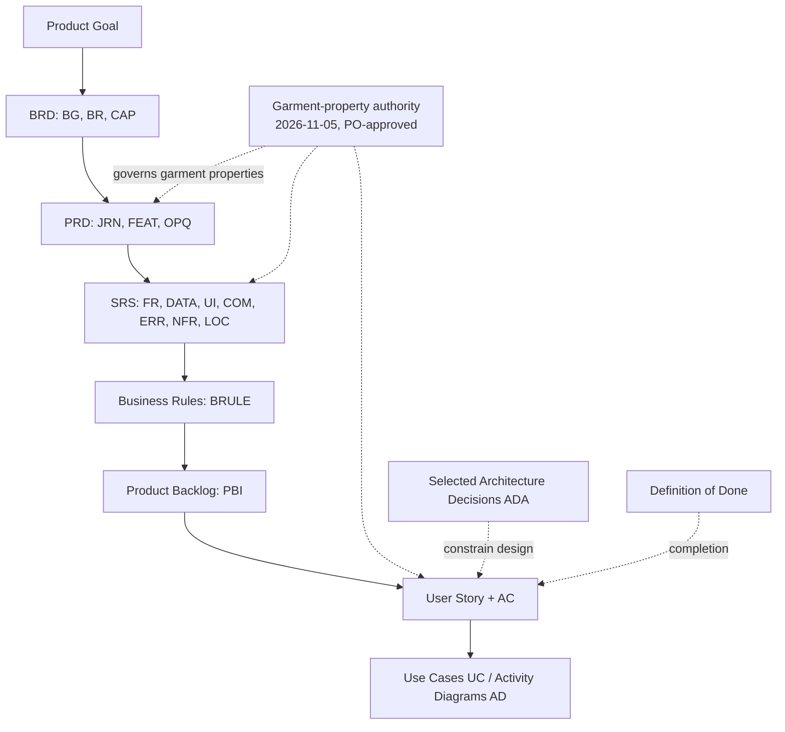
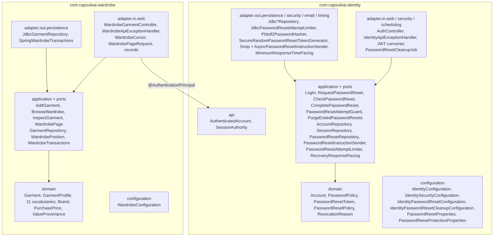
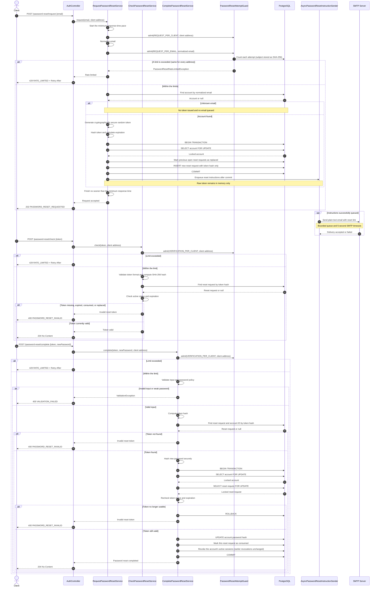
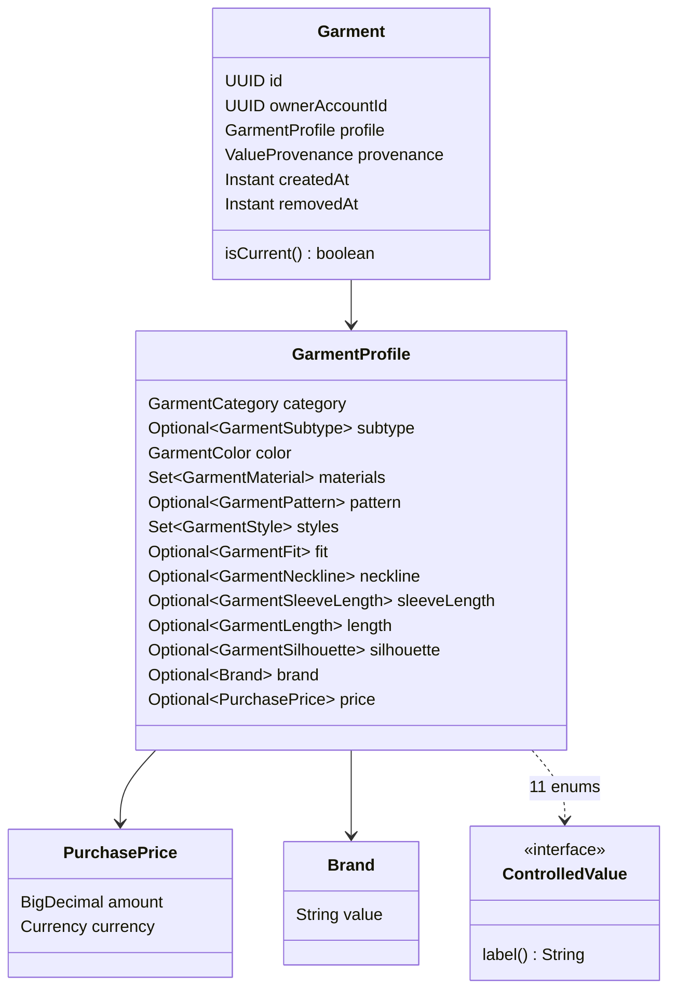
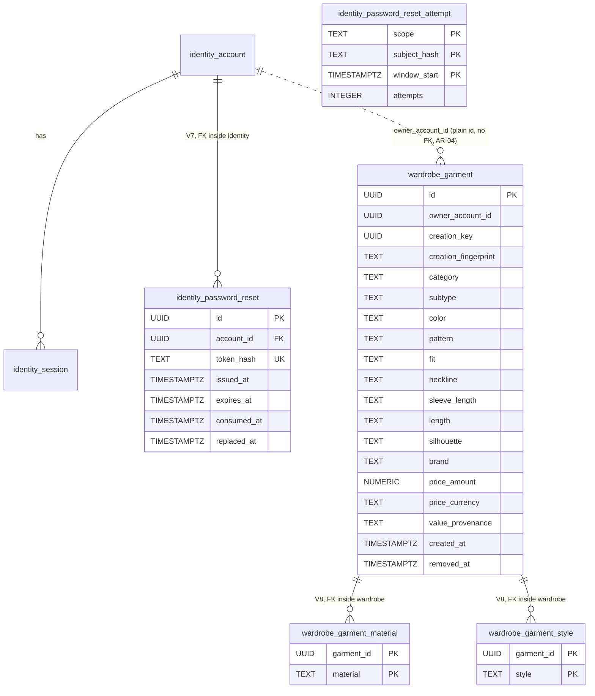
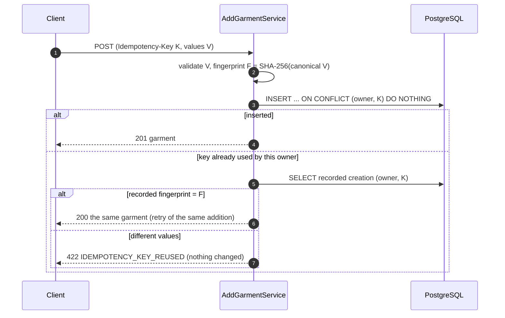

# Sprint 2 Shared Architecture

| Field | Value |
| --- | --- |
| Sprint | Sprint 2 — Recover Access and Establish a Private Wardrobe |
| Applies to | [US-AUTH-005](US-AUTH-005-guide.md), [US-GAR-001](US-GAR-001-guide.md), [US-WAR-001](US-WAR-001-guide.md), [US-WAR-002](US-WAR-002-guide.md) |
| Repository baseline | Stage 0: `sprint_02` at `90d3237`, which contains the schema-ownership correction (`17f32de`), plus the 2026-11-07 Product Owner decision updates to the requirement documents ([README §3](README.md#3-repository-baseline)) |
| Read with | [README](README.md) |
| Code status | Every structure described here exists in the guide author's scratch clone, where it was compiled and tested on 2026-11-07 after the Product Owner decisions were incorporated (final `clean verify`: 461 unit / 258 integration tests). It has **not** been applied to this repository's `backend/` or run in hosted CI (⏳ BACKEND IMPLEMENTATION PENDING). |

This document holds the cross-story decisions. Each story guide repeats what its developer needs, so a guide can be followed alone. When the two disagree, the story guide's code (taken from the tested stage commit) is authoritative, and this document should be corrected.

---

## 1. Purpose and scope

| In scope | Out of scope |
| --- | --- |
| Identity recovery (V7, reset services, SMTP boundary); Wardrobe module (model, V8, creation, overview, detail); their integration through `identity.api`; schema-per-owner persistence (AR-01–AR-08); API conventions; errors; transactions; idempotency; configuration; testing; shared-file ownership; decisions | Mobile client; images and AI (PBI-012/013); editing/removal (PBI-008/016); search/filter (PBI-015); Wear and analytics (PBI-021/025); deployment and the production email provider |

## 2. Repository baseline and stages

| Stage | State | Produced by | OpenAPI | Migrations |
| --- | --- | --- | --- | --- |
| 0 | `90d3237`: Sprint 1 Identity in schema `identity`, CORS, empty Wardrobe module, architecture checks | already committed (`17f32de`) | 0.4.1 | V1–V5, V6 |
| 1 | + email password recovery, attempt limits, timing hardening, 30-day cleanup | [US-AUTH-005](US-AUTH-005-guide.md) | 0.5.0 | + V7 |
| 2 | + Wardrobe model (multiple Styles) and manual creation | [US-GAR-001](US-GAR-001-guide.md) | 0.6.0 | + V8 |
| 3 | + current-wardrobe overview in cursor pages | [US-WAR-001](US-WAR-001-guide.md) | 0.7.0 | — |
| 4 | + garment detail, cross-story test | [US-WAR-002](US-WAR-002-guide.md) | 0.8.0 | — |

Across the four stages, 163 files change: 139 are added and 24 modified, and none is removed. Every stage compiles and passes `clean verify` on its own ([README §13](README.md#13-expected-outcome-of-each-stage)). Apply the stages in order, because each guide's BEFORE blocks are exact for its starting stage.

## 3. Requirement hierarchy and source precedence



Precedence when sources disagree:

1. An explicit, newer Product Owner decision that names what it supersedes. Examples: the garment-property authority, PRD §34.1, and the "Current property-model revision — 2026-11-05" notes at the top of each story.
2. The story's own Acceptance Criteria, for behaviour within that story.
3. SRS requirement rows, then Business Rules, then the PRD feature text, then the BRD.
4. Architecture decisions (ADA) constrain *how*, never *what*.

The Product Owner decided every question the previous revision left open on 2026-11-07 (§22.2), and the guides implement those decisions. A conflict found later must be labelled **[OPEN]** and raised before coding; until it is decided, implement the smallest reversible behaviour as **[TECH]** (§22).

## 4. Labels and conventions

| Label | Meaning |
| --- | --- |
| **[REQ]** | Stated by a requirement source (quoted verbatim in the story guides, sections 3–8) |
| **[ARCH]** | A selected architecture decision (ADA-nnn) or an established repository convention |
| **[TECH]** | A technical decision proposed by these guides (`TD-S2-nn`, §22); changeable without a product decision |
| **[OPEN]** | Needed a product/team decision (`OPEN-S2-nn`). All were decided on 2026-11-07; the ids are kept with their status (§22.2) |
| **[ADD] / [MODIFY] / [REMOVE]** | File actions in the story guides |

Repository conventions kept unchanged:

- One controller per cohesive base path. `AuthController` gains the recovery handlers, and `WardrobeGarmentController` serves `/api/v1/wardrobe/garments`.
- Services have descriptive names (`RequestPasswordResetService`, `AddGarmentService`).
- Commands and value types are records; domain types are immutable.
- There are no Lombok, JPA or field injection.
- SQL is always schema-qualified (`identity.identity_session`, `wardrobe.wardrobe_garment`), with one statement per string literal or text block ([backend conventions §2](../../../../engineering/backend-conventions.md#2-each-persistence-owner-has-its-own-postgresql-schema)).

## 5. Module boundaries and package structure



| Rule | Enforced by |
| --- | --- |
| `domain` and `application` import no Spring, Jakarta or JDBC types | `ArchitectureDependencyTest` |
| Nothing outside a module uses anything of it except its `api` (domain, application, ports, adapters and configuration are private) | `ArchitectureDependencyTest`, for every module registered in `BusinessModule` |
| Wardrobe uses only `com.capsuleai.identity.api` | Same test; ADA-015, ADA-018, AR-03 |
| A published `api` exposes no private domain or application type | `ArchitectureDependencyTest` (ADA-018) |
| Spring JDBC only in persistence adapters and configuration; no module cycles | `ArchitectureDependencyTest` |
| Each module's SQL names only its own schema, always qualified; each migration after V6 changes one schema | `PersistenceOwnershipSqlTest` (AR-01–AR-04) |
| Tables sit in their owner's schema; no foreign key or view crosses schemas; `public` holds only Flyway's history | `DatabaseSchemaOwnershipIT` |
| Wardrobe owns its tables in schema `wardrobe`; no foreign key into Identity | V8 design; ADA-016, AR-01, AR-04 |

## 6. Identity–Wardrobe integration

| Aspect | Design |
| --- | --- |
| Who is the owner | `AuthenticatedAccount.accountId()` resolved by Identity's JWT converter after it confirms the persistent session is usable. Wardrobe receives it through `@AuthenticationPrincipal`. |
| Owner storage | `wardrobe.wardrobe_garment.owner_account_id UUID NOT NULL`. There is no FK, and no Wardrobe query names an `identity` table: Wardrobe must not depend on Identity's schema ([ARCH] ADA-016, AR-02–AR-04, [TECH] TD-S2-09). |
| Lifecycle coupling | None at runtime. Identity does not call Wardrobe, and no event is published. The only published contract used is `identity.api.AuthenticatedAccount` (ADA-017: narrow published contracts; no internal HTTP or broker). |
| Account deletion | Not in scope. Without an FK, a future account-deletion capability must make each owner remove or de-identify its own data through its own services; Identity must never delete `wardrobe.*` rows ([selected architecture decisions §8.4](../../../../04-architecture/selected-architecture-decisions.md#84-cross-owner-lifecycle-consistency)). |
| Recovery effect on Wardrobe | Indirect but complete: revoking every active session makes every earlier token fail on every Wardrobe operation (`WardrobeAccessAfterPasswordResetIT`). |
| Test-fixture coupling | `IdentityIntegrationTestSupport` truncates every table of the `identity` schema; `WardrobeIntegrationTestSupport` additionally truncates `wardrobe.wardrobe_garment_material, wardrobe.wardrobe_garment_style, wardrobe.wardrobe_garment`. Because no foreign key crosses schemas, Identity truncation cannot cascade into Wardrobe. |

## 7. Authentication and authorization

| Endpoint group | Access | Mechanism |
| --- | --- | --- |
| `POST /api/v1/auth/registrations`, `/login`, `/refresh` (Sprint 1) | Public | `PUBLIC_ENDPOINTS` in `IdentitySecurityConfiguration` |
| `POST /api/v1/auth/password-reset/request`, `/check`, `/complete` (US-AUTH-005) | **Public**; the reset secret is the credential. A stale `Authorization` header is ignored. Attempt limits apply (429 `RATE_LIMITED`, TD-S2-26). | Added to `PUBLIC_ENDPOINTS` |
| `POST /api/v1/auth/logout` and everything else | Protected | Default-deny; JWT (HS256) plus `SessionAuthority`, so the session must be neither revoked nor expired |
| `/api/v1/wardrobe/garments/**` | Protected, owner-scoped | No configuration change: default-deny covers it. Every query includes `owner_account_id = :owner`. |

- **Unusable access:** 401 `AUTHENTICATION_REQUIRED` with `WWW-Authenticate: Bearer`. This covers a missing, invalid or expired token, logout, refresh-reuse revocation and password-reset revocation. The response body never contains resource data.
- **Cross-account access:** another account's resource is indistinguishable from a non-existent one (404, §13). There is no 403 anywhere in the Wardrobe API.
- **CORS:** Stage 2 adds `Idempotency-Key` to the allowed request headers. Origins stay configuration-driven (`CAPSULE_CORS_ALLOWED_ORIGINS`).


## 8. Password-recovery architecture

The sequence below is the detailed diagram contributed on `sprint_02` (commit `90d3237`), corrected in one place and extended with the 2026-11-07 decisions:

- **Corrected:** completion consumes only its own interaction. There is no "invalidate other open requests" step, because at most one interaction per account can be open (the partial unique index of V7).
- **Added:** the attempt guard (OPEN-S2-04), the minimum response time of a successful request (OPEN-S2-05) and the 429 outcome.



| Property | Design | Decision |
| --- | --- | --- |
| Secret | 256 random bits (`SecureRandom`), Base64url; only its SHA-256 hex is stored (`token_hash`) | TD-S2-03 |
| Validity | 30 minutes (`PasswordResetPolicy.INTERACTION_LIFETIME`); usable while `now < expires_at`, not consumed and not replaced | [REQ] FR-AUTH-017 |
| Replacement | A new request marks the open one `replaced_at`; a partial unique index allows at most one open interaction per account | [REQ] FR-AUTH-018 |
| Equivalent initiation | Same 202 body for registered and unregistered addresses; the email is sent only for an account. A missing or malformed address is 400 `VALIDATION_FAILED`, which depends only on the typed value, never on account existence | [REQ] FR-AUTH-003 |
| Invalid outcomes | Unknown, expired, consumed and replaced secrets all produce one code, `PASSWORD_RESET_INVALID` | TD-S2-02 |
| Completion effects | One transaction: new PBKDF2 hash, `consumed_at`, every **active** session revoked with `PASSWORD_RESET`; sessions revoked earlier keep their reason | [REQ] FR-AUTH-004, TD-S2-07 |
| Login race | `LogInService` re-reads the hash `FOR SHARE` inside the session-creating transaction; a login that verified the old password before a reset commits gets no session | TD-S2-08 |
| Attempt limits | Per fixed 15-minute window: 3 requests per normalized email, 20 requests and 30 link checks/completions per client address; counted before the account lookup; 429 `RATE_LIMITED` with `Retry-After` | [REQ] FR-AUTH-019, TD-S2-26 |
| Timing | A successful request lasts at least 250 ms for every address; measured, not claimed constant | [REQ] NFR-SEC-003, TD-S2-27 |
| Retention | Ended interactions are deleted 30 days after they ended by Identity's hourly cleanup job; an active interaction is never deleted | [REQ] DATA-AUTH-006, TD-S2-28 |
| Delivery | `SmtpPasswordResetInstructionSender` (approved Vietnamese plain text) behind `AsyncPasswordResetInstructionSender` (bounded queue of 100, drained for up to 10 s on shutdown). Failures are logged without secret or address. Mailpit is test evidence only | TD-S2-04, OPEN-S2-03, OPEN-S2-09 |
| Link | `instruction-link` + `#token=<secret>`; production uses a verified HTTPS domain (App Links / Universal Links); a custom scheme is accepted only with the development flag; the fragment is not sent to web servers or logged by proxies | [REQ] FR-AUTH-020, TD-S2-05 |

## 9. Wardrobe domain model



`Garment` is a record. `removedAt` is `null` while the garment is current, and `isCurrent()` tests exactly that.

| Property (authority) | Type / cardinality | Applies to | Values |
| --- | --- | --- | --- |
| Category | `GarmentCategory`, required | all | 8 |
| Subtype | `GarmentSubtype`, optional, must belong to the Category | all | 84 |
| Color (dominant) | `GarmentColor`, required, single | all | 34 (incl. Colorful) |
| Material | `Set<GarmentMaterial>`, 0..n distinct, no percentages | all | 28 |
| Pattern | `GarmentPattern`, optional | all | 24 |
| Style | `Set<GarmentStyle>`, 0..n distinct, like Material ([TECH] TD-S2-13, PO decision OPEN-S2-08) | all | 17 |
| Fit | `GarmentFit`, optional | Tops | 4 |
| Neckline | `GarmentNeckline`, optional | Tops | 23 |
| Sleeve Length | `GarmentSleeveLength`, optional | Tops | 5 |
| Length | `GarmentLength`, optional, from the category's list | Tops (4), Pants (2) | 6 |
| Silhouette | `GarmentSilhouette`, optional | Pants | 7 |
| Brand | `Brand`, optional exact text, at most 100 code points, blank = not supplied (TD-S2-12) | all | — |
| Purchase Price | `PurchasePrice`, optional pair: decimal ≥ 0, scale ≤ the currency's minor unit, at most 12 integer digits, ISO 4217 code (TD-S2-11) | all | — |

These are exactly the 13 approved properties; Style becoming a set adds no property.

- **Codes:** each enum constant's name is its stable API and database code. `label()` returns the exact approved text (`TANKS_AND_CAMIS` → "Tanks & Camis", corrected by REVIEW-TAXONOMY). The ten Dresses/Jumpsuits identifiers are the approved ones ([TECH] TD-S2-10).
- **Sets:** Materials and Styles are `EnumSet`s in catalogue order, so repeated selections collapse and responses list them in the authority's order.
- **No readiness:** there is no readiness predicate, column or gate; every response says `recommendationEligibility: NOT_EVALUATED` ([REQ] FR-GAR-004/005, BRULE-GAR-003, X-1).
- **Provenance:** `ValueProvenance.USER_ENTERED` for every manual garment, stored per garment ([TECH] TD-S2-16).

## 10. Data model

Physical placement ([ARCH] AR-01): `identity_account`, `identity_session`, `identity_refresh_token`, `identity_password_reset` and `identity_password_reset_attempt` are in schema **`identity`**; `wardrobe_garment`, `wardrobe_garment_material` and `wardrobe_garment_style` are in schema **`wardrobe`**; `flyway_schema_history` stays in Flyway's default schema `public`. Solid lines are foreign keys, each inside one schema. The dotted line is a plain identifier with no foreign key and no join (AR-02, AR-04).



`identity_password_reset_attempt` has no foreign key: its subject is the SHA-256 of a normalized email or a client address, which may belong to no account.

## 11. Schema (V6, V7 and V8, complete)

### 11.0 V6 — move the Sprint 1 Identity tables into the `identity` schema (Stage 0)

Already part of Stage 0; shown so the whole chain is visible. It moves the tables with `ALTER TABLE … SET SCHEMA`, which keeps every row, index, constraint and foreign key; `${flyway:defaultSchema}` names the schema V2–V5 created them in.

```sql
-- Architecture refinement AR-01 (2026-11-06): every persistence owner has its own
-- PostgreSQL schema. Identity owns the schema "identity".
--
-- V2-V5 created the Identity tables without a schema name, so they live in Flyway's
-- default schema (the connection's default schema; "public" under PostgreSQL's
-- default search_path). ${flyway:defaultSchema} names exactly that schema, so this
-- migration moves the tables from where they really are instead of assuming "public".
--
-- ALTER TABLE ... SET SCHEMA changes only the namespace of the existing tables: rows,
-- column values, indexes, constraints, foreign keys and privileges move with them.
-- Nothing is dropped, recreated or copied. Flyway runs this file in one transaction,
-- so a failure leaves every table where it was.
--
-- The schema history table stays in Flyway's default schema; Flyway's configuration
-- is unchanged, so V1-V5 are never applied again.

CREATE SCHEMA IF NOT EXISTS identity;

-- Children move after their parents only for readability; foreign keys follow the
-- tables, not their names, so the order does not affect them.
ALTER TABLE ${flyway:defaultSchema}.identity_account       SET SCHEMA identity;
ALTER TABLE ${flyway:defaultSchema}.identity_session       SET SCHEMA identity;
ALTER TABLE ${flyway:defaultSchema}.identity_refresh_token SET SCHEMA identity;
```

### 11.1 V7 — `identity.identity_password_reset`, `identity.identity_password_reset_attempt` and the `PASSWORD_RESET` revocation reason (US-AUTH-005)

```sql
-- US-AUTH-005: persistent password-reset authority (ADA-008, DATA-AUTH-005).
-- Owner: Identity. Every object is in the identity schema (AR-01); the foreign key
-- stays inside it (AR-04). V6 created the schema and moved the Sprint 1 tables there.
-- One row per issued interaction. Only the SHA-256 hash of its secret is stored.
-- An interaction ends at most one way: consumed by an accepted reset, or replaced
-- by a newer issuance (FR-AUTH-017, FR-AUTH-018). Expiry is enforced by comparing
-- expires_at with the application clock.
CREATE TABLE identity.identity_password_reset (
    id          UUID        PRIMARY KEY,
    account_id  UUID        NOT NULL REFERENCES identity.identity_account (id),
    token_hash  TEXT        NOT NULL,
    issued_at   TIMESTAMPTZ NOT NULL,
    expires_at  TIMESTAMPTZ NOT NULL,
    consumed_at TIMESTAMPTZ NULL,
    replaced_at TIMESTAMPTZ NULL,
    CONSTRAINT uq_identity_password_reset_token_hash UNIQUE (token_hash),
    CONSTRAINT ck_identity_password_reset_token_hash_format CHECK (token_hash ~ '^[0-9a-f]{64}$'),
    CONSTRAINT ck_identity_password_reset_lifetime
        CHECK (expires_at > issued_at AND expires_at <= issued_at + INTERVAL '30 minutes'),
    CONSTRAINT ck_identity_password_reset_single_outcome
        CHECK (consumed_at IS NULL OR replaced_at IS NULL),
    CONSTRAINT ck_identity_password_reset_consumed_after_issue
        CHECK (consumed_at IS NULL OR consumed_at >= issued_at),
    CONSTRAINT ck_identity_password_reset_replaced_after_issue
        CHECK (replaced_at IS NULL OR replaced_at >= issued_at)
);

-- An account has at most one open (neither consumed nor replaced) interaction.
-- Issuance replaces the open one before inserting, under the account row lock.
CREATE UNIQUE INDEX ux_identity_password_reset_open_per_account
    ON identity.identity_password_reset (account_id)
    WHERE consumed_at IS NULL AND replaced_at IS NULL;

CREATE INDEX ix_identity_password_reset_account ON identity.identity_password_reset (account_id);

-- Ended interactions are deleted 30 days after they end (OPEN-S2-07): the cleanup
-- searches by the moment an interaction ended.
CREATE INDEX ix_identity_password_reset_ended
    ON identity.identity_password_reset ((COALESCE(consumed_at, replaced_at, expires_at)));

-- Abuse protection (OPEN-S2-04, FR-AUTH-019): one counter per scope, hashed subject
-- (normalized email or client address, never stored in clear) and fixed time window.
CREATE TABLE identity.identity_password_reset_attempt (
    scope        TEXT        NOT NULL,
    subject_hash TEXT        NOT NULL,
    window_start TIMESTAMPTZ NOT NULL,
    attempts     INTEGER     NOT NULL,
    CONSTRAINT pk_identity_password_reset_attempt PRIMARY KEY (scope, subject_hash, window_start),
    CONSTRAINT ck_identity_password_reset_attempt_scope
        CHECK (scope IN ('REQUEST_PER_EMAIL', 'REQUEST_PER_CLIENT', 'VERIFICATION_PER_CLIENT')),
    CONSTRAINT ck_identity_password_reset_attempt_subject_hash CHECK (subject_hash ~ '^[0-9a-f]{64}$'),
    CONSTRAINT ck_identity_password_reset_attempt_count CHECK (attempts > 0)
);

CREATE INDEX ix_identity_password_reset_attempt_window ON identity.identity_password_reset_attempt (window_start);

-- An accepted reset revokes every active session of the account with its own reason.
ALTER TABLE identity.identity_session
    DROP CONSTRAINT ck_identity_session_revocation_reason;

ALTER TABLE identity.identity_session
    ADD CONSTRAINT ck_identity_session_revocation_reason
        CHECK (revocation_reason IN ('LOGOUT', 'REFRESH_TOKEN_REUSE', 'PASSWORD_RESET'));
```

### 11.2 V8 — `wardrobe.wardrobe_garment`, `wardrobe.wardrobe_garment_material` and `wardrobe.wardrobe_garment_style` (US-GAR-001)

```sql
-- US-GAR-001: Wardrobe-owned confirmed garments (ADA-016, DATA-GAR-001/002/005).
-- A row exists only for an explicitly confirmed addition; drafts are never stored.
-- Codes are the enum constant names of com.capsuleai.wardrobe.domain; each maps to
-- one approved label of the garment-property authority. owner_account_id is the
-- authenticated Identity account id: Wardrobe receives it through the published
-- AuthenticatedAccount contract and deliberately has no foreign key into Identity's
-- private tables (ADA-016, AR-04). removed_at NULL means "in the owner's current wardrobe".
--
-- Owner: Wardrobe. This first Wardrobe migration creates the module's own schema
-- (AR-01); every object below is in it, and no object refers to another schema.
CREATE SCHEMA IF NOT EXISTS wardrobe;

CREATE TABLE wardrobe.wardrobe_garment (
    id                   UUID        PRIMARY KEY,
    owner_account_id     UUID        NOT NULL,
    creation_key         UUID        NOT NULL,
    creation_fingerprint TEXT        NOT NULL,
    category             TEXT        NOT NULL,
    subtype              TEXT        NULL,
    color                TEXT        NOT NULL,
    pattern              TEXT        NULL,
    fit                  TEXT        NULL,
    neckline             TEXT        NULL,
    sleeve_length        TEXT        NULL,
    length               TEXT        NULL,
    silhouette           TEXT        NULL,
    brand                TEXT        NULL,
    price_amount         NUMERIC     NULL,
    price_currency       TEXT        NULL,
    value_provenance     TEXT        NOT NULL,
    created_at           TIMESTAMPTZ NOT NULL,
    removed_at           TIMESTAMPTZ NULL,

    -- One accepted garment per logical addition (ADA-009, DATA-INT-004).
    CONSTRAINT uq_wardrobe_garment_creation_key UNIQUE (owner_account_id, creation_key),
    CONSTRAINT ck_wardrobe_garment_creation_fingerprint_format
        CHECK (creation_fingerprint ~ '^[0-9a-f]{64}$'),

    CONSTRAINT ck_wardrobe_garment_category CHECK (category IN (
        'TOPS', 'DRESSES_JUMPSUITS', 'PANTS', 'SKIRTS', 'OUTERWEAR', 'SHOES',
        'BAGS', 'HEADWEAR')),
    CONSTRAINT ck_wardrobe_garment_subtype_in_category CHECK (subtype IS NULL OR CASE category
            WHEN 'TOPS' THEN subtype IN (
                'T_SHIRTS', 'LONG_SLEEVE_T_SHIRTS', 'SLEEVELESS_T_SHIRTS', 'POLO_SHIRTS',
                'TANKS_AND_CAMIS', 'CROP_TOPS', 'BLOUSES', 'SHIRTS', 'SWEATSHIRTS', 'HOODIES',
                'SWEATERS', 'SWEATER_VESTS', 'SPORTS_TOPS', 'BODYSUITS')
            WHEN 'DRESSES_JUMPSUITS' THEN subtype IN (
                'DAY_DRESS', 'T_SHIRT_DRESS', 'SHIRT_DRESS', 'SWEATSHIRT_DRESS', 'SWEATER_DRESS',
                'JACKET_DRESS', 'SUSPENDER_DRESS', 'JUMPSUIT', 'PARTY_DRESS', 'MINI_DRESS')
            WHEN 'PANTS' THEN subtype IN (
                'JEANS', 'TROUSERS', 'DRESS_PANTS', 'TRACK_PANTS', 'LEGGINGS', 'SHORTS')
            WHEN 'SKIRTS' THEN subtype IN (
                'MINI_SKIRTS', 'MIDI_SKIRTS', 'MAXI_SKIRTS')
            WHEN 'OUTERWEAR' THEN subtype IN (
                'COATS', 'TRENCH_COATS', 'FUR_COATS', 'SHEARLING_COATS', 'BLAZERS', 'JACKETS',
                'BLOUSONS', 'VARSITY_JACKETS', 'TRUCKER_JACKETS', 'BIKER_JACKETS', 'CARDIGANS',
                'ZIP_UP_HOODIES', 'FIELD_JACKETS', 'SPORT_JACKETS', 'FLEECE_JACKETS', 'PARKAS',
                'DOWN_JACKETS', 'PUFFER_JACKETS', 'VESTS')
            WHEN 'SHOES' THEN subtype IN (
                'SNEAKERS', 'SLIP_ONS', 'SPORTS_SHOES', 'HIKING_SHOES', 'BOOTS', 'COMBAT_BOOTS',
                'UGG_BOOTS', 'LOAFERS_AND_LOAFER_MULES', 'BOAT_SHOES_AND_MOCCASINS', 'FLAT_SHOES',
                'HEELS', 'SANDALS', 'SANDAL_HEELS', 'SLIDES', 'MULE_HEELS')
            WHEN 'BAGS' THEN subtype IN (
                'TOTE', 'SHOULDER', 'CROSSBODY', 'WAIST', 'CANVAS', 'BACKPACKS', 'DUFFEL',
                'CLUTCH', 'BRIEFCASES', 'DRAWSTRING', 'SUITCASES')
            WHEN 'HEADWEAR' THEN subtype IN (
                'CAP', 'HATS', 'BEANIES', 'BERETS', 'FEDORAS', 'SUN_HATS')
            ELSE FALSE
        END),
    CONSTRAINT ck_wardrobe_garment_color CHECK (color IN (
        'WHITE', 'IVORY', 'BEIGE', 'LIGHT_GRAY', 'DARK_GRAY', 'BLACK', 'LIGHT_YELLOW',
        'YELLOW', 'TURMERIC', 'ORANGE', 'CORAL', 'RED', 'PINK', 'HOT_PINK', 'LIGHT_GREEN',
        'GREEN', 'OLIVE', 'DARK_OLIVE', 'TEAL', 'KHAKI', 'CYAN', 'SKY_BLUE', 'BLUE',
        'NAVY', 'LAVENDER', 'PURPLE', 'BURGUNDY', 'CAMEL', 'BROWN', 'DARK_BROWN',
        'MAGENTA', 'GOLD', 'SILVER', 'COLORFUL')),
    CONSTRAINT ck_wardrobe_garment_pattern CHECK (pattern IS NULL OR pattern IN (
        'SOLID', 'STRIPED', 'GRAPHIC', 'DOTTED', 'ANIMAL', 'FLORAL', 'TROPICAL', 'PAISLEY',
        'ARGYLE', 'CAMO', 'COLOR_BLOCK', 'REPEATED', 'CHECKERBOARD', 'PLAID', 'GINGHAM',
        'HOUNDSTOOTH', 'HERRINGBONE', 'CHEVRON', 'TWEED', 'ABSTRACT', 'TIE_DYE',
        'GEOMETRIC', 'LACE', 'OTHER_PATTERNS')),

    -- Category applicability (FR-GAR-007): Fit, Neckline, Sleeve Length only for Tops;
    -- Length from the Tops or Pants list only for that category; Silhouette only for Pants.
    CONSTRAINT ck_wardrobe_garment_fit CHECK (fit IS NULL OR (category = 'TOPS' AND fit IN (
        'SLIM', 'REGULAR', 'LOOSE', 'OVERSIZED'))),
    CONSTRAINT ck_wardrobe_garment_neckline CHECK (neckline IS NULL OR (category = 'TOPS' AND neckline IN (
        'ROUND', 'SCOOP_U', 'BOAT', 'V_NECK', 'DEEP_V', 'SQUARE', 'SURPLICE',
        'SHIRT_COLLAR', 'STANDUP_COLLAR', 'WIDE_COLLAR', 'MOCKNECK', 'TURTLENECK',
        'STRAPLESS', 'THICK_STRAP', 'THIN_STRAP', 'SWEETHEART', 'OFF_THE_SHOULDER',
        'ASYMMETRIC', 'HALTER', 'ILLUSION', 'KEYHOLE', 'SUIT_COLLAR', 'OTHER'))),
    CONSTRAINT ck_wardrobe_garment_sleeve_length CHECK (sleeve_length IS NULL OR (category = 'TOPS' AND sleeve_length IN (
        'SLEEVELESS', 'CAP_SLEEVE', 'SHORT_SLEEVE', 'THREE_QUARTER_SLEEVE', 'LONG_SLEEVE'))),
    CONSTRAINT ck_wardrobe_garment_length CHECK (length IS NULL
        OR (category = 'TOPS' AND length IN ('CROPPED', 'WAIST', 'HIP', 'KNEE'))
        OR (category = 'PANTS' AND length IN ('SHORT', 'LONG'))),
    CONSTRAINT ck_wardrobe_garment_silhouette CHECK (silhouette IS NULL OR (category = 'PANTS' AND silhouette IN (
        'FLARE', 'SLIM', 'TAPERED', 'BAGGY', 'SKINNY', 'BOOTCUT', 'WIDE_LEG'))),

    -- Optional Brand text (FR-GAR-012, OPEN-S2-01B): never blank, at most 100 Unicode
    -- code points (char_length counts code points in a UTF8 database), kept exactly.
    CONSTRAINT ck_wardrobe_garment_brand
        CHECK (brand IS NULL OR (char_length(brand) BETWEEN 1 AND 100 AND brand ~ '\S')),

    -- Optional purchase Price (FR-GAR-013): amount and currency together or neither;
    -- an exact non-negative decimal with an upper-case ISO 4217 code. NUMERIC without
    -- a declared scale keeps the scale as entered, so 12.50 is read back as 12.50.
    CONSTRAINT ck_wardrobe_garment_price_complete
        CHECK ((price_amount IS NULL) = (price_currency IS NULL)),
    CONSTRAINT ck_wardrobe_garment_price_amount
        CHECK (price_amount IS NULL
               OR (price_amount >= 0 AND price_amount < 1000000000000 AND scale(price_amount) <= 4)),
    CONSTRAINT ck_wardrobe_garment_price_currency
        CHECK (price_currency IS NULL OR price_currency ~ '^[A-Z]{3}$'),

    CONSTRAINT ck_wardrobe_garment_value_provenance CHECK (value_provenance IN ('USER_ENTERED')),
    CONSTRAINT ck_wardrobe_garment_removed_after_created
        CHECK (removed_at IS NULL OR removed_at >= created_at)
);

-- The owner's current wardrobe, newest first with the id as a stable tie-breaker, so a
-- keyset page (created_at, id) < (cursor) is one ordered index range (US-WAR-001, OPEN-S2-10).
CREATE INDEX ix_wardrobe_garment_owner_current
    ON wardrobe.wardrobe_garment (owner_account_id, created_at DESC, id DESC)
    WHERE removed_at IS NULL;

-- Zero, one or several distinct Materials per garment (FR-GAR-010). The primary
-- key makes a repeated selection impossible; no percentage is stored.
CREATE TABLE wardrobe.wardrobe_garment_material (
    garment_id UUID NOT NULL REFERENCES wardrobe.wardrobe_garment (id) ON DELETE CASCADE,
    material   TEXT NOT NULL,
    CONSTRAINT pk_wardrobe_garment_material PRIMARY KEY (garment_id, material),
    CONSTRAINT ck_wardrobe_garment_material CHECK (material IN (
        'COTTON', 'POLYESTER', 'NYLON', 'DENIM', 'LEATHER', 'WOOL', 'SPANDEX_ELASTANE',
        'LINEN', 'ACRYLIC', 'SILK', 'RAYON', 'VISCOSE', 'TWEED', 'VELVET', 'CHIFFON',
        'SUEDE', 'CORDUROY', 'LACE', 'FUR', 'DOWN', 'LYOCELL', 'METAL', 'CUPRO',
        'CASHMERE', 'MOHAIR', 'ANGORA', 'ALPACA', 'OTHER_MATERIALS'))
);

-- Zero, one or several distinct Styles per garment (FR-GAR-009; Product Owner decision
-- 2026-11-07, OPEN-S2-08). Stored like Materials: the primary key makes a repeated
-- selection impossible, and Etc is not a value.
CREATE TABLE wardrobe.wardrobe_garment_style (
    garment_id UUID NOT NULL REFERENCES wardrobe.wardrobe_garment (id) ON DELETE CASCADE,
    style      TEXT NOT NULL,
    CONSTRAINT pk_wardrobe_garment_style PRIMARY KEY (garment_id, style),
    CONSTRAINT ck_wardrobe_garment_style CHECK (style IN (
        'COMFORTABLE', 'CASUAL', 'BUSINESS_CASUAL', 'FORMAL', 'MODERN', 'CLASSIC',
        'MINIMALIST', 'BOHEMIAN', 'LUXURY', 'SPORTY', 'ATHLEISURE', 'TRENDY', 'KIDCORE',
        'ARTISTIC', 'DRESSY', 'FEMININE', 'STREET'))
);
```

Design notes:

- **Vocabularies as `CHECK` lists**, not lookup tables ([TECH] TD-S2-10). The approved lists change only by product decision, together with a new migration and the enum. `JdbcGarmentRepositoryIT` round-trips every value, so the enum and the `CHECK` lists cannot drift apart unnoticed.
- **Applicability in the database:** Tops-only and Pants-only columns are constrained by category, and Subtype must belong to its Category. The application validates first, so these constraints are a second line of defence.
- **Material and Style sets:** two child tables whose primary keys `(garment_id, material)` and `(garment_id, style)` make a repeated value impossible. `wardrobe_garment` has no `style` column, so the former single-Style representation cannot be written.
- **Price:** `NUMERIC` without declared scale stores the exact submitted value (`12.50` stays `12.50`). Amount and currency are both present or both absent.
- **Current wardrobe:** `removed_at IS NULL`. The partial index `ix_wardrobe_garment_owner_current (owner_account_id, created_at DESC, id DESC)` matches the overview's keyset order exactly, so a page is one index range without a sort (`CurrentWardrobePageIT` checks the plan).
- **Recovery retention (V7):** the expression index `ix_identity_password_reset_ended` on `COALESCE(consumed_at, replaced_at, expires_at)` lets the cleanup find ended interactions without scanning the table; `ix_identity_password_reset_attempt_window` does the same for old counters.
- **Ownership in the migrations:** V7 names only `identity.*`; V8 creates `wardrobe` (`CREATE SCHEMA IF NOT EXISTS`) and names only `wardrobe.*`. Neither migration contains a cross-schema reference, which `PersistenceOwnershipSqlTest` enforces for every migration after V6.

## 12. Flyway migration plan

| Version | File | Story | Change | Reversible by |
| --- | --- | --- | --- | --- |
| V1–V5 | existing | Pre-sprint, Sprint 1 | Created the Identity tables in Flyway's default schema | **Never edit** (checksums are validated) |
| V6 | `V6__move_identity_tables_into_identity_schema.sql` | Stage 0 (AR-01) | Creates schema `identity`; moves the three Sprint 1 tables there with their data | **Never edit**; a later forward migration |
| V7 | `V7__create_identity_password_reset.sql` | US-AUTH-005 | Two new tables (interactions, attempt counters) and their indexes; replaces the `identity.identity_session` revocation-reason CHECK to add `PASSWORD_RESET` | A later forward migration |
| V8 | `V8__create_wardrobe_garment.sql` | US-GAR-001 | Creates schema `wardrobe`; three new tables (garments, Materials, Styles), constraints, partial index | A later forward migration |
| — | — | US-WAR-001, US-WAR-002 | No schema change (the overview index is already in V8) | — |

V7 and V8 are new in Sprint 2 and not applied to any shared database yet, so the guides define them in their final form. Once a stage is merged and deployed anywhere, its migration is frozen like V1–V6.

- **Upgrade path:** each upgrade test creates a separate database with `IsolatedMigrationDatabase` and migrates it up to the version before the one under test:
  - `IdentitySchemaRelocationIT`: V5 → V6.
  - `PasswordResetSchemaIT`: V6 → V7.
  - `GarmentSchemaIT`: V7 → V8.

  Each test then inserts representative rows, applies exactly the migration under test, and asserts that existing data survives and the new constraints accept it. A scratch *schema* (the Sprint 1 technique) cannot test V6 or later, because those migrations move or create tables in the shared owner schemas.
- **Schema history:** Flyway's `schemas`, `default-schema` and `table` settings are not changed. `flyway_schema_history` stays in the default schema, so existing databases continue from V5 and never re-apply V1–V5.
- **Production:** `spring.flyway.clean-disabled=true` stays set, and migrations run at application start.
- **Two developers adding migrations in parallel:** whoever merges second renumbers before merging. Never reuse a version number.


## 13. API conventions and endpoint catalogue

| Convention | Rule |
| --- | --- |
| Base path | `/api/v1/<module>/...`: `/api/v1/auth` (Identity), `/api/v1/wardrobe/garments` (Wardrobe) |
| Bodies | JSON read into request records; a body that cannot be parsed is 400 `MALFORMED_REQUEST` |
| Codes | Vocabulary values are upper-case constant names (`TANKS_AND_CAMIS`); clients map them to Vietnamese labels |
| Absent values | Responses list every field and use `null` when absent (`materials` and `styles` are `[]`); nothing is omitted or invented ([TECH] TD-S2-15) |
| Money | `price.amount` is a JSON **string** holding the exact decimal; `price.currency` is an upper-case ISO 4217 code ([TECH] TD-S2-11, approved) |
| Collections | A large collection is returned in keyset pages: `limit` (1–100, default 20), opaque `cursor`, response `nextCursor` (`null` on the last page) ([TECH] TD-S2-19, TD-S2-29) |
| Time | ISO-8601 UTC instants (`createdAt`) |
| Errors | RFC 9457 `application/problem+json` with a stable `code` property; `VALIDATION_FAILED` adds `fieldErrors: [{field, code}]` |
| Contract | `docs/05-api/openapi.yaml` is updated in the same change as the handler; `IdentityOpenApiContractIT` enforces that every `/api/` handler is documented and that the documented security, request fields, success fields and `required` lists match |
| Versioning | `info.version` is bumped per story (0.5.0 → 0.8.0); all Sprint 2 changes are additive |
| SQL | Every table is written schema-qualified; a module's SQL names only its own schema; one statement per string literal or text block (AR-01–AR-03, `PersistenceOwnershipSqlTest`) |

| Method and path | Story | Access | Success | Errors |
| --- | --- | --- | --- | --- |
| `POST /api/v1/auth/password-reset/request` | US-AUTH-005 | Public | 202 `PASSWORD_RESET_REQUESTED` | 400 `VALIDATION_FAILED`, `MALFORMED_REQUEST`; 429 `RATE_LIMITED`; 503 `TEMPORARILY_UNAVAILABLE` |
| `POST /api/v1/auth/password-reset/check` | US-AUTH-005 | Public | 204 | 400 `PASSWORD_RESET_INVALID`, `VALIDATION_FAILED`, `MALFORMED_REQUEST`; 429; 503 |
| `POST /api/v1/auth/password-reset/complete` | US-AUTH-005 | Public | 204 | 400 `PASSWORD_RESET_INVALID`, `VALIDATION_FAILED`, `MALFORMED_REQUEST`; 429; 503 |
| `POST /api/v1/wardrobe/garments` (+ `Idempotency-Key`) | US-GAR-001 | Protected | 201 new / 200 replay, `Garment` | 400 `VALIDATION_FAILED`, `MALFORMED_REQUEST`; 401; 422 `IDEMPOTENCY_KEY_REUSED`; 503 |
| `GET /api/v1/wardrobe/garments?limit=&cursor=` | US-WAR-001 | Protected | 200 `WardrobeOverview` (one page, `nextCursor`) | 400 `VALIDATION_FAILED` (`limit`, `cursor`); 401; 503 |
| `GET /api/v1/wardrobe/garments/{garmentId}` | US-WAR-002 | Protected | 200 `Garment` | 401; 404 `GARMENT_NOT_FOUND`; 410 `GARMENT_NO_LONGER_CURRENT`; 503 |

The Sprint 1 endpoints (`registrations`, `login`, `refresh`, `logout`) are unchanged, except that a login racing a completed reset gets no session (§15).

## 14. Exception handling and error representation

| Layer | Responsibility |
| --- | --- |
| Domain | Throws typed problems: `InvalidValueException` (Identity), `InvalidGarmentValueException` with a `GarmentValueProblem` (Wardrobe) |
| Application | Collects field problems into `RequestValidationException` or `GarmentValidationException` (every problem at once). Throws outcome exceptions such as `PasswordResetRejectedException`, `PasswordResetRateLimitedException` (with its `Retry-After`), `IdempotencyKeyReusedException`, `GarmentNotFoundException` and `GarmentNoLongerCurrentException` |
| Web adapter | One `@RestControllerAdvice` per module, scoped with `basePackageClasses`, maps outcomes to status plus `code`. Each `detail` text is constant and never echoes submitted values, secrets or other accounts' data. Wardrobe's web adapter also rejects an unusable page request (`InvalidWardrobePageException` → 400 with `limit`/`cursor` field errors) |
| Security chain | 401 `AUTHENTICATION_REQUIRED` from the existing authentication entry point, before any controller |
| Infrastructure failures | `DataAccessResourceFailureException`, `TransientDataAccessResourceException` and `CannotCreateTransactionException` → 503 `TEMPORARILY_UNAVAILABLE`: the outcome is not confirmed, and a retry is safe |

```json
{
  "type": "about:blank",
  "title": "Bad Request",
  "status": 400,
  "detail": "Some garment values are missing, unconfirmed or not allowed. Correct or clear them and confirm again; nothing was saved.",
  "instance": "/api/v1/wardrobe/garments",
  "code": "VALIDATION_FAILED",
  "fieldErrors": [
    {"field": "fit", "code": "NOT_APPLICABLE"},
    {"field": "price", "code": "INCOMPLETE_PRICE"}
  ]
}
```

## 15. Transactions, locking and concurrency

**Global lock order (Identity): account row → reset row → session rows.** Every transaction that takes more than one of these locks takes them in this order, so the reset flows cannot deadlock with each other or with login.

| Flow | Transaction content | Locks |
| --- | --- | --- |
| Request reset | Count the attempt (one upsert per limit, each its own short transaction); then replace the open interaction, insert the new one | Attempt row: `INSERT … ON CONFLICT DO UPDATE` serializes concurrent counts; then `identity.identity_account` FOR UPDATE |
| Complete reset | Recheck the interaction; replace the hash; consume; revoke active sessions | account FOR UPDATE → reset row FOR UPDATE → session rows (UPDATE) |
| Login (modified) | Recheck the stored hash equals the verified one; create the session | account FOR SHARE (conflicts with reset's FOR UPDATE) |
| Refresh (Sprint 1) | Rotate the refresh token | token and session rows FOR UPDATE; a concurrent reset's revoke waits for them, then revokes |
| Add garment | Insert with `ON CONFLICT (owner_account_id, creation_key) DO NOTHING`; on conflict, read the recorded creation | Unique-index wait on a concurrent insert of the same key |
| Reset cleanup | Delete at most 500 ended interactions per statement, repeated until a batch is short; then old attempt counters | `FOR UPDATE SKIP LOCKED` on the selected rows, so a row held by a request or completion is skipped and deleted by a later run |
| Browse / detail | Single SELECT per page or garment, auto-commit | None |

| Race | Guarantee | Evidence |
| --- | --- | --- |
| Two completions of one link | Exactly one changes the password | `ConcurrentPasswordResetIT.competingCompletionsOfOneLinkChangeThePasswordExactlyOnce` |
| Two requests | Exactly one usable link remains | `ConcurrentPasswordResetIT.competingRequestsLeaveExactlyOneUsableLink` |
| Reset vs refresh | No usable session remains, whichever commits first | `ConcurrentPasswordResetIT.resetRacingARenewalLeavesNoUsableSessionWhicheverCommitsFirst` |
| Reset vs login with the old password | That login gets no session | `PasswordResetLoginRaceIT.aLoginThatVerifiedTheOldPasswordBeforeAResetCommitsGetsNoSession` |
| Duplicate deliveries of one addition | Exactly one garment | `ConcurrentGarmentCreationIT.concurrentDeliveriesOfOneAdditionCreateExactlyOneGarment` |
| Concurrent attempts against one limit | No more than the limit is admitted; every attempt gets a distinct count | `PasswordResetRateLimitIT.concurrentRequestsCannotExceedTheLimit`, `JdbcPasswordResetAttemptLimiterIT.concurrentAttemptsEachReceiveADistinctCount` |
| Cleanup versus a transaction holding a reset row | The held row is skipped, not waited for, and deleted on the next run | `PasswordResetCleanupIT.theCleanupSkipsARowAnotherTransactionHoldsAndDeletesItOnTheNextRun` |
| Garments added or removed while paging | No current garment repeated or skipped; a new one appears from the first page | `BrowseWardrobeApiIT.garmentsAddedOrRemovedBetweenPagesAreNeitherRepeatedNorSkipped` |

Concurrency tests coordinate threads with latches or barriers and gated test doubles. No test uses `Thread.sleep`, and time comes from `MutableClock`.

## 16. Idempotency



| Rule | Value |
| --- | --- |
| Header | `Idempotency-Key`, required on `POST /garments`; must be a UUID (`REQUIRED` / `INVALID_FORMAT` in `fieldErrors`) |
| Scope | Per owner: `UNIQUE (owner_account_id, creation_key)`. The same key from two accounts creates two garments. |
| Lifetime | Permanent for the garment's life; there is no expiry window ([TECH] TD-S2-14) |
| Fingerprint | Accepted values only; Materials and Styles as catalogue-ordered sets, so `["STREET","CASUAL"]` and `["CASUAL","STREET","CASUAL"]` are the same addition (`GarmentCreationFingerprintTest`) |
| Separate additions | Two different keys with identical values create two garments (two real possessions) |
| Failure | A 503 is not a confirmed outcome; a retry with the same key creates the garment once or returns it |
| Origin | [ARCH] ADA-009; [REQ] DATA-INT-004, FR-AI-010 |

## 17. Configuration and environment variables

| Property | Default / profile | Env var (`local` profile) | Purpose |
| --- | --- | --- | --- |
| `spring.datasource.*` | `local` profile | `CAPSULE_DB_URL`, `CAPSULE_DB_USER`, `CAPSULE_DB_PASSWORD` | PostgreSQL (Sprint 1) |
| `capsuleai.identity.access-token.signing-secret` | none (required) | `CAPSULE_JWT_SIGNING_SECRET` | HS256 key (Sprint 1) |
| `capsuleai.cors.allowed-origins` | empty; `local`: `https://editor.swagger.io` | `CAPSULE_CORS_ALLOWED_ORIGINS` | CORS |
| `spring.mail.host` / `.port` | `local`: `localhost` / `1025` (Mailpit) | `CAPSULE_MAIL_HOST`, `CAPSULE_MAIL_PORT` | SMTP server (US-AUTH-005) |
| `spring.mail.username` / `.password` | `local`: empty | `CAPSULE_MAIL_USERNAME`, `CAPSULE_MAIL_PASSWORD` | SMTP credentials; **never committed** |
| `spring.mail.properties.mail.smtp.auth` / `.starttls.enable` | `local`: `false` | `CAPSULE_MAIL_SMTP_AUTH`, `CAPSULE_MAIL_STARTTLS` | Provider requirements |
| `spring.mail.properties.mail.smtp.*timeout` | 5000 ms (all profiles) | — | No unbounded blocking |
| `capsuleai.identity.password-reset.sender-address` | `local`: `no-reply@capsuleai.local` | `CAPSULE_MAIL_FROM` | From address; validated as an email at startup |
| `capsuleai.identity.password-reset.instruction-link` | none; `local`: `capsuleai://reset-password`; test: `https://capsuleai.test/reset-password` | `CAPSULE_PASSWORD_RESET_LINK` | Absolute link without fragment or user info; the secret is appended as `#token=`. `https:` with a host is required unless the next property is `true`; `http:` is always rejected |
| `capsuleai.identity.password-reset.development-custom-scheme-allowed` | `false`; `local`: `true` | — | Allows a custom scheme for local development only (OPEN-S2-02) |
| `capsuleai.identity.password-reset.protection.request-per-email-max-attempts` / `request-per-client-max-attempts` / `verification-per-client-max-attempts` | `3` / `20` / `30`; test: `1000` | — | Attempt limits per window (TD-S2-26) |
| `capsuleai.identity.password-reset.protection.window` | `PT15M` | — | Length of the fixed, epoch-aligned window (at least 1 s) |
| `capsuleai.identity.password-reset.protection.minimum-request-response-time` | `PT0.25S`; test: `PT0S` | — | Minimum duration of a successful Forgot Password request, 0–2 s (TD-S2-27) |
| `capsuleai.identity.password-reset.cleanup.enabled` / `initial-delay` / `interval` / `batch-size` | `true` / `PT1M` / `PT1H` / `500`; test: disabled | — | Retention cleanup job (TD-S2-28) |
| `server.forward-headers-strategy`, `server.tomcat.remoteip.internal-proxies` | Spring Boot defaults (off) | — | Set them only behind a trusted reverse proxy, so the client address used for limits is the real client's (§18) |

- **Fail fast:** the default profile defines no SMTP host and no reset properties. Without `spring.mail.host`, Boot creates no `JavaMailSender`, so `IdentityPasswordResetConfiguration` cannot be built. `PasswordResetProperties` also rejects a missing or invalid sender address or link. In both cases the application does not start, and the problem is never discovered at the first reset request. (This follows from the code; no test starts the application without these settings.) A deployment supplies the values through its own profile or through Spring's relaxed binding (for example `SPRING_MAIL_HOST`, `CAPSULEAI_IDENTITY_PASSWORDRESET_SENDERADDRESS`).
- **Tests:** `application-test.properties` points SMTP at an unused local port (`127.0.0.1:2525`). The real sender is replaced there by `RecordingPasswordResetInstructionSender`, and `SmtpPasswordResetInstructionSenderIT` builds its own sender against a Mailpit container.
- **No new secret** is introduced. The email provider is deliberately not chosen: OPEN-S2-09 (option A) keeps the adapter provider-neutral and requires a real provider, sender domain, SPF/DKIM/DMARC, TLS and delivery evidence before release (⚠️ EXTERNAL VERIFICATION PENDING).

## 18. Security and privacy

| Concern | Measure |
| --- | --- |
| Account enumeration | Identical 202 for registered and unregistered emails; one `PASSWORD_RESET_INVALID` for every unusable secret; identical 404 for unknown and others' garments |
| Secret exposure | Reset secret stored only as a SHA-256 hash; never logged or returned; delivered in a URL fragment; email logs omit recipient and link (`secretsNeverAppearInResponsesOrLogs`) |
| Credential change | Atomic hash replacement plus revocation of every active session; the old password and refresh tokens are denied afterwards |
| Owner isolation | Owner from the verified token only; every Wardrobe query is owner-scoped; tests for every operation with two accounts |
| Private data in logs | No garment values, emails or tokens in log messages; PostgreSQL error detail suppressed (`logServerErrorDetail=false`, Sprint 1) |
| Transport and caching | HTTPS is a deployment concern (outside this package); Spring Security's default no-store cache headers are left enabled |
| Abuse | Attempt limits on request, check and complete (TD-S2-26), counted before the account lookup so registered and unregistered addresses behave identically; the delivery queue is bounded, so a flood cannot exhaust memory or threads |
| Client address | `HttpServletRequest.getRemoteAddr()`. Behind a reverse proxy, enable `server.forward-headers-strategy=native` and restrict `server.tomcat.remoteip.internal-proxies` to the real proxy; otherwise every user shares the proxy's address (one shared limit), and trusting any `X-Forwarded-For` would let a client choose its own address. Counters store only the SHA-256 of the address or email |
| Timing | Minimum response time of a successful Forgot Password request (TD-S2-27), measured by `PasswordResetTimingIT`. **Not** a constant-time guarantee: under load or a database fault the paths can still differ, and a database failure during issuance is a truthful 503 that only a registered address can produce (residual risk accepted with OPEN-S2-05, bounded by the limits) |
| Retention | Ended reset interactions deleted after 30 days; attempt counters after one day (TD-S2-28) |
| Data minimization | No image, no inference, Brand/Price only as typed by the user (BRULE-GAR-010, BRULE-AUTH-007) |
| Persistence isolation | One schema per owner; no cross-schema join, table access, view or foreign key (AR-01–AR-04). The application connects with one database role that can reach every schema, so this is enforced by build-time tests, **not** by runtime privileges (AR-08). The Product Owner accepted this explicitly (REVIEW-DB-ROLE option A): it is not hard isolation |

## 19. Testing architecture

| Context | Classes | Why separate |
| --- | --- | --- |
| Shared application context | `IdentityIntegrationTestSupport` (PostgreSQL Testcontainer, MockMvc, `MutableClock`, `RecordingPasswordResetInstructionSender` as `@Primary`); `WardrobeIntegrationTestSupport extends` it | One Spring context and one container are reused by most ITs |
| Login-race context | `PasswordResetLoginRaceIT` | Replaces `PasswordHasher` with a gated one |
| Recovery-failure context | `PasswordResetFailureIT` | Wraps a repository and the attempt limiter so they fail on demand |
| Recovery-limit context | `PasswordResetRateLimitIT` | Low limits (2 / 4 / 3) through `@TestPropertySource` |
| Recovery-timing context | `PasswordResetTimingIT` | Minimum response time 150 ms through `@TestPropertySource` |
| Wardrobe-failure context | `WardrobeFailureIT` | Imports `FailingGarmentRepository` |
| No Spring | Domain/application unit tests with in-memory fakes (`InMemoryAccountRepository`, `InMemorySessionRepository`, `InMemoryPasswordResetRepository`, `InMemoryGarmentRepository`, `SequencePasswordResetTokenGenerator`, `RecordingPasswordHasher`) | Fast and deterministic |
| SMTP | `SmtpPasswordResetInstructionSenderIT` with a Mailpit `GenericContainer`, reading its HTTP API | Real SMTP evidence without an external provider |
| Migration upgrades | `IsolatedMigrationDatabase` (test class in `com.capsuleai.foundation`): a separate empty database on the same container per test | Upgrade tests start from an exact earlier version without disturbing the shared database |

- **Fakes, not mocks:** the ports are small, so hand-written fakes record exactly what happened and serve several tests. Mockito remains available through `spring-boot-starter-test`; Sprint 2 tests do not need it.
- **Time:** the application has one `Clock` bean (`IdentityConfiguration.identityClock()`). Wardrobe reuses it ([TECH] TD-S2-23), and tests advance `MutableClock` instead of sleeping.
- **Data isolation:** each IT starts from truncated tables (`resetIdentityState`, `resetWardrobeState`) and uses distinct synthetic emails.
- **Reports guard:** CI requires every suite's report by name, with a minimum test count (69 after Stage 4).
- **Ownership checks:** `ArchitectureDependencyTest`, `PersistenceOwnershipSqlTest` and `DatabaseSchemaOwnershipIT` run unchanged at every stage. Each story's new code and migrations pass them without editing them.

| Suite (Stage 4) | Unit | Integration |
| --- | --- | --- |
| Sprint 1 and Stage 0 | existing, plus `PersistenceOwnershipSqlTest` and the extended `ArchitectureDependencyTest` | existing, plus `IdentitySchemaRelocationIT` and `DatabaseSchemaOwnershipIT` |
| US-AUTH-005 | `PasswordResetTokenTest`, `PasswordResetTokenHashTest`, `PasswordResetPropertiesTest`, `RequestPasswordResetServiceTest`, `CheckPasswordResetServiceTest`, `CompletePasswordResetServiceTest`, `LogInServiceTest` (modified), `PasswordResetAttemptGuardTest`, `PurgeEndedPasswordResetsServiceTest`, `MinimumResponseTimePacingTest`, `PasswordResetCleanupJobTest`, `SmtpPasswordResetInstructionSenderTest`, `AsyncPasswordResetInstructionSenderTest` | `PasswordResetSchemaIT`, `PasswordResetApiIT`, `ConcurrentPasswordResetIT`, `PasswordResetLoginRaceIT`, `PasswordResetFailureIT`, `PasswordResetRateLimitIT`, `PasswordResetTimingIT`, `JdbcPasswordResetAttemptLimiterIT`, `PasswordResetCleanupIT`, `SmtpPasswordResetInstructionSenderIT` |
| US-GAR-001 | `ApprovedGarmentVocabularyTest`, `GarmentProfileTest`, `BrandTest`, `PurchasePriceTest`, `GarmentEntryValidatorTest`, `GarmentCreationFingerprintTest`, `AddGarmentServiceTest` | `GarmentSchemaIT`, `JdbcGarmentRepositoryIT`, `AddGarmentApiIT`, `ConcurrentGarmentCreationIT`, `WardrobeFailureIT`, `CorsSecurityIT` (modified), `IdentityOpenApiContractIT` (modified) |
| US-WAR-001 | `BrowseWardrobeServiceTest`, `WardrobeCursorTest`, `WardrobePageRequestTest` | `BrowseWardrobeApiIT`, `CurrentWardrobePageIT`, `WardrobeFailureIT` (modified) |
| US-WAR-002 | `InspectGarmentServiceTest` | `GarmentDetailApiIT`, `WardrobeFailureIT` and `IdentityOpenApiContractIT` (modified), `WardrobeAccessAfterPasswordResetIT` |

## 20. Cross-story integration

| Scenario | Stories | Evidence |
| --- | --- | --- |
| Create → browse → inspect the same garment | GAR-001, WAR-001, WAR-002 | `GarmentDetailApiIT.theDetailOfAGarmentChosenFromTheOverviewIsThatGarment` |
| Reset → every earlier access and refresh token denied on add, browse and detail → new-password login → same wardrobe, identical detail → another account unaffected | AUTH-005, GAR-001, WAR-001, WAR-002 | `WardrobeAccessAfterPasswordResetIT.aResetRevokesEveryEarlierCredentialAndPreservesTheWardrobe` |
| Reset-revoked token on browse | AUTH-005, WAR-001 | `BrowseWardrobeApiIT.unusableAccessIsNeverReportedAsAnEmptyWardrobe` |
| Reset-revoked token on add | AUTH-005, GAR-001 | `AddGarmentApiIT.unusableAccessIsDeniedAndSavesNothing` |
| Browser client sends `Idempotency-Key` | GAR-001, CORS (Sprint 1 fix) | `CorsSecurityIT` (modified) |
| OpenAPI matches every handler | all | `IdentityOpenApiContractIT` |


## 21. Shared-file ownership matrix

Each file below is modified by more than one stage, or is an existing file modified by one stage that other stories depend on. **M** = modified, **A** = added, **—** = untouched. When one of these files does not match a guide's BEFORE text, an earlier stage is missing or was applied differently.

| File | S1 AUTH-005 | S2 GAR-001 | S3 WAR-001 | S4 WAR-002 | What each change does |
| --- | --- | --- | --- | --- | --- |
| `docs/05-api/openapi.yaml` | M | M | M | M | 0.5.0 recovery with 429 `RATE_LIMITED` → 0.6.0 creation and Wardrobe schemas (`styles` array) → 0.7.0 paged overview (`limit`, `cursor`, `nextCursor`) → 0.8.0 detail, `RecordedUse`, 404/410 |
| `.github/workflows/backend-ci.yml` | M | M | M | M | S1 also adds the `sprint_02` pull-request trigger (REVIEW-CI); every stage adds its report names to `$required` (69 after S4) |
| `backend/README.md` | M | M | M | M | Overview, technology, configuration, testing and limitations per story |
| `identity/configuration/IdentitySecurityConfiguration.java` | M | M | — | — | S1: recovery endpoints in `PUBLIC_ENDPOINTS`; S2: `Idempotency-Key` allowed by CORS |
| `test/.../identity/adapter/in/web/IdentityOpenApiContractIT.java` | — | M | — | M | S2: protected operations with bodies are called with a token and an `Idempotency-Key`; S4: path parameters filled with random UUIDs |
| `test/.../identity/adapter/in/security/CorsSecurityIT.java` | — | M | — | — | Preflight allows `Idempotency-Key` |
| `test/.../identity/support/IdentityIntegrationTestSupport.java` | M | — | — | — | Recovery helpers (`requestPasswordResetToken`, `completePasswordReset`) reused by Wardrobe ITs |
| `test/.../identity/support/IdentityTestConfiguration.java` | M | — | — | — | `@Primary` recording reset sender for every IT context |
| `wardrobe/application/ports/GarmentRepository.java` | — | A | M | M | S3: `findCurrentByOwner(owner, after, maximumCount)`, one keyset page; S4: `findOwned` |
| `wardrobe/adapter/out/persistence/JdbcGarmentRepository.java` | — | A | M | M | S3: the first-page and after-cursor queries; S4: `findOwned`; all on the shared `SELECT_GARMENT`, which reads Materials and Styles |
| `wardrobe/adapter/in/web/WardrobeGarmentController.java` | — | A | M | M | S3: `GET` with `limit` and `cursor`; S4: `GET /{garmentId}` |
| `wardrobe/configuration/WardrobeConfiguration.java` | — | A | M | M | Wires each new service |
| `wardrobe/adapter/in/web/GarmentResponse.java` | — | A | — | M | S4: `recordedUse` (also in `POST` responses) |
| `wardrobe/adapter/in/web/WardrobeApiExceptionHandler.java` | — | A | M | M | S3: 400 for an unusable page request; S4: 404 and 410 |
| `test/.../wardrobe/application/InMemoryGarmentRepository.java` | — | A | M | M | Fake follows the port |
| `test/.../wardrobe/adapter/in/web/WardrobeFailureIT.java` | — | A | M | M | S3: failing first and later overview pages; S4: failing detail |

Stage 1 alone also modifies `pom.xml`, `compose.yaml`, the three `application*.properties` files, `application-test.properties` and several Identity classes (`AuthController`, `IdentityApiExceptionHandler`, `LogInService`, `AccountRepository`, `SessionRepository`, `PasswordResetRepository`, their JDBC adapters, `RevocationReason`) together with their fakes and tests. The [US-AUTH-005 guide](US-AUTH-005-guide.md) §11 lists them.

**Parallel development:** if two developers work on different stories at once, each must rebase onto the earlier story's merge before applying the shared rows above, and then re-run `IdentityOpenApiContractIT` and the CI guard.

## 22. Technical decisions, Product Owner decisions and contradictions

### 22.1 Technical decision log

| ID | Decision | Alternatives rejected | Reason | Guide |
| --- | --- | --- | --- | --- |
| TD-S2-01 | Recovery lives in Identity; garments in Wardrobe, starting from its existing package | A separate recovery module; garments in `wardrobeintelligence` | ADA-015/016 ownership; Wardrobe was already a documented owner | AUTH-005, GAR-001 |
| TD-S2-02 | Three public POST operations (`request`, `check`, `complete`) and one invalid code | Two operations; distinct codes for expired/used/replaced | AC requires that opening an invalid link reports rejection; one code avoids leaking interaction state | AUTH-005 |
| TD-S2-03 | 256-bit random secret, SHA-256 stored | Signed JWT; encryption; slow hash | Single use and replacement need a row anyway; a full-entropy secret needs no slow hash | AUTH-005 |
| TD-S2-04 | SMTP via `JavaMailSender`, asynchronous after commit, bounded queue | Provider SDK; synchronous send; outbox table | Provider-neutral (OPEN-S2-09 option A); no timing leak; no new infrastructure. Loss on crash is accepted because the user can request again | AUTH-005 |
| TD-S2-05 | Instruction link `<instruction-link>#token=<secret>`. Production: a verified **HTTPS** domain opened as Android App Link / iOS Universal Link. A custom scheme only when `development-custom-scheme-allowed=true` (local profile); `http:` never | Query parameter; typed code; custom scheme in production | Fragments are not sent to servers; a verified domain cannot be claimed by another app (OPEN-S2-02 option A). The domain itself is not chosen here | AUTH-005 |
| TD-S2-06 | Fixed lock order account → reset → sessions, READ COMMITTED | SERIALIZABLE with retries; advisory locks; version column | Matches the existing transaction style; deadlock-free by construction | AUTH-005 |
| TD-S2-07 | Revoke the account's **active** sessions (`PASSWORD_RESET`) in one statement; sessions revoked earlier keep their original reason and time | Delete sessions; revoke expired ones too; overwrite earlier revocations | Revocation is what the requirements describe; expired sessions are already unusable; history is evidence (X-2, confirmed 2026-11-07) | AUTH-005 |
| TD-S2-08 | Login rechecks the hash under `FOR SHARE` inside its transaction | Verify the password inside the lock; credential version | Keeps PBKDF2 outside the lock; no schema change | AUTH-005 |
| TD-S2-09 | `owner_account_id` without FK into Identity (now also required by [ARCH] AR-04) | FK to `identity.identity_account` | ADA-016 context data ownership | GAR-001 |
| TD-S2-10 | Enum codes = constant names with exact labels; text columns with `CHECK` lists | Lookup tables; PostgreSQL ENUM types | No seed data to keep in sync; forward migration per approved change | GAR-001 |
| TD-S2-11 | **Price, approved (OPEN-S2-01A).** Optional; a missing Price is unknown, never 0; 0 is valid; negative is invalid. Amount is an exact decimal JSON **string** with at most 12 integer digits and no more decimals than the currency's ISO 4217 minor unit (rejected, never rounded); currency an upper-case ISO 4217 code known to `java.util.Currency` with a minor unit; amount and currency together or both omitted; `NUMERIC` without scale | JSON number; fixed scale; rounding; currency allow-list, inference or conversion | Exactness without floating point; the Product Owner approved these rules on 2026-11-07 | GAR-001 |
| TD-S2-12 | **Brand, approved (OPEN-S2-01B).** Optional free text, at most 100 Unicode code points; blank = not supplied; a supplied value is kept exactly (no trimming, case, accent or whitespace change); no enum or catalogue | Trimming or case folding; brand catalogue | BRULE-GAR-010 user authority; approved 2026-11-07 | GAR-001 |
| TD-S2-13 | **Style is an optional set** of approved values, like Material: zero, one or several; repeats collapse; catalogue order; stored in `wardrobe.wardrobe_garment_style` (PK `(garment_id, style)`); JSON `"styles": [...]`; field errors `styles[i]` | A single value (the former TD-S2-13); a text-array column | PO decision OPEN-S2-08 option B (2026-11-07) supersedes the single-value proposal; the child table mirrors Materials and keeps one CHECK list | GAR-001, WAR-002 |
| TD-S2-14 | `Idempotency-Key` header (UUID), unique per owner, permanent, with SHA-256 value fingerprint; 201 / 200 / 422 | Body field; server draft id; value deduplication; expiring keys | ADA-009 logical-action identity; distinguishes a retry from a second identical garment. Materials and Styles enter the fingerprint as sets, so selection order does not matter | GAR-001 |
| TD-S2-15 | Flat responses with every field present (`null` when absent, `[]` for no Material or Style); constant `recommendationEligibility: NOT_EVALUATED`; no image field | Omitted fields; readiness column; always-null image | Existing contract convention; truthful eligibility (X-1); no implied capability (X-3) | GAR-001, WAR-001, WAR-002 |
| TD-S2-16 | Provenance `USER_ENTERED` per garment | Per attribute | Per-attribute provenance only matters once AI suggestions exist | GAR-001 |
| TD-S2-17 | Explicit `confirmed: true` | Confirmation implied by POST | AC distinguishes missing from unconfirmed | GAR-001 |
| TD-S2-18 | `removed_at` column; removed state created by test fixtures only | A removal endpoint now | Removal belongs to PBI-016; current-ownership filtering must already be correct (X-4) | GAR-001, WAR-001, WAR-002 |
| TD-S2-19 | **Overview in keyset (cursor) pages**: newest first by `created_at DESC, id DESC`; `limit` 1–100, default 20; opaque `cursor` / `nextCursor`; one extra row decides whether another page follows; index `(owner_account_id, created_at DESC, id DESC) WHERE removed_at IS NULL` | The whole wardrobe unpaged (the former TD-S2-19); offset or page numbers; client-side paging | PO decision OPEN-S2-10 option B (2026-11-07). Offsets repeat or skip garments when the wardrobe changes between pages; a keyset page is one index range | WAR-001 |
| TD-S2-20 | 404 `GARMENT_NOT_FOUND` for unknown, malformed and others' ids; 410 `GARMENT_NO_LONGER_CURRENT` for the owner's removed garment | 403; 400 for malformed ids; 404 for removed | No existence oracle; AC-09 distinguishes "no longer current" | WAR-002 |
| TD-S2-21 | `recordedUse: {availability: UNAVAILABLE}`; no `wearCount`, no `lastWornAt` | Omit; zero count | BRULE-HIST-001: no evidence is not zero use (X-5) | WAR-002 |
| TD-S2-22 | Generalize `IdentityOpenApiContractIT` (tokens, `Idempotency-Key`, path parameters) instead of a Wardrobe copy | A second contract test | One contract file, one test; every handler covered | GAR-001, WAR-002 |
| TD-S2-23 | Wardrobe reuses the single application `Clock` bean | A Wardrobe `Clock` bean | Two beans would break injection and the shared `MutableClock` | GAR-001 |
| TD-S2-24 | `WardrobeIntegrationTestSupport extends IdentityIntegrationTestSupport` | Independent Wardrobe context | Same context and container, so there is no extra startup and real authentication is used in every Wardrobe IT | GAR-001 |
| TD-S2-25 | Schema-upgrade tests on a separate database (`IsolatedMigrationDatabase`) | Scratch schema via Flyway `schemas` (the Sprint 1 technique) | V6 and later move or create tables in the shared owner schemas, so a scratch schema would collide with the application's tables | AUTH-005, GAR-001 |
| TD-S2-26 | **Recovery attempt limits** (OPEN-S2-04 option A): per fixed, epoch-aligned 15-minute window, 3 requests per normalized email, 20 requests per client address and 30 link checks/completions per client address; counted atomically in `identity.identity_password_reset_attempt` (subject stored only as SHA-256); over the limit → 429 `RATE_LIMITED` with `Retry-After`; all values configurable | In-memory counters; Redis; sliding windows; CAPTCHA; relying on the delivery queue | Holds across restarts and instances with no new infrastructure; registered and unregistered addresses are counted identically before the account lookup. The thresholds are conservative technical defaults, not product rules | AUTH-005 |
| TD-S2-27 | **Minimum response time** of a successful Forgot Password request (default 250 ms, configurable 0–2 s), applied to registered and unregistered addresses alike | Claiming constant time; random delays; synchronous dummy issuance | Hides the issuance transaction under normal load and is measurable (`PasswordResetTimingIT`); it is not a constant-time guarantee (OPEN-S2-05 option A) | AUTH-005 |
| TD-S2-28 | **Retention** (OPEN-S2-07 option A): delete a reset interaction 30 days after it ended, `COALESCE(consumed_at, replaced_at, expires_at)`; an open, unexpired interaction is never deleted. Identity's in-process `@Scheduled` job runs hourly in batches of 500, each batch its own statement with `FOR UPDATE SKIP LOCKED`; attempt counters are deleted one day after their window started | Keeping rows forever; an external scheduler or broker; deleting on read | Identity owns its data; batches keep locks short; skipped rows are deleted by the next run, so a failed or concurrent run loses nothing | AUTH-005 |
| TD-S2-29 | **Cursor format**: base64url without padding of `v1|<createdAt>|<garment id>`; only the canonical encoding of a well-formed value is accepted; anything else → 400 `VALIDATION_FAILED`, `cursor` `INVALID_FORMAT`; `limit` outside 1–100 → `OUT_OF_RANGE`, not an integer → `INVALID_FORMAT` | Signed or encrypted cursor; silently restarting at the first page; offsets | The cursor is neither secret nor authority: every page is owner-scoped, so an altered cursor can only move within the caller's own wardrobe. No key management is needed | WAR-001 |
| TD-S2-30 | **CI triggers** (REVIEW-CI option A): pushes to `main` and pull requests targeting `main` **or `sprint_02`**; the job and its report guard are unchanged | `main` only (story PRs get no hosted CI); every branch | Story PRs into `sprint_02` get hosted evidence without weakening `main`. Proposed in the Stage 1 guide; the real workflow file is changed only when that guide is applied | AUTH-005 |

### 22.2 Product Owner decisions of 2026-11-07 and their status

The Product Owner decided every item that the previous revision listed as open. Nothing in this table is still undecided.

Status legend: ✅ **APPROVED AND INCORPORATED INTO GUIDES** (guide and documentation changes are complete) · ⏳ **BACKEND IMPLEMENTATION PENDING** (the proposed code exists only in these guides; it has not been applied to `backend/`) · ⚠️ **EXTERNAL VERIFICATION PENDING** (needs evidence from outside the repository) · 🟡 **DEFERRED BY APPROVED DECISION**.

| ID | Decision | Where it is realized | Status |
| --- | --- | --- | --- |
| OPEN-S2-01A | Price rules exactly as TD-S2-11 | `PurchasePrice`, `GarmentEntryValidator`, V8 CHECKs, OpenAPI `Price`, US-GAR-001 §10 | ✅ ⏳ |
| OPEN-S2-01B | Brand rules exactly as TD-S2-12 | `Brand`, V8 CHECK, OpenAPI `brand`, US-GAR-001 §10 | ✅ ⏳ |
| OPEN-S2-02 | Option A: verified HTTPS link (App Links / Universal Links) in production, custom scheme for local development only, `#token=` fragment, mobile/external fallback; no domain is invented | `PasswordResetProperties`, `application*.properties`, backend README, US-AUTH-005 §10.11 | ✅ ⏳ ⚠️ domain, association files and mobile handling |
| OPEN-S2-03 | Vietnamese email approved with minor proofreading: subject `Đặt lại mật khẩu CapsuleAI`; single use, 30 minutes, ignore if unexpected; no wardrobe information; no delivery claim | `SmtpPasswordResetInstructionSender` and its tests | ✅ ⏳ |
| OPEN-S2-04 | Option A: configurable per-address and per-client limits on initiation, protection of check and complete, identical for registered and unregistered addresses; Identity-owned; no Redis | TD-S2-26; US-AUTH-005 §10.12, AC-17 | ✅ ⏳ |
| OPEN-S2-05 | Option A: truthful 503 (no fake success), timing hardening with measurable tests, documented residual risk; no constant-time claim | TD-S2-27; US-AUTH-005 §10.13 | ✅ ⏳ |
| OPEN-S2-06 | Option B: denylist deferred; Sprint 1 `PasswordPolicy` (12–128 code points) for registration and reset alike | No code change; US-AUTH-005 §9.3 C-2 | ✅ 🟡 |
| OPEN-S2-07 | Option A: 30-day retention with tested automated cleanup, Identity-owned, never deleting an active interaction | TD-S2-28; US-AUTH-005 §10.14 | ✅ ⏳ |
| OPEN-S2-08 | Option B: multiple Styles like Materials, all eight categories, no 14th property | TD-S2-13; US-GAR-001 §10; US-WAR-002 detail | ✅ ⏳ |
| OPEN-S2-09 | Option A: provider-neutral SMTP; Mailpit is test evidence only; a real provider, sender domain, SPF/DKIM/DMARC, TLS and delivery evidence before release or Done; no provider is invented | TD-S2-04; backend README "Before release"; US-AUTH-005 §15–§16 | ✅ ⏳ ⚠️ provider and delivery evidence |
| OPEN-S2-10 | Option B: cursor pagination in Sprint 2 (keyset on `created_at DESC` plus id) | TD-S2-19, TD-S2-29; US-WAR-001 §10, AC-12 | ✅ ⏳ |
| OPEN-S2-11 | PRD FEAT-WAR-001 compatibility-readiness wording removed; UCs, stories and SRS aligned | PRD, UC-007, UC-008, stories, test strategy (already changed in the repository) | ✅ |
| OPEN-S2-12 | SRS DATA-GAR-002 "SOLID density" removed; Solid stays a Pattern value | SRS (already changed) | ✅ |
| REVIEW-CI | Option A: hosted CI for PRs into `sprint_02` as well; `main` unchanged | TD-S2-30; US-AUTH-005 step for `backend-ci.yml` | ✅ ⏳ |
| REVIEW-DB-ROLE | Option A: one database role; ownership enforced by build-time checks, which is not hard isolation | Selected architecture decisions §8.5; §18 of this document | ✅ |
| REVIEW-TAXONOMY | "Tanks & Camils" / `TANKS_AND_CAMILS` corrected to **"Tanks & Camis"** / `TANKS_AND_CAMIS` everywhere; no other taxonomy change | Authority file (already changed), `GarmentSubtype`, V8, OpenAPI, tests | ✅ ⏳ |

The [decision implementation notes](../decision-implementation-notes.md) map every decision to the exact files and sections.

### 22.3 Cross-story contradictions and their treatment

| # | Conflict | Treatment | Status |
| --- | --- | --- | --- |
| X-1 | Older readiness wording (FR-GAR-005, PRD FEAT-WAR-001 item 2, UC-008 A4 "unready") versus the 2026-11-05 decision that eligibility is not evaluated | Confirmed 2026-11-07: every response carries `recommendationEligibility: NOT_EVALUATED`; no readiness is stored, computed or implied. The PRD, UCs and stories were aligned (OPEN-S2-11) | ✅ ⏳ |
| X-2 | "All account Refresh Sessions" (FR-AUTH-004, AC-05) versus "all **active** Refresh Sessions" (SRS §3.1.1) | Confirmed: TD-S2-07 revokes active sessions only, atomically with the password change; earlier revocations keep their reason; covered by concurrency and regression tests | ✅ ⏳ |
| X-3 | Stories mention images (AC wording) versus no image capability in Sprint 2 | Confirmed: no image field; imageless entries are complete (TD-S2-15) | ✅ ⏳ |
| X-4 | Removal states in AC (WAR-001 AC-08, WAR-002 AC-09) versus no removal story in Sprint 2 | Confirmed: `removed_at` plus test fixtures only; no removal endpoint (TD-S2-18) | ✅ ⏳ |
| X-5 | Recorded-use AC (WAR-002 AC-06/AC-07) versus no Wear capability | Confirmed: `recordedUse.availability = UNAVAILABLE`; no `wearCount`, no `lastWornAt` (TD-S2-21) | ✅ ⏳ |
| X-6 | Price/Brand rules and Style cardinality were unresolved | Resolved by OPEN-S2-01A, OPEN-S2-01B and OPEN-S2-08 and applied in TD-S2-11/12/13 | ✅ ⏳ |
| X-7 | ADD §9.4 left "exact schema/FK/joins/access rules" downstream "rather than a universal cross-context FK ban" versus the 2026-11-06 refinement AR-01–AR-08 | Preserved: the refinement decides those details (one schema per owner; no cross-schema join, access or FK). It is recorded in [selected architecture decisions §8](../../../../04-architecture/selected-architecture-decisions.md#8-approved-architecture-refinement-ar-01ar-08--context-owned-schemas); the historical ADA text is unchanged. Stage 0 already implements it | ✅ |

Each story guide's §9.3 lists the story-local contradictions in full, next to the verbatim source text.
