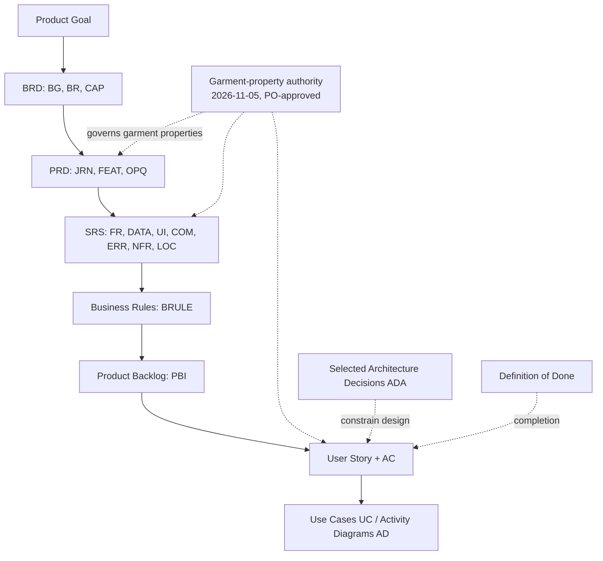
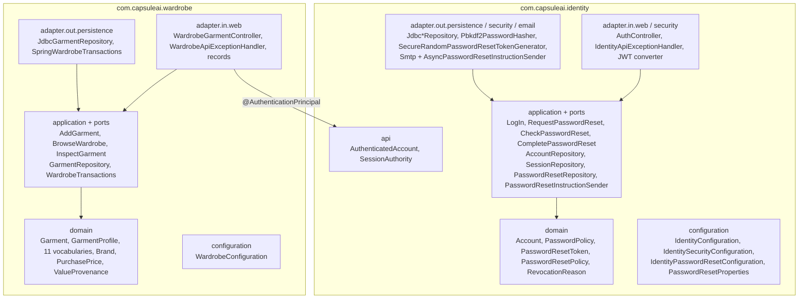
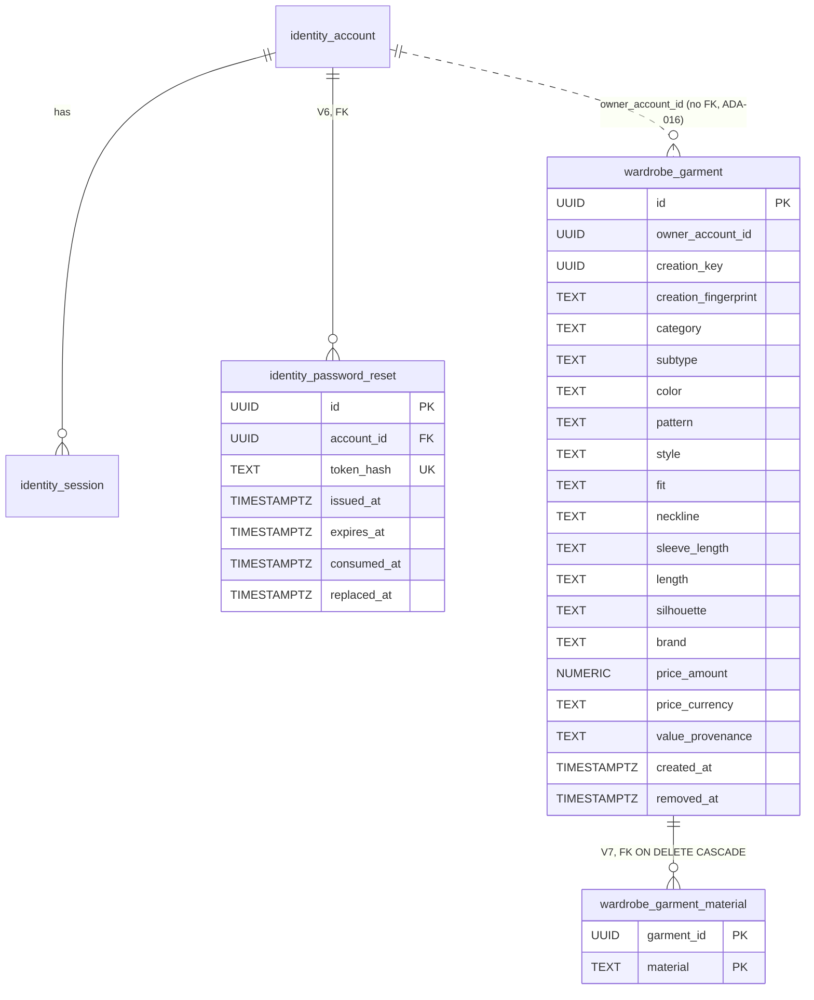
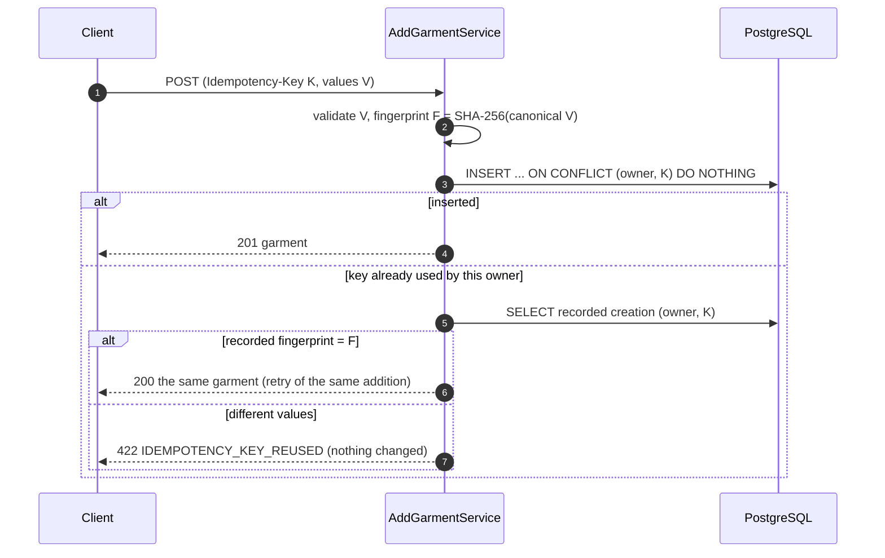

# Sprint 2 Shared Architecture

| Field | Value |
| --- | --- |
| Sprint | Sprint 2 — Recover Access and Establish a Private Wardrobe |
| Applies to | [US-AUTH-005](US-AUTH-005-guide.md), [US-GAR-001](US-GAR-001-guide.md), [US-WAR-001](US-WAR-001-guide.md), [US-WAR-002](US-WAR-002-guide.md) |
| Repository baseline | `sprint_02` at `1d0bc83` |
| Read with | [README](README.md) |
| Code status | Every structure described here exists in the guide author's scratch clone, where it was compiled and tested (final `clean verify`: 360 unit / 217 integration tests). It has **not** been applied to this repository or run in hosted CI. |

This document holds the cross-story decisions. Each story guide repeats what its developer needs, so a guide can be followed alone. When the two disagree, the story guide's code (taken from the tested stage commit) is authoritative, and this document should be corrected.

---

## 1. Purpose and scope

| In scope | Out of scope |
| --- | --- |
| Identity recovery (V6, reset services, SMTP boundary); Wardrobe module (model, V7, creation, overview, detail); their integration through `identity.api`; API conventions; errors; transactions; idempotency; configuration; testing; shared-file ownership; decisions | Mobile client; images and AI (PBI-012/013); editing/removal (PBI-008/016); search/filter (PBI-015); Wear and analytics (PBI-021/025); deployment and the production email provider |

## 2. Repository baseline and stages

| Stage | State | Produced by | OpenAPI | Migrations |
| --- | --- | --- | --- | --- |
| 0 | `1d0bc83`: Sprint 1 Identity, CORS, empty Wardrobe module | — | 0.4.1 | V1–V5 |
| 1 | + email password recovery | [US-AUTH-005](US-AUTH-005-guide.md) | 0.5.0 | + V6 |
| 2 | + Wardrobe model and manual creation | [US-GAR-001](US-GAR-001-guide.md) | 0.6.0 | + V7 |
| 3 | + current-wardrobe overview | [US-WAR-001](US-WAR-001-guide.md) | 0.7.0 | — |
| 4 | + garment detail, cross-story test | [US-WAR-002](US-WAR-002-guide.md) | 0.8.0 | — |

Across the four stages, 133 files change: 109 are added and 24 modified, and none is removed. Every stage compiles and passes `clean verify` on its own ([README §13](README.md#13-expected-outcome-of-each-stage)). Apply the stages in order, because each guide's BEFORE blocks are exact for its starting stage.

## 3. Requirement hierarchy and source precedence



Precedence when sources disagree:

1. An explicit, newer Product Owner decision that names what it supersedes. Examples: the garment-property authority, PRD §34.1, and the "Current property-model revision — 2026-11-05" notes at the top of each story.
2. The story's own Acceptance Criteria, for behaviour within that story.
3. SRS requirement rows, then Business Rules, then the PRD feature text, then the BRD.
4. Architecture decisions (ADA) constrain *how*, never *what*.

When none of these resolves a conflict, the guides label it **[OPEN]** and implement the smallest reversible behaviour as **[TECH]** (§22).

## 4. Labels and conventions

| Label | Meaning |
| --- | --- |
| **[REQ]** | Stated by a requirement source (quoted verbatim in the story guides, sections 3–8) |
| **[ARCH]** | A selected architecture decision (ADA-nnn) or an established repository convention |
| **[TECH]** | A technical decision proposed by these guides (`TD-S2-nn`, §22); changeable without a product decision |
| **[OPEN]** | Needs a product/team decision (`OPEN-S2-nn`, §22); the guides implement a provisional default |
| **[ADD] / [MODIFY] / [REMOVE]** | File actions in the story guides |

Repository conventions kept unchanged:

- One controller per cohesive base path. `AuthController` gains the recovery handlers, and `WardrobeGarmentController` serves `/api/v1/wardrobe/garments`.
- Services have descriptive names (`RequestPasswordResetService`, `AddGarmentService`).
- Commands and value types are records; domain types are immutable.
- There are no Lombok, JPA or field injection.

## 5. Module boundaries and package structure



| Rule | Enforced by |
| --- | --- |
| `domain` and `application` import no Spring, Jakarta or JDBC types | `ArchitectureDependencyTest` (existing) |
| Nothing outside a module uses its `domain`, `application` or `adapter` packages | `ArchitectureDependencyTest` (Wardrobe was already listed as an owner) |
| Wardrobe uses only `com.capsuleai.identity.api` | Same test; ADA-015, ADA-018 |
| Wardrobe owns its tables; no foreign key into Identity | V7 design; ADA-016 |

## 6. Identity–Wardrobe integration

| Aspect | Design |
| --- | --- |
| Who is the owner | `AuthenticatedAccount.accountId()` resolved by Identity's JWT converter after it confirms the persistent session is usable. Wardrobe receives it through `@AuthenticationPrincipal`. |
| Owner storage | `wardrobe_garment.owner_account_id UUID NOT NULL`. There is no FK: Wardrobe must not depend on Identity's schema ([ARCH] ADA-016, [TECH] TD-S2-09). |
| Lifecycle coupling | None at runtime. Identity does not call Wardrobe, and no event is published. The only published contract used is `identity.api.AuthenticatedAccount` (ADA-017: narrow published contracts; no internal HTTP or broker). |
| Account deletion | Not in scope. Without an FK, a future account-deletion capability must purge Wardrobe data explicitly (noted for that PBI). |
| Recovery effect on Wardrobe | Indirect but complete: revoking every active session makes every earlier token fail on every Wardrobe operation (`WardrobeAccessAfterPasswordResetIT`). |
| Test-fixture coupling | `IdentityIntegrationTestSupport` truncates Identity tables; `WardrobeIntegrationTestSupport` additionally truncates `wardrobe_garment_material, wardrobe_garment`. Because there is no FK, Identity truncation cannot cascade into Wardrobe. |

## 7. Authentication and authorization

| Endpoint group | Access | Mechanism |
| --- | --- | --- |
| `POST /api/v1/auth/registrations`, `/login`, `/refresh` (Sprint 1) | Public | `PUBLIC_ENDPOINTS` in `IdentitySecurityConfiguration` |
| `POST /api/v1/auth/password-reset/request`, `/check`, `/complete` (US-AUTH-005) | **Public**; the reset secret is the credential. A stale `Authorization` header is ignored. | Added to `PUBLIC_ENDPOINTS` |
| `POST /api/v1/auth/logout` and everything else | Protected | Default-deny; JWT (HS256) plus `SessionAuthority`, so the session must be neither revoked nor expired |
| `/api/v1/wardrobe/garments/**` | Protected, owner-scoped | No configuration change: default-deny covers it. Every query includes `owner_account_id = :owner`. |

- **Unusable access:** 401 `AUTHENTICATION_REQUIRED` with `WWW-Authenticate: Bearer`. This covers a missing, invalid or expired token, logout, refresh-reuse revocation and password-reset revocation. The response body never contains resource data.
- **Cross-account access:** another account's resource is indistinguishable from a non-existent one (404, §13). There is no 403 anywhere in the Wardrobe API.
- **CORS:** Stage 2 adds `Idempotency-Key` to the allowed request headers. Origins stay configuration-driven (`CAPSULE_CORS_ALLOWED_ORIGINS`).


## 8. Password-recovery architecture

```mermaid
sequenceDiagram
    autonumber
    participant C as Client
    participant A as AuthController
    participant R as RequestPasswordResetService
    participant DB as PostgreSQL
    participant Q as AsyncPasswordResetInstructionSender
    participant M as SMTP server
    C->>A: POST /password-reset/request {email}
    A->>R: request(email)
    R->>DB: find account; then tx: lock account FOR UPDATE,<br/>mark open interaction replaced, insert new (hash only)
    R-->>Q: after commit: hand over instructions (raw secret in memory only)
    A-->>C: 202 PASSWORD_RESET_REQUESTED (same for unknown email)
    Q->>M: plain-text email with link#token=secret (bounded queue, 5 s timeouts)
    C->>A: POST /password-reset/check {token}
    A-->>C: 204 or 400 PASSWORD_RESET_INVALID
    C->>A: POST /password-reset/complete {token, newPassword}
    A->>DB: tx: lock account FOR UPDATE, lock reset row FOR UPDATE, recheck usable,<br/>replace hash, consume, revoke all active sessions
    A-->>C: 204 (or 400 VALIDATION_FAILED / PASSWORD_RESET_INVALID)
```

| Property | Design | Decision |
| --- | --- | --- |
| Secret | 256 random bits (`SecureRandom`), Base64url; only its SHA-256 hex is stored (`token_hash`) | TD-S2-03 |
| Validity | 30 minutes (`PasswordResetPolicy.INTERACTION_LIFETIME`); usable while `now < expires_at`, not consumed and not replaced | [REQ] FR-AUTH-017 |
| Replacement | A new request marks the open one `replaced_at`; a partial unique index allows at most one open interaction per account | [REQ] FR-AUTH-018 |
| Equivalent initiation | Same 202 body for registered and unregistered addresses; the email is sent only for an account. A missing or malformed address is 400 `VALIDATION_FAILED`, which depends only on the typed value, never on account existence | [REQ] FR-AUTH-003 |
| Invalid outcomes | Unknown, expired, consumed and replaced secrets all produce one code, `PASSWORD_RESET_INVALID` | TD-S2-02 |
| Completion effects | One transaction: new PBKDF2 hash, `consumed_at`, every active session revoked with `PASSWORD_RESET` | [REQ] FR-AUTH-004, TD-S2-07 |
| Login race | `LogInService` re-reads the hash `FOR SHARE` inside the session-creating transaction; a login that verified the old password before a reset commits gets no session | TD-S2-08 |
| Delivery | `SmtpPasswordResetInstructionSender` (Vietnamese plain text) behind `AsyncPasswordResetInstructionSender` (bounded queue of 100, drained for up to 10 s on shutdown). Failures are logged without secret or address. | TD-S2-04 |
| Link | `instruction-link` + `#token=<secret>`; the fragment is not sent to web servers or logged by proxies | TD-S2-05, OPEN-S2-02 |

## 9. Wardrobe domain model


`Garment` is a record. `removedAt` is `null` while the garment is current, and `isCurrent()` tests exactly that.

| Property (authority) | Type / cardinality | Applies to | Values |
| --- | --- | --- | --- |
| Category | `GarmentCategory`, required | all | 8 |
| Subtype | `GarmentSubtype`, optional, must belong to the Category | all | 84 |
| Color (dominant) | `GarmentColor`, required, single | all | 34 (incl. Colorful) |
| Material | `Set<GarmentMaterial>`, 0..n distinct, no percentages | all | 28 |
| Pattern | `GarmentPattern`, optional | all | 24 |
| Style | `GarmentStyle`, optional, **single** ([TECH] TD-S2-13 / [OPEN] OPEN-S2-08) | all | 17 |
| Fit | `GarmentFit`, optional | Tops | 4 |
| Neckline | `GarmentNeckline`, optional | Tops | 23 |
| Sleeve Length | `GarmentSleeveLength`, optional | Tops | 5 |
| Length | `GarmentLength`, optional, from the category's list | Tops (4), Pants (2) | 6 |
| Silhouette | `GarmentSilhouette`, optional | Pants | 7 |
| Brand | `Brand`, optional exact text, at most 100 code points, blank = not supplied | all | — |
| Purchase Price | `PurchasePrice`, optional pair: decimal ≥ 0, scale ≤ the currency's minor unit, at most 12 integer digits, ISO 4217 code | all | — |

- **Codes:** each enum constant's name is its stable API and database code. `label()` returns the exact approved text (`TANKS_AND_CAMILS` → "Tanks & Camils"). The ten Dresses/Jumpsuits identifiers are the approved ones ([TECH] TD-S2-10).
- **No readiness:** there is no readiness predicate, column or gate; every response says `recommendationEligibility: NOT_EVALUATED` ([REQ] FR-GAR-004/005, BRULE-GAR-003).
- **Provenance:** `ValueProvenance.USER_ENTERED` for every manual garment, stored per garment ([TECH] TD-S2-16).

## 10. Data model



## 11. Schema (V6 and V7, complete)

### 11.1 V6 — `identity_password_reset` and the `PASSWORD_RESET` revocation reason (US-AUTH-005)

```sql
-- US-AUTH-005: persistent password-reset authority (ADA-008, DATA-AUTH-005).
-- One row per issued interaction. Only the SHA-256 hash of its secret is stored.
-- An interaction ends at most one way: consumed by an accepted reset, or replaced
-- by a newer issuance (FR-AUTH-017, FR-AUTH-018). Expiry is enforced by comparing
-- expires_at with the application clock.
CREATE TABLE identity_password_reset (
    id          UUID        PRIMARY KEY,
    account_id  UUID        NOT NULL REFERENCES identity_account (id),
    token_hash  TEXT        NOT NULL,
    issued_at   TIMESTAMPTZ NOT NULL,
    expires_at  TIMESTAMPTZ NOT NULL,
    consumed_at TIMESTAMPTZ NULL,
    replaced_at TIMESTAMPTZ NULL,
    CONSTRAINT uq_identity_password_reset_token_hash UNIQUE (token_hash),
    CONSTRAINT ck_identity_password_reset_token_hash_format CHECK (token_hash ~ '^[0-9a-f]{64}$'),
    CONSTRAINT ck_identity_password_reset_lifetime
        CHECK (expires_at > issued_at AND expires_at <= issued_at + INTERVAL '30 minutes'),
    CONSTRAINT ck_identity_password_reset_single_outcome
        CHECK (consumed_at IS NULL OR replaced_at IS NULL),
    CONSTRAINT ck_identity_password_reset_consumed_after_issue
        CHECK (consumed_at IS NULL OR consumed_at >= issued_at),
    CONSTRAINT ck_identity_password_reset_replaced_after_issue
        CHECK (replaced_at IS NULL OR replaced_at >= issued_at)
);

-- An account has at most one open (neither consumed nor replaced) interaction.
-- Issuance replaces the open one before inserting, under the account row lock.
CREATE UNIQUE INDEX ux_identity_password_reset_open_per_account
    ON identity_password_reset (account_id)
    WHERE consumed_at IS NULL AND replaced_at IS NULL;

CREATE INDEX ix_identity_password_reset_account ON identity_password_reset (account_id);

-- An accepted reset revokes every active session of the account with its own reason.
ALTER TABLE identity_session
    DROP CONSTRAINT ck_identity_session_revocation_reason;

ALTER TABLE identity_session
    ADD CONSTRAINT ck_identity_session_revocation_reason
        CHECK (revocation_reason IN ('LOGOUT', 'REFRESH_TOKEN_REUSE', 'PASSWORD_RESET'));
```

### 11.2 V7 — `wardrobe_garment` and `wardrobe_garment_material` (US-GAR-001)

```sql
-- US-GAR-001: Wardrobe-owned confirmed garments (ADA-016, DATA-GAR-001/002/005).
-- A row exists only for an explicitly confirmed addition; drafts are never stored.
-- Codes are the enum constant names of com.capsuleai.wardrobe.domain; each maps to
-- one approved label of the garment-property authority. owner_account_id is the
-- authenticated Identity account id: Wardrobe receives it through the published
-- AuthenticatedAccount contract and deliberately has no foreign key into Identity's
-- private tables (ADA-016). removed_at NULL means "in the owner's current wardrobe".
CREATE TABLE wardrobe_garment (
    id                   UUID        PRIMARY KEY,
    owner_account_id     UUID        NOT NULL,
    creation_key         UUID        NOT NULL,
    creation_fingerprint TEXT        NOT NULL,
    category             TEXT        NOT NULL,
    subtype              TEXT        NULL,
    color                TEXT        NOT NULL,
    pattern              TEXT        NULL,
    style                TEXT        NULL,
    fit                  TEXT        NULL,
    neckline             TEXT        NULL,
    sleeve_length        TEXT        NULL,
    length               TEXT        NULL,
    silhouette           TEXT        NULL,
    brand                TEXT        NULL,
    price_amount         NUMERIC     NULL,
    price_currency       TEXT        NULL,
    value_provenance     TEXT        NOT NULL,
    created_at           TIMESTAMPTZ NOT NULL,
    removed_at           TIMESTAMPTZ NULL,

    -- One accepted garment per logical addition (ADA-009, DATA-INT-004).
    CONSTRAINT uq_wardrobe_garment_creation_key UNIQUE (owner_account_id, creation_key),
    CONSTRAINT ck_wardrobe_garment_creation_fingerprint_format
        CHECK (creation_fingerprint ~ '^[0-9a-f]{64}$'),

    CONSTRAINT ck_wardrobe_garment_category CHECK (category IN (
        'TOPS', 'DRESSES_JUMPSUITS', 'PANTS', 'SKIRTS', 'OUTERWEAR', 'SHOES',
        'BAGS', 'HEADWEAR')),
    CONSTRAINT ck_wardrobe_garment_subtype_in_category CHECK (subtype IS NULL OR CASE category
            WHEN 'TOPS' THEN subtype IN (
                'T_SHIRTS', 'LONG_SLEEVE_T_SHIRTS', 'SLEEVELESS_T_SHIRTS', 'POLO_SHIRTS',
                'TANKS_AND_CAMILS', 'CROP_TOPS', 'BLOUSES', 'SHIRTS', 'SWEATSHIRTS', 'HOODIES',
                'SWEATERS', 'SWEATER_VESTS', 'SPORTS_TOPS', 'BODYSUITS')
            WHEN 'DRESSES_JUMPSUITS' THEN subtype IN (
                'DAY_DRESS', 'T_SHIRT_DRESS', 'SHIRT_DRESS', 'SWEATSHIRT_DRESS', 'SWEATER_DRESS',
                'JACKET_DRESS', 'SUSPENDER_DRESS', 'JUMPSUIT', 'PARTY_DRESS', 'MINI_DRESS')
            WHEN 'PANTS' THEN subtype IN (
                'JEANS', 'TROUSERS', 'DRESS_PANTS', 'TRACK_PANTS', 'LEGGINGS', 'SHORTS')
            WHEN 'SKIRTS' THEN subtype IN (
                'MINI_SKIRTS', 'MIDI_SKIRTS', 'MAXI_SKIRTS')
            WHEN 'OUTERWEAR' THEN subtype IN (
                'COATS', 'TRENCH_COATS', 'FUR_COATS', 'SHEARLING_COATS', 'BLAZERS', 'JACKETS',
                'BLOUSONS', 'VARSITY_JACKETS', 'TRUCKER_JACKETS', 'BIKER_JACKETS', 'CARDIGANS',
                'ZIP_UP_HOODIES', 'FIELD_JACKETS', 'SPORT_JACKETS', 'FLEECE_JACKETS', 'PARKAS',
                'DOWN_JACKETS', 'PUFFER_JACKETS', 'VESTS')
            WHEN 'SHOES' THEN subtype IN (
                'SNEAKERS', 'SLIP_ONS', 'SPORTS_SHOES', 'HIKING_SHOES', 'BOOTS', 'COMBAT_BOOTS',
                'UGG_BOOTS', 'LOAFERS_AND_LOAFER_MULES', 'BOAT_SHOES_AND_MOCCASINS', 'FLAT_SHOES',
                'HEELS', 'SANDALS', 'SANDAL_HEELS', 'SLIDES', 'MULE_HEELS')
            WHEN 'BAGS' THEN subtype IN (
                'TOTE', 'SHOULDER', 'CROSSBODY', 'WAIST', 'CANVAS', 'BACKPACKS', 'DUFFEL',
                'CLUTCH', 'BRIEFCASES', 'DRAWSTRING', 'SUITCASES')
            WHEN 'HEADWEAR' THEN subtype IN (
                'CAP', 'HATS', 'BEANIES', 'BERETS', 'FEDORAS', 'SUN_HATS')
            ELSE FALSE
        END),
    CONSTRAINT ck_wardrobe_garment_color CHECK (color IN (
        'WHITE', 'IVORY', 'BEIGE', 'LIGHT_GRAY', 'DARK_GRAY', 'BLACK', 'LIGHT_YELLOW',
        'YELLOW', 'TURMERIC', 'ORANGE', 'CORAL', 'RED', 'PINK', 'HOT_PINK', 'LIGHT_GREEN',
        'GREEN', 'OLIVE', 'DARK_OLIVE', 'TEAL', 'KHAKI', 'CYAN', 'SKY_BLUE', 'BLUE',
        'NAVY', 'LAVENDER', 'PURPLE', 'BURGUNDY', 'CAMEL', 'BROWN', 'DARK_BROWN',
        'MAGENTA', 'GOLD', 'SILVER', 'COLORFUL')),
    CONSTRAINT ck_wardrobe_garment_pattern CHECK (pattern IS NULL OR pattern IN (
        'SOLID', 'STRIPED', 'GRAPHIC', 'DOTTED', 'ANIMAL', 'FLORAL', 'TROPICAL', 'PAISLEY',
        'ARGYLE', 'CAMO', 'COLOR_BLOCK', 'REPEATED', 'CHECKERBOARD', 'PLAID', 'GINGHAM',
        'HOUNDSTOOTH', 'HERRINGBONE', 'CHEVRON', 'TWEED', 'ABSTRACT', 'TIE_DYE',
        'GEOMETRIC', 'LACE', 'OTHER_PATTERNS')),
    CONSTRAINT ck_wardrobe_garment_style CHECK (style IS NULL OR style IN (
        'COMFORTABLE', 'CASUAL', 'BUSINESS_CASUAL', 'FORMAL', 'MODERN', 'CLASSIC',
        'MINIMALIST', 'BOHEMIAN', 'LUXURY', 'SPORTY', 'ATHLEISURE', 'TRENDY', 'KIDCORE',
        'ARTISTIC', 'DRESSY', 'FEMININE', 'STREET')),

    -- Category applicability (FR-GAR-007): Fit, Neckline, Sleeve Length only for Tops;
    -- Length from the Tops or Pants list only for that category; Silhouette only for Pants.
    CONSTRAINT ck_wardrobe_garment_fit CHECK (fit IS NULL OR (category = 'TOPS' AND fit IN (
        'SLIM', 'REGULAR', 'LOOSE', 'OVERSIZED'))),
    CONSTRAINT ck_wardrobe_garment_neckline CHECK (neckline IS NULL OR (category = 'TOPS' AND neckline IN (
        'ROUND', 'SCOOP_U', 'BOAT', 'V_NECK', 'DEEP_V', 'SQUARE', 'SURPLICE',
        'SHIRT_COLLAR', 'STANDUP_COLLAR', 'WIDE_COLLAR', 'MOCKNECK', 'TURTLENECK',
        'STRAPLESS', 'THICK_STRAP', 'THIN_STRAP', 'SWEETHEART', 'OFF_THE_SHOULDER',
        'ASYMMETRIC', 'HALTER', 'ILLUSION', 'KEYHOLE', 'SUIT_COLLAR', 'OTHER'))),
    CONSTRAINT ck_wardrobe_garment_sleeve_length CHECK (sleeve_length IS NULL OR (category = 'TOPS' AND sleeve_length IN (
        'SLEEVELESS', 'CAP_SLEEVE', 'SHORT_SLEEVE', 'THREE_QUARTER_SLEEVE', 'LONG_SLEEVE'))),
    CONSTRAINT ck_wardrobe_garment_length CHECK (length IS NULL
        OR (category = 'TOPS' AND length IN ('CROPPED', 'WAIST', 'HIP', 'KNEE'))
        OR (category = 'PANTS' AND length IN ('SHORT', 'LONG'))),
    CONSTRAINT ck_wardrobe_garment_silhouette CHECK (silhouette IS NULL OR (category = 'PANTS' AND silhouette IN (
        'FLARE', 'SLIM', 'TAPERED', 'BAGGY', 'SKINNY', 'BOOTCUT', 'WIDE_LEG'))),

    -- Optional Brand text (FR-GAR-012): never blank, at most 100 characters.
    CONSTRAINT ck_wardrobe_garment_brand
        CHECK (brand IS NULL OR (char_length(brand) BETWEEN 1 AND 100 AND brand ~ '\S')),

    -- Optional purchase Price (FR-GAR-013): amount and currency together or neither;
    -- an exact non-negative decimal with an upper-case ISO 4217 code. NUMERIC without
    -- a declared scale keeps the scale as entered, so 12.50 is read back as 12.50.
    CONSTRAINT ck_wardrobe_garment_price_complete
        CHECK ((price_amount IS NULL) = (price_currency IS NULL)),
    CONSTRAINT ck_wardrobe_garment_price_amount
        CHECK (price_amount IS NULL
               OR (price_amount >= 0 AND price_amount < 1000000000000 AND scale(price_amount) <= 4)),
    CONSTRAINT ck_wardrobe_garment_price_currency
        CHECK (price_currency IS NULL OR price_currency ~ '^[A-Z]{3}$'),

    CONSTRAINT ck_wardrobe_garment_value_provenance CHECK (value_provenance IN ('USER_ENTERED')),
    CONSTRAINT ck_wardrobe_garment_removed_after_created
        CHECK (removed_at IS NULL OR removed_at >= created_at)
);

-- The owner's current wardrobe, newest first (US-WAR-001).
CREATE INDEX ix_wardrobe_garment_owner_current
    ON wardrobe_garment (owner_account_id, created_at DESC, id)
    WHERE removed_at IS NULL;

-- Zero, one or several distinct Materials per garment (FR-GAR-010). The primary
-- key makes a repeated selection impossible; no percentage is stored.
CREATE TABLE wardrobe_garment_material (
    garment_id UUID NOT NULL REFERENCES wardrobe_garment (id) ON DELETE CASCADE,
    material   TEXT NOT NULL,
    CONSTRAINT pk_wardrobe_garment_material PRIMARY KEY (garment_id, material),
    CONSTRAINT ck_wardrobe_garment_material CHECK (material IN (
        'COTTON', 'POLYESTER', 'NYLON', 'DENIM', 'LEATHER', 'WOOL', 'SPANDEX_ELASTANE',
        'LINEN', 'ACRYLIC', 'SILK', 'RAYON', 'VISCOSE', 'TWEED', 'VELVET', 'CHIFFON',
        'SUEDE', 'CORDUROY', 'LACE', 'FUR', 'DOWN', 'LYOCELL', 'METAL', 'CUPRO',
        'CASHMERE', 'MOHAIR', 'ANGORA', 'ALPACA', 'OTHER_MATERIALS'))
);
```

Design notes:

- **Vocabularies as `CHECK` lists**, not lookup tables ([TECH] TD-S2-10). The approved lists change only by product decision, together with a new migration and the enum. `JdbcGarmentRepositoryIT` round-trips every value, so the enum and the `CHECK` lists cannot drift apart unnoticed.
- **Applicability in the database:** Tops-only and Pants-only columns are constrained by category, and Subtype must belong to its Category. The application validates first, so these constraints are a second line of defence.
- **Price:** `NUMERIC` without declared scale stores the exact submitted value (`12.50` stays `12.50`). Amount and currency are both present or both absent.
- **Current wardrobe:** `removed_at IS NULL`. The partial index `ix_wardrobe_garment_owner_current` serves the overview's filter and order.

## 12. Flyway migration plan

| Version | File | Story | Change | Reversible by |
| --- | --- | --- | --- | --- |
| V1–V5 | existing | Pre-sprint, Sprint 1 | — | **Never edit** (checksums are validated) |
| V6 | `V6__create_identity_password_reset.sql` | US-AUTH-005 | New table, two indexes; replaces the `identity_session` revocation-reason CHECK to add `PASSWORD_RESET` | A later forward migration |
| V7 | `V7__create_wardrobe_garment.sql` | US-GAR-001 | Two new tables, constraints, partial index | A later forward migration |
| — | — | US-WAR-001, US-WAR-002 | No schema change | — |

- **Upgrade path:** `PasswordResetSchemaIT` and `GarmentSchemaIT` run the real migration files into a scratch schema up to V5 (or V6), insert representative rows, and then migrate to the latest version. They assert that existing data survives and that the new constraints accept it.
- **Production:** `spring.flyway.clean-disabled=true` stays set, and migrations run at application start.
- **Two developers adding migrations in parallel:** whoever merges second renumbers before merging. Never reuse a version number.


## 13. API conventions and endpoint catalogue

| Convention | Rule |
| --- | --- |
| Base path | `/api/v1/<module>/...`: `/api/v1/auth` (Identity), `/api/v1/wardrobe/garments` (Wardrobe) |
| Bodies | JSON read into request records; a body that cannot be parsed is 400 `MALFORMED_REQUEST` |
| Codes | Vocabulary values are upper-case constant names (`TANKS_AND_CAMILS`); clients map them to Vietnamese labels |
| Absent values | Responses list every field and use `null` when absent (`materials` is `[]`); nothing is omitted or invented ([TECH] TD-S2-15) |
| Money | `price.amount` is a JSON **string** holding the exact decimal; `price.currency` is an ISO 4217 code |
| Time | ISO-8601 UTC instants (`createdAt`) |
| Errors | RFC 9457 `application/problem+json` with a stable `code` property; `VALIDATION_FAILED` adds `fieldErrors: [{field, code}]` |
| Contract | `docs/05-api/openapi.yaml` is updated in the same change as the handler; `IdentityOpenApiContractIT` enforces that every `/api/` handler is documented and that the documented security, request fields, success fields and `required` lists match |
| Versioning | `info.version` is bumped per story (0.5.0 → 0.8.0); all Sprint 2 changes are additive |

| Method and path | Story | Access | Success | Errors |
| --- | --- | --- | --- | --- |
| `POST /api/v1/auth/password-reset/request` | US-AUTH-005 | Public | 202 `PASSWORD_RESET_REQUESTED` | 400 `VALIDATION_FAILED`, `MALFORMED_REQUEST`; 503 `TEMPORARILY_UNAVAILABLE` |
| `POST /api/v1/auth/password-reset/check` | US-AUTH-005 | Public | 204 | 400 `PASSWORD_RESET_INVALID`, `VALIDATION_FAILED`, `MALFORMED_REQUEST`; 503 |
| `POST /api/v1/auth/password-reset/complete` | US-AUTH-005 | Public | 204 | 400 `PASSWORD_RESET_INVALID`, `VALIDATION_FAILED`, `MALFORMED_REQUEST`; 503 |
| `POST /api/v1/wardrobe/garments` (+ `Idempotency-Key`) | US-GAR-001 | Protected | 201 new / 200 replay, `Garment` | 400 `VALIDATION_FAILED`, `MALFORMED_REQUEST`; 401; 422 `IDEMPOTENCY_KEY_REUSED`; 503 |
| `GET /api/v1/wardrobe/garments` | US-WAR-001 | Protected | 200 `WardrobeOverview` | 401; 503 |
| `GET /api/v1/wardrobe/garments/{garmentId}` | US-WAR-002 | Protected | 200 `Garment` | 401; 404 `GARMENT_NOT_FOUND`; 410 `GARMENT_NO_LONGER_CURRENT`; 503 |

The Sprint 1 endpoints (`registrations`, `login`, `refresh`, `logout`) are unchanged, except that a login racing a completed reset gets no session (§15).

## 14. Exception handling and error representation

| Layer | Responsibility |
| --- | --- |
| Domain | Throws typed problems: `InvalidValueException` (Identity), `InvalidGarmentValueException` with a `GarmentValueProblem` (Wardrobe) |
| Application | Collects field problems into `RequestValidationException` or `GarmentValidationException` (every problem at once). Throws outcome exceptions such as `PasswordResetRejectedException`, `IdempotencyKeyReusedException`, `GarmentNotFoundException` and `GarmentNoLongerCurrentException` |
| Web adapter | One `@RestControllerAdvice` per module, scoped with `basePackageClasses`, maps outcomes to status plus `code`. Each `detail` text is constant and never echoes submitted values, secrets or other accounts' data |
| Security chain | 401 `AUTHENTICATION_REQUIRED` from the existing authentication entry point, before any controller |
| Infrastructure failures | `DataAccessResourceFailureException`, `TransientDataAccessResourceException` and `CannotCreateTransactionException` → 503 `TEMPORARILY_UNAVAILABLE`: the outcome is not confirmed, and a retry is safe |

```json
{
  "type": "about:blank",
  "title": "Bad Request",
  "status": 400,
  "detail": "Some garment values are missing, unconfirmed or not allowed. Correct or clear them and confirm again; nothing was saved.",
  "instance": "/api/v1/wardrobe/garments",
  "code": "VALIDATION_FAILED",
  "fieldErrors": [
    {"field": "fit", "code": "NOT_APPLICABLE"},
    {"field": "price", "code": "INCOMPLETE_PRICE"}
  ]
}
```

## 15. Transactions, locking and concurrency

**Global lock order (Identity): account row → reset row → session rows.** Every transaction that takes more than one of these locks takes them in this order, so the reset flows cannot deadlock with each other or with login.

| Flow | Transaction content | Locks |
| --- | --- | --- |
| Request reset | Replace the open interaction, insert the new one | `identity_account` FOR UPDATE |
| Complete reset | Recheck the interaction; replace the hash; consume; revoke active sessions | account FOR UPDATE → reset row FOR UPDATE → session rows (UPDATE) |
| Login (modified) | Recheck the stored hash equals the verified one; create the session | account FOR SHARE (conflicts with reset's FOR UPDATE) |
| Refresh (Sprint 1) | Rotate the refresh token | token and session rows FOR UPDATE; a concurrent reset's revoke waits for them, then revokes |
| Add garment | Insert with `ON CONFLICT (owner_account_id, creation_key) DO NOTHING`; on conflict, read the recorded creation | Unique-index wait on a concurrent insert of the same key |
| Browse / detail | Single SELECT, auto-commit | None |

| Race | Guarantee | Evidence |
| --- | --- | --- |
| Two completions of one link | Exactly one changes the password | `ConcurrentPasswordResetIT.competingCompletionsOfOneLinkChangeThePasswordExactlyOnce` |
| Two requests | Exactly one usable link remains | `ConcurrentPasswordResetIT.competingRequestsLeaveExactlyOneUsableLink` |
| Reset vs refresh | No usable session remains, whichever commits first | `ConcurrentPasswordResetIT.resetRacingARenewalLeavesNoUsableSessionWhicheverCommitsFirst` |
| Reset vs login with the old password | That login gets no session | `PasswordResetLoginRaceIT.aLoginThatVerifiedTheOldPasswordBeforeAResetCommitsGetsNoSession` |
| Duplicate deliveries of one addition | Exactly one garment | `ConcurrentGarmentCreationIT.concurrentDeliveriesOfOneAdditionCreateExactlyOneGarment` |

Concurrency tests coordinate threads with latches or barriers and gated test doubles. No test uses `Thread.sleep`, and time comes from `MutableClock`.

## 16. Idempotency



| Rule | Value |
| --- | --- |
| Header | `Idempotency-Key`, required on `POST /garments`; must be a UUID (`REQUIRED` / `INVALID_FORMAT` in `fieldErrors`) |
| Scope | Per owner: `UNIQUE (owner_account_id, creation_key)`. The same key from two accounts creates two garments. |
| Lifetime | Permanent for the garment's life; there is no expiry window ([TECH] TD-S2-14) |
| Separate additions | Two different keys with identical values create two garments (two real possessions) |
| Failure | A 503 is not a confirmed outcome; a retry with the same key creates the garment once or returns it |
| Origin | [ARCH] ADA-009; [REQ] DATA-INT-004, FR-AI-010 |

## 17. Configuration and environment variables

| Property | Default / profile | Env var (`local` profile) | Purpose |
| --- | --- | --- | --- |
| `spring.datasource.*` | `local` profile | `CAPSULE_DB_URL`, `CAPSULE_DB_USER`, `CAPSULE_DB_PASSWORD` | PostgreSQL (Sprint 1) |
| `capsuleai.identity.access-token.signing-secret` | none (required) | `CAPSULE_JWT_SIGNING_SECRET` | HS256 key (Sprint 1) |
| `capsuleai.cors.allowed-origins` | empty; `local`: `https://editor.swagger.io` | `CAPSULE_CORS_ALLOWED_ORIGINS` | CORS |
| `spring.mail.host` / `.port` | `local`: `localhost` / `1025` (Mailpit) | `CAPSULE_MAIL_HOST`, `CAPSULE_MAIL_PORT` | SMTP server (US-AUTH-005) |
| `spring.mail.username` / `.password` | `local`: empty | `CAPSULE_MAIL_USERNAME`, `CAPSULE_MAIL_PASSWORD` | SMTP credentials; **never committed** |
| `spring.mail.properties.mail.smtp.auth` / `.starttls.enable` | `local`: `false` | `CAPSULE_MAIL_SMTP_AUTH`, `CAPSULE_MAIL_STARTTLS` | Provider requirements |
| `spring.mail.properties.mail.smtp.*timeout` | 5000 ms (all profiles) | — | No unbounded blocking |
| `capsuleai.identity.password-reset.sender-address` | `local`: `no-reply@capsuleai.local` | `CAPSULE_MAIL_FROM` | From address; validated as an email at startup |
| `capsuleai.identity.password-reset.instruction-link` | `local`: `capsuleai://reset-password` | `CAPSULE_PASSWORD_RESET_LINK` | Absolute link without fragment or user info; the secret is appended as `#token=` |

- **Fail fast:** the default profile defines no SMTP host and no reset properties. Without `spring.mail.host`, Boot creates no `JavaMailSender`, so `IdentityPasswordResetConfiguration` cannot be built. `PasswordResetProperties` also rejects a missing or invalid sender address or link. In both cases the application does not start, and the problem is never discovered at the first reset request. (This follows from the code; no test starts the application without these settings.) A deployment supplies the values through its own profile or through Spring's relaxed binding (for example `SPRING_MAIL_HOST`, `CAPSULEAI_IDENTITY_PASSWORDRESET_SENDERADDRESS`).
- **Tests:** `application-test.properties` points SMTP at an unused local port (`127.0.0.1:2525`). The real sender is replaced there by `RecordingPasswordResetInstructionSender`, and `SmtpPasswordResetInstructionSenderIT` builds its own sender against a Mailpit container.
- **No new secret** is introduced; the email-provider account is not chosen ([OPEN] OPEN-S2-09).

## 18. Security and privacy

| Concern | Measure |
| --- | --- |
| Account enumeration | Identical 202 for registered and unregistered emails; one `PASSWORD_RESET_INVALID` for every unusable secret; identical 404 for unknown and others' garments |
| Secret exposure | Reset secret stored only as a SHA-256 hash; never logged or returned; delivered in a URL fragment; email logs omit recipient and link (`secretsNeverAppearInResponsesOrLogs`) |
| Credential change | Atomic hash replacement plus revocation of every active session; the old password and refresh tokens are denied afterwards |
| Owner isolation | Owner from the verified token only; every Wardrobe query is owner-scoped; tests for every operation with two accounts |
| Private data in logs | No garment values, emails or tokens in log messages; PostgreSQL error detail suppressed (`logServerErrorDetail=false`, Sprint 1) |
| Transport and caching | HTTPS is a deployment concern (outside this package); Spring Security's default no-store cache headers are left enabled |
| Abuse | No rate limiting yet ([OPEN] OPEN-S2-04); the delivery queue is bounded, so a flood cannot exhaust memory or threads |
| Data minimization | No image, no inference, Brand/Price only as typed by the user (BRULE-GAR-010, BRULE-AUTH-007) |

## 19. Testing architecture

| Context | Classes | Why separate |
| --- | --- | --- |
| Shared application context | `IdentityIntegrationTestSupport` (PostgreSQL Testcontainer, MockMvc, `MutableClock`, `RecordingPasswordResetInstructionSender` as `@Primary`); `WardrobeIntegrationTestSupport extends` it | One Spring context and one container are reused by most ITs |
| Login-race context | `PasswordResetLoginRaceIT` | Replaces `PasswordHasher` with a gated one |
| Recovery-failure context | `PasswordResetFailureIT` | Wraps a repository so it fails on demand |
| Wardrobe-failure context | `WardrobeFailureIT` | Imports `FailingGarmentRepository` |
| No Spring | Domain/application unit tests with in-memory fakes (`InMemoryAccountRepository`, `InMemorySessionRepository`, `InMemoryPasswordResetRepository`, `InMemoryGarmentRepository`, `SequencePasswordResetTokenGenerator`, `RecordingPasswordHasher`) | Fast and deterministic |
| SMTP | `SmtpPasswordResetInstructionSenderIT` with a Mailpit `GenericContainer`, reading its HTTP API | Real SMTP evidence without an external provider |

- **Fakes, not mocks:** the ports are small, so hand-written fakes record exactly what happened and serve several tests. Mockito remains available through `spring-boot-starter-test`; Sprint 2 tests do not need it.
- **Time:** the application has one `Clock` bean (`IdentityConfiguration.identityClock()`). Wardrobe reuses it ([TECH] TD-S2-23), and tests advance `MutableClock` instead of sleeping.
- **Data isolation:** each IT starts from truncated tables (`resetIdentityState`, `resetWardrobeState`) and uses distinct synthetic emails.
- **Reports guard:** CI requires every suite's report by name (50 after Stage 4).

| Suite (Stage 4) | Unit | Integration |
| --- | --- | --- |
| Sprint 1 and baseline | existing | existing |
| US-AUTH-005 | `PasswordResetTokenTest`, `PasswordResetTokenHashTest`, `PasswordResetPropertiesTest`, `RequestPasswordResetServiceTest`, `CheckPasswordResetServiceTest`, `CompletePasswordResetServiceTest`, `LogInServiceTest` (modified), `SmtpPasswordResetInstructionSenderTest`, `AsyncPasswordResetInstructionSenderTest` | `PasswordResetSchemaIT`, `PasswordResetApiIT`, `ConcurrentPasswordResetIT`, `PasswordResetLoginRaceIT`, `PasswordResetFailureIT`, `SmtpPasswordResetInstructionSenderIT` |
| US-GAR-001 | `ApprovedGarmentVocabularyTest`, `GarmentProfileTest`, `BrandTest`, `PurchasePriceTest`, `GarmentEntryValidatorTest`, `AddGarmentServiceTest` | `GarmentSchemaIT`, `JdbcGarmentRepositoryIT`, `AddGarmentApiIT`, `ConcurrentGarmentCreationIT`, `WardrobeFailureIT`, `CorsSecurityIT` (modified), `IdentityOpenApiContractIT` (modified) |
| US-WAR-001 | `BrowseWardrobeServiceTest` | `BrowseWardrobeApiIT`, `WardrobeFailureIT` (modified) |
| US-WAR-002 | `InspectGarmentServiceTest` | `GarmentDetailApiIT`, `WardrobeFailureIT` and `IdentityOpenApiContractIT` (modified), `WardrobeAccessAfterPasswordResetIT` |

## 20. Cross-story integration

| Scenario | Stories | Evidence |
| --- | --- | --- |
| Create → browse → inspect the same garment | GAR-001, WAR-001, WAR-002 | `GarmentDetailApiIT.theDetailOfAGarmentChosenFromTheOverviewIsThatGarment` |
| Reset → every earlier access and refresh token denied on add, browse and detail → new-password login → same wardrobe, identical detail → another account unaffected | AUTH-005, GAR-001, WAR-001, WAR-002 | `WardrobeAccessAfterPasswordResetIT.aResetRevokesEveryEarlierCredentialAndPreservesTheWardrobe` |
| Reset-revoked token on browse | AUTH-005, WAR-001 | `BrowseWardrobeApiIT.unusableAccessIsNeverReportedAsAnEmptyWardrobe` |
| Reset-revoked token on add | AUTH-005, GAR-001 | `AddGarmentApiIT.unusableAccessIsDeniedAndSavesNothing` |
| Browser client sends `Idempotency-Key` | GAR-001, CORS (Sprint 1 fix) | `CorsSecurityIT` (modified) |
| OpenAPI matches every handler | all | `IdentityOpenApiContractIT` |


## 21. Shared-file ownership matrix

Each file below is modified by more than one stage, or is an existing file modified by one stage that other stories depend on. **M** = modified, **A** = added, **—** = untouched. When one of these files does not match a guide's BEFORE text, an earlier stage is missing or was applied differently.

| File | S1 AUTH-005 | S2 GAR-001 | S3 WAR-001 | S4 WAR-002 | What each change does |
| --- | --- | --- | --- | --- | --- |
| `docs/05-api/openapi.yaml` | M | M | M | M | 0.5.0 recovery → 0.6.0 creation and Wardrobe schemas → 0.7.0 overview → 0.8.0 detail, `RecordedUse`, 404/410 |
| `.github/workflows/backend-ci.yml` | M | M | M | M | Adds each story's report names to `$required` (50 after S4) |
| `backend/README.md` | M | M | M | M | Overview, technology, configuration, testing and limitations per story |
| `identity/configuration/IdentitySecurityConfiguration.java` | M | M | — | — | S1: recovery endpoints in `PUBLIC_ENDPOINTS`; S2: `Idempotency-Key` allowed by CORS |
| `test/.../identity/adapter/in/web/IdentityOpenApiContractIT.java` | — | M | — | M | S2: protected operations with bodies are called with a token and an `Idempotency-Key`; S4: path parameters filled with random UUIDs |
| `test/.../identity/adapter/in/security/CorsSecurityIT.java` | — | M | — | — | Preflight allows `Idempotency-Key` |
| `test/.../identity/support/IdentityIntegrationTestSupport.java` | M | — | — | — | Recovery helpers (`requestPasswordResetToken`, `completePasswordReset`) reused by Wardrobe ITs |
| `test/.../identity/support/IdentityTestConfiguration.java` | M | — | — | — | `@Primary` recording reset sender for every IT context |
| `wardrobe/application/ports/GarmentRepository.java` | — | A | M | M | S3: `findCurrentByOwner`; S4: `findOwned` |
| `wardrobe/adapter/out/persistence/JdbcGarmentRepository.java` | — | A | M | M | The two queries above, on the shared `SELECT_GARMENT` |
| `wardrobe/adapter/in/web/WardrobeGarmentController.java` | — | A | M | M | S3: `GET`; S4: `GET /{garmentId}` |
| `wardrobe/configuration/WardrobeConfiguration.java` | — | A | M | M | Wires each new service |
| `wardrobe/adapter/in/web/GarmentResponse.java` | — | A | — | M | S4: `recordedUse` (also in `POST` responses) |
| `wardrobe/adapter/in/web/WardrobeApiExceptionHandler.java` | — | A | — | M | S4: 404 and 410 |
| `test/.../wardrobe/application/InMemoryGarmentRepository.java` | — | A | M | M | Fake follows the port |
| `test/.../wardrobe/adapter/in/web/WardrobeFailureIT.java` | — | A | M | M | S3: failing overview; S4: failing detail |

Stage 1 alone also modifies `pom.xml`, `compose.yaml`, the three `application*.properties` files and several Identity classes (`AuthController`, `IdentityApiExceptionHandler`, `LogInService`, `AccountRepository`, `SessionRepository`, their JDBC adapters, `RevocationReason`) together with their fakes and tests. The [US-AUTH-005 guide](US-AUTH-005-guide.md) §11 lists them.

**Parallel development:** if two developers work on different stories at once, each must rebase onto the earlier story's merge before applying the shared rows above, and then re-run `IdentityOpenApiContractIT` and the CI guard.

## 22. Technical decisions, open decisions and contradictions

### 22.1 Technical decision log

| ID | Decision | Alternatives rejected | Reason | Guide |
| --- | --- | --- | --- | --- |
| TD-S2-01 | Recovery lives in Identity; garments in Wardrobe, starting from its existing package | A separate recovery module; garments in `wardrobeintelligence` | ADA-015/016 ownership; Wardrobe was already a documented owner | AUTH-005, GAR-001 |
| TD-S2-02 | Three public POST operations (`request`, `check`, `complete`) and one invalid code | Two operations; distinct codes for expired/used/replaced | AC requires that opening an invalid link reports rejection; one code avoids leaking interaction state | AUTH-005 |
| TD-S2-03 | 256-bit random secret, SHA-256 stored | Signed JWT; encryption; slow hash | Single use and replacement need a row anyway; a full-entropy secret needs no slow hash | AUTH-005 |
| TD-S2-04 | SMTP via `JavaMailSender`, asynchronous after commit, bounded queue | Provider SDK; synchronous send; outbox table | Provider-neutral; no timing leak; no new infrastructure. Loss on crash is accepted because the user can request again | AUTH-005 |
| TD-S2-05 | Configurable instruction link with `#token=` fragment | Query parameter; typed code | Fragments are not sent to servers; a typed code would be a new recovery method | AUTH-005 |
| TD-S2-06 | Fixed lock order account → reset → sessions, READ COMMITTED | SERIALIZABLE with retries; advisory locks; version column | Matches the existing transaction style; deadlock-free by construction | AUTH-005 |
| TD-S2-07 | Revoke the account's **active** sessions (`PASSWORD_RESET`) | Delete sessions; revoke expired ones too | Revocation is what the requirements describe; expired sessions are already unusable | AUTH-005 |
| TD-S2-08 | Login rechecks the hash under `FOR SHARE` inside its transaction | Verify the password inside the lock; credential version | Keeps PBKDF2 outside the lock; no schema change | AUTH-005 |
| TD-S2-09 | `owner_account_id` without FK into Identity | FK to `identity_account` | ADA-016 context data ownership | GAR-001 |
| TD-S2-10 | Enum codes = constant names with exact labels; text columns with `CHECK` lists | Lookup tables; PostgreSQL ENUM types | No seed data to keep in sync; forward migration per approved change | GAR-001 |
| TD-S2-11 | Price amount as a decimal string; `NUMERIC` without scale; ≥ 0, ≤ 12 integer digits, scale ≤ currency minor unit, `java.util.Currency` codes | JSON number; fixed scale; currency allow-list | Exactness without floating point; provisional bounds pending OPEN-S2-01 | GAR-001 |
| TD-S2-12 | Brand: exact text, ≤ 100 code points, blank = not supplied, no normalization | Trimming or case folding; brand catalogue | BRULE-GAR-010 user authority; provisional pending OPEN-S2-01 | GAR-001 |
| TD-S2-13 | Style is a single optional value | A set like Materials | The singular "selection" wording, mirroring Pattern; pending OPEN-S2-08 | GAR-001 |
| TD-S2-14 | `Idempotency-Key` header (UUID), unique per owner, permanent, with SHA-256 value fingerprint; 201 / 200 / 422 | Body field; server draft id; value deduplication; expiring keys | ADA-009 logical-action identity; distinguishes a retry from a second identical garment | GAR-001 |
| TD-S2-15 | Flat responses with every field present (`null` when absent); constant `recommendationEligibility: NOT_EVALUATED`; no image field | Omitted fields; readiness column; always-null image | Existing contract convention; truthful eligibility; no implied capability | GAR-001, WAR-001, WAR-002 |
| TD-S2-16 | Provenance `USER_ENTERED` per garment | Per attribute | Per-attribute provenance only matters once AI suggestions exist | GAR-001 |
| TD-S2-17 | Explicit `confirmed: true` | Confirmation implied by POST | AC distinguishes missing from unconfirmed | GAR-001 |
| TD-S2-18 | `removed_at` column; removed state created by test fixtures only | A removal endpoint now | Removal belongs to PBI-016; current-ownership filtering must already be correct | GAR-001, WAR-001, WAR-002 |
| TD-S2-19 | Overview ordered `created_at DESC, id`, whole wardrobe, no pagination | Unordered; client sort; cursor pagination | Deterministic; the story excludes sorting/pagination rules; pending OPEN-S2-10 | WAR-001 |
| TD-S2-20 | 404 `GARMENT_NOT_FOUND` for unknown, malformed and others' ids; 410 `GARMENT_NO_LONGER_CURRENT` for the owner's removed garment | 403; 400 for malformed ids; 404 for removed | No existence oracle; AC-09 distinguishes "no longer current" | WAR-002 |
| TD-S2-21 | `recordedUse: {availability: UNAVAILABLE}` | Omit; zero count | BRULE-HIST-001: no evidence is not zero use | WAR-002 |
| TD-S2-22 | Generalize `IdentityOpenApiContractIT` (tokens, `Idempotency-Key`, path parameters) instead of a Wardrobe copy | A second contract test | One contract file, one test; every handler covered | GAR-001, WAR-002 |
| TD-S2-23 | Wardrobe reuses the single application `Clock` bean | A Wardrobe `Clock` bean | Two beans would break injection and the shared `MutableClock` | GAR-001 |
| TD-S2-24 | `WardrobeIntegrationTestSupport extends IdentityIntegrationTestSupport` | Independent Wardrobe context | Same context and container, so there is no extra startup and real authentication is used in every Wardrobe IT | GAR-001 |

### 22.2 Open decisions

| ID | Question | Provisional default in the guides | Owner | Blocks Done? |
| --- | --- | --- | --- | --- |
| OPEN-S2-01 | Price bounds, zero, precision, currency list; Brand length/blank/normalization (PRD OPQ-013) | TD-S2-11, TD-S2-12 | Product Owner | Yes, for US-GAR-001 acceptance |
| OPEN-S2-02 | Instruction-link contract with the mobile app | `capsuleai://reset-password#token=…`, configurable | PO + mobile | Yes, for the end-to-end journey |
| OPEN-S2-03 | Final Vietnamese email wording | Plain-text draft in `SmtpPasswordResetInstructionSender` | PO / UX writing | Yes, for acceptance |
| OPEN-S2-04 | Rate limiting of recovery requests | None; bounded delivery queue only | Team + PO | Risk decision |
| OPEN-S2-05 | Timing equivalence; enumeration through partial failures | Response equivalence only (tested) | Team | Risk decision |
| OPEN-S2-06 | Compromised-password denylist | None (Sprint 1 policy: 12–128 code points) | PO + security | Not for Sprint 2 unless decided |
| OPEN-S2-07 | Retention of consumed, replaced and expired reset rows | Kept; no purge job | PO + privacy | No |
| OPEN-S2-08 | Style cardinality | Single (TD-S2-13) | Product Owner | Yes, for US-GAR-001 acceptance |
| OPEN-S2-09 | Production email provider and delivery evidence | SMTP configuration only; Mailpit evidence | PO + operations | Yes, for real delivery evidence (Sprint plan §6.1) |
| OPEN-S2-10 | Pagination for large wardrobes | None (TD-S2-19) | Team + PO | No |
| OPEN-S2-11 | PRD FEAT-WAR-001 item 2 still speaks of entries "needing additional compatibility information" | Ignored in favour of BRULE-GAR-003 / OPQ-015 | PO / BA | Documentation alignment |
| OPEN-S2-12 | DATA-GAR-002 verification still mentions "SOLID density" | Ignored (attribute removed) | BA | Documentation alignment |

### 22.3 Cross-story contradictions and their treatment

| # | Conflict | Treatment |
| --- | --- | --- |
| X-1 | Older readiness wording (FR-GAR-005, PRD FEAT-WAR-001 item 2, UC-008 A4 "unready") versus the 2026-11-05 decision that eligibility is not evaluated | The newer PO decision governs: no readiness anywhere; constant `NOT_EVALUATED` (OPEN-S2-11) |
| X-2 | "All account Refresh Sessions" (FR-AUTH-004, AC-05) versus "all **active** Refresh Sessions" (SRS §3.1.1) | TD-S2-07: active sessions, which leaves no usable session either way |
| X-3 | Stories mention images (AC wording) versus no image capability in Sprint 2 | TD-S2-15: no image field; imageless entries are complete |
| X-4 | Removal states in AC (WAR-001 AC-08, WAR-002 AC-09) versus no removal story in Sprint 2 | TD-S2-18: `removed_at` plus fixtures |
| X-5 | Recorded-use AC (WAR-002 AC-06/AC-07) versus no Wear capability | TD-S2-21: explicit `UNAVAILABLE` |
| X-6 | Price/Brand rules and Style cardinality unresolved in the authority and PRD | Provisional TD-S2-11/12/13; PO decision OPEN-S2-01/08 before acceptance |

Each story guide's §9.3 lists the story-local contradictions in full, next to the verbatim source text.
