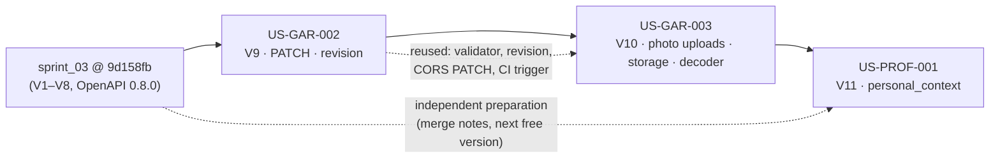

# Sprint 3 Backend Implementation Guides

| Field | Value |
| --- | --- |
| Sprint | Sprint 3: trustworthy and recognizable private wardrobe, declared personal context |
| Sprint Goal | Enable users to build a more trustworthy and recognizable private wardrobe by correcting accepted garment information, confirming photo-supported additions, and declaring personal style and common needs. |
| Stories | US-GAR-002, US-GAR-003, US-PROF-001 (exactly these three; US-MEAS-001 is removed from Sprint 3) |
| Plan | [Sprint 3 plan](../sprint-plan.md) v0.3: 21-entry decision register, **all 21 approved** by the Product Owner |
| Detailed choices | The 16 detailed choices OPEN-S3-01–16 in the [decision record](open-questions.md) were **approved by the Product Owner on 2026-11-11**. Their implementation and verification are still pending |
| Baseline inspected | Branch `sprint_03`, commit `9d158fb`, clean working tree |
| Package status | Documentation only. **No code in this package has been compiled, run, tested or deployed.** |

## 1. Purpose of this package

These guides turn the approved Sprint 3 decisions into concrete, step-by-step backend instructions for the developer, who implements them manually. Each guide gives:

- verbatim requirements;
- the engineering interpretation;
- the just-in-time design;
- complete proposed code, migrations and tests;
- commands and manual checks;
- the acceptance, requirement and DoD matrices.

The package does **not** change any Java, test, migration, OpenAPI, configuration, Docker, CI or requirement file. Every such change appears only inside these Markdown files as future work.

## 2. Verification status — read this first

| Item | Status |
| --- | --- |
| Proposed Java, SQL, YAML and properties | **Not compiled or executed.** They were written against the inspected baseline files (exact class, method and anchor text) and reviewed by reading, not by a build. Expect to fix small compile issues while applying them. |
| Library facts the design depends on | Checked read-only. **Jackson 3.1.5** (local Maven cache, by bytecode): an absent `JsonNode` creator property is `null` and an explicit JSON `null` is a `NullNode`; `isString()`, `stringValue()`, `properties()`, `isIntegralNumber()` and `canConvertToInt()` exist. **AWS SDK v2**: `PutObjectRequest.ifNoneMatch` returns `412` when the key exists; timeouts are off by default. **libheif** (upstream sources read on 2026-11-11): `heif-dec` decodes all top-level images in libheif's top-level order, numbering several outputs from 1. It applies transforms by default, writes no EXIF/XMP unless asked, and keeps security limits unless `--disable-limits`. `heif-info` lists the same top-level images and marks the primary one with `, primary`. libheif keeps file order and does not move the primary image first. `heif-enc` makes its first input primary. **MinIO**: community images stopped in October 2025. **Adobe S3Mock 5.1.0**: published June 2026. |
| Facts still requiring verification | The HEIF toolchain on the target OS and CI, including the primary-image mapping (OPEN-S3-08/11, V1–V8). S3Mock and AWS behaviour (OPEN-S3-13, V-S3). Decoder resource ceilings (OPEN-S3-12). Approval of a choice does not verify it. |
| Test counts in CI steps | They equal the `@Test` methods written in each guide; they are not results |
| Fabricated evidence | None. No stage commit hashes, test results or deployments are claimed. |

## 3. Repository baseline

The full baseline is in [shared architecture §2](shared-architecture.md#2-repository-baseline). In short:

- **Stack:** Java 21, Spring Boot 4.1.1, Spring Security 7, `JdbcClient`, Flyway, PostgreSQL 17.11, Testcontainers 2, Jackson 3.
- **Migrations:** V1–V8 (next free: V9). OpenAPI 0.8.0.
- **Modules:** Identity and Wardrobe implemented; `personalcontext` is a skeleton.
- **CI:** 69 required reports; PR triggers cover `main` and `sprint_02` only.
- **Compose:** no object storage and no HEIF decoder exist.

## 4. Selected stories

| Story | Outcome | Guide | Main changes |
| --- | --- | --- | --- |
| [US-GAR-002](../../../stories/garment/US-GAR-002-correct-and-enrich-garment-information.md) | Confirmed, presence-aware edits of current owned garments with optimistic revisions | [US-GAR-002-guide.md](US-GAR-002-guide.md) | V9 `revision`; `PATCH /garments/{id}`; shared validator; `409 REVISION_CONFLICT`; OpenAPI 0.9.0 |
| [US-GAR-003](../../../stories/garment/US-GAR-003-add-photo-supported-garment.md) | One private photo, staged and then attached by an explicitly confirmed new garment | [US-GAR-003-guide.md](US-GAR-003-guide.md) | V10 photo lifecycle table; S3 storage adapter; bounded decoder (ImageIO + libheif); `/photo-uploads`; `photoUploadId` on creation; cleanup job; OpenAPI 0.10.0 |
| [US-PROF-001](../../../stories/profile/US-PROF-001-set-and-revise-style-and-common-needs.md) | Private declared profile styles and common-need priorities | [US-PROF-001-guide.md](US-PROF-001-guide.md) | V11 `personal_context` schema; `GET`/`PATCH /personal-context/preferences`; `personalcontext.api.CurrentPersonalContext`; OpenAPI 0.11.0 |

## 5. Implementation order

**Recommended order: US-GAR-002 → US-GAR-003 → US-PROF-001** (Sprint 3 plan §7.2).

1. **US-GAR-002** first. It establishes the revision model, the shared profile validator, the PATCH convention, the operation-neutral 503 text, the `sprint_03` CI trigger and CORS `PATCH`. US-GAR-003 builds on those files.
2. **US-GAR-003** second. It reuses creation idempotency and the validator, and extends `Garment`, `GarmentResponse` and the controller cumulatively.
3. **US-PROF-001** last, though it is **independently preparable**. It has no code dependency on either garment story; only cumulative shared files overlap (CORS `PATCH`, OpenAPI version, CI list, README, migration number). The guide's §11 merge notes cover preparing it first or in parallel.

The guides are **cumulative**:

- each `[MODIFY]` BEFORE anchor matches the file as the previous guide leaves it;
- the cumulative order and merge rules for every shared file are in [shared architecture §21](shared-architecture.md#21-shared-file-ownership-and-cumulative-order);
- Flyway versions follow the real next free version at implementation time ([§13](shared-architecture.md#13-flyway-migration-plan)).

## 6. Dependency graph

Solid arrows are the recommended cumulative order. Dotted arrows show useful reuse and the independent PROF path. No hard backlog dependency between the three stories is invented.

## 7. How to read a story guide

Every story guide has the same 18 sections:

1. Story overview
2. Repository baseline
3. Business requirements (verbatim)
4. Product requirements (verbatim)
5. Software requirements (verbatim)
6. Business rules (verbatim)
7. User story and acceptance criteria (verbatim)
8. Use cases, flows and architecture decisions (verbatim)
9. Engineering interpretation
10. Just-in-time design: diagrams, API, SQL, transactions, concurrency, security, recovery, configuration, testing
11. File change matrix (Order · Action · Exact Repository Path · Purpose · Dependencies)
12. Production steps `Step Pn — [ADD|MODIFY] file`: full code or BEFORE/AFTER anchors, explanation, database implications, common mistakes, verification
13. Test steps `Step Tn`: complete test code and Maven Wrapper commands
14. Manual verification (PowerShell 5.1 / `curl.exe`)
15. AC and requirement-to-test matrices
16. Definition of Done
17. Troubleshooting
18. Final checklist

Labels (`[ADD]`, `[MODIFY]`, BEFORE/AFTER, `OPEN-S3-xx`, `S3-…`) are defined in [shared architecture §4](shared-architecture.md#4-labels-and-conventions-used-in-the-guides).

## 8. Decisions and approved detailed choices

**Plan decisions approved by the Product Owner on 2026-11-11** (applied, never reopened):

| Story | Decisions |
| --- | --- |
| US-GAR-002 | S3-GAR-01 presence-aware PATCH · S3-GAR-02 optimistic revision · S3-GAR-03 explicit correction/clearing · S3-GAR-04 reread and original-revision retry · S3-GAR-05 shared validation and atomic transaction |
| US-GAR-003 | S3-IMG-01 local S3-compatible + managed S3 (strategy only) · S3-IMG-02 application-proxied multipart · S3-IMG-03 stage then confirm · S3-IMG-04 durable pending coordination · S3-IMG-05 application streaming · S3-IMG-06 bounded decoder (**investigation direction only**) · S3-IMG-07 new garments only · S3-IMG-08 recoverable lifecycle (**TTL not selected**) |
| US-PROF-001 | S3-PROF-01 Personal Context owns persistence · S3-PROF-02 unset, canonical, explicit zero · S3-PROF-03 presence-aware revision · S3-PROF-04 optimistic revision + guarded create · S3-PROF-05 minimal published context |
| All three | S3-INT-01 compatible API evolution and one recovery vocabulary · S3-INT-02 isolated integration evidence plus real-provider checks · S3-INT-03 story guides with shared-file coordination (reconciled with the implementation during execution) |

**The 16 detailed choices ([decision record](open-questions.md)) were approved by the Product Owner on 2026-11-11.** Each guide labels the code that implements a choice with its `OPEN-S3-xx` ID. Approval authorizes the direction. It does not show that the code compiles, that the tests pass or that a technology works in the deployment environment.

| Approved choice | IDs | Implementation / verification still pending |
| --- | --- | --- |
| Contracts: compatible evolution, opaque `revision` + `expectedRevision` + `409`, `application/json` presence rules with whole-Price replacement, no-op keeps the revision, `/photo-uploads` + `photoUploadId`, `/personal-context/preferences` with six need codes and `revision: null` | OPEN-S3-01, 04, 05, 06, 14, 15 | Implementation and the tests in each guide; client evidence |
| Policy: 24-hour pending TTL (`PT24H`, configurable); 15,000,000 bytes; metadata-free JPEG ≤ 2048 px, original not kept | OPEN-S3-07, 09, 10 | Implementation and tests |
| Multi-image HEIF: the **primary** image is the target; explicit `PHOTO_MULTIPLE_IMAGES` rejection is the temporary fail-closed fallback | OPEN-S3-11 | V4/V8 on the deployment image and CI, then `heif-primary-image-selection=true`; until then only the fallback ships |
| Technology: libheif `heif-info` + `heif-dec` subprocess with ImageIO; ceilings 250 MP / 20 s / 2 decodes; AWS SDK 2.46.13 + S3Mock 5.1.0 | OPEN-S3-08, 12, 13 | V1–V8, measurements on the deployment size, V-S3 against S3Mock and private AWS S3 |
| Process and evidence: isolated Testcontainers + S3Mock + libheif in CI, `sprint_03` trigger; this guide package; minimal `CurrentPersonalContext` now | OPEN-S3-02, 03, 16 | CI runs; guides reconciled with the implementation; architecture tests for the published contract |

The per-item statuses and the traceability matrix are in the [summary register](open-questions.md#2-summary-register) and [§3 of the decision record](open-questions.md#3-coverage-and-traceability-matrix).

## 9. Prerequisites for implementing

- **Toolchain:** Windows PowerShell 5.1, the Maven Wrapper (`.\mvnw.cmd`), Docker Desktop for Testcontainers and Compose, JDK 21.
- **Local configuration:** a private `.env` with the PostgreSQL variables. The guides never read or print it.
- **For US-GAR-003:**
  - the S3Mock Compose service (added by the guide);
  - libheif with the libde265 plugin for HEIC: Ubuntu packages, or MSYS2 on Windows;
  - `heif-enc` (x265 plugin) to generate HEIC test fixtures.
- **For real-provider evidence:** a private AWS S3 test bucket and least-privilege credentials kept outside the repository. This is **not** available in the repository.

## 10. Per-story workflow

1. Re-check the starting point: `git status --short` and `git log -1`. Confirm the previous guide's changes are present, or use the merge notes.
2. Re-check the [decision record](open-questions.md). The approved choices are not reopened; if the PO later revises one, apply its "change impact" first.
3. Apply the production steps in order, then the test steps. Run focused tests after each logical group.
4. Run `.\mvnw.cmd clean verify` and inspect the reports: none missing, failed or skipped.
5. Run the manual script (§14 of the guide) against the `local` profile.
6. Update the README, OpenAPI and CI as the guide specifies. Open a PR against `sprint_03`.
7. Collect the outstanding external evidence before claiming Done: client evidence and, for US-GAR-003, the HEIF and real-provider verification.

## 11. Expected state after each story

| After | Migrations | OpenAPI | CORS methods | CI required reports | New endpoints |
| --- | --- | --- | --- | --- | --- |
| Baseline | V1–V8 | 0.8.0 | GET, POST | 69 | — |
| US-GAR-002 | + V9 | 0.9.0 | + PATCH | 75 | `PATCH /api/v1/wardrobe/garments/{id}` |
| US-GAR-003 | + V10 | 0.10.0 | + DELETE | 88 | `/api/v1/wardrobe/photo-uploads` (POST, GET, GET content, DELETE); `GET /garments/{id}/photo` |
| US-PROF-001 | + V11 | 0.11.0 | (PATCH) | 95 | `GET`/`PATCH /api/v1/personal-context/preferences` |

These are planned states, not observed ones.

## 12. Continuous integration

- **Trigger.** US-GAR-002 adds `sprint_03` to the PR trigger (S3-INT-02 / OPEN-S3-02, approved), so PRs into the sprint branch run the full verification.
- **HEIF in CI.** US-GAR-003 installs libheif on the runner and sets `CAPSULEAI_REQUIRE_HEIF=true`. A missing decoder then fails the build instead of skipping `HeifDecodingIT`. Its primary-image tests are the automated part of V4/V8 on the runner.
- **Required reports.** The guard keeps requiring zero skips. Counts only grow; never lower a count to make a build pass.

## 13. Branching and pull requests

These guides do not commit, push, merge or open PRs. When implementing:

- use a scoped branch from `sprint_03`;
- stage explicit paths;
- never stage `.env`, `target/` output, credentials or photos;
- open the PR against `sprint_03`, linking the story and the OPEN-S3 IDs it relies on.

## 14. Known limitations and outstanding external evidence

- **Client evidence** is outstanding for all three stories:
  - review, clear, cancel, conflict and uncertainty UI;
  - camera and library permissions, preview and replace;
  - onboarding skip and return;
  - localization and accessibility.
- **Real AWS S3 behaviour** (account, region, budget, deployment, conditional writes) is not established; an emulator pass is protocol evidence only.
- **HEIF** on the target OS, CI and real devices is not verified (V1–V8).
- **Multi-image HEIF.** The approved target is the primary image (OPEN-S3-11). It is implemented behind `capsuleai.wardrobe.photo.heif-primary-image-selection`, which stays `false` until V4/V8 pass. Until then such files are rejected explicitly, and the target capability is **not** Done.
- **Decoder ceilings** (250 MP, 20 s, 2 decodes) are approved safety bounds, but they have not been measured on the deployment size (OPEN-S3-12).
- **Garment removal and the 30-day physical deletion of removed-garment photos** are not selected (US-GAR-005). The `DISCARDED` lifecycle can be reused then.
- **Database roles.** A single database role still serves every schema; ownership is enforced by tests, not privileges.
- **Measurement.** No measurement producer, event or table exists (US-MEAS-001 removed).

## 15. Package contents

| File | Purpose |
| --- | --- |
| [README.md](README.md) | This overview |
| [shared-architecture.md](shared-architecture.md) | Cross-story conventions: modules, revisions, presence rules, errors, API catalogue, Flyway plan, data model, transactions, idempotency, media lifecycle, Personal Context, configuration, security, cumulative file order, testing |
| [open-questions.md](open-questions.md) | Decision record of the 16 detailed choices (OPEN-S3-01 to OPEN-S3-16), all approved on 2026-11-11. It keeps the options, the approved option, the remaining verification, the change impact and the traceability matrix. The file name is kept for stable links |
| [US-GAR-002-guide.md](US-GAR-002-guide.md) | Garment editing |
| [US-GAR-003-guide.md](US-GAR-003-guide.md) | Photo-supported garment creation |
| [US-PROF-001-guide.md](US-PROF-001-guide.md) | Styles and common needs |

## 16. Authoritative sources

- [Sprint 3 plan](../sprint-plan.md): decisions §9, register §13, DoD §11.
- [Product Backlog](../../../product-backlog.md) and [stories](../../../stories/README.md).
- [BRD](../../../../01-business/BRD.md), [PRD](../../../../02-product/PRD.md), [SRS](../../../../03-requirements/SRS.md), [Business Rules](../../../../03-requirements/business-rules.md).
- [Garment property authority](../../../../../Initial%20files/Image%20to%20Properties%20Extraction.md) and [delivery decisions](../../../delivery-decisions.md).
- [Selected architecture decisions](../../../../04-architecture/selected-architecture-decisions.md) (ADA-001–018, AR-01–08) and [backend conventions](../../../../engineering/backend-conventions.md).
- [Definition of Done](../../../definition-of-done.md) and [Test Strategy](../../../../07-testing/test-strategy.md).
- The living code, `docs/05-api/openapi.yaml` and the Flyway migrations win over any guide text once a story is implemented (OPEN-S3-03).

## 17. Final package checklist

- [x] Exactly six Markdown files in `implementation-guides/`; nothing else created or modified.
- [x] The three selected stories covered; US-MEAS-001 excluded.
- [x] All 21 approved plan decisions applied, including S3-INT-01–03.
- [x] All 16 detailed choices recorded as approved on 2026-11-11, each labelled with its `OPEN-S3-xx` ID, with the implementation and verification status kept separate.
- [x] The approved pending TTL (`PT24H`) is a configurable default.
- [x] The HEIF toolchain is concrete (libheif `heif-info` + `heif-dec` + libde265), with verification procedure V1–V8, marked "verification required".
- [x] Multi-image HEIF: primary-image selection is designed, coded and tested; the explicit rejection is marked as the temporary fallback until V4/V8 pass.
- [x] Guides are cumulative, with BEFORE anchors from the previous stage. Flyway V9/V10/V11 follow the real next version and schema ownership. No fabricated commit hashes.
- [x] Proposed code is disclosed as not compiled or executed.
