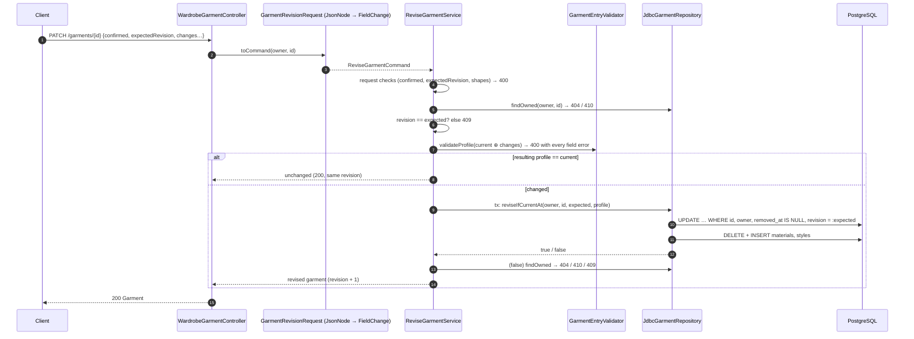

# US-GAR-002 — Correct and Enrich Authoritative Garment Information: Implementation Guide

| Field | Value |
| --- | --- |
| Story | [US-GAR-002](../../../stories/garment/US-GAR-002-correct-and-enrich-garment-information.md) (Draft v0.4), parent PBI-008 |
| Sprint | Sprint 3, story 1 of 3 (recommended order GAR-002 → GAR-003 → PROF-001) |
| Starting point | `sprint_03` @ `9d158fb`, clean tree |
| Approved decisions applied | S3-GAR-01, S3-GAR-02, S3-GAR-03, S3-GAR-04, S3-GAR-05 |
| Provisional choices used | OPEN-S3-01 (API evolution), OPEN-S3-02 (CI trigger), OPEN-S3-04 (revision token in body, `409`), OPEN-S3-05 (`application/json` presence rules), OPEN-S3-06 (no-op keeps revision): see [open questions](open-questions.md) |
| Verification status | **Not compiled, not run, not tested.** Every code block is a proposed future change written against the inspected baseline. See §16 and [README §2](README.md#2-verification-status--read-this-first). |
| Shared rules | [shared-architecture.md](shared-architecture.md) §8 (revisions), §10 (presence-aware PATCH), §11 (errors), §21 (cumulative file order) |

## 1. Story Overview

**Story.** As an authenticated owner, I want to review, enrich and explicitly confirm supported garment information, so that my wardrobe and advice reflect trustworthy descriptions.

**Backend outcome.** A new operation applies an explicitly confirmed edit to an existing current garment that the caller owns:

```text
PATCH /api/v1/wardrobe/garments/{garmentId}
```

- **Partial edit.** Omitted properties stay untouched; explicit `null` clears an optional value.
- **Validation.** The complete resulting profile is validated with the same rules as creation.
- **Concurrency.** A stale edit is refused through an optimistic revision.
- **Atomicity.** Scalar values, Materials and Styles change together in one Wardrobe transaction.
- **Rereading.** The accepted profile is returned and remains readable through the existing detail and overview routes.

**What this story does not do:**

- no recommendation readiness (`recommendationEligibility` stays `NOT_EVALUATED`);
- no photo replacement or attachment;
- no garment removal endpoint;
- no AI reanalysis;
- no edit history;
- no recommendation, Coverage or Multiplier invalidation engine. AC-06 is satisfied by "detail uses the new profile"; future consumers use the revision.

## 2. Repository Baseline

| Item | State at `9d158fb` | Relevance |
| --- | --- | --- |
| `Garment` | Record `(id, ownerAccountId, profile, provenance, createdAt, removedAt)`; no revision | Gains `revision` |
| `GarmentProfile` | 13 properties; enforces category applicability; Materials/Styles as catalogue-ordered sets | Reused unchanged |
| `GarmentEntryValidator` | Package-private; `validate(AddGarmentCommand)` collects every field problem; 117 tests in `GarmentEntryValidatorTest` | Refactored so the profile part is shared, with **identical** creation behaviour |
| `GarmentRepository` | `addIfCreationKeyUnused`, `findCreation`, `findCurrentByOwner`, `findOwned` | Gains `reviseIfCurrentAt` |
| Implementations of `GarmentRepository` | `JdbcGarmentRepository` (main), `InMemoryGarmentRepository` and `WardrobeFailureIT.FailingGarmentRepository` (tests) | All three must implement the new method, or the test sources stop compiling |
| `WardrobeGarmentController` | `POST`, `GET`, `GET /{garmentId}` | Gains `PATCH /{garmentId}` |
| `WardrobeApiExceptionHandler` | 400/404/410/422/503; the 503 detail promises creation idempotency only | + `409 REVISION_CONFLICT`; operation-neutral 503 (OPEN-S3-01) |
| V8 | `wardrobe.wardrobe_garment` without a revision | V9 adds `revision` |
| CORS | `GET, POST` only; `CorsSecurityIT` asserts that a `PATCH` preflight is refused | Adds `PATCH`; the test changes |
| OpenAPI | 0.8.0 | → 0.9.0 |
| CI | PR triggers `main`, `sprint_02`; 69 required reports | + `sprint_03`; + GAR-002 reports |

## 3. Original Business Requirements — Verbatim

From [BRD](../../../../01-business/BRD.md) (story traceability: BR-003, BR-002, CAP-04):

| ID | Requirement | Rationale | Priority | Goal |
| --- | --- | --- | --- | --- |
| BR-002 | Users must retain final authority over garment information through review, confirmation, correction, and manual entry, with prediction confidence and provenance distinguished conceptually. | Reliable advice depends on trusted wardrobe information. | Must | BG-01, BG-02, BG-03, BG-04 |
| BR-003 | Wardrobe understanding must support exactly the 13 approved properties and category applicability in Section 13.2, including optional multiple Materials and Styles, Brand and original purchase Price with explicit currency, without an image or recommendation gate. | Styling and utility assessment need richer context than basic tags. | Must | BG-01, BG-02, BG-03, BG-04 |

| Capability | Name | Description |
| --- | --- | --- |
| CAP-04 | Garment Intelligence | Describe garment characteristics sufficiently to support styling, coverage, and purchase evaluation. |

## 4. Original Product Requirements — Verbatim

From [PRD](../../../../02-product/PRD.md) §8.3:

> ### 8.3 JRN-03 — Wardrobe Management
>
> **Intent:** Keep the product aligned with what the user currently owns.
>
> 1. The user browses garment cards or searches/filters the wardrobe.
> 2. Garment detail presents confirmed information and recorded utilization without implying observed physical wear.
> 3. The user edits inaccurate or changed information and confirms the revision.
> 4. The user can remove a garment through an explicit, understandable removal action.
> 5. Subsequent recommendations and assessments reflect the current confirmed wardrobe; removed garments cannot remain selectable as owned items.
>
> **Recovery:** Empty wardrobes prompt Add Garment; no search results offer changes to the search/filter; failed edits/removals retain a clear unconfirmed state and retry. Historical Wear Events/outfit records preserve understandable snapshots, labeling a removed garment "Removed from wardrobe" rather than treating it as currently owned. **Features:** FEAT-WAR-001–FEAT-WAR-003, FEAT-ANL-001.

From PRD §14.2 (FEAT-WAR-002):

> **Purpose:** Keep wardrobe-based advice aligned with current possessions and corrections.
>
> **User value:** Inaccurate entries and garments no longer owned do not distort current recommendations.
>
> **Product behavior:**
>
> 1. Allow supported profile information to be edited and explicitly confirmed.
> 2. Explain garment removal and require a deliberate confirmation before applying it.
> 3. After a successful change, current wardrobe displays use the new state.
> 4. Refresh or clearly require reevaluation of affected recommendations, coverage, and multiplier estimates.
>
> **User controls:** Edit, confirm/cancel edits, confirm/cancel removal. **Product states:** Viewing, editing, confirmation pending, updating/removing, complete, failed.
>
> **Failure / fallback:** Do not claim a change succeeded if it did not. Preserve useful entered work where practical and offer retry; keep unresolved changes distinct from the authoritative current state.
>
> - **AC-01:** A confirmed profile edit appears in detail and subsequently evaluated advice.
> - **AC-02:** Canceling an edit/removal leaves the confirmed garment unchanged.

Removal items 2, 5 and 6 and AC-03/AC-04 belong to US-GAR-005 and are not reproduced.

From PRD §13.1 (FEAT-GAR-001), product behaviour paragraph:

> **Product behavior:** Manual entry offers all applicable properties during Sprint 2. Review validates supplied values and category applicability, permits optional omissions, and explicitly confirms the accepted information. Preserve all accepted values through persistence and inspection. Unsupported/inapplicable values require correction or clearing; no silent substitution, fabricated value or additional property is allowed. Optional images and future AI suggestions stay separate from the confirmed profile.

JRN-02 (garment digitization) is traced by the story for its shared confirmation meaning only. Its step 5 reads:

> 5. With confirmed Category and one approved Color, save while omitting optional fields and preserving all supplied applicable values. Recommendation eligibility is not evaluated.

## 5. Original Software Requirements — Verbatim

From [SRS](../../../../03-requirements/SRS.md):

| ID | Requirement | Verification |
| --- | --- | --- |
| FR-WAR-003 | The system shall allow explicit confirmation/cancellation of supported garment-profile edits. | T: edit/confirm/cancel. |
| FR-WAR-006 | The system shall refresh or mark affected prior advice for reevaluation after relevant edits/removal. | T: affected assessment state. |
| FR-GAR-001 | The system shall support primary classification limited to TOPS, DRESSES_JUMPSUITS, PANTS, SKIRTS, OUTERWEAR, SHOES, BAGS, HEADWEAR. | T: defined categories only. |
| FR-GAR-002 | The system shall support every approved category-specific Subtype in the source authority, validate parent association and allow omission without invented fallback values or silent replacement. | T: defined vocabularies and subtype fallback saving. |
| FR-GAR-003 | The system shall accept a garment with a supported Category, one supported dominant Color and explicit user confirmation, without requiring any other property, image, successful AI analysis or recommendation-eligibility gate. | T: minimum-only profile. |
| FR-GAR-006 | The system shall keep all properties except Category and Color optional for saving, enforce category applicability on supplied values and preserve valid accepted optional information without fabricating missing values. | T: every optional omission and supplied-value/applicability case. |
| FR-GAR-007 | The system shall support optional Fit, Neckline and Sleeve Length only for Tops, category-specific Length only for Tops/Pants, and Silhouette only for Pants, using exact approved lists and correcting or clearing inapplicable supplied fields. | T/I: every approved category-specific detail/value and inapplicable input. |
| FR-GAR-008 | The system shall require exactly one dominant Color from the complete approved list, including Colorful, without secondary-color or coordinate extensions. | T: all approved single Colors; no extra color property. |
| FR-GAR-010 | The system shall support zero, one or multiple distinct approved Material values per garment, avoiding duplicate semantic selections and fabricated percentages, proportions or verified-composition claims. | T: uncertain material case. |
| FR-GAR-011 | The system shall make user-confirmed/corrected/entered values authoritative and prevent later automated output from silently replacing them. | T: analysis after correction. |
| DATA-GAR-005 | The system shall represent active/removed ownership independently from missing optional properties and unevaluated recommendation eligibility, without a readiness/compatibility gate or a physical schema prescribed by this SRS; preserve the implemented API's `NOT_EVALUATED` result. | T/I |
| DATA-INT-001 | The system shall prevent an AI proposal or later analysis from silently superseding a confirmed/corrected garment value. | T: authority preservation. |
| ERR-GAR-001 | Save attempted without the saveable minimum. → The system shall explain missing confirmed Primary Category or Dominant Color and retain the draft for correction rather than save it as an authoritative garment. Recovery: User supplies/changes the missing information; existing garments remain unchanged. | T: each minimum value missing. |
| COM-002 | The system shall distinguish interrupted communication from accepted save, access/recovery or Wear action outcomes, applying Section 9 recovery without false completion or duplicated logical actions. | T: interrupted save/reset/refresh/Wear actions and outcome review. |

FR-GAR-004, FR-GAR-009, FR-GAR-012, FR-GAR-013, DATA-GAR-002 and DATA-GAR-003 are also traced. Their text is long and is already quoted in full in the Sprint 2 US-GAR-001 guide §5. The excerpts that matter here are:

- **FR-GAR-009:** "one optional Pattern and zero, one or multiple distinct approved Style values per garment … without … accepting Etc".
- **FR-GAR-012:** "Brand text of at most 100 Unicode code points … treat a blank value as unspecified, preserve accepted nonblank text exactly … for inspection and future editing".
- **FR-GAR-013:** "Price … exact decimal monetary amount with an explicit valid upper-case ISO 4217 currency code … preserve it for inspection and future editing … Zero is a valid known amount distinct from a missing Price".

FR-GAR-005 is superseded.

## 6. Original Business Rules — Verbatim

From [Business Rules](../../../../03-requirements/business-rules.md):

> **BRULE-GAR-001 — Canonical Garment Authority.** Each owned garment belongs to the authorized user's wardrobe. Automated attribute proposals are not authoritative. Applicable User Confirmed, User Corrected, or User Entered-and-confirmed values establish the canonical profile; later automated analysis cannot silently overwrite them.

> **BRULE-GAR-002 — Saveable Minimum.** A garment is Saveable when the user explicitly confirms its supported Primary Category and Dominant Color. Manual creation requires neither an image nor successful analysis. Missing optional rich descriptors do not prevent saving; canceled or unconfirmed work does not establish a confirmed wardrobe entry.

> **BRULE-GAR-004 — Controlled Classification and Context Vocabularies.** Category is one of the eight approved codes. Every supplied optional Subtype must belong to that Category and its complete approved source list; missing Subtype is valid. No invented fallback or silent replacement is permitted. MINI_DRESS and other overlapping names remain subtypes without automatic derivation. All Bags/Headwear choices are approved, not pending research.

> **BRULE-GAR-005 — Bounded Garment Descriptors.** Exactly 13 fashion properties are approved: Category, Subtype, Color, Material, Pattern, Style, Fit, Neckline, Sleeve Length, Length, Silhouette, Brand, Price. Category and one dominant Color plus explicit user confirmation form the saving minimum. All other applicable properties are optional. Material and Style each support zero or multiple distinct selections; Pattern is single and optional. Fit, Neckline and Sleeve Length apply only to Tops; Length uses separate Tops/Pants vocabularies; Silhouette applies only to Pants. Every supplied controlled value must match the source vocabulary and category; correct or clear invalid/inapplicable input rather than silently substitute or discard it. Unknown optional information is absent, not an invented UNKNOWN/OTHER/Etc value. Preserve real listed fallbacks such as Other, Other Materials and Colorful only where defined.

> **BRULE-GAR-006 — Descriptor Consistency and Unknown Information.** Unknown optional information remains absent rather than an invented value. Material selections form distinct semantic values, without percentages/proportions. Color is one approved dominant value; Pattern is one optional value; Style, like Material, is an optional set of distinct values. Validate applicability and supplied labels before confirmation; correct/clear invalid or inapplicable fields without silent substitution or discard. No cross-property inference is approved merely because a subtype overlaps length, style or occasion. Etc is not a Style value. Removed descriptors cannot be reconstructed as hidden fields or readiness gates.

> **BRULE-GAR-009 — Accepted Edits and Removal.** Only accepted edits/removal change current garment state; canceled, failed, or pending work must not be represented as accepted. Removal excludes the garment from new current outfits, current Coverage, and the current Multiplier baseline. Relevant accepted changes require refresh or an outdated indication for affected advice; historical meaning remains governed by BRULE-HIST-002. …

> **BRULE-GAR-010 — Optional Brand and Purchase Price Authority** (excerpt). … Future edits may revise or clear these properties with explicit user confirmation. … Brand has at most 100 Unicode code points, a blank Brand is unspecified, and accepted Brand text is kept exactly. A Price of zero is a known amount, not a missing one; negative amounts, more than 12 integer digits and more fractional digits than the currency's ISO 4217 minor unit are rejected, never rounded; the currency is a valid upper-case ISO 4217 code. Nothing is defaulted or silently altered.

BRULE-GAR-003 (revised) and BRULE-GAR-008 are also traced:

- **BRULE-GAR-003:** "Recommendation eligibility has not been evaluated … Preserve the implemented Sprint 2 `recommendationEligibility: NOT_EVALUATED` response."
- **BRULE-GAR-008:** provenance is distinct from confidence; User Entered values become authoritative through confirmation.

## 7. Original User Story and Acceptance Criteria — Verbatim

> As an authenticated owner, I want to review, enrich and explicitly confirm supported garment information, so that my wardrobe and advice reflect trustworthy descriptions.

> **AC-01 — Review bounded information.** Present accepted/proposed/missing information distinctly and support all applicable approved properties for correction or clearing, using the complete source lists: Category, Subtype, one Color, distinct Materials, Pattern, distinct Styles, category-specific details, Brand and purchase Price.
> The optional-property and classification rules in Section 3 apply to this accepted outcome, including preservation of valid supplied values and correction/clearing of invalid category/subtype or incomplete Price pairs.

> **AC-02 — Apply supported consistency.** Reject unsupported or inapplicable values without changing accepted information. Use the complete source lists, require one approved Color, preserve distinct Materials and Styles, and never silently substitute a value or accept Etc as Style.

> **AC-03 — Preserve saving validity and unevaluated eligibility.** Confirmed Category and one Color remain the saving minimum. Other applicable values are optional. An accepted edit can revise or clear optional values and revalidate category-specific applicability without executing a readiness gate, claiming suitability or reintroducing removed properties.

> **AC-04 — Preserve uncertainty.** Unknown properties stay absent unless the user explicitly supplies/accepts supported information; no automatic cross-property derivation is approved. Material can be corrected or left unknown without a verified composition/durability claim; derivation cannot silently replace user-confirmed values.

> **AC-05 — Confirm or cancel.** Explicit confirmation establishes the revised authoritative profile; recommendation eligibility remains not evaluated. Cancellation or a known rejected/failed edit retains the prior accepted profile; later AI output cannot silently overwrite confirmed corrections.

> **AC-06 — Refresh dependent meaning.** After a relevant accepted revision, detail uses the new profile and affected outfit/Coverage/Multiplier advice is refreshed or marked outdated. Failed reassessment does not make old advice current.

> **AC-07 — Resolve uncertain acceptance.** If communication leaves acceptance uncertain, show an unconfirmed outcome and allow review before safe retry, preserving useful entered work where practical. Do not claim either saved or definitely unchanged state solely from the interrupted response.

> **AC-08 — Protect the selected item.** An expired/revoked or wrong-account request cannot inspect/edit another user's garment. A changed/removed selection is explained without editing another item or restoring historical ownership.

Story §8 Out of Scope: "Initial manual creation supporting all 13 applicable properties is US-GAR-001; photo/AI routes are US-GAR-003/004; removal is US-GAR-005. No new descriptors, universal completeness requirement or recommendation algorithm is added."

## 8. Original Use Cases, Flows and Architecture Decisions — Verbatim

From [UC-009](../../../../03-requirements/use-cases/UC-009-edit-garment.md) §6 Main Success Scenario:

> 1. The User requests editing for the selected garment.
> 2. CapsuleAI presents its accepted profile and supported editable information, with relevant unknown/uncertain states.
> 3. The User revises intended values using the supported vocabularies, including all applicable source-approved properties and multiple distinct Materials, or clears optional information. A category change requires correction or clearing of an incompatible subtype. Price, if supplied, includes both decimal amount and explicit ISO 4217 currency; incomplete pairs return for correction before acceptance.
> 4. CapsuleAI presents the proposed revision and identifies missing required or incompatible values and eligibility under a future approved policy implications.
> 5. The User explicitly confirms the intended supported changes.
> 6. CapsuleAI acknowledges the accepted revision and shows the new authoritative accepted profile / unevaluated eligibility.
> 7. CapsuleAI refreshes affected advice/assessments or identifies them as requiring reevaluation rather than presenting prior results as current.

> **A1 — Leave optional descriptors unknown.** At Main Step 3: 1. The User changes only intended fields and leaves unknown optional Brand/Price/material/shape/color/context detail unknown. 2. Resume at Main Step 4; completing every rich descriptor is not required for a supported edit.
>
> **A2 — Add previously unknown optional information.** 1. The User supplies intended applicable properties from the approved source list. 2. CapsuleAI validates vocabulary/applicability and permits confirmation without requiring every optional field. 3. Accepted edits preserve user authority; eligibility is not evaluated and no compatibility descriptor is derived.
>
> **A3 — Cancel before acceptance.** At Main Step 5: 1. The User cancels the proposed edit. 2. CapsuleAI retains the previously accepted profile and dependent state.

> **E1 — Invalid or unconfirmed required information.** At Main Step 4: 1. CapsuleAI explains unsupported values, inconsistent descriptors or missing confirmed minimum information and does not accept the revision. 2. The User corrects the proposal and resumes at Main Step 3.
>
> **E2 — Edit failed or acceptance uncertain.** At Main Step 6: 1. CapsuleAI distinguishes known failure from unconfirmed acceptance, preserving useful entered work where practical. 2. The prior profile stays authoritative after known failure; the User reviews the actual outcome before retrying an uncertain update.
>
> **E3 — Garment is no longer current/authorized.** At Main Step 5: 1. CapsuleAI refuses an edit to information outside the User's current authorized ownership and explains the unavailable selection. 2. The User returns to current wardrobe inspection; no historical snapshot is silently restored as owned.
>
> **E4 — Authorized access becomes unusable.** At Main Step 1: 1. CapsuleAI pauses protected interaction if access expires, is revoked or is not authorized for the affected information, and explains the need to authenticate again. 2. The User can resume the appropriate goal after UC-002 establishes usable access. Protected information is not exposed or misrepresented as empty, and the interrupted request is not falsely reported as accepted.

> **§9 Success Postconditions.** Accepted revised values are canonical and cannot be silently replaced by later automated output. Current accepted profile / unevaluated eligibility reflects the accepted revision; affected recommendations, Coverage and Multiplier refresh or clearly become outdated.

Architecture and decisions:

- **ADA-003/009/015/016:** a Modular Monolith with database-coordinated logical actions and an owner transaction port; Wardrobe owns garment persistence.
- **AR-01–AR-08:** context-owned schemas.
- **The approved Sprint 3 decisions S3-GAR-01–05**, quoted in full in [Sprint 3 plan §9.1](../sprint-plan.md#91-us-gar-002-decisions). Their recommended options are:

| ID | Recommended solution (verbatim) | Status |
| --- | --- | --- |
| S3-GAR-01 | Option B — presence-aware PATCH of the editable garment profile, with explicit user confirmation. | APPROVED |
| S3-GAR-02 | Option B — optimistic concurrency using an opaque representation/revision token and atomic expected-revision acceptance. | APPROVED |
| S3-GAR-03 | Option B — require explicit correction or clearing of every resulting inapplicable value; a client may offer Option A as a visibly confirmed editing aid. | APPROVED |
| S3-GAR-04 | Option A — recover by authenticated reread and reuse the original expected revision for any uncertain retry; keep durable creation/confirmation idempotency. | APPROVED |
| S3-GAR-05 | Option A — shared domain/application validation plus appropriate database constraints, within one Wardrobe-owned transaction. | APPROVED |

## 9. Engineering Interpretation

| # | Interpretation | Source |
| --- | --- | --- |
| I-1 | "Explicit confirmation" is a required `confirmed: true` in the PATCH body, as in creation. `false` or a missing value changes nothing (`NOT_CONFIRMED` / `REQUIRED`). Cancellation is the client not sending the PATCH; the backend keeps the prior profile automatically. | AC-05, UC-009 A3, FR-WAR-003 |
| I-2 | Presence-aware semantics follow [shared architecture §10](shared-architecture.md#10-presence-aware-partial-updates). Category and Color can be replaced but not cleared. | S3-GAR-01, OPEN-S3-05 |
| I-3 | The service builds the **resulting** values (current accepted profile + changes) and validates them with the same validator as creation. Errors name the request field even if the user did not send it in this edit (for example the old `subtype` after a Category change). | S3-GAR-03, S3-GAR-05, BRULE-GAR-005/006 |
| I-4 | No cross-property derivation and no automatic clearing. A Category change that leaves an inapplicable `fit` is rejected with `fit: NOT_APPLICABLE` until the same edit sends `"fit": null`. | AC-04, BRULE-GAR-006 |
| I-5 | Revision: V9 column `revision` (≥ 1). Responses carry `"revision": "<n>"`; PATCH requires `expectedRevision`. A stale value gives `409 REVISION_CONFLICT`. The acceptance check is atomic in SQL. | S3-GAR-02, OPEN-S3-04 |
| I-6 | Uncertain outcome: no durable edit receipt. The client rereads. A retry with the original `expectedRevision` cannot apply twice. A `409` after an uncertain response is not proof of either outcome. | S3-GAR-04, AC-07, COM-002 |
| I-7 | An edit whose result equals the current profile (after a valid precondition) writes nothing and returns `200` with the same revision. | OPEN-S3-06 |
| I-8 | Ownership and currency: other owner, unknown id or malformed id → `404 GARMENT_NOT_FOUND`; own removed garment → `410 GARMENT_NO_LONGER_CURRENT`. Both are checked before the write and again atomically inside it (`removed_at IS NULL` in the UPDATE predicate). | AC-08, UC-009 E3 |
| I-9 | Identity, owner, creation time, creation key, creation fingerprint and provenance (`USER_ENTERED`) never change. Overview ordering (`created_at DESC, id DESC`) is therefore unchanged by edits. | S3-GAR-04, US-WAR-001 |
| I-10 | AC-06 in the backend: detail and overview reflect the new profile immediately, and the revision is the published "basis changed" signal. No outfit, Coverage or Multiplier results exist yet, so none are refreshed. | AC-06, plan §6.1 |
| I-11 | A creation replay (same `Idempotency-Key` and original values) after an edit returns `200` with the **current** garment. The original fingerprint is kept and never recomputed. | S3-GAR-04 |
| I-12 | Media: the PATCH body has no media field. After US-GAR-003, an attached photo is preserved by every edit. | S3-IMG-07 |

## 10. Just-in-Time Detailed Design

### 10.1 Component interaction



### 10.2 API contract

`PATCH /api/v1/wardrobe/garments/{garmentId}`, protected (bearer), `Content-Type: application/json`.

| Field | Type | Required | Semantics |
| --- | --- | --- | --- |
| `confirmed` | boolean | yes | Must be `true` |
| `expectedRevision` | string `^[1-9][0-9]{0,17}$` | yes | The `revision` last read; opaque |
| `category`, `color` | code string | no | Absent: keep. Code: replace. `null`: `REQUIRED` error |
| `subtype`, `pattern`, `fit`, `neckline`, `sleeveLength`, `length`, `silhouette` | code string or `null` | no | Absent: keep. `null`: clear. Code: replace |
| `materials`, `styles` | array of codes, `[]` or `null` | no | Absent: keep. `[]`/`null`: clear. Array: replace the set (duplicates collapse) |
| `brand` | string or `null` | no | Absent: keep. `null` or blank: clear. Text: exact replace (≤ 100 code points) |
| `price` | `{amount, currency}` or `null` | no | Absent: keep. `null`: clear. Object: replace the whole pair |

Example request:

```json
{
  "confirmed": true,
  "expectedRevision": "1",
  "category": "PANTS",
  "subtype": "JEANS",
  "fit": null,
  "silhouette": "WIDE_LEG",
  "materials": ["DENIM"],
  "price": { "amount": "0", "currency": "VND" }
}
```

Responses:

| Status | Body | When |
| --- | --- | --- |
| `200` | `Garment` with the new `revision` (unchanged when nothing changed) | Accepted |
| `400 VALIDATION_FAILED` | `fieldErrors` | Missing/false `confirmed`; missing/malformed `expectedRevision`; cleared Category/Color; unsupported, inapplicable or wrong-kind values; incomplete Price; Brand > 100 |
| `400 MALFORMED_REQUEST` | — | Not JSON |
| `401 AUTHENTICATION_REQUIRED` | — | No usable session |
| `404 GARMENT_NOT_FOUND` | — | Unknown, malformed or another account's id |
| `409 REVISION_CONFLICT` | — | Stale `expectedRevision` |
| `410 GARMENT_NO_LONGER_CURRENT` | — | Own removed garment |
| `503 TEMPORARILY_UNAVAILABLE` | — | Database unavailable; outcome not confirmed |

`Garment` (detail, creation and PATCH responses) gains `revision` (string, required).

### 10.3 SQL

V9 (complete in Step P1) adds:

```sql
revision BIGINT NOT NULL DEFAULT 1
CHECK (revision >= 1)
```

Acceptance statement (in `JdbcGarmentRepository.reviseIfCurrentAt`):

```sql
UPDATE wardrobe.wardrobe_garment
SET category = :category, subtype = :subtype, color = :color, pattern = :pattern,
    fit = :fit, neckline = :neckline, sleeve_length = :sleeveLength, length = :length,
    silhouette = :silhouette, brand = :brand, price_amount = :priceAmount,
    price_currency = :priceCurrency, revision = revision + 1
WHERE id = :garmentId AND owner_account_id = :ownerAccountId
  AND removed_at IS NULL AND revision = :expectedRevision
```

The update is followed, only when one row was updated, by:

```sql
DELETE FROM wardrobe.wardrobe_garment_material WHERE garment_id = :garmentId
DELETE FROM wardrobe.wardrobe_garment_style WHERE garment_id = :garmentId
```

and one `INSERT` per resulting Material and Style. All V8 CHECK constraints apply to the UPDATE, so the database independently refuses an inapplicable or invalid value (defence in depth, S3-GAR-05).

### 10.4 Transactions and concurrency

- **One `WardrobeTransactions.inTransaction`** holds the conditional UPDATE, the child-set replacement and, on failure, the diagnosis read. See [shared architecture §8](shared-architecture.md#8-revision-and-optimistic-concurrency) for the PostgreSQL re-evaluation behaviour that guarantees one winner.
- **Pre-check outside the transaction.** The pre-check read and validation run outside the transaction. The UPDATE predicate re-asserts every condition (owner, current, revision), so a change between the read and the write is still detected.
- **No lock across user interaction**, and no storage or network call inside the transaction.

### 10.5 Security

- The owner comes only from `@AuthenticationPrincipal`.
- The UPDATE always includes `owner_account_id = :ownerAccountId`.
- Other-owner and unknown ids are indistinguishable (`404`).
- No error body echoes submitted values.
- CORS gains `PATCH`; the allowed headers are unchanged because the revision travels in the body.

### 10.6 Recovery

| Situation | Server behaviour | Client behaviour |
| --- | --- | --- |
| `400` | Nothing changed | Keep the draft; correct or clear the named fields |
| `409` | Nothing changed | `GET` the garment, show the differences, let the user re-confirm with the new `revision`. **Never** resend automatically with the new token. |
| `503` or no response | Unknown | `GET` the garment. If it shows the intended values, treat the edit as accepted. If not, retry with the **original** `expectedRevision`: `409` means something else changed it; reread again. |
| `404` / `410` | Nothing changed | Return to the wardrobe |

### 10.7 Configuration

None. No new property is introduced.

### 10.8 Testing plan

| Level | Class | Focus |
| --- | --- | --- |
| Domain | `GarmentTest` | Revision invariants, `withRevisedProfile` |
| Application | `ReviseGarmentServiceTest` | Presence semantics, clearing, Category-change errors, Brand/Price rules, confirmation, revision, ownership, no-op, write-time refusal |
| Web mapping | `GarmentRevisionRequestTest` | Absent versus `null` versus wrong JSON kind (verifies the Jackson 3 assumption) |
| Schema | `GarmentRevisionSchemaIT` | V8 → V9 upgrade keeps rows at revision 1; CHECK constraint |
| API | `ReviseGarmentApiIT` | End-to-end through the real filter chain and PostgreSQL |
| Concurrency | `ConcurrentGarmentRevisionIT` | Competing edits, edit versus removal, rollback of scalars and sets |
| Failure | `WardrobeFailureIT` (+1) | Injected outage after the write → 503 and rollback |
| Security | `CorsSecurityIT` (modified) | PATCH preflight granted; PUT/DELETE still refused |
| Contract | `IdentityOpenApiContractIT` (unchanged code) | The new operation is documented, protected, and its required fields are enforced |

## 11. File Change Matrix

All paths are relative to the repository root. `…/wardrobe` = `backend/src/main/java/com/capsuleai/wardrobe`; `…/test/wardrobe` = `backend/src/test/java/com/capsuleai/wardrobe`.

| Order | Action | Exact Repository Path | Purpose | Dependencies |
| --- | --- | --- | --- | --- |
| P1 | ADD | `backend/src/main/resources/db/migration/V9__add_wardrobe_garment_revision.sql` | Revision column | V8 |
| P2 | MODIFY | `backend/src/main/java/com/capsuleai/wardrobe/domain/Garment.java` | `revision`, `withRevisedProfile` | — |
| P3 | MODIFY | `backend/src/main/java/com/capsuleai/wardrobe/domain/GarmentValueProblem.java` | Document `REQUIRED`/`INVALID_FORMAT` for revisions | — |
| P4 | ADD | `backend/src/main/java/com/capsuleai/wardrobe/application/GarmentValues.java` | Shared raw values | P2 |
| P5 | MODIFY | `backend/src/main/java/com/capsuleai/wardrobe/application/AddGarmentCommand.java` | `values()` | P4 |
| P6 | MODIFY | `backend/src/main/java/com/capsuleai/wardrobe/application/GarmentEntryValidator.java` | Shared `validateProfile` | P4, P5 |
| P7 | ADD | `backend/src/main/java/com/capsuleai/wardrobe/application/FieldChange.java` | Keep/Clear/Replace/Malformed | — |
| P8 | ADD | `backend/src/main/java/com/capsuleai/wardrobe/application/GarmentChanges.java` | The 13 property changes | P4, P7 |
| P9 | ADD | `backend/src/main/java/com/capsuleai/wardrobe/application/ReviseGarmentCommand.java` | Command | P8 |
| P10 | ADD | `backend/src/main/java/com/capsuleai/wardrobe/application/GarmentRevision.java` | Outcome | P2 |
| P11 | ADD | `backend/src/main/java/com/capsuleai/wardrobe/application/GarmentRevisionConflictException.java` | `409` | — |
| P12 | MODIFY | `backend/src/main/java/com/capsuleai/wardrobe/application/ports/GarmentRepository.java` | `reviseIfCurrentAt` | P2 |
| P13 | ADD | `backend/src/main/java/com/capsuleai/wardrobe/application/ReviseGarmentService.java` | Use case | P6–P12 |
| P14 | MODIFY | `backend/src/main/java/com/capsuleai/wardrobe/adapter/out/persistence/JdbcGarmentRepository.java` | Revision read/insert; conditional revise | P1, P12 |
| P15 | ADD | `backend/src/main/java/com/capsuleai/wardrobe/adapter/in/web/GarmentRevisionRequest.java` | PATCH body + mapping | P8, P9 |
| P16 | MODIFY | `backend/src/main/java/com/capsuleai/wardrobe/adapter/in/web/GarmentResponse.java` | `revision` | P2 |
| P17 | MODIFY | `backend/src/main/java/com/capsuleai/wardrobe/adapter/in/web/WardrobeGarmentController.java` | `@PatchMapping` | P13, P15, P16 |
| P18 | MODIFY | `backend/src/main/java/com/capsuleai/wardrobe/adapter/in/web/WardrobeApiExceptionHandler.java` | `409`; neutral `503` | P11 |
| P19 | MODIFY | `backend/src/main/java/com/capsuleai/wardrobe/configuration/WardrobeConfiguration.java` | Bean | P13 |
| P20 | MODIFY | `backend/src/main/java/com/capsuleai/identity/configuration/IdentitySecurityConfiguration.java` | CORS `PATCH` | — |
| P21 | MODIFY | `docs/05-api/openapi.yaml` | 0.9.0 | P15–P18 |
| P22 | MODIFY | `.github/workflows/backend-ci.yml` | `sprint_03` trigger; reports | T-steps |
| P23 | MODIFY | `backend/README.md` | Editing section; limitations | — |
| T1 | MODIFY | `backend/src/test/java/com/capsuleai/wardrobe/application/InMemoryGarmentRepository.java` | Implement `reviseIfCurrentAt` | P12 |
| T2 | MODIFY | `backend/src/test/java/com/capsuleai/wardrobe/adapter/in/web/WardrobeFailureIT.java` | Delegate; failed-edit test | P12 |
| T3 | ADD | `backend/src/test/java/com/capsuleai/wardrobe/domain/GarmentTest.java` | Domain | P2 |
| T4 | ADD | `backend/src/test/java/com/capsuleai/wardrobe/application/ReviseGarmentServiceTest.java` | Application | P13, T1 |
| T5 | ADD | `backend/src/test/java/com/capsuleai/wardrobe/adapter/in/web/GarmentRevisionRequestTest.java` | JSON mapping | P15 |
| T6 | ADD | `backend/src/test/java/com/capsuleai/wardrobe/adapter/out/persistence/GarmentRevisionSchemaIT.java` | Migration | P1 |
| T7 | ADD | `backend/src/test/java/com/capsuleai/wardrobe/adapter/in/web/ReviseGarmentApiIT.java` | API | P17–P19 |
| T8 | ADD | `backend/src/test/java/com/capsuleai/wardrobe/application/ConcurrentGarmentRevisionIT.java` | Races, rollback | P13, P14 |
| T9 | MODIFY | `backend/src/test/java/com/capsuleai/identity/adapter/in/security/CorsSecurityIT.java` | PATCH allowed | P20 |

No other file changes. `IdentityOpenApiContractIT`, `GarmentEntryValidatorTest`, `AddGarmentServiceTest` and the other existing tests are **not** modified and must still pass unchanged.

## 12. Complete Production Implementation

Apply the steps in order. The source tree compiles again after P19 **together with T1–T2**, the two existing test classes that implement `GarmentRepository`.

### Step P1 — [ADD] `V9__add_wardrobe_garment_revision.sql`

**Path:** `backend/src/main/resources/db/migration/V9__add_wardrobe_garment_revision.sql`

```sql
-- US-GAR-002 (S3-GAR-02): optimistic revision of a garment's accepted profile.
-- Every garment that exists when this migration runs starts at revision 1, as does every
-- garment created later; each accepted edit that changes the profile adds exactly 1.
-- The revision is concurrency metadata, not one of the 13 garment properties (DATA-GAR-002).
--
-- Owner: Wardrobe. This migration changes only the wardrobe schema (AR-01). In PostgreSQL 11
-- and later, adding a NOT NULL column with a constant default does not rewrite the table.
ALTER TABLE wardrobe.wardrobe_garment
    ADD COLUMN revision BIGINT NOT NULL DEFAULT 1;

ALTER TABLE wardrobe.wardrobe_garment
    ADD CONSTRAINT ck_wardrobe_garment_revision_positive CHECK (revision >= 1);
```

**Explanation.** The default fills every existing row and keeps any insert that omits the column valid. The CHECK makes a non-positive revision impossible even if a future code path skipped the domain check.

**Database implications.** Forward-only and Wardrobe-only. Version 9 assumes V8 is the latest migration on the branch. If another story already took V9, use the next free version ([shared architecture §13](shared-architecture.md#13-flyway-migration-plan)).

**Common mistakes.**

- Do not edit V8.
- Do not use `updated_at` as a version substitute (S3-GAR-02).
- Do not write a trigger or function: owner schemas must contain no routines (`DatabaseSchemaOwnershipIT`).

**Verification.** T6 `GarmentRevisionSchemaIT`; `PersistenceOwnershipSqlTest` (one owner schema, qualified table).

### Step P2 — [MODIFY] `Garment.java`

**Path:** `backend/src/main/java/com/capsuleai/wardrobe/domain/Garment.java`. Replace the whole file:

```java
package com.capsuleai.wardrobe.domain;

import java.time.Instant;
import java.util.Objects;
import java.util.UUID;

/**
 * One confirmed garment owned by one account (DATA-GAR-001, BRULE-GAR-001).
 * Only accepted creation produces a Garment; drafts never do.
 *
 * <p>{@code removedAt} is null while the garment is in the owner's current
 * wardrobe. Ownership is independent of optional properties and of
 * recommendation eligibility, which is not evaluated (DATA-GAR-005).
 *
 * <p>{@code revision} identifies the accepted profile version (US-GAR-002, S3-GAR-02):
 * {@link #FIRST_REVISION} on creation, one more after each accepted edit that changes the
 * profile. It is concurrency metadata, not one of the 13 garment properties.
 */
public record Garment(
        UUID id,
        UUID ownerAccountId,
        GarmentProfile profile,
        ValueProvenance provenance,
        Instant createdAt,
        Instant removedAt,
        long revision) {

    /** The revision of a newly accepted garment. */
    public static final long FIRST_REVISION = 1;

    public Garment {
        Objects.requireNonNull(id, "id");
        Objects.requireNonNull(ownerAccountId, "ownerAccountId");
        Objects.requireNonNull(profile, "profile");
        Objects.requireNonNull(provenance, "provenance");
        Objects.requireNonNull(createdAt, "createdAt");
        if (removedAt != null && removedAt.isBefore(createdAt)) {
            throw new IllegalArgumentException("A garment cannot be removed before it was created");
        }
        if (revision < FIRST_REVISION) {
            throw new IllegalArgumentException("A garment revision starts at " + FIRST_REVISION);
        }
    }

    /** A garment at its first revision. */
    public Garment(UUID id, UUID ownerAccountId, GarmentProfile profile, ValueProvenance provenance,
                   Instant createdAt, Instant removedAt) {
        this(id, ownerAccountId, profile, provenance, createdAt, removedAt, FIRST_REVISION);
    }

    /** A newly confirmed manual entry: user-entered values, currently owned. */
    public static Garment confirmManualEntry(UUID id, UUID ownerAccountId, GarmentProfile profile, Instant createdAt) {
        return new Garment(id, ownerAccountId, profile, ValueProvenance.USER_ENTERED, createdAt, null);
    }

    /**
     * The same garment with an accepted revised profile (US-GAR-002). Identity, owner,
     * provenance, creation time and removal state are kept; the revision advances by one.
     * Only a current garment can be revised (AC-08).
     */
    public Garment withRevisedProfile(GarmentProfile revisedProfile) {
        Objects.requireNonNull(revisedProfile, "revisedProfile");
        if (!isCurrent()) {
            throw new IllegalStateException("Only a garment in the current wardrobe can be revised");
        }
        return new Garment(id, ownerAccountId, revisedProfile, provenance, createdAt, removedAt,
                Math.addExact(revision, 1));
    }

    public boolean isCurrent() {
        return removedAt == null;
    }

    public boolean isOwnedBy(UUID accountId) {
        return ownerAccountId.equals(accountId);
    }
}
```

**Explanation.** The record gains a seventh component. The **secondary 6-argument constructor** keeps every existing call site compiling:

- `JdbcGarmentRepository` (until P14);
- `BrowseWardrobeServiceTest`;
- `InspectGarmentServiceTest`;
- `confirmManualEntry`.

Provenance stays `USER_ENTERED` ([shared architecture §9](shared-architecture.md#9-wardrobe-domain-model-changes)).

**Common mistakes.**

- Do not put the revision into `GarmentProfile`: it would join profile equality and the creation fingerprint.
- Do not touch `createdAt`; overview order depends on it.

**Verification.** T3 `GarmentTest`.

### Step P3 — [MODIFY] `GarmentValueProblem.java`

**Path:** `backend/src/main/java/com/capsuleai/wardrobe/domain/GarmentValueProblem.java`. Javadoc only; constant names are API and do not change.

BEFORE:

```java
    /** A required value (Category, Color, confirmation, Idempotency-Key) is missing. */
    REQUIRED,
```

AFTER:

```java
    /**
     * A required value (Category, Color, confirmation, Idempotency-Key, expectedRevision)
     * is missing, or an edit tried to clear Category or Color.
     */
    REQUIRED,
```

BEFORE:

```java
    /** The Idempotency-Key is not a UUID. */
    INVALID_FORMAT
```

AFTER:

```java
    /** The Idempotency-Key is not a UUID, or expectedRevision is not a revision token. */
    INVALID_FORMAT
```

### Step P4 — [ADD] `GarmentValues.java`

**Path:** `backend/src/main/java/com/capsuleai/wardrobe/application/GarmentValues.java`

```java
package com.capsuleai.wardrobe.application;

import com.capsuleai.wardrobe.domain.Brand;
import com.capsuleai.wardrobe.domain.ControlledValue;
import com.capsuleai.wardrobe.domain.GarmentProfile;
import com.capsuleai.wardrobe.domain.PurchasePrice;
import java.util.List;
import java.util.Optional;

/**
 * The 13 garment properties as submitted text, before validation: codes, Brand text and the
 * Price pair. Creation (US-GAR-001) and revision (US-GAR-002) both turn these values into an
 * accepted profile through the same validator, so there is one definition of a valid garment
 * (S3-GAR-05). A missing value is null; a missing Material or Style list is null or empty.
 */
public record GarmentValues(
        String category,
        String subtype,
        String color,
        List<String> materials,
        String pattern,
        List<String> styles,
        String fit,
        String neckline,
        String sleeveLength,
        String length,
        String silhouette,
        String brand,
        String priceAmount,
        String priceCurrency) {

    /**
     * An accepted profile expressed as submitted values. Validating the result again yields an
     * equal profile: codes are enum names, Brand is the exact accepted text and the amount is
     * the exact accepted decimal text.
     */
    static GarmentValues of(GarmentProfile profile) {
        return new GarmentValues(
                profile.category().name(),
                code(profile.subtype()),
                profile.color().name(),
                profile.materials().stream().map(Enum::name).toList(),
                code(profile.pattern()),
                profile.styles().stream().map(Enum::name).toList(),
                code(profile.fit()),
                code(profile.neckline()),
                code(profile.sleeveLength()),
                code(profile.length()),
                code(profile.silhouette()),
                profile.brand().map(Brand::value).orElse(null),
                profile.price().map(PurchasePrice::amountText).orElse(null),
                profile.price().map(PurchasePrice::currencyCode).orElse(null));
    }

    private static String code(Optional<? extends ControlledValue> value) {
        return value.map(ControlledValue::name).orElse(null);
    }
}
```

**Explanation.** A stored Price such as `12.50 USD` returns as `"12.50"` through `toPlainString()`, which `PurchasePrice.of` accepts. A stored Brand already passed the 100-code-point check. Revalidating untouched values therefore never creates a new error (verified in T4).

### Step P5 — [MODIFY] `AddGarmentCommand.java`

**Path:** `backend/src/main/java/com/capsuleai/wardrobe/application/AddGarmentCommand.java`

BEFORE (end of file):

```java
        String priceAmount,
        String priceCurrency) {
}
```

AFTER:

```java
        String priceAmount,
        String priceCurrency) {

    /** The submitted garment properties, for the shared profile validation (S3-GAR-05). */
    GarmentValues values() {
        return new GarmentValues(category, subtype, color, materials, pattern, styles, fit, neckline,
                sleeveLength, length, silhouette, brand, priceAmount, priceCurrency);
    }
}
```

### Step P6 — [MODIFY] `GarmentEntryValidator.java`

**Path:** `backend/src/main/java/com/capsuleai/wardrobe/application/GarmentEntryValidator.java`. Replace the whole file. Creation behaviour, field names, codes and the **order** of reported violations are identical to the baseline; only the profile part becomes callable on its own.

```java
package com.capsuleai.wardrobe.application;

import com.capsuleai.wardrobe.domain.Brand;
import com.capsuleai.wardrobe.domain.CategorySpecificProperty;
import com.capsuleai.wardrobe.domain.ControlledValue;
import com.capsuleai.wardrobe.domain.GarmentCategory;
import com.capsuleai.wardrobe.domain.GarmentColor;
import com.capsuleai.wardrobe.domain.GarmentFit;
import com.capsuleai.wardrobe.domain.GarmentLength;
import com.capsuleai.wardrobe.domain.GarmentMaterial;
import com.capsuleai.wardrobe.domain.GarmentNeckline;
import com.capsuleai.wardrobe.domain.GarmentPattern;
import com.capsuleai.wardrobe.domain.GarmentProfile;
import com.capsuleai.wardrobe.domain.GarmentSilhouette;
import com.capsuleai.wardrobe.domain.GarmentSleeveLength;
import com.capsuleai.wardrobe.domain.GarmentStyle;
import com.capsuleai.wardrobe.domain.GarmentSubtype;
import com.capsuleai.wardrobe.domain.GarmentValueProblem;
import com.capsuleai.wardrobe.domain.InvalidGarmentValueException;
import com.capsuleai.wardrobe.domain.PurchasePrice;
import java.util.ArrayList;
import java.util.EnumSet;
import java.util.List;
import java.util.Optional;
import java.util.Set;
import java.util.UUID;
import java.util.regex.Pattern;

/**
 * Turns submitted garment values into an accepted profile, or reports every problem at
 * once (FR-GAR-002/003/006–010/012/013, BRULE-GAR-004–006/010).
 *
 * <p>Nothing is silently replaced, discarded or invented: an unsupported value, a Subtype
 * or Length from another category's list, or a category-specific property supplied for a
 * category it does not apply to is reported for correction or clearing. Blank optional
 * values mean "not supplied".
 *
 * <p>Creation (US-GAR-001) validates the logical-action key, the confirmation and the
 * profile; revision (US-GAR-002) validates the profile that results from applying an edit
 * to the accepted one, with exactly the same rules (S3-GAR-03, S3-GAR-05).
 */
final class GarmentEntryValidator {

    static final String IDEMPOTENCY_KEY_FIELD = "Idempotency-Key";

    private static final Pattern CANONICAL_UUID =
            Pattern.compile("[0-9a-fA-F]{8}-[0-9a-fA-F]{4}-[0-9a-fA-F]{4}-[0-9a-fA-F]{4}-[0-9a-fA-F]{12}");

    private final List<GarmentFieldViolation> violations = new ArrayList<>();

    private GarmentEntryValidator() {
    }

    /** A validated logical-action key and the accepted profile. */
    record ValidatedGarmentEntry(UUID creationKey, GarmentProfile profile) {
    }

    /** @throws GarmentValidationException listing every problem; nothing was stored */
    static ValidatedGarmentEntry validate(AddGarmentCommand command) {
        return new GarmentEntryValidator().validateEntry(command);
    }

    /**
     * Validates complete garment values as one accepted profile (US-GAR-002: the profile that
     * results from an edit). Field names in the reported problems are the request field names,
     * so a previously accepted value that no longer applies is reported against its own field.
     *
     * @throws GarmentValidationException listing every problem
     */
    static GarmentProfile validateProfile(GarmentValues values) {
        GarmentEntryValidator validator = new GarmentEntryValidator();
        Optional<GarmentProfile> profile = validator.profile(values);
        validator.rejectIfAnyProblem();
        return profile.orElseThrow();
    }

    private ValidatedGarmentEntry validateEntry(AddGarmentCommand command) {
        UUID creationKey = creationKey(command.idempotencyKey());
        requireConfirmation(command.confirmed());
        Optional<GarmentProfile> profile = profile(command.values());
        rejectIfAnyProblem();
        return new ValidatedGarmentEntry(creationKey, profile.orElseThrow());
    }

    /** The accepted profile, or empty when any property was rejected (the problems are recorded). */
    private Optional<GarmentProfile> profile(GarmentValues values) {
        int problemsBefore = violations.size();
        Optional<GarmentCategory> category = required(GarmentCategory.class, "category", values.category());
        Optional<GarmentColor> color = required(GarmentColor.class, "color", values.color());
        Optional<GarmentSubtype> subtype = subtype(values.subtype(), category);
        Set<GarmentMaterial> materials = distinct(GarmentMaterial.class, "materials", values.materials());
        Optional<GarmentPattern> pattern = optional(GarmentPattern.class, "pattern", values.pattern());
        Set<GarmentStyle> styles = distinct(GarmentStyle.class, "styles", values.styles());
        Optional<GarmentFit> fit = categorySpecific(
                GarmentFit.class, "fit", values.fit(), CategorySpecificProperty.FIT, category);
        Optional<GarmentNeckline> neckline = categorySpecific(
                GarmentNeckline.class, "neckline", values.neckline(), CategorySpecificProperty.NECKLINE, category);
        Optional<GarmentSleeveLength> sleeveLength = categorySpecific(GarmentSleeveLength.class, "sleeveLength",
                values.sleeveLength(), CategorySpecificProperty.SLEEVE_LENGTH, category);
        Optional<GarmentLength> length = length(values.length(), category);
        Optional<GarmentSilhouette> silhouette = categorySpecific(GarmentSilhouette.class, "silhouette",
                values.silhouette(), CategorySpecificProperty.SILHOUETTE, category);
        Optional<Brand> brand = brand(values.brand());
        Optional<PurchasePrice> price = price(values.priceAmount(), values.priceCurrency());

        if (violations.size() != problemsBefore) {
            return Optional.empty();
        }
        return Optional.of(new GarmentProfile(category.orElseThrow(), subtype, color.orElseThrow(), materials,
                pattern, styles, fit, neckline, sleeveLength, length, silhouette, brand, price));
    }

    private void rejectIfAnyProblem() {
        if (!violations.isEmpty()) {
            throw new GarmentValidationException(violations);
        }
    }

    private UUID creationKey(String idempotencyKey) {
        if (isBlank(idempotencyKey)) {
            reject(IDEMPOTENCY_KEY_FIELD, GarmentValueProblem.REQUIRED);
            return null;
        }
        if (!CANONICAL_UUID.matcher(idempotencyKey).matches()) {
            reject(IDEMPOTENCY_KEY_FIELD, GarmentValueProblem.INVALID_FORMAT);
            return null;
        }
        return UUID.fromString(idempotencyKey);
    }

    /** AC-05: a draft is never authoritative; only explicit confirmation creates a garment. */
    private void requireConfirmation(Boolean confirmed) {
        if (confirmed == null) {
            reject("confirmed", GarmentValueProblem.REQUIRED);
        } else if (!confirmed) {
            reject("confirmed", GarmentValueProblem.NOT_CONFIRMED);
        }
    }

    private <E extends Enum<E> & ControlledValue> Optional<E> required(Class<E> vocabulary, String field, String code) {
        if (isBlank(code)) {
            reject(field, GarmentValueProblem.REQUIRED);
            return Optional.empty();
        }
        return optional(vocabulary, field, code);
    }

    private <E extends Enum<E> & ControlledValue> Optional<E> optional(Class<E> vocabulary, String field, String code) {
        if (isBlank(code)) {
            return Optional.empty();
        }
        Optional<E> value = ControlledValue.fromCode(vocabulary, code);
        if (value.isEmpty()) {
            reject(field, GarmentValueProblem.UNSUPPORTED_VALUE);
        }
        return value;
    }

    private Optional<GarmentSubtype> subtype(String code, Optional<GarmentCategory> category) {
        Optional<GarmentSubtype> subtype = optional(GarmentSubtype.class, "subtype", code);
        if (subtype.isPresent() && category.isPresent() && subtype.get().category() != category.get()) {
            reject("subtype", GarmentValueProblem.NOT_IN_CATEGORY);
            return Optional.empty();
        }
        return subtype;
    }

    /**
     * Distinct approved values of a multi-valued property, Material (FR-GAR-010) or Style
     * (FR-GAR-009): repeated selections collapse into one, and each unsupported entry is
     * identified by its position, for example {@code styles[1]}.
     */
    private <E extends Enum<E> & ControlledValue> Set<E> distinct(
            Class<E> vocabulary, String field, List<String> codes) {
        Set<E> values = EnumSet.noneOf(vocabulary);
        if (codes == null) {
            return values;
        }
        for (int index = 0; index < codes.size(); index++) {
            Optional<E> value = ControlledValue.fromCode(vocabulary, codes.get(index));
            if (value.isPresent()) {
                values.add(value.get());
            } else {
                reject(field + "[" + index + "]", GarmentValueProblem.UNSUPPORTED_VALUE);
            }
        }
        return values;
    }

    private <E extends Enum<E> & ControlledValue> Optional<E> categorySpecific(Class<E> vocabulary, String field,
            String code, CategorySpecificProperty property, Optional<GarmentCategory> category) {
        if (isBlank(code)) {
            return Optional.empty();
        }
        if (category.isPresent() && !category.get().accepts(property)) {
            reject(field, GarmentValueProblem.NOT_APPLICABLE);
            return Optional.empty();
        }
        return optional(vocabulary, field, code);
    }

    private Optional<GarmentLength> length(String code, Optional<GarmentCategory> category) {
        Optional<GarmentLength> length = categorySpecific(
                GarmentLength.class, "length", code, CategorySpecificProperty.LENGTH, category);
        if (length.isPresent() && category.isPresent() && length.get().category() != category.get()) {
            reject("length", GarmentValueProblem.NOT_IN_CATEGORY);
            return Optional.empty();
        }
        return length;
    }

    private Optional<Brand> brand(String rawBrand) {
        try {
            return Brand.optional(rawBrand);
        } catch (InvalidGarmentValueException rejected) {
            reject("brand", rejected.problem());
            return Optional.empty();
        }
    }

    /** Amount and currency together, or neither (BRULE-GAR-010); a missing Price is unknown, not zero. */
    private Optional<PurchasePrice> price(String amount, String currency) {
        boolean amountSupplied = !isBlank(amount);
        boolean currencySupplied = !isBlank(currency);
        if (!amountSupplied && !currencySupplied) {
            return Optional.empty();
        }
        if (amountSupplied != currencySupplied) {
            reject("price", GarmentValueProblem.INCOMPLETE_PRICE);
            return Optional.empty();
        }
        try {
            return Optional.of(PurchasePrice.of(amount, currency));
        } catch (InvalidGarmentValueException rejected) {
            String field = rejected.problem() == GarmentValueProblem.UNSUPPORTED_CURRENCY
                    ? "price.currency"
                    : "price.amount";
            reject(field, rejected.problem());
            return Optional.empty();
        }
    }

    private void reject(String field, GarmentValueProblem problem) {
        violations.add(new GarmentFieldViolation(field, problem));
    }

    private static boolean isBlank(String value) {
        return value == null || value.isBlank();
    }
}
```

**Explanation.** In the baseline, any recorded problem prevented profile construction and every problem was thrown together, in insertion order. The refactor keeps that:

- `profile()` constructs only when it recorded none of its own problems (a missing Category or Color is always such a problem);
- `rejectIfAnyProblem()` throws everything collected so far.

**Common mistakes.**

- Do not reorder the statements in `profile()`; tests may assert the order of `fieldErrors`.
- Keep the class package-private.

**Verification.** All 117 `GarmentEntryValidatorTest` cases and `AddGarmentServiceTest` pass unchanged; T4 covers `validateProfile`.

### Step P7 — [ADD] `FieldChange.java`

**Path:** `backend/src/main/java/com/capsuleai/wardrobe/application/FieldChange.java`

```java
package com.capsuleai.wardrobe.application;

import java.util.Objects;

/**
 * One property of a presence-aware partial edit (S3-GAR-01, OPEN-S3-05): keep the accepted
 * value, clear it, replace it, or a submitted value of the wrong kind that must be reported
 * for correction. The web adapter decides which; the application never sees JSON.
 *
 * @param <T> the submitted value type (a code, a list of codes or a Price pair)
 */
public sealed interface FieldChange<T> {

    /** The property was not part of the edit. */
    record Keep<T>() implements FieldChange<T> {
    }

    /** The user explicitly cleared the property. */
    record Clear<T>() implements FieldChange<T> {
    }

    /** The user supplied a new value; it is validated with the whole resulting profile. */
    record Replace<T>(T value) implements FieldChange<T> {

        public Replace {
            Objects.requireNonNull(value, "value");
        }
    }

    /** A value of a kind the property cannot hold, for example a number where a code belongs. */
    record Malformed<T>() implements FieldChange<T> {
    }

    static <T> FieldChange<T> keep() {
        return new Keep<>();
    }

    static <T> FieldChange<T> clear() {
        return new Clear<>();
    }

    static <T> FieldChange<T> replace(T value) {
        return new Replace<>(value);
    }

    static <T> FieldChange<T> malformed() {
        return new Malformed<>();
    }

    default boolean isMalformed() {
        return this instanceof Malformed<T>;
    }

    default boolean isClear() {
        return this instanceof Clear<T>;
    }

    /**
     * The value after this change: {@code current} if kept, null if cleared, the new value if
     * replaced. A malformed change has no resulting value; report it before applying.
     */
    default T applyTo(T current) {
        return switch (this) {
            case Keep<T> keep -> current;
            case Clear<T> clear -> null;
            case Replace<T> replace -> replace.value();
            case Malformed<T> malformed -> throw new IllegalStateException("A malformed change cannot be applied");
        };
    }
}
```

**Explanation.** The sealed interface makes the `switch` exhaustive under Java 21, so no new kind of change can slip in unhandled.

**Common mistake.** Do not use `Optional` for presence: `Optional.empty()` cannot distinguish "keep" from "clear".

### Step P8 — [ADD] `GarmentChanges.java`

**Path:** `backend/src/main/java/com/capsuleai/wardrobe/application/GarmentChanges.java`

```java
package com.capsuleai.wardrobe.application;

import com.capsuleai.wardrobe.domain.GarmentValueProblem;
import java.util.ArrayList;
import java.util.List;
import java.util.Objects;

/**
 * The requested change of each of the 13 garment properties in one edit (US-GAR-002,
 * S3-GAR-01). Category and Color can be replaced but not cleared; Price is one value made of
 * amount and currency and is kept, cleared or replaced as a whole (BRULE-GAR-010).
 */
public record GarmentChanges(
        FieldChange<String> category,
        FieldChange<String> subtype,
        FieldChange<String> color,
        FieldChange<List<String>> materials,
        FieldChange<String> pattern,
        FieldChange<List<String>> styles,
        FieldChange<String> fit,
        FieldChange<String> neckline,
        FieldChange<String> sleeveLength,
        FieldChange<String> length,
        FieldChange<String> silhouette,
        FieldChange<String> brand,
        FieldChange<PriceInput> price) {

    /** A submitted Price: both parts as text, either possibly missing (then reported as incomplete). */
    public record PriceInput(String amount, String currency) {
    }

    public GarmentChanges {
        Objects.requireNonNull(category, "category");
        Objects.requireNonNull(subtype, "subtype");
        Objects.requireNonNull(color, "color");
        Objects.requireNonNull(materials, "materials");
        Objects.requireNonNull(pattern, "pattern");
        Objects.requireNonNull(styles, "styles");
        Objects.requireNonNull(fit, "fit");
        Objects.requireNonNull(neckline, "neckline");
        Objects.requireNonNull(sleeveLength, "sleeveLength");
        Objects.requireNonNull(length, "length");
        Objects.requireNonNull(silhouette, "silhouette");
        Objects.requireNonNull(brand, "brand");
        Objects.requireNonNull(price, "price");
    }

    /** An edit that keeps every property. */
    public static GarmentChanges none() {
        return new GarmentChanges(FieldChange.keep(), FieldChange.keep(), FieldChange.keep(), FieldChange.keep(),
                FieldChange.keep(), FieldChange.keep(), FieldChange.keep(), FieldChange.keep(), FieldChange.keep(),
                FieldChange.keep(), FieldChange.keep(), FieldChange.keep(), FieldChange.keep());
    }

    /**
     * Problems visible without the accepted profile: a cleared required property, or a value of
     * the wrong kind. Reported before any lookup, so nothing is read for an unusable request.
     */
    List<GarmentFieldViolation> shapeViolations() {
        List<GarmentFieldViolation> violations = new ArrayList<>();
        required("category", category, violations);
        malformed("subtype", subtype, violations);
        required("color", color, violations);
        malformed("materials", materials, violations);
        malformed("pattern", pattern, violations);
        malformed("styles", styles, violations);
        malformed("fit", fit, violations);
        malformed("neckline", neckline, violations);
        malformed("sleeveLength", sleeveLength, violations);
        malformed("length", length, violations);
        malformed("silhouette", silhouette, violations);
        malformed("brand", brand, violations);
        malformed("price", price, violations);
        return violations;
    }

    /** The garment values that result from applying this edit to {@code current}. */
    GarmentValues applyTo(GarmentValues current) {
        PriceInput currentPrice = current.priceAmount() == null && current.priceCurrency() == null
                ? null
                : new PriceInput(current.priceAmount(), current.priceCurrency());
        PriceInput resultingPrice = price.applyTo(currentPrice);
        return new GarmentValues(
                category.applyTo(current.category()),
                subtype.applyTo(current.subtype()),
                color.applyTo(current.color()),
                materials.applyTo(current.materials()),
                pattern.applyTo(current.pattern()),
                styles.applyTo(current.styles()),
                fit.applyTo(current.fit()),
                neckline.applyTo(current.neckline()),
                sleeveLength.applyTo(current.sleeveLength()),
                length.applyTo(current.length()),
                silhouette.applyTo(current.silhouette()),
                brand.applyTo(current.brand()),
                resultingPrice == null ? null : resultingPrice.amount(),
                resultingPrice == null ? null : resultingPrice.currency());
    }

    private static void required(String field, FieldChange<String> change, List<GarmentFieldViolation> violations) {
        if (change.isClear()) {
            violations.add(new GarmentFieldViolation(field, GarmentValueProblem.REQUIRED));
        } else {
            malformed(field, change, violations);
        }
    }

    private static void malformed(String field, FieldChange<?> change, List<GarmentFieldViolation> violations) {
        if (change.isMalformed()) {
            violations.add(new GarmentFieldViolation(field, GarmentValueProblem.UNSUPPORTED_VALUE));
        }
    }
}
```

**Explanation.**

- A cleared set becomes `null`, which the validator treats as "none".
- A cleared Price becomes amount and currency `null`, which is a valid absent Price.
- A replaced Price with one part missing becomes `price: INCOMPLETE_PRICE` during validation, exactly as in creation.

### Step P9 — [ADD] `ReviseGarmentCommand.java`

**Path:** `backend/src/main/java/com/capsuleai/wardrobe/application/ReviseGarmentCommand.java`

```java
package com.capsuleai.wardrobe.application;

import java.util.UUID;

/**
 * One explicitly confirmed edit of an owned garment, exactly as submitted (US-GAR-002).
 * {@code ownerAccountId} comes from the authenticated session, never from the request;
 * {@code garmentId} and {@code expectedRevision} are raw text so that malformed values are
 * reported, not thrown by a parser.
 */
public record ReviseGarmentCommand(
        UUID ownerAccountId,
        String garmentId,
        Boolean confirmed,
        String expectedRevision,
        GarmentChanges changes) {
}
```

### Step P10 — [ADD] `GarmentRevision.java`

**Path:** `backend/src/main/java/com/capsuleai/wardrobe/application/GarmentRevision.java`

```java
package com.capsuleai.wardrobe.application;

import com.capsuleai.wardrobe.domain.Garment;
import java.util.Objects;

/**
 * Outcome of an accepted edit: the garment as it now is, and whether this edit changed its
 * profile ({@code false}: the confirmed values equalled the accepted ones, so nothing was
 * written and the revision is unchanged; OPEN-S3-06).
 */
public record GarmentRevision(Garment garment, boolean changed) {

    public GarmentRevision {
        Objects.requireNonNull(garment, "garment");
    }
}
```

### Step P11 — [ADD] `GarmentRevisionConflictException.java`

**Path:** `backend/src/main/java/com/capsuleai/wardrobe/application/GarmentRevisionConflictException.java`

```java
package com.capsuleai.wardrobe.application;

/**
 * The garment's accepted profile changed after the editor read it: the expected revision is
 * no longer current (US-GAR-002, S3-GAR-02). Nothing changed. The client rereads the garment
 * and lets the user review before resubmitting; it never resubmits automatically (S3-GAR-04).
 */
public final class GarmentRevisionConflictException extends RuntimeException {

    public GarmentRevisionConflictException() {
        super("The garment changed after it was read; the edit was not applied");
    }
}
```

### Step P12 — [MODIFY] `GarmentRepository.java`

**Path:** `backend/src/main/java/com/capsuleai/wardrobe/application/ports/GarmentRepository.java`

BEFORE:

```java
import com.capsuleai.wardrobe.domain.Garment;
import java.util.List;
```

AFTER:

```java
import com.capsuleai.wardrobe.domain.Garment;
import com.capsuleai.wardrobe.domain.GarmentProfile;
import java.util.List;
```

BEFORE (last method and closing brace):

```java
    Optional<Garment> findOwned(UUID ownerAccountId, UUID garmentId);
}
```

AFTER:

```java
    Optional<Garment> findOwned(UUID ownerAccountId, UUID garmentId);

    /**
     * Replaces the accepted profile of the owner's current garment, only if its revision is
     * still {@code expectedRevision} (US-GAR-002, S3-GAR-02/05). Scalar values, Materials and
     * Styles change together and the revision increases by exactly one; identity, owner,
     * provenance, creation key, creation fingerprint and creation time do not change.
     *
     * <p>Must be atomic under concurrency: of several revisions of the same garment expecting
     * the same revision, at most one returns {@code true}. Call inside
     * {@link WardrobeTransactions} so the profile and both sets commit or roll back together.
     *
     * @return {@code true} if revised; {@code false} if the garment is not this owner's, is not
     *         in the current wardrobe or is no longer at {@code expectedRevision} (nothing changed)
     */
    boolean reviseIfCurrentAt(UUID ownerAccountId, UUID garmentId, long expectedRevision,
                              GarmentProfile revisedProfile);
}
```

**Common mistake.** This breaks compilation of `InMemoryGarmentRepository` and `WardrobeFailureIT.FailingGarmentRepository` until T1 and T2 are applied. Apply them before running any test.

### Step P13 — [ADD] `ReviseGarmentService.java`

**Path:** `backend/src/main/java/com/capsuleai/wardrobe/application/ReviseGarmentService.java`

```java
package com.capsuleai.wardrobe.application;

import com.capsuleai.wardrobe.application.ports.GarmentRepository;
import com.capsuleai.wardrobe.application.ports.WardrobeTransactions;
import com.capsuleai.wardrobe.domain.Garment;
import com.capsuleai.wardrobe.domain.GarmentProfile;
import com.capsuleai.wardrobe.domain.GarmentValueProblem;
import java.util.ArrayList;
import java.util.List;
import java.util.Objects;
import java.util.Optional;
import java.util.UUID;
import java.util.regex.Pattern;

/**
 * US-GAR-002 — accepts one explicitly confirmed correction or enrichment of a current garment
 * the authenticated owner holds (FR-WAR-003, FR-GAR-001–013, BRULE-GAR-002/005/006/009/010).
 *
 * <p>The edit is presence-aware (S3-GAR-01): untouched properties keep their accepted values.
 * The complete resulting profile is validated with the creation rules (S3-GAR-05); a value
 * that no longer applies after a Category change must be corrected or cleared in the same
 * edit and is never cleared automatically (S3-GAR-03). The edit is accepted only if the
 * garment is still owned, current and at the revision the editor read, checked atomically
 * in the database (S3-GAR-02). A stale edit is refused, never merged or retried; after an
 * uncertain outcome the client rereads (S3-GAR-04). An edit that changes nothing writes
 * nothing and keeps the revision (OPEN-S3-06).
 */
public final class ReviseGarmentService {

    static final String CONFIRMED_FIELD = "confirmed";
    static final String EXPECTED_REVISION_FIELD = "expectedRevision";

    private static final Pattern CANONICAL_UUID =
            Pattern.compile("[0-9a-fA-F]{8}-[0-9a-fA-F]{4}-[0-9a-fA-F]{4}-[0-9a-fA-F]{4}-[0-9a-fA-F]{12}");

    /** A positive decimal that fits in a long; clients treat it as opaque (OPEN-S3-04). */
    private static final Pattern REVISION_TOKEN = Pattern.compile("[1-9][0-9]{0,17}");

    private final GarmentRepository garments;
    private final WardrobeTransactions transactions;

    public ReviseGarmentService(GarmentRepository garments, WardrobeTransactions transactions) {
        this.garments = Objects.requireNonNull(garments, "garments");
        this.transactions = Objects.requireNonNull(transactions, "transactions");
    }

    /**
     * @throws GarmentValidationException        if the edit is unconfirmed, lacks a usable expected revision, or
     *                                           would produce an invalid profile (nothing changed)
     * @throws GarmentNotFoundException          if the owner has no garment with this id
     * @throws GarmentNoLongerCurrentException   if the owner's garment left the current wardrobe
     * @throws GarmentRevisionConflictException  if the garment changed after the editor read it
     */
    public GarmentRevision revise(ReviseGarmentCommand command) {
        UUID owner = Objects.requireNonNull(command.ownerAccountId(), "ownerAccountId");
        Objects.requireNonNull(command.changes(), "changes");
        long expectedRevision = checkRequest(command);
        UUID garmentId = garmentId(command.garmentId());

        Garment current = garments.findOwned(owner, garmentId).orElseThrow(GarmentNotFoundException::new);
        if (!current.isCurrent()) {
            throw new GarmentNoLongerCurrentException();
        }
        if (current.revision() != expectedRevision) {
            throw new GarmentRevisionConflictException();
        }

        GarmentValues resulting = command.changes().applyTo(GarmentValues.of(current.profile()));
        GarmentProfile revisedProfile = GarmentEntryValidator.validateProfile(resulting);
        if (revisedProfile.equals(current.profile())) {
            return new GarmentRevision(current, false);
        }

        Garment revised = current.withRevisedProfile(revisedProfile);
        return transactions.inTransaction(() -> {
            if (garments.reviseIfCurrentAt(owner, garmentId, expectedRevision, revisedProfile)) {
                return new GarmentRevision(revised, true);
            }
            throw refusalReason(owner, garmentId);
        });
    }

    /** Problems visible without reading the garment; returns the expected revision. */
    private static long checkRequest(ReviseGarmentCommand command) {
        List<GarmentFieldViolation> violations = new ArrayList<>();
        if (command.confirmed() == null) {
            violations.add(new GarmentFieldViolation(CONFIRMED_FIELD, GarmentValueProblem.REQUIRED));
        } else if (!command.confirmed()) {
            violations.add(new GarmentFieldViolation(CONFIRMED_FIELD, GarmentValueProblem.NOT_CONFIRMED));
        }
        long expectedRevision = 0;
        String token = command.expectedRevision();
        if (token == null || token.isBlank()) {
            violations.add(new GarmentFieldViolation(EXPECTED_REVISION_FIELD, GarmentValueProblem.REQUIRED));
        } else if (!REVISION_TOKEN.matcher(token).matches()) {
            violations.add(new GarmentFieldViolation(EXPECTED_REVISION_FIELD, GarmentValueProblem.INVALID_FORMAT));
        } else {
            expectedRevision = Long.parseLong(token);
        }
        violations.addAll(command.changes().shapeViolations());
        if (!violations.isEmpty()) {
            throw new GarmentValidationException(violations);
        }
        return expectedRevision;
    }

    private static UUID garmentId(String garmentId) {
        if (garmentId == null || !CANONICAL_UUID.matcher(garmentId).matches()) {
            throw new GarmentNotFoundException();
        }
        return UUID.fromString(garmentId);
    }

    /** Why the atomic revision changed nothing, as seen inside the same transaction. */
    private RuntimeException refusalReason(UUID owner, UUID garmentId) {
        Optional<Garment> now = garments.findOwned(owner, garmentId);
        if (now.isEmpty()) {
            return new GarmentNotFoundException();
        }
        if (!now.get().isCurrent()) {
            return new GarmentNoLongerCurrentException();
        }
        return new GarmentRevisionConflictException();
    }
}
```

**Explanation.**

- **Order of checks.** The request-level checks (confirmation, revision token, cleared Category/Color, wrong JSON kinds) run **before** any lookup. This means `IdentityOpenApiContractIT`'s required-field test receives `400 REQUIRED` for a random garment id, and an unusable request reads nothing.
- **Pre-check.** The revision pre-check avoids validating an edit that is already known to be stale.
- **Authority.** The SQL predicate in P14 is the real authority.

**Common mistakes.**

- Do not catch `GarmentRevisionConflictException` and retry with the newer revision. That would overwrite another device's accepted change (S3-GAR-02/04).
- Do not validate only the submitted fields. The whole resulting profile must be valid (S3-GAR-03).

**Verification.** T4 `ReviseGarmentServiceTest`, T7, T8.

### Step P14 — [MODIFY] `JdbcGarmentRepository.java`

**Path:** `backend/src/main/java/com/capsuleai/wardrobe/adapter/out/persistence/JdbcGarmentRepository.java`. Replace the whole file:

```java
package com.capsuleai.wardrobe.adapter.out.persistence;

import com.capsuleai.wardrobe.application.ports.GarmentRepository;
import com.capsuleai.wardrobe.application.ports.RecordedGarmentCreation;
import com.capsuleai.wardrobe.application.ports.WardrobePosition;
import com.capsuleai.wardrobe.domain.Brand;
import com.capsuleai.wardrobe.domain.ControlledValue;
import com.capsuleai.wardrobe.domain.Garment;
import com.capsuleai.wardrobe.domain.GarmentCategory;
import com.capsuleai.wardrobe.domain.GarmentColor;
import com.capsuleai.wardrobe.domain.GarmentFit;
import com.capsuleai.wardrobe.domain.GarmentLength;
import com.capsuleai.wardrobe.domain.GarmentMaterial;
import com.capsuleai.wardrobe.domain.GarmentNeckline;
import com.capsuleai.wardrobe.domain.GarmentPattern;
import com.capsuleai.wardrobe.domain.GarmentProfile;
import com.capsuleai.wardrobe.domain.GarmentSilhouette;
import com.capsuleai.wardrobe.domain.GarmentSleeveLength;
import com.capsuleai.wardrobe.domain.GarmentStyle;
import com.capsuleai.wardrobe.domain.GarmentSubtype;
import com.capsuleai.wardrobe.domain.PurchasePrice;
import com.capsuleai.wardrobe.domain.ValueProvenance;
import java.math.BigDecimal;
import java.sql.Array;
import java.sql.ResultSet;
import java.sql.SQLException;
import java.sql.Types;
import java.time.Instant;
import java.time.OffsetDateTime;
import java.time.ZoneOffset;
import java.util.Arrays;
import java.util.Currency;
import java.util.EnumSet;
import java.util.List;
import java.util.Optional;
import java.util.Set;
import java.util.UUID;
import org.springframework.jdbc.core.simple.JdbcClient;

/** PostgreSQL implementation of {@link GarmentRepository}. */
public final class JdbcGarmentRepository implements GarmentRepository {

    /** Every garment column plus its Materials and Styles, read in one statement for a consistent snapshot. */
    static final String SELECT_GARMENT = """
            SELECT g.id, g.owner_account_id, g.creation_fingerprint, g.category, g.subtype, g.color,
                   g.pattern, g.fit, g.neckline, g.sleeve_length, g.length, g.silhouette,
                   g.brand, g.price_amount, g.price_currency, g.value_provenance, g.created_at, g.removed_at,
                   g.revision,
                   ARRAY(SELECT m.material FROM wardrobe.wardrobe_garment_material m WHERE m.garment_id = g.id) AS materials,
                   ARRAY(SELECT s.style FROM wardrobe.wardrobe_garment_style s WHERE s.garment_id = g.id) AS styles
            FROM wardrobe.wardrobe_garment g
            """;

    /**
     * The first page of the owner's current wardrobe. The order matches the partial index
     * ix_wardrobe_garment_owner_current, so PostgreSQL reads one index range and stops after
     * maximumCount rows, without sorting the whole wardrobe.
     */
    static final String SELECT_CURRENT_FIRST_PAGE = SELECT_GARMENT + """
            WHERE g.owner_account_id = :ownerAccountId AND g.removed_at IS NULL
            ORDER BY g.created_at DESC, g.id DESC
            LIMIT :maximumCount
            """;

    /** A later page: strictly after the (created_at, id) position, in the same order. */
    static final String SELECT_CURRENT_PAGE_AFTER = SELECT_GARMENT + """
            WHERE g.owner_account_id = :ownerAccountId AND g.removed_at IS NULL
              AND (g.created_at, g.id) < (:afterCreatedAt, :afterGarmentId)
            ORDER BY g.created_at DESC, g.id DESC
            LIMIT :maximumCount
            """;

    /**
     * US-GAR-002: replaces the profile only while the garment is the owner's, current and at the
     * expected revision. Under READ COMMITTED a concurrent revision of the same row makes this
     * statement wait and then re-evaluate the predicate against the committed row, so at most
     * one of several edits expecting the same revision updates it (S3-GAR-02).
     */
    static final String REVISE_IF_CURRENT_AT = """
            UPDATE wardrobe.wardrobe_garment
            SET category = :category, subtype = :subtype, color = :color, pattern = :pattern,
                fit = :fit, neckline = :neckline, sleeve_length = :sleeveLength, length = :length,
                silhouette = :silhouette, brand = :brand, price_amount = :priceAmount,
                price_currency = :priceCurrency, revision = revision + 1
            WHERE id = :garmentId AND owner_account_id = :ownerAccountId
              AND removed_at IS NULL AND revision = :expectedRevision
            """;

    private final JdbcClient jdbc;

    public JdbcGarmentRepository(JdbcClient jdbc) {
        this.jdbc = jdbc;
    }

    @Override
    public boolean addIfCreationKeyUnused(Garment garment, UUID creationKey, String creationFingerprint) {
        int inserted = bindProfile(jdbc.sql("""
                        INSERT INTO wardrobe.wardrobe_garment (
                            id, owner_account_id, creation_key, creation_fingerprint, category, subtype, color,
                            pattern, fit, neckline, sleeve_length, length, silhouette, brand,
                            price_amount, price_currency, value_provenance, created_at, revision)
                        VALUES (
                            :id, :ownerAccountId, :creationKey, :creationFingerprint, :category, :subtype, :color,
                            :pattern, :fit, :neckline, :sleeveLength, :length, :silhouette, :brand,
                            :priceAmount, :priceCurrency, :valueProvenance, :createdAt, :revision)
                        ON CONFLICT (owner_account_id, creation_key) DO NOTHING
                        """), garment.profile())
                .param("id", garment.id())
                .param("ownerAccountId", garment.ownerAccountId())
                .param("creationKey", creationKey)
                .param("creationFingerprint", creationFingerprint)
                .param("valueProvenance", garment.provenance().name())
                .param("createdAt", toDatabase(garment.createdAt()))
                .param("revision", garment.revision())
                .update();
        if (inserted == 0) {
            return false;
        }
        insertSets(garment.id(), garment.profile());
        return true;
    }

    @Override
    public Optional<RecordedGarmentCreation> findCreation(UUID ownerAccountId, UUID creationKey) {
        return jdbc.sql(SELECT_GARMENT + "WHERE g.owner_account_id = :ownerAccountId AND g.creation_key = :creationKey")
                .param("ownerAccountId", ownerAccountId)
                .param("creationKey", creationKey)
                .query((row, rowNumber) ->
                        new RecordedGarmentCreation(mapGarment(row), row.getString("creation_fingerprint")))
                .optional();
    }

    @Override
    public List<Garment> findCurrentByOwner(UUID ownerAccountId, Optional<WardrobePosition> after, int maximumCount) {
        if (after.isEmpty()) {
            return jdbc.sql(SELECT_CURRENT_FIRST_PAGE)
                    .param("ownerAccountId", ownerAccountId)
                    .param("maximumCount", maximumCount)
                    .query((row, rowNumber) -> mapGarment(row))
                    .list();
        }
        return jdbc.sql(SELECT_CURRENT_PAGE_AFTER)
                .param("ownerAccountId", ownerAccountId)
                .param("afterCreatedAt", toDatabase(after.get().createdAt()))
                .param("afterGarmentId", after.get().garmentId())
                .param("maximumCount", maximumCount)
                .query((row, rowNumber) -> mapGarment(row))
                .list();
    }

    @Override
    public Optional<Garment> findOwned(UUID ownerAccountId, UUID garmentId) {
        return jdbc.sql(SELECT_GARMENT + "WHERE g.owner_account_id = :ownerAccountId AND g.id = :garmentId")
                .param("ownerAccountId", ownerAccountId)
                .param("garmentId", garmentId)
                .query((row, rowNumber) -> mapGarment(row))
                .optional();
    }

    @Override
    public boolean reviseIfCurrentAt(UUID ownerAccountId, UUID garmentId, long expectedRevision,
                                     GarmentProfile revisedProfile) {
        int updated = bindProfile(jdbc.sql(REVISE_IF_CURRENT_AT), revisedProfile)
                .param("garmentId", garmentId)
                .param("ownerAccountId", ownerAccountId)
                .param("expectedRevision", expectedRevision)
                .update();
        if (updated == 0) {
            return false;
        }
        // The UPDATE holds the garment's row lock until commit, so no other revision can
        // interleave with this replacement of the two sets.
        jdbc.sql("DELETE FROM wardrobe.wardrobe_garment_material WHERE garment_id = :garmentId")
                .param("garmentId", garmentId)
                .update();
        jdbc.sql("DELETE FROM wardrobe.wardrobe_garment_style WHERE garment_id = :garmentId")
                .param("garmentId", garmentId)
                .update();
        insertSets(garmentId, revisedProfile);
        return true;
    }

    private void insertSets(UUID garmentId, GarmentProfile profile) {
        for (GarmentMaterial material : profile.materials()) {
            jdbc.sql("INSERT INTO wardrobe.wardrobe_garment_material (garment_id, material) VALUES (:garmentId, :material)")
                    .param("garmentId", garmentId)
                    .param("material", material.name())
                    .update();
        }
        for (GarmentStyle style : profile.styles()) {
            jdbc.sql("INSERT INTO wardrobe.wardrobe_garment_style (garment_id, style) VALUES (:garmentId, :style)")
                    .param("garmentId", garmentId)
                    .param("style", style.name())
                    .update();
        }
    }

    /** Binds the 12 scalar profile columns shared by INSERT and the revision UPDATE. */
    private static JdbcClient.StatementSpec bindProfile(JdbcClient.StatementSpec statement, GarmentProfile profile) {
        return statement
                .param("category", profile.category().name())
                .param("subtype", code(profile.subtype()), Types.VARCHAR)
                .param("color", profile.color().name())
                .param("pattern", code(profile.pattern()), Types.VARCHAR)
                .param("fit", code(profile.fit()), Types.VARCHAR)
                .param("neckline", code(profile.neckline()), Types.VARCHAR)
                .param("sleeveLength", code(profile.sleeveLength()), Types.VARCHAR)
                .param("length", code(profile.length()), Types.VARCHAR)
                .param("silhouette", code(profile.silhouette()), Types.VARCHAR)
                .param("brand", profile.brand().map(Brand::value).orElse(null), Types.VARCHAR)
                .param("priceAmount", profile.price().map(PurchasePrice::amount).orElse(null), Types.NUMERIC)
                .param("priceCurrency", profile.price().map(PurchasePrice::currencyCode).orElse(null), Types.VARCHAR);
    }

    static Garment mapGarment(ResultSet row) throws SQLException {
        BigDecimal priceAmount = row.getBigDecimal("price_amount");
        Optional<PurchasePrice> price = priceAmount == null
                ? Optional.empty()
                : Optional.of(new PurchasePrice(priceAmount, Currency.getInstance(row.getString("price_currency"))));
        GarmentProfile profile = new GarmentProfile(
                required(GarmentCategory.class, row.getString("category")),
                optional(GarmentSubtype.class, row.getString("subtype")),
                required(GarmentColor.class, row.getString("color")),
                codes(GarmentMaterial.class, row.getArray("materials")),
                optional(GarmentPattern.class, row.getString("pattern")),
                codes(GarmentStyle.class, row.getArray("styles")),
                optional(GarmentFit.class, row.getString("fit")),
                optional(GarmentNeckline.class, row.getString("neckline")),
                optional(GarmentSleeveLength.class, row.getString("sleeve_length")),
                optional(GarmentLength.class, row.getString("length")),
                optional(GarmentSilhouette.class, row.getString("silhouette")),
                Optional.ofNullable(row.getString("brand")).map(Brand::new),
                price);
        return new Garment(
                row.getObject("id", UUID.class),
                row.getObject("owner_account_id", UUID.class),
                profile,
                ValueProvenance.valueOf(row.getString("value_provenance")),
                fromDatabase(row, "created_at"),
                fromDatabase(row, "removed_at"),
                row.getLong("revision"));
    }

    /** The distinct stored codes of a multi-valued property (Materials, Styles) as a catalogue-ordered set. */
    private static <E extends Enum<E> & ControlledValue> Set<E> codes(Class<E> vocabulary, Array column)
            throws SQLException {
        Set<E> values = EnumSet.noneOf(vocabulary);
        Arrays.stream((String[]) column.getArray())
                .map(code -> required(vocabulary, code))
                .forEach(values::add);
        return values;
    }

    private static <E extends Enum<E> & ControlledValue> E required(Class<E> vocabulary, String code) {
        return ControlledValue.fromCode(vocabulary, code)
                .orElseThrow(() -> new IllegalStateException("Stored " + vocabulary.getSimpleName() + " is unknown"));
    }

    private static <E extends Enum<E> & ControlledValue> Optional<E> optional(Class<E> vocabulary, String code) {
        return code == null ? Optional.empty() : Optional.of(required(vocabulary, code));
    }

    private static String code(Optional<? extends ControlledValue> value) {
        return value.map(ControlledValue::name).orElse(null);
    }

    private static OffsetDateTime toDatabase(Instant instant) {
        return instant.atOffset(ZoneOffset.UTC);
    }

    private static Instant fromDatabase(ResultSet row, String column) throws SQLException {
        OffsetDateTime value = row.getObject(column, OffsetDateTime.class);
        return value == null ? null : value.toInstant();
    }
}
```

**Explanation.**

- The insert binds the profile through the same `bindProfile` helper as the revision, so the two statements cannot drift apart.
- `creation_key`, `creation_fingerprint`, `created_at`, `value_provenance` and `owner_account_id` are never updated (S3-GAR-04).
- Every SQL text names `wardrobe.` tables only (AR-03).

**Database implications.**

- The row lock taken by the UPDATE lasts until the surrounding `WardrobeTransactions` commits.
- Every V8 CHECK constraint guards the updated row.
- The `ON DELETE CASCADE` child tables are emptied and refilled within the same transaction.

**Common mistakes.**

- Do not run the child-set DELETE before the conditional UPDATE: a refused edit would then have deleted another editor's sets.
- Do not add `revision` to `ON CONFLICT` logic.

**Verification.** T7, T8; `PersistenceOwnershipSqlTest`.

### Step P15 — [ADD] `GarmentRevisionRequest.java`

**Path:** `backend/src/main/java/com/capsuleai/wardrobe/adapter/in/web/GarmentRevisionRequest.java`

```java
package com.capsuleai.wardrobe.adapter.in.web;

import com.capsuleai.wardrobe.application.FieldChange;
import com.capsuleai.wardrobe.application.GarmentChanges;
import com.capsuleai.wardrobe.application.GarmentChanges.PriceInput;
import com.capsuleai.wardrobe.application.ReviseGarmentCommand;
import java.util.ArrayList;
import java.util.Collections;
import java.util.List;
import java.util.UUID;
import tools.jackson.databind.JsonNode;

/**
 * JSON body of PATCH /api/v1/wardrobe/garments/{garmentId} (US-GAR-002): the explicit
 * confirmation, the revision the editor read and any of the 13 properties to change.
 *
 * <p>Every property is a raw {@link JsonNode} so that an omitted property (Jackson leaves the
 * component null) can be told apart from an explicit JSON null (a NullNode): omitted keeps the
 * accepted value, null clears it (S3-GAR-01, OPEN-S3-05). There is no owner and no media field.
 */
public record GarmentRevisionRequest(
        Boolean confirmed,
        String expectedRevision,
        JsonNode category,
        JsonNode subtype,
        JsonNode color,
        JsonNode materials,
        JsonNode pattern,
        JsonNode styles,
        JsonNode fit,
        JsonNode neckline,
        JsonNode sleeveLength,
        JsonNode length,
        JsonNode silhouette,
        JsonNode brand,
        JsonNode price) {

    ReviseGarmentCommand toCommand(UUID ownerAccountId, String garmentId) {
        GarmentChanges changes = new GarmentChanges(
                text(category), text(subtype), text(color), codes(materials), text(pattern), codes(styles),
                text(fit), text(neckline), text(sleeveLength), text(length), text(silhouette), text(brand),
                price(price));
        return new ReviseGarmentCommand(ownerAccountId, garmentId, confirmed, expectedRevision, changes);
    }

    /** A code or Brand text: omitted keeps, null clears, a string replaces, anything else is malformed. */
    static FieldChange<String> text(JsonNode node) {
        if (node == null) {
            return FieldChange.keep();
        }
        if (node.isNull()) {
            return FieldChange.clear();
        }
        if (node.isString()) {
            return FieldChange.replace(node.stringValue());
        }
        return FieldChange.malformed();
    }

    /**
     * Materials or Styles: omitted keeps, null clears, an array replaces the whole set. A
     * non-string element becomes null, which validation reports at its position (for example
     * {@code materials[1]: UNSUPPORTED_VALUE}); a non-array is malformed.
     */
    static FieldChange<List<String>> codes(JsonNode node) {
        if (node == null) {
            return FieldChange.keep();
        }
        if (node.isNull()) {
            return FieldChange.clear();
        }
        if (!node.isArray()) {
            return FieldChange.malformed();
        }
        List<String> codes = new ArrayList<>();
        for (JsonNode element : node) {
            codes.add(element.isString() ? element.stringValue() : null);
        }
        return FieldChange.replace(Collections.unmodifiableList(codes));
    }

    /** Price is one value: omitted keeps, null clears, an object of string-or-null parts replaces both. */
    static FieldChange<PriceInput> price(JsonNode node) {
        if (node == null) {
            return FieldChange.keep();
        }
        if (node.isNull()) {
            return FieldChange.clear();
        }
        if (!node.isObject()) {
            return FieldChange.malformed();
        }
        JsonNode amount = node.get("amount");
        JsonNode currency = node.get("currency");
        if (!isStringOrAbsent(amount) || !isStringOrAbsent(currency)) {
            return FieldChange.malformed();
        }
        return FieldChange.replace(new PriceInput(stringOrNull(amount), stringOrNull(currency)));
    }

    private static boolean isStringOrAbsent(JsonNode node) {
        return node == null || node.isNull() || node.isString();
    }

    private static String stringOrNull(JsonNode node) {
        return node == null || node.isNull() ? null : node.stringValue();
    }
}
```

**Explanation.**

- **Jackson behaviour.** Jackson 3.1.5's `JsonNodeDeserializer` returns `null` from `getAbsentValue` and a `NullNode` from `getNullValue`. That is exactly the absent-versus-null distinction this record needs, and T5 asserts it, so a future Jackson change fails a fast unit test.
- **Contract test.** `IdentityOpenApiContractIT` requires a record request type; this is one.
- **Strictness.** A number for a code is reported, not coerced (OPEN-S3-05).

**Common mistakes.**

- Do not declare the properties as `String`: an omitted value and `null` would both arrive as `null`.
- Do not use `asString()` without checking `isString()` first: it converts numbers to text, silently accepting `12` as a Brand.

### Step P16 — [MODIFY] `GarmentResponse.java`

**Path:** `backend/src/main/java/com/capsuleai/wardrobe/adapter/in/web/GarmentResponse.java`

BEFORE (Javadoc end and record header end):

```java
 * capability exists yet, so it is UNAVAILABLE, never zero (US-WAR-002 AC-07).
 */
```

AFTER:

```java
 * capability exists yet, so it is UNAVAILABLE, never zero (US-WAR-002 AC-07).
 *
 * <p>{@code revision} is the opaque version of the accepted profile (US-GAR-002, OPEN-S3-04);
 * an editor sends it back unchanged as {@code expectedRevision}.
 */
```

BEFORE:

```java
        RecordedUseResponse recordedUse,
        String createdAt) {
```

AFTER:

```java
        RecordedUseResponse recordedUse,
        String createdAt,
        String revision) {
```

BEFORE:

```java
                RecordedUseResponse.UNAVAILABLE,
                garment.createdAt().toString());
    }
```

AFTER:

```java
                RecordedUseResponse.UNAVAILABLE,
                garment.createdAt().toString(),
                Long.toString(garment.revision()));
    }
```

**Explanation.** The same record serves creation (`201`/`200`), detail and PATCH, so all three report the revision. The overview summary (`GarmentSummaryResponse`) is unchanged.

### Step P17 — [MODIFY] `WardrobeGarmentController.java`

**Path:** `backend/src/main/java/com/capsuleai/wardrobe/adapter/in/web/WardrobeGarmentController.java`. Replace the whole file:

```java
package com.capsuleai.wardrobe.adapter.in.web;

import com.capsuleai.identity.api.AuthenticatedAccount;
import com.capsuleai.wardrobe.application.AddGarmentService;
import com.capsuleai.wardrobe.application.BrowseWardrobeService;
import com.capsuleai.wardrobe.application.GarmentCreation;
import com.capsuleai.wardrobe.application.GarmentRevision;
import com.capsuleai.wardrobe.application.InspectGarmentService;
import com.capsuleai.wardrobe.application.ReviseGarmentService;
import org.springframework.http.HttpStatus;
import org.springframework.http.ResponseEntity;
import org.springframework.security.core.annotation.AuthenticationPrincipal;
import org.springframework.web.bind.annotation.GetMapping;
import org.springframework.web.bind.annotation.PatchMapping;
import org.springframework.web.bind.annotation.PathVariable;
import org.springframework.web.bind.annotation.PostMapping;
import org.springframework.web.bind.annotation.RequestBody;
import org.springframework.web.bind.annotation.RequestHeader;
import org.springframework.web.bind.annotation.RequestMapping;
import org.springframework.web.bind.annotation.RequestParam;
import org.springframework.web.bind.annotation.RestController;

/**
 * Wardrobe garment API: the authenticated user's own garments.
 *
 * <p>Every operation is protected by the application's default-deny filter
 * chain (JWT plus usable persistent session). The owner is always the
 * authenticated account; no request names another owner (FR-AUTH-008).
 */
@RestController
@RequestMapping("/api/v1/wardrobe/garments")
public class WardrobeGarmentController {

    static final String IDEMPOTENCY_KEY_HEADER = "Idempotency-Key";

    private final AddGarmentService addGarmentService;
    private final BrowseWardrobeService browseWardrobeService;
    private final InspectGarmentService inspectGarmentService;
    private final ReviseGarmentService reviseGarmentService;

    public WardrobeGarmentController(AddGarmentService addGarmentService,
                                     BrowseWardrobeService browseWardrobeService,
                                     InspectGarmentService inspectGarmentService,
                                     ReviseGarmentService reviseGarmentService) {
        this.addGarmentService = addGarmentService;
        this.browseWardrobeService = browseWardrobeService;
        this.inspectGarmentService = inspectGarmentService;
        this.reviseGarmentService = reviseGarmentService;
    }

    /**
     * US-GAR-001 — accepts one explicitly confirmed manual garment. 201 when this
     * request created it; 200 with the same garment when the same logical
     * addition (same Idempotency-Key and values) was already accepted.
     */
    @PostMapping
    public ResponseEntity<GarmentResponse> addGarment(
            @AuthenticationPrincipal AuthenticatedAccount owner,
            @RequestHeader(name = IDEMPOTENCY_KEY_HEADER, required = false) String idempotencyKey,
            @RequestBody GarmentCreationRequest request) {
        GarmentCreation creation = addGarmentService.add(request.toCommand(owner.accountId(), idempotencyKey));
        HttpStatus status = creation.newlyCreated() ? HttpStatus.CREATED : HttpStatus.OK;
        return ResponseEntity.status(status).body(GarmentResponse.from(creation.garment()));
    }

    /**
     * US-WAR-001 — one page of the current wardrobe, newest first. A genuinely empty
     * wardrobe is 200 with an empty list; a failure or an unusable page request is never
     * turned into an empty list.
     */
    @GetMapping
    public WardrobeResponse browseWardrobe(@AuthenticationPrincipal AuthenticatedAccount owner,
                                           @RequestParam(name = WardrobePageRequest.LIMIT, required = false)
                                           String limit,
                                           @RequestParam(name = WardrobePageRequest.CURSOR, required = false)
                                           String cursor) {
        WardrobePageRequest page = WardrobePageRequest.parse(limit, cursor);
        return WardrobeResponse.from(browseWardrobeService.browse(owner.accountId(), page.pageSize(), page.after()));
    }

    /**
     * US-WAR-002 — one owned garment with every accepted property. The id is read as
     * text so that a malformed id is simply "not found", like any id the caller does not own.
     */
    @GetMapping("/{garmentId}")
    public GarmentResponse inspectGarment(@AuthenticationPrincipal AuthenticatedAccount owner,
                                          @PathVariable String garmentId) {
        return GarmentResponse.from(inspectGarmentService.inspect(owner.accountId(), garmentId));
    }

    /**
     * US-GAR-002 — applies one explicitly confirmed, presence-aware edit and returns the garment
     * as it now is (200). A stale expected revision is 409 and changes nothing; the client
     * rereads with GET /{garmentId} before asking the user to confirm again.
     */
    @PatchMapping("/{garmentId}")
    public GarmentResponse reviseGarment(@AuthenticationPrincipal AuthenticatedAccount owner,
                                         @PathVariable String garmentId,
                                         @RequestBody GarmentRevisionRequest request) {
        GarmentRevision revision = reviseGarmentService.revise(request.toCommand(owner.accountId(), garmentId));
        return GarmentResponse.from(revision.garment());
    }
}
```

**Explanation.** The same cohesive controller owns `/api/v1/wardrobe/garments/**` (repository convention: one controller per base path, not per story). The garment id stays text, so a malformed id is "not found".

### Step P18 — [MODIFY] `WardrobeApiExceptionHandler.java`

**Path:** `backend/src/main/java/com/capsuleai/wardrobe/adapter/in/web/WardrobeApiExceptionHandler.java`

BEFORE (imports):

```java
import com.capsuleai.wardrobe.application.GarmentNotFoundException;
import com.capsuleai.wardrobe.application.GarmentValidationException;
```

AFTER:

```java
import com.capsuleai.wardrobe.application.GarmentNotFoundException;
import com.capsuleai.wardrobe.application.GarmentRevisionConflictException;
import com.capsuleai.wardrobe.application.GarmentValidationException;
```

BEFORE:

```java
    @ExceptionHandler(HttpMessageNotReadableException.class)
```

AFTER:

```java
    /** US-GAR-002 (S3-GAR-02/04): the edit was based on an outdated revision; nothing changed. */
    @ExceptionHandler(GarmentRevisionConflictException.class)
    public ResponseEntity<ProblemDetail> handleRevisionConflict(GarmentRevisionConflictException exception) {
        return respond(problem(HttpStatus.CONFLICT, "REVISION_CONFLICT",
                "This garment changed after you opened it, so your edit was not applied. Reload it, review the "
                        + "current values and confirm your changes again."));
    }

    @ExceptionHandler(HttpMessageNotReadableException.class)
```

BEFORE:

```java
        return respond(problem(HttpStatus.SERVICE_UNAVAILABLE, "TEMPORARILY_UNAVAILABLE",
                "The wardrobe could not be reached, so the outcome is not confirmed. Retry; repeating a garment "
                        + "addition with the same Idempotency-Key never adds it twice."));
```

AFTER:

```java
        return respond(problem(HttpStatus.SERVICE_UNAVAILABLE, "TEMPORARILY_UNAVAILABLE",
                "The wardrobe could not be reached, so the outcome is not confirmed. Check the current state before "
                        + "retrying: an addition repeated with the same Idempotency-Key is never added twice, and an "
                        + "edit repeated with the same expectedRevision is never applied twice."));
```

**Explanation.** The 503 text was creation-specific. S3-INT-01 (OPEN-S3-01) asks that it not be applied blindly to edits. No existing test asserts the old wording; `WardrobeFailureIT` checks only the status and `code`.

### Step P19 — [MODIFY] `WardrobeConfiguration.java`

**Path:** `backend/src/main/java/com/capsuleai/wardrobe/configuration/WardrobeConfiguration.java`

BEFORE:

```java
import com.capsuleai.wardrobe.application.InspectGarmentService;
```

AFTER:

```java
import com.capsuleai.wardrobe.application.InspectGarmentService;
import com.capsuleai.wardrobe.application.ReviseGarmentService;
```

BEFORE (last bean and closing brace):

```java
    @Bean
    InspectGarmentService inspectGarmentService(GarmentRepository garments) {
        return new InspectGarmentService(garments);
    }
}
```

AFTER:

```java
    @Bean
    InspectGarmentService inspectGarmentService(GarmentRepository garments) {
        return new InspectGarmentService(garments);
    }

    @Bean
    ReviseGarmentService reviseGarmentService(GarmentRepository garments, WardrobeTransactions transactions) {
        return new ReviseGarmentService(garments, transactions);
    }
}
```

### Step P20 — [MODIFY] `IdentitySecurityConfiguration.java`

**Path:** `backend/src/main/java/com/capsuleai/identity/configuration/IdentitySecurityConfiguration.java`

BEFORE:

```java
        corsConfiguration.setAllowedMethods(List.of(HttpMethod.GET.name(), HttpMethod.POST.name()));
```

AFTER:

```java
        // PATCH: US-GAR-002 garment edits (and US-PROF-001 preference revisions); OPEN-S3-01.
        corsConfiguration.setAllowedMethods(
                List.of(HttpMethod.GET.name(), HttpMethod.POST.name(), HttpMethod.PATCH.name()));
```

**Explanation.**

- Without `PATCH`, browser clients on an allowed origin (for example the Swagger Editor) cannot call the edit; native clients are unaffected.
- The allowed headers stay as they are, because the revision is in the body.
- A granted preflight authorizes nothing; the actual request still needs a usable session.

**Common mistake.** Do not add `*` or `DELETE` here. `DELETE` arrives with US-GAR-003's cancel route.

### Step P21 — [MODIFY] `docs/05-api/openapi.yaml` (0.8.0 → 0.9.0)

Change 1, version. BEFORE:

```yaml
  version: 0.8.0
```

AFTER:

```yaml
  version: 0.9.0
```

Change 2, covered stories. BEFORE:

```yaml
      - US-WAR-002: Inspect an owned garment
```

AFTER:

```yaml
      - US-WAR-002: Inspect an owned garment
      - US-GAR-002: Correct and enrich garment information
```

Change 3, scope sentence. BEFORE:

```yaml
    session listing, all-device logout, garment editing or
    removal, garment images, search, filtering or user
    profiles.
```

AFTER:

```yaml
    session listing, all-device logout, garment removal,
    garment images, search, filtering or user profiles.

    Garment editing (US-GAR-002) is a presence-aware PATCH
    protected by an optimistic revision: every garment
    response carries an opaque revision, which an edit sends
    back as expectedRevision; a stale value is 409
    REVISION_CONFLICT and changes nothing.
```

Change 4, the PATCH operation. BEFORE (end of the detail `get` operation, followed by `components:`):

```yaml
        "410":
          $ref: "#/components/responses/GarmentNoLongerCurrent"

        "503":
          $ref: "#/components/responses/Unavailable"

components:
```

AFTER:

```yaml
        "410":
          $ref: "#/components/responses/GarmentNoLongerCurrent"

        "503":
          $ref: "#/components/responses/Unavailable"

    patch:
      tags:
        - Wardrobe
      operationId: reviseGarment
      summary: Correct or enrich one owned garment
      description: |
        US-GAR-002 (FR-WAR-003, FR-GAR-001–013, BRULE-GAR-002/005/006/009/010;
        approved S3-GAR-01–05; provisional OPEN-S3-04/05/06).

        Applies an explicitly confirmed, presence-aware edit to a
        current garment of the authenticated account:

        - an omitted property keeps its accepted value;
        - null clears an optional property or the whole price;
        - null or [] clears materials or styles; an array replaces
          the whole set;
        - price is always replaced as a whole object;
        - category and color can be changed but never cleared.

        The complete resulting profile is validated. A previously
        accepted value that no longer applies after a category change
        is reported against its own field and must be corrected or
        cleared in the same edit; nothing is cleared automatically.

        expectedRevision must be the revision last read. A stale
        value is 409 REVISION_CONFLICT and changes nothing: read the
        garment again, review, and confirm again with the new
        revision. An edit that would change nothing returns 200 with
        the same revision. After a lost response or a 503, read the
        garment before retrying; a retry with the original
        expectedRevision can never apply the edit twice.

        Recommendation eligibility stays NOT_EVALUATED. Edits never
        change the garment's id, creation time or provenance.

      parameters:
        - name: garmentId
          in: path
          required: true
          description: The garment id from the wardrobe overview or detail.
          schema:
            type: string
            format: uuid

      requestBody:
        required: true
        content:
          application/json:
            schema:
              $ref: "#/components/schemas/GarmentRevisionRequest"
            examples:
              correctAndClear:
                summary: Correct the color, replace the materials, clear the brand
                value:
                  confirmed: true
                  expectedRevision: "1"
                  color: "NAVY"
                  materials: ["COTTON", "LINEN"]
                  brand: null
              changeCategory:
                summary: Change Tops to Pants and clear the Tops-only fit in the same edit
                value:
                  confirmed: true
                  expectedRevision: "2"
                  category: "PANTS"
                  subtype: "JEANS"
                  fit: null
                  silhouette: "WIDE_LEG"

      responses:
        "200":
          description: The edit was accepted (or changed nothing); the garment as it now is.
          content:
            application/json:
              schema:
                $ref: "#/components/schemas/Garment"

        "400":
          $ref: "#/components/responses/GarmentRevisionRejected"

        "401":
          $ref: "#/components/responses/Unauthorized"

        "404":
          $ref: "#/components/responses/GarmentNotFound"

        "409":
          $ref: "#/components/responses/RevisionConflict"

        "410":
          $ref: "#/components/responses/GarmentNoLongerCurrent"

        "503":
          $ref: "#/components/responses/Unavailable"

components:
```

Change 5, a new request schema. BEFORE:

```yaml
    Garment:
      type: object
```

AFTER:

```yaml
    GarmentRevisionRequest:
      type: object
      description: |
        An explicitly confirmed edit of one garment (US-GAR-002).
        Omit a property to keep it; send null to clear an optional
        property, the whole price or a set; send [] to clear a set.
        A value of the wrong JSON type is rejected for that field.
        There is no owner field and no media field.
      required:
        - confirmed
        - expectedRevision
      properties:
        confirmed:
          type: boolean
          description: Must be true. false or missing changes nothing.
        expectedRevision:
          type: string
          pattern: "^[1-9][0-9]{0,17}$"
          description: The revision of the garment as last read. Opaque; send it unchanged.
        category:
          $ref: "#/components/schemas/GarmentCategoryCode"
        subtype:
          anyOf:
            - $ref: "#/components/schemas/GarmentSubtypeCode"
            - type: "null"
        color:
          $ref: "#/components/schemas/GarmentColorCode"
        materials:
          type: [array, "null"]
          items:
            $ref: "#/components/schemas/GarmentMaterialCode"
        pattern:
          anyOf:
            - $ref: "#/components/schemas/GarmentPatternCode"
            - type: "null"
        styles:
          type: [array, "null"]
          items:
            $ref: "#/components/schemas/GarmentStyleCode"
        fit:
          anyOf:
            - $ref: "#/components/schemas/GarmentFitCode"
            - type: "null"
        neckline:
          anyOf:
            - $ref: "#/components/schemas/GarmentNecklineCode"
            - type: "null"
        sleeveLength:
          anyOf:
            - $ref: "#/components/schemas/GarmentSleeveLengthCode"
            - type: "null"
        length:
          anyOf:
            - $ref: "#/components/schemas/GarmentLengthCode"
            - type: "null"
        silhouette:
          anyOf:
            - $ref: "#/components/schemas/GarmentSilhouetteCode"
            - type: "null"
        brand:
          type: [string, "null"]
          description: Kept exactly; blank or null clears it; at most 100 Unicode code points.
        price:
          anyOf:
            - $ref: "#/components/schemas/Price"
            - type: "null"

    Garment:
      type: object
```

Change 6, the `revision` field in `Garment.required`. BEFORE:

```yaml
        - recordedUse
        - createdAt
      properties:
```

AFTER:

```yaml
        - recordedUse
        - createdAt
        - revision
      properties:
```

Change 7, the `revision` property. BEFORE:

```yaml
        recordedUse:
          $ref: "#/components/schemas/RecordedUse"
        createdAt:
          type: string
          format: date-time

    RecordedUse:
```

AFTER:

```yaml
        recordedUse:
          $ref: "#/components/schemas/RecordedUse"
        createdAt:
          type: string
          format: date-time
        revision:
          type: string
          pattern: "^[1-9][0-9]*$"
          description: |
            Opaque version of the accepted profile (US-GAR-002,
            OPEN-S3-04). Send it unchanged as expectedRevision when
            editing. It changes only when an edit changes the profile.

    RecordedUse:
```

Change 8, two new responses. BEFORE:

```yaml
    GarmentNotFound:
```

AFTER:

```yaml
    GarmentRevisionRejected:
      description: |
        The edit was not applied; the accepted garment is unchanged.
        VALIDATION_FAILED lists every problem: a missing or false
        confirmation, a missing or malformed expectedRevision, a
        cleared category or color, unsupported, inapplicable or
        wrong-type values, an incomplete price or an overlong brand.
        A previously accepted value that no longer applies after a
        category change is reported against its own field.
        MALFORMED_REQUEST means the body is not valid JSON.
      content:
        application/problem+json:
          schema:
            $ref: "#/components/schemas/Problem"
          examples:
            staleDetailAfterCategoryChange:
              summary: A Tops-only fit left in place when the category becomes Pants
              value:
                title: "Bad Request"
                status: 400
                detail: "Some garment values are missing, unconfirmed or not allowed. Correct or clear them and confirm again; nothing was saved."
                instance: "/api/v1/wardrobe/garments/1d2c3b4a-0000-4000-8000-000000000001"
                code: "VALIDATION_FAILED"
                fieldErrors:
                  - field: "fit"
                    code: "NOT_APPLICABLE"

    RevisionConflict:
      description: |
        The resource changed after it was read, so the edit was not
        applied. Read it again, let the user review the current
        values and confirm again with the new revision. Never resend
        automatically with the new revision.
      content:
        application/problem+json:
          schema:
            $ref: "#/components/schemas/Problem"
          example:
            title: "Conflict"
            status: 409
            detail: "This garment changed after you opened it, so your edit was not applied. Reload it, review the current values and confirm your changes again."
            instance: "/api/v1/wardrobe/garments/1d2c3b4a-0000-4000-8000-000000000001"
            code: "REVISION_CONFLICT"

    GarmentNotFound:
```

**Explanation.** `IdentityOpenApiContractIT` checks all of this automatically:

- the new `PATCH` handler is documented;
- it rejects a missing token with `401`;
- `GarmentRevisionRequest`'s 15 properties equal the record components;
- `Garment` lists `revision` and requires every returned field;
- removing `confirmed` or `expectedRevision` from the first example gives `400 REQUIRED`.

**Common mistake.** Keep the first example complete: the contract test removes one required field at a time from it.

### Step P22 — [MODIFY] `.github/workflows/backend-ci.yml`

Change 1: PRs into `sprint_03` run CI (OPEN-S3-02, provisional). BEFORE:

```yaml
  pull_request:
    branches: [main, sprint_02]
```

AFTER:

```yaml
  pull_request:
    branches: [main, sprint_02, sprint_03]
```

Change 2: the failure suite gains one test. BEFORE:

```yaml
            'failsafe-reports/TEST-com.capsuleai.wardrobe.adapter.in.web.WardrobeFailureIT.xml' = 5
```

AFTER:

```yaml
            'failsafe-reports/TEST-com.capsuleai.wardrobe.adapter.in.web.WardrobeFailureIT.xml' = 6
```

Change 3: the new reports. BEFORE:

```yaml
            'failsafe-reports/TEST-com.capsuleai.wardrobe.WardrobeAccessAfterPasswordResetIT.xml' = 1
          }
```

AFTER:

```yaml
            'failsafe-reports/TEST-com.capsuleai.wardrobe.WardrobeAccessAfterPasswordResetIT.xml' = 1
            'surefire-reports/TEST-com.capsuleai.wardrobe.domain.GarmentTest.xml' = 4
            'surefire-reports/TEST-com.capsuleai.wardrobe.application.ReviseGarmentServiceTest.xml' = 17
            'surefire-reports/TEST-com.capsuleai.wardrobe.adapter.in.web.GarmentRevisionRequestTest.xml' = 5
            'failsafe-reports/TEST-com.capsuleai.wardrobe.adapter.out.persistence.GarmentRevisionSchemaIT.xml' = 2
            'failsafe-reports/TEST-com.capsuleai.wardrobe.adapter.in.web.ReviseGarmentApiIT.xml' = 13
            'failsafe-reports/TEST-com.capsuleai.wardrobe.application.ConcurrentGarmentRevisionIT.xml' = 3
          }
```

**Explanation.**

- The guard now has 75 entries.
- The counts equal the number of `@Test` methods written in T3–T8. If you add tests, raise the numbers; never lower them to make a build pass.
- `CorsSecurityIT` stays at 26: one parameter row is removed and one test added (T9).

### Step P23 — [MODIFY] `backend/README.md`

Change 1, the end of "Inspecting one garment". BEFORE:

```markdown
Removal itself is not implemented (PBI-016), so the `410` outcome currently arises only from test fixtures. Editing, images and Wear reporting are not implemented either.
```

AFTER:

````markdown
Removal itself is not implemented (PBI-016), so the `410` outcome currently arises only from test fixtures. Images and Wear reporting are not implemented either.

### Editing one garment

`PATCH /api/v1/wardrobe/garments/{garmentId}` (US-GAR-002) applies an explicitly confirmed edit to one current garment of the authenticated account. Send `confirmed: true`, the `expectedRevision` (the `revision` from the last creation, detail or edit response) and only the properties you change:

| In the body | Effect |
| --- | --- |
| Property omitted | Kept as accepted |
| `null` | Clears an optional property, the whole `price`, or `materials`/`styles` |
| `[]` | Clears `materials` or `styles` |
| Value | Replaces it; `price` is always replaced as a whole `{amount, currency}` |

Category and Color can be changed but not cleared. The complete resulting garment is validated with the same rules as creation. A value that no longer applies after a Category change (for example a Tops-only `fit` when the category becomes `PANTS`) is reported against its own field, and the same edit must clear or correct it; nothing is cleared automatically.

| Outcome | Response |
| --- | --- |
| Accepted | `200` with the garment and a new `revision` |
| Nothing would change | `200`, `revision` unchanged |
| Invalid, unconfirmed, missing or malformed `expectedRevision` | `400 VALIDATION_FAILED`, nothing changed |
| The garment changed since it was read | `409 REVISION_CONFLICT`, nothing changed: reload it, review, confirm again |
| Unknown, malformed or another account's garment | `404 GARMENT_NOT_FOUND` |
| This account's removed garment | `410 GARMENT_NO_LONGER_CURRENT` |
| Database unavailable | `503 TEMPORARILY_UNAVAILABLE`, outcome not confirmed: reload before retrying |

After a lost response, reload the garment. A retry that reuses the original `expectedRevision` can never apply the edit twice. A creation retried with its original `Idempotency-Key` after an edit returns `200` with the current, edited garment.

Focused tests, from `backend` (the second command needs Docker):

```powershell
.\mvnw.cmd '-Dtest=GarmentTest,ReviseGarmentServiceTest,GarmentRevisionRequestTest' test
.\mvnw.cmd '-Dtest=HarnessSmokeTest' '-Dit.test=ReviseGarmentApiIT,ConcurrentGarmentRevisionIT,GarmentRevisionSchemaIT,WardrobeFailureIT,IdentityOpenApiContractIT,CorsSecurityIT' verify
```
````

Change 2, the migration list. BEFORE:

```markdown
`wardrobe.wardrobe_garment_material` and `wardrobe.wardrobe_garment_style`. Flyway maintains
```

AFTER:

```markdown
`wardrobe.wardrobe_garment_material` and `wardrobe.wardrobe_garment_style`. `V9__add_wardrobe_garment_revision.sql` (US-GAR-002) adds the optimistic `revision` column (starting at 1) to `wardrobe.wardrobe_garment`. Flyway maintains
```

Change 3. BEFORE:

```markdown
Expect successful rows for versions `1` to `8`.
```

AFTER:

```markdown
Expect successful rows for versions `1` to `9`.
```

Change 4. BEFORE:

```markdown
Root [backend-ci.yml](../.github/workflows/backend-ci.yml) runs for pushes to `main` and PRs targeting `main`.
```

AFTER:

```markdown
Root [backend-ci.yml](../.github/workflows/backend-ci.yml) runs for pushes to `main` and PRs targeting `main`, `sprint_02` or `sprint_03`.
```

Change 5. BEFORE:

```markdown
Garment editing/removal/images and all other business endpoints
```

AFTER:

```markdown
Sprint 3 adds confirmed garment editing with optimistic revisions (US-GAR-002). Garment removal/images and all other business endpoints
```

## 13. Complete Automated Test Implementation

All commands run from `backend` in Windows PowerShell 5.1. Integration tests (`*IT`) need Docker. `HarnessSmokeTest` is named in focused `verify` runs because Surefire's `failIfNoTests=true` would otherwise fail when `-Dtest` matches nothing.

### Step T1 — [MODIFY] `InMemoryGarmentRepository.java`

**Path:** `backend/src/test/java/com/capsuleai/wardrobe/application/InMemoryGarmentRepository.java`

BEFORE:

```java
import com.capsuleai.wardrobe.domain.Garment;
import java.util.Comparator;
```

AFTER:

```java
import com.capsuleai.wardrobe.domain.Garment;
import com.capsuleai.wardrobe.domain.GarmentProfile;
import java.time.Instant;
import java.util.Comparator;
```

BEFORE:

```java
    synchronized void add(Garment garment) {
```

AFTER:

```java
    @Override
    public synchronized boolean reviseIfCurrentAt(UUID ownerAccountId, UUID garmentId, long expectedRevision,
                                                  GarmentProfile revisedProfile) {
        for (Map.Entry<CreationKey, RecordedGarmentCreation> entry : creations.entrySet()) {
            Garment garment = entry.getValue().garment();
            if (garment.id().equals(garmentId) && garment.isOwnedBy(ownerAccountId) && garment.isCurrent()
                    && garment.revision() == expectedRevision) {
                entry.setValue(new RecordedGarmentCreation(
                        garment.withRevisedProfile(revisedProfile), entry.getValue().creationFingerprint()));
                return true;
            }
        }
        return false;
    }

    /** TEST HELPER: the garment leaves the current wardrobe at {@code removedAt}. */
    synchronized void remove(UUID garmentId, Instant removedAt) {
        creations.replaceAll((key, recorded) -> {
            Garment garment = recorded.garment();
            if (!garment.id().equals(garmentId)) {
                return recorded;
            }
            return new RecordedGarmentCreation(new Garment(garment.id(), garment.ownerAccountId(), garment.profile(),
                    garment.provenance(), garment.createdAt(), removedAt, garment.revision()),
                    recorded.creationFingerprint());
        });
    }

    synchronized void add(Garment garment) {
```

**Explanation.** `Map.Entry.setValue` on a `LinkedHashMap` is not a structural change, so it is safe while iterating. The fake keeps the creation fingerprint, as the real repository does.

### Step T2 — [MODIFY] `WardrobeFailureIT.java`

**Path:** `backend/src/test/java/com/capsuleai/wardrobe/adapter/in/web/WardrobeFailureIT.java`

BEFORE:

```java
import com.capsuleai.wardrobe.domain.Garment;
import com.capsuleai.wardrobe.support.WardrobeIntegrationTestSupport;
```

AFTER:

```java
import com.capsuleai.wardrobe.domain.Garment;
import com.capsuleai.wardrobe.domain.GarmentProfile;
import com.capsuleai.wardrobe.support.WardrobeIntegrationTestSupport;
```

BEFORE:

```java
import org.springframework.http.HttpHeaders;
import org.springframework.jdbc.core.simple.JdbcClient;
```

AFTER:

```java
import org.springframework.http.HttpHeaders;
import org.springframework.http.MediaType;
import org.springframework.jdbc.core.simple.JdbcClient;
```

BEFORE:

```java
import static org.springframework.test.web.servlet.request.MockMvcRequestBuilders.get;
```

AFTER:

```java
import static org.springframework.test.web.servlet.request.MockMvcRequestBuilders.get;
import static org.springframework.test.web.servlet.request.MockMvcRequestBuilders.patch;
```

BEFORE:

```java
        private final AtomicBoolean failReads = new AtomicBoolean();
```

AFTER:

```java
        private final AtomicBoolean failReads = new AtomicBoolean();
        private final AtomicBoolean failAfterRevision = new AtomicBoolean();
```

BEFORE:

```java
        void reset() {
            failAfterWrite.set(false);
            failReads.set(false);
        }
```

AFTER:

```java
        void failNextRevisionAfterItRan() {
            failAfterRevision.set(true);
        }

        void reset() {
            failAfterWrite.set(false);
            failReads.set(false);
            failAfterRevision.set(false);
        }
```

BEFORE:

```java
        private void failReadIfRequested() {
```

AFTER:

```java
        @Override
        public boolean reviseIfCurrentAt(UUID ownerAccountId, UUID garmentId, long expectedRevision,
                                         GarmentProfile revisedProfile) {
            boolean revised = delegate.reviseIfCurrentAt(ownerAccountId, garmentId, expectedRevision, revisedProfile);
            if (failAfterRevision.getAndSet(false)) {
                throw new DataAccessResourceFailureException("connection lost after the revision (simulated)");
            }
            return revised;
        }

        private void failReadIfRequested() {
```

BEFORE:

```java
    @Test
    void earlierAcceptedGarmentsAreUntouchedByALaterFailedSave() throws Exception {
```

AFTER:

```java
    /** US-GAR-002 AC-05/AC-07: a failed edit is rolled back, not reported as saved, and the reread shows the truth. */
    @Test
    void aFailedEditIsRolledBackAndNotReportedAsSaved() throws Exception {
        IssuedTokens tokens = registerAndLogIn("failed-edit@example.com");
        UUID garmentId = addGarmentAndReturnId(tokens.accessToken(),
                garment("TOPS", "WHITE", "materials", List.of("COTTON")));
        failingGarmentRepository.failNextRevisionAfterItRan();

        mockMvc.perform(patch(GARMENTS + "/" + garmentId)
                        .header(HttpHeaders.AUTHORIZATION, "Bearer " + tokens.accessToken())
                        .contentType(MediaType.APPLICATION_JSON)
                        .content("{\"confirmed\":true,\"expectedRevision\":\"1\",\"color\":\"BLACK\","
                                + "\"materials\":[\"WOOL\",\"SILK\"]}"))
                .andExpect(status().isServiceUnavailable())
                .andExpect(jsonPath("$.code").value("TEMPORARILY_UNAVAILABLE"))
                .andExpect(jsonPath("$.revision").doesNotExist());

        mockMvc.perform(get(GARMENTS + "/" + garmentId)
                        .header(HttpHeaders.AUTHORIZATION, "Bearer " + tokens.accessToken()))
                .andExpect(status().isOk())
                .andExpect(jsonPath("$.color").value("WHITE"))
                .andExpect(jsonPath("$.materials.length()").value(1))
                .andExpect(jsonPath("$.materials[0]").value("COTTON"))
                .andExpect(jsonPath("$.revision").value("1"));
    }

    @Test
    void earlierAcceptedGarmentsAreUntouchedByALaterFailedSave() throws Exception {
```

**Explanation.** The fake fails **after** the conditional UPDATE and the set replacement ran. The 503 and the unchanged reread therefore prove that the scalars **and** both sets were rolled back.

### Step T3 — [ADD] `GarmentTest.java`

**Path:** `backend/src/test/java/com/capsuleai/wardrobe/domain/GarmentTest.java`

```java
package com.capsuleai.wardrobe.domain;

import java.time.Instant;
import java.util.Optional;
import java.util.Set;
import java.util.UUID;
import org.junit.jupiter.api.Test;

import static org.assertj.core.api.Assertions.assertThat;
import static org.assertj.core.api.Assertions.assertThatThrownBy;

/** US-GAR-002: the garment revision is metadata that only accepted edits advance (S3-GAR-02). */
class GarmentTest {

    private static final UUID OWNER = UUID.randomUUID();
    private static final Instant CREATED = Instant.parse("2026-11-01T08:00:00Z");

    @Test
    void aNewlyConfirmedGarmentIsAtTheFirstRevision() {
        Garment garment = Garment.confirmManualEntry(UUID.randomUUID(), OWNER,
                GarmentProfile.minimum(GarmentCategory.TOPS, GarmentColor.WHITE), CREATED);

        assertThat(garment.revision()).isEqualTo(Garment.FIRST_REVISION).isEqualTo(1L);
    }

    @Test
    void aRevisionBelowTheFirstIsRejected() {
        GarmentProfile profile = GarmentProfile.minimum(GarmentCategory.SHOES, GarmentColor.BLACK);

        assertThatThrownBy(() -> new Garment(UUID.randomUUID(), OWNER, profile, ValueProvenance.USER_ENTERED,
                CREATED, null, 0))
                .isInstanceOf(IllegalArgumentException.class);
        assertThatThrownBy(() -> new Garment(UUID.randomUUID(), OWNER, profile, ValueProvenance.USER_ENTERED,
                CREATED, null, -1))
                .isInstanceOf(IllegalArgumentException.class);
    }

    @Test
    void aRevisedProfileKeepsIdentityOwnerProvenanceAndCreationTimeAndAdvancesTheRevisionByOne() {
        Garment original = Garment.confirmManualEntry(UUID.randomUUID(), OWNER,
                GarmentProfile.minimum(GarmentCategory.TOPS, GarmentColor.WHITE), CREATED);
        GarmentProfile corrected = new GarmentProfile(GarmentCategory.TOPS, Optional.of(GarmentSubtype.SHIRTS),
                GarmentColor.NAVY, Set.of(GarmentMaterial.LINEN), Optional.empty(), Set.of(), Optional.empty(),
                Optional.empty(), Optional.empty(), Optional.empty(), Optional.empty(), Optional.empty(),
                Optional.empty());

        Garment revised = original.withRevisedProfile(corrected);

        assertThat(revised.id()).isEqualTo(original.id());
        assertThat(revised.ownerAccountId()).isEqualTo(OWNER);
        assertThat(revised.provenance()).isEqualTo(ValueProvenance.USER_ENTERED);
        assertThat(revised.createdAt()).isEqualTo(CREATED);
        assertThat(revised.isCurrent()).isTrue();
        assertThat(revised.profile()).isEqualTo(corrected);
        assertThat(revised.revision()).isEqualTo(2L);
        assertThat(original.revision()).as("the original value object is unchanged").isEqualTo(1L);
    }

    @Test
    void aGarmentThatLeftTheCurrentWardrobeCannotBeRevised() {
        Garment removed = new Garment(UUID.randomUUID(), OWNER,
                GarmentProfile.minimum(GarmentCategory.BAGS, GarmentColor.RED), ValueProvenance.USER_ENTERED,
                CREATED, CREATED.plusSeconds(60), 3);

        assertThatThrownBy(() -> removed.withRevisedProfile(GarmentProfile.minimum(GarmentCategory.BAGS,
                GarmentColor.BLUE)))
                .isInstanceOf(IllegalStateException.class);
    }
}
```

**Command:** `.\mvnw.cmd '-Dtest=GarmentTest' test`, expected 4 tests.

### Step T4 — [ADD] `ReviseGarmentServiceTest.java`

**Path:** `backend/src/test/java/com/capsuleai/wardrobe/application/ReviseGarmentServiceTest.java`

```java
package com.capsuleai.wardrobe.application;

import com.capsuleai.wardrobe.application.GarmentChanges.PriceInput;
import com.capsuleai.wardrobe.application.ports.GarmentRepository;
import com.capsuleai.wardrobe.application.ports.RecordedGarmentCreation;
import com.capsuleai.wardrobe.application.ports.WardrobePosition;
import com.capsuleai.wardrobe.domain.Brand;
import com.capsuleai.wardrobe.domain.Garment;
import com.capsuleai.wardrobe.domain.GarmentCategory;
import com.capsuleai.wardrobe.domain.GarmentColor;
import com.capsuleai.wardrobe.domain.GarmentFit;
import com.capsuleai.wardrobe.domain.GarmentMaterial;
import com.capsuleai.wardrobe.domain.GarmentPattern;
import com.capsuleai.wardrobe.domain.GarmentProfile;
import com.capsuleai.wardrobe.domain.GarmentSilhouette;
import com.capsuleai.wardrobe.domain.GarmentStyle;
import com.capsuleai.wardrobe.domain.GarmentSubtype;
import com.capsuleai.wardrobe.domain.GarmentValueProblem;
import com.capsuleai.wardrobe.domain.PurchasePrice;
import java.math.BigDecimal;
import java.time.Instant;
import java.util.HashMap;
import java.util.List;
import java.util.Map;
import java.util.Optional;
import java.util.Set;
import java.util.UUID;
import org.junit.jupiter.api.Test;

import static org.assertj.core.api.Assertions.assertThat;
import static org.assertj.core.api.Assertions.assertThatThrownBy;

/** US-GAR-002 — presence-aware, validated, revision-protected garment edits (S3-GAR-01–05). */
class ReviseGarmentServiceTest {

    private static final UUID OWNER = UUID.randomUUID();
    private static final Instant CREATED = Instant.parse("2026-11-01T08:00:00Z");

    private final InMemoryGarmentRepository garments = new InMemoryGarmentRepository();
    private final ImmediateWardrobeTransactions transactions = new ImmediateWardrobeTransactions();
    private final ReviseGarmentService service = new ReviseGarmentService(garments, transactions);

    @Test
    void aConfirmedEditReplacesOnlyTheSubmittedPropertiesAndAdvancesTheRevision() {
        Garment tee = stored(whiteCottonTee());

        GarmentRevision revision = service.revise(command(tee, "1", new Edit()
                .set("color", FieldChange.replace("NAVY"))
                .set("pattern", FieldChange.replace("STRIPED"))));

        GarmentProfile profile = revision.garment().profile();
        assertThat(revision.changed()).isTrue();
        assertThat(revision.garment().revision()).isEqualTo(2L);
        assertThat(profile.color()).isEqualTo(GarmentColor.NAVY);
        assertThat(profile.pattern()).contains(GarmentPattern.STRIPED);
        assertThat(profile.subtype()).contains(GarmentSubtype.T_SHIRTS);
        assertThat(profile.materials()).containsExactly(GarmentMaterial.COTTON);
        assertThat(profile.styles()).containsExactly(GarmentStyle.CASUAL);
        assertThat(profile.fit()).contains(GarmentFit.REGULAR);
        assertThat(profile.brand()).contains(new Brand("Uniqlo"));
        assertThat(profile.price()).isEqualTo(whiteCottonTee().price());
        assertThat(garments.findOwned(OWNER, tee.id())).contains(revision.garment());
        assertThat(transactions.count()).isOne();
    }

    @Test
    void nullClearsOptionalPropertiesAndAnEmptyOrNullSetClearsMaterialsAndStyles() {
        Garment tee = stored(whiteCottonTee());

        GarmentProfile profile = service.revise(command(tee, "1", new Edit()
                .set("subtype", FieldChange.clear())
                .set("fit", FieldChange.clear())
                .set("brand", FieldChange.clear())
                .set("materials", FieldChange.replace(List.of()))
                .set("styles", FieldChange.clear()))).garment().profile();

        assertThat(profile.category()).isEqualTo(GarmentCategory.TOPS);
        assertThat(profile.color()).isEqualTo(GarmentColor.WHITE);
        assertThat(profile.subtype()).isEmpty();
        assertThat(profile.fit()).isEmpty();
        assertThat(profile.brand()).isEmpty();
        assertThat(profile.materials()).isEmpty();
        assertThat(profile.styles()).isEmpty();
        assertThat(profile.price()).as("untouched").isPresent();
    }

    @Test
    void priceIsReplacedOrClearedAsAWholeAndZeroIsAKnownAmount() {
        Garment tee = stored(whiteCottonTee());

        GarmentProfile zero = service.revise(command(tee, "1", new Edit()
                .set("price", FieldChange.replace(new PriceInput("0", "USD"))))).garment().profile();
        assertThat(zero.price()).hasValueSatisfying(price -> {
            assertThat(price.amount()).isEqualByComparingTo(BigDecimal.ZERO);
            assertThat(price.currencyCode()).isEqualTo("USD");
        });

        GarmentProfile cleared = service.revise(command(tee, "2", new Edit()
                .set("price", FieldChange.clear()))).garment().profile();
        assertThat(cleared.price()).isEmpty();
    }

    @Test
    void anIncompletePriceIsRejectedAndTheAcceptedProfileIsKept() {
        Garment tee = stored(whiteCottonTee());

        assertThatThrownBy(() -> service.revise(command(tee, "1", new Edit()
                .set("price", FieldChange.replace(new PriceInput("10", null))))))
                .isInstanceOfSatisfying(GarmentValidationException.class, rejected ->
                        assertThat(rejected.violations()).containsExactly(
                                new GarmentFieldViolation("price", GarmentValueProblem.INCOMPLETE_PRICE)));
        assertThat(garments.findOwned(OWNER, tee.id())).contains(tee);
    }

    @Test
    void categoryAndColorCanBeReplacedButNotCleared() {
        Garment tee = stored(whiteCottonTee());

        assertThatThrownBy(() -> service.revise(command(tee, "1", new Edit()
                .set("category", FieldChange.clear())
                .set("color", FieldChange.clear()))))
                .isInstanceOfSatisfying(GarmentValidationException.class, rejected ->
                        assertThat(rejected.violations()).containsExactly(
                                new GarmentFieldViolation("category", GarmentValueProblem.REQUIRED),
                                new GarmentFieldViolation("color", GarmentValueProblem.REQUIRED)));
        assertThat(garments.findOwned(OWNER, tee.id())).contains(tee);
    }

    @Test
    void anUnconfirmedEditChangesNothing() {
        Garment tee = stored(whiteCottonTee());
        Edit navy = new Edit().set("color", FieldChange.replace("NAVY"));

        assertThatThrownBy(() -> service.revise(new ReviseGarmentCommand(OWNER, tee.id().toString(), false, "1",
                navy.build())))
                .isInstanceOfSatisfying(GarmentValidationException.class, rejected ->
                        assertThat(rejected.violations()).containsExactly(
                                new GarmentFieldViolation("confirmed", GarmentValueProblem.NOT_CONFIRMED)));
        assertThatThrownBy(() -> service.revise(new ReviseGarmentCommand(OWNER, tee.id().toString(), null, "1",
                navy.build())))
                .isInstanceOfSatisfying(GarmentValidationException.class, rejected ->
                        assertThat(rejected.violations()).containsExactly(
                                new GarmentFieldViolation("confirmed", GarmentValueProblem.REQUIRED)));
        assertThat(garments.findOwned(OWNER, tee.id())).contains(tee);
        assertThat(transactions.count()).isZero();
    }

    @Test
    void aMissingOrMalformedExpectedRevisionIsRejectedBeforeAnyLookup() {
        String unknownGarment = UUID.randomUUID().toString();

        assertThatThrownBy(() -> service.revise(new ReviseGarmentCommand(OWNER, unknownGarment, true, null,
                GarmentChanges.none())))
                .isInstanceOfSatisfying(GarmentValidationException.class, rejected ->
                        assertThat(rejected.violations()).containsExactly(
                                new GarmentFieldViolation("expectedRevision", GarmentValueProblem.REQUIRED)));
        for (String malformed : List.of("abc", "0", "01", "-1", "1.0", "1234567890123456789")) {
            assertThatThrownBy(() -> service.revise(new ReviseGarmentCommand(OWNER, unknownGarment, true, malformed,
                    GarmentChanges.none())))
                    .as(malformed)
                    .isInstanceOfSatisfying(GarmentValidationException.class, rejected ->
                            assertThat(rejected.violations()).containsExactly(
                                    new GarmentFieldViolation("expectedRevision", GarmentValueProblem.INVALID_FORMAT)));
        }
    }

    @Test
    void aCategoryChangeThatLeavesInapplicableAcceptedValuesIsRejectedNotCleared() {
        Garment tee = stored(whiteCottonTee());

        assertThatThrownBy(() -> service.revise(command(tee, "1", new Edit()
                .set("category", FieldChange.replace("PANTS")))))
                .isInstanceOfSatisfying(GarmentValidationException.class, rejected ->
                        assertThat(rejected.violations()).containsExactly(
                                new GarmentFieldViolation("subtype", GarmentValueProblem.NOT_IN_CATEGORY),
                                new GarmentFieldViolation("fit", GarmentValueProblem.NOT_APPLICABLE)));
        assertThat(garments.findOwned(OWNER, tee.id())).contains(tee);
    }

    @Test
    void inapplicableValuesCorrectedOrClearedInTheSameEditAreAccepted() {
        Garment tee = stored(whiteCottonTee());

        GarmentProfile pants = service.revise(command(tee, "1", new Edit()
                .set("category", FieldChange.replace("PANTS"))
                .set("subtype", FieldChange.replace("JEANS"))
                .set("fit", FieldChange.clear())
                .set("silhouette", FieldChange.replace("WIDE_LEG")))).garment().profile();

        assertThat(pants.category()).isEqualTo(GarmentCategory.PANTS);
        assertThat(pants.subtype()).contains(GarmentSubtype.JEANS);
        assertThat(pants.fit()).isEmpty();
        assertThat(pants.silhouette()).contains(GarmentSilhouette.WIDE_LEG);
        assertThat(pants.length()).as("no length is derived from the subtype").isEmpty();
        assertThat(pants.materials()).containsExactly(GarmentMaterial.COTTON);
    }

    @Test
    void unsupportedValuesAndEtcAsAStyleAreRejectedWithoutChanges() {
        Garment tee = stored(whiteCottonTee());

        assertThatThrownBy(() -> service.revise(command(tee, "1", new Edit()
                .set("color", FieldChange.replace("SKY"))
                .set("styles", FieldChange.replace(List.of("CASUAL", "ETC"))))))
                .isInstanceOfSatisfying(GarmentValidationException.class, rejected ->
                        assertThat(rejected.violations()).containsExactly(
                                new GarmentFieldViolation("color", GarmentValueProblem.UNSUPPORTED_VALUE),
                                new GarmentFieldViolation("styles[1]", GarmentValueProblem.UNSUPPORTED_VALUE)));
        assertThat(garments.findOwned(OWNER, tee.id())).contains(tee);
    }

    @Test
    void anEditThatChangesNothingKeepsTheRevisionAndWritesNothing() {
        Garment tee = stored(whiteCottonTee());

        GarmentRevision empty = service.revise(command(tee, "1", new Edit()));
        GarmentRevision sameValues = service.revise(command(tee, "1", new Edit()
                .set("color", FieldChange.replace("WHITE"))
                .set("materials", FieldChange.replace(List.of("COTTON", "COTTON")))));

        assertThat(empty.changed()).isFalse();
        assertThat(sameValues.changed()).isFalse();
        assertThat(sameValues.garment()).isEqualTo(tee);
        assertThat(sameValues.garment().revision()).isEqualTo(1L);
        assertThat(transactions.count()).as("no write was attempted").isZero();
    }

    @Test
    void aStaleRevisionIsAConflictAndChangesNothing() {
        Garment tee = stored(whiteCottonTee());
        service.revise(command(tee, "1", new Edit().set("color", FieldChange.replace("RED"))));

        assertThatThrownBy(() -> service.revise(command(tee, "1", new Edit()
                .set("color", FieldChange.replace("BLUE")))))
                .isInstanceOf(GarmentRevisionConflictException.class);

        Garment current = garments.findOwned(OWNER, tee.id()).orElseThrow();
        assertThat(current.profile().color()).isEqualTo(GarmentColor.RED);
        assertThat(current.revision()).isEqualTo(2L);
    }

    @Test
    void anotherOwnersUnknownOrMalformedGarmentIsNotFound() {
        Garment tee = stored(whiteCottonTee());
        GarmentChanges navy = new Edit().set("color", FieldChange.replace("NAVY")).build();

        assertThatThrownBy(() -> service.revise(new ReviseGarmentCommand(UUID.randomUUID(), tee.id().toString(),
                true, "1", navy))).isInstanceOf(GarmentNotFoundException.class);
        assertThatThrownBy(() -> service.revise(new ReviseGarmentCommand(OWNER, UUID.randomUUID().toString(),
                true, "1", navy))).isInstanceOf(GarmentNotFoundException.class);
        assertThatThrownBy(() -> service.revise(new ReviseGarmentCommand(OWNER, "not-a-garment",
                true, "1", navy))).isInstanceOf(GarmentNotFoundException.class);
        assertThat(garments.findOwned(OWNER, tee.id())).contains(tee);
    }

    @Test
    void aGarmentThatLeftTheCurrentWardrobeIsNoLongerCurrent() {
        Garment tee = stored(whiteCottonTee());
        garments.remove(tee.id(), CREATED.plusSeconds(30));

        assertThatThrownBy(() -> service.revise(command(tee, "1", new Edit()
                .set("color", FieldChange.replace("NAVY")))))
                .isInstanceOf(GarmentNoLongerCurrentException.class);
    }

    @Test
    void aChangeBetweenReadingAndWritingIsExplainedFromTheStateAtWriteTime() {
        Garment editedElsewhere = stored(whiteCottonTee());
        Garment removedElsewhere = stored(GarmentProfile.minimum(GarmentCategory.SHOES, GarmentColor.BLACK));
        GarmentProfile competingEdit = GarmentProfile.minimum(GarmentCategory.TOPS, GarmentColor.GREEN);
        RacingRepository racing = new RacingRepository(garments);
        ReviseGarmentService racingService = new ReviseGarmentService(racing, transactions);

        racing.beforeNextRevision(() -> garments.reviseIfCurrentAt(OWNER, editedElsewhere.id(), 1, competingEdit));
        assertThatThrownBy(() -> racingService.revise(command(editedElsewhere, "1", new Edit()
                .set("color", FieldChange.replace("NAVY")))))
                .isInstanceOf(GarmentRevisionConflictException.class);
        assertThat(garments.findOwned(OWNER, editedElsewhere.id()).orElseThrow().profile()).isEqualTo(competingEdit);

        racing.beforeNextRevision(() -> garments.remove(removedElsewhere.id(), CREATED.plusSeconds(5)));
        assertThatThrownBy(() -> racingService.revise(command(removedElsewhere, "1", new Edit()
                .set("color", FieldChange.replace("WHITE")))))
                .isInstanceOf(GarmentNoLongerCurrentException.class);
    }

    @Test
    void brandIsKeptExactlyAndAnOverlongBrandIsRejected() {
        Garment tee = stored(whiteCottonTee());

        GarmentProfile exact = service.revise(command(tee, "1", new Edit()
                .set("brand", FieldChange.replace("  Maison  Ébène ")))).garment().profile();
        assertThat(exact.brand()).contains(new Brand("  Maison  Ébène "));

        assertThatThrownBy(() -> service.revise(command(tee, "2", new Edit()
                .set("brand", FieldChange.replace("x".repeat(Brand.MAX_LENGTH + 1))))))
                .isInstanceOfSatisfying(GarmentValidationException.class, rejected ->
                        assertThat(rejected.violations()).containsExactly(
                                new GarmentFieldViolation("brand", GarmentValueProblem.TOO_LONG)));
    }

    @Test
    void valuesOfTheWrongKindAreReportedPerFieldBeforeAnyChange() {
        Garment tee = stored(whiteCottonTee());

        assertThatThrownBy(() -> service.revise(command(tee, "1", new Edit()
                .set("subtype", FieldChange.malformed())
                .set("materials", FieldChange.malformed())
                .set("price", FieldChange.malformed()))))
                .isInstanceOfSatisfying(GarmentValidationException.class, rejected ->
                        assertThat(rejected.violations()).containsExactly(
                                new GarmentFieldViolation("subtype", GarmentValueProblem.UNSUPPORTED_VALUE),
                                new GarmentFieldViolation("materials", GarmentValueProblem.UNSUPPORTED_VALUE),
                                new GarmentFieldViolation("price", GarmentValueProblem.UNSUPPORTED_VALUE)));
        assertThat(garments.findOwned(OWNER, tee.id())).contains(tee);
    }

    private Garment stored(GarmentProfile profile) {
        Garment garment = Garment.confirmManualEntry(UUID.randomUUID(), OWNER, profile, CREATED);
        garments.add(garment);
        return garment;
    }

    private static ReviseGarmentCommand command(Garment garment, String expectedRevision, Edit edit) {
        return new ReviseGarmentCommand(OWNER, garment.id().toString(), true, expectedRevision, edit.build());
    }

    private static GarmentProfile whiteCottonTee() {
        return new GarmentProfile(GarmentCategory.TOPS, Optional.of(GarmentSubtype.T_SHIRTS), GarmentColor.WHITE,
                Set.of(GarmentMaterial.COTTON), Optional.empty(), Set.of(GarmentStyle.CASUAL),
                Optional.of(GarmentFit.REGULAR), Optional.empty(), Optional.empty(), Optional.empty(),
                Optional.empty(), Optional.of(new Brand("Uniqlo")), Optional.of(PurchasePrice.of("199000", "VND")));
    }

    /** Builds GarmentChanges in which every property is kept unless set. */
    private static final class Edit {

        private final Map<String, FieldChange<?>> changes = new HashMap<>();

        Edit set(String field, FieldChange<?> change) {
            changes.put(field, change);
            return this;
        }

        GarmentChanges build() {
            return new GarmentChanges(get("category"), get("subtype"), get("color"), get("materials"),
                    get("pattern"), get("styles"), get("fit"), get("neckline"), get("sleeveLength"), get("length"),
                    get("silhouette"), get("brand"), get("price"));
        }

        @SuppressWarnings("unchecked")
        private <T> FieldChange<T> get(String field) {
            return (FieldChange<T>) changes.getOrDefault(field, FieldChange.keep());
        }
    }

    /** Runs a competing change after the service has read the garment and just before it writes. */
    private static final class RacingRepository implements GarmentRepository {

        private final InMemoryGarmentRepository delegate;
        private Runnable competingChange = () -> { };

        RacingRepository(InMemoryGarmentRepository delegate) {
            this.delegate = delegate;
        }

        void beforeNextRevision(Runnable change) {
            competingChange = change;
        }

        @Override
        public boolean reviseIfCurrentAt(UUID ownerAccountId, UUID garmentId, long expectedRevision,
                                         GarmentProfile revisedProfile) {
            Runnable change = competingChange;
            competingChange = () -> { };
            change.run();
            return delegate.reviseIfCurrentAt(ownerAccountId, garmentId, expectedRevision, revisedProfile);
        }

        @Override
        public boolean addIfCreationKeyUnused(Garment garment, UUID creationKey, String creationFingerprint) {
            return delegate.addIfCreationKeyUnused(garment, creationKey, creationFingerprint);
        }

        @Override
        public Optional<RecordedGarmentCreation> findCreation(UUID ownerAccountId, UUID creationKey) {
            return delegate.findCreation(ownerAccountId, creationKey);
        }

        @Override
        public List<Garment> findCurrentByOwner(UUID ownerAccountId, Optional<WardrobePosition> after,
                                                int maximumCount) {
            return delegate.findCurrentByOwner(ownerAccountId, after, maximumCount);
        }

        @Override
        public Optional<Garment> findOwned(UUID ownerAccountId, UUID garmentId) {
            return delegate.findOwned(ownerAccountId, garmentId);
        }
    }
}
```

**Command:** `.\mvnw.cmd '-Dtest=ReviseGarmentServiceTest' test`, expected 17 tests.

**Explanation.** `RacingRepository` runs a competing change after the service has read and validated, and before its conditional write. This exercises the write-time diagnosis (`refusalReason`) without threads.

### Step T5 — [ADD] `GarmentRevisionRequestTest.java`

**Path:** `backend/src/test/java/com/capsuleai/wardrobe/adapter/in/web/GarmentRevisionRequestTest.java`

```java
package com.capsuleai.wardrobe.adapter.in.web;

import com.capsuleai.wardrobe.application.FieldChange;
import com.capsuleai.wardrobe.application.GarmentChanges;
import com.capsuleai.wardrobe.application.GarmentChanges.PriceInput;
import com.capsuleai.wardrobe.application.ReviseGarmentCommand;
import java.util.Arrays;
import java.util.UUID;
import org.junit.jupiter.api.Test;
import tools.jackson.databind.json.JsonMapper;

import static org.assertj.core.api.Assertions.assertThat;

/**
 * US-GAR-002 (OPEN-S3-05): the PATCH body keeps "omitted", "null" and "wrong kind" apart. This also
 * pins the Jackson 3 behaviour the design relies on: an absent JsonNode record component is null,
 * an explicit JSON null is a NullNode.
 */
class GarmentRevisionRequestTest {

    private static final JsonMapper JSON = JsonMapper.builder().build();
    private static final UUID OWNER = UUID.randomUUID();

    @Test
    void anOmittedPropertyIsKeptAndAnExplicitNullClearsIt() {
        GarmentChanges changes = changes("{\"confirmed\":true,\"expectedRevision\":\"3\",\"subtype\":null,"
                + "\"materials\":null,\"price\":null}");

        assertThat(changes.category()).isInstanceOf(FieldChange.Keep.class);
        assertThat(changes.color()).isInstanceOf(FieldChange.Keep.class);
        assertThat(changes.brand()).isInstanceOf(FieldChange.Keep.class);
        assertThat(changes.subtype()).isInstanceOf(FieldChange.Clear.class);
        assertThat(changes.materials()).isInstanceOf(FieldChange.Clear.class);
        assertThat(changes.price()).isInstanceOf(FieldChange.Clear.class);
    }

    @Test
    void aStringReplacesAndAnyOtherJsonKindIsMalformed() {
        GarmentChanges changes = changes("{\"subtype\":\"JEANS\",\"fit\":12,\"brand\":true,"
                + "\"pattern\":{\"code\":\"SOLID\"},\"color\":[\"RED\"]}");

        assertThat(changes.subtype()).isEqualTo(FieldChange.replace("JEANS"));
        assertThat(changes.fit()).isInstanceOf(FieldChange.Malformed.class);
        assertThat(changes.brand()).isInstanceOf(FieldChange.Malformed.class);
        assertThat(changes.pattern()).isInstanceOf(FieldChange.Malformed.class);
        assertThat(changes.color()).isInstanceOf(FieldChange.Malformed.class);
    }

    @Test
    void anArrayReplacesTheWholeSetAndNonStringEntriesBecomeUnsupportedPositions() {
        GarmentChanges changes = changes("{\"materials\":[\"COTTON\",7,null],\"styles\":\"CASUAL\"}");

        assertThat(changes.materials()).isEqualTo(FieldChange.replace(Arrays.asList("COTTON", null, null)));
        assertThat(changes.styles()).isInstanceOf(FieldChange.Malformed.class);
        assertThat(changes("{\"styles\":[]}").styles()).isEqualTo(FieldChange.replace(java.util.List.of()));
    }

    @Test
    void priceIsReplacedAsOneObjectAndOtherShapesAreMalformed() {
        assertThat(changes("{\"price\":{\"amount\":\"0\",\"currency\":\"VND\"}}").price())
                .isEqualTo(FieldChange.replace(new PriceInput("0", "VND")));
        assertThat(changes("{\"price\":{\"amount\":\"12\"}}").price())
                .as("an incomplete pair reaches validation, which reports INCOMPLETE_PRICE")
                .isEqualTo(FieldChange.replace(new PriceInput("12", null)));
        assertThat(changes("{\"price\":\"12 VND\"}").price()).isInstanceOf(FieldChange.Malformed.class);
        assertThat(changes("{\"price\":{\"amount\":12,\"currency\":\"VND\"}}").price())
                .isInstanceOf(FieldChange.Malformed.class);
    }

    @Test
    void confirmationAndExpectedRevisionArePassedOnForTheServiceToCheck() {
        ReviseGarmentCommand explicit = command("{\"confirmed\":false,\"expectedRevision\":\"7\"}");
        ReviseGarmentCommand empty = command("{}");

        assertThat(explicit.confirmed()).isFalse();
        assertThat(explicit.expectedRevision()).isEqualTo("7");
        assertThat(explicit.ownerAccountId()).isEqualTo(OWNER);
        assertThat(explicit.garmentId()).isEqualTo("garment-id-as-text");
        assertThat(empty.confirmed()).isNull();
        assertThat(empty.expectedRevision()).isNull();
        assertThat(empty.changes()).isEqualTo(GarmentChanges.none());
    }

    private static GarmentChanges changes(String json) {
        return command(json).changes();
    }

    private static ReviseGarmentCommand command(String json) {
        return JSON.readValue(json, GarmentRevisionRequest.class).toCommand(OWNER, "garment-id-as-text");
    }
}
```

**Explanation.**

- **Equality.** `FieldChange.replace(...)` values compare by record equality. `Keep`, `Clear` and `Malformed` are compared by type; empty records of the same type are also equal, so `GarmentChanges.none()` equality works.
- **Exceptions.** In Jackson 3, `readValue(String, Class)` throws only unchecked `JacksonException`s, so no `throws` clause is needed.

**Command:** `.\mvnw.cmd '-Dtest=GarmentRevisionRequestTest' test`, expected 5 tests. **If the first test fails**, the Jackson absent/null behaviour differs from the verified 3.1.5 behaviour. Do not continue: switch `GarmentRevisionRequest` to read the body as an `ObjectNode` and check `has(name)` (see §17).

### Step T6 — [ADD] `GarmentRevisionSchemaIT.java`

**Path:** `backend/src/test/java/com/capsuleai/wardrobe/adapter/out/persistence/GarmentRevisionSchemaIT.java`

```java
package com.capsuleai.wardrobe.adapter.out.persistence;

import com.capsuleai.foundation.IsolatedMigrationDatabase;
import com.capsuleai.wardrobe.support.WardrobeIntegrationTestSupport;
import java.util.UUID;
import org.junit.jupiter.api.Test;
import org.springframework.beans.factory.annotation.Autowired;
import org.springframework.dao.DataIntegrityViolationException;
import org.springframework.jdbc.core.simple.JdbcClient;
import org.testcontainers.postgresql.PostgreSQLContainer;

import static org.assertj.core.api.Assertions.assertThat;
import static org.assertj.core.api.Assertions.assertThatThrownBy;

/** US-GAR-002: V9 upgrades existing wardrobes safely and the database defends the revision (S3-GAR-02/05). */
class GarmentRevisionSchemaIT extends WardrobeIntegrationTestSupport {

    private static final String INSERT_MINIMUM_GARMENT = """
            INSERT INTO wardrobe.wardrobe_garment (id, owner_account_id, creation_key, creation_fingerprint,
                category, color, value_provenance, created_at)
            VALUES (:id, :owner, :key, :fingerprint, 'TOPS', 'WHITE', 'USER_ENTERED', now())
            """;

    @Autowired
    private PostgreSQLContainer server;

    @Test
    void upgradingAWardrobeFromV8KeepsEveryGarmentAndStartsItAtRevisionOne() throws Exception {
        try (IsolatedMigrationDatabase database = IsolatedMigrationDatabase.create(server, jdbc)) {
            database.migrateTo("8");
            JdbcClient isolated = database.jdbc();
            UUID garmentId = insertMinimumGarment(isolated);
            isolated.sql("INSERT INTO wardrobe.wardrobe_garment_material (garment_id, material) VALUES (:id, 'COTTON')")
                    .param("id", garmentId)
                    .update();

            database.migrateTo("9");

            assertThat(isolated.sql("SELECT revision FROM wardrobe.wardrobe_garment WHERE id = :id")
                    .param("id", garmentId).query(Long.class).single()).isEqualTo(1L);
            assertThat(isolated.sql("SELECT count(*) FROM wardrobe.wardrobe_garment_material WHERE garment_id = :id")
                    .param("id", garmentId).query(Long.class).single()).isOne();
        }
    }

    @Test
    void theDatabaseDefaultsTheRevisionAndRefusesAMissingOrNonPositiveOne() {
        UUID garmentId = insertMinimumGarment(jdbc);

        assertThat(jdbc.sql("SELECT revision FROM wardrobe.wardrobe_garment WHERE id = :id")
                .param("id", garmentId).query(Long.class).single()).isEqualTo(1L);
        assertThatThrownBy(() -> jdbc.sql("UPDATE wardrobe.wardrobe_garment SET revision = 0 WHERE id = :id")
                .param("id", garmentId).update())
                .isInstanceOf(DataIntegrityViolationException.class);
        assertThatThrownBy(() -> jdbc.sql("UPDATE wardrobe.wardrobe_garment SET revision = NULL WHERE id = :id")
                .param("id", garmentId).update())
                .isInstanceOf(DataIntegrityViolationException.class);
    }

    private static UUID insertMinimumGarment(JdbcClient client) {
        UUID garmentId = UUID.randomUUID();
        client.sql(INSERT_MINIMUM_GARMENT)
                .param("id", garmentId)
                .param("owner", UUID.randomUUID())
                .param("key", UUID.randomUUID())
                .param("fingerprint", "0".repeat(64))
                .update();
        return garmentId;
    }
}
```

**Explanation.**

- **Isolated database.** `IsolatedMigrationDatabase` (existing, used by `IdentitySchemaRelocationIT`) creates a fresh database on the same container and migrates it to V8 first. This proves the **upgrade** path with existing data, not just a fresh install.
- **Existing behaviour.** `GarmentSchemaIT` keeps asserting that V8 is applied and nothing is pending.

**Command:** `.\mvnw.cmd '-Dtest=HarnessSmokeTest' '-Dit.test=GarmentRevisionSchemaIT' verify`, expected 2 tests.

### Step T7 — [ADD] `ReviseGarmentApiIT.java`

**Path:** `backend/src/test/java/com/capsuleai/wardrobe/adapter/in/web/ReviseGarmentApiIT.java`

```java
package com.capsuleai.wardrobe.adapter.in.web;

import com.capsuleai.wardrobe.support.WardrobeIntegrationTestSupport;
import com.jayway.jsonpath.JsonPath;
import java.nio.charset.StandardCharsets;
import java.time.Duration;
import java.util.LinkedHashMap;
import java.util.List;
import java.util.Map;
import java.util.UUID;
import org.junit.jupiter.api.Test;
import org.springframework.http.HttpHeaders;
import org.springframework.http.MediaType;
import org.springframework.test.web.servlet.ResultActions;
import tools.jackson.databind.json.JsonMapper;

import static org.assertj.core.api.Assertions.assertThat;
import static org.hamcrest.Matchers.containsInAnyOrder;
import static org.hamcrest.Matchers.nullValue;
import static org.springframework.test.web.servlet.request.MockMvcRequestBuilders.get;
import static org.springframework.test.web.servlet.request.MockMvcRequestBuilders.patch;
import static org.springframework.test.web.servlet.request.MockMvcRequestBuilders.post;
import static org.springframework.test.web.servlet.result.MockMvcResultMatchers.jsonPath;
import static org.springframework.test.web.servlet.result.MockMvcResultMatchers.status;

/**
 * US-GAR-002 through the real filter chain, application and PostgreSQL: confirmed presence-aware
 * edits, shared validation, optimistic revisions, owner isolation and safe recovery.
 */
class ReviseGarmentApiIT extends WardrobeIntegrationTestSupport {

    private static final JsonMapper JSON = JsonMapper.builder().build();

    /** AC-01/AC-03/AC-05/AC-06. */
    @Test
    void aConfirmedEditIsReturnedAndReadBackThroughDetailAndOverview() throws Exception {
        IssuedTokens tokens = registerAndLogIn("edit-basic@example.com");
        String created = addGarment(tokens.accessToken(), UUID.randomUUID().toString(),
                garment("TOPS", "WHITE", "subtype", "T_SHIRTS", "materials", List.of("COTTON"), "brand", "Uniqlo"))
                .andExpect(status().isCreated())
                .andExpect(jsonPath("$.revision").value("1"))
                .andReturn().getResponse().getContentAsString(StandardCharsets.UTF_8);
        UUID id = UUID.fromString(JsonPath.read(created, "$.id"));

        String revised = revise(tokens.accessToken(), id, edit("1", "color", "NAVY",
                "materials", List.of("COTTON", "LINEN"), "pattern", "STRIPED"))
                .andExpect(status().isOk())
                .andExpect(jsonPath("$.id").value(id.toString()))
                .andExpect(jsonPath("$.color").value("NAVY"))
                .andExpect(jsonPath("$.pattern").value("STRIPED"))
                .andExpect(jsonPath("$.materials", containsInAnyOrder("COTTON", "LINEN")))
                .andExpect(jsonPath("$.subtype").value("T_SHIRTS"))
                .andExpect(jsonPath("$.brand").value("Uniqlo"))
                .andExpect(jsonPath("$.provenance").value("USER_ENTERED"))
                .andExpect(jsonPath("$.recommendationEligibility").value("NOT_EVALUATED"))
                .andExpect(jsonPath("$.createdAt").value(JsonPath.<String>read(created, "$.createdAt")))
                .andExpect(jsonPath("$.revision").value("2"))
                .andReturn().getResponse().getContentAsString(StandardCharsets.UTF_8);

        assertThat(detail(tokens.accessToken(), id)).isEqualTo(revised);
        mockMvc.perform(get(GARMENTS).header(HttpHeaders.AUTHORIZATION, "Bearer " + tokens.accessToken()))
                .andExpect(status().isOk())
                .andExpect(jsonPath("$.garments[0].color").value("NAVY"));
    }

    /** AC-01/AC-03/AC-04: clearing optional values leaves them absent; the saving minimum stays. */
    @Test
    void clearingOptionalValuesLeavesThemAbsentWhileTheMinimumStays() throws Exception {
        IssuedTokens tokens = registerAndLogIn("edit-clear@example.com");
        UUID id = addGarmentAndReturnId(tokens.accessToken(), garment("OUTERWEAR", "CAMEL",
                "subtype", "TRENCH_COATS", "pattern", "SOLID", "styles", List.of("CLASSIC"), "brand", "Burberry",
                "price", Map.of("amount", "2500000", "currency", "VND")));

        revise(tokens.accessToken(), id, edit("1", "subtype", null, "pattern", null, "styles", List.of(),
                "brand", null, "price", null))
                .andExpect(status().isOk())
                .andExpect(jsonPath("$.category").value("OUTERWEAR"))
                .andExpect(jsonPath("$.color").value("CAMEL"))
                .andExpect(jsonPath("$.subtype").value(nullValue()))
                .andExpect(jsonPath("$.pattern").value(nullValue()))
                .andExpect(jsonPath("$.styles.length()").value(0))
                .andExpect(jsonPath("$.brand").value(nullValue()))
                .andExpect(jsonPath("$.price").value(nullValue()));
        assertThat(countRows("wardrobe.wardrobe_garment_style")).isZero();
    }

    /** AC-01/AC-02, BRULE-GAR-010: known zero, exact Brand, incomplete pairs rejected. */
    @Test
    void aKnownZeroPriceAndExactBrandAreKeptAndAnIncompletePriceIsRejected() throws Exception {
        IssuedTokens tokens = registerAndLogIn("edit-price@example.com");
        UUID id = addGarmentAndReturnId(tokens.accessToken(), minimumGarment("BAGS", "BLACK"));

        revise(tokens.accessToken(), id, edit("1", "price", Map.of("amount", "0", "currency", "VND"),
                "brand", "  Maison  Ébène "))
                .andExpect(status().isOk())
                .andExpect(jsonPath("$.price.amount").value("0"))
                .andExpect(jsonPath("$.price.currency").value("VND"))
                .andExpect(jsonPath("$.brand").value("  Maison  Ébène "));

        revise(tokens.accessToken(), id, edit("2", "price", Map.of("amount", "5")))
                .andExpect(status().isBadRequest())
                .andExpect(jsonPath("$.code").value("VALIDATION_FAILED"))
                .andExpect(jsonPath("$.fieldErrors[0].field").value("price"))
                .andExpect(jsonPath("$.fieldErrors[0].code").value("INCOMPLETE_PRICE"));
        assertThat(JsonPath.<String>read(detail(tokens.accessToken(), id), "$.price.amount")).isEqualTo("0");
        assertThat(JsonPath.<String>read(detail(tokens.accessToken(), id), "$.revision")).isEqualTo("2");
    }

    /** AC-02/AC-03, S3-GAR-03: nothing is cleared automatically after a Category change. */
    @Test
    void aCategoryChangeLeavingAnIncompatibleValueIsRejectedUntilTheSameEditClearsIt() throws Exception {
        IssuedTokens tokens = registerAndLogIn("edit-category@example.com");
        UUID id = addGarmentAndReturnId(tokens.accessToken(), garment("TOPS", "BLUE",
                "subtype", "T_SHIRTS", "fit", "SLIM"));

        revise(tokens.accessToken(), id, edit("1", "category", "PANTS"))
                .andExpect(status().isBadRequest())
                .andExpect(jsonPath("$.fieldErrors[?(@.field == 'subtype')].code").value("NOT_IN_CATEGORY"))
                .andExpect(jsonPath("$.fieldErrors[?(@.field == 'fit')].code").value("NOT_APPLICABLE"));
        assertThat(JsonPath.<String>read(detail(tokens.accessToken(), id), "$.category")).isEqualTo("TOPS");

        revise(tokens.accessToken(), id, edit("1", "category", "PANTS", "subtype", "JEANS", "fit", null,
                "silhouette", "WIDE_LEG"))
                .andExpect(status().isOk())
                .andExpect(jsonPath("$.category").value("PANTS"))
                .andExpect(jsonPath("$.subtype").value("JEANS"))
                .andExpect(jsonPath("$.fit").value(nullValue()))
                .andExpect(jsonPath("$.silhouette").value("WIDE_LEG"))
                .andExpect(jsonPath("$.length").value(nullValue()))
                .andExpect(jsonPath("$.revision").value("2"));
    }

    /** S3-GAR-02: two editors of one revision; the second is told to reread, not merged. */
    @Test
    void aStaleRevisionIsAConflictAndTheRereadShowsTheWinningValues() throws Exception {
        IssuedTokens phone = registerAndLogIn("edit-two-devices@example.com");
        IssuedTokens laptop = logIn("edit-two-devices@example.com", PASSWORD);
        UUID id = addGarmentAndReturnId(phone.accessToken(), minimumGarment("SHOES", "WHITE"));

        revise(phone.accessToken(), id, edit("1", "color", "RED")).andExpect(status().isOk());
        revise(laptop.accessToken(), id, edit("1", "color", "BLUE"))
                .andExpect(status().isConflict())
                .andExpect(jsonPath("$.code").value("REVISION_CONFLICT"))
                .andExpect(jsonPath("$.color").doesNotExist());

        String reread = detail(laptop.accessToken(), id);
        assertThat(JsonPath.<String>read(reread, "$.color")).isEqualTo("RED");
        assertThat(JsonPath.<String>read(reread, "$.revision")).isEqualTo("2");
    }

    /** AC-07, S3-GAR-04: a committed edit whose response was lost cannot be applied twice by a retry. */
    @Test
    void anAcceptedEditRepeatedWithItsOriginalRevisionIsNeverAppliedTwice() throws Exception {
        IssuedTokens tokens = registerAndLogIn("edit-lost-response@example.com");
        UUID id = addGarmentAndReturnId(tokens.accessToken(), garment("TOPS", "WHITE", "materials", List.of("COTTON")));
        Map<String, Object> intended = edit("1", "materials", List.of("WOOL"));

        revise(tokens.accessToken(), id, intended).andExpect(status().isOk());
        revise(tokens.accessToken(), id, intended)
                .andExpect(status().isConflict())
                .andExpect(jsonPath("$.code").value("REVISION_CONFLICT"));

        String reread = detail(tokens.accessToken(), id);
        assertThat(JsonPath.<List<String>>read(reread, "$.materials")).containsExactly("WOOL");
        assertThat(JsonPath.<String>read(reread, "$.revision")).isEqualTo("2");
        assertThat(countRows("wardrobe.wardrobe_garment_material")).isOne();
    }

    /** OPEN-S3-06: confirming the accepted values again is not a new revision. */
    @Test
    void anEditThatChangesNothingKeepsTheRevision() throws Exception {
        IssuedTokens tokens = registerAndLogIn("edit-noop@example.com");
        UUID id = addGarmentAndReturnId(tokens.accessToken(), garment("TOPS", "WHITE", "styles", List.of("CASUAL")));

        revise(tokens.accessToken(), id, edit("1", "color", "WHITE", "styles", List.of("CASUAL", "CASUAL")))
                .andExpect(status().isOk())
                .andExpect(jsonPath("$.revision").value("1"));
    }

    /** AC-08: another account's garment is indistinguishable from an unknown one and stays unchanged. */
    @Test
    void anotherAccountsGarmentIsNotFoundAndStaysUnchanged() throws Exception {
        IssuedTokens alice = registerAndLogIn("edit-alice@example.com");
        IssuedTokens bob = registerAndLogIn("edit-bob@example.com");
        UUID alicesGarment = addGarmentAndReturnId(alice.accessToken(), minimumGarment("HEADWEAR", "GREEN"));

        revise(bob.accessToken(), alicesGarment, edit("1", "color", "RED"))
                .andExpect(status().isNotFound())
                .andExpect(jsonPath("$.code").value("GARMENT_NOT_FOUND"));
        revise(bob.accessToken(), UUID.randomUUID(), edit("1", "color", "RED"))
                .andExpect(status().isNotFound())
                .andExpect(jsonPath("$.code").value("GARMENT_NOT_FOUND"));
        revise(bob.accessToken(), "not-a-uuid", edit("1", "color", "RED"))
                .andExpect(status().isNotFound());

        assertThat(JsonPath.<String>read(detail(alice.accessToken(), alicesGarment), "$.color")).isEqualTo("GREEN");
    }

    /** AC-08, UC-009 E3: a removed selection is explained and not edited. */
    @Test
    void aRemovedGarmentIsNoLongerCurrentAndIsNotEdited() throws Exception {
        IssuedTokens tokens = registerAndLogIn("edit-removed@example.com");
        UUID id = addGarmentAndReturnId(tokens.accessToken(), minimumGarment("SKIRTS", "BLACK"));
        jdbc.sql("UPDATE wardrobe.wardrobe_garment SET removed_at = created_at WHERE id = :id").param("id", id).update();

        revise(tokens.accessToken(), id, edit("1", "color", "RED"))
                .andExpect(status().isGone())
                .andExpect(jsonPath("$.code").value("GARMENT_NO_LONGER_CURRENT"));

        assertThat(jdbc.sql("SELECT color FROM wardrobe.wardrobe_garment WHERE id = :id")
                .param("id", id).query(String.class).single()).isEqualTo("BLACK");
    }

    /** AC-08, UC-009 E4: no usable session, no edit. */
    @Test
    void aMissingTokenOrALoggedOutSessionCannotEdit() throws Exception {
        IssuedTokens tokens = registerAndLogIn("edit-logout@example.com");
        UUID id = addGarmentAndReturnId(tokens.accessToken(), minimumGarment("PANTS", "KHAKI"));

        mockMvc.perform(patch(GARMENTS + "/" + id).contentType(MediaType.APPLICATION_JSON)
                        .content(JSON.writeValueAsString(edit("1", "color", "RED"))))
                .andExpect(status().isUnauthorized())
                .andExpect(jsonPath("$.code").value("AUTHENTICATION_REQUIRED"));
        mockMvc.perform(post("/api/v1/auth/logout").header(HttpHeaders.AUTHORIZATION, "Bearer " + tokens.accessToken()))
                .andExpect(status().is2xxSuccessful());
        revise(tokens.accessToken(), id, edit("1", "color", "RED"))
                .andExpect(status().isUnauthorized());

        assertThat(jdbc.sql("SELECT color FROM wardrobe.wardrobe_garment WHERE id = :id")
                .param("id", id).query(String.class).single()).isEqualTo("KHAKI");
    }

    /** S3-GAR-04: creation keys stay stable after edits; a replay returns the current garment, once. */
    @Test
    void replayingTheOriginalCreationAfterAnEditReturnsTheCurrentGarmentOnce() throws Exception {
        IssuedTokens tokens = registerAndLogIn("edit-replay@example.com");
        String key = UUID.randomUUID().toString();
        Map<String, Object> original = garment("TOPS", "WHITE", "subtype", "SHIRTS");
        String created = addGarment(tokens.accessToken(), key, original)
                .andExpect(status().isCreated())
                .andReturn().getResponse().getContentAsString(StandardCharsets.UTF_8);
        UUID id = UUID.fromString(JsonPath.read(created, "$.id"));
        revise(tokens.accessToken(), id, edit("1", "color", "BLACK")).andExpect(status().isOk());

        addGarment(tokens.accessToken(), key, original)
                .andExpect(status().isOk())
                .andExpect(jsonPath("$.id").value(id.toString()))
                .andExpect(jsonPath("$.color").value("BLACK"))
                .andExpect(jsonPath("$.revision").value("2"));
        assertThat(countGarmentsOf(tokens.accountId())).isOne();
    }

    /** AC-05, FR-WAR-003: unconfirmed or unusable requests change nothing. */
    @Test
    void anUnconfirmedOrUnusableEditChangesNothing() throws Exception {
        IssuedTokens tokens = registerAndLogIn("edit-unconfirmed@example.com");
        UUID id = addGarmentAndReturnId(tokens.accessToken(), minimumGarment("TOPS", "IVORY"));
        Map<String, Object> unconfirmed = edit("1", "color", "RED");
        unconfirmed.put("confirmed", false);
        Map<String, Object> withoutRevision = edit("1", "color", "RED");
        withoutRevision.remove("expectedRevision");

        revise(tokens.accessToken(), id, unconfirmed)
                .andExpect(status().isBadRequest())
                .andExpect(jsonPath("$.fieldErrors[0].field").value("confirmed"))
                .andExpect(jsonPath("$.fieldErrors[0].code").value("NOT_CONFIRMED"));
        revise(tokens.accessToken(), id, withoutRevision)
                .andExpect(status().isBadRequest())
                .andExpect(jsonPath("$.fieldErrors[0].field").value("expectedRevision"))
                .andExpect(jsonPath("$.fieldErrors[0].code").value("REQUIRED"));
        revise(tokens.accessToken(), id, edit("abc", "color", "RED"))
                .andExpect(status().isBadRequest())
                .andExpect(jsonPath("$.fieldErrors[0].code").value("INVALID_FORMAT"));
        revise(tokens.accessToken(), id, edit("1", "color", null))
                .andExpect(status().isBadRequest())
                .andExpect(jsonPath("$.fieldErrors[0].field").value("color"))
                .andExpect(jsonPath("$.fieldErrors[0].code").value("REQUIRED"));

        String reread = detail(tokens.accessToken(), id);
        assertThat(JsonPath.<String>read(reread, "$.color")).isEqualTo("IVORY");
        assertThat(JsonPath.<String>read(reread, "$.revision")).isEqualTo("1");
    }

    /** US-WAR-001 regression: edits change neither creation time nor the overview order. */
    @Test
    void editingKeepsTheOverviewOrder() throws Exception {
        IssuedTokens tokens = registerAndLogIn("edit-order@example.com");
        UUID older = addGarmentAndReturnId(tokens.accessToken(), minimumGarment("SHOES", "BROWN"));
        clock.advance(Duration.ofSeconds(1));
        UUID newer = addGarmentAndReturnId(tokens.accessToken(), minimumGarment("SHOES", "WHITE"));

        revise(tokens.accessToken(), older, edit("1", "color", "BLACK")).andExpect(status().isOk());

        mockMvc.perform(get(GARMENTS).header(HttpHeaders.AUTHORIZATION, "Bearer " + tokens.accessToken()))
                .andExpect(status().isOk())
                .andExpect(jsonPath("$.garments[0].id").value(newer.toString()))
                .andExpect(jsonPath("$.garments[1].id").value(older.toString()))
                .andExpect(jsonPath("$.garments[1].color").value("BLACK"));
    }

    private ResultActions revise(String accessToken, Object garmentId, Map<String, ?> body) throws Exception {
        return mockMvc.perform(patch(GARMENTS + "/" + garmentId)
                .header(HttpHeaders.AUTHORIZATION, "Bearer " + accessToken)
                .contentType(MediaType.APPLICATION_JSON)
                .content(JSON.writeValueAsString(body)));
    }

    private String detail(String accessToken, UUID garmentId) throws Exception {
        return mockMvc.perform(get(GARMENTS + "/" + garmentId).header(HttpHeaders.AUTHORIZATION, "Bearer " + accessToken))
                .andExpect(status().isOk())
                .andReturn().getResponse().getContentAsString(StandardCharsets.UTF_8);
    }

    /** confirmed: true, the expected revision, then name/value pairs; a value may be null (= clear). */
    private static Map<String, Object> edit(String expectedRevision, Object... namesAndValues) {
        Map<String, Object> body = new LinkedHashMap<>();
        body.put("confirmed", true);
        body.put("expectedRevision", expectedRevision);
        for (int index = 0; index < namesAndValues.length; index += 2) {
            body.put((String) namesAndValues[index], namesAndValues[index + 1]);
        }
        return body;
    }
}
```

**Explanation.**

- **Null fields.** The garment response always includes every key, so cleared values are asserted as "present and `null`" (`value(nullValue())`), not as missing keys.
- **Logout.** The test uses the existing `POST /api/v1/auth/logout`, which revokes only the current session.

**Command:** `.\mvnw.cmd '-Dtest=HarnessSmokeTest' '-Dit.test=ReviseGarmentApiIT' verify`, expected 13 tests.

### Step T8 — [ADD] `ConcurrentGarmentRevisionIT.java`

**Path:** `backend/src/test/java/com/capsuleai/wardrobe/application/ConcurrentGarmentRevisionIT.java`

```java
package com.capsuleai.wardrobe.application;

import com.capsuleai.wardrobe.application.ports.GarmentRepository;
import com.capsuleai.wardrobe.application.ports.WardrobeTransactions;
import com.capsuleai.wardrobe.domain.GarmentCategory;
import com.capsuleai.wardrobe.domain.GarmentColor;
import com.capsuleai.wardrobe.domain.GarmentMaterial;
import com.capsuleai.wardrobe.domain.GarmentProfile;
import com.capsuleai.wardrobe.domain.GarmentStyle;
import com.capsuleai.wardrobe.support.WardrobeIntegrationTestSupport;
import java.util.List;
import java.util.Optional;
import java.util.Set;
import java.util.UUID;
import java.util.concurrent.Callable;
import java.util.concurrent.CountDownLatch;
import java.util.concurrent.CyclicBarrier;
import java.util.concurrent.ExecutionException;
import java.util.concurrent.ExecutorService;
import java.util.concurrent.Executors;
import java.util.concurrent.Future;
import org.junit.jupiter.api.Test;
import org.springframework.beans.factory.annotation.Autowired;

import static java.util.concurrent.TimeUnit.SECONDS;
import static org.assertj.core.api.Assertions.assertThat;
import static org.assertj.core.api.Assertions.assertThatThrownBy;

/**
 * US-GAR-002 with real transactions on PostgreSQL READ COMMITTED: one of two competing edits wins,
 * an edit cannot revive a concurrently removed garment, and a failure rolls back scalars and both
 * sets together (S3-GAR-02, S3-GAR-05).
 */
class ConcurrentGarmentRevisionIT extends WardrobeIntegrationTestSupport {

    @Autowired
    private ReviseGarmentService service;

    @Autowired
    private WardrobeTransactions transactions;

    @Autowired
    private GarmentRepository garmentRepository;

    @Test
    void ofTwoEditsOfTheSameRevisionExactlyOneWinsAndTheSetsMatchTheWinner() throws Exception {
        IssuedTokens tokens = registerAndLogIn("race-two-edits@example.com");
        UUID id = addGarmentAndReturnId(tokens.accessToken(), garment("TOPS", "WHITE", "materials", List.of("COTTON")));
        CyclicBarrier start = new CyclicBarrier(2);
        ExecutorService executor = Executors.newFixedThreadPool(2);
        try {
            Future<String> red = executor.submit(edit(start, tokens.accountId(), id, "RED", List.of("WOOL")));
            Future<String> blue = executor.submit(edit(start, tokens.accountId(), id, "BLUE",
                    List.of("LINEN", "SILK")));
            List<String> outcomes = List.of(red.get(20, SECONDS), blue.get(20, SECONDS));

            assertThat(outcomes).containsExactlyInAnyOrder("accepted", "conflict");
        } finally {
            executor.shutdownNow();
        }

        String color = jdbc.sql("SELECT color FROM wardrobe.wardrobe_garment WHERE id = :id")
                .param("id", id).query(String.class).single();
        List<String> materials = jdbc.sql("SELECT material FROM wardrobe.wardrobe_garment_material "
                        + "WHERE garment_id = :id ORDER BY material")
                .param("id", id).query(String.class).list();
        assertThat(jdbc.sql("SELECT revision FROM wardrobe.wardrobe_garment WHERE id = :id")
                .param("id", id).query(Long.class).single()).isEqualTo(2L);
        assertThat(color).isIn("RED", "BLUE");
        assertThat(materials)
                .as("the stored set belongs to the edit whose color won")
                .isEqualTo(color.equals("RED") ? List.of("WOOL") : List.of("LINEN", "SILK"));
    }

    @Test
    void anEditWaitingBehindAConcurrentRemovalIsRefusedAsNoLongerCurrent() throws Exception {
        IssuedTokens tokens = registerAndLogIn("race-removal@example.com");
        UUID id = addGarmentAndReturnId(tokens.accessToken(), minimumGarment("TOPS", "WHITE"));
        CountDownLatch removalHoldsTheRow = new CountDownLatch(1);
        CountDownLatch commitRemoval = new CountDownLatch(1);
        ExecutorService executor = Executors.newFixedThreadPool(2);
        try {
            Future<Object> removal = executor.submit(() -> transactions.inTransaction(() -> {
                jdbc.sql("UPDATE wardrobe.wardrobe_garment SET removed_at = created_at WHERE id = :id")
                        .param("id", id).update();
                removalHoldsTheRow.countDown();
                awaitQuietly(commitRemoval);
                return null;
            }));
            assertThat(removalHoldsTheRow.await(10, SECONDS)).isTrue();

            Future<GarmentRevision> edit = executor.submit(() -> service.revise(new ReviseGarmentCommand(
                    tokens.accountId(), id.toString(), true, "1", colorChange("BLACK"))));
            awaitAStatementWaitingForALock();
            commitRemoval.countDown();
            removal.get(10, SECONDS);

            assertThatThrownBy(() -> edit.get(10, SECONDS))
                    .isInstanceOf(ExecutionException.class)
                    .hasCauseInstanceOf(GarmentNoLongerCurrentException.class);
        } finally {
            commitRemoval.countDown();
            executor.shutdownNow();
        }
        assertThat(jdbc.sql("SELECT color FROM wardrobe.wardrobe_garment WHERE id = :id")
                .param("id", id).query(String.class).single()).isEqualTo("WHITE");
    }

    @Test
    void aFailureAfterTheRevisionStatementRollsBackScalarsAndBothSets() throws Exception {
        IssuedTokens tokens = registerAndLogIn("race-rollback@example.com");
        UUID id = addGarmentAndReturnId(tokens.accessToken(), garment("TOPS", "WHITE",
                "materials", List.of("COTTON"), "styles", List.of("CASUAL")));
        GarmentProfile revised = new GarmentProfile(GarmentCategory.TOPS, Optional.empty(), GarmentColor.BLUE,
                Set.of(GarmentMaterial.WOOL), Optional.empty(), Set.of(GarmentStyle.CLASSIC), Optional.empty(),
                Optional.empty(), Optional.empty(), Optional.empty(), Optional.empty(), Optional.empty(),
                Optional.empty());

        assertThatThrownBy(() -> transactions.inTransaction(() -> {
            assertThat(garmentRepository.reviseIfCurrentAt(tokens.accountId(), id, 1, revised)).isTrue();
            throw new IllegalStateException("simulated failure after the sets were rewritten");
        })).isInstanceOf(IllegalStateException.class);

        assertThat(jdbc.sql("SELECT color || ':' || revision FROM wardrobe.wardrobe_garment WHERE id = :id")
                .param("id", id).query(String.class).single()).isEqualTo("WHITE:1");
        assertThat(jdbc.sql("SELECT material FROM wardrobe.wardrobe_garment_material WHERE garment_id = :id")
                .param("id", id).query(String.class).list()).containsExactly("COTTON");
        assertThat(jdbc.sql("SELECT style FROM wardrobe.wardrobe_garment_style WHERE garment_id = :id")
                .param("id", id).query(String.class).list()).containsExactly("CASUAL");
    }

    private Callable<String> edit(CyclicBarrier start, UUID owner, UUID id, String color, List<String> materials) {
        GarmentChanges changes = new GarmentChanges(FieldChange.keep(), FieldChange.keep(),
                FieldChange.replace(color), FieldChange.replace(materials), FieldChange.keep(), FieldChange.keep(),
                FieldChange.keep(), FieldChange.keep(), FieldChange.keep(), FieldChange.keep(), FieldChange.keep(),
                FieldChange.keep(), FieldChange.keep());
        return () -> {
            start.await(10, SECONDS);
            try {
                service.revise(new ReviseGarmentCommand(owner, id.toString(), true, "1", changes));
                return "accepted";
            } catch (GarmentRevisionConflictException conflict) {
                return "conflict";
            }
        };
    }

    private static GarmentChanges colorChange(String color) {
        return new GarmentChanges(FieldChange.keep(), FieldChange.keep(), FieldChange.replace(color),
                FieldChange.keep(), FieldChange.keep(), FieldChange.keep(), FieldChange.keep(), FieldChange.keep(),
                FieldChange.keep(), FieldChange.keep(), FieldChange.keep(), FieldChange.keep(), FieldChange.keep());
    }

    /** Polls PostgreSQL until another session is blocked on a lock, so the race is deterministic. */
    private void awaitAStatementWaitingForALock() throws InterruptedException {
        long deadline = System.nanoTime() + SECONDS.toNanos(10);
        while (jdbc.sql("SELECT count(*) FROM pg_stat_activity WHERE wait_event_type = 'Lock' "
                        + "AND datname = current_database()")
                .query(Long.class).single() == 0) {
            if (System.nanoTime() > deadline) {
                throw new AssertionError("The edit never waited for the garment's row lock");
            }
            Thread.sleep(20);
        }
    }

    private static void awaitQuietly(CountDownLatch latch) {
        try {
            if (!latch.await(10, SECONDS)) {
                throw new IllegalStateException("The test never released the removal");
            }
        } catch (InterruptedException interrupted) {
            Thread.currentThread().interrupt();
            throw new IllegalStateException(interrupted);
        }
    }
}
```

**Explanation.**

- **Two edits.** If both threads read revision 1 and race into the UPDATE, PostgreSQL makes the second wait and then re-evaluates `revision = 1`, which is now false. If the first commits before the second reads, the service pre-check reports the conflict. Either way exactly one is accepted, and the stored sets belong to the winner.
- **Removal race.** The test proves the edit was actually **blocked** (`pg_stat_activity` shows a lock wait) before the removal commits, so the predicate re-evaluation of `removed_at IS NULL` is really exercised.
- **Rollback.** The rollback test calls the real repository inside a real transaction and throws after the sets were rewritten.

**Command:** `.\mvnw.cmd '-Dtest=HarnessSmokeTest' '-Dit.test=ConcurrentGarmentRevisionIT' verify`, expected 3 tests.

### Step T9 — [MODIFY] `CorsSecurityIT.java`

**Path:** `backend/src/test/java/com/capsuleai/identity/adapter/in/security/CorsSecurityIT.java`

BEFORE:

```java
import java.time.Duration;
import java.util.Map;
```

AFTER:

```java
import java.time.Duration;
import java.util.Map;
import java.util.UUID;
```

BEFORE:

```java
import static org.springframework.test.web.servlet.request.MockMvcRequestBuilders.options;
```

AFTER:

```java
import static org.springframework.test.web.servlet.request.MockMvcRequestBuilders.options;
import static org.springframework.test.web.servlet.request.MockMvcRequestBuilders.patch;
```

BEFORE:

```java
                .andExpect(header().string(ACCESS_CONTROL_ALLOW_METHODS, "GET,POST"))
```

AFTER:

```java
                .andExpect(header().string(ACCESS_CONTROL_ALLOW_METHODS, "GET,POST,PATCH"))
```

BEFORE:

```java
            "PUT, content-type",
            "PATCH, content-type",
            "POST, x-requested-with"})
```

AFTER:

```java
            "PUT, content-type",
            "POST, x-requested-with"})
```

BEFORE:

```java
    @Test
    void protectedOperationPreflightNeedsNoTokenButTheActualRequestStillDoes() throws Exception {
```

AFTER:

```java
    /** US-GAR-002: a browser client may send a garment edit; the actual edit still needs a usable session. */
    @Test
    void garmentRevisionPreflightIsGrantedButTheEditStillNeedsAToken() throws Exception {
        String garment = "/api/v1/wardrobe/garments/" + UUID.randomUUID();

        mockMvc.perform(preflight(garment, WEB_CLIENT, "PATCH", "authorization,content-type"))
                .andExpect(status().isOk())
                .andExpect(header().string(ACCESS_CONTROL_ALLOW_ORIGIN, WEB_CLIENT))
                .andExpect(header().string(ACCESS_CONTROL_ALLOW_METHODS, containsString("PATCH")))
                .andExpect(header().doesNotExist(WWW_AUTHENTICATE));

        expectReadableAuthenticationFailure(mockMvc.perform(patch(garment).header(ORIGIN, WEB_CLIENT)
                .contentType(MediaType.APPLICATION_JSON).content("{}")), WEB_CLIENT);
    }

    @Test
    void protectedOperationPreflightNeedsNoTokenButTheActualRequestStillDoes() throws Exception {
```

**Explanation.** `DELETE`, `PUT` and an unknown header remain refused, so the default-deny coverage stays. The parameterized test now has 3 rows and a new test is added, so the report still has 26 tests. The `preflight(...)` helper already exists in the class.

**Command:** `.\mvnw.cmd '-Dtest=HarnessSmokeTest' '-Dit.test=CorsSecurityIT' verify`, expected 26 tests.

### Full verification

```powershell
Set-Location 'D:\CapsuleAI\backend'
.\mvnw.cmd clean verify
```

Before claiming success, inspect `target\surefire-reports` and `target\failsafe-reports`:

- every required report exists;
- none has failures, errors or skips.

`IdentityOpenApiContractIT`, `ArchitectureDependencyTest`, `PersistenceOwnershipSqlTest` and `DatabaseSchemaOwnershipIT` must pass without modification.

## 14. Manual Verification

Prerequisites:

- Docker Desktop is running.
- The developer's own `.env` defines the PostgreSQL variables. Do not print or commit it.
- Boot is started with the `local` profile and a private `CAPSULE_JWT_SIGNING_SECRET`, as in backend README §9.

Use synthetic accounts only. The script prints statuses, codes and booleans, never tokens.

```powershell
# Save as manual-gar002.ps1 (UTF-8 with BOM) outside the repository and run with: powershell -File .\manual-gar002.ps1
$ErrorActionPreference = 'Stop'
$base = 'http://127.0.0.1:8080/api/v1'
$utf8 = New-Object System.Text.UTF8Encoding($false)

function Call($method, $uri, $body, $headers = @{}) {
    $request = [System.Net.HttpWebRequest]::Create($uri)
    $request.Method = $method
    foreach ($name in $headers.Keys) { $request.Headers.Add($name, $headers[$name]) }
    if ($null -ne $body) {
        $bytes = $utf8.GetBytes($body)
        $request.ContentType = 'application/json; charset=utf-8'
        $request.ContentLength = $bytes.Length
        $stream = $request.GetRequestStream(); $stream.Write($bytes, 0, $bytes.Length); $stream.Close()
    } elseif ($method -eq 'POST') { $request.ContentLength = 0 }
    try { $response = $request.GetResponse() } catch [System.Net.WebException] { $response = $_.Exception.Response }
    $reader = New-Object System.IO.StreamReader($response.GetResponseStream(), $utf8)
    $text = $reader.ReadToEnd(); $status = [int]$response.StatusCode; $response.Close()
    $json = $null; if ($text) { $json = $text | ConvertFrom-Json }
    [pscustomobject]@{ Status = $status; Json = $json }
}
function Check($label, $ok) { "{0,-88} {1}" -f $label, $(if ($ok) { 'PASS' } else { 'FAIL' }) }
function Account($email) {
    Call POST "$base/auth/registrations" ('{"email":"' + $email + '","password":"correct horse battery staple","confirmPassword":"correct horse battery staple"}') | Out-Null
    $login = Call POST "$base/auth/login" ('{"email":"' + $email + '","password":"correct horse battery staple"}')
    @{ Authorization = "Bearer $($login.Json.accessToken)" }
}

$h = Account ("edit.demo." + [guid]::NewGuid().ToString('N').Substring(0, 8) + "@example.com")
$created = Call POST "$base/wardrobe/garments" '{"confirmed":true,"category":"TOPS","subtype":"T_SHIRTS","color":"WHITE","fit":"SLIM","materials":["COTTON"]}' ($h + @{ 'Idempotency-Key' = [guid]::NewGuid().ToString() })
$id = $created.Json.id
Check "created at revision 1 ($($created.Status))" ($created.Status -eq 201 -and $created.Json.revision -eq '1')

$e1 = Call PATCH "$base/wardrobe/garments/$id" '{"confirmed":true,"expectedRevision":"1","color":"NAVY","materials":["COTTON","LINEN"]}' $h
Check "confirmed edit -> 200, NAVY, 2 materials, revision 2" ($e1.Status -eq 200 -and $e1.Json.color -eq 'NAVY' -and $e1.Json.materials.Count -eq 2 -and $e1.Json.revision -eq '2')

$cat = Call PATCH "$base/wardrobe/garments/$id" '{"confirmed":true,"expectedRevision":"2","category":"PANTS"}' $h
$codes = ($cat.Json.fieldErrors | ForEach-Object { "$($_.field):$($_.code)" }) -join ' '
Check "category change leaving subtype/fit -> 400 [$codes]" ($cat.Status -eq 400 -and $codes -match 'subtype:NOT_IN_CATEGORY' -and $codes -match 'fit:NOT_APPLICABLE')

$fix = Call PATCH "$base/wardrobe/garments/$id" '{"confirmed":true,"expectedRevision":"2","category":"PANTS","subtype":"JEANS","fit":null}' $h
Check "same change with subtype corrected and fit cleared -> 200, revision 3" ($fix.Status -eq 200 -and $fix.Json.category -eq 'PANTS' -and $null -eq $fix.Json.fit -and $fix.Json.revision -eq '3')

$stale = Call PATCH "$base/wardrobe/garments/$id" '{"confirmed":true,"expectedRevision":"2","color":"RED"}' $h
Check "stale expectedRevision -> 409 REVISION_CONFLICT" ($stale.Status -eq 409 -and $stale.Json.code -eq 'REVISION_CONFLICT')

$zero = Call PATCH "$base/wardrobe/garments/$id" '{"confirmed":true,"expectedRevision":"3","price":{"amount":"0","currency":"VND"},"brand":"  Maison  Ebene "}' $h
Check "known zero price and exact brand kept" ($zero.Status -eq 200 -and $zero.Json.price.amount -eq '0' -and $zero.Json.brand -eq '  Maison  Ebene ')

$clear = Call PATCH "$base/wardrobe/garments/$id" '{"confirmed":true,"expectedRevision":"4","price":null,"brand":null,"materials":[]}' $h
Check "clearing price, brand and materials -> null/null/[]" ($clear.Status -eq 200 -and $null -eq $clear.Json.price -and $null -eq $clear.Json.brand -and $clear.Json.materials.Count -eq 0)

$noop = Call PATCH "$base/wardrobe/garments/$id" '{"confirmed":true,"expectedRevision":"5","color":"NAVY"}' $h
Check "edit that changes nothing -> 200, revision stays 5" ($noop.Status -eq 200 -and $noop.Json.revision -eq '5')

$other = Account ("edit.other." + [guid]::NewGuid().ToString('N').Substring(0, 8) + "@example.com")
$foreign = Call PATCH "$base/wardrobe/garments/$id" '{"confirmed":true,"expectedRevision":"5","color":"RED"}' $other
Check "another account -> 404 GARMENT_NOT_FOUND" ($foreign.Status -eq 404 -and $foreign.Json.code -eq 'GARMENT_NOT_FOUND')

$detail = Call GET "$base/wardrobe/garments/$id" $null $h
Check "detail shows accepted state (NAVY, PANTS, revision 5, NOT_EVALUATED)" ($detail.Json.color -eq 'NAVY' -and $detail.Json.category -eq 'PANTS' -and $detail.Json.revision -eq '5' -and $detail.Json.recommendationEligibility -eq 'NOT_EVALUATED')

Call POST "$base/auth/logout" $null $h | Out-Null
$revoked = Call PATCH "$base/wardrobe/garments/$id" '{"confirmed":true,"expectedRevision":"5","color":"RED"}' $h
Check "logged-out session -> 401" ($revoked.Status -eq 401)
```

Optional database check, from the repository root:

```powershell
docker compose --env-file .env exec postgres psql -U capsuleai_dev -d capsuleai_dev -c "SELECT version, success FROM flyway_schema_history WHERE version = '9';"
```

Expect version 9 to be present and successful.

Browser CORS check, with the Swagger Editor origin allowed by `application-local.properties`:

```powershell
curl.exe -s -o NUL -w "%{http_code}\n" -X OPTIONS "http://127.0.0.1:8080/api/v1/wardrobe/garments/00000000-0000-4000-8000-000000000000" -H "Origin: https://editor.swagger.io" -H "Access-Control-Request-Method: PATCH" -H "Access-Control-Request-Headers: authorization,content-type"
```

Expect `200`.

## 15. Acceptance Criteria Verification Matrix

### 15.1 AC to evidence

| AC | Backend evidence (planned tests) | Client evidence still required |
| --- | --- | --- |
| AC-01 Review bounded information | T4: replace, clear and Category-change cases; T7: `aConfirmedEdit…`, `clearingOptionalValues…`, `aKnownZeroPrice…`; detail returns every property (existing `GarmentDetailApiIT`) | Presenting accepted, proposed and missing information distinctly on Android/iOS |
| AC-02 Apply supported consistency | T4: `unsupportedValuesAndEtc…`, `aCategoryChange…Rejected…`, `valuesOfTheWrongKind…`; T7: `aCategoryChange…`; V8 CHECK constraints on UPDATE | Field-level guidance UI |
| AC-03 Saving validity, unevaluated eligibility | T4: `categoryAndColor…NotCleared`; T7: `clearingOptionalValues…` (minimum stays), `recommendationEligibility = NOT_EVALUATED` | — |
| AC-04 Preserve uncertainty | T4: `inapplicableValuesCorrected…` (no Length derived from JEANS); validator never derives values | Leaving Material unknown in UI |
| AC-05 Confirm or cancel | T4: `anUnconfirmedEdit…`; T7: `anUnconfirmedOrUnusableEdit…`; T2: failed edit rolled back | Cancel flow (no request sent) |
| AC-06 Refresh dependent meaning | T7: detail and overview show the new profile; the revision changes | No outfit/Coverage/Multiplier results exist yet; future consumers must use the revision |
| AC-07 Resolve uncertain acceptance | T7: `anAcceptedEditRepeated…NeverAppliedTwice`, `aStaleRevision…Reread…`; T2: 503 then truthful reread | "Unconfirmed outcome" state and review before retry |
| AC-08 Protect the selected item | T4/T7: other owner, unknown and malformed → 404; removed → 410; logout → 401; T8: removal race → 410 | Navigation back to the current wardrobe |

### 15.2 Requirement to test

| Requirement / rule / decision | Tests |
| --- | --- |
| FR-WAR-003 | T4 `anUnconfirmedEdit…`; T7 `aConfirmedEdit…` |
| FR-WAR-006 | T7 revision change (basis signal); README note |
| FR-GAR-001/002/007/008/009/010 | T4 Category change, unsupported values, sets; `GarmentEntryValidatorTest` (shared rules, unchanged) |
| FR-GAR-003/006 | T4 `categoryAndColor…`; T7 `clearingOptionalValues…` |
| FR-GAR-011, DATA-INT-001 | Provenance unchanged (T3); no automated writer exists |
| FR-GAR-012/013, BRULE-GAR-010 | T4 `brandIsKeptExactly…`, `priceIsReplaced…`, `anIncompletePrice…`; T7 `aKnownZeroPrice…` |
| DATA-GAR-005, BRULE-GAR-003 | T7 `NOT_EVALUATED` after the edit |
| COM-002 | T7 lost-response test; T2 |
| BRULE-GAR-005/006 | T4 Category-change and Etc tests |
| BRULE-GAR-009 | T2, T4 (failed and canceled edits leave the state unchanged) |
| S3-GAR-01 | T4, T5, T7 |
| S3-GAR-02 | T6, T7 stale, T8 race |
| S3-GAR-03 | T4, T7 Category change |
| S3-GAR-04 | T7 lost response, creation replay after edit |
| S3-GAR-05 | P6 shared validator; T8 rollback; T6 CHECK |
| AR-01–08 | `PersistenceOwnershipSqlTest`, `DatabaseSchemaOwnershipIT`, `ArchitectureDependencyTest` (unchanged) |
| S3-INT-01 (OPEN-S3-01) | `IdentityOpenApiContractIT` (PATCH documented and enforced), T9 CORS |

## 16. Definition of Done

Statuses: **Planned** (this guide), **Implemented**, **Verified** (tests and CI pass on the integrated revision), **Done** (whole story, including client evidence).

| DoD item (from `definition-of-done.md`, Sprint 3 plan §11) | How this story meets it | Status at writing |
| --- | --- | --- |
| AC mapped and passing | §15 matrix; T3–T9 | Planned |
| Requirements and business rules preserved | 13 properties, optional values, exact Brand/Price, `NOT_EVALUATED` | Planned |
| Contract synchronized | P21 OpenAPI 0.9.0; `IdentityOpenApiContractIT` passes unchanged | Planned |
| Forward migration, V8 transition tested | P1; T6 | Planned |
| Authorization and privacy | Owner-scoped SQL; 401/404/410 tests | Planned |
| Concurrency and uncertainty | T7, T8 | Planned |
| Full `clean verify` and required CI reports | P22; the `sprint_03` trigger depends on OPEN-S3-02 approval | Planned |
| Review, no open blocker or Critical defect | PR review | Not started |
| Client evidence (review, clear, cancel, conflict, uncertainty UI) | Out of backend scope | **Outstanding** |
| OPEN-S3-01/04/05/06 resolved or accepted | See [open questions](open-questions.md) | Pending PO / JIT verification |

**Honesty note.** This guide was written without compiling or running anything. Nothing above is implemented or verified until the steps are applied and `clean verify` passes.

## 17. Troubleshooting

| Symptom | Likely cause | Fix |
| --- | --- | --- |
| Test sources fail to compile after P12 | `InMemoryGarmentRepository` / `FailingGarmentRepository` lack `reviseIfCurrentAt` | Apply T1 and T2 |
| `GarmentRevisionRequestTest.anOmittedPropertyIsKept…` fails: omitted is `Clear` | A Jackson version maps an absent `JsonNode` creator property to `NullNode` | Change `GarmentRevisionRequest` to `@RequestBody ObjectNode body` mapping with `body.has(name)`. Note that `IdentityOpenApiContractIT.requestSchemasListExactlyTheFieldsTheEndpointsRead` requires a record type, so keep a record and add a static factory that reads from an `ObjectNode` in a custom `@JsonCreator(mode = DELEGATING)` constructor |
| `IdentityOpenApiContractIT.everyDocumentedRequiredRequestFieldIsEnforced` gets 404 instead of 400 | Request checks run after the garment lookup | Keep `checkRequest` before `garmentId(...)` in `ReviseGarmentService` |
| The contract test reports a field mismatch for `PATCH` | OpenAPI `GarmentRevisionRequest` properties differ from the 15 record components | Align the names exactly (`sleeveLength`, not `sleeve_length`) |
| `CorsSecurityIT.swaggerEditorPreflight…` expects `GET,POST` | T9 not applied | Apply T9 |
| `PersistenceOwnershipSqlTest` complains about V9 | An unqualified table name or a second schema | Qualify with `wardrobe.` and change nothing else |
| `ConcurrentGarmentRevisionIT.anEditWaiting…` times out on the lock wait | The edit failed before reaching the UPDATE (for example a validation error) | Check that the command is valid; run the test alone for its stack trace |
| PATCH returns `409` right after a lost response | The first attempt committed | Reread; this is the designed recovery (S3-GAR-04) |
| Flyway: "Detected resolved migration not applied" | V9 renumbered after another migration was applied | Never renumber applied migrations; use the next free version ([shared architecture §13](shared-architecture.md#13-flyway-migration-plan)) |

## 18. Final Implementation Checklist

- [ ] Starting point checked: `git log -1` and `git status --short` (the guide assumes `9d158fb` or a later commit without conflicting Wardrobe changes).
- [ ] P1–P23 applied in order; T1–T2 applied immediately after P12.
- [ ] V9 is the next free migration version on the branch (otherwise renumbered before any shared database applies it).
- [ ] `.\mvnw.cmd '-Dtest=GarmentTest,ReviseGarmentServiceTest,GarmentRevisionRequestTest,GarmentEntryValidatorTest,AddGarmentServiceTest' test` passes.
- [ ] `.\mvnw.cmd '-Dtest=HarnessSmokeTest' '-Dit.test=ReviseGarmentApiIT,ConcurrentGarmentRevisionIT,GarmentRevisionSchemaIT,WardrobeFailureIT,CorsSecurityIT,IdentityOpenApiContractIT,DatabaseSchemaOwnershipIT' verify` passes.
- [ ] `.\mvnw.cmd clean verify` passes; reports inspected; none failed or skipped.
- [ ] OpenAPI 0.9.0 renders in the Swagger Editor; the PATCH examples validate.
- [ ] Manual script §14 run against the local profile; outputs recorded without secrets.
- [ ] README updated (P23).
- [ ] OPEN-S3-01/02/04/05/06 statuses re-checked; if a decision changed, apply the "change impact" from [open questions](open-questions.md).
- [ ] PR opened against `sprint_03` (CI trigger from P22); no commit contains `.env`, tokens or generated output.
- [ ] Client evidence for AC-01/05/07 requested; the story is **not** marked Done without it.

