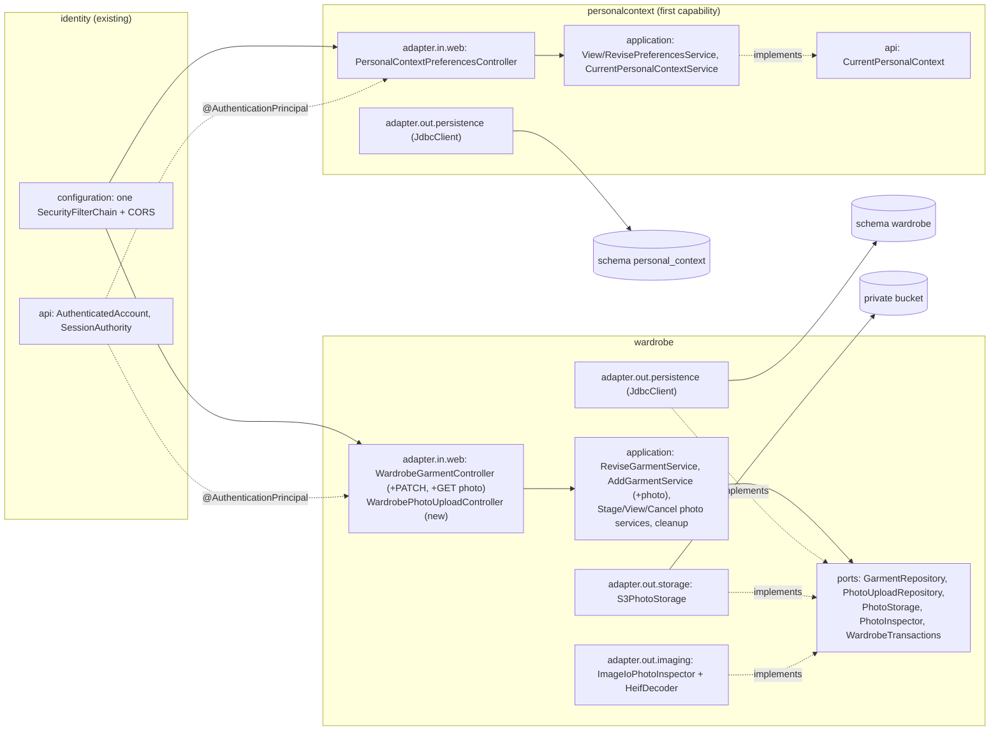
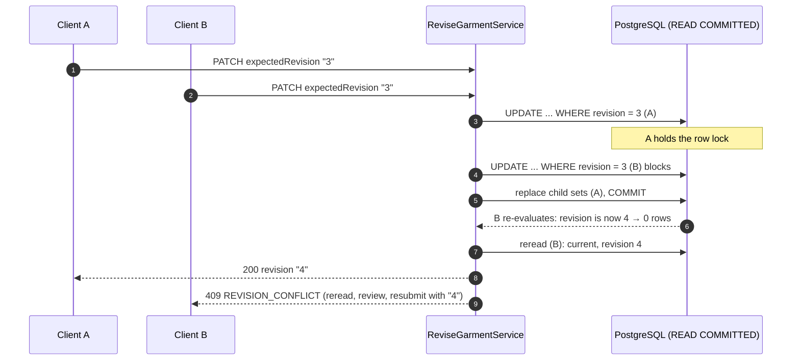
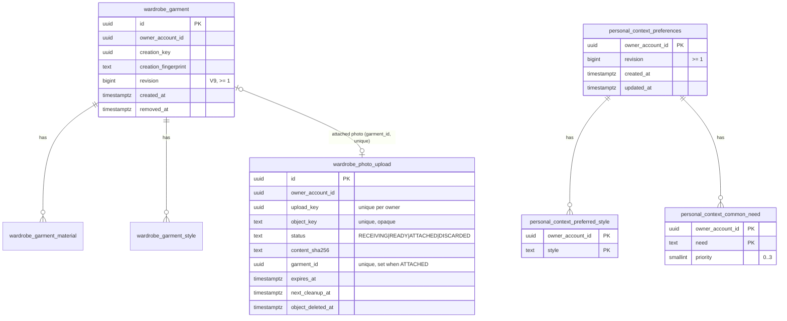
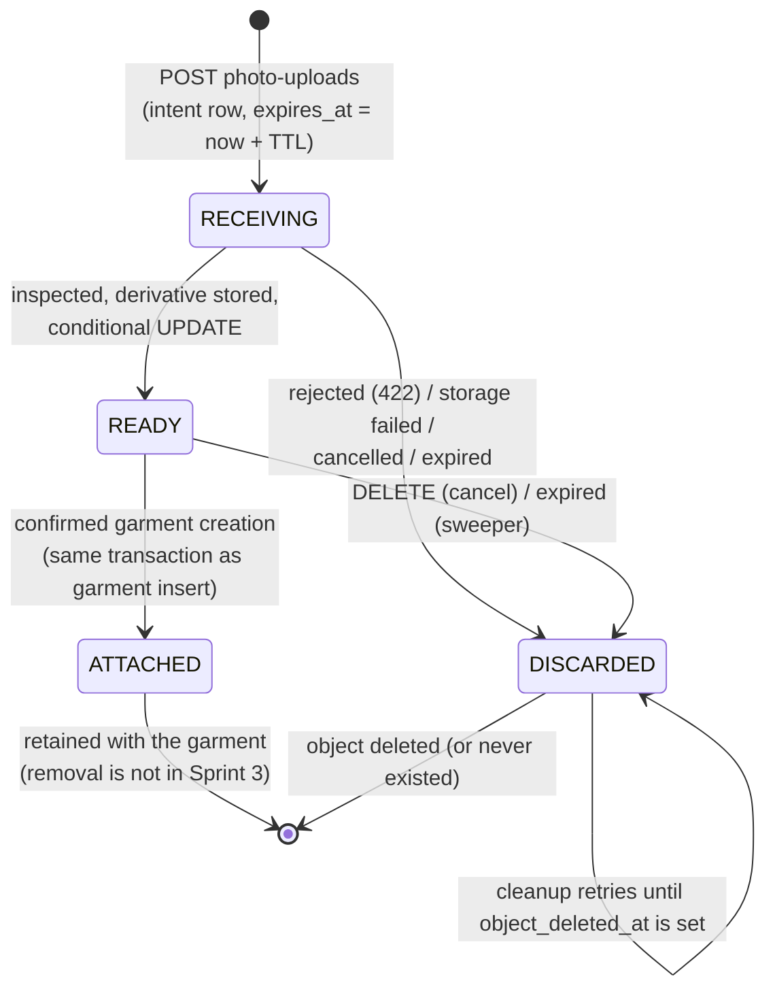
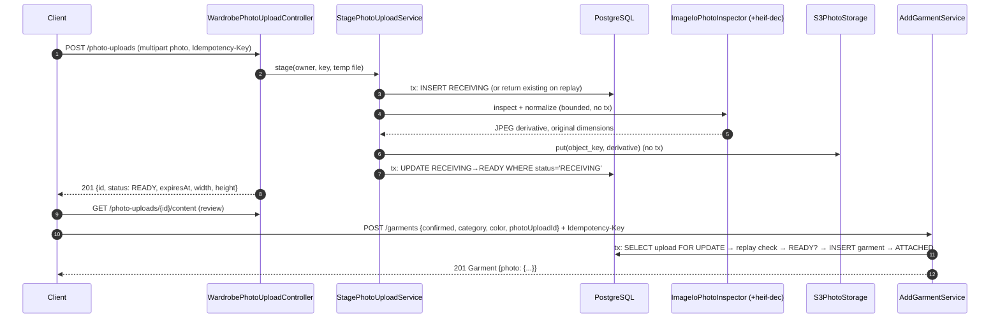
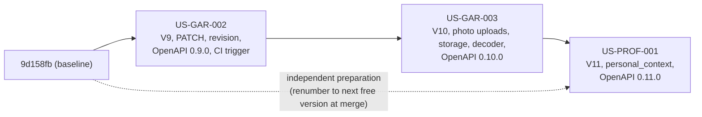

# Sprint 3 — Shared Architecture and Conventions

| Field | Value |
| --- | --- |
| Sprint | Sprint 3 |
| Stories | US-GAR-002 → US-GAR-003 → US-PROF-001 (PROF-001 can be prepared independently) |
| Baseline | `sprint_03` @ `9d158fb` |
| Status | Implementation guidance only. **No code in this package has been compiled, run or tested.** See [README §2](README.md#2-verification-status--read-this-first). |
| Decisions | All 21 plan decisions (S3-GAR, S3-IMG, S3-PROF, S3-INT) and the 16 detailed choices OPEN-S3-01–16 are **approved by the Product Owner** (2026-11-11). Their implementation and verification status is tracked in the [decision record](open-questions.md#2-summary-register). |
| Companion files | [README](README.md) · [open questions](open-questions.md) · [US-GAR-002](US-GAR-002-guide.md) · [US-GAR-003](US-GAR-003-guide.md) · [US-PROF-001](US-PROF-001-guide.md) |

## 1. Purpose and scope

This file holds the conventions that more than one Sprint 3 story uses, so each story guide can stay self-contained without three slightly different versions of the same rule. It covers exactly the three selected stories.

**Out of scope:**

- **US-MEAS-001** (removed from Sprint 3): no measurement producer, intake, table, event, job or test.
- **Readiness:** no recommendation-readiness evaluation (`recommendationEligibility` stays `NOT_EVALUATED`).
- **Garment media:** no attaching photos to existing garments, no replacing confirmed photos.
- **Assisted and bulk features:** no AI extraction, no background removal, no bulk import, no catalogue.
- **Other profile features:** no US-PROF-002 body/gender profile, no location or weather, no public profile.
- **Analysis:** no ranking or Coverage computation, no analytics.

## 2. Repository baseline

Inspected read-only at `sprint_03` @ `9d158fb` ("remove US-MEAS-001 out of sprint 3 planning"), clean working tree.

| Area | Present state | Evidence |
| --- | --- | --- |
| Build | Java 21, Spring Boot 4.1.1 (WebMVC, Security OAuth2 resource server, JDBC via `JdbcClient`, Flyway, Mail), PostgreSQL driver, Testcontainers 2 (`org.testcontainers.postgresql.PostgreSQLContainer`), ArchUnit 1.5.1, Jackson 3 (`tools.jackson.*`, 3.1.5 in the local cache), Maven Wrapper | `backend/pom.xml` |
| Modules | `identity` and `wardrobe` implemented; `personalcontext`, `wardrobeintelligence`, `outfitadviceanduse`, `productmeasurement` contain only `package-info.java` | `backend/src/main/java/com/capsuleai` |
| Migrations | V1–V8; V8 creates `wardrobe.wardrobe_garment`, `wardrobe_garment_material`, `wardrobe_garment_style`, index `ix_wardrobe_garment_owner_current`. **Next free version: V9.** | `backend/src/main/resources/db/migration` |
| API | OpenAPI **0.8.0**: auth (7 operations), `POST`/`GET /api/v1/wardrobe/garments`, `GET /api/v1/wardrobe/garments/{garmentId}` | `docs/05-api/openapi.yaml` |
| Security | One filter chain owned by Identity; default deny; CORS methods `GET, POST`; headers `Authorization, Content-Type, Accept, Idempotency-Key`; no exposed headers | `IdentitySecurityConfiguration` |
| Architecture tests | `ArchitectureDependencyTest` (14), `PersistenceOwnershipSqlTest` (14), `DatabaseSchemaOwnershipIT` (5); `BusinessModule` already registers schema `personal_context` | `backend/src/test/java/com/capsuleai/architecture` |
| Contract test | `IdentityOpenApiContractIT` covers all `/api` handlers: documented ⇔ served, security, request/response record fields, required fields → `400 REQUIRED`. It only understands `application/json` bodies. | `identity/adapter/in/web` |
| CI | `backend-ci.yml`: push `main`; PRs into `main`, `sprint_02`; **69** required report entries; any skipped test in a required report fails | `.github/workflows/backend-ci.yml` |
| Compose | PostgreSQL 17.11, Mailpit v1.27.11; no object storage | `compose.yaml` |

The Sprint 1 and 2 guides are used only as **structure and quality references**. Their baselines, test counts and listings are historical. The guides in this package were written against the files above.

## 3. Requirement hierarchy and source precedence

1. **Explicit Product Owner decisions:**
   - the 2026-11-11 approvals of S3-GAR-01–05, S3-IMG-01–08 and S3-PROF-01–05;
   - the later 2026-11-11 approvals of S3-INT-01–03 (Option A) and of the 16 detailed choices OPEN-S3-01–16 in [open-questions.md](open-questions.md);
   - the 2026-11-07 Brand/Price/Style decisions.
2. **Garment property authority** (`Initial files/Image to Properties Extraction.md`) and delivery decision DD-007.
3. **SRS, Business Rules, PRD, BRD.** Newer explicit approvals override older wording.
4. **Story acceptance criteria** (US-GAR-002 AC-01–08, US-GAR-003 AC-01–07, US-PROF-001 AC-01–06).
5. **Sprint 3 plan:** analysis, decision register and DoD application.
6. **Architecture:** ADA-001–018 selections, AR-01–08, ADD and views.
7. **This package.** Every detail the sources left open points to an `OPEN-S3-xx` entry, all approved. Once a story is implemented, the code, `docs/05-api/openapi.yaml` and the migrations win over guide text (S3-INT-03).

Known stale wording is listed in plan §12.2:

- PBI-008 "readiness guidance";
- backend conventions §1 "only AuthController";
- Data View "Identity-only implemented".

It does not change any rule below.

## 4. Labels and conventions used in the guides

| Label | Meaning |
| --- | --- |
| `[ADD]` | The file does not exist at the story's starting point; create it with the full content shown |
| `[MODIFY]` | The file exists; apply the shown change at the quoted BEFORE anchor, or replace the whole file where the step says so |
| BEFORE / AFTER | BEFORE is text that must exist exactly once at the starting point; AFTER is the replacement |
| `OPEN-S3-xx` | Code or values that implement a detailed choice approved by the Product Owner on 2026-11-11. The entry in [open-questions.md](open-questions.md) holds the alternatives, the remaining verification and the change impact if the PO ever revises it |
| `S3-…` | An approved decision in the Sprint 3 plan |
| Starting point | US-GAR-002 starts at `9d158fb`; US-GAR-003 starts after US-GAR-002 is applied; US-PROF-001 starts after US-GAR-003 is applied (or see §21 for independent preparation) |

No guide contains a fabricated commit hash for a later stage. "After US-GAR-002" means "after all US-GAR-002 steps are applied", whatever commit that becomes.

## 5. Module boundaries and package structure

All three stories keep pragmatic Clean Architecture inside each module:

```text
com.capsuleai.<module>
├── api/                      published contracts (records/interfaces, no domain types)
├── domain/                   framework-free model and rules
├── application/              use cases; framework-free; ports/ for outbound interfaces
├── adapter/in/web/           controllers, request/response records, scoped exception handler
├── adapter/in/scheduling/    in-process scheduled jobs (no broker)
├── adapter/out/persistence/  JdbcClient repositories, Spring transaction adapter
├── adapter/out/storage/      (Wardrobe, US-GAR-003) private object storage
├── adapter/out/imaging/      (Wardrobe, US-GAR-003) bounded image inspection/decoding
└── configuration/            Spring wiring and @ConfigurationProperties
```

The existing `ArchitectureDependencyTest` already enforces these rules for every new class:

- `domain` depends on nothing in Spring, `java.sql`, `java.net.http`, Jackson, `application` or `adapter`;
- `application` and `api` depend on no Spring, servlet, `java.sql`, `java.net.http`, Jackson, `adapter` or `configuration`;
- `adapter.in` and `adapter.out` never depend on each other;
- Spring JDBC is used only in `adapter.out..` and `configuration..`;
- another module may use only `<module>.api`.



## 6. Identity integration

- The owner is always `AuthenticatedAccount.accountId()` from `@AuthenticationPrincipal`. No request body, query or path carries an owner id.
- The existing `SessionAwareJwtAuthenticationConverter` already checks the persistent session on every request, so a logged-out, revoked or password-reset session is `401 AUTHENTICATION_REQUIRED` before any Sprint 3 controller runs.
- Wardrobe and Personal Context never read `identity.*` tables. There is no foreign key to Identity; `owner_account_id` is an opaque UUID (AR-04, ADA-016).

## 7. Authentication and authorization rules

| Situation | Response | Applies to |
| --- | --- | --- |
| No, invalid, expired or revoked token | `401 AUTHENTICATION_REQUIRED` (existing entry point) | Every new route |
| Another account's garment, unknown id, malformed id | `404 GARMENT_NOT_FOUND` (indistinguishable) | PATCH garment, GET garment photo |
| The caller's own removed garment | `410 GARMENT_NO_LONGER_CURRENT` | PATCH garment, GET garment photo |
| Another account's photo upload, unknown id, malformed id | `404 PHOTO_UPLOAD_NOT_FOUND` (indistinguishable) | Photo-upload routes and `photoUploadId` in creation |
| Preferences of another account | Impossible to address; the resource is always "my preferences" | Preferences routes |

## 8. Revision and optimistic concurrency

S3-GAR-02 and S3-PROF-04 are APPROVED. The token transport is OPEN-S3-04, also approved: an opaque `revision` string in responses, `expectedRevision` in the PATCH body, `409 REVISION_CONFLICT`.

- **Storage:** a `revision BIGINT NOT NULL CHECK (revision >= 1)` column in the owner's table.
- **Representation:** in responses, `"revision": "<decimal>"`, an **opaque** string. Clients echo it unchanged as `"expectedRevision"`.
- **Acceptance:** one conditional statement inside the owner's transaction.

  ```sql
  UPDATE <owner table> SET ..., revision = revision + 1
  WHERE <owner and identity predicates> AND revision = :expectedRevision
  ```

  Under PostgreSQL READ COMMITTED, a concurrent UPDATE of the same row blocks until the first commits. The predicate is then **re-evaluated** against the new row version, so the second statement updates 0 rows. Exactly one competing edit wins. No lock is held across user interaction.
- **Child sets** (Materials, Styles, preferred styles, common needs) are deleted and re-inserted **after** the conditional UPDATE succeeded, in the same transaction. The UPDATE's row lock serializes child-set writers, and any failure rolls back the whole revision.
- **Diagnosing 0 rows:** after a failed conditional UPDATE, the service rereads inside the same transaction:
  - missing → not found;
  - removed → no longer current;
  - otherwise → `409 REVISION_CONFLICT`.
- **Guarded first creation** (preferences only):

  ```sql
  INSERT ... ON CONFLICT (owner_account_id) DO NOTHING
  ```

  0 rows → `409 REVISION_CONFLICT`. One owner can have only one profile.
- **No automatic retry:** a conflict is never retried server-side and never "merged". The client rereads and the user reviews (S3-GAR-04).
- **No-op edits:** OPEN-S3-06, approved. Write nothing and return `200` with the unchanged revision, after the precondition has passed. A stale `expectedRevision` is still `409`, even when nothing would change. Both branches must be tested.



## 9. Wardrobe domain model changes

| Story | Change | Rule kept |
| --- | --- | --- |
| US-GAR-002 | `Garment` gains `long revision` (≥ 1, first = 1). A secondary 6-argument constructor keeps existing call sites compiling. | Exactly 13 properties in `GarmentProfile`; revision is metadata. |
| US-GAR-003 | `Garment` gains `Optional<GarmentPhoto> photo` (photo id, content type, width, height). Secondary 6- and 7-argument constructors remain. New `PhotoUpload` aggregate plus the `PhotoUploadStatus` and `PhotoRejectionReason` enums. | Media is metadata outside the 13 properties (property authority §4, DATA-GAR-004). |
| — | `ValueProvenance` stays `USER_ENTERED` after an edit | A user correcting their own manually entered values is still user-entered. `USER_CORRECTED` belongs to assisted-entry stories. The V8 CHECK `value_provenance IN ('USER_ENTERED')` stays. |

## 10. Presence-aware partial updates

S3-GAR-01 and S3-PROF-03 are APPROVED, and so is their encoding, OPEN-S3-05.

Media type: `application/json`.

| JSON in the PATCH body | Optional scalar (Subtype, Pattern, Fit, Neckline, Sleeve Length, Length, Silhouette, Brand) | Required scalar (Category, Color) | Set (Materials, Styles; profile `styles`) | Price | Profile need (inside `commonNeeds`) |
| --- | --- | --- | --- | --- | --- |
| Property absent | Unchanged | Unchanged | Unchanged | Unchanged | Unchanged |
| `null` | Cleared (absent) | `REQUIRED` error | Cleared (empty set) | Cleared (amount and currency) | Cleared (unset) |
| Value of the right type | Replaced, then the **whole resulting profile** is validated | Replaced | Replaced as a whole | Replaced as a whole (`{"amount","currency"}`) | Replaced (`0`–`3`) |
| `[]` | — | — | Cleared | — | — |
| Value of the wrong JSON type | `UNSUPPORTED_VALUE` for that field | `UNSUPPORTED_VALUE` | `UNSUPPORTED_VALUE` (per element: `materials[1]`) | `UNSUPPORTED_VALUE` (`price`) | `UNSUPPORTED_VALUE` (`commonNeeds.TRAVEL`) |

Rules:

1. **Required request fields.** `expectedRevision` is required in both PATCH bodies; the garment PATCH also requires `confirmed: true`. Missing fields are reported as `REQUIRED` **before** any lookup, so `IdentityOpenApiContractIT`'s required-field test works with a random resource id.
2. **Absent versus null.** The web adapter maps each `JsonNode` component to the application type `FieldChange<T>` (`Keep`, `Clear`, `Replace(T)`, `Malformed`). Jackson 3 gives `null` for an absent `JsonNode` creator property and a `NullNode` for JSON `null`. That was verified in the 3.1.5 bytecode, and each story re-verifies it with a unit test.
3. **Validate the resulting profile.** The service applies the changes to the current accepted state, then validates the **resulting** profile with the shared validator used for creation. A previously accepted value that becomes inapplicable after a Category change is reported against its own field (`subtype: NOT_IN_CATEGORY`, `fit: NOT_APPLICABLE`). It is never silently cleared (S3-GAR-03).
4. **Unknown properties** are ignored, as Jackson already does for POST.

## 11. Error model and recovery vocabulary

The body shape is the existing RFC 9457 `ProblemDetail` with a stable `code` and, for validation, `fieldErrors[{field, code}]`. No body echoes submitted values or private data.

| HTTP | `code` | Meaning | Stories |
| --- | --- | --- | --- |
| 400 | `VALIDATION_FAILED` | Field errors. **Nothing was changed.** | All |
| 400 | `MALFORMED_REQUEST` | Body is not JSON / not readable | All |
| 401 | `AUTHENTICATION_REQUIRED` | Existing; no usable session | All |
| 404 | `GARMENT_NOT_FOUND` | Unknown / other owner / malformed id | GAR-002, GAR-003 |
| 410 | `GARMENT_NO_LONGER_CURRENT` | Own garment removed | GAR-002, GAR-003 |
| 409 | `REVISION_CONFLICT` | `expectedRevision` is stale (or a concurrent first setup won). Reread, review, resubmit. | GAR-002, PROF-001 |
| 422 | `IDEMPOTENCY_KEY_REUSED` | Existing; same key, different addition (now including a different photo) | GAR-003 |
| 422 | `PHOTO_UNSUPPORTED_FORMAT`, `PHOTO_TOO_LARGE`, `PHOTO_TOO_SMALL`, `PHOTO_UNREADABLE`, `PHOTO_MULTIPLE_IMAGES` | Photo not accepted; replace it or continue manually | GAR-003 |
| 422 | `PHOTO_UPLOAD_KEY_REUSED` | Upload `Idempotency-Key` reused for different bytes | GAR-003 |
| 404 | `PHOTO_UPLOAD_NOT_FOUND` | Unknown / other owner / malformed upload id | GAR-003 |
| 409 | `PHOTO_UPLOAD_NOT_USABLE` | Upload cancelled, expired, not ready or already used | GAR-003 |
| 404 | `GARMENT_PHOTO_UNAVAILABLE` | This garment has no photo, or its stored photo is missing. **The garment information is unaffected.** | GAR-003 |
| 503 | `TEMPORARILY_UNAVAILABLE` | Database, storage or decoder capacity unavailable. **The outcome is not confirmed.** Check the current state before retrying. | All |

The 503 detail becomes **operation-neutral** in US-GAR-002 (S3-INT-01). The old text promised only creation idempotency, which would mislead for edits:

> The wardrobe could not be reached, so the outcome is not confirmed. Check the current state before retrying: an addition repeated with the same Idempotency-Key is never added twice, and an edit repeated with the same expectedRevision is never applied twice.

**Recovery rule (COM-002, S3-GAR-04).** After a lost or 503 response to a write:

1. Reread the resource: `GET` garment, `GET` photo upload, or `GET` preferences.
2. Compare with the intended change.
3. If a retry is still wanted, retry with the **original** `expectedRevision` or `Idempotency-Key`.

An edit that already committed advanced the revision, so the retry gets `409` instead of applying twice. A `409` after an uncertain response is **not** proof that the first attempt failed or succeeded; the reread shows the truth.

## 12. API conventions and endpoint catalogue

| Story | Method and path | Request | Success | Notes |
| --- | --- | --- | --- | --- |
| existing | `POST /api/v1/wardrobe/garments` | JSON + `Idempotency-Key` | `201`/`200` `Garment` | GAR-003 adds optional `photoUploadId` |
| existing | `GET /api/v1/wardrobe/garments` | `limit`, `cursor` | `200 WardrobeOverview` | **Unchanged**: summary keeps exactly its seven fields |
| existing | `GET /api/v1/wardrobe/garments/{garmentId}` | — | `200 Garment` | Gains `revision` (GAR-002) and `photo` (GAR-003) |
| GAR-002 | `PATCH /api/v1/wardrobe/garments/{garmentId}` | `GarmentRevisionRequest` | `200 Garment` | `400`, `401`, `404`, `409`, `410`, `503` |
| GAR-003 | `POST /api/v1/wardrobe/photo-uploads` | `multipart/form-data` part `photo` + `Idempotency-Key` | `201`/`200 PhotoUpload` | `400`, `401`, `422`, `503` |
| GAR-003 | `GET /api/v1/wardrobe/photo-uploads/{photoUploadId}` | — | `200 PhotoUpload` | Status and outcome review |
| GAR-003 | `GET /api/v1/wardrobe/photo-uploads/{photoUploadId}/content` | — | `200 image/jpeg` | Only while `READY`; `Cache-Control: private, no-store` |
| GAR-003 | `DELETE /api/v1/wardrobe/photo-uploads/{photoUploadId}` | — | `204` | Cancel; idempotent; `409` if already attached |
| GAR-003 | `GET /api/v1/wardrobe/garments/{garmentId}/photo` | — | `200 image/jpeg` | `404 GARMENT_PHOTO_UNAVAILABLE` when absent or missing |
| PROF-001 | `GET /api/v1/personal-context/preferences` | — | `200 Preferences` | `revision: null` when never declared |
| PROF-001 | `PATCH /api/v1/personal-context/preferences` | `PreferencesRevisionRequest` | `200 Preferences` | `400`, `401`, `409`, `503` |

OpenAPI versions:

- `0.9.0` after US-GAR-002;
- `0.10.0` after US-GAR-003;
- `0.11.0` after US-PROF-001.

If PROF-001 lands before GAR-003, it takes `0.10.0` and GAR-003 takes `0.11.0`. The rule: next minor version at merge time.

Controllers follow the repository's "one controller per cohesive API base path" convention:

- `WardrobeGarmentController` owns `/api/v1/wardrobe/garments/**`;
- `WardrobePhotoUploadController` owns `/api/v1/wardrobe/photo-uploads/**`;
- `PersonalContextPreferencesController` owns `/api/v1/personal-context/preferences`.

## 13. Flyway migration plan

| Version (recommended order) | File | Owner schema | Story | Content |
| --- | --- | --- | --- | --- |
| V9 | `V9__add_wardrobe_garment_revision.sql` | `wardrobe` | US-GAR-002 | `revision BIGINT NOT NULL DEFAULT 1`, `CHECK (revision >= 1)` |
| V10 | `V10__create_wardrobe_photo_upload.sql` | `wardrobe` | US-GAR-003 | `wardrobe.wardrobe_photo_upload` and its indexes |
| V11 | `V11__create_personal_context_preferences.sql` | `personal_context` | US-PROF-001 | `CREATE SCHEMA personal_context`; three `personal_context_*` tables |

Rules (AR-01–AR-08; enforced by `PersistenceOwnershipSqlTest` and `DatabaseSchemaOwnershipIT`):

1. **One owner schema per migration.** Every table reference is schema-qualified. No cross-schema foreign key, view, trigger or function. Owner schemas may contain **no routines** at all: `DatabaseSchemaOwnershipIT.noViewOrRoutineInAnOwnerSchemaCouldReadAnotherOwnersTables` asserts this.
2. **V1–V8 are immutable.** Never edit an applied migration and never run `flyway clean` (`spring.flyway.clean-disabled=true`).
3. **Use the next free version on the branch at implementation time.** If PROF-001 is implemented before GAR-003, PROF-001 takes V10 and GAR-003 takes V11. Flyway's default `outOfOrder=false` makes validation fail if a lower version appears after a higher one was applied, so merge migrations in version order. Renumber only a migration that has **not** been applied to any shared database.
4. **Verify the transition from V8 and from a fresh database.** Each story's schema IT runs on the fully migrated Testcontainers database, and the existing `IsolatedMigrationDatabase` pattern can migrate to an intermediate version where a transition matters (US-GAR-002 `GarmentRevisionSchemaIT`).

## 14. Data model (Sprint 3 additions)



The complete DDL is in each story guide (§10 and its migration step).

## 15. Transactions, locking and concurrency

| Operation | Transaction boundary | Concurrency control |
| --- | --- | --- |
| Garment PATCH | `WardrobeTransactions.inTransaction`: conditional UPDATE + child-set replace + diagnosis read | Row lock taken by UPDATE; predicate re-evaluation (§8) |
| Photo staging | **No transaction holds byte transfer.** (1) short transaction: insert `RECEIVING` intent; (2) outside any transaction: inspect and decode, then storage put; (3) short conditional UPDATE `RECEIVING → READY` | Unique `(owner_account_id, upload_key)`; conditional status transitions |
| Photo-backed creation | One transaction: `SELECT … FOR UPDATE` the upload row → creation-key replay check → require `READY` and not expired → insert garment + child sets → `READY → ATTACHED` | Row lock on the upload serializes confirmations and the sweeper |
| Expiry sweep | One short transaction per batch: `UPDATE … WHERE id IN (SELECT … FOR UPDATE SKIP LOCKED)` and status still pending | Skips rows a confirmation holds; the predicate re-checks status |
| Object deletion | Claim row (`SKIP LOCKED`); delete the object **outside** the transaction; mark `object_deleted_at` with a conditional UPDATE | Idempotent delete; retry with backoff |
| Preferences PATCH | `PersonalContextTransactions.inTransaction`: guarded insert or conditional UPDATE + child replace | §8 |

No object-storage or decoder call ever runs inside a database transaction (S3-GAR-05, S3-IMG-04).

## 16. Idempotency and logical actions

| Action | Identity | Replay | Different payload with the same identity |
| --- | --- | --- | --- |
| Manual creation (existing) | `(owner, Idempotency-Key)` | `200` with the **current** garment (it may have been edited since; S3-GAR-04) | `422 IDEMPOTENCY_KEY_REUSED` |
| Photo-backed creation (GAR-003) | Same key. The fingerprint additionally includes `photo=<photoUploadId>`, **only when present**, so every existing imageless fingerprint is unchanged. | `200`, even though the upload is now `ATTACHED` | `422 IDEMPOTENCY_KEY_REUSED`, including the same key with no photo or a different photo |
| Photo staging (GAR-003) | `(owner, upload Idempotency-Key)` + SHA-256 of the received bytes | `200` with the existing upload (any status) | `422 PHOTO_UPLOAD_KEY_REUSED` |
| Garment edit (GAR-002) | **No durable receipt** (S3-GAR-04 Option A). `expectedRevision` makes a repeat harmless. | `409` (the revision advanced); reread | — |
| Preferences edit (PROF-001) | Same as garment edit | `409`; reread | — |

The creation fingerprint is **never** recomputed from revised values (S3-GAR-04).

## 17. Private media architecture (US-GAR-003)



- **Object identity.** Each object key is generated server-side: `photos/<owner-independent random UUID>.jpg`. The key is **never** derived from bytes, filename or garment values, and never contains Brand, Price or other profile content. It is unique in the database, and storage puts use `If-None-Match: *` where the provider supports it (OPEN-S3-13).
- **In-flight fence.** When a `RECEIVING` row is discarded (cancel or expiry while an upload is still running), `next_cleanup_at` is set to:

  ```text
  GREATEST(now, created_at + in-flight-fence)
  ```

  The fence (`PT5M`) must be longer than the storage call timeout plus twice the decode timeout (checked at startup), so cleanup cannot delete before a late put lands. An uploader whose final `RECEIVING → READY` update fails also resets `object_deleted_at = NULL` and `next_cleanup_at = now`, which re-queues deletion. Together these prevent late orphans (S3-IMG-04).
- **Attached media** is never selected by expiry or cleanup: both queries require status `RECEIVING`, `READY` or `DISCARDED`.
- **Pending lifetime.** 24 hours (`PT24H`), approved by the PO (OPEN-S3-07), configurable.
- **Decoding** (OPEN-S3-08/10/12, approved; verification pending):
  - JPEG and PNG are decoded in Java ImageIO; HEIC/HEIF by libheif's `heif-info` and `heif-dec` in bounded subprocesses that share one decode deadline.
  - Only a metadata-free, orientation-corrected JPEG with a long edge of at most 2048 px is stored.
  - Safety ceilings: 250 MP declared per image, 20 s, 2 concurrent decodes; busy slots give `503`.
- **Multi-image HEIF** (OPEN-S3-11, approved):
  - The target is the file's **primary** image, found through `heif-info`'s `, primary` line and `heif-dec`'s matching numbered output (US-GAR-003 §10.9).
  - Until verification V4/V8 passes, `capsuleai.wardrobe.photo.heif-primary-image-selection=false` keeps the approved temporary fail-closed fallback, `422 PHOTO_MULTIPLE_IMAGES`.
  - No arbitrary image is ever chosen.
- **Missing objects.** A missing object for an attached photo gives `404 GARMENT_PHOTO_UNAVAILABLE` on the photo route only. The garment JSON stays readable (AC-06).
- **Delivery.** Private delivery is application streaming after the owner check (S3-IMG-05), with:

  ```text
  Content-Type: image/jpeg
  Cache-Control: private, no-store
  X-Content-Type-Options: nosniff
  ```

  There are no presigned URLs, public URLs or storage credentials in any response.
- **Garment removal and 30-day deletion.** Removal of accepted media is not selected. When US-GAR-005 lands, it must make the photo inaccessible immediately and physically delete it within 30 days (DATA-RET-002). The `DISCARDED` path can be reused for that.



## 18. Personal Context architecture (US-PROF-001)

- **Owner:** `com.capsuleai.personalcontext`, schema `personal_context` (S3-PROF-01, AR-01). It is the module's first persisted state; V11 creates the schema.
- **Vocabulary:** independent of garment Style.
  - `ProfileStyle`: `MINIMAL`, `CASUAL`, `SMART_CASUAL`, `CLASSIC`, `STREETWEAR`, `SPORTY`, `FORMAL`.
  - `CommonNeed`: six needs, codes per OPEN-S3-15 (approved), each with its SRS §3.14.1 occasion codes.
  - `NeedPriority`: `NOT_RELEVANT=0`, `LOW=1`, `MEDIUM=2`, `HIGH=3`.
- **Absent and zero** (S3-PROF-02): an unset need is absent (`null`); `0` is a declaration and stays `0`. The current request occasion is not stored and never rewrites needs (AC-03).
- **Published contract** (S3-PROF-05, OPEN-S3-16, approved): `personalcontext.api.CurrentPersonalContext.find(UUID)` returns `Optional<DeclaredPersonalContext>`, containing the revision, style codes and declared needs only. It has no consumer in Sprint 3; an integration test and the architecture tests must still prove it.

## 19. Configuration and environment variables

| Property | Default (main) | Test profile | Story | Notes |
| --- | --- | --- | --- | --- |
| `spring.servlet.multipart.max-file-size` / `max-request-size` | `16MB` / `17MB` | same | GAR-003 | Transport guard only (OPEN-S3-09) |
| `spring.servlet.multipart.resolve-lazily` | `true` | same | GAR-003 | Size errors reach the scoped Wardrobe handler |
| `server.tomcat.max-swallow-size` | `20MB` | — | GAR-003 | Clients receive the 422 instead of a reset connection |
| `capsuleai.wardrobe.photo.maximum-bytes` | `15000000` | same | GAR-003 | OPEN-S3-09 (approved) |
| `capsuleai.wardrobe.photo.minimum-shortest-side` | `512` | same | GAR-003 | FR-AI-012 |
| `capsuleai.wardrobe.photo.derivative-long-edge` | `2048` | same | GAR-003 | OPEN-S3-10 (approved) |
| `capsuleai.wardrobe.photo.maximum-declared-pixels` | `250000000` | same | GAR-003 | OPEN-S3-12 (approved; to be measured) |
| `capsuleai.wardrobe.photo.decode-timeout` | `PT20S` | same | GAR-003 | OPEN-S3-12 (approved; to be measured); shared by `heif-info` and `heif-dec` |
| `capsuleai.wardrobe.photo.maximum-concurrent-decodes` | `2` | same | GAR-003 | OPEN-S3-12 (approved; to be measured) |
| `capsuleai.wardrobe.photo.heif-decoder-command` | `heif-dec` | env `CAPSULE_HEIF_DECODER` | GAR-003 | OPEN-S3-08 (approved; V1–V8 pending) |
| `capsuleai.wardrobe.photo.heif-info-command` | `heif-info` | env `CAPSULE_HEIF_INFO` | GAR-003 | OPEN-S3-08/11: lists top-level images and marks the primary |
| `capsuleai.wardrobe.photo.heif-primary-image-selection` | `false` | `false` (`HeifDecodingIT` builds both modes itself) | GAR-003 | OPEN-S3-11: `true` is the approved target, set only after V4 and V8 pass for that environment; `false` is the approved temporary fail-closed fallback |
| `capsuleai.wardrobe.photo-upload.pending-ttl` | `PT24H` | same | GAR-003 | OPEN-S3-07 (approved by the PO) |
| `capsuleai.wardrobe.photo-upload.in-flight-fence` | `PT5M` | same | GAR-003 | > storage call timeout + 2 × decode timeout (startup check) |
| `capsuleai.wardrobe.photo-upload.cleanup.enabled` / `initial-delay` / `interval` / `batch-size` / `retry-delay` | `true` / `PT1M` / `PT5M` / `100` / `PT10M` | `false` (tests call the service) | GAR-003 | |
| `capsuleai.wardrobe.photo-storage.bucket` | `${CAPSULE_PHOTO_BUCKET:}` (required at first use) | `capsuleai-photos-test` | GAR-003 | Private bucket |
| `capsuleai.wardrobe.photo-storage.region` | `${CAPSULE_PHOTO_REGION:ap-southeast-1}` | `us-east-1` | GAR-003 | Region choice is a deployment decision (S3-IMG-01) |
| `capsuleai.wardrobe.photo-storage.endpoint` | `${CAPSULE_PHOTO_ENDPOINT:}` (empty = AWS) | dummy, overridden in storage ITs | GAR-003 | Local: `http://localhost:9090` |
| `capsuleai.wardrobe.photo-storage.access-key-id` / `secret-access-key` | `${CAPSULE_PHOTO_ACCESS_KEY_ID:}` / `${CAPSULE_PHOTO_SECRET_ACCESS_KEY:}` | dummy | GAR-003 | Empty → AWS default credentials chain; never commit real values |
| `capsuleai.wardrobe.photo-storage.call-timeout` | `PT30S` | same | GAR-003 | SDK `apiCallTimeout` (timeouts are off by default in the SDK) |
| `capsuleai.wardrobe.photo-storage.conditional-writes` | `true` | per V-S3 result | GAR-003 | OPEN-S3-13 (approved; V-S3 pending) |
| `capsuleai.wardrobe.photo-storage.path-style` | `false` | `true` | GAR-003 | Local S3Mock needs path-style |

Personal Context adds no configuration property.

## 20. Security and privacy

- **Authorization:** every new route is authenticated by the existing chain and is owner-scoped. Unknown, other-owner and malformed identifiers share one `404`.
- **CORS:**
  - GAR-002 adds `PATCH`; GAR-003 adds `DELETE`;
  - the allowed headers stay unchanged, because the revision travels in the body (OPEN-S3-04);
  - there are no exposed headers;
  - exact origins only, as today;
  - `CorsSecurityIT` is updated so refused-method tests still cover `PUT` and an unknown header.
- **Logging:** no photo bytes, filenames, object keys, Brand, Price, preferences or tokens are logged. Errors log exception classes and safe ids only.
- **Media privacy:**
  - stored objects carry no EXIF/GPS (OPEN-S3-10);
  - storage metadata carries only `Content-Type`;
  - responses are `Cache-Control: private, no-store`;
  - nothing is used for training (NFR-PRIV-002).
- **Temporary files:** temporary upload and decode files live in a private directory created with owner-only permissions where the OS supports POSIX attributes. They are deleted in `finally` blocks.
- **Database role:** one role still serves every schema, so schema isolation is enforced by tests, not privileges. This is a known limit (REVIEW-DB-ROLE, Sprint 2).

## 21. Shared-file ownership and cumulative order

The three guides are **cumulative**. Each `[MODIFY]` step quotes BEFORE anchors that exist at that story's starting point.

| File | GAR-002 | GAR-003 | PROF-001 | Merge rule if applied out of order |
| --- | --- | --- | --- | --- |
| `wardrobe/domain/Garment.java` | + `revision` | + `photo` (keeps the 6-arg and adds the 7-arg secondary constructor) | — | GAR-003 assumes `revision` exists |
| `wardrobe/application/AddGarmentCommand.java` | + `values()` | + `photoUploadId` (+ 17-arg secondary constructor) | — | — |
| `wardrobe/application/GarmentEntryValidator.java` | Refactor: `validateProfile(GarmentValues)` | + `photoUploadId` format check | — | — |
| `wardrobe/adapter/out/persistence/JdbcGarmentRepository.java` | + `revision` read/insert, `reviseIfCurrentAt` | + photo LEFT JOIN and mapping | — | — |
| `wardrobe/adapter/in/web/GarmentResponse.java` | + `revision` | + `photo` | — | — |
| `wardrobe/adapter/in/web/WardrobeGarmentController.java` | + PATCH | + GET `/{garmentId}/photo` | — | — |
| `wardrobe/adapter/in/web/WardrobeApiExceptionHandler.java` | + `REVISION_CONFLICT`, neutral 503 | + photo handlers | — | — |
| `wardrobe/configuration/WardrobeConfiguration.java` | + `ReviseGarmentService` bean | `AddGarmentService` bean gains photo dependencies | — | — |
| `identity/configuration/IdentitySecurityConfiguration.java` | Methods `GET, POST, PATCH` | + `DELETE` | Needs `PATCH`: add it if GAR-002 is not yet applied | Keep the union of methods |
| `identity/adapter/in/security/CorsSecurityIT.java` | `GET,POST,PATCH`; PATCH removed from refused | `GET,POST,PATCH,DELETE`; DELETE removed from refused | (PATCH as in GAR-002 if not yet applied) | Expected header = union, in this order |
| `identity/adapter/in/web/IdentityOpenApiContractIT.java` | — | Multipart and binary support | — | — |
| `architecture/DatabaseSchemaOwnershipIT.java` | — | — | + `personal_context` tables asserted | — |
| `docs/05-api/openapi.yaml` | 0.9.0 | 0.10.0 | 0.11.0 | Next minor version at merge |
| `.github/workflows/backend-ci.yml` | + `sprint_03` trigger + GAR-002 reports | + libheif install, env, reports | + PROF reports | Union of entries; trigger added once |
| `backend/README.md` | Editing section | Photos section | Preferences section | Sections are independent |
| `backend/pom.xml` | — | + AWS SDK BOM and `s3` | — | — |
| `application.properties`, `application-local.properties`, `src/test/resources/application-test.properties` | — | Multipart, photo, storage properties | — | — |
| `compose.yaml` | — | + S3Mock service | — | — |
| `wardrobe/support/WardrobeIntegrationTestSupport.java` | — | Truncate the photo table; `@Import` the test configuration; photo helpers | — | — |
| `wardrobe/application/InMemoryGarmentRepository.java`, `WardrobeFailureIT.java` | Implement `reviseIfCurrentAt` | — | — | — |



## 22. Testing architecture

| Layer | Pattern (existing) | Sprint 3 use |
| --- | --- | --- |
| Domain unit (`*Test`, Surefire) | Pure JUnit 6 + AssertJ | `GarmentTest`, `PhotoUploadTest`, `DeclaredPreferencesTest` |
| Application unit (`*Test`) | In-memory fakes (`InMemoryGarmentRepository`, `ImmediateWardrobeTransactions`) | `ReviseGarmentServiceTest`, `StagePhotoUploadServiceTest`, `PhotoBackedGarmentCreationTest`, `PhotoUploadLifecycleServiceTest`, `RevisePreferencesServiceTest` |
| Web mapping unit (`*Test`) | Jackson `JsonMapper` | `GarmentRevisionRequestTest`, `PreferencesRevisionRequestTest` |
| Imaging unit (`*Test`) | Synthetic JPEG/PNG generated in the test with ImageIO; no binary fixtures | `ImageIoPhotoInspectorTest`, `HeifDecoderTest` (listing, primary selection and fail-closed rules without libheif) |
| Integration (`*IT`, Failsafe) | `IdentityIntegrationTestSupport`: real app, real filter chain, PostgreSQL Testcontainers, `MutableClock` | API, schema and concurrency ITs per story |
| Real storage | Testcontainers `GenericContainer("adobe/s3mock:5.1.0")` | `S3PhotoStorageIT` (API ITs use the in-memory `FaultInjectingPhotoStorage`) |
| Real decoder | Installed libheif; `CAPSULEAI_REQUIRE_HEIF=true` in CI turns a missing tool into a failure | `HeifDecodingIT`, including primary-image selection when the primary is not the first image |
| Concurrency | `CountDownLatch`/`CyclicBarrier` with real transactions (existing `ConcurrentGarmentCreationIT` style) | `ConcurrentGarmentRevisionIT`, `ConcurrentPhotoConfirmationIT`, `ConcurrentPreferencesIT` |
| Contract | `IdentityOpenApiContractIT` (all handlers) | Extended for multipart and binary in GAR-003 |
| Architecture | `ArchitectureDependencyTest`, `PersistenceOwnershipSqlTest`, `DatabaseSchemaOwnershipIT` | Run unchanged against new code; DatabaseSchemaOwnershipIT also asserts the `personal_context` tables |

Commands, from `backend`, in Windows PowerShell 5.1 (single quotes keep `-D` arguments intact):

```powershell
.\mvnw.cmd '-Dtest=ReviseGarmentServiceTest' test
.\mvnw.cmd '-Dtest=HarnessSmokeTest' '-Dit.test=ReviseGarmentApiIT' verify
.\mvnw.cmd clean verify
```

`HarnessSmokeTest` is named in focused `verify` runs because Surefire's `failIfNoTests=true` would otherwise fail when `-Dtest` matches nothing.

## 23. Cross-story integration

| Interaction | Rule |
| --- | --- |
| GAR-002 edit of a photo-backed garment (after GAR-003) | Edits never touch the photo association (S3-IMG-07). The response still carries `photo`. |
| GAR-003 replay of a photo-backed creation after a GAR-002 edit | `200` with the current (edited) garment and its photo; one garment |
| GAR-003 creation response | Includes `revision: "1"` (from GAR-002) |
| PROF-001 and Wardrobe | No dependency in either direction. Garment Style and profile style are separate vocabularies (BRULE-GAR-004). |
| Logout or password reset during any Sprint 3 flow | The next request gets `401`. Nothing is changed by a rejected request. |

## 24. Index of decisions applied

| Decision | Status | Where applied |
| --- | --- | --- |
| S3-GAR-01 | APPROVED | GAR-002 §9–§12; this file §10 |
| S3-GAR-02 | APPROVED | GAR-002 V9, `reviseIfCurrentAt`; this file §8 |
| S3-GAR-03 | APPROVED | GAR-002 `ReviseGarmentService` (validate the resulting profile) |
| S3-GAR-04 | APPROVED | GAR-002 §10 recovery; this file §11, §16 |
| S3-GAR-05 | APPROVED | GAR-002 shared validator and transaction |
| S3-IMG-01 | APPROVED (strategy) | GAR-003 storage adapter; OPEN-S3-13 (approved; V-S3 pending) |
| S3-IMG-02 | APPROVED | GAR-003 multipart controller |
| S3-IMG-03 | APPROVED | GAR-003 staged upload + `photoUploadId` |
| S3-IMG-04 | APPROVED | GAR-003 V10, lifecycle, fence; this file §17 |
| S3-IMG-05 | APPROVED | GAR-003 streaming routes |
| S3-IMG-06 | APPROVED (investigation direction); concrete choices OPEN-S3-08/09/10/11/12 approved, toolchain unverified | GAR-003 inspector and `HeifDecoder`, §10.9 |
| S3-IMG-07 | APPROVED | GAR-003 scope (no attach/replace routes) |
| S3-IMG-08 | APPROVED (lifecycle); TTL `PT24H` approved through OPEN-S3-07 | GAR-003 cleanup |
| S3-PROF-01 | APPROVED | PROF-001 module and V11 |
| S3-PROF-02 | APPROVED | PROF-001 domain; OPEN-S3-15 |
| S3-PROF-03 | APPROVED | PROF-001 PATCH; OPEN-S3-05 |
| S3-PROF-04 | APPROVED | PROF-001 revision and guarded create |
| S3-PROF-05 | APPROVED | PROF-001 `api`; OPEN-S3-16 |
| S3-INT-01 | APPROVED (Option A) | OPEN-S3-01: all three guides (shared errors §11, CORS, contract test) |
| S3-INT-02 | APPROVED (Option A); executable evidence pending | OPEN-S3-02: Testcontainers, S3Mock, libheif in CI, `sprint_03` trigger; real-provider check outstanding |
| S3-INT-03 | APPROVED (Option A); reconcile guides with the implementation during execution | OPEN-S3-03: this package and §21 |

The per-choice traceability for OPEN-S3-01–16 (design sections, production steps, test steps, remaining verification) is in [open-questions.md §3](open-questions.md#3-coverage-and-traceability-matrix).
