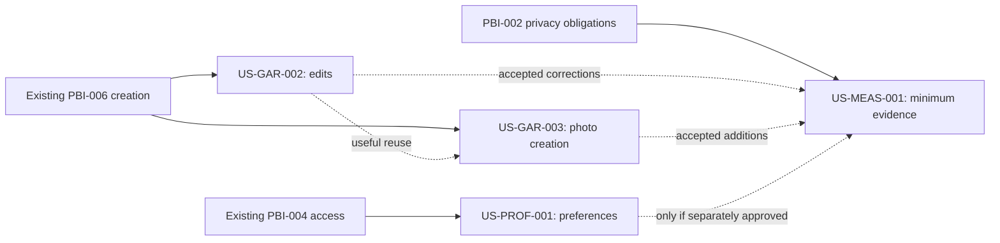
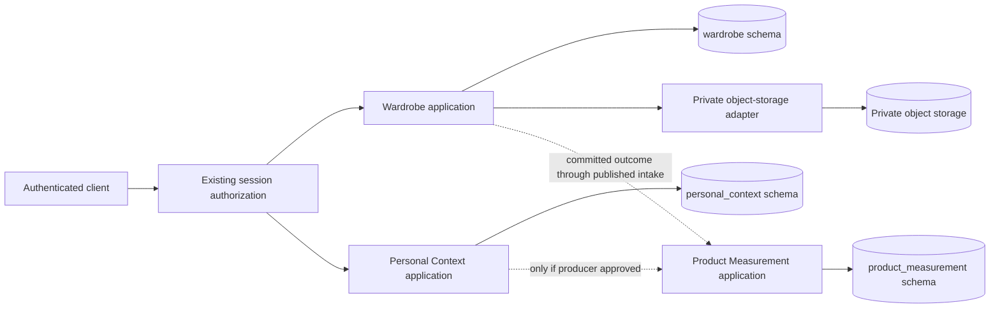
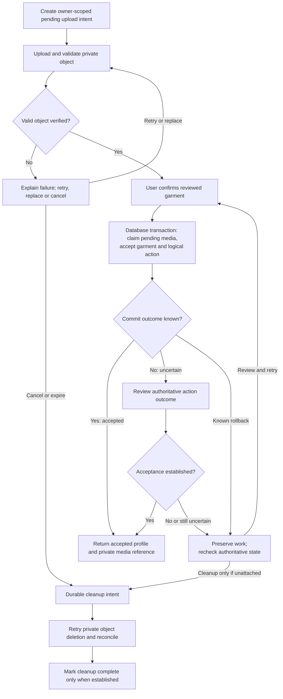

# CapsuleAI — Sprint 3 Backend Sprint Planning

## 1. Sprint Overview

| Field | Planning baseline |
| --- | --- |
| Artifact / version | Sprint 3 Backend Sprint Plan / 0.1 |
| Status | Draft for Product Owner and technical review; recommendations are not approvals |
| Repository inspected | `sprint_03`, commit `47b587d` (`update new businesses of Danh`), following merged PR #4 |
| Scope authority | The Product Owner explicitly selected the four stories in Section 5 for this planning task |
| Accountability | Product Owner owns product decisions; Developers own implementation planning and technical feasibility; the PO is also the primary backend developer |
| Planning convention | Flexible capstone Sprint; completion is assessed through outcomes and applicable evidence |
| Change boundary | This task creates only this plan; existing requirements, decisions, backlog order, stories, code, contracts and migrations are unchanged |

This plan connects the selected outcomes to the actual Sprint 1–2 backend and current approved requirements. It does not approve new provider, concurrency, API or lifecycle choices. Section 9 analyzes 27 significant decision questions; Section 13 provides their matching review register. Existing approved boundaries are identified separately from proposed realization choices.

The user’s explicit planning convention governs this plan: no fixed duration, start/end dates, capacity assumption, velocity, Story Points, delivery estimates or artificial deadlines are assigned. The general preference for roughly four to six related stories is satisfied by the four selected here. This does not reorder the Product Backlog or authorize additional work.

The [workflow](../../../../Initial%20files/CapsuleAI_Scrum_Development_Workflow.md), especially Sections 26 and 31–33, still governs iterative execution: selection precedes story-specific Just-In-Time (JIT) design; automated tests accompany implementation. This plan is the initial implementation direction, not a whole-Sprint API/schema/sequence design gate. Test Strategy and Engineering Baseline already exist and are reused.

## 2. Sprint Goal

**Enable users to build a more trustworthy and recognizable private wardrobe by correcting accepted garment information, confirming photo-supported additions, and declaring personal style and common needs, while capturing minimum reliable evidence without disrupting those actions.**

Sprint 2 provides authenticated manual creation, current-wardrobe pages and full garment inspection. Sprint 3 lets users maintain that truth, recognize newly entered clothing through private photos, and establish private context for future advice. Minimum measurement distinguishes useful accepted work from uploads, attempts and retries. Together these outcomes strengthen “Understand My Wardrobe,” preparing later styling without claiming an implemented recommendation engine or measured product benefit.

The selected scope is explicit; this proposed Goal and the technical recommendations remain reviewable. Backend delivery alone does not establish complete mobile-story Done.

## 3. Current Repository and Backend Baseline

### 3.1 Repository inspection and source precedence

Inspection covered tracked repository structure, current status/history, the Product Goal/Backlog, BRD/PRD/SRS and Business Rules, current property authority and DD-007, story catalogue/refinement review, the four selected stories, relevant UC/Activity slices, QA/ASR/ADA/selected decisions, ADD and four views, DoD/Test Strategy, Sprint 1–2 plans/guides, engineering conventions, production Java, migrations, OpenAPI, tests and CI. Generated build output, dependency caches, `.git` internals and secret files are excluded from source analysis.

| Source | Role in this plan |
| --- | --- |
| [BRD](../../../01-business/BRD.md), [PRD](../../../02-product/PRD.md), [SRS](../../../03-requirements/SRS.md), [Business Rules](../../../03-requirements/business-rules.md) | Business intent, current scope, enforceable behavior and invariants; latest explicit approvals override older conflicting wording |
| [Property authority](../../../../Initial%20files/Image%20to%20Properties%20Extraction.md), [delivery decisions](../../delivery-decisions.md) | Exact garment model, resolved Brand/Price/Style policy, DD-007 expanded MVP and stored-feedback policy |
| [Product Goal](../../product-goal.md), [Product Backlog](../../product-backlog.md), [story catalogue](../../stories/README.md), [refinement review Section 10](../../backlog-refinement-review.md#10-pr-4-synchronization-and-sprint-3-candidate-impact) | Value, hard capability dependencies, current story boundaries and synchronization findings; earlier candidate status is superseded only by this task’s explicit four-story selection |
| [Selected architecture decisions](../../../04-architecture/selected-architecture-decisions.md), [ADA](../../../04-architecture/architecture-decision-analysis.md), [ADD](../../../04-architecture/ADD.md), [views](../../../04-architecture/views/) | Approved decisions versus analysis; existing owner boundaries and realization obligations |
| [Test Strategy](../../../07-testing/test-strategy.md), [DoD](../../definition-of-done.md), [backend conventions](../../../engineering/backend-conventions.md) | Proportional verification, completion and established code conventions |
| [Sprint 1 plan](../sprint-01/sprint-plan.md), [Sprint 2 plan](../sprint-02/sprint-plan.md), [Sprint 2 shared guide](../sprint-02/implementation-guides/shared-architecture.md), [backend README](../../../../backend/README.md) | Historical selections and reusable implementation context; actual code is the evidence of present capability |

The initial working tree contained the unrelated untracked `Image_Handling_Essential_Concepts (1).md`; it is preserved and is not a policy authority. No Sprint 3 plan existed. Static inspection establishes what source is present, not a fresh successful execution or production readiness.

### 3.2 Confirmed implementation and reuse

| Area | Actual present behavior and evidence | Sprint 3 consequence |
| --- | --- | --- |
| Runtime/build | [POM](../../../../backend/pom.xml): Java 21, Spring Boot 4.1.1, servlet MVC, Spring JDBC, Flyway, PostgreSQL driver, JUnit/Testcontainers and ArchUnit; Maven Wrapper | Extend this application and its managed dependency line; no JPA, cache or broker introduction |
| Identity | `com.capsuleai.identity` contains registration/login, JWT plus persistent usable-session checks, refresh rotation, logout and email password recovery; `AuthenticatedAccount` and `SessionAuthority` are published | Derive the owner from the verified principal; reuse revocation/reset isolation; never accept an arbitrary owner ID as authority |
| Wardrobe domain | `com.capsuleai.wardrobe`: `GarmentProfile`, controlled enums, `Brand`, `PurchasePrice`, `Garment`; optional Materials/Styles are distinct sets | Reuse the 13-property policy, preserving absent values, category applicability and exact accepted Brand/Price |
| Acceptance and retries | [AddGarmentService](../../../../backend/src/main/java/com/capsuleai/wardrobe/application/AddGarmentService.java), `GarmentCreationFingerprint`, repository `addIfCreationKeyUnused`/`findCreation`; owner plus creation key is unique | Existing manual POST returns 201 for new acceptance and 200 for same-action replay; changed-payload key reuse is rejected. Extend deliberately for media; do not derive keys from photo bytes or garment likeness |
| Transactions | `WardrobeTransactions` and `IdentityTransactions` are framework-free application ports; Spring adapters use `TransactionTemplate`, default PostgreSQL READ COMMITTED | Keep transaction ownership in application operations. HTTP adapters remain thin. Add appropriate owner ports only when needed |
| Persistence and reads | [JdbcGarmentRepository](../../../../backend/src/main/java/com/capsuleai/wardrobe/adapter/out/persistence/JdbcGarmentRepository.java): owner-scoped SQL, one-statement profile plus child-set reads, current pages ordered by `created_at DESC, id DESC` | Preserve coherent reads and cursor ordering. An edit changes neither garment identity nor creation time. Current creation lookup returns the garment’s current profile, not an immutable original response snapshot |
| Existing API | [OpenAPI](../../../05-api/openapi.yaml): auth/recovery, POST and GET `/api/v1/wardrobe/garments`, GET `/{garmentId}`; cohesive `WardrobeGarmentController` | New operations belong to cohesive resource groups; no controller-per-story convention. Current JSON creation must continue working |
| Response/error baseline | Flat garment values; absent scalar `null`, set `[]`; `recommendationEligibility: NOT_EVALUATED`; `recordedUse.availability: UNAVAILABLE`. Scoped `WardrobeApiExceptionHandler`, RFC 9457 Problem Details and stable codes | New media/revision fields and conflict/recovery behavior require synchronized contracts/tests during implementation; do not fabricate use data or expose private input in errors |
| Migrations | V1–V8 exist; V6 moves Identity ownership, V7 adds recovery, V8 creates `wardrobe.wardrobe_garment`, material and style child tables | Only forward migrations. V8 has no edit revision or media association. One owner per new migration; no physical schema is selected by this plan |
| Infrastructure | [Compose](../../../../compose.yaml) provides PostgreSQL 17.11 and Mailpit; no object-storage service or media decoder is configured | Media integration and deployment feasibility are real work; not assumed available |
| Module skeletons | `personalcontext`, `productmeasurement`, `outfitadviceanduse`, `wardrobeintelligence` each contain only `package-info.java`; Identity and Wardrobe contain real implementation | Personal Context and Product Measurement gain their first capabilities; advice/intelligence remain unimplemented |

### 3.3 Existing checks and practical gaps

Existing tests include `ApprovedGarmentVocabularyTest`, `GarmentProfileTest`, `BrandTest`, `PurchasePriceTest`, `GarmentEntryValidatorTest`, `GarmentCreationFingerprintTest`, `AddGarmentServiceTest`, `ConcurrentGarmentCreationIT`, `JdbcGarmentRepositoryIT`, `GarmentSchemaIT`, `CurrentWardrobePageIT`, `AddGarmentApiIT`, `BrowseWardrobeApiIT`, `GarmentDetailApiIT`, `WardrobeFailureIT` and `WardrobeAccessAfterPasswordResetIT`. They contain real assertions for complete values, optional absence, retries, separate additions, ownership and outage distinctions, not just placeholder names.

`ArchitectureDependencyTest`, `PersistenceOwnershipSqlTest` and `DatabaseSchemaOwnershipIT` enforce boundaries. `IdentityOpenApiContractIT`, despite its name, checks all documented `/api` handler coverage, security and request/response shapes. It must evolve with new operations rather than be assumed Identity-only. Surefire runs `*Test`; Failsafe participates in `verify` for `*IT`.

The [CI workflow](../../../../.github/workflows/backend-ci.yml) runs full Maven verification and checks required reports. Its triggers currently cover pushes to `main` and PRs targeting `main` or `sprint_02`, not `sprint_03`. Existing browser CORS allows GET/POST and a limited header set; PATCH and revision headers will need explicit synchronized treatment if selected. These are findings and future implementation tasks, not changes made here.

## 4. Approved Business and Architecture Constraints

### 4.1 Business truth retained

- Exactly 13 garment properties: **Category, Subtype, Color, Material, Pattern, Style, Fit, Neckline, Sleeve Length, Length, Silhouette, Brand, Price**. The eight categories are `TOPS`, `DRESSES_JUMPSUITS`, `PANTS`, `SKIRTS`, `OUTERWEAR`, `SHOES`, `BAGS`, `HEADWEAR`. All source-listed vocabularies are approved; there is no reduced Sprint 3 list.
- Category and one dominant Color plus explicit confirmation are the saving minimum. All other applicable properties are optional. Material and Style are sets; Pattern is single. Fit/Neckline/Sleeve Length apply to Tops; Length uses separate Tops/Pants lists; Silhouette applies to Pants. Invalid or inapplicable supplied values require correction/clearing, without silent substitution, discard or cross-property inference.
- Brand is optional exact user-entered text, at most 100 Unicode code points; blank is unspecified. Price is the user-reported original purchase amount plus explicit upper-case valid ISO 4217 currency. Known zero is valid; absence is not zero. Reject negatives, more than 12 integer digits and excess currency minor-unit precision; never round, infer currency or use binary floating point.
- User-entered/confirmed/corrected truth is authoritative. Media, version, action identity and provenance are metadata outside the 13 properties. Images and successful AI analysis are not saving prerequisites. Retain `recommendationEligibility: NOT_EVALUATED`; no readiness fields, composition template or matching policy is introduced.
- Profile styles are the separate seven-code vocabulary in SRS 4.10, not garment Style. Six common needs use Not Relevant=0, Low=1, Medium=2, High=3. Unset is absent context; explicit zero is a declaration. Current request occasion never automatically rewrites common priorities.
- Private purpose-limited collection/exchange, current-session authorization and account isolation apply immediately. No personal-data AI training/improvement. Measurement is optional to core acceptance, user-linked for at most 90 days. Necessary functional information has a distinct lifecycle; removed-garment originals/nonessential data have the applicable 30-day physical-deletion obligation.

### 4.2 Selected architecture, not reopened alternatives

[ADA-001–018 selections](../../../04-architecture/selected-architecture-decisions.md) remain binding: one Java/Spring Boot Modular Monolith, one PostgreSQL authority, pragmatic Clean Architecture per module, explicit published local contracts and private models/translation, narrowly bounded external ports/adapters, private object storage with application-controlled delivery, database-coordinated logical actions, no dedicated cache or broker initially, protected minimal observability, and deliberate recoverable coordination. The selected private Python analysis runtime remains for future AI assistance; photo-backed manual entry does not require an analysis call.

[AR-01–AR-08](../../../04-architecture/selected-architecture-decisions.md#8-approved-architecture-refinement-ar-01ar-08--context-owned-schemas) require one schema per persistence owner, schema-qualified `<schema>_<name>` tables, no cross-owner SQL joins, persistence access or foreign keys, published `api` contracts, no internal HTTP, deliberate transaction participation and automated enforcement. `personal_context` and `product_measurement` are existing approved owners/schemas, created only by their first persisting story. One database role does not provide runtime schema isolation.

Architecture analysis and selected decisions already record the baseline. No standalone ADR, microservice, shared repository, new database or cross-owner trigger is required here. Full DTOs, physical schemas, numeric technical limits and conditional UML belong to the affected story’s JIT work; no second generic Design phase follows it.

## 5. Selected Sprint 3 Backlog

| Selected story — exact current title | Parent | Business value | Main bounded outcome |
| --- | --- | --- | --- |
| [US-GAR-002 — Correct and enrich authoritative garment information](../../stories/garment/US-GAR-002-correct-and-enrich-garment-information.md) | PBI-008 | Keep wardrobe truth accurate and useful | Explicitly confirm corrections/enrichment of an existing current owned garment |
| [US-GAR-003 — Add a photo-supported garment with manual confirmation](../../stories/garment/US-GAR-003-add-photo-supported-garment.md) | PBI-012 | Recognize clothing visually without waiting for AI | One private photo supporting a separately confirmed new garment |
| [US-PROF-001 — Set and revise style preferences and common needs](../../stories/profile/US-PROF-001-set-and-revise-style-and-common-needs.md) | PBI-010 | Prepare relevant future advice and Coverage under user control | Private progressive preference setup and safe revision |
| [US-MEAS-001 — Capture minimum necessary wardrobe-use evidence](../../stories/measurement/US-MEAS-001-capture-minimum-wardrobe-use-evidence.md) | PBI-009 | Evaluate delivered work without distorted counts or blocked actions | Purpose-minimal outcome evidence, independent failure and retention |

These are the only selected stories. Source document Draft labels are retained; selection here does not silently approve every AC document or new technical recommendation. Parent PBIs can be broader than a selected story: optional body/gender lifecycle, for example, belongs to US-PROF-002 and is not pulled in by selecting PBI-010’s private style/common-needs slice.

## 6. User Story Scope and Acceptance Overview

The AC IDs, titles and text below are reproduced from each current story. They retain their source meaning and are scoped to that story, not a new Sprint-specific acceptance numbering system. Backend interpretation and client evidence are distinguished after each table. Section numbers inside quoted AC text refer to the originating story, not this plan.

### 6.1. US-GAR-002 — Correct and enrich authoritative garment information

| Source AC | Exact criterion and meaning |
| --- | --- |
| AC-01 — Review bounded information | Present accepted/proposed/missing information distinctly and support all applicable approved properties for correction or clearing, using the complete source lists: Category, Subtype, one Color, distinct Materials, Pattern, distinct Styles, category-specific details, Brand and purchase Price.  The optional-property and classification rules in Section 3 apply to this accepted outcome, including preservation of valid supplied values and correction/clearing of invalid category/subtype or incomplete Price pairs. |
| AC-02 — Apply supported consistency | Reject unsupported or inapplicable values without changing accepted information. Use the complete source lists, require one approved Color, preserve distinct Materials and Styles, and never silently substitute a value or accept Etc as Style. |
| AC-03 — Preserve saving validity and unevaluated eligibility | Confirmed Category and one Color remain the saving minimum. Other applicable values are optional. An accepted edit can revise or clear optional values and revalidate category-specific applicability without executing a readiness gate, claiming suitability or reintroducing removed properties. |
| AC-04 — Preserve uncertainty | Unknown properties stay absent unless the user explicitly supplies/accepts supported information; no automatic cross-property derivation is approved. Material can be corrected or left unknown without a verified composition/durability claim; derivation cannot silently replace user-confirmed values. |
| AC-05 — Confirm or cancel | Explicit confirmation establishes the revised authoritative profile; recommendation eligibility remains not evaluated. Cancellation or a known rejected/failed edit retains the prior accepted profile; later AI output cannot silently overwrite confirmed corrections. |
| AC-06 — Refresh dependent meaning | After a relevant accepted revision, detail uses the new profile and affected outfit/Coverage/Multiplier advice is refreshed or marked outdated. Failed reassessment does not make old advice current. |
| AC-07 — Resolve uncertain acceptance | If communication leaves acceptance uncertain, show an unconfirmed outcome and allow review before safe retry, preserving useful entered work where practical. Do not claim either saved or definitely unchanged state solely from the interrupted response. |
| AC-08 — Protect the selected item | An expired/revoked or wrong-account request cannot inspect/edit another user's garment. A changed/removed selection is explained without editing another item or restoring historical ownership. |

**Backend responsibilities/deliverables:** extend the current Wardrobe application/repository/web boundary for confirmed edits, validate the complete resulting profile, atomically revise Materials/Styles and scalar values, reject stale/non-current/wrong-owner selections, and expose accepted current truth for rereading. Preserve existing media association; no attach/replace action is implied. A revision token and safe uncertainty handling are proposed in S3-GAR-02/04. Reuse the existing complete detail route.

**Important edges and integration:** clearing optional Brand/Price/sets; zero Price; inapplicable old fields after Category change; two editors; removal during editing; no-op resubmission versus accepted correction; commit with lost response; creation replay after a later edit. Future assessments must use fresh revisions or be marked outdated when those consumers exist; do not build a recommendation/invalidation engine now. Measurement consumes only accepted correction facts after commit.

**Evidence and exclusions:** unit policy tests, real PostgreSQL rollback/races, authenticated API/contract and read-after-write regression; client review/clear/cancel/conflict/uncertainty evidence is still required. No creation feature, removal endpoint, reanalysis, recommendation eligibility evaluation or history rewriting is selected. UC-009 governs edit behavior; AD-007 covers only relevant shared confirmation/authority behavior and is not an edit activity model.

### 6.2. US-GAR-003 — Add a photo-supported garment with manual confirmation

| Source AC | Exact criterion and meaning |
| --- | --- |
| AC-01 — Choose a permitted route | Offer capture or photo-library selection with lighting/visibility guidance. Camera denial/unavailability does not remove permitted library or imageless manual entry; library input does not require camera permission.  The optional-property and classification rules in Section 3 apply to this accepted outcome, including preservation of valid supplied values and correction/clearing of invalid category/subtype or incomplete Price pairs. |
| AC-02 — Validate supported input | Accept supported JPEG/JPG, PNG and HEIC/HEIF at or below 15 MB with shortest dimension at least 512 pixels. Explain unsupported or out-of-limit input, including 511-pixel and above-15-MB cases, with replacement/manual continuation. A non-plain background alone does not invalidate input. |
| AC-03 — Review or cancel selection | Show the selected input, allow replacement or cancellation before confirmation, and keep image/proposal work distinct from a confirmed wardrobe addition. |
| AC-04 — Confirm a useful garment | After explicit confirmation of the saveable category/dominant-color minimum, associate the available image with the correct owned garment. An image alone creates no confirmed item; richer fields and AI success are not required to save. |
| AC-05 — Preserve authority and unevaluated eligibility | The confirmed profile remains authoritative, with optional unknown information absent. Materials and Styles support distinct multiple values; all supplied category-valid properties, optional Brand and original purchase Price are preserved under the approved validation. Missing optional information cannot label an accepted garment unready, invalid, unsuitable or ineligible. Preserve the existing `recommendationEligibility: NOT_EVALUATED` contract; no recommendation engine or AI extraction is added. |
| AC-06 — Recover safely | Canceled preconfirmation work creates no confirmed item. Known failed saves are not success; interrupted/uncertain acceptance permits review and safe same-action retry without duplicate accepted additions. Missing media does not hide otherwise available accepted garment information. |
| AC-07 — Protect private media | Only authorized ownership/session access permits the relevant image and garment operations; denied access creates no wardrobe mutation or private disclosure. Optional measurement failure does not reverse accepted creation. |

**Backend responsibilities/deliverables:** private media port/adapter, genuine image validation including HEIC/HEIF, owner-scoped pending-upload/confirmation coordination if approved, one atomic database acceptance of garment/profile/media association/action outcome, authorized retrieval and resumable cleanup. Keep imageless creation independent of storage availability and avoid long object operations inside database transactions.

**Important edges and integration:** unsupported/corrupt or oversized data; minimum dimensions; denied camera with permitted library/manual route; staged image replacement/cancel before confirmation; wrong-owner stage; duplicate confirmations; lost upload/confirmation response; successful object write followed by database failure; missing photo after accepted creation. Missing media never hides accepted garment information. Use shared garment validation and non-blocking accepted-addition measurement.

**Evidence and exclusions:** real object-adapter and PostgreSQL integration, valid format fixtures, concurrent confirmation/recovery, unauthorized retrieval and deletion/expiry races; camera/gallery permissions, recognizable preview, guidance and device HEIF behavior need mobile evidence. New single-photo creation only: attaching to an existing imageless garment, replacing a confirmed photo, bulk queue, background removal and AI extraction are unselected. UC-007/AD-007 cover broader assistance; only the manual-confirmation slice is delivered.

### 6.3. US-PROF-001 — Set and revise style preferences and common needs

| Source AC | Exact criterion and meaning |
| --- | --- |
| AC-01 — Set or revisit preferences | Show current or unset styles/common needs and support submission of permitted choices in onboarding or later profile revision. Unset data is absent context, not an inferred persona or mandatory wardrobe checklist. |
| AC-02 — Use canonical choices | Accept the controlled style vocabulary and six need dimensions/mapping in SRS Sections 4.10/3.14.1, with Not Relevant=0, Low=1, Medium=2 and High=3. Unsupported values are explained for correction without saving invented replacements. |
| AC-03 — Separate common and current context | A current outfit request occasion may differ from ongoing needs and does not automatically overwrite their priorities; accepted common-priority changes remain available to subsequent contextual Coverage. |
| AC-04 — Preserve progressive entry | Follow the source progression from account entry through style/common needs, optional personal context, location and recommended first garment to Today/Wardrobe. Omitted optional context or no first garment does not block authenticated entry; later completion is available. |
| AC-05 — Reflect accepted changes | Accepted styles/priorities become the user's current context for relevant later ranking and assessment. Affected prior assessments are refreshed or marked outdated; Not Relevant needs are not silently replaced by positive defaults. |
| AC-06 — Cancel or recover safely | Leaving an unsubmitted revision or known rejection/failure keeps the last accepted profile. An uncertain update is not called saved; the user can review actual context or retry, and unusable/wrong-account access cannot change the profile. |

**Backend responsibilities/deliverables:** first real Personal Context domain/application/persistence/web capability, private read plus confirmed style/common-priority revision, owner-scoped atomic persistence, explicit absent/zero semantics and a small published current-context contract where justified. Keep its vocabulary independent of garment Style.

**Important edges and integration:** initially absent profile, empty style selection, omitted versus explicit-zero need, every canonical priority, unsupported code, concurrent initial creation/revision, canceled/rejected/uncertain changes and account switch. No current occasion mutation. Future consumers use accepted context/revision rather than direct table access; none is implemented just to demonstrate this contract.

**Evidence and exclusions:** mapping/domain, PostgreSQL absent-state/rollback/concurrency, authenticated contract and safe reread tests; progressive onboarding/skip/return, local labels and device accessibility require client evidence. Optional body/gender management is US-PROF-002; actual location/weather is US-CTX-001; public creator profile, advice ranking and Coverage calculation remain outside this story. UC-005 is broader than this slice and has no dedicated current Activity Diagram.

### 6.4. US-MEAS-001 — Capture minimum necessary wardrobe-use evidence

| Source AC | Exact criterion and meaning |
| --- | --- |
| AC-01 — Distinguish early outcomes | Evidence distinguishes garment-entry attempts from confirmed additions, correction from creation, and pending/failed/uncertain from established outcomes. Image submission alone is not a confirmed owned garment. |
| AC-02 — Preserve later action meanings | As recommendation, Shuffle, feedback and Wear producers arrive, their exposure/attempt/accepted outcomes remain distinguishable; Wear creation, correction and removal are separate meanings rather than extra creation counts. |
| AC-03 — Avoid logical-action inflation | Retries/repeated delivery of one accepted action do not inflate accepted-addition or Wear counts. Separate explicit Wear intentions remain separate reports; history grouping is not logical-action/event identity and imposes no ranking cap. |
| AC-04 — Minimize private content | Ordinary engagement evidence requires no raw private garment images or sensitive profile contents; access and external disclosures remain necessary, private and purpose-limited, with no credential/token/recovery secrets. |
| AC-05 — Enforce measurement retention | User-linked engagement/measurement data is deleted or aggregated/de-identified within 90 days so older retained information is no longer user-linked. This neither deletes necessary functional history nor extends applicable 30-day removed-data deletion deadlines. |
| AC-06 — Isolate measurement failure | If measurement is unavailable or its response fails, an otherwise usable core action retains its actual accepted/failed status. No fabricated action completion, lost accepted action or forced duplicate retry is introduced to satisfy measurement. |
| AC-07 — Provide inspectable meaning | Using synthetic examples, evidence can show which exposure, attempt, accepted change or limitation was observed without claiming product benefits or growth targets. Undecided metric definitions are recorded for review. |

**Backend responsibilities/deliverables:** first Product Measurement intake/persistence/lifecycle capability, explicit source/meaning distinctions for delivered wardrobe entry and correction, logical-action deduplication, privacy-safe inspectable synthetic evidence, independent failure handling and enforced retention. Accepted facts originate in committed business outcomes, not client success claims.

**Important edges and integration:** an uploaded photo is not an addition; a retry is not a new acceptance; a correction is not creation; undelivered client observations are unknown, not fabricated failures/successes; measurement database failure must not reverse the garment/profile result. Profile measurement is a separate proposed minimum producer choice, not an existing explicit FR-MET-001 obligation.

**Evidence and exclusions:** event-meaning/dedup unit tests, real independent transaction and consumer integration, failure/restart and 90-day boundary/cleanup tests, synthetic accepted-versus-attempt examples with limitations. Later recommendation/Shuffle/Like/Dislike/Wear/insight producers are integrated when delivered, not selected now. No analytics administrator, external vendor, dashboard, new KPI target, complete-loop analysis (US-MEAS-002) or ranking decay is introduced. CAT-Q07 limits benefits/cohort interpretation, not truthful early outcome distinctions.

## 7. Dependencies and Recommended Implementation Order

### 7.1 Hard dependencies versus useful sequence

| Selected outcome | Backlog hard capability dependency | Confirmed baseline / required evidence |
| --- | --- | --- |
| US-GAR-002 / PBI-008 | PBI-006 | Manual confirmed creation is implemented; current detail is useful reuse, not a new hard PBI-007 dependency |
| US-GAR-003 / PBI-012 | PBI-006 | Same implemented creation authority; photo storage/decoding feasibility must be established within this selected work |
| US-PROF-001 / PBI-010 | PBI-004 | Authentication/session capability exists. PBI-003 mobile foundation and PBI-006 are useful sequence, not hard completion gates |
| US-MEAS-001 / PBI-009 | PBI-002 | First-operation privacy protections require applicable evidence; PBI-006 is useful producer sequence. Do not claim the whole privacy PBI Done merely because authorization code exists |

No backlog hard dependency between the four selected stories is invented. Measurement verification needs actual delivered producers; this is an integration dependency of its evidence, not a new requirement that all future product stories be completed. Camera/gallery and progressive onboarding evidence depend on client collaboration; no additional mobile story is silently selected.

### 7.2 Recommended delivery sequence

1. **Prepare shared meanings early:** review this decision register, accepted-action identity, correction-versus-creation meaning, absent/zero context and independent measurement failure. Investigate actual HEIC/HEIF and private-storage feasibility early; significant uncertainty can justify a bounded technical investigation within the selected work. This is preparation, not implementation of an extra selected story or full-Sprint design.
2. **US-GAR-002:** reuse the existing garment model/read path to establish confirmed editing, revision conflicts, shared validation and safe rereading. This gives later photo creation a well-defined accepted profile without making editing a new hard prerequisite.
3. **US-GAR-003:** add private staged media and new confirmed photo-backed creation after its relevant decisions are resolved. Reuse garment validation and creation idempotency; retain imageless continuity.
4. **US-PROF-001:** add the independent Personal Context capability and private published context meaning. Its preparation may proceed alongside media investigation because it does not depend on photo completion.
5. **US-MEAS-001 integration and completion:** finish the minimum intake, deduplication, retention and failure-isolation capability against real delivered manual/photo creation and garment correction. Prepare its contract early and add producer hooks with each owning story; do not postpone all measurement work until after those stories are considered Done. Profile hooks are conditional on S3-MEAS-06 approval.
6. **Integrate the selected outcomes:** run current-state, privacy, concurrency, cross-resource recovery, lifecycle and regression verification; collect relevant client evidence and review/CI evidence before claiming Done.

The numbered story order is **GAR-002 → GAR-003 → PROF-001 → MEAS-001**, with early measurement preparation and optional independent profile preparation. It is an implementation recommendation, not a change to global PBI Order fields.

The diagram distinguishes existing capability inputs from proposed sequence and integration. Solid arrows show required existing capability inputs; dotted arrows show useful implementation/evidence sequence only.

The profile-to-measurement edge is conditional, not an approved new measurement obligation. The diagram adds no hard dependency between selected stories and does not imply that the whole PBI-002 has already been completed.

## 8. Architecture and Integration Impact

### 8.1 Responsibility and change map

| Existing module / boundary | Necessary selected capability | High-level implementation impact |
| --- | --- | --- |
| `com.capsuleai.wardrobe.domain` | Valid confirmed revisions and photo-supported garment truth | Reuse `GarmentProfile`, Brand/Price and enums; add only needed revision/media lifecycle metadata, never extra fashion properties |
| `wardrobe.application` / `.application.ports` | Edit, stage/confirm media, safe action outcomes | Owner/current/revision validation; owner transaction port; coherent child sets; private media port; no provider/network call in a controller or framework dependency in core policy |
| `wardrobe.adapter.in.web` | Existing garment group plus coherent media responsibility | Evolve `WardrobeGarmentController` for garment operations; a separate media controller is justified only by its resource responsibility, not one per story; scoped Problem Details and current-state recovery |
| `wardrobe.adapter.out.persistence` / `.adapter.out` integration | Versioned persistence and storage adapter | Forward Wardrobe-only migrations, atomic acceptance and pending-work records, opaque immutable object identity, bounded adapter timeouts and truthful errors |
| `com.capsuleai.personalcontext` | First declared style/common-needs behavior | Appropriate domain/application/ports/adapters/configuration following existing pragmatic Clean Architecture; first `personal_context` migration; controlled profile vocabulary and current context contract |
| `com.capsuleai.productmeasurement` | First minimal independent evidence/lifecycle behavior | Published intake meanings, owner application port and independent transaction adapter, first `product_measurement` migration, deduplication and resumable purge; no access to Wardrobe/Identity tables |
| `identity.api` / existing security configuration | Reused usable principal/session authority | No new authentication model or per-request account existence query. Synchronize affected CORS verbs/headers if used, retaining exact allowed origins and default denial |
| `outfitadviceanduse`, `wardrobeintelligence` | Future consumers only | No new recommendation, Wear, Coverage or candidate engine. Fresh profile/garment revisions remain obtainable through owning APIs when real consumers require them |
| External object storage / processing | Private photo resource behind Wardrobe ports | Local test/development service and approved managed deployment choice; production-like compatibility and genuine decoder evidence are required |
| Shared engineering artifacts during implementation | Keep delivered truth synchronized | Affected OpenAPI/security contract tests, configuration examples, forward migrations, architecture ownership tests and CI configuration; update architecture documents only if architecture truth changes |

Applied V1–V8 are immutable. The affected story chooses only necessary forward migrations; no version numbers, full table design or speculative empty schemas are reserved here. A logical migration touching two owners is split by owner and verified as a supported deployment transition. Measurements do not participate in the garment acceptance transaction.

### 8.2 Bounded component interaction

This proposed interaction view shows ownership and approved boundaries, rather than final classes or endpoint contracts. Media objects are external resources; core authoritative state stays in PostgreSQL.

Each owner accesses only its own persistence. The dotted measurement interaction is independent of core acceptance; it does not create a distributed transaction or guarantee eventual recording. Private media delivery rechecks application authority and does not publish storage credentials or a public object URL.

### 8.3 Cross-resource coordination and recovery

The proposed staged flow avoids pretending an object write and a database commit are atomic. Durable owner-scoped pending work and immutable object identity allow recovery; exact lifecycle/expiration policy remains pending in S3-IMG-08.

Uncertainty review may find no accepted action or still be unavailable; only an established accepted outcome reaches the accepted result. Otherwise, keep work recoverable and recheck authoritative state before any attempted acceptance or cleanup. An uncertain response establishes neither acceptance nor unchanged state; attached media is not canceled as if it were an unconfirmed upload. Cleanup and confirmation must coordinate on the same pending record so a sweeper cannot delete newly attached media. A missing object after acceptance yields a truthful media limitation while the accepted profile remains readable. Durable media cleanup is distinct from optional measurement delivery; introducing reliable media recovery does not select an analytics Outbox or broker.

## 9. Decision Analysis & Proposed Solutions

**How to read statuses:** `APPROVED` below restates a cited existing authority; it is not approval granted by this plan. `PROPOSED — PENDING PO APPROVAL` identifies a new recommendation. `DEFERRED TO JIT DESIGN` leaves a bounded technical choice to the affected story before dependent implementation. `BLOCKED — REQUIRES PO DECISION` identifies an unresolved policy required before the affected behavior can be completed; it does not cancel the user-selected Sprint scope.

Stable S3 decision IDs are planning references, not new requirement IDs or standalone ADRs. Where two stories share a mechanism, the later entry applies the earlier decision instead of independently selecting another architecture.

### 9.1. US-GAR-002 Decisions

#### S3-GAR-01 — Update semantics and optional clearing

**Problem**

How can an explicit edit preserve untouched values while allowing deliberate clearing?

**Context**

The current API creates and reads complete profiles; it has no update operation. Edits must keep the minimum valid and preserve every untouched accepted property.

**Viable Solutions**

| Option | Solution | Advantages | Disadvantages / Trade-offs |
| --- | --- | --- | --- |
| A | PUT: replace the complete editable profile | One complete result to validate; simple full-form submission | A stale or incomplete representation can erase optional data; complete replacement must be explicit |
| B | PATCH: partial absolute field assignments with presence-aware clearing | Matches corrections and progressive enrichment; omitted fields remain untouched | Requires clear omitted/null/empty semantics and complete-result validation |

**Recommended Solution**

Option B — presence-aware PATCH of the editable garment profile, with explicit user confirmation.

**Rationale**

Omitted values remain unchanged; explicit clearing removes an optional scalar or the Price pair, and an empty Materials/Styles set clears that set. Category/Color cannot be cleared. Apply the patch to current accepted state and validate the resulting complete profile. This fits FR-WAR-003 without sending every field and avoids incremental operations that compound on retry. PATCH alone is not concurrency or outcome protection.

**Implementation Implications**

Wardrobe web/application mappings must preserve field presence, distinguish absent from null, and treat Price amount/currency as one coherent value. Final media type, request representation and response contract are JIT work; media association and server authority metadata are not generic patchable fields.

**Decision Status**

PROPOSED — PENDING PO APPROVAL

**Approval Owner**

Product Owner with Backend Tech Lead

**Traceability**

US-GAR-002 AC-01–AC-05, AC-07; FR-WAR-003; FR-GAR-003/009/010/012/013; BRULE-GAR-002/005/006/010; UC-009.

#### S3-GAR-02 — Concurrent garment edits and stale versions

**Problem**

An editor must not silently overwrite accepted changes made since the displayed profile was read.

**Context**

Garment and V8 currently have no revision token. READ COMMITTED and a transaction alone do not detect a stale form.

**Viable Solutions**

| Option | Solution | Advantages | Disadvantages / Trade-offs |
| --- | --- | --- | --- |
| A | Last Write Wins with current ownership validation | Least metadata and client work | Can lose accepted user corrections; unsuitable as the default for full-profile conflicts |
| B | Optimistic revision precondition and atomic conditional update | Detects stale submissions without long-lived locks; appropriate for occasional edits | Clients must reread/review conflicts; requires revision metadata |
| C | Short pessimistic row lock during acceptance | Serializes database work and child-set changes | Does not by itself detect stale user intent; adds lock contention and still needs a client revision check |

**Recommended Solution**

Option B — optimistic concurrency using an opaque representation/revision token and atomic expected-revision acceptance.

**Rationale**

Owner, current membership and expected revision must still match when the database accepts the change. One competing edit wins; the stale edit is explained for rereview, not automatically merged or retried with a newer token. Brief database row locks may implement atomicity but are not locks held across user interaction. PostgreSQL rechecks conditional UPDATE predicates after competing commits; see Section 9.6.

**Implementation Implications**

Add necessary Wardrobe revision metadata by forward migration, return it on current inspection/update, and verify scalar plus child-set concurrency. Choose header versus body token and exact conflict status in JIT design; no `updated_at` timestamp is assumed a reliable version substitute.

**Decision Status**

PROPOSED — PENDING PO APPROVAL

**Approval Owner**

Product Owner with Backend Tech Lead

**Traceability**

US-GAR-002 AC-05/06/08; DATA-INT-004; FR-WAR-003/006; ADA-003/009/015; current Garment and SpringWardrobeTransactions.

#### S3-GAR-03 — Category changes and inapplicable accepted values

**Problem**

Changing Category can make an existing Subtype or category-specific descriptor invalid.

**Context**

The property authority already prohibits silent substitution/discard. The choice concerns how to help the user produce a valid confirmed change, not permission to weaken applicability.

**Viable Solutions**

| Option | Solution | Advantages | Disadvantages / Trade-offs |
| --- | --- | --- | --- |
| A | Explicitly reviewed proposed clearings alongside Category change | Can offer a guided preview while preserving confirmation authority | Must clearly show each clearing and include it in the confirmed intent |
| B | Reject inconsistent resulting profile with field-level correction guidance | Smallest reliable backend behavior; nothing silently disappears | May require a further correction submission |

**Recommended Solution**

Option B — require explicit correction or clearing of every resulting inapplicable value; a client may offer Option A as a visibly confirmed editing aid.

**Rationale**

Silent automatic clearing is excluded by BRULE-GAR-005/006 and is not an equally available policy. With partial updates, omitted previously accepted fields remain present and can cause a clear validation error after Category changes. Do not derive length or style from an overlapping subtype name. This preserves user authority across every category.

**Implementation Implications**

Validate the complete post-edit profile through shared domain rules. Return safe field errors and keep the accepted profile unchanged on rejection. Client confirmation must make any proposed clearings visible; no new UI feature is presumed delivered by backend tests.

**Decision Status**

PROPOSED — PENDING PO APPROVAL

**Approval Owner**

Product Owner with BA and Backend Tech Lead

**Traceability**

US-GAR-002 AC-02/03/05; FR-GAR-001/002/006–010; BRULE-GAR-004/005/006; UC-009 Main Step 3; property authority Section 2.

#### S3-GAR-04 — Commit followed by a lost update response

**Problem**

A client may not know whether an edit committed and must not overwrite a later edit while trying to recover.

**Context**

Story AC-07 allows review or safe retry; it does not require a durable receipt for every edit. Creation already has durable logical-action identity under ADA-009.

**Viable Solutions**

| Option | Solution | Advantages | Disadvantages / Trade-offs |
| --- | --- | --- | --- |
| A | Reread current truth plus optimistic preconditions for absolute edits | Minimal new state; prevents repeated stale application | A later edit can obscure whether the earlier edit ever committed; no historical proof |
| B | Owner-scoped durable edit action receipt with fingerprint and accepted revision | Can prove the original edit outcome and deduplicate it across later revisions | More persistence, lifecycle and request protocol; must separate original result from current profile |

**Recommended Solution**

Option A — recover by authenticated reread and reuse the original expected revision for any uncertain retry; keep durable creation/confirmation idempotency.

**Rationale**

An already accepted edit advances the revision, so repeating its original precondition cannot apply it again. After a lost response, show the current profile and reconcile; a precondition conflict is not proof of the original outcome. Never replace the token automatically and resend old intent. This is enough for the story without adding a new edit-history promise. Choose Option B only if exact historical acceptance proof becomes an approved need.

**Implementation Implications**

JIT API/client recovery tests must cover commit-plus-disconnect, concurrent later edits, stale/no-op requests and unavailable rereads. Creation fingerprints/keys must remain stable after later edits; do not recompute the original creation fingerprint from revised values. Current findCreation returns current garment truth; replay wording must not claim an immutable original response.

**Decision Status**

PROPOSED — PENDING PO APPROVAL

**Approval Owner**

Product Owner with Backend Tech Lead

**Traceability**

US-GAR-002 AC-05/07/08; UC-009 E2; COM-002; DATA-INT-004; ADA-009; AddGarmentService/findCreation.

#### S3-GAR-05 — Validation and atomic garment revision

**Problem**

How do scalar values, multiple Materials/Styles and ownership/version checks become one accepted revision?

**Context**

Existing domain validation, SQL constraints and WardrobeTransactions already provide the foundation. Applying a patch directly to columns can bypass complete-profile invariants.

**Viable Solutions**

| Option | Solution | Advantages | Disadvantages / Trade-offs |
| --- | --- | --- | --- |
| A | Assemble and validate the resulting profile, then atomically persist revision and child sets through the owner transaction port | Reuses tested domain policy; rollback keeps one coherent accepted state | Requires a conditional repository operation and targeted database safeguards |
| B | A single owner database routine plus application-level validation | Can centralize a complex atomic database operation | Adds stored policy/SQL ownership complexity and duplication not justified by current edit scope |

**Recommended Solution**

Option A — shared domain/application validation plus appropriate database constraints, within one Wardrobe-owned transaction.

**Rationale**

Derive owner from usable authentication; locate only that owner’s garment; refuse removed selections; validate the intended complete result; atomically require current membership and expected revision before changing child sets. Any failed set write or constraint rolls back the whole edit. Preserve separate unknown/other-owner and known-owner-removed meanings without enumeration. Do not add readiness checks.

**Implementation Implications**

Extend GarmentRepository deliberately rather than exposing JDBC to services. Domain invariants and safe input errors remain shared with creation; database constraints defend persisted integrity. Test late conflicts, set rollback, supplied-value boundaries and a concurrently removed garment. No object-store or optional measurement call belongs inside this acceptance transaction.

**Decision Status**

PROPOSED — PENDING PO APPROVAL

**Approval Owner**

Product Owner with Backend Tech Lead

**Traceability**

US-GAR-002 AC-02/03/05/08; FR-GAR-001–013 excluding superseded FR-GAR-005 predicates; BRULE-GAR-001–006/009/010; ADA-003/009/015/016; AR-01–07.

### 9.2. US-GAR-003 Decisions

#### S3-IMG-01 — Private storage provider and environment boundary

**Problem**

Which concrete storage environment supports private media without making local development dependent on production credentials?

**Context**

ADA-007 already selects private object storage and authorized application delivery. Neither a provider nor a storage SDK is currently installed/configured; PostgreSQL blobs, public buckets and arbitrary local production files are not replacement options.

**Viable Solutions**

| Option | Solution | Advantages | Disadvantages / Trade-offs |
| --- | --- | --- | --- |
| A | S3-compatible local service for development/isolated integration plus managed Amazon S3 for deployed private media | Local repeatability and a mature managed durability/access model behind one narrow adapter | Local compatibility is not complete S3 equivalence; deployed access, cost and operations require verification |
| B | Managed S3-compatible provider for deployed storage, with local compatibility fixture | May fit project account, region or operational constraints better while reusing much adapter code | Provider-specific authorization, conditional write, lifecycle and compatibility differences require evidence |
| C | Managed non-S3 private object storage through a provider-specific adapter | Appropriate if the team already has a suitable managed account and operational skills | Adds a different adapter/protocol and corresponding integration work |

**Recommended Solution**

Option A — isolated S3-compatible local development/testing, with private managed Amazon S3 as the proposed deployed target.

**Rationale**

This fits ADA-006/007 and keeps developer data/credentials separate from deployed media. It is a planning recommendation, not an account purchase, region selection, cost guarantee or production deployment approval. Confirm account access, budget, region/privacy suitability and real provider behavior before acceptance; Option B remains credible if those constraints favor it.

**Implementation Implications**

Wardrobe owns the storage port and adapter; configure private buckets/credentials outside source. Select an actively supported local fixture and SDK during JIT work, pin reproducible compatible versions, and check real-provider authorization, put/read/delete and recovery semantics. An emulator pass alone is insufficient production evidence.

**Decision Status**

PROPOSED — PENDING PO APPROVAL

**Approval Owner**

Product Owner / project owner with Backend Tech Lead

**Traceability**

US-GAR-003 AC-02/04/06/07; DATA-GAR-004; NFR-PRIV-001/002; ADA-006/007/013; Deployment View; S3 references in Section 9.6.

#### S3-IMG-02 — Upload transport

**Problem**

Should the client send image bytes through the application or upload directly to private storage?

**Context**

One approved input can be up to 15 MB. Transport choice must preserve owner validation, real content validation and safe stage recovery; storage acceptance is not garment confirmation.

**Viable Solutions**

| Option | Solution | Advantages | Disadvantages / Trade-offs |
| --- | --- | --- | --- |
| A | Application-proxied multipart upload into private staged storage | One authenticated application boundary; centralized byte limits, validation and observability; simpler client recovery | Application handles upload bandwidth/temp resources and must enforce bounded processing |
| B | Presigned direct-to-storage upload into a quarantined owner-scoped stage | Reduces application transfer load; direct provider transfer | Adds upload grants, CORS, completion verification and replay/overwrite concerns; backend must inspect actual bytes before confirmation |

**Recommended Solution**

Option A — proxy bounded multipart photo uploads through the existing authenticated application.

**Rationale**

The current small deployment and single-photo slice benefit from one controlled path more than speculative bandwidth optimization. Enforce the approved file boundary while streaming/buffering safely and do not hold a database transaction open for byte transfer. Option B is viable if measured transfer constraints justify its additional protocol; a presigned URL is reusable until expiry and may overwrite the same key without suitable protections, not intrinsically single-use.

**Implementation Implications**

JIT design chooses multipart envelope and bounded temporary handling, gateway/server limits and timeouts compatible with the accepted image range. A dropped upload response is resolved through owner-scoped pending status/retry. Do not log photo bytes, storage grants or client filenames as authoritative object identity.

**Decision Status**

PROPOSED — PENDING PO APPROVAL

**Approval Owner**

Product Owner with Backend Tech Lead

**Traceability**

US-GAR-003 AC-02/03/06/07; FR-AI-012; HW-001/002; DATA-GAR-004; ADA-006/007/013/014; Section 9.6 provider references.

#### S3-IMG-03 — Upload versus explicit garment confirmation

**Problem**

How can the user review/replace/cancel the image without an upload creating owned clothing?

**Context**

Existing manual acceptance takes confirmed profile data and a logical creation key. Photo selection and upload have separate lifecycles from this accepted garment.

**Viable Solutions**

| Option | Solution | Advantages | Disadvantages / Trade-offs |
| --- | --- | --- | --- |
| A | One final multipart create request after client-side review | Fewer server-visible stages; simple initial interaction | Lost response resends bytes; server-side validation only at final submission; partial storage/DB recovery still needed |
| B | Owner-scoped temporary upload followed by explicit confirmed creation | Separates image validation/review from ownership; efficient confirmation retry and cleanup status | Introduces pending state, cancellation/expiry and safe confirmation coordination |

**Recommended Solution**

Option B — staged upload with separately confirmed new-garment creation.

**Rationale**

A stage is private unconfirmed work, not a garment row or accepted-addition event. Confirmation binds the reviewed approved profile and one verified stage to one logical creation action. This better supports AC-03/04/06 and clear recovery than a large request that combines every step. It costs lifecycle work and therefore depends on S3-IMG-04/08; it is not an AI pipeline or batch workflow.

**Implementation Implications**

Reuse canonical profile validation and durable creation identity. Verify stage owner, validity and eligibility for attachment inside acceptance coordination. A stage cannot create two garments; distinct legitimate additions use distinct intentions/stages. Keep the existing imageless JSON creation path independent and do not silently fall back from confirmed photo entry to an imageless success.

**Decision Status**

PROPOSED — PENDING PO APPROVAL

**Approval Owner**

Product Owner with BA and Backend Tech Lead

**Traceability**

US-GAR-003 AC-03–AC-07; FR-AI-004/008/010; DATA-INT-004; BRULE-GAR-001/002/010; UC-007; ADA-007/009/012.

#### S3-IMG-04 — Database/object consistency and orphan recovery

**Problem**

Object writes, database acceptance and HTTP delivery can succeed or fail separately.

**Context**

A PostgreSQL transaction cannot roll back an object write. Deleting an object as blind compensation after an uncertain commit could destroy an already accepted garment photo.

**Viable Solutions**

| Option | Solution | Advantages | Disadvantages / Trade-offs |
| --- | --- | --- | --- |
| A | Persist Wardrobe-owned intent/status, immutable object identity and recoverable cleanup; claim verified media in database acceptance | Survives process interruption; supports reconciliation and safe retries without a broker | Additional state and cleanup verification; object availability still depends on external storage |
| B | Best-effort immediate compensation plus periodic private-store inventory reconciliation | Fewer durable stage transitions; can recover orphans using a complete inventory policy | Larger uncertainty/race window; inventory needs trusted owner/age metadata and must not delete attached objects |

**Recommended Solution**

Option A — durable pending media coordination and resumable owner-controlled recovery.

**Rationale**

Record an intent before external upload so crash-created objects remain discoverable. Use opaque immutable keys and verify the uploaded object; atomically claim the stage, create the garment/association and record the creation outcome in PostgreSQL. Cleanup claims must serialize against confirmation. On uncertain commit, consult authoritative state before deleting anything. This follows ADA-009/012 without XA or a new broker.

**Implementation Implications**

Test intent-without-object, object-without-ready-status, ready-but-unconfirmed, DB rollback, commit-plus-lost-response, concurrent confirms, delete failure and restart. Upload completion must recheck the pending claim; a write completing after cancellation/cleanup can otherwise create a late orphan. Fence or reconcile such in-flight writes before declaring cleanup complete. Keep external transfers outside the acceptance transaction. If accepted media later disappears, expose a media limitation while preserving readable accepted profile; do not automatically create a replacement garment. Dedup fingerprints include the intended immutable media reference for photo creation, and reuse of one creation key across differing routes/payloads cannot create two items.

**Decision Status**

PROPOSED — PENDING PO APPROVAL

**Approval Owner**

Product Owner with Backend Tech Lead

**Traceability**

US-GAR-003 AC-04/06/07; US-GAR-002 AC-07; DATA-INT-004; DATA-RET-002; ADA-007/009/012; AR-07; ADD coordination/lifecycle; Section 8.3.

#### S3-IMG-05 — Private image delivery under current application authority

**Problem**

How can accepted or pending photos be read without exposing a durable storage bearer capability?

**Context**

ADA-007 already requires application-controlled authorized delivery; private source photos must remain protected after logout, session revocation or account switch.

**Viable Solutions**

| Option | Solution | Advantages | Disadvantages / Trade-offs |
| --- | --- | --- | --- |
| A | Application streams the private object after current session and owner/association checks | Fits existing security chain; no storage bearer exposed to the client | Application carries read bandwidth and needs bounded stream/error handling |
| B | Application authorizes each request then uses a private internal proxy handoff | Can offload byte transfer while keeping every external request behind application authorization | Requires a correctly configured trusted internal delivery path and cache controls; more deployment complexity |

**Recommended Solution**

Option A — authenticated application delivery, rechecking the current owner and permitted pending/accepted media association for each request.

**Rationale**

This is the smallest realization of the selected policy. Direct client-facing presigned GET is not recommended as an equivalent authorization mechanism: possession grants access until its grant ends and is not a current CapsuleAI session check. Private bucket credentials alone are insufficient user isolation. No public URL or unrevocable bearer becomes authority.

**Implementation Implications**

Use opaque references, deny wrong-owner/unknown media without enumeration, prevent shared/public caching, and clear account-specific client displays/caches on switch/logout. If byte ranges or conditional caching are supported, they must pass the same authorization. Test revoked sessions, reset, pending-versus-accepted access and missing-object distinctions. Private storage metadata must not reveal Brand/Price or profile content.

**Decision Status**

PROPOSED — PENDING PO APPROVAL

**Approval Owner**

Product Owner with Backend Tech Lead / security reviewer

**Traceability**

US-GAR-003 AC-07; FR-AUTH-008/009; NFR-SEC-001/002; NFR-PRIV-001; DATA-GAR-004; ADA-007/008; selected private-delivery policy.

#### S3-IMG-06 — Supported image validation and safe decoding

**Problem**

How will the actual deployment decode all approved formats safely, including HEIC/HEIF?

**Context**

FR-AI-012 requires JPEG/JPG, PNG and HEIC/HEIF, maximum 15 MB and shortest dimension at least 512 pixels. No media processing dependency exists. A file suffix, client Content-Type or parseable header does not establish a valid decodable image.

**Viable Solutions**

| Option | Solution | Advantages | Disadvantages / Trade-offs |
| --- | --- | --- | --- |
| A | Vetted in-process decoder stack with proven HEIF support | Direct adapter integration; few runtime hops | Native codec/plugin availability, memory isolation and dependency/license maintenance must be proven |
| B | Bounded local decoding process behind the same Wardrobe media port | Can isolate decoder crashes/resources and use a mature HEIF-capable stack | Packaging, process supervision, temporary-file privacy and protocol/error handling add work |

**Recommended Solution**

Option B as the investigation direction — prove a bounded decoder adapter using a maintained HEIF-capable toolchain; finalize the concrete library/runtime in selected-story JIT design.

**Rationale**

Official libheif documentation shows real HEIC decoding depends on codecs/plugins and provides decode security limits; it is a feasibility candidate, not a newly selected dependency. Evaluate it against Option A with valid device fixtures and reproducible deployment. Do not assume Java ImageIO supports HEIC merely because JPEG/PNG work, require client conversion as a substitute for approved input support, or make AI inference a prerequisite. A failed codec investigation is unresolved work, not approval to remove a format.

**Implementation Implications**

Validate bounded bytes, sniff container/content, genuinely decode and verify dimensions/orientation. Bound decode memory, pixel allocation, processing time and temporary resources; inspect malicious/truncated/mismatched input. Correct orientation and strip unnecessary EXIF/GPS/private metadata from served/stored presentation derivatives. Original retention/normalization, MB byte interpretation, multi-image HEIF selection and any new user-visible pixel limit need explicit contract/policy review; do not invent numerical limits or silently reject otherwise supported input. Verify codec availability, security updates and distribution/license obligations before adoption.

**Decision Status**

DEFERRED TO JIT DESIGN

**Approval Owner**

Backend Tech Lead; Product Owner for any user-visible policy or requirement change

**Traceability**

US-GAR-003 AC-02/03/07; FR-AI-001/002/012; NFR-PRIV-001/002; ADA-006/007/013; property authority metadata boundary; official decoder references in Section 9.6.

#### S3-IMG-07 — Photo attachment scope

**Problem**

Does selecting this story also authorize attaching to an existing imageless garment or replacing a confirmed photo?

**Context**

The selected story expressly describes new single-photo garment creation; replace/cancel refers to selection before confirmation. Existing edits change accepted garment information, not arbitrary media lifecycle actions.

**Viable Solutions**

Only the following existing approved boundary is available within this selection. Realization alternatives are analyzed in the related proposed decisions; prohibited scope/owner/default changes are not additional options.

| Option | Solution | Advantages | Disadvantages / Trade-offs |
| --- | --- | --- | --- |
| A | New photo-supported creation only; pre-confirmation image replacement/cancel | Exactly matches current selected story and bounded verification | Existing imageless garments cannot gain/replace photos through this story |

**Recommended Solution**

Option A — preserve new-garment-only photo support.

**Rationale**

This is already authorized by the current story, not a new recommendation approval. Existing-item attachment/replacement would require separate scope authorization, so it is not presented as an available Sprint 3 implementation option. Reuse of storage infrastructure by later Chat/Catalog/Bulk does not bring those journeys or confirmed-photo replacement into Sprint 3.

**Implementation Implications**

Attribute editing retains any accepted media link. Staged replacement creates/reuses only unconfirmed work with cleanup, never replaces an accepted photo. Confirmed media stays private; do not add existing-item attachment endpoints merely to reuse a create adapter.

**Decision Status**

APPROVED

**Approval Owner**

Product Owner — existing story scope authority

**Traceability**

US-GAR-003 Sections 3/8, AC-03/04; PBI-012; US-GAR-002 edits-only boundary; FR-AI-004; DD-007; refinement review Section 10.3.

#### S3-IMG-08 — Pending media lifecycle, expiry and deletion policy

**Problem**

What recoverable lifecycle removes abandoned private media without racing confirmation or promising an unapproved retention period?

**Context**

Cancel/abandon/failure must not create ownership. DATA-RET-002 sets an applicable 30-day physical-deletion maximum for removed-garment originals/nonessential data; it does not select a pending-upload TTL.

**Viable Solutions**

| Option | Solution | Advantages | Disadvantages / Trade-offs |
| --- | --- | --- | --- |
| A | Explicit owner-controlled pending lifecycle with configurable, PO-approved expiry and resumable cleanup | Makes cancellation, abandonment, retry and cleanup inspectable; coordinates with confirmation | Needs a reviewed pending-retention policy and operational deletion evidence |
| B | Short-lived pending storage with provider lifecycle as primary expiry, coordinated with application attachment state | Can reduce routine application sweeping | Fixed provider expiry can race accepted attachment unless media is safely moved/excluded; less precise recovery |

**Recommended Solution**

Option A — recoverable application-owned lifecycle; request PO selection of the pending retention/expiry policy before the affected lifecycle is finalized.

**Rationale**

Use conceptual pending/validated/attached and cancel-or-expire/cleanup-pending/cleaned meanings, with failed or uncertain storage work explicit. A pending stage is not automatically confirmed and a failed cleanup remains retryable. No numeric TTL is approved here. Cancellation makes work unusable for confirmation and initiates cleanup; expiry uses the same guarded claim. Provider lifecycle can be a verified backstop, never a blind rule deleting attached objects.

**Implementation Implications**

Cover canceled, replaced, expired, abandoned, corrupt and uncertain stages, secure pending reads, storage outages and idempotent deletion. Coordinate sweeper/confirmation in Wardrobe persistence; persist recovery intent and preserve original age across retries. Active accepted media is retained only while necessary; future removal must make it inaccessible immediately and physically purge applicable original/derivatives within 30 days. No garment-removal or account-deletion feature is selected. An unresolved TTL blocks lifecycle completion/Done, not the four-story selection or unrelated progress.

**Decision Status**

BLOCKED — REQUIRES PO DECISION

**Approval Owner**

Product Owner / BA for pending retention policy; Backend Tech Lead for implementation

**Traceability**

US-GAR-003 AC-03/06/07; DATA-RET-002; BRULE-AUTH-007; ADA-007/009/012; ADD lifecycle; S3-IMG-04/05.

### 9.3. US-PROF-001 Decisions

#### S3-PROF-01 — Persistence ownership

**Problem**

Where does the first implemented style/common-needs profile belong?

**Context**

Logical/Implementation/Data Views and selected AR rules already assign declared context to Personal Context; its package is currently a skeleton.

**Viable Solutions**

Only the following existing approved boundary is available within this selection. Realization alternatives are analyzed in the related proposed decisions; prohibited scope/owner/default changes are not additional options.

| Option | Solution | Advantages | Disadvantages / Trade-offs |
| --- | --- | --- | --- |
| A | Personal Context-owned persistence through its private ports/adapters | Matches the approved domain owner, schema and future consumption boundary | Introduces the first real capability in that existing module |

**Recommended Solution**

Option A — `com.capsuleai.personalcontext`, owning `personal_context` state.

**Rationale**

This restates existing approved ownership. Identity provides authentication, not profile storage, and Wardrobe owns garments, not ongoing needs. Keeping preferences in Identity tables or sharing a profile entity across modules is not an equivalent available option under AR-03/05. No new bounded context is introduced.

**Implementation Implications**

Create only necessary owner-scoped state in the first Personal Context forward migration; use the verified account identifier without a cross-schema FK. Reuse the application transaction-port pattern for coherent profile revision. Detailed normalization is JIT, not decided by this ownership confirmation.

**Decision Status**

APPROVED

**Approval Owner**

Product Owner / architecture authority — existing selected boundary

**Traceability**

US-PROF-001 AC-01/05/06; DATA-AUTH-003; ADA-015–018; AR-01–08; Logical/Implementation/Data Views.

#### S3-PROF-02 — Unset context, canonical styles and explicit zero

**Problem**

How should absent preferences and deliberately irrelevant needs remain distinguishable?

**Context**

The profile vocabulary is MINIMAL, CASUAL, SMART_CASUAL, CLASSIC, STREETWEAR, SPORTY, FORMAL. Common needs are Everyday/Casual, Work/Professional, School/University, Formal/Special Event, Travel and Sport/Active, with their SRS 3.14.1 occasion mapping.

**Viable Solutions**

Only the following existing approved boundary is available within this selection. Realization alternatives are analyzed in the related proposed decisions; prohibited scope/owner/default changes are not additional options.

| Option | Solution | Advantages | Disadvantages / Trade-offs |
| --- | --- | --- | --- |
| A | Preserve absent context, controlled styles and per-need explicit 0–3 values | Matches approved progressive entry and meaningful zero priority | Representation and clients must distinguish omitted/unset from submitted zero |

**Recommended Solution**

Option A — preserve absent context, canonical choices and explicit-zero semantics.

**Rationale**

This is existing approved behavior, not permission to choose inferred defaults. Omitted/unset does not mean Not Relevant; explicit 0 is Not Relevant and remains 0. A cleared style selection is empty, not an inferred persona. Reject unsupported style/need/priority values; do not map garment Styles into profile styles or overwrite common needs from the current request occasion.

**Implementation Implications**

JIT persistence/API representation must round-trip absent needs, explicit zero and a genuinely empty style selection. Test all six need mappings and all four priorities. Optional setup/first garment cannot block authenticated entry. No weight-based ranking or Coverage computation is implemented to test storage of these declarations.

**Decision Status**

APPROVED

**Approval Owner**

Product Owner — existing requirements and business-rule authority

**Traceability**

US-PROF-001 AC-01–AC-05; FR-PROF-001–004/008; SRS 3.14.1/4.10; BRULE-PROF-002; BRULE-COV-001/002; UC-005 A1/A2/A4.

#### S3-PROF-03 — Profile revision semantics

**Problem**

Should revising one need or style selection replace all other accepted context?

**Context**

Progressive setup permits partial/unset information, and later revision must preserve accepted context on cancellation or known failure.

**Viable Solutions**

| Option | Solution | Advantages | Disadvantages / Trade-offs |
| --- | --- | --- | --- |
| A | Full replacement of the selected style/common-needs resource | Simple complete snapshot validation | Omitted needs may be cleared unintentionally unless replacement is explicit; requires sending untouched context |
| B | Presence-aware partial revision with explicit clear and absolute values | Fits progressive entry and small later changes | Requires careful nested need-map omission/clear semantics and resulting-profile validation |

**Recommended Solution**

Option B — apply the presence-aware revision convention from S3-GAR-01 to this owner’s separate profile resource.

**Rationale**

Omitted fields/need dimensions remain unchanged, explicit clearing means unset, and explicit 0 remains a declared value. Do not treat null as zero or apply a global merge rule that removes unrelated needs. Validate the resulting declared context and commit it atomically. This shares a contract convention, not a garment DTO/domain model.

**Implementation Implications**

Personal Context owns validation, persistence and accepted revision response. JIT design defines the exact editable representation and clear operations without a full physical schema here. Future optional context fields must not be erased by this slice; test cancellation, rejection and uncertain response recovery through current-profile rereading.

**Decision Status**

PROPOSED — PENDING PO APPROVAL

**Approval Owner**

Product Owner with Backend Tech Lead

**Traceability**

US-PROF-001 AC-01/02/04/05/06; FR-PROF-002/003/008; DATA-AUTH-003; UC-005 E1/E2; ADA-015/016; S3-GAR-01.

#### S3-PROF-04 — Concurrent profile setup and revisions

**Problem**

Concurrent devices or first-time setup requests must not silently replace one another’s accepted context.

**Context**

There is currently no persisted profile or revision. The same lost-update and uncertain-response problem applies as garment editing, including the initially absent resource.

**Viable Solutions**

| Option | Solution | Advantages | Disadvantages / Trade-offs |
| --- | --- | --- | --- |
| A | Last Write Wins for the whole profile | Minimal version protocol | Can discard another accepted need/style change |
| B | Optimistic expected revision, with explicit create-if-unset semantics | Protects concurrent first creation and later revision; coherent with garment editing | Requires a token/absence precondition and client conflict handling |
| C | Short row lock plus explicit expected revision check | Can serialize a multi-table update | More locking complexity; initial absence still needs unique owner enforcement and a creation protocol |

**Recommended Solution**

Option B — reuse the optimistic revision and reread conventions of S3-GAR-02/04, including a guarded first creation.

**Rationale**

One owner can establish only one current profile; a second competing initial setup does not silently overwrite it. A revision conflict requires review, never automatic resubmission with a refreshed token. Selective field merge may be explored later if justified, not inferred as a business rule. The token is concurrency metadata, not a preference.

**Implementation Implications**

Personal Context enforces unique owner state and atomic expected-revision updates through its own ports. Verify two first creates, competing need/style edits, rollback and commit-plus-lost-response. Exact revision representation/error mapping is shared JIT work, not a second concurrency architecture decision.

**Decision Status**

PROPOSED — PENDING PO APPROVAL

**Approval Owner**

Product Owner with Backend Tech Lead

**Traceability**

US-PROF-001 AC-05/06; UC-005 E2/E3; DATA-INT-004; ADA-003/009/015–018; S3-GAR-02/04; S3-INT-01.

#### S3-PROF-05 — Published current-context integration

**Problem**

How will later advice/Coverage obtain accepted profile context without reading Personal Context tables or using stale snapshots?

**Context**

The selected architecture already requires owner-published Java APIs and private models; future consumers are currently skeletons.

**Viable Solutions**

| Option | Solution | Advantages | Disadvantages / Trade-offs |
| --- | --- | --- | --- |
| A | Small owner-published current-context query with declared values, absence and revision meaning | Simple synchronous current truth within the monolith; no copied result store | Consumers must be explicit about missing/limited context and relevant revision basis |
| B | Published change facts plus consumer-maintained projections when a real consumer needs them | Can suit measured consumption patterns or async work | Adds projection lag, lifecycle and recovery complexity; no current consumer justifies it |

**Recommended Solution**

Option A — a narrow `personalcontext.api` current-context contract when needed by the selected implementation, designed for later owner-authorized consumption.

**Rationale**

This applies ADA-017/018 with request-time current inputs and avoids internal HTTP or cross-owner SQL. Expose only minimal public contract values; do not leak private domain records or publish a public creator profile. A revision lets later consumers detect changed assessment bases, but does not itself implement invalidation or reliable notifications.

**Implementation Implications**

Verify contract isolation and current/absent semantics with focused integration/architecture tests. Do not build fake recommendation/Coverage modules, speculative event subscribers or result caches to exercise this story. Affected future consumers must refresh or mark prior results outdated when delivered; unavailable reevaluation is not a fresh assessment.

**Decision Status**

PROPOSED — PENDING PO APPROVAL

**Approval Owner**

Product Owner with Backend Tech Lead

**Traceability**

US-PROF-001 AC-03/05; FR-PROF-004; FR-ANL-014; BRULE-COV-006; ADA-010/015–018; AR-02–07; S3-INT-01.

### 9.4. US-MEAS-001 Decisions

#### S3-MEAS-01 — Minimum measurement scope and source of truth

**Problem**

What evidence is useful now without comprehensive private interaction tracking or false acceptance counts?

**Context**

FR-MET-001 distinguishes additions/corrections; AC-01 distinguishes attempts and established outcomes. The backend cannot observe every screen exposure, camera choice or client cancellation.

**Viable Solutions**

| Option | Solution | Advantages | Disadvantages / Trade-offs |
| --- | --- | --- | --- |
| A | Minimum purpose-linked typed observations plus authoritative committed outcome facts | Fits delivered scope, privacy and testable meaning; avoids invented benefit claims | Coverage gaps and missing observations must be disclosed |
| B | Broader instrumentation of delivered interactions after a reviewed purpose/field inventory | Can answer more detailed usability questions | More privacy, consent/purpose, validation and retention work; not justified as the default |

**Recommended Solution**

Option A — instrument the minimum delivered garment-entry/correction outcomes and necessary source-distinguished client observations.

**Rationale**

Client exposure/attempt reports establish only that an observation was reported. A validated upload establishes an uploaded stage, never a confirmed addition. Backend accepted facts originate only after business commit; rejected, failed and uncertain states remain distinct. A database reread establishes current persisted truth but not all historical attempts. Undelivered observations are unknown; do not infer success, failure, conversion rates or growth.

**Implementation Implications**

JIT design identifies the small accepted evidence vocabulary and source trust at published intake boundaries. A client intake, if required for AC-01, is authenticated, bounded and cannot submit server-authoritative accepted events. Use synthetic examples to show evidence limitations. No Wear/recommendation event is generated before its producer exists.

**Decision Status**

PROPOSED — PENDING PO APPROVAL

**Approval Owner**

Product Owner / BA with Developers and QA

**Traceability**

US-MEAS-001 AC-01/02/04/07; FR-MET-001–003/006/007; NFR-TEST-002; FEAT-MET-001; CAT-Q07; BRULE-AUTH-007.

#### S3-MEAS-02 — Measurement ownership and storage shape

**Problem**

How should the approved measurement owner persist inspectable minimal evidence?

**Context**

Product Measurement and its `product_measurement` schema are already selected; no analytics vendor, broker or additional database is selected.

**Viable Solutions**

| Option | Solution | Advantages | Disadvantages / Trade-offs |
| --- | --- | --- | --- |
| A | Purpose-minimal typed evidence rows in the owner schema with logical-action uniqueness and age-based cleanup | Supports inspectable examples, deduplication and retention in the existing database | Requires a small owned schema and disciplined data minimization |
| B | Owner-local aggregates plus only the minimum deduplication/source evidence needed | Reduces retained behavioral detail | Harder to inspect attempts versus acceptance and safely deduplicate/recompute; aggregate keys may still be user-linked |

**Recommended Solution**

Option A — small Product Measurement-owned PostgreSQL evidence storage, retaining only fields justified by the delivered meanings.

**Rationale**

This realizes existing ownership while favoring AC-07 inspectability over a premature aggregate/reporting engine. Owner identifiers and action/revision references are still personal links and expire accordingly; a hash or pseudonym alone is not de-identification. No raw photos, object URLs, Brand/Price, preference values, credentials or token/reset secrets belong in ordinary engagement evidence.

**Implementation Implications**

Create the schema in its first persisting story migration, one owner per migration; no cross-schema FK/join. Use published local intake and a separate owner transaction port. Exact fields/indexes remain JIT; schema ownership and retention tests must include the new owner’s real tables. Operational logs are not a replacement behavioral store.

**Decision Status**

PROPOSED — PENDING PO APPROVAL

**Approval Owner**

Product Owner with Backend Tech Lead; BA/QA review evidence meaning

**Traceability**

US-MEAS-001 AC-01/03/04/05/07; FR-MET-006; DATA-RET-003; ADA-003/014–018; AR-01–08; Implementation/Data Views.

#### S3-MEAS-03 — Business acceptance survives measurement failure

**Problem**

How can a measurement write fail without rolling back or misreporting a successful garment/profile action?

**Context**

FR-MET-007 and AC-06 require outcome independence. All owners share one database, so this means transaction/error isolation, not independent physical infrastructure availability.

**Viable Solutions**

| Option | Solution | Advantages | Disadvantages / Trade-offs |
| --- | --- | --- | --- |
| A | After successful owner commit, attempt published measurement intake in a separate transaction with bounded failure handling | Simple explicit coordination; preserves core result; fits no-broker baseline | Process crash or failed intake may lose evidence; bounded extra work can add response latency |
| B | Recoverable delivery work recorded by the business owner and retried through published intake | Can close part of the crash-loss window without a broker | Adds durable work, lifecycle and deduplication coupling; measurement must still not become a blocking acceptance prerequisite |

**Recommended Solution**

Option A — explicit post-commit best-effort measurement in an independent transaction; preserve the core response and report recording limitations safely.

**Rationale**

Call only after the owner transaction returns committed, and contain intake/timeout failures. Never catch a failed measurement SQL write inside the same transaction and assume it remains usable. If AFTER_COMMIT listeners are used, apply the same independent transaction and error guarantees: bound transactional resources require a new transaction for committed writes, and callback styles have different exception behavior. This plan does not promise zero event loss; Option B needs separate justification if such a guarantee is later required.

**Implementation Implications**

Keep core application policy framework-free through ports; place any Spring synchronization in adapters/configuration. Publish owner-controlled committed outcome facts through a framework-free producer port; translate public producer facts to the Measurement intake at the local adapter/wiring edge. No producer imports Measurement persistence/private models or shares its own private aggregate. Verify actual committed garment/profile state and successful core response during measurement rejection, timeout and transaction failure. Record a minimal protected diagnostic, never a false recorded-success claim. Same-database outage may affect both operations; do not promise independent service uptime. No broker, Outbox or unbounded retry queue is selected.

**Decision Status**

PROPOSED — PENDING PO APPROVAL

**Approval Owner**

Product Owner with Backend Tech Lead

**Traceability**

US-MEAS-001 AC-06/07; US-GAR-003 AC-07; FR-MET-007; ERR-MET-001; ADA-009/012/014/017; AR-07; Spring references in Section 9.6.

#### S3-MEAS-04 — Deduplicating accepted logical actions

**Problem**

Repeated delivery must not turn one accepted addition or correction into extra accepted counts.

**Context**

Current creation keys already distinguish one intended addition from two separate additions of identical garments. Media stages and HTTP retries are not accepted-action identities.

**Viable Solutions**

| Option | Solution | Advantages | Disadvantages / Trade-offs |
| --- | --- | --- | --- |
| A | Unique measurement origin plus accepted logical-action identity and outcome kind; accepted revision where relevant | Concurrency-safe deduplication using existing database authority; preserves different action meanings | Requires precise stable origin/identity/time contract and expiry behavior |
| B | Consumer computes a canonical fingerprint from immutable producer facts, including object, accepted revision, outcome and original time | Avoids a separate producer event identifier; can deduplicate equivalent deliveries | Canonicalization and stable original-time requirements become part of the contract; insufficient fields can collapse separate actions |

**Recommended Solution**

Option A — deduplicate by stable producer identity plus accepted action/meaning; use garment identity for creation and accepted revision/action for corrections.

**Rationale**

Two deliveries of one confirmed photo-backed addition count once, not once for upload and again for confirmation. Separate genuine additions remain separate even with identical profiles/photos. One accepted correction revision differs from creation and from a later revision. Rejected/no-op/replayed commands are not new accepted corrections merely because a request was received. Preserve original accepted/captured time on retries; never renew its measurement age.

**Implementation Implications**

Enforce uniqueness in Product Measurement persistence and race-test concurrent intake. Producers distinguish newly accepted work from replay; old creation replays after edits must not emit a new creation with current time/profile. If a retried original fact is already outside its 90-day user-linked window, do not recreate a fresh linked record. Define meaningful no-op reporting in JIT consistent with this recommendation, without rewriting story AC.

**Decision Status**

PROPOSED — PENDING PO APPROVAL

**Approval Owner**

Product Owner / BA with Backend Tech Lead

**Traceability**

US-MEAS-001 AC-01/03/05; FR-MET-001/005/006; DATA-INT-004; DATA-RET-003; ADA-009; S3-GAR-04 and S3-IMG-04.

#### S3-MEAS-05 — Enforcing the separate 90-day measurement limit

**Problem**

How will linked measurement stop being retained within the approved maximum, including interrupted cleanup and retries?

**Context**

DATA-RET-003 concerns linked engagement/measurement, not functional garment/history authority or the superseded 90-day ranking-decay rule.

**Viable Solutions**

| Option | Solution | Advantages | Disadvantages / Trade-offs |
| --- | --- | --- | --- |
| A | Age-based bounded physical deletion with resumable application-owned cleanup | Smallest mechanism; directly verifiable absence of old linked rows | Requires scheduled execution, progress/failure evidence and deadline-aware recovery |
| B | Aggregate/de-identify by the deadline, then delete all linkable source/detail | May preserve useful nonpersonal totals | Must prove no residual user/action link or reidentification path; more policy and verification work |

**Recommended Solution**

Option A — delete linked measurement within 90 days of original capture; retain no older user-linked derivatives.

**Rationale**

Deletion is simpler to substantiate than introducing statistical aggregation and de-identification rules now. Reads hiding old rows do not establish physical deletion. Cleanup must run with enough operating margin and monitored recovery to meet the maximum; do not schedule the first attempt only after the deadline and call it compliant. A fixed clock, bounded batches and repeated execution support deterministic evidence. The exact schedule is JIT operational design, not a new retention period.

**Implementation Implications**

Expire source evidence, deduplication links and any staging/retry data that constitutes measurement together; assess diagnostic/export/backup handling so retention is not defeated by retained copies. Preserve original timestamps and reject aged replay resurrection. Test just before/at/after the deadline, interrupted batches/restarts and privacy-safe inspection. Necessary functional state and any applicable 30-day removed-data obligation remain separate and are not deleted/extended by this job.

**Decision Status**

PROPOSED — PENDING PO APPROVAL

**Approval Owner**

Product Owner / BA for lifecycle interpretation; Backend Tech Lead for enforcement

**Traceability**

US-MEAS-001 AC-04/05; FR-MET-006; DATA-RET-001–003; BRULE-AUTH-007; BRULE-HIST-003; ASR-SEC-002; ADA-012/014.

#### S3-MEAS-06 — Cross-story producer inventory

**Problem**

Which selected outcomes emit evidence, and is profile-revision measurement already required?

**Context**

Current sources explicitly require garment entry and correction distinctions. Profile-revision engagement is not explicitly listed in FR-MET-001 or this story’s required early producer scope.

**Viable Solutions**

| Option | Solution | Advantages | Disadvantages / Trade-offs |
| --- | --- | --- | --- |
| A | Manual/photo confirmed-addition and garment-correction facts; profile verification stays functional | Directly source-supported minimum; avoids unnecessary private tracking | No profile adoption/engagement measure is added |
| B | Option A plus a minimal accepted-profile-revision fact after explicit PO approval | Could show whether the delivered preference capability is used | Additional collection needs a purpose decision; never include style/need values or sensitive context |

**Recommended Solution**

Option A — required wardrobe producers only; keep profile measurement optional and unimplemented unless the PO explicitly chooses Option B.

**Rationale**

Manual and photo routes share one accepted-addition meaning with a minimal route distinction only where needed; stage upload is a separate attempt/technical limitation. Edits emit accepted corrections, not additions. Profile storage/revision tests prove US-PROF-001 without inventing an analytics obligation. A future approved profile fact would use the same independent intake, identity and retention conventions; it must not alter the core transaction.

**Implementation Implications**

Prepare the minimum intake early, integrate producer hooks when their owners are implemented, and complete end-to-end evidence in US-MEAS-001. Future advice/Shuffle/Like/Dislike/Wear/Community/Chat/Try-On/Catalog/Bulk producers remain future feature work. Do not add a dashboard or full value-loop assembly. Record CAT-Q07 operational metric/cohort definitions before benefit interpretation.

**Decision Status**

PROPOSED — PENDING PO APPROVAL

**Approval Owner**

Product Owner / BA with Backend Tech Lead and QA

**Traceability**

US-MEAS-001 AC-01/02/04/06/07; US-GAR-002 AC-05/07; US-GAR-003 AC-04/06/07; US-PROF-001 AC-05/06; FR-MET-001/006/007; CAT-Q07; DD-007.

### 9.5. Cross-Story Decisions

#### S3-INT-01 — Compatible API evolution and shared recovery vocabulary

**Problem**

How can new revision/media/profile/intake contracts be introduced without breaking current creation, paging, detail or security checks?

**Context**

Current flat response conventions and the all-handler OpenAPI test are concrete integration constraints. CORS currently permits only GET/POST and existing headers; newly selected verbs/preconditions are not automatically available to browser clients.

**Viable Solutions**

| Option | Solution | Advantages | Disadvantages / Trade-offs |
| --- | --- | --- | --- |
| A | Evolve existing resource contracts compatibly; add narrowly scoped new operations and explicit revision/media semantics | Preserves current clients and avoids duplicated wardrobe surfaces | Consumer and exact-shape contract tests must be synchronized; additive fields still require compatibility review |
| B | Introduce a new versioned representation only where an actual incompatible consumer contract requires it | Can preserve old behavior during an unavoidable migration | Extra routes/models/security tests and migration burden; no current evidence justifies blanket versioning |

**Recommended Solution**

Option A — compatible resource evolution with one coherent error, revision and recovery convention.

**Rationale**

Keep existing imageless creation and key semantics, complete accepted values, cursor ordering, owner denial and NOT_EVALUATED. Return current truth after accepted writes; rereads do not promise a historical outcome receipt. Validation/rejection, stale conflict, known failure, pending media and uncertain acceptance must remain distinguishable. Reuse Problem Details; do not make the old creation-specific outage/retry wording apply blindly to edits or profile revisions.

**Implementation Implications**

Synchronize affected OpenAPI and consumers during implementation; extend IdentityOpenApiContractIT to understand new body/media/precondition shapes rather than weakening its all-handler checks. Review CORS allowed methods/headers and exposed revision headers if browser clients need them, retaining private origins and default-deny security. No full endpoint/DTO catalogue is created by this plan.

**Decision Status**

PROPOSED — PENDING PO APPROVAL

**Approval Owner**

Product Owner with Backend Tech Lead and client contributor

**Traceability**

All selected story recovery/access AC; COM-001/002; FR-AUTH-008/009; NFR-SEC-001–003; ADA-006/008/009/015/017/018; DoD contract trigger; S3-GAR-01/02/04, S3-PROF-03/04, S3-IMG-03/05.

#### S3-INT-02 — Integration environment and executable evidence

**Problem**

How can real persistence/storage/decoder and failure boundaries be checked without relying on developer state or pretending an emulator proves production behavior?

**Context**

The current suite has isolated PostgreSQL Testcontainers and Mailpit, but no storage/codec fixture. CI’s current branch triggers do not include sprint_03-targeted PRs.

**Viable Solutions**

| Option | Solution | Advantages | Disadvantages / Trade-offs |
| --- | --- | --- | --- |
| A | Extend isolated test fixtures with real supported storage protocol, pinned decoder and provider compatibility checks | Reproducible ownership, transaction, concurrency and crash-recovery evidence; no dependency on a personal development database | Additional fixture startup/configuration and deployed-provider credentials/evidence handling |
| B | Use a dedicated resettable shared integration stack with serialized suites and isolated namespaces | Useful for environment-heavy decoder/provider validation | Requires strict cleanup/isolation and scheduling; risks state leakage or race masking without care |

**Recommended Solution**

Option A — extend existing isolated integration patterns, plus focused real-provider/deployment verification for the selected adapter and decoder.

**Rationale**

This keeps everyday verification deterministic while exposing differences an emulator cannot prove. Use synthetic fixtures and least-privilege test credentials, never real private wardrobes. Targeted protocol fault injection complements real integration; it does not replace it. Review how actual PR targeting will trigger required checks instead of assuming branch pushes execute CI.

**Implementation Implications**

JIT implementation must configure needed storage/decoder fixtures, clock/cleanup controls and fault injection. Verify fresh migration and V8-to-new-owner transitions, ownership guards, actual private reads and delete/restart behavior. Propose the necessary CI trigger/report additions with the actual implementation PR; this task does not edit workflow configuration or run a backend verification campaign.

**Decision Status**

PROPOSED — PENDING PO APPROVAL

**Approval Owner**

Product Owner / project owner with Backend Tech Lead and QA

**Traceability**

All four selected stories; Test Strategy real-integration/failure policy; DoD integration/CI/runtime triggers; ADA-006/007/013/014; AR-08; existing CI, DatabaseSchemaOwnershipIT and Wardrobe integration support.

#### S3-INT-03 — JIT design packaging and shared-file coordination

**Problem**

Where should concrete design and implementation evidence live without a competing design source or an upfront all-Sprint specification?

**Context**

The workflow requires story-by-story JIT design during execution. Sprint 2 guides provide useful patterns, but their full class/SQL listings and historical status cannot substitute for current implementation truth.

**Viable Solutions**

| Option | Solution | Advantages | Disadvantages / Trade-offs |
| --- | --- | --- | --- |
| A | Self-contained selected-story guides, referencing a small shared convention section and living OpenAPI/migrations | Readable implementation handoff with clear producer/consumer ownership; avoids premature full-Sprint design | Shared files must be reconciled as each story lands |
| B | Focused design notes in existing story/PR/contract locations without separate per-story guides | Less documentation overhead where risk is small | Requires careful navigation so lifecycle/concurrency decisions and evidence remain discoverable |

**Recommended Solution**

Option A — use selected-story guides when that work is requested, with living contracts/migrations remaining authoritative; finalize the necessary packaging in JIT design.

**Rationale**

The user wants a plan suitable for later guides, not guides now. Choose packaging according to complexity and risk when that work is authorized; no guide or every-story sequence/state checklist is a prerequisite today. Resolve shared conventions early enough for the story, then design/test/implement incrementally rather than freezing a full Sprint design.

**Implementation Implications**

At guide time, recheck HEAD and relevant sources; identify existing/new/modified shared files and the order of compatible updates. Coordinate Wardrobe domain/repository/controller/response, OpenAPI, security CORS, migrations, ownership tests and CI without overwriting earlier story work. Include Sequence/State diagrams only when interaction/lifecycle risk needs them; no new generic design phase or mandatory ADR.

**Decision Status**

DEFERRED TO JIT DESIGN

**Approval Owner**

Backend Tech Lead / Developers; Product Owner for scope or policy changes

**Traceability**

Workflow Sections 26/27/31–34; DD-006; DoD documentation/review conditions; existing Sprint 2 guide pattern; all selected stories.

### 9.6. Technical references used to bound recommendations

The following official documentation was consulted through Context7 for technical capabilities, not to supersede repository selections. Recommendations remain project judgments requiring the statuses above; no cited library or provider is installed by this plan.

| Reference | Decision implication |
| --- | --- |
| [PostgreSQL 17 transaction isolation](https://www.postgresql.org/docs/17/transaction-iso.html), [row locking](https://www.postgresql.org/docs/17/explicit-locking.html) | Conditional UPDATE predicates are reevaluated after a concurrent row update; short row locks do not protect stale user intent across requests. Supports S3-GAR-02/05 and S3-PROF-04. |
| [Spring transaction synchronization contract](https://github.com/spring-projects/spring-framework/blob/main/spring-tx/src/main/java/org/springframework/transaction/support/TransactionSynchronization.java), [callback exception handling](https://github.com/spring-projects/spring-framework/blob/main/spring-tx/src/main/java/org/springframework/transaction/support/TransactionSynchronizationUtils.java) | Post-commit access can retain bound resources; writes need an independent transaction. Different callback paths handle exceptions differently, so verify the actual chosen mechanism rather than claiming every AFTER_COMMIT error propagates or is swallowed. Supports S3-MEAS-03. |
| [S3 presigned URLs](https://docs.aws.amazon.com/AmazonS3/latest/userguide/using-presigned-url.html), [conditional writes](https://docs.aws.amazon.com/AmazonS3/latest/userguide/conditional-writes.html) | Grants can be reused until expiry and uploads may overwrite existing keys; explicit immutable-object/replay controls are necessary. A storage grant is not a current application session. Supports S3-IMG-02/04/05. |
| [libheif project documentation](https://github.com/strukturag/libheif/blob/master/README.md), [decoder security limits](https://github.com/strukturag/libheif/blob/master/libheif/api/libheif/heif_security.h) | HEIF/HEIC decoding has real codec/plugin and resource-limit requirements. Proves a candidate investigation direction, not a production dependency, supported-device result or license conclusion. Supports S3-IMG-06. |

Recheck the concrete deployed versions and provider/codec behavior in JIT design. Moving upstream reference pages are not evidence that the current backend already implements those capabilities.

## 10. Verification and Testing Strategy

This is planned implementation evidence under the existing Test Strategy, not a report that Sprint 3 tests exist or have passed. Use selective TDD for meaningful policy/race boundaries where useful; tests and implementation evolve together. Verify the chosen recommendations only after their relevant decisions are resolved.

### 10.1 Story verification portfolio

| Story | Unit / application | Real integration / contract | Concurrency / recovery | Client / integrated evidence |
| --- | --- | --- | --- | --- |
| US-GAR-002 | All approved values/applicability; patch presence/clearing; distinct sets; Brand code points and exact text; known-zero Price, paired currency/precision; no inferred fields/readiness; canceled/invalid/no-op meaning | PostgreSQL versioned scalar/set persistence, rollback and coherent reads; owner/current authorization; new contract/errors; detail and collection after edit | Two edits of one revision; late set failure; stale removed selection; commit with lost response; old creation replay after edit; no stale automatic resend | Review, explicit correction/clear, cancellation, field guidance, conflict/recovery and truthful accepted state on supported clients |
| US-GAR-003 | Image/stage authority, actual validation outcomes, explicit confirmation, stage/action fingerprint and private reference mapping; storage failure independent of imageless entry | Real object protocol adapter plus decoder fixtures for JPEG/JPG, PNG, HEIC/HEIF; real PostgreSQL association/creation; private reads; exact approved 15 MB and 511/512 shortest-dimension boundaries | Concurrent same-stage/same-action confirmation; conflicting payload/key; another owner’s stage; object success/DB rollback; commit/lost response; upload retry; sweep/confirm race; canceled/expired/abandoned work and resumed delete | Separate camera/library permission alternatives, guidance, supported real device HEIF, recognizable preview, replace/cancel before confirmation, manual continuation and private display/cache isolation |
| US-PROF-001 | Seven profile styles distinct from garment Style; six need mappings; priority 0/1/2/3; absent versus zero; partial/clear semantics; no inferred persona or current-occasion overwrite | First owner migration and state round-trip; owner-scoped read/revision, public-contract isolation/currentness; transaction rollback and access errors | Competing first setup, competing edits, stale token, canceled/failed update, commit/lost response, rejected access/account switch; measurement outage if an optional producer is approved | Progressive setup/skip/later completion without first-garment quota; current versus unset values; accessible local labels; safe canceled/uncertain revision |
| US-MEAS-001 | Source trust and event meanings; upload/attempt versus accepted addition; correction versus creation; canonical dedup identity/time; privacy field allowlist; no fabricated benefit | Real Product Measurement persistence/intake and independent transaction; real delivered producers; uniqueness; owner schema/retention; synthetic inspectable examples | Replayed/concurrent producer deliveries; original-time preservation; post-commit intake failure/timeout; process crash-loss limitation; 90-day before/at/after expiry, late replay rejection, interrupted purge/restart | Client exposure/attempt observations distinguished from backend acceptance; missing client reports remain unknown; no private photo/profile contents in evidence |

For image validation, test honest formats and adversarial suffix/Content-Type mismatch, truncation, malformed containers, metadata/GPS exposure, orientation, decoder allocation/time limits and temporary-file cleanup. Non-white backgrounds are permitted. Do not invent a lower size limit or claim format support from header inspection alone. A valid input that cannot be processed is a truthful limitation requiring resolution, not silently “unsupported” by new policy.

Known removal behavior can be exercised with deliberate owner-controlled integration fixtures even though no removal endpoint is selected. Such fixtures verify an edit/read precondition; they do not claim a new garment-removal feature. Likewise, fixtures for future producers test contract meaning only and do not implement Wear/ranking.

### 10.2 Regression and shared boundaries

- Preserve registration/login, refresh rotation/reuse handling, logout, password recovery, current-session versus account-wide revocation, token secrecy and account-existence-safe recovery responses.
- Preserve all-category imageless manual creation, original fingerprint/key semantics, distinct genuine additions, optional absence, Material/Style set behavior, exact Brand/Price and `NOT_EVALUATED`. Preserve complete detail, owner privacy, known removed selection versus unknown, and no read-side mutation.
- Preserve bounded cursor paging and stable `created_at/id` ordering after edits/photo integration. An outage is never a genuine empty wardrobe; absent media is never a missing accepted profile.
- Run `ArchitectureDependencyTest`, `PersistenceOwnershipSqlTest` and `DatabaseSchemaOwnershipIT` against new owner capabilities; test no cross-schema FK/join/access, no leaked private model, no module cycle and framework-free domain/application. Preserve the known limit of one shared database role.
- Evolve and run the current all-handler OpenAPI contract checks and relevant security tests, including exact CORS/preflight behavior where used. Test every new operation with expired/revoked/reset/wrong-account access and repeated/guessed media references. Unknown routes remain denied.
- Verify forward migration from the actual V8 baseline and a fresh supported database; never edit applied migrations. Test that newly owned tables are registered and no empty speculative owner schema is required.
- Run the full Maven Wrapper `clean verify` lifecycle used by CI, including Surefire and Failsafe, on the implemented revision. Required report discovery and no failed/skipped required suites must be inspected. Broaden further only where changed behavior/risk warrants it; no test count or coverage percentage is invented.

### 10.3 Failure evidence and honest limits

Use barriers/latches or equivalent deterministic coordination for races, injected clocks for age/deadline boundaries and deliberate adapter/database faults for partial success. Assertions must inspect persisted business truth and API outcomes, not merely mocks or log messages. Verify interruption before/after each durable media transition and that cleanup eventually resumes without deleting attached media.

The 90-day measurement limit needs physical lifecycle evidence and operational deadline recovery, including retained copies where applicable. It is distinct from the 30-day removed-data obligation and has no effect on matching-engine ranking. No fixed weights, boost, recency penalty, ranking cap or decay is approved by this Sprint.

Capture environment, implemented commit, safe fixture/source IDs, actual results and known limitations in existing PR/test/review evidence. Required real-provider/device evidence remains outstanding until executed; an emulator or backend-only pass is not evidence of a production-ready integrated mobile story.

## 11. Definition of Done and Completion Evidence

The [existing DoD](../../definition-of-done.md), Sections 3–6, is the completion authority; this section applies it rather than replacing it. Each selected story requires all its applicable source AC and common/triggered conditions. An enabler demonstrates its defined evidence outcome without creating an unnecessary user-facing analytics feature.

| DoD area / trigger | Sprint 3 completion evidence |
| --- | --- |
| Requirements and business rules | Story-scoped AC mapping with passing behavior and stable source IDs; 13-property authority, optional values, explicit confirmation and current-context meanings preserved |
| API/service contract changes | Actual OpenAPI/consumer and all-handler contract checks match implemented success, clear/conflict, media, privacy and recovery behavior |
| Persistence and migrations | Forward owner-specific migrations, supported V8 transition/fresh migration, constraints, coherent set writes and tested rollback; no cross-owner SQL/FK |
| Authorization and privacy | Real session/owner denial, logout/reset/account-switch tests, purpose-minimal external input, private media and measurement field inspection; no training data use |
| Concurrency and uncertainty | Deterministic competing-edit/setup/confirmation tests; original action deduplication; commit/lost-response review and no false success or duplicate action |
| Required integrations and runtime | Actual storage adapter/decoder and private provider configuration evidence, resumable lifecycle/cleanup and honest unavailable-media behavior; relevant deployment/configuration guidance synchronized |
| Retention and non-blocking measurement | Linked measurement physically expires/de-identifies by the existing deadline; retries preserve age; measurement failure leaves accepted core truth/response intact; pending media policy resolved and tested |
| Automation and regression | Relevant unit/real integration/security/contract/architecture tests and full verification pass on the integrated revision; required CI checks actually run and pass |
| Review and documentation | Appropriate change review, no unresolved blocking behavior/Critical defect, affected contracts/design/configuration and traceability reflect delivered truth; no ceremonial unrelated edits |
| Client and usable Increment | Supported Vietnamese Android/iOS review/permissions/skip/recovery flows and applicable accessibility evidence; demonstrated integrated behavior with existing access and Wardrobe capabilities |

At review, distinguish **planning complete**, **backend implemented**, **backend verified**, and **whole story Done**. The latter requires actual collaborating client/integration evidence where triggered. No new status workflow or separate evidence document per story is required. Missing required evidence means the corresponding work is not Done; it is not waived by this plan or by later privacy/quality PBIs.

A useful demonstration walks through an authenticated current garment correction, one new private photo-backed confirmed garment, private preference setup/revision and inspectable minimum addition/correction evidence. Repeat with another account, a stale edit, interrupted confirmation and unavailable measurement. Use synthetic data and describe any missing client/provider evidence explicitly. This demonstration is a proposed review scenario, not a claim that it has run.

## 12. Risks and Open Questions

### 12.1 Active delivery and decision risks

| Risk / open point | Effect and handling | Owner / relevant decision |
| --- | --- | --- |
| HEIC/HEIF deployment feasibility | Native codec/plugin availability, security limits and actual device fixtures must be proven; do not weaken approved input support | Backend Tech Lead; S3-IMG-06 and S3-INT-02 |
| Pending-upload lifetime is unspecified | Requires an explicit expiry/retention policy before lifecycle completion; no invented TTL | PO/BA; S3-IMG-08 is blocked for this policy |
| Concrete deployed provider is unselected | Confirm access, private delivery, region/privacy, cost/operations and actual adapter compatibility before adoption | Project Owner/PO with Tech Lead; S3-IMG-01 |
| Lost corrections or accidental clearing | Presence-aware contract, explicit category-dependent correction and revision conflicts require client/backend agreement | PO/BA, Backend/client contributors; S3-GAR-01–05, S3-PROF-03/04 |
| Orphan/raced or inaccessible media | Durable intent, guarded confirmation/cleanup, immutable identity, safe reread and deletion retry; DB commit is not object atomicity | Backend Tech Lead; S3-IMG-03–05/08 |
| Measurement loss versus inflated truth | Recommended best-effort post-commit intake can lose evidence; acknowledge gaps and deduplicate accepted logical actions instead of promising guaranteed delivery | PO/BA with Tech Lead; S3-MEAS-01/03/04 |
| CAT-Q07 metric/cohort definitions | Operational counts/benefits and cohorts need PO/BA/QA agreement before interpretation; minimum typed action evidence can proceed without invented KPI definitions | PO/BA and QA; S3-MEAS-01/06 |
| Profile measurement is not an explicit current producer requirement | Recommend no profile engagement collection by default; optional minimum fact requires separate PO selection | PO/BA; S3-MEAS-06 |
| Exact image contract interpretation | MB byte interpretation, multi-image HEIF handling, metadata/original strategy and any user-visible extra resource limit need JIT review; no silent requirement relaxation | Tech Lead with PO for policy effects; S3-IMG-06/08 |
| Client participation and PBI-002 evidence | Camera/gallery, progressive entry, accessibility and actual privacy proof cannot be established from backend source; identify missing evidence without assuming capacity or selecting extra stories | Developers/QA with PO; Sections 7/10/11 |
| CI may not run for the intended integration path | Current workflow lacks PR target sprint_03; actual branch/PR strategy must trigger the required checks | Developers/Tech Lead; S3-INT-02 |

PRD MVP-Q01–Q10 remain the source for expansion-specific sharing, saved-look, Chat, try-on, catalog/bulk, allocation and engine questions. They do not make those unselected features Sprint 3 prerequisites. Resolve an expansion question here only if a demonstrated dependency affects a selected outcome; do not settle future sharing consent, preview provider or owner allocation through private photo implementation.

### 12.2 Unresolved source/documentation inconsistencies found

These findings are recorded without editing their source files. Newer explicit approvals/current code govern the plan.

| Finding | Governing interpretation / limitation |
| --- | --- |
| Selected story status paragraphs and refinement review Section 10.3 still say Draft/candidate and no Sprint assignment | Historical/current-source status is preserved. The latest user instruction now explicitly selects exactly four for this plan; it does not approve new recommendations or claim software Done |
| PBI-008 heading retains “with readiness guidance”; UC-007 Goal and AD-007 review wording retain fragments about readiness/compatibility; UC-009 Section 15 still lists OPQ-012–014 as unresolved | The final property authority, revised BRULE-GAR-003, resolved PRD decisions and actual NOT_EVALUATED contract override stale wording. No readiness/compatibility gate or already-resolved Brand/Price question is reopened |
| [Product Goal Section 9](../../product-goal.md#9-traceability) has older version labels and some `../01-business` / `../02-product` / `../03-requirements` relative links that do not resolve from its own directory | Use actual canonical BRD/PRD/SRS/rules paths in this plan and current content, not the old labels/links; no source repair is performed |
| [Backend conventions Section 1](../../../engineering/backend-conventions.md#1-controllers-group-a-cohesive-api) still says only AuthController exists | WardrobeGarmentController demonstrably exists and is reused; the governing cohesive-controller rule is still valid |
| Data View notes retain an “Identity-only implemented” statement | V8 and actual Wardrobe create/page/detail source prove Wardrobe persistence also exists; conceptual ownership remains valid |
| Test Strategy Sections 24–26 retain old UC/Activity counts, old source versions and initial preparation/implementation disclaimers | Current catalogue has 31 UC specifications and 21 Activity Diagrams; actual Sprint 1–2 backend exists. Its testing principles remain applicable; obsolete snapshot wording is not a current software claim |
| Workflow Section 37 contains an illustrative Sprint 3 recommendation roadmap; Section 32 recommends consistent Sprint length | The explicit current four-story selection and flexible planning instruction govern this plan. No Sprint 3 recommendation engine, duration or timing constraint is inferred |
| CI and CORS configuration do not yet cover all likely Sprint 3 verbs/headers/integration targets | These are confirmed code/configuration limitations to synchronize with implementation, not evidence that future API checks will automatically work |

The inconsistencies do not authorize product-policy changes. Relevant source corrections can be proposed separately when authorized; this task preserves all other artifacts.

## 13. Consolidated Decision Register

The register contains exactly one row per detailed decision. The three APPROVED entries restate existing scope/ownership/semantics only. New work has 21 proposed recommendations, two technical choices deferred to JIT design and one pending-policy blocker. Approval owners review decisions in context; one person holding multiple roles does not convert a recommendation into approval.

| Decision ID | Related Story | Question | Recommended Option | Status | Approval Owner |
| --- | --- | --- | --- | --- | --- |
| [S3-GAR-01](#s3-gar-01--update-semantics-and-optional-clearing) | US-GAR-002 | Update semantics and optional clearing | B — Presence-aware PATCH and explicit clearing | PROPOSED — PENDING PO APPROVAL | Product Owner with Backend Tech Lead |
| [S3-GAR-02](#s3-gar-02--concurrent-garment-edits-and-stale-versions) | US-GAR-002 | Concurrent garment edits and stale versions | B — Optimistic expected-revision acceptance | PROPOSED — PENDING PO APPROVAL | Product Owner with Backend Tech Lead |
| [S3-GAR-03](#s3-gar-03--category-changes-and-inapplicable-accepted-values) | US-GAR-002 | Category changes and inapplicable accepted values | B — Explicit correction/clearing of incompatibilities | PROPOSED — PENDING PO APPROVAL | Product Owner with BA and Backend Tech Lead |
| [S3-GAR-04](#s3-gar-04--commit-followed-by-a-lost-update-response) | US-GAR-002 | Commit followed by a lost update response | A — Authenticated reread; original revision on retry | PROPOSED — PENDING PO APPROVAL | Product Owner with Backend Tech Lead |
| [S3-GAR-05](#s3-gar-05--validation-and-atomic-garment-revision) | US-GAR-002 | Validation and atomic garment revision | A — Shared validation; atomic owner transaction | PROPOSED — PENDING PO APPROVAL | Product Owner with Backend Tech Lead |
| [S3-IMG-01](#s3-img-01--private-storage-provider-and-environment-boundary) | US-GAR-003 | Private storage provider and environment boundary | A — Local S3 compatibility; proposed managed S3 deployment | PROPOSED — PENDING PO APPROVAL | Product Owner / project owner with Backend Tech Lead |
| [S3-IMG-02](#s3-img-02--upload-transport) | US-GAR-003 | Upload transport | A — Authenticated application-proxied multipart | PROPOSED — PENDING PO APPROVAL | Product Owner with Backend Tech Lead |
| [S3-IMG-03](#s3-img-03--upload-versus-explicit-garment-confirmation) | US-GAR-003 | Upload versus explicit garment confirmation | B — Stage privately, then confirm new garment | PROPOSED — PENDING PO APPROVAL | Product Owner with BA and Backend Tech Lead |
| [S3-IMG-04](#s3-img-04--databaseobject-consistency-and-orphan-recovery) | US-GAR-003 | Database/object consistency and orphan recovery | A — Durable pending coordination and resumable cleanup | PROPOSED — PENDING PO APPROVAL | Product Owner with Backend Tech Lead |
| [S3-IMG-05](#s3-img-05--private-image-delivery-under-current-application-authority) | US-GAR-003 | Private image delivery under current application authority | A — Application-authorized private streaming | PROPOSED — PENDING PO APPROVAL | Product Owner with Backend Tech Lead / security reviewer |
| [S3-IMG-06](#s3-img-06--supported-image-validation-and-safe-decoding) | US-GAR-003 | Supported image validation and safe decoding | B — Investigate bounded decoder; finalize JIT | DEFERRED TO JIT DESIGN | Backend Tech Lead; Product Owner for any user-visible policy or requirement change |
| [S3-IMG-07](#s3-img-07--photo-attachment-scope) | US-GAR-003 | Photo attachment scope | A — New garment only; pre-confirmation replacement | APPROVED | Product Owner — existing story scope authority |
| [S3-IMG-08](#s3-img-08--pending-media-lifecycle-expiry-and-deletion-policy) | US-GAR-003 | Pending media lifecycle, expiry and deletion policy | A — Recoverable lifecycle; PO selects pending expiry | BLOCKED — REQUIRES PO DECISION | Product Owner / BA for pending retention policy; Backend Tech Lead for implementation |
| [S3-PROF-01](#s3-prof-01--persistence-ownership) | US-PROF-001 | Persistence ownership | A — Personal Context owns persistence | APPROVED | Product Owner / architecture authority — existing selected boundary |
| [S3-PROF-02](#s3-prof-02--unset-context-canonical-styles-and-explicit-zero) | US-PROF-001 | Unset context, canonical styles and explicit zero | A — Preserve unset, canonical values and explicit zero | APPROVED | Product Owner — existing requirements and business-rule authority |
| [S3-PROF-03](#s3-prof-03--profile-revision-semantics) | US-PROF-001 | Profile revision semantics | B — Presence-aware partial profile revision | PROPOSED — PENDING PO APPROVAL | Product Owner with Backend Tech Lead |
| [S3-PROF-04](#s3-prof-04--concurrent-profile-setup-and-revisions) | US-PROF-001 | Concurrent profile setup and revisions | B — Optimistic revision; guarded first setup | PROPOSED — PENDING PO APPROVAL | Product Owner with Backend Tech Lead |
| [S3-PROF-05](#s3-prof-05--published-current-context-integration) | US-PROF-001 | Published current-context integration | A — Minimal published current-context query | PROPOSED — PENDING PO APPROVAL | Product Owner with Backend Tech Lead |
| [S3-MEAS-01](#s3-meas-01--minimum-measurement-scope-and-source-of-truth) | US-MEAS-001 | Minimum measurement scope and source of truth | A — Minimum source-distinguished evidence | PROPOSED — PENDING PO APPROVAL | Product Owner / BA with Developers and QA |
| [S3-MEAS-02](#s3-meas-02--measurement-ownership-and-storage-shape) | US-MEAS-001 | Measurement ownership and storage shape | A — Minimal owner-local PostgreSQL evidence | PROPOSED — PENDING PO APPROVAL | Product Owner with Backend Tech Lead; BA/QA review evidence meaning |
| [S3-MEAS-03](#s3-meas-03--business-acceptance-survives-measurement-failure) | US-MEAS-001 | Business acceptance survives measurement failure | A — Independent post-commit best-effort intake | PROPOSED — PENDING PO APPROVAL | Product Owner with Backend Tech Lead |
| [S3-MEAS-04](#s3-meas-04--deduplicating-accepted-logical-actions) | US-MEAS-001 | Deduplicating accepted logical actions | A — Stable producer action/meaning uniqueness | PROPOSED — PENDING PO APPROVAL | Product Owner / BA with Backend Tech Lead |
| [S3-MEAS-05](#s3-meas-05--enforcing-the-separate-90-day-measurement-limit) | US-MEAS-001 | Enforcing the separate 90-day measurement limit | A — Delete linked evidence within 90 days | PROPOSED — PENDING PO APPROVAL | Product Owner / BA for lifecycle interpretation; Backend Tech Lead for enforcement |
| [S3-MEAS-06](#s3-meas-06--cross-story-producer-inventory) | US-MEAS-001; all selected producers | Cross-story producer inventory | A — Wardrobe producers; profile metric optional | PROPOSED — PENDING PO APPROVAL | Product Owner / BA with Backend Tech Lead and QA |
| [S3-INT-01](#s3-int-01--compatible-api-evolution-and-shared-recovery-vocabulary) | All four selected stories | Compatible API evolution and shared recovery vocabulary | A — Compatible contracts and shared recovery meanings | PROPOSED — PENDING PO APPROVAL | Product Owner with Backend Tech Lead and client contributor |
| [S3-INT-02](#s3-int-02--integration-environment-and-executable-evidence) | All four selected stories | Integration environment and executable evidence | A — Isolated real integrations plus provider checks | PROPOSED — PENDING PO APPROVAL | Product Owner / project owner with Backend Tech Lead and QA |
| [S3-INT-03](#s3-int-03--jit-design-packaging-and-shared-file-coordination) | All four selected stories | JIT design packaging and shared-file coordination | A — Selected-story guides when requested; JIT packaging | DEFERRED TO JIT DESIGN | Backend Tech Lead / Developers; Product Owner for scope or policy changes |

Review the shared garment/profile update convention together (S3-GAR-01/02/04 and S3-PROF-03/04), then the staged-media package (S3-IMG-01–06/08), then the minimum measurement package (S3-MEAS-01–06). This groups review efficiently without creating additional decisions. S3-IMG-07 and S3-PROF-01/02 remain approved constraints; a proposed provider or mechanism must fit them.

## 14. Requirements Traceability

### 14.1 Source-linked story traceability

The following tables reproduce the selected stories’ existing traceability with links rebased to this plan. Their broader UC/PBI references apply only to each selected slice. Source-retained superseded IDs are historical anchors, not permission to implement retired readiness/decay policies. Exact AC text and IDs appear in Section 6.

#### 14.1.1. US-GAR-002

| Source | References |
| --- | --- |
| Parent PBI | [PBI-008](../../product-backlog.md#pbi-008--correct-and-enrich-garment-information-with-readiness-guidance); scoped outcome and dependencies |
| Business | [BRD](../../../01-business/BRD.md): BR-003, BR-002, CAP-04 |
| Product | [PRD](../../../02-product/PRD.md): JRN-02, JRN-03, FEAT-GAR-001, FEAT-WAR-002 |
| SRS | [SRS](../../../03-requirements/SRS.md): FR-GAR-001–FR-GAR-013 (FR-GAR-005 superseded); FR-WAR-003, FR-WAR-006; DATA-GAR-002, DATA-GAR-003, DATA-GAR-005; DATA-INT-001; ERR-GAR-001, ERR-GAR-002; COM-002 |
| Business Rules | [Business Rules](../../../03-requirements/business-rules.md): BRULE-GAR-001–BRULE-GAR-006, BRULE-GAR-008, BRULE-GAR-009, BRULE-GAR-010 |
| Use Cases | [UC-007](../../../03-requirements/use-cases/UC-007-add-garment.md); [UC-009](../../../03-requirements/use-cases/UC-009-edit-garment.md); applicable interaction slices / verification anchors only |
| Activity Diagrams | [AD-007](../../../03-requirements/activity-diagrams/AD-007-add-garment.puml); applicable branches only |
| Completion / Verification | [Definition of Done](../../definition-of-done.md), applicable common/triggered criteria; [Test Strategy](../../../07-testing/test-strategy.md), proportional source-linked evidence. |

**Applicable architecture / decision / AC anchors:** ADA-003/008/009/010/014–018; AR-01–08; S3-GAR-01–05; AC-01–AC-08. Shared cross-story decisions S3-INT-01–03 apply proportionally.

#### 14.1.2. US-GAR-003

| Source | References |
| --- | --- |
| Parent PBI | [PBI-012](../../product-backlog.md#pbi-012--add-a-photo-supported-garment-with-manual-confirmation); scoped outcome and dependencies |
| Business | [BRD](../../../01-business/BRD.md): BG-01, BR-001, BR-004, CAP-02, CAP-03 |
| Product | [PRD](../../../02-product/PRD.md): JRN-02, FEAT-AI-001, FEAT-AI-002 |
| SRS | [SRS](../../../03-requirements/SRS.md): FR-AI-001–FR-AI-004, FR-AI-008–FR-AI-012; FR-GAR-001–FR-GAR-013 (FR-GAR-005 superseded); DATA-GAR-002, DATA-GAR-004; HW-001, HW-002; DATA-INT-004; ERR-AI-001; COM-002 |
| Business Rules | [Business Rules](../../../03-requirements/business-rules.md): BRULE-GAR-001–BRULE-GAR-006, BRULE-GAR-010, BRULE-AUTH-001 |
| Use Cases | [UC-007](../../../03-requirements/use-cases/UC-007-add-garment.md); applicable interaction slices / verification anchors only |
| Activity Diagrams | [AD-007](../../../03-requirements/activity-diagrams/AD-007-add-garment.puml); applicable branches only |
| Completion / Verification | [Definition of Done](../../definition-of-done.md), applicable common/triggered criteria; [Test Strategy](../../../07-testing/test-strategy.md), proportional source-linked evidence. |

**Applicable architecture / decision / AC anchors:** ADA-003/006/007/008/009/012/013/014–018; AR-01–08; S3-IMG-01–08; AC-01–AC-07. Shared cross-story decisions S3-INT-01–03 apply proportionally.

#### 14.1.3. US-PROF-001

| Source | References |
| --- | --- |
| Parent PBI | [PBI-010](../../product-backlog.md#pbi-010--set-and-revise-preferences-through-progressive-onboarding); scoped outcome and dependencies |
| Business | [BRD](../../../01-business/BRD.md): BR-010, BR-012, CAP-01, CAP-06 |
| Product | [PRD](../../../02-product/PRD.md): JRN-01, FEAT-PROF-001 |
| SRS | [SRS](../../../03-requirements/SRS.md): FR-PROF-001–FR-PROF-004, FR-PROF-008; FR-AUTH-011; DATA-AUTH-003; UI-002; FR-ANL-014 |
| Business Rules | [Business Rules](../../../03-requirements/business-rules.md): BRULE-PROF-002, BRULE-GAR-004, BRULE-COV-001, BRULE-COV-002, BRULE-COV-006 |
| Use Cases | [UC-005](../../../03-requirements/use-cases/UC-005-update-personalization-profile.md); applicable interaction slices / verification anchors only |
| Activity Diagrams | No dedicated activity for this slice is required by the current baseline; the linked textual Use Cases govern relevant behavior. |
| Completion / Verification | [Definition of Done](../../definition-of-done.md), applicable common/triggered criteria; [Test Strategy](../../../07-testing/test-strategy.md), proportional source-linked evidence. |

**Applicable architecture / decision / AC anchors:** ADA-003/008/009/010/014–018; AR-01–08; S3-PROF-01–05; AC-01–AC-06. Shared cross-story decisions S3-INT-01–03 apply proportionally.

#### 14.1.4. US-MEAS-001

| Source | References |
| --- | --- |
| Parent PBI | [PBI-009](../../product-backlog.md#pbi-009--minimum-necessary-measurement-from-first-wardrobe-use); scoped outcome and dependencies |
| Business | [BRD](../../../01-business/BRD.md): BR-019, BR-021 |
| Product | [PRD](../../../02-product/PRD.md): FEAT-MET-001 |
| SRS | [SRS](../../../03-requirements/SRS.md): FR-MET-001–FR-MET-003, FR-MET-005–FR-MET-007; DATA-RET-003; NFR-TEST-002; ERR-MET-001 |
| Business Rules | [Business Rules](../../../03-requirements/business-rules.md): BRULE-AUTH-007, BRULE-WEAR-006, BRULE-HIST-003 |
| Use Cases | [UC-007](../../../03-requirements/use-cases/UC-007-add-garment.md); [UC-013](../../../03-requirements/use-cases/UC-013-provide-outfit-feedback.md); [UC-014](../../../03-requirements/use-cases/UC-014-record-wear-event.md); applicable interaction slices / verification anchors only |
| Activity Diagrams | No dedicated activity for this slice is required by the current baseline; the linked textual Use Cases govern relevant behavior. |
| Completion / Verification | [Definition of Done](../../definition-of-done.md), applicable common/triggered criteria; [Test Strategy](../../../07-testing/test-strategy.md), proportional source-linked evidence. |

**Applicable architecture / decision / AC anchors:** ADA-003/009/012/014–018; AR-01–08; S3-MEAS-01–06; AC-01–AC-07. Shared cross-story decisions S3-INT-01–03 apply proportionally.

### 14.2 Cross-cutting quality and evidence chain

All four stories also apply the [catalogue shared quality](../../stories/README.md#2-shared-quality-and-completion): FR-AUTH-008/009, COM-001/002/003, NFR-SEC-001–003, NFR-PRIV-001/002, applicable DATA-INT-001–004 and DATA-RET-001–003, localization/accessibility and source-specific error requirements. Relevant architectural drivers include [ASR](../../../04-architecture/ASR.md) ASR-SEC-001/002, ASR-REL-001/002 and ASR-INT-001, grounded in [Quality Attribute Analysis](../../../04-architecture/quality-attribute-analysis.md).

Traceability continues from **source requirement/rule → existing story AC → S3 decision where needed → selected-story JIT contract/design → implementation and executable check → review/CI/client/provider evidence**. Sections 10–11 identify planned evidence categories; they are not invented test identifiers or links to unexecuted results. Add actual check/result references with implementation rather than fabricating them now.

The [Logical](../../../04-architecture/views/logical-view.puml), [Implementation](../../../04-architecture/views/implementation-view.puml), [Deployment](../../../04-architecture/views/deployment-view.puml) and [Data](../../../04-architecture/views/data-view.puml) Views retain authority for owners, boundaries and resources. A detailed schema/contract update during implementation does not automatically require architectural reselection or whole-view redesign. Change affected architecture only when its underlying truth changes.

## 15. Final Sprint 3 Planning Summary

The proposed Goal is trustworthy, recognizable private wardrobe maintenance and entry, declared personal context and reliable minimum evidence. Exactly US-GAR-002, US-GAR-003, US-PROF-001 and US-MEAS-001 are selected. Recommended order is garment editing → photo-supported creation → private preferences → completed measurement integration, with measurement definitions prepared early and profile preparation able to proceed independently.

The 27 analyzed questions yield 21 proposed recommendations, three restatements of existing approval, two bounded JIT technical choices and one pending-policy blocker. Key directions are presence-aware partial edits with optimistic protection, authenticated reread after uncertainty, staged private media with durable cleanup coordination, Personal Context ownership with absent/zero distinctions, and minimal post-commit measurement with stable logical-action deduplication and physical 90-day expiry. Deployed storage choice, pending-media policy and other new recommendations are not approved by writing this plan.

After PO/technical review resolves the relevant decisions, execute each selected story through **JIT design → automated tests plus implementation → refactor/integration verification → PR/CI/review → applicable AC + DoD**. Keep a usable Increment and adapt the plan through learning. Do not complete all Sprint API/schema/sequence/state designs first, add a second design phase, select unlisted stories or implement unrelated expanded-MVP capabilities.

This planning task changes only this file. It implements no backend behavior, does not run or claim passing backend tests, and establishes no complete mobile-story Done, production readiness or product-benefit result. Plan validation concerns source/AC coverage, register consistency, navigation, Mermaid rendering and repository change isolation; actual software verification remains the implementation evidence defined above.
