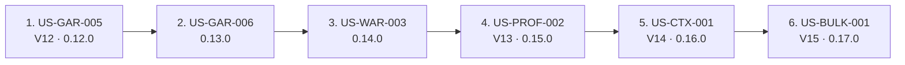

# Sprint 4 — Backend Implementation Guides

This package tells a backend developer exactly how to implement the six selected Sprint 4 stories:

- the complete production code, tests, migrations, OpenAPI and CI changes, in delivery order;
- the verbatim requirements;
- every decision behind the code.

**It is documentation only. No source file, test, migration, OpenAPI file or workflow in the repository was changed to produce it.**

**Revision of 2026-11-17.** The package was synchronized with the canonical documentation:

- **Vietnamese descriptor search.** The Product Owner explicitly authorized Vietnamese search labels and aliases for US-WAR-003. OPEN-S4-11 is refined, and the WAR-003 guide gains step P3, the `VietnameseDescriptorAliases` class (195 values). The canonical table is in [vietnamese-descriptor-search-aliases.md](../../../../03-requirements/vocabularies/vietnamese-descriptor-search-aliases.md). The cursor matching policy moves from `m1` to `m2`. Test T10 is new, and T2, T3, T4, T7 and T8 are extended. WAR-003's former steps P3–P20 are now P4–P21, and the CI totals grow by one.
- **US-GAR-006.** The story now has a formal Draft story file and a parent, PBI-049. Its acceptance criteria are a delegated formalization awaiting Product Owner acceptance.
- **Canonical documents.** The plan (version 0.2), PRD, SRS, Business Rules, Use Cases, backlog, stories and ADD were updated, and the verbatim sections of the guides were refreshed from them.

## 1. Sprint Goal

From the [Sprint 4 plan](../sprint-plan.md#2-sprint-goal):

> **Enable owners to maintain a trustworthy, findable wardrobe and control their personal and environmental context, using the existing private-photo and confirmed-garment foundations, with safe removal, attachment and bulk-entry recovery.**

## 2. Stories

| Order | Story | Guide | Migration | OpenAPI | CI entries after |
| --- | --- | --- | --- | --- | --- |
| 1 | US-GAR-005 — Remove a garment while preserving minimal history | [US-GAR-005-guide.md](US-GAR-005-guide.md) | V12 (`wardrobe`) | 0.12.0 | 103 |
| 2 | US-GAR-006 — Attach a photo to an existing imageless garment (Draft story since 2026-11-17; PBI-049) | [US-GAR-006-guide.md](US-GAR-006-guide.md) | — | 0.13.0 | 107 |
| 3 | US-WAR-003 — Find owned garments through search and filters | [US-WAR-003-guide.md](US-WAR-003-guide.md) | — | 0.14.0 | 117 |
| 4 | US-PROF-002 — Control optional body and gender context | [US-PROF-002-guide.md](US-PROF-002-guide.md) | V13 (`personal_context`) | 0.15.0 | 123 |
| 5 | US-CTX-001 — Choose environmental context with safe fallback | [US-CTX-001-guide.md](US-CTX-001-guide.md) | V14 (`personal_context`) | 0.16.0 | 132 |
| 6 | US-BULK-001 — Review and confirm a bulk garment-photo import | [US-BULK-001-guide.md](US-BULK-001-guide.md) | V15 (`wardrobe`) | 0.17.0 | 139 |

The CI baseline before Sprint 4 is 95 required report entries.

## 3. Package Contents

Exactly nine files:

| File | Purpose |
| --- | --- |
| `README.md` | This overview |
| [shared-architecture.md](shared-architecture.md) | Cross-story rules: shared-file order, lock order, identity and recovery, errors, transport, migrations, OpenAPI, configuration, testing, SQL, privacy, naming, external obligations |
| [open-questions.md](open-questions.md) | The record of the 33 delegated detailed decisions (OPEN-S4-01 to OPEN-S4-33) |
| `US-GAR-005-guide.md` … `US-BULK-001-guide.md` | One guide per story, each with the same 18 sections (below) |

Each story guide has these sections:

1. Story Overview
2. Repository Baseline
3. Business Requirements — Verbatim
4. Product Requirements — Verbatim
5. Software Requirements — Verbatim
6. Business Rules — Verbatim
7. User Story and Acceptance Criteria — Verbatim
8. Use Cases, Flows and Architecture Decisions — Verbatim
9. Engineering Interpretation
10. Just-in-Time Detailed Design
11. File Change Matrix
12. Complete Production Implementation
13. Complete Automated Test Implementation
14. Manual Verification
15. Acceptance Criteria and Requirements-to-Test Matrices
16. Definition of Done
17. Troubleshooting
18. Final Checklist

## 4. Verified Repository Baseline

The guides are written against branch `sprint_04` at commit `33c579ce52008da8fd60ade41ce743ea6b5e002c` (merge of PR #5, Sprint 3). Its state:

- **Stack:** Java 21, Spring Boot 4.1.1 (Spring Framework 7, Spring Security 7), `JdbcClient` without JPA, Flyway, PostgreSQL 17 (Testcontainers `postgres:17.11-bookworm`), Jackson 3 (`tools.jackson`), JUnit 5, AssertJ, ArchUnit, MockMvc and the Maven Wrapper.
- **Modules:** Identity, Wardrobe and Personal Context, each in its own schema (AR-01–08). `PersistenceOwnershipSqlTest` and `DatabaseSchemaOwnershipIT` enforce this.
- **Migrations:** V1–V11.
- **OpenAPI:** 0.11.0 at `docs/05-api/openapi.yaml`, checked against the served API by `IdentityOpenApiContractIT`.
- **CI:** `.github/workflows/backend-ci.yml`, with 95 required report entries and pull-request branches `main`, `sprint_02` and `sprint_03`.

[shared-architecture.md §2](shared-architecture.md#2-verified-repository-baseline) has the details.

## 5. Decisions

**Approved by the Product Owner on 2026-11-16: all 30 Sprint 4 decisions.**

- Story decisions: S4-GAR-01–06, S4-WAR-01–04, S4-PROF-01–04, S4-CTX-01–06 and S4-BULK-01–07.
- Integration decisions: S4-INT-01–03.

The approval is binding. Since version 0.2 (2026-11-17) the plan records it in its decision register, which each guide quotes; the earlier "PROPOSED — PENDING PO APPROVAL" status is kept there as history.

**Explicitly authorized by the Product Owner on 2026-11-17:** Vietnamese descriptor search for US-WAR-003 (refinement of OPEN-S4-11). The capability is authorized; the alias wording remains a delegated default.

**Delegated to Claude: 33 detailed decisions, OPEN-S4-01 to OPEN-S4-33.** Each is labeled `SELECTED BY CLAUDE — DELEGATED DEFAULT`, `IMPLEMENTATION PENDING` and `VERIFICATION PENDING` in [open-questions.md](open-questions.md). **None is Product Owner–approved.** The defaults most worth a review are:

| Area | Default | Record |
| --- | --- | --- |
| Removal command and outcomes | `POST …/garments/{id}/removal` → `REMOVED` / `ALREADY_REMOVED`; replay of a removed creation → `410` | OPEN-S4-01, 03 |
| Removal cleanup | Every `PT5M`, batch 50, retry `PT15M`, physical deletion within `P30D`, warning at `P21D` | OPEN-S4-04, 05 |
| Search | `q` of 1–100 code points over English labels, codes and **Vietnamese search aliases** of six vocabularies, plus Brand; case-insensitive, accent-sensitive; ambiguous words match every named value; filtered cursor bound to its conditions under matching policy `m2` (`CONDITIONS_CHANGED`). **Review of the alias wording advised.** | OPEN-S4-11–15 |
| Optional context vocabularies | `GenderContext` and `BodyShape` codes: **newly selected; an inclusive-representation review is advised** | OPEN-S4-16 |
| Location and weather | Rounded to 2 decimals; Open-Meteo `current` data; inclusive 30 minutes on the provider's evidence time; one `PT2S` deadline, 8 concurrent requests, 64 KiB | OPEN-S4-18–24 |
| Bulk limits | 20 items, 3 active batches, `P7D`, derived 300,000,000 bytes, no drafts: **Product Owner review advised** | OPEN-S4-25 |

## 6. Implementation Sequence

Apply the guides **in this order**. Every BEFORE anchor is the file as left by the previous guide (OPEN-S4-31).



The arrows are file order for this package, the plan's recommended sequence. They are not product dependencies: US-WAR-003, US-PROF-002 and US-CTX-001 are functionally independent of the media stories. A team that changes the order must rebase the BEFORE anchors of the shared files and renumber migrations and OpenAPI versions.

## 7. How to Use the Guides

1. Read [shared-architecture.md](shared-architecture.md) once.
2. For each story, in order:
   1. Read §1–§11.
   2. Apply §12 step by step:
      - `[ADD]` creates the file with the complete code shown;
      - `[MODIFY]` replaces each BEFORE block, which must match exactly once, with its AFTER block.
   3. Apply §13 the same way.
   4. Run the commands in §13, then the manual checks in §14.
3. Keep line endings when editing. Several Personal Context files and the `.properties` files use CRLF.
4. Commit per story. This package itself commits nothing.

**Shared files** changed by more than one guide are listed in [shared-architecture.md §3](shared-architecture.md#3-cumulative-delivery-order-and-shared-files). These are the busiest:

- the Wardrobe controller and exception handler;
- `application.properties` and `application-test.properties`;
- `openapi.yaml` and `backend-ci.yml`;
- the integration-test support classes, `GarmentSchemaIT` and `PreferencesSchemaIT`.

## 8. Prerequisites

- JDK 21 and Docker (Testcontainers) for integration tests.
- The local stack of `backend/README.md`: Compose PostgreSQL and S3Mock.
- `curl.exe` and Windows PowerShell 5.1 for the manual checks. The shared `manual-helpers.ps1` is in [US-GAR-005 §14](US-GAR-005-guide.md#14-manual-verification).
- Never use real credentials, personal photos or real user data in manual checks. Never run `flyway clean` against a shared database.

## 9. Migrations and API

| Version | Story | Schema | Content |
| --- | --- | --- | --- |
| V12 | GAR-005 | `wardrobe` | `minimized_at` and its CHECK; `wardrobe_garment_removal_cleanup` |
| V13 | PROF-002 | `personal_context` | `personal_context_optional_context` |
| V14 | CTX-001 | `personal_context` | `personal_context_location`, `personal_context_weather_evidence` |
| V15 | BULK-001 | `wardrobe` | `wardrobe_bulk_import_batch`, `wardrobe_bulk_import_item` |

New and changed operations:

| Operation | Story |
| --- | --- |
| `POST /api/v1/wardrobe/garments/{garmentId}/removal` | GAR-005 |
| `POST /api/v1/wardrobe/garments/{garmentId}/photo-attachment` | GAR-006 |
| `GET /api/v1/wardrobe/garments` gains `q`, `category` and `color`, plus `resultState` and `conditions` | WAR-003 |
| `GET`/`PATCH /api/v1/personal-context/optional-context` | PROF-002 |
| `GET`/`PATCH /api/v1/personal-context/location` | CTX-001 |
| `POST`/`GET /api/v1/wardrobe/bulk-imports`, `GET …/{batchId}`, `POST …/items/{itemId}/photo`, `…/acceptance`, `…/cancellation`, `POST …/{batchId}/stop` | BULK-001 |

## 10. Verification Commands

From `backend/`:

```powershell
# One unit class
.\mvnw.cmd -q "-Dtest=GarmentRemovalTest" test

# Integration classes (the smoke test satisfies Surefire when no other unit test is selected)
.\mvnw.cmd "-Dtest=HarnessSmokeTest" "-Dit.test=GarmentRemovalApiIT,GarmentSchemaIT" verify

# Everything, as CI runs it
.\mvnw.cmd clean verify
```

After each guide, CI on a pull request to `sprint_04` must find the cumulative number of required reports listed in §2, with no failure or skip.

## 11. Status

| Item | Status |
| --- | --- |
| Repository source, tests, migrations, OpenAPI, CI | **All six guides applied:** US-GAR-005 on 2026-11-21 (V12, OpenAPI 0.12.0, the CI trigger `sprint_04`), US-GAR-006 on 2026-11-22 (no migration, OpenAPI 0.13.0, 107 required reports), US-WAR-003 on 2026-11-22 (no migration, OpenAPI 0.14.0, 117 required reports), US-PROF-002 on 2026-11-22 (V13, OpenAPI 0.15.0, 123 required reports), US-CTX-001 on 2026-11-23 (V14, OpenAPI 0.16.0, 132 required reports) and US-BULK-001 on 2026-11-23 (V15, OpenAPI 0.17.0, 139 required reports). |
| Guides applied in the repository | **All six.** On 2026-11-23 `./mvnw -o clean verify` passed in the repository: 710 unit and 464 integration tests, none failed or skipped; 138 of 139 required reports present locally (the Sprint 3 `HeifDecodingIT` needs libheif, which CI installs). The local measurements and manual checks are recorded in each guide's §14: the WAR-003 query plans, the PROF-002 manual checks, the CTX-001 manual checks and deadline measurement, and the BULK-001 manual checks and resource measurement. No real Open-Meteo request has been made; nothing is deployed; CI has not run. |
| Scratch verification (2026-11-17) | **Re-run after the Vietnamese search refinement, in an isolated copy.** All 206 steps of the six guides applied in order, with every BEFORE anchor matching exactly once, plus the canonical alias document that T10 reads. `./mvnw -o clean verify` gave BUILD SUCCESS: 687 unit tests and 435 integration tests, with 0 failures, 0 errors and 0 skipped; this includes the new `VietnameseDescriptorAliasesTest` (5) and the extended WAR-003 tests. Of the 138 required CI reports, 137 existed with at least their minimum count; the 138th is again the Sprint 3 `HeifDecodingIT` (libheif not installed on that machine). |
| Scratch verification (2026-11-16, superseded) | **Done on 2026-11-16 in an isolated copy.** All 204 steps of the six guides applied in order with every BEFORE anchor matching exactly once. `./mvnw -o clean verify` (the same Maven Wrapper, offline, run from Git Bash) gave BUILD SUCCESS: 677 unit tests (Surefire) and 433 integration tests (Failsafe, Testcontainers PostgreSQL 17.11), with 0 failures, 0 errors and 0 skipped. Of the 137 required CI reports, 136 existed with at least their minimum count. The 137th, the Sprint 3 `HeifDecodingIT`, ran 0 tests because libheif is not installed on that machine; CI installs it. |
| Delegated decisions | `VERIFICATION PENDING` until implemented in the repository and confirmed by its CI |

**What the scratch run is, and is not.**

- **It is:** the guides' ADD and MODIFY steps applied mechanically, in order, to a copy of `backend/`, `docs/05-api` and `.github/workflows`, followed by Maven on that copy.
- **It shows** that the code and tests in the guides compile, that their BEFORE anchors match cumulatively, and that the listed tests passed there.
- **It is not** a run in the repository, a CI run or a deployment. It does not cover the external obligations below.

## 12. Real-Provider and External Obligations

None of these is satisfied by this package.

- **Open-Meteo (US-CTX-001):**
  - its terms of use, attribution and eligibility for the actual deployment are **not verified**;
  - no real request was made, and the response shape follows the public documentation (§14 M7);
  - the 2-second deadline must be measured in the agreed environment (§14 M8);
  - until the terms are cleared, production can run with `capsuleai.personal-context.weather.enabled=false`, which reports `NOT_CONFIGURED`.
- **Object storage (US-GAR-005):** that deleted photos leave no recoverable version depends on the bucket's versioning and lifecycle configuration. This is an operations check (§14 M9 of that guide).
- **Resources (US-BULK-001):** 20 representative photos per batch must be measured in the agreed environment before the Product Owner reviews the limits (§14 M11).
- **Clients:** removal confirmation, search, optional-context, location-permission, multiphoto and resume screens, uncertain-outcome review, Vietnamese text and accessibility.

## 13. Known Limitations

- US-GAR-006's acceptance criteria (story AC-01–AC-06, the guide's P-AC-01–06) are a delegated formalization of 2026-11-17 and await Product Owner acceptance.
- No outfit recommendation, Coverage, Multiplier or other result consumer exists. AC parts that need one (CTX-001 AC-04/AC-05 reevaluation, PROF-002 soft influence) are recorded as gaps, never as passes.
- No AI extraction is added: bulk review values always come from the user.
- Bulk batches are kept as minimal action identity while the account exists; a purge is deferred to account-lifecycle work.
- The PROF-002 vocabularies, the BULK-001 limits and the WAR-003 Vietnamese alias wording are delegated defaults awaiting review. Approved S4-PROF-01 and S4-BULK-06 expect explicit confirmation of those values before release.
- Search stays accent-sensitive and literal: `ao thun` does not match `áo thun`, and a two-descriptor phrase such as `áo thun trắng` is not split.

## 14. Final Checklist

- [ ] The six guides are applied in order, each followed by `.\mvnw.cmd clean verify` and a pull request to `sprint_04`.
- [ ] CI finds 139 required reports after the sixth guide.
- [ ] Every OPEN-S4 default is either confirmed by the team or changed through its record in `open-questions.md`.
- [ ] The Vietnamese alias wording is reviewed; any change goes to the canonical table and WAR-003 P3 together, with a new matching-policy tag.
- [ ] The Product Owner accepts or amends the US-GAR-006 acceptance criteria.
- [ ] Open-Meteo terms reviewed. CTX-001 M7 and M8 recorded.
- [ ] Bucket versioning checked (GAR-005 M9). BULK-001 M11 recorded.
- [ ] Client evidence gathered for each story's Definition of Done.
- [ ] No credential, token, personal photo or real user data was committed.
