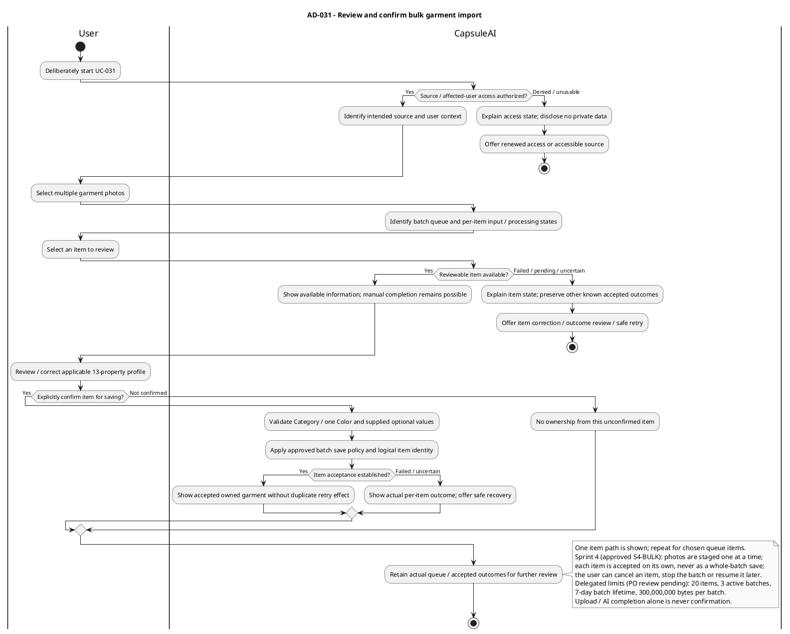
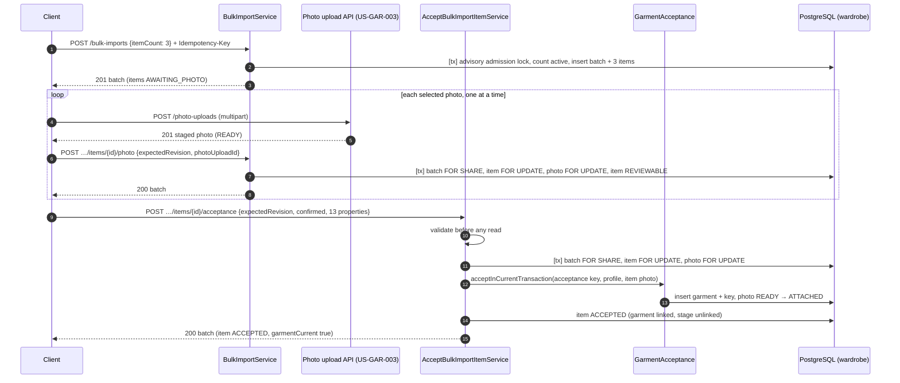
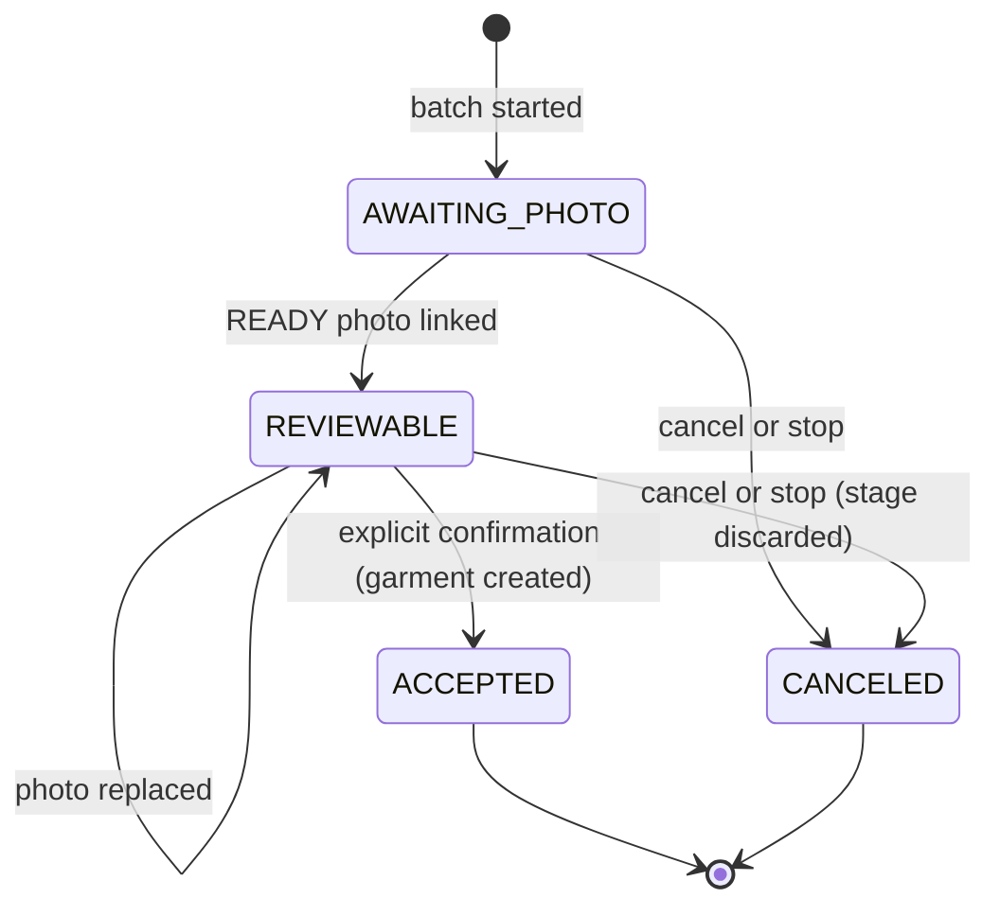

# US-BULK-001 — Review and Confirm a Bulk Garment-Photo Import: Implementation Guide

| Field | Value |
| --- | --- |
| Story | [US-BULK-001](../../../stories/bulk-import/US-BULK-001-review-and-confirm-bulk-garment-import.md) (Draft), parent PBI-048 |
| Sprint | Sprint 4, story 6 of 6 in the [recommended order](README.md#6-implementation-sequence): the last guide, because it reuses the photo staging of US-GAR-003 and builds on the US-GAR-005 replay rule |
| Starting point | After US-GAR-005, US-GAR-006, US-WAR-003, US-PROF-002 and US-CTX-001 |
| Approved decisions applied | S4-BULK-01 to S4-BULK-07, S4-INT-01, S4-INT-02, S4-INT-03, all **approved by the Product Owner on 2026-11-16** |
| Delegated defaults applied | OPEN-S4-25 to 33 (`SELECTED BY CLAUDE — DELEGATED DEFAULT`, [record](open-questions.md)). **The four admission values (20 items, 3 active batches, `P7D`, 300,000,000 bytes) are delegated defaults; Product Owner review is advised.** |
| Out of scope by instruction | AI extraction or proposal of garment values, outfit recommendation, parallel or background processing, server-side drafts |
| Verification status | **Applied to the repository on 2026-11-23** (P1–P35 and T1–T9 implemented from this guide, then reviewed; the review corrections and added tests are recorded in P21 and §13). `./mvnw -o clean verify` passed in the repository on 2026-11-23: 710 unit and 464 integration tests, none failed, errored or was skipped. Of the 139 required CI reports, 138 were present with at least their minimum; the missing one is the Sprint 3 `HeifDecodingIT`, which needs libheif that the local machine lacks and CI installs. Manual M1–M10 passed on a throwaway stack, and M11 was measured locally (§14). **Still required:** Product Owner review of the four OPEN-S4-25 values, M11 in the agreed environment, client evidence (M12), and a CI run on a pull request to `sprint_04`. Batch purge stays deferred to account-lifecycle work. |

## 1. Story Overview

**Story.** As an authenticated user, I want to select several photos and review them as one queue before saving accepted garments. This reduces repetitive entry while I keep the authority to confirm each garment.

**Backend outcome.**

- **Batch.** `POST /api/v1/wardrobe/bulk-imports` with an `Idempotency-Key` and an `itemCount` from 1 to 20.
  - It creates one batch with that many server-identified items, each `AWAITING_PHOTO`, each with a persistent acceptance key.
  - A repeated start returns the same batch.
  - At most 3 batches per owner are active (open and unexpired). A batch takes item work for 7 days.
- **Sequential staging** (S4-BULK-03). The client stages each photo with the existing `POST /photo-uploads`, then links it with `POST …/items/{itemId}/photo`. The item becomes `REVIEWABLE`. A linked photo is never an owned garment.
- **Per-item confirmation** (S4-BULK-04).
  - `POST …/items/{itemId}/acceptance` with the reviewed 13 properties, `confirmed: true` and the item's `expectedRevision`.
  - In one transaction, the shared `GarmentAcceptance` (extracted from `AddGarmentService`) creates exactly one garment under the item's acceptance key and attaches the item's own photo; the item becomes `ACCEPTED`.
  - Items are independent: an invalid or failed item never affects another.
- **Safe retries** (S4-BULK-05, S4-INT-02).
  - The same confirmation repeated after a lost response returns the same garment, even after the garment was removed (`garmentCurrent: false`).
  - A repeated link or cancellation changes nothing.
  - Every command answers with the whole batch, so the client can review each outcome.
- **Cancel and stop** (S4-BULK-07). An item can be cancelled. A stop cancels every item not yet accepted and discards their staged photos; accepted items stay.
- **Resume** (OPEN-S4-30). `GET /bulk-imports` lists the active batches and `GET /bulk-imports/{id}` shows one batch, including stopped and expired ones.

**Out of scope:**

- AI completion or extraction (a reviewed value always comes from the user);
- multipart batch upload or parallel decoding;
- a server worker;
- server-side drafts of unconfirmed values;
- purging old batches (deferred to account-lifecycle work);
- client screens.

## 2. Repository Baseline

| Item | State after US-CTX-001 | Relevance |
| --- | --- | --- |
| Photo staging | `POST /photo-uploads` validates, normalizes and stores one photo (`PT24H` TTL, 15,000,000 bytes, decoder ceiling 2) | Reused unchanged for every item (OPEN-S4-30) |
| `AddGarmentService` | Validates, then runs the imageless or photo-backed acceptance in one transaction; replays a removed garment as `410` (US-GAR-005 P11) | P7 extracts that logic as `GarmentAcceptance`; P8 delegates to it with an unchanged constructor and behavior |
| `PhotoUploadRepository` | `lockOwned`, `attach`, and `cancel` (RECEIVING or READY → DISCARDED with object cleanup) | Used for linking, acceptance and stop |
| `WardrobeApiExceptionHandler` | Has the GAR-006 handler last among the domain handlers | P30 adds five handlers and neutral key-reuse text |
| `WardrobeIntegrationTestSupport` | `TRUNCATE` from US-GAR-005 T6 | T4 adds the V15 tables and two helpers |
| `GarmentSchemaIT` | Exact `wardrobe` table list (US-GAR-005 T7) | T5 adds the two V15 tables |
| Migrations | V1–V14 | This guide adds **V15** |
| OpenAPI | 0.16.0 | → 0.17.0 |
| CI | 132 entries | +7 entries (139) |

## 3. Original Business Requirements — Verbatim

> Sections 3–8 reproduce the cited sources verbatim. Only relative link targets were re-based to this file's location, and heading levels were shifted to nest under this guide; no wording was changed. Sprint 4 decision rows reproduce the plan's register (version 0.2), which records the Product Owner's approval of 2026-11-16. Paragraphs and lines dated 2026-11-17 were added to the sources by the Sprint 4 documentation synchronization.

From [BRD](../../../../01-business/BRD.md):

| ID | Requirement | Business Rationale | Priority | Related Goals |
|---|---|---|---|---|
| BR-021 | Personal images, wardrobes, profile information, and behavior must remain private to authorized access, with understandable user control over their information. | Trust is necessary for participation across the value loop. | Must | BG-01, BG-02, BG-03, BG-04 |
| BR-022 | Users must be able to understand the basis and limitations of recommendations, coverage, and utility estimates, including insufficient data or unavailable context. | Enable informed choices and avoid false certainty. | Must | BG-02, BG-03, BG-04 |
| BR-031 | Users must be able to select multiple garment photos, review a batch queue and confirm accepted garments, with individual failures/uncertain outcomes distinguished. Upload alone must not create a confirmed garment. | Reduce repetitive entry while keeping each accepted profile authoritative. | Must | BG-01 |

| ID | Capability | Business Purpose |
|---|---|---|
| CAP-15 | Bulk Garment Import | Review and confirm multiple photo-backed entries without automatic ownership. |

| ID | Goal | Rationale | Expected Business / User Value | Related Product Capabilities |
|---|---|---|---|---|
| BG-01 | Reduce Wardrobe Digitization Effort | Manual setup delays access to useful wardrobe advice. | Faster access to a trustworthy digital closet with less repetitive entry. | CAP-01–CAP-04 |

## 4. Original Product Requirements — Verbatim

From [PRD](../../../../02-product/PRD.md):

### 8.12 JRN-12 — Reviewed bulk entry

Select multiple photos → inspect per-item queue outcomes → review/correct each applicable profile → explicitly confirm accepted entries → inspect saved items and resolve failed/uncertain items safely.

**Recovery / completion:** Distinguish pending, genuinely empty, unavailable, denied, failed and accepted outcomes where applicable; preserve prior accepted information and safe retry. **Features:** FEAT-BULK-001; unresolved policy is in Section 34.2.

### FEAT-BULK-001 — Review and confirm bulk garment-photo import

**Purpose / user value:** Reduce repeated entry work while keeping each wardrobe addition deliberate and trustworthy.

**Source:** BR-031; CAP-15; JRN-12; DD-007. **Entry / preconditions:** Authenticated authorized access and an identifiable source look/item where applicable; an empty wardrobe does not prohibit independent discovery or conversation.

**Product behavior:** Select multiple photos, see their batch queue, inspect each entry, correct/complete the applicable profile and explicitly confirm accepted garments before saving. Per-item pending, review, accepted, failed and uncertain states are distinguishable; one item failure does not falsely complete or erase another accepted result. Upload/analysis alone does not confirm ownership. Limits, processing, resumability and save atomicity remain MVP-Q08; AI is not a prerequisite to manual confirmation.

**Controls / states / recovery:** Use the explicit actions above; distinguish loading/pending, available, empty/no-match, failed/unavailable and denied access as applicable. Preserve the identified selection and prior accepted state; uncertain mutation outcomes require review/safe retry, not a second accepted action.

**Feature-level acceptance criteria:**

- **AC-01:** The source-linked end-to-end outcome and each stated supported action can be demonstrated with identifiable accepted results.
- **AC-02:** Missing information, denied access and dependency failure produce the stated recovery without fabricated success, ownership or wear.
- **AC-03:** The relevant privacy, user-confirmation, typed feedback and independent-action boundaries above hold in positive and negative fixtures; open policy must be approved before the affected story is Ready.

**Out of scope / deferred detail:** Exclusions in Section 27 apply. Exact API/schema/provider/model/transaction design is JIT for selected stories; no implementation or Sprint assignment follows from this feature specification.

**Sprint 4 resolution (2026-11-17):** US-BULK-001 provisionally settles the MVP-Q08 points it needs ([SRS Section 3.23.1](../../../../03-requirements/SRS.md#3231-bulk-import-rules)): up to 20 photos per batch, up to 3 unfinished batches per user, 7 days to finish a batch, photos staged one at a time, each item reviewed and confirmed on its own, and the user can cancel an item, stop the batch or resume it later. These limits are delegated defaults awaiting Product Owner review. See Section 34.3.

## 5. Original Software Requirements — Verbatim

From [SRS](../../../../03-requirements/SRS.md):

| ID | Requirement | Scope | Source | Verification |
|---|---|---|---|---|
| FR-BULK-001 | The system shall allow selection of multiple garment photos into an identifiable import batch queue under applicable photo permissions and input-validation rules. | MVP | FEAT-BULK-001; BR-031, BR-021, BR-022 | T/I: multiphoto queue correspondence and invalid item. |
| FR-BULK-002 | The system shall show each queued item's pending, reviewable, accepted, failed or uncertain outcome independently, without representing an uploaded photo as a confirmed owned garment. | MVP | FEAT-BULK-001; BR-031, BR-021, BR-022 | T/I: mixed item outcomes and no upload-only ownership. |
| FR-BULK-003 | The system shall allow each reviewable item's applicable approved garment profile to be reviewed/corrected, supporting all 13 properties, optional distinct Materials/Styles, category applicability and user authority. | MVP | FEAT-BULK-001; BR-031, BR-021, BR-022 | T/I: review/correction and unknown optional information. |
| FR-BULK-004 | The system shall save only entries explicitly confirmed by the user with Category and one Color, retaining all accepted optional information and truthful unevaluated recommendation eligibility; upload or AI completion alone shall not confirm an item. | MVP | FEAT-BULK-001; BR-031, BR-021, BR-022 | T/I: confirmed versus uploaded/proposed entries. |
| FR-BULK-005 | The system shall distinguish each failed or uncertain item from accepted additions, preserve known accepted outcomes and offer correction/outcome review/safe retry without falsely claiming the whole batch succeeded. | MVP | FEAT-BULK-001; BR-031, BR-021, BR-022 | T/I: partial failure, uncertain acknowledgment and accepted survivors. |
| FR-BULK-006 | The system shall preserve one accepted garment per logical confirmed item action across retries/reprocessing, while permitting separately intentional additions, enforcing affected-user/media authorization and preventing cross-item association errors. | MVP | FEAT-BULK-001; BR-031, BR-021, BR-022 | T/I: item retry versus separate intent; cross-account/cross-item checks. |
| DATA-BULK-001 | The system shall associate batch items, private staged media, review/confirmation and each logical accepted-add outcome without cross-item/user mixing or ownership from upload; limits, resumption, save atomicity and staged-media cleanup require MVP-Q08. | MVP | FEAT-BULK-001; BR-031, BR-021 | I/T: owner/source separation, accepted versus pending outcomes and approved lifecycle policy. |
| DATA-INT-004 | The system shall keep failed/pending mutations distinct from accepted state, preventing duplicates of the same logical action without collapsing separate explicit Wear intentions. | MVP | FEAT-AI-002, FEAT-PERS-002; BR-005, BR-011 | T: interrupted additions/Wear actions; retry versus explicit same-outfit/day repeat. |
| NFR-PRIV-001 | The system shall limit personal data to necessary functionality, authorized bounded outfit sharing, personalization, history/utilization, measurement, security and operational integrity, respecting omission/correction/removal/permission controls. Only an explicitly approved shared-outfit/creator/media projection may be available to its authorized audience; this grants no access to private wardrobe inventories, source images, purchase information, profile, feedback or history. No entire-wardrobe sharing, unrestricted third-party sharing or personal-data sale is permitted. Sharing audience, consent and publishable fields remain MVP-Q01, not inferred permission. | MVP | FEAT-AUTH-001, FEAT-COM-001/002, FEAT-CHAT-001, FEAT-TRY-001; BR-021, BR-025–BR-028 | I/T: permitted shared projection versus denied private operations; explicit sharing and account isolation; policy approval required before sharing stories are Ready. |
| NFR-PRIV-002 | The MVP shall not use personal wardrobe images, profiles, Wear Events, feedback or corrections for AI model training/improvement; any future use requires separate explicit opt-in and an approved future product/privacy change, and external navigation does not grant unrestricted sharing consent. | MVP | FEAT-AUTH-001, FEAT-AI-002, FEAT-MET-001, FEAT-SHOP-002; BR-002, BR-018, BR-021 | I: complete MVP data-use boundary and future opt-in/change control; private data absent from training/improvement inputs. |

Added to the [SRS](../../../../03-requirements/SRS.md) on 2026-11-17 by the Sprint 4 documentation synchronization (verbatim):

#### 3.23.1 Bulk Import Rules

Added 2026-11-17 for [US-BULK-001](../../../stories/bulk-import/US-BULK-001-review-and-confirm-bulk-garment-import.md). The approved decisions S4-BULK-01–07 (approved 2026-11-16) govern; details are delegated defaults ([OPEN-S4-25–30](open-questions.md#open-s4-25--bulk-admission-limits-and-retention)). The numeric limits are configuration awaiting Product Owner review; they resolve the corresponding parts of MVP-Q08 provisionally ([PRD Section 34.3](../../../../02-product/PRD.md#343-sprint-4-resolutions-2026-11-17)). FR-BULK-001–FR-BULK-006 and DATA-BULK-001 are unchanged.

| Rule | Requirement |
|---|---|
| Batch | The owner starts a batch by stating how many photos it will contain. Starting the same batch again with the same request key returns the same batch. |
| Limits (delegated defaults) | At most 20 items per batch, at most 3 active batches per owner, a batch lifetime of 7 days, and an aggregate ceiling of 300,000,000 original bytes per batch (20 × the existing 15,000,000-byte photo limit). The existing 24-hour expiry of a staged photo is unchanged. |
| Items | Each item is waiting for a photo, reviewable, accepted or cancelled. A reviewable item's photo is shown as ready or expired; an expired photo must be selected again. |
| Sequential processing | Photos are staged one at a time through the existing intake. There is no background worker, parallel decoding or AI analysis. |
| Review and confirmation | Each reviewable item is reviewed and confirmed individually, with Category and one Color plus any valid optional properties under the 13-property rules. Upload alone never creates a garment. |
| Partial success | Item outcomes are independent: accepting one item never depends on another, a failed or cancelled item does not undo accepted ones, and the batch never reports items as accepted that were not. |
| Retry | Repeating an item confirmation after a lost response returns the same accepted garment and never creates a second one. Confirming an accepted item again with different values is refused. |
| Cancellation and stopping | The owner can cancel one item or stop the whole batch. Stopping cancels the remaining items and releases their unclaimed photos; accepted garments stay. |
| Resumption | The owner can list active batches and reopen one to continue after leaving the app, within the batch lifetime. An expired batch accepts no further work but keeps its accepted garments. Purging old batches together with the account lifecycle is deferred. |
| Ownership | Another account's batch, item or photo is indistinguishable from an unknown one. A staged photo belongs to at most one item. |

## 6. Original Business Rules — Verbatim

From [Business Rules](../../../../03-requirements/business-rules.md):

### BRULE-BULK-001 — Review before batch ownership

**Rule:** Multi-photo input creates a review queue, not confirmed ownership. Each accepted entry requires user confirmation of Category and one Color, preserving every supplied valid optional property under the same 13-property authority. Uncertain AI or an unavailable analysis capability does not remove manual review/confirmation.

**Source:** FR-BULK-001/002/003/004; DATA-BULK-001.

### BRULE-BULK-002 — Individual outcomes and retry identity

**Rule:** Track each item's actual outcome without cross-item/account mixing. Distinguish pending, reviewable, accepted, failed and uncertain; preserve accepted results and recover the same logical confirmed item action without duplicates. Multiple separate intentional additions remain possible. Limits, queue processing/resumption, save atomicity and staged-media lifecycle require MVP-Q08; no numeric limit, broker or asynchronous topology is implied.

**Source:** FR-BULK-002/005/006; DATA-BULK-001; DATA-INT-004.

**Sprint 4 refinement (2026-11-17):** For US-BULK-001, the delegated defaults of OPEN-S4-25–30 provisionally settle the MVP-Q08 parts it needs: at most 20 items per batch, 3 active batches per owner, a 7-day batch lifetime and a 300,000,000-byte aggregate ceiling, with sequential staging, independent item acceptance, item cancellation, batch stop and resumption. The existing 24-hour staged-photo expiry is unchanged. These numbers are configuration awaiting Product Owner review and do not introduce a broker or asynchronous topology (approved S4-BULK-01–07; SRS Section 3.23.1).

### BRULE-GAR-001 — Canonical Garment Authority

**Rule:** Each owned garment belongs to the authorized user's wardrobe. Automated attribute proposals are not authoritative. Applicable User Confirmed, User Corrected, or User Entered-and-confirmed values establish the canonical profile; later automated analysis cannot silently overwrite them.

**Applies To:** ingestion, edits, all garment-dependent evaluations.

**Source:** DATA-GAR-001, FR-GAR-011, AI-REQ-001, AI-REQ-007, DATA-INT-001.

### BRULE-GAR-002 — Saveable Minimum

**Rule:** A garment is Saveable when the user explicitly confirms its supported Primary Category and Dominant Color. Manual creation requires neither an image nor successful analysis. Missing optional rich descriptors do not prevent saving; canceled or unconfirmed work does not establish a confirmed wardrobe entry.

**Applies To:** assisted/manual creation and validation.

**Source:** FR-GAR-003, FR-AI-003, FR-AI-008, FR-AI-009, ERR-GAR-001.

### BRULE-GAR-005 — Bounded Garment Descriptors

**Rule:** Exactly 13 fashion properties are approved: Category, Subtype, Color, Material, Pattern, Style, Fit, Neckline, Sleeve Length, Length, Silhouette, Brand, Price. Category and one dominant Color plus explicit user confirmation form the saving minimum. All other applicable properties are optional. Material and Style each support zero or multiple distinct selections; Pattern is single and optional. Fit, Neckline and Sleeve Length apply only to Tops; Length uses separate Tops/Pants vocabularies; Silhouette applies only to Pants. Every supplied controlled value must match the source vocabulary and category; correct or clear invalid/inapplicable input rather than silently substitute or discard it. Unknown optional information is absent, not an invented UNKNOWN/OTHER/Etc value. Preserve real listed fallbacks such as Other, Other Materials and Colorful only where defined.

| # | Property | Applicability | Required for Saving | Meaning / Value Authority |
|---|---|---|---|---|
| 1 | Category | All categories | Yes | One of eight category codes. |
| 2 | Subtype | All categories | No | Optional category-valid selection from the complete approved list. |
| 3 | Color | All categories | Yes | Exactly one dominant Color; Colorful is supported. |
| 4 | Material | All categories | No | Zero, one or multiple approved materials; no semantic duplicates or invented percentages. |
| 5 | Pattern | All categories | No | One optional approved Pattern. |
| 6 | Style | All categories | No | Optional set of zero, one or more distinct approved Style values (repeated selections do not repeat a value); Etc is explanatory, never a value. |
| 7 | Fit | Tops | No | Optional approved Fit. |
| 8 | Neckline | Tops | No | Optional approved Neckline. |
| 9 | Sleeve Length | Tops | No | Optional approved Sleeve Length. |
| 10 | Length | Tops and Pants | No | Category-specific approved Length values. |
| 11 | Silhouette | Pants | No | Optional approved Silhouette. |
| 12 | Brand | All categories | No | Optional user-entered text; no enum/catalogue. |
| 13 | Price | All categories | No | Optional amount originally paid: decimal amount and explicit ISO 4217 currency. |

Complete values are in the [source authority](../../../../../Initial%20files/Image%20to%20Properties%20Extraction.md); no reduced local list, automatic compatibility descriptor or extra attribute is permitted.

**Source:** FR-GAR-002/006–010/012/013, DATA-GAR-002.

### BRULE-GAR-006 — Descriptor Consistency and Unknown Information

**Rule:** Unknown optional information remains absent rather than an invented value. Material selections form distinct semantic values, without percentages/proportions. Color is one approved dominant value; Pattern is one optional value; Style, like Material, is an optional set of distinct values. Validate applicability and supplied labels before confirmation; correct/clear invalid or inapplicable fields without silent substitution or discard. No cross-property inference is approved merely because a subtype overlaps length, style or occasion. Etc is not a Style value. Removed descriptors cannot be reconstructed as hidden fields or readiness gates.

**Source:** FR-GAR-002/006–010, DATA-GAR-002, AI-REQ-008.

### BRULE-GAR-010 — Optional Brand and Purchase Price Authority

**Rule:** Brand is optional user-entered text across all eight categories, with no fixed enum or external catalogue. Preserve the confirmed value; unknown is not a fabricated brand. Price is the optional user-reported purchase price of the owned garment, represented by a decimal amount together with an explicit ISO 4217 currency code. An amount without currency, or currency without amount, is incomplete supplied information and must be corrected or cleared before confirmation; omitting both is valid and does not mean zero. Never infer currency from location or perform floating-point monetary calculations. This is not market/resale/replacement value or a retailer/affiliate price; no conversion feature is introduced. Neither field is a save or readiness requirement. Price must not be inferred from a photograph; any future Brand suggestion remains unconfirmed until user acceptance. Later analysis or image upload must not silently replace confirmed Brand or Price.

Future edits may revise or clear these properties with explicit user confirmation. Supplied valid values participate in the same accepted garment addition and safe-retry outcome; they do not create separate ownership or duplicate accepted additions. Approved validation (PRD OPQ-013, resolved 2026-11-07): Brand has at most 100 Unicode code points, a blank Brand is unspecified, and accepted Brand text is kept exactly. A Price of zero is a known amount, not a missing one; negative amounts, more than 12 integer digits and more fractional digits than the currency's ISO 4217 minor unit are rejected, never rounded; the currency is a valid upper-case ISO 4217 code. Nothing is defaulted or silently altered.

**Applies To:** manual entry, inspection, future editing and assisted-review protection across all eight categories.

**Source:** FR-GAR-012, FR-GAR-013, FR-GAR-011, DATA-GAR-002, DATA-GAR-003, DATA-INT-001, DATA-INT-004; PRD Sections 13.5/34.1.

### BRULE-AUTH-001 — Authorized Personal Operations

**Rule:** Personal wardrobe, profile, feedback, history, and assessment operations require authentication and authorization for the affected user's information. Unavailable authorized access is not an empty wardrobe and does not change personal state.

**Applies To:** all personal domain operations.

**Source:** FR-AUTH-008, ERR-AUTH-001, DATA-GAR-001.

### BRULE-AUTH-007 — Purpose-Limited Private Data Use

**Rule:** Personal data is used only as necessary for CapsuleAI functionality, personalization, wardrobe/history/utilization, validation/measurement, security and operational integrity within the authorized User's private experience, plus explicitly authorized bounded outfit sharing under BRULE-COM-001. MVP personal images, profiles, Wear Events, feedback and corrections are not used for AI model training/improvement. Future personal-data training requires separate explicit opt-in and an approved future product/privacy change.

Only an approved shared outfit/creator/media projection may be exposed to its authorized audience. This never authorizes private inventory, source-image, purchase-information, profile or history access. Entire-wardrobe sharing, unrestricted third-party sharing and personal-data sale remain excluded; sharing audience/consent/fields require MVP-Q01 approval. External dependencies receive only purpose-minimal information: required selected weather location, email/necessary recovery-delivery information, explicitly chosen shopping navigation, or necessary authorized Chat/preview/analysis input under its approved minimal contract; unrelated wardrobe/profile/history disclosure is prohibited. Provider/context choices remain MVP-Q03/Q04/Q09. Necessary active-account information and minimal history follow the retention/removal rules; this policy adds no Delete Account goal or legal certification.

**Applies To:** personal information, account/profile/wardrobe/history, validation/measurement and external exchanges.

**Source:** FR-AUTH-008, NFR-PRIV-001, NFR-PRIV-002, SI-002, SI-003, COM-003, FR-MET-006, DATA-RET-001, DATA-RET-002, DATA-RET-003.

## 7. Original User Story and Acceptance Criteria — Verbatim

From [US-BULK-001](../../../../06-scrum/stories/bulk-import/US-BULK-001-review-and-confirm-bulk-garment-import.md):

### 1. Story

As an authenticated CapsuleAI user, I want to select multiple photos and review a batch queue before saving accepted garments, so that I can reduce repetitive entry while retaining confirmation authority and truthful per-item results.

### 3. Scope

Select multiple photos → queue → per-item review/correction → explicit confirmation/save. Preserve individual failed/uncertain outcomes, accepted results and item-level retry identity. Upload or AI completion alone is never ownership.

### 4. Preconditions

Authorized photo/wardrobe access and applicable selection permissions; batch policy/processing feasibility approved before Ready. These preconditions do not imply a new provider, UI tab, algorithm or product-policy default.

### 5. Acceptance Criteria

#### AC-01 — Multiphoto queue correspondence and invalid item

Given the authorized source and applicable approved policy, the system shall allow selection of multiple garment photos into an identifiable import batch queue under applicable photo permissions and input-validation rules.

**Source / verification:** FR-BULK-001; verify multiphoto queue correspondence and invalid item.

#### AC-02 — Mixed item outcomes and no upload-only ownership

Given the authorized source and applicable approved policy, the system shall show each queued item's pending, reviewable, accepted, failed or uncertain outcome independently, without representing an uploaded photo as a confirmed owned garment.

**Source / verification:** FR-BULK-002; verify mixed item outcomes and no upload-only ownership.

#### AC-03 — Review/correction and unknown optional information

Given the authorized source and applicable approved policy, the system shall allow each reviewable item's applicable approved garment profile to be reviewed/corrected, supporting all 13 properties, optional distinct Materials/Styles, category applicability and user authority.

**Source / verification:** FR-BULK-003; verify review/correction and unknown optional information.

#### AC-04 — Confirmed versus uploaded/proposed entries

Given the authorized source and applicable approved policy, the system shall save only entries explicitly confirmed by the user with Category and one Color, retaining all accepted optional information and truthful unevaluated recommendation eligibility; upload or AI completion alone shall not confirm an item.

**Source / verification:** FR-BULK-004; verify confirmed versus uploaded/proposed entries.

#### AC-05 — Partial failure, uncertain acknowledgment and accepted survivors

Given the authorized source and applicable approved policy, the system shall distinguish each failed or uncertain item from accepted additions, preserve known accepted outcomes and offer correction/outcome review/safe retry without falsely claiming the whole batch succeeded.

**Source / verification:** FR-BULK-005; verify partial failure, uncertain acknowledgment and accepted survivors.

#### AC-06 — Item retry versus separate intent; cross-account/cross-item checks

Given the authorized source and applicable approved policy, the system shall preserve one accepted garment per logical confirmed item action across retries/reprocessing, while permitting separately intentional additions, enforcing affected-user/media authorization and preventing cross-item association errors.

**Source / verification:** FR-BULK-006; verify item retry versus separate intent; cross-account/cross-item checks.

#### AC-07 — Accepted, canceled and uncertain actions

Cancellation or known rejection/failure does not apply the requested mutation. An interrupted response does not prove success or failure: retain an unconfirmed outcome, allow outcome review/safe same-action retry and avoid duplicate accepted effects. A read, preview, Like, Follow, Save or draft copy alone never creates a confirmed Garment or Wear Event. An expired/revoked/wrong-account operation reveals no private state or unauthorized mutation. Optional measurement failure cannot reverse a valid accepted action.

### 6. Quality and Verification

Apply [shared quality/completion](../../../stories/README.md#2-shared-quality-and-completion), the [Definition of Done](../../../definition-of-done.md) and [Test Strategy](../../../../07-testing/test-strategy.md) proportionally. Use known authorized/denied fixtures, missing information and dependency failure, plus real persistence/integration/client evidence when delivered. Vietnamese Android/iOS accessibility and truthful states apply. Protect secrets/private source data; no MVP personal-data training. New tests are planned obligations, not executed or implemented evidence.

### 7. Dependencies

PBI-012 photo-supported review and PBI-006 confirmed authority. AI assistance PBI-013 is conditional; queue topology, limits/resumption and save atomicity remain unselected. Collaborations do not establish priority or a serial schedule. Existing module/public-contract constraints remain authoritative.

### 8. Out of Scope

Comments, messaging, entire-wardrobe sharing, multithread chat history, personalized avatars, AR/3D, automatic ownership/wear/purchase verification and native commerce remain excluded. This story does not implement neighboring capabilities merely to expose an entry point. Full API/data/sequence/state/provider/transaction design follows actual Sprint selection only where justified by complexity and risk.

### 10. Open Refinement Notes

MVP-Q08, MVP-Q09 are maintained in [PRD Section 34.2](../../../../02-product/PRD.md#342-mvp-expansion-open-decisions). Resolve only relevant approved-scope details and feasibility before Ready. Options/recommendations are unapproved. No new numeric rule, source agreement, provider, retention period, estimate or Sprint commitment is inferred. JIT mechanics remain with selected work.

## 8. Original Use Cases, Flows and Architecture Decisions — Verbatim

### 8.1 [UC-031](../../../../03-requirements/use-cases/UC-031-review-and-confirm-bulk-import.md)

#### 1. Use Case Summary

| Field | Value |
|---|---|
| Use Case ID | UC-031 |
| Use Case Name | Review and confirm bulk garment import |
| Scope / Level | CapsuleAI / User Goal |
| Primary Actor | User |
| Supporting Actors | None selected; Chat/preview/catalog providers and module allocation remain unresolved, not invented external actors. |
| Version / Status | 0.1 / Draft |
| Revision | 2026-11-09 — approved PR #4 / DD-007 scope propagation; no implementation or Sprint selection. |

#### 2. Goal

Reduce repetitive entry while retaining confirmation authority and truthful per-item results.

#### 4. Preconditions

Authorized photo/wardrobe access and applicable selection permissions; batch policy/processing feasibility approved before Ready. Authentication/authorization still applies if an existing session later expires. No current implementation is implied.

#### 5. Trigger

The User deliberately starts the named goal from its relevant source area or selected look/item. Related goals are navigation/collaboration, not UML include/extend by default.

#### 6. Main Success Scenario

1. The User selects multiple garment photos through a permitted route.
2. CapsuleAI identifies the queue items and their actual input/processing/review states.
3. The User reviews each selected item, correcting or manually supplying the applicable approved profile.
4. The User explicitly confirms the entries to be saved; Category and one Color are the minimum for each accepted profile.
5. CapsuleAI records actual per-item acceptance, failure or uncertainty under the refined batch save policy, without treating upload/analysis as confirmation.
6. The User sees accepted owned garments and can correct or safely recover failed/uncertain items without duplicating already accepted logical additions.

#### 7. Alternative Flows

##### A1 — Independent continuation or cancellation

Before accepting a mutation, the User may decline/cancel it and continue independent supported product use. No canceled intent is represented as accepted. Each optional Like, Follow, Save, preview, duplicate, garment confirmation or Wear remains a distinct action with its own meaning; a related action is not automatically performed.

##### A2 — Limited or missing information

Show available source information with its ownership/provenance and disclose what is missing. Empty/no-match data differs from retrieval failure. Where this goal includes Add Garment, allow manual correction/completion of Category and one Color with optional applicable fields; do not invent missing information, personal purchase Price or recommendation eligibility.

##### A3 — Feedback or Wear handoff where applicable

Like on Community and AI Today/Chat suggestions and AI Today/Chat-only Dislike use [UC-013](../../../../03-requirements/use-cases/UC-013-provide-outfit-feedback.md). Community Dislike is rejected without mutation. A preview's Wear Today entry uses [UC-014](../../../../03-requirements/use-cases/UC-014-record-wear-event.md) only after current-valid-owned prerequisites; viewing, saving, following, duplicating, chatting or previewing alone creates no Wear or owned garment.

#### 8. Exception / Failure Flows

##### E1 — Unusable access or unavailable source target

Pause protected use; disclose no private source contents and mutate no unrelated target. Explain denied/unavailable access truthfully and allow renewed authentication or selection of an accessible source. Do not treat another user's Wardrobe or private source image as shared content.

##### E2 — Dependency or retrieval failure

Show pending/failed/unavailable state separately from a completed result or genuinely empty data. Retain the identified selection and useful work where practical, and offer retry/return to independent paths. Missing AI does not justify a fabricated answer/preview or remove manual garment-entry continuity.

##### E3 — Mutation outcome failed or uncertain

Known rejection/failure preserves prior accepted state. An interrupted acknowledgment alone proves neither acceptance nor definite failure. Recover by outcome review/safe retry of the same logical action, without duplicate accepted additions or applying a change to a different item. Bulk recovery uses each item's actual outcome under its refined save policy.

#### 9. Success Postconditions

- The named source-linked outcome is identifiable for the authorized user and its actual target.
- Private Wardrobe authority, shared projection, catalog information, independent drafts, saved interest and reported Wear remain distinct.
- No unapproved audience, retention period, provider, model, batch limit, ranking rule or Sprint assignment is selected.

#### 10. Minimal / Failure Postconditions

Previously accepted state and unrelated records remain protected. Pending/failed/uncertain work is never falsely complete; read/preview/selection/upload alone cannot silently confirm ownership or wear.

#### 11. Business Rules

[Business Rules](../../../../03-requirements/business-rules.md): BRULE-BULK-001/002; BRULE-GAR-001/002/005/006/010; BRULE-AUTH-001/007. The owning rule statements control; this interaction does not duplicate their policy. Garment entry, when present, follows BRULE-GAR-001/002/005/006/010 and the full source-owned 13-property model.

#### 13. Special Requirements / Constraints

Use Vietnamese user-facing meaning on supported Android/iOS with applicable accessible names/states and understandable recovery. Protect credentials, private media and unrelated profile/history. No MVP personal-data model training. User-linked measurement, when collected, retains the existing separate 90-day policy and cannot reverse accepted product actions; it is not functional Chat/post/saved-look retention.

#### 15. Open Issues

MVP-Q08, MVP-Q09 in [PRD Section 34.2](../../../../02-product/PRD.md#342-mvp-expansion-open-decisions) require relevant owner review before Ready. Recommendations are unapproved; JIT implementation contracts follow actual selection. No documentation-only completion/approval is claimed.

### 8.2 [AD-031](../../../../03-requirements/activity-diagrams/AD-031-review-and-confirm-bulk-import.puml)



### 8.3 Open product questions — verbatim from [PRD §34.2](../../../../02-product/PRD.md#342-mvp-expansion-open-decisions)

| ID | Question / owner | Options | Trade-offs | Recommendation (unapproved) | Impact |
|---|---|---|---|---|---|
| MVP-Q08 | What batch limits, processing, resumability, per-item retry and save atomicity are required? Owner: PO with Developers. | Bounded sequential queue; bounded parallel processing; resumable batch with item outcomes. Decide partial acceptance versus reviewed atomic save and staged-media lifecycle. | User effort/recovery versus resource use and transaction/lifecycle complexity. | Unapproved: evaluate independently recoverable item outcomes and bounded processing first; approve limits and accepted-save semantics before Ready. | US-BULK-001; upload never confirms ownership. No broker, asynchronous architecture, numeric limit or staged-media TTL selected. |
| MVP-Q09 | Which existing owner or justified new owner coordinates Community, Catalog, Chat and Try-On, and which external inputs are permitted? Owner: Tech Lead with PO for privacy implications. | Extend cohesive existing owners where semantics fit; introduce an explicit owner within the same monolith where authority differs; narrow integration ports. | Low structural cost versus semantic isolation, coupling, shared-content lifecycle and future extraction. | Unapproved: keep confirmed garments with Wardrobe and existing feedback/Wear with Outfit Advice and Use; analyze shared-content/catalog/orchestration allocation before selecting a new owner. | ADD Section 15 and all four views; preserve ADA-001–018 and AR-01–08; allocation is not implemented or approved by a note. |

### 8.4 Selected architecture decisions — verbatim from [selected decisions](../../../../04-architecture/selected-architecture-decisions.md)

| ADA ID | Decision Problem | Selected Option | Backend Impact | Status |
| --- | --- | --- | --- | --- |
| ADA-009 | Logical-action idempotency and accepted effects | Option A — Database-backed logical-action coordination and coherent effects | Coordinate accepted logical actions durably and coherently. | Selected |
| ADA-012 | Messaging and background coordination | Option A — Explicit core coordination with no broker initially | Coordinate core effects explicitly; make required later work recoverable. | Selected |
| ADA-015 | Internal Module Architecture | Option B — Pragmatic Clean Architecture inside each business module | Keep domain/application dependencies inward with useful ports/adapters. | Selected |
| ADA-016 | Context Data Ownership | Option B — One PostgreSQL database initially with explicit context-owned logical persistence boundaries | Own persistence logically per context within one PostgreSQL. | Selected |
| ADA-017 | Inter-Context Communication | Option B — Explicit published module contracts, choosing synchronous local interaction or event-based interaction according to business semantics | Choose local calls/events through public contracts by business semantics. | Selected |
| ADA-018 | Context Model Isolation and Anti-Corruption | Option B — Published contracts + Anti-Corruption Layer translation at meaningful semantic boundaries | Keep models private and translate meanings at real semantic boundaries. | Selected |

### 8.5 Sprint 4 decisions — verbatim from the [plan register](../sprint-plan.md#13-consolidated-decision-register)

> **Status:** the Product Owner approved all 30 Sprint 4 recommendations on **2026-11-16**. The plan's register, version 0.2 of 2026-11-17, records that approval and is reproduced below; see [open-questions.md](open-questions.md#1-decision-authority).

| Decision ID | Related Story | Question | Recommended Solution | Decision Status | Approval Owner |
| --- | --- | --- | --- | --- | --- |
| [S4-BULK-01](../sprint-plan.md#s4-bulk-01) | US-BULK-001 | Wardrobe coordination and single-item acceptance reuse | Option A — Wardrobe-owned coordination with a focused shared acceptance operation and explicit item transaction. | APPROVED — 2026-11-16 | Product Owner with Backend Tech Lead |
| [S4-BULK-02](../sprint-plan.md#s4-bulk-02) | US-BULK-001 | Batch identity, durable review state and progress truth | Option B — a minimal durable Wardrobe batch/item model, contingent on approved lifecycle and resumption policy. | APPROVED — 2026-11-16 | Product Owner with Backend Tech Lead and QA |
| [S4-BULK-03](../sprint-plan.md#s4-bulk-03) | US-BULK-001 | Bounded item processing without an AI dependency | Option A — sequential staging initially, with independent item progress and manual review. | APPROVED — 2026-11-16 | Product Owner with Backend Tech Lead and QA |
| [S4-BULK-04](../sprint-plan.md#s4-bulk-04) | US-BULK-001 | Per-item acceptance versus reviewed atomic group save | Option A — independently confirmed per-item acceptance, with atomic item/garment/media/action effects. | APPROVED — 2026-11-16 | Product Owner with Backend Tech Lead and QA |
| [S4-BULK-05](../sprint-plan.md#s4-bulk-05) | US-BULK-001 | Batch and item action identity across retries | Option A — stable item identities and persistent per-item acceptance keys independent of queue order. | APPROVED — 2026-11-16 | Product Owner with Backend Tech Lead and QA |
| [S4-BULK-06](../sprint-plan.md#s4-bulk-06) | US-BULK-001 | Batch admission, resumability and draft retention policy | Option B — approve a finite composite admission and lifecycle policy before implementing its limits; leave numeric values unresolved here. | APPROVED — 2026-11-16 | Product Owner with Backend Tech Lead, QA and operations owner |
| [S4-BULK-07](../sprint-plan.md#s4-bulk-07) | US-BULK-001 | Cancellation, in-flight acceptance and interrupted-batch recovery | Option B — an authoritative stop for remaining unaccepted work, preserving accepted items and exposing race outcomes. | APPROVED — 2026-11-16 | Product Owner with Backend Tech Lead and QA |
| [S4-INT-01](../sprint-plan.md#s4-int-01) | US-GAR-005; US-GAR-006; US-BULK-001 | Shared lock order and transaction authority | Option A — canonical existing garment then photo order, preceded by any batch/item coordination locks. | APPROVED — 2026-11-16 | Product Owner with Backend Tech Lead and QA |
| [S4-INT-02](../sprint-plan.md#s4-int-02) | All six selected stories | Logical action outcomes and uncertainty recovery | Option A — targeted durable identities and explicit current-state review, adding a receipt only where natural state cannot prove the required outcome. | APPROVED — 2026-11-16 | Product Owner with Backend Tech Lead and QA |
| [S4-INT-03](../sprint-plan.md#s4-int-03) | All six selected stories | Compatible command transport and synchronized delivery contracts | Option A — compatible explicit confirmed commands, preserving existing PATCH/body-revision conventions and resource grouping. | APPROVED — 2026-11-16 | Product Owner with Backend Tech Lead and QA |

## 9. Engineering Interpretation

| Source obligation | Engineering meaning | Where |
| --- | --- | --- |
| AC-01: identifiable multiphoto queue, invalid item | A batch has stable, server-generated item ids and positions. Each photo goes through the existing staging validation; a rejected photo fails only its own staging request, and the item stays `AWAITING_PHOTO`. | P1, P4, P19, T8 |
| AC-02: independent outcomes, no upload-only ownership | Persisted item states are `AWAITING_PHOTO`, `REVIEWABLE`, `ACCEPTED` and `CANCELED`, plus a derived `photoState`. Only `ACCEPTED` has a garment. "Failed" is a request answer; "uncertain" is resolved by reading the batch. | P2, P9, P27, T8 |
| AC-03: review and correction of all 13 properties | The acceptance request has the 13 properties of a single creation and goes through `GarmentEntryValidator.validateProfile` (distinct Materials and Styles, category applicability, user authority). Corrections stay on the client until confirmation (no drafts). | P20, P24, T8 |
| AC-04: only confirmed entries are saved | `confirmed: true`, Category and one Color are required. Linking a photo creates nothing. Recommendation eligibility stays unevaluated, as for every garment. | P20, T8 |
| AC-05: partial failure, accepted survivors | Each acceptance is its own transaction. An invalid middle item leaves the others acceptable, and accepted items survive stop and expiry. The batch shows counts but never claims the whole batch succeeded. | P19, P20, T8 |
| AC-06: retry versus separate intent; cross-account and cross-item checks | One acceptance key per item gives one garment per item across retries. Two stagings of the same image are two intents; one staging cannot be linked to two items. The photo always comes from the item row. Another account gets `404`. | P1, P19, P20, T8, T9 |
| AC-07: cancelled and uncertain actions | Cancellation and rejection change nothing else. A lost response is resolved by reading the batch or retrying the same action. An expired, revoked or wrong-account operation reveals nothing. | P19, P20, P30, T8 |
| S4-BULK-01 Wardrobe coordination | Batches live in Wardrobe next to garments and stages; acceptance reuses the shared `GarmentAcceptance` | P7, P8, P20 |
| S4-BULK-06 composite policy | 20 items, 3 active batches, `P7D` lifetime; the aggregate of 300,000,000 bytes is derived from 20 × 15,000,000 | P6, P32, P33 |
| S4-BULK-07 authoritative stop | The batch is locked `FOR UPDATE`; unfinished items are cancelled with their stages | P19, P21, T9 |
| S4-INT-01 lock order | Batch → item → staged photo → garment insert | P19, P20, P21 |

## 10. Just-in-Time Detailed Design

### 10.1 Sequence: queue, stage, review and confirm



### 10.2 Item states (OPEN-S4-26)



`photoState` is derived when read:

- `NONE`: no photo linked.
- `READY`: the linked stage is READY and unexpired.
- `EXPIRED`: the linked stage can no longer be used for this item (expired, cancelled, attached elsewhere or purged). The user links a photo again.

The batch status `EXPIRED` is also derived: `expires_at` has passed.

### 10.3 API contract

| Operation | Contract |
| --- | --- |
| `POST /api/v1/wardrobe/bulk-imports` | `Idempotency-Key` header; `{itemCount}`. `201`/`200 BulkImport`. `400`. `409 BULK_IMPORT_LIMIT_REACHED`. `422 IDEMPOTENCY_KEY_REUSED`. |
| `GET /api/v1/wardrobe/bulk-imports` | `200 BulkImportList {batches}`: active batches, newest first |
| `GET /api/v1/wardrobe/bulk-imports/{batchId}` | `200 BulkImport`. `404 BULK_IMPORT_NOT_FOUND`. |
| `POST …/{batchId}/items/{itemId}/photo` | `{expectedRevision, photoUploadId}`. `200 BulkImport`. `404 BULK_IMPORT_NOT_FOUND`/`PHOTO_UPLOAD_NOT_FOUND`. `409 PHOTO_UPLOAD_NOT_USABLE`/`BULK_IMPORT_CLOSED`/`REVISION_CONFLICT`. |
| `POST …/{batchId}/items/{itemId}/acceptance` | `{expectedRevision, confirmed, category, color, …13 properties}`. `200 BulkImport`. `409 BULK_IMPORT_ITEM_NOT_READY`/`PHOTO_UPLOAD_NOT_USABLE`/`BULK_IMPORT_CLOSED`/`REVISION_CONFLICT`. |
| `POST …/{batchId}/items/{itemId}/cancellation` | `{expectedRevision}`. `200 BulkImport`. `409 BULK_IMPORT_CLOSED`/`REVISION_CONFLICT`. |
| `POST …/{batchId}/stop` | `{confirmed}`. `200 BulkImport` (idempotent). |
| `BulkImport` | `{id, status, itemCount, acceptedCount, canceledCount, pendingCount, createdAt, expiresAt, stoppedAt, items[]}` |
| `BulkImportItem` | `{id, position, status, revision, photoState, photoUploadId, garmentId, garmentCurrent}` |

The order of checks inside a command makes retries safe:

| Command | Order |
| --- | --- |
| Link | Validate → lock → **same photo already linked: return** → batch open → revision → item unfinished → photo owned, usable and not linked elsewhere |
| Accept | Validate → lock → **already accepted: compare values, return or `BULK_IMPORT_CLOSED`** → batch open → revision → not cancelled → photo linked → photo usable |
| Cancel | Validate → lock → **already cancelled: return** → not accepted → batch open → revision |
| Stop | Validate → lock `FOR UPDATE` → **already stopped: return** → cancel unfinished items and stages → mark stopped |

### 10.4 Data (V15)

| Table | Columns | Rules |
| --- | --- | --- |
| `wardrobe_bulk_import_batch` | `id`, `owner_account_id`, `creation_key`, `item_count`, `status`, `created_at`, `expires_at`, `stopped_at` | Unique `(owner_account_id, creation_key)`. `item_count` 1–100 (hard ceiling). `status` `OPEN`/`STOPPED`. `stopped_at` exactly when stopped. Partial index on open batches. |
| `wardrobe_bulk_import_item` | `id`, `batch_id` (FK, cascade), `queue_position`, `acceptance_key` (unique), `status`, `photo_upload_id`, `garment_id` (FK), `revision`, `updated_at` | A photo exactly when `REVIEWABLE`; a garment exactly when `ACCEPTED`. A stage belongs to at most one item, and a garment comes from at most one item (unique partial indexes). |

There is no garment value, draft, photo byte or personal profile in V15 (OPEN-S4-25). `photo_upload_id` is deliberately not a foreign key: a stage can be attached elsewhere by the owner and later purged by US-GAR-005 cleanup.

### 10.5 Concurrency (OPEN-S4-28)

| Race | Outcome |
| --- | --- |
| Stop and acceptance of the same item | They meet at the batch row (`FOR UPDATE` against `FOR SHARE`). Either the acceptance commits first and the item stays `ACCEPTED`, or the stop commits first and the acceptance answers `BULK_IMPORT_CLOSED`. |
| Two acceptances of one item | The item lock serializes them. The second replays the first: one garment. |
| Acceptances of different items | Share locks on the batch are compatible, so they run in parallel |
| Two links of one staged photo to two items | The photo lock serializes them. The second sees the first link and answers `PHOTO_UPLOAD_NOT_USABLE`. |
| Concurrent batch starts | A per-owner `pg_advisory_xact_lock` admits them one at a time; a fourth active batch is refused |
| Photo expiry job and acceptance | The expiry job uses `SKIP LOCKED`. An acceptance holding the photo lock finishes; otherwise the photo is discarded and the item shows `EXPIRED`. |

### 10.6 Security and privacy

- Every lookup is scoped to the authenticated owner. Another account's batch, item or photo is indistinguishable from an unknown one (`404`).
- The photo used for a garment comes from the item row, never from the acceptance request (no cross-item association).
- No submitted value is echoed in an error.
- No garment value is stored before confirmation. Batches hold only identifiers, states and times.

### 10.7 Testing plan

| Level | Classes |
| --- | --- |
| Domain | `BulkImportBatchTest` |
| Application | `BulkImportPolicyTest`, `GarmentAcceptanceTest`; the unchanged `AddGarmentServiceTest` and `PhotoBackedGarmentCreationTest` |
| Web mapping | `BulkImportRequestTest` |
| Schema | `BulkImportSchemaIT`, updated `GarmentSchemaIT` |
| HTTP | `BulkImportApiIT` (13 scenarios); `IdentityOpenApiContractIT` covers the seven operations |
| Concurrency | `ConcurrentBulkImportIT` |
| Client (not CI) | Multiphoto selection, sequential staging, resume and uncertain-outcome review |

## 11. File Change Matrix

`…/w/` is `backend/src/main/java/com/capsuleai/wardrobe/` and `…/test/w/` is `backend/src/test/java/com/capsuleai/wardrobe/`.

| Order | Action | Exact repository path | Purpose | Dependencies |
| --- | --- | --- | --- | --- |
| P1 | ADD | `backend/src/main/resources/db/migration/V15__create_wardrobe_bulk_import.sql` | Batch and item tables | V14 |
| P2 | ADD | `…/w/domain/BulkImportItemStatus.java` | Item states | — |
| P3 | ADD | `…/w/domain/BulkImportBatchStatus.java` | Batch states | — |
| P4 | ADD | `…/w/domain/BulkImportItem.java` | Item state machine | P2 |
| P5 | ADD | `…/w/domain/BulkImportBatch.java` | Lifetime and stop | P3 |
| P6 | ADD | `…/w/application/BulkImportPolicy.java` | Admission values | — |
| P7 | ADD | `…/w/application/GarmentAcceptance.java` | Shared acceptance seam | — |
| P8 | MODIFY | `…/w/application/AddGarmentService.java` | Delegate to P7 | P7 |
| P9 | ADD | `…/w/application/ports/BulkImportRepository.java` | Persistence port, overviews | P4, P5 |
| P10 | ADD | `…/w/application/BulkImportNotFoundException.java` | `404` | — |
| P11 | ADD | `…/w/application/BulkImportClosedException.java` | `409` | — |
| P12 | ADD | `…/w/application/BulkImportLimitReachedException.java` | `409` | — |
| P13 | ADD | `…/w/application/BulkImportItemNotReadyException.java` | `409` | — |
| P14 | ADD | `…/w/application/BulkImportItemConflictException.java` | `409 REVISION_CONFLICT` | — |
| P15 | ADD | `…/w/application/CreateBulkImportCommand.java` | Start command | — |
| P16 | ADD | `…/w/application/LinkBulkImportPhotoCommand.java` | Link command | — |
| P17 | ADD | `…/w/application/AcceptBulkImportItemCommand.java` | Acceptance command | — |
| P18 | ADD | `…/w/application/BulkImportCreation.java` | Start outcome | P9 |
| P19 | ADD | `…/w/application/BulkImportService.java` | Start, view, list, link, cancel, stop | P4–P6, P9–P18 |
| P20 | ADD | `…/w/application/AcceptBulkImportItemService.java` | Per-item confirmation | P7, P9, P17, P19 |
| P21 | ADD | `…/w/adapter/out/persistence/JdbcBulkImportRepository.java` | SQL | P1, P9 |
| P22 | ADD | `…/w/adapter/in/web/BulkImportCreationRequest.java` | Start body | P15 |
| P23 | ADD | `…/w/adapter/in/web/BulkImportPhotoRequest.java` | Link body | P16 |
| P24 | ADD | `…/w/adapter/in/web/BulkImportItemAcceptanceRequest.java` | Acceptance body | P17 |
| P25 | ADD | `…/w/adapter/in/web/BulkImportItemCancellationRequest.java` | Cancellation body | — |
| P26 | ADD | `…/w/adapter/in/web/BulkImportStopRequest.java` | Stop body | — |
| P27 | ADD | `…/w/adapter/in/web/BulkImportResponse.java` | Batch view | P9 |
| P28 | ADD | `…/w/adapter/in/web/BulkImportListResponse.java` | Resume list | P27 |
| P29 | ADD | `…/w/adapter/in/web/WardrobeBulkImportController.java` | Seven operations | P19, P20, P22–P28 |
| P30 | MODIFY | `…/w/adapter/in/web/WardrobeApiExceptionHandler.java` | Five handlers, neutral key-reuse text | P10–P14 |
| P31 | ADD | `…/w/configuration/WardrobeBulkImportConfiguration.java` | Beans | P19–P21, P32 |
| P32 | ADD | `…/w/configuration/WardrobeBulkImportProperties.java` | Typed configuration | — |
| P33 | MODIFY | `backend/src/main/resources/application.properties` | Defaults | P32 |
| P34 | MODIFY | `docs/05-api/openapi.yaml` | 0.16.0 → 0.17.0 | P22–P29 |
| P35 | MODIFY | `.github/workflows/backend-ci.yml` | 7 entries | T1–T9 |
| T1 | ADD | `…/test/w/domain/BulkImportBatchTest.java` | Batch and item rules | P4, P5 |
| T2 | ADD | `…/test/w/application/BulkImportPolicyTest.java` | Limits | P6 |
| T3 | ADD | `…/test/w/application/GarmentAcceptanceTest.java` | Shared seam | P7 |
| T4 | MODIFY | `…/test/w/support/WardrobeIntegrationTestSupport.java` | Truncate, helpers | P1 |
| T5 | MODIFY | `…/test/w/adapter/out/persistence/GarmentSchemaIT.java` | Exact table list | P1 |
| T6 | ADD | `…/test/w/adapter/in/web/BulkImportRequestTest.java` | Request mapping | P22, P24 |
| T7 | ADD | `…/test/w/adapter/out/persistence/BulkImportSchemaIT.java` | V15 | P1 |
| T8 | ADD | `…/test/w/adapter/in/web/BulkImportApiIT.java` | HTTP | P29, T4 |
| T9 | ADD | `…/test/w/application/ConcurrentBulkImportIT.java` | Races | P19–P21, T4 |

## 12. Complete Production Implementation

The BEFORE blocks are the files as left by US-CTX-001, the fifth guide. Commands run from `backend/`. Every new class is in the Wardrobe module, which owns batches, items, staged photos and garments (S4-BULK-01).

### Step P1 — [ADD] `backend/src/main/resources/db/migration/V15__create_wardrobe_bulk_import.sql`

```sql
-- US-BULK-001 (S4-BULK-02/05/06/07, approved 2026-11-16; OPEN-S4-25/26/27/28 delegated defaults): one import
-- batch per explicit start, with stable server-generated items. Nothing here makes anyone own a garment: a
-- garment exists only after an explicit per-item confirmation, which also sets the item to ACCEPTED in the
-- same transaction (S4-BULK-04).
--
-- Minimal by design (OPEN-S4-25): no garment values, no drafts and no photo bytes are stored here. An item
-- names its staged photo while REVIEWABLE and its garment once ACCEPTED. The staged photo is not a foreign key:
-- a stage may be used elsewhere and later purged by US-GAR-005 cleanup, and the item then reports its photo as
-- no longer usable. Batches and items stay as minimal action identity while the account exists (no purge yet).
--
-- Owner: Wardrobe. Every object below is in the wardrobe schema (AR-01); owner_account_id is the authenticated
-- Identity account id with no foreign key into Identity (ADA-016, AR-04).
CREATE TABLE wardrobe.wardrobe_bulk_import_batch (
    id               UUID        PRIMARY KEY,
    owner_account_id UUID        NOT NULL,
    creation_key     UUID        NOT NULL,
    item_count       SMALLINT    NOT NULL,
    status           TEXT        NOT NULL,
    created_at       TIMESTAMPTZ NOT NULL,
    expires_at       TIMESTAMPTZ NOT NULL,
    stopped_at       TIMESTAMPTZ NULL,

    -- The Idempotency-Key of the start request: one batch per logical start (OPEN-S4-27).
    CONSTRAINT uq_wardrobe_bulk_import_batch_creation_key UNIQUE (owner_account_id, creation_key),
    -- A hard ceiling; the configured limit (20 by default) is enforced by the application.
    CONSTRAINT ck_wardrobe_bulk_import_batch_item_count CHECK (item_count BETWEEN 1 AND 100),
    -- EXPIRED is derived from expires_at and never stored.
    CONSTRAINT ck_wardrobe_bulk_import_batch_status CHECK (status IN ('OPEN', 'STOPPED')),
    CONSTRAINT ck_wardrobe_bulk_import_batch_stopped CHECK ((status = 'STOPPED') = (stopped_at IS NOT NULL)),
    CONSTRAINT ck_wardrobe_bulk_import_batch_lifetime CHECK (expires_at > created_at),
    CONSTRAINT ck_wardrobe_bulk_import_batch_stopped_after_created CHECK (stopped_at IS NULL OR stopped_at >= created_at)
);

-- The owner's active batches (admission limit and the resume list).
CREATE INDEX ix_wardrobe_bulk_import_batch_owner_open
    ON wardrobe.wardrobe_bulk_import_batch (owner_account_id, expires_at)
    WHERE status = 'OPEN';

CREATE TABLE wardrobe.wardrobe_bulk_import_item (
    id              UUID        PRIMARY KEY,
    batch_id        UUID        NOT NULL
        REFERENCES wardrobe.wardrobe_bulk_import_batch (id) ON DELETE CASCADE,
    queue_position  SMALLINT    NOT NULL,
    acceptance_key  UUID        NOT NULL,
    status          TEXT        NOT NULL,
    photo_upload_id UUID        NULL,
    garment_id      UUID        NULL REFERENCES wardrobe.wardrobe_garment (id),
    revision        BIGINT      NOT NULL,
    updated_at      TIMESTAMPTZ NOT NULL,

    CONSTRAINT uq_wardrobe_bulk_import_item_position UNIQUE (batch_id, queue_position),
    -- The creation key of the one garment this item may become (S4-BULK-05).
    CONSTRAINT uq_wardrobe_bulk_import_item_acceptance_key UNIQUE (acceptance_key),
    CONSTRAINT ck_wardrobe_bulk_import_item_position CHECK (queue_position BETWEEN 1 AND 100),
    CONSTRAINT ck_wardrobe_bulk_import_item_status
        CHECK (status IN ('AWAITING_PHOTO', 'REVIEWABLE', 'ACCEPTED', 'CANCELED')),
    CONSTRAINT ck_wardrobe_bulk_import_item_photo CHECK ((status = 'REVIEWABLE') = (photo_upload_id IS NOT NULL)),
    CONSTRAINT ck_wardrobe_bulk_import_item_garment CHECK ((status = 'ACCEPTED') = (garment_id IS NOT NULL)),
    CONSTRAINT ck_wardrobe_bulk_import_item_revision CHECK (revision >= 1)
);

-- One staged photo belongs to at most one item (no cross-item association, AC-06).
CREATE UNIQUE INDEX uq_wardrobe_bulk_import_item_linked_photo
    ON wardrobe.wardrobe_bulk_import_item (photo_upload_id)
    WHERE photo_upload_id IS NOT NULL;

-- One garment comes from at most one item.
CREATE UNIQUE INDEX uq_wardrobe_bulk_import_item_garment
    ON wardrobe.wardrobe_bulk_import_item (garment_id)
    WHERE garment_id IS NOT NULL;
```

**Explanation.**

- The item CHECKs encode the state machine of OPEN-S4-26: a stage is linked exactly while REVIEWABLE, and a garment exactly when ACCEPTED.
- `(batch_id, queue_position)` also serves every per-batch item lookup, so no further index is needed.
- The garment foreign key is safe because garments are never deleted. US-GAR-005 keeps a minimal row.

### Step P2 — [ADD] `backend/src/main/java/com/capsuleai/wardrobe/domain/BulkImportItemStatus.java`

```java
package com.capsuleai.wardrobe.domain;

/**
 * US-BULK-001 (S4-BULK-02, OPEN-S4-26) — the persisted state of one import item. "Failed" and "uncertain" are
 * never stored: a failure is the answer to one request (nothing changed), and uncertainty is what a client
 * knows after a lost response, resolved by reading the item again.
 */
public enum BulkImportItemStatus {

    /** Created with the batch; no staged photo is linked yet. */
    AWAITING_PHOTO,

    /** A staged photo is linked and the item can be reviewed and confirmed. Nothing is owned yet. */
    REVIEWABLE,

    /** Explicitly confirmed: exactly one garment exists for this item. Final. */
    ACCEPTED,

    /** Cancelled by the user or by stopping the batch; no garment was created. Final. */
    CANCELED;

    public boolean isFinal() {
        return this == ACCEPTED || this == CANCELED;
    }
}
```

### Step P3 — [ADD] `backend/src/main/java/com/capsuleai/wardrobe/domain/BulkImportBatchStatus.java`

```java
package com.capsuleai.wardrobe.domain;

/** US-BULK-001 (S4-BULK-02/06/07, OPEN-S4-26) — whether a batch still takes item work. */
public enum BulkImportBatchStatus {

    /** Takes item work until it expires. */
    OPEN,

    /** Stopped by the user: every item not accepted was cancelled; accepted items stay accepted. */
    STOPPED,

    /** Derived and never stored: the lifetime of an open batch has ended, so it takes no new item work. */
    EXPIRED
}
```

### Step P4 — [ADD] `backend/src/main/java/com/capsuleai/wardrobe/domain/BulkImportItem.java`

```java
package com.capsuleai.wardrobe.domain;

import java.time.Instant;
import java.util.Objects;
import java.util.Optional;
import java.util.UUID;

/**
 * US-BULK-001 (S4-BULK-02/05, OPEN-S4-26/27) — one queued item of an import batch.
 *
 * <p>The identity, the queue position and the acceptance key are generated by the server when the batch
 * starts and never change; the acceptance key is the creation key of the one garment this item may become,
 * so a retried confirmation can never create a second garment. An item never holds garment values: review
 * data stays on the client until the user confirms (OPEN-S4-25). A REVIEWABLE item names its staged photo;
 * an ACCEPTED item names its garment and no longer the stage, which now belongs to the garment.
 */
public record BulkImportItem(
        UUID id,
        UUID batchId,
        int queuePosition,
        UUID acceptanceKey,
        BulkImportItemStatus status,
        Optional<UUID> photoUploadId,
        Optional<UUID> garmentId,
        long revision,
        Instant updatedAt) {

    public static final long FIRST_REVISION = 1;

    public BulkImportItem {
        Objects.requireNonNull(id, "id");
        Objects.requireNonNull(batchId, "batchId");
        Objects.requireNonNull(acceptanceKey, "acceptanceKey");
        Objects.requireNonNull(status, "status");
        Objects.requireNonNull(photoUploadId, "photoUploadId must be Optional.empty() without a photo");
        Objects.requireNonNull(garmentId, "garmentId must be Optional.empty() without a garment");
        Objects.requireNonNull(updatedAt, "updatedAt");
        if (queuePosition < 1) {
            throw new IllegalArgumentException("Queue positions start at 1");
        }
        if (revision < FIRST_REVISION) {
            throw new IllegalArgumentException("An item revision starts at " + FIRST_REVISION);
        }
        if ((status == BulkImportItemStatus.REVIEWABLE) != photoUploadId.isPresent()) {
            throw new IllegalArgumentException("Exactly a reviewable item names its staged photo");
        }
        if ((status == BulkImportItemStatus.ACCEPTED) != garmentId.isPresent()) {
            throw new IllegalArgumentException("Exactly an accepted item names its garment");
        }
    }

    /** A new item of a starting batch. */
    public static BulkImportItem awaitingPhoto(UUID id, UUID batchId, int queuePosition, UUID acceptanceKey,
                                               Instant createdAt) {
        return new BulkImportItem(id, batchId, queuePosition, acceptanceKey, BulkImportItemStatus.AWAITING_PHOTO,
                Optional.empty(), Optional.empty(), FIRST_REVISION, createdAt);
    }

    /** Links a staged photo, or replaces the linked one; only an unfinished item takes a photo. */
    public BulkImportItem withPhoto(UUID stagedPhotoId, Instant linkedAt) {
        requireUnfinished();
        return next(BulkImportItemStatus.REVIEWABLE, Optional.of(stagedPhotoId), Optional.empty(), linkedAt);
    }

    /** Cancels an unfinished item; its stage is no longer linked. */
    public BulkImportItem canceled(Instant canceledAt) {
        requireUnfinished();
        return next(BulkImportItemStatus.CANCELED, Optional.empty(), Optional.empty(), canceledAt);
    }

    /** Records the one garment created by the explicit confirmation of this reviewable item. */
    public BulkImportItem accepted(UUID acceptedGarmentId, Instant acceptedAt) {
        if (status != BulkImportItemStatus.REVIEWABLE) {
            throw new IllegalStateException("Only a reviewable item can be accepted");
        }
        return next(BulkImportItemStatus.ACCEPTED, Optional.empty(), Optional.of(acceptedGarmentId), acceptedAt);
    }

    public boolean isFinished() {
        return status.isFinal();
    }

    private void requireUnfinished() {
        if (isFinished()) {
            throw new IllegalStateException("An accepted or cancelled item does not change");
        }
    }

    private BulkImportItem next(BulkImportItemStatus nextStatus, Optional<UUID> nextPhoto,
                                Optional<UUID> nextGarment, Instant changedAt) {
        Instant nextUpdate = changedAt.isBefore(updatedAt) ? updatedAt : changedAt;
        return new BulkImportItem(id, batchId, queuePosition, acceptanceKey, nextStatus, nextPhoto, nextGarment,
                Math.addExact(revision, 1), nextUpdate);
    }
}
```

### Step P5 — [ADD] `backend/src/main/java/com/capsuleai/wardrobe/domain/BulkImportBatch.java`

```java
package com.capsuleai.wardrobe.domain;

import java.time.Duration;
import java.time.Instant;
import java.util.Objects;
import java.util.Optional;
import java.util.UUID;

/**
 * US-BULK-001 (S4-BULK-02/06/07, OPEN-S4-25/26/28) — one explicitly started import batch of an owner: how many
 * items it queues, when its lifetime ends and whether the user stopped it. Only OPEN and STOPPED are stored;
 * EXPIRED is derived from {@code expiresAt}. A stopped or expired batch takes no new item work, but its
 * accepted items and every outcome stay readable.
 */
public record BulkImportBatch(
        UUID id,
        UUID ownerAccountId,
        UUID creationKey,
        int itemCount,
        BulkImportBatchStatus status,
        Instant createdAt,
        Instant expiresAt,
        Optional<Instant> stoppedAt) {

    public BulkImportBatch {
        Objects.requireNonNull(id, "id");
        Objects.requireNonNull(ownerAccountId, "ownerAccountId");
        Objects.requireNonNull(creationKey, "creationKey");
        Objects.requireNonNull(status, "status");
        Objects.requireNonNull(createdAt, "createdAt");
        Objects.requireNonNull(expiresAt, "expiresAt");
        Objects.requireNonNull(stoppedAt, "stoppedAt must be Optional.empty() while not stopped");
        if (status == BulkImportBatchStatus.EXPIRED) {
            throw new IllegalArgumentException("EXPIRED is derived from expiresAt and never stored");
        }
        if (itemCount < 1) {
            throw new IllegalArgumentException("A batch queues at least one item");
        }
        if (!expiresAt.isAfter(createdAt)) {
            throw new IllegalArgumentException("A batch expires after it started");
        }
        if ((status == BulkImportBatchStatus.STOPPED) != stoppedAt.isPresent()) {
            throw new IllegalArgumentException("Exactly a stopped batch has a stop time");
        }
    }

    /** A new batch whose lifetime starts now. */
    public static BulkImportBatch open(UUID id, UUID ownerAccountId, UUID creationKey, int itemCount,
                                       Instant createdAt, Duration lifetime) {
        return new BulkImportBatch(id, ownerAccountId, creationKey, itemCount, BulkImportBatchStatus.OPEN,
                createdAt, createdAt.plus(lifetime), Optional.empty());
    }

    /** The status a reader sees at {@code now}: STOPPED, EXPIRED once the lifetime has ended, otherwise OPEN. */
    public BulkImportBatchStatus statusAt(Instant now) {
        if (status == BulkImportBatchStatus.STOPPED) {
            return BulkImportBatchStatus.STOPPED;
        }
        return now.isBefore(expiresAt) ? BulkImportBatchStatus.OPEN : BulkImportBatchStatus.EXPIRED;
    }

    public boolean acceptsItemWorkAt(Instant now) {
        return statusAt(now) == BulkImportBatchStatus.OPEN;
    }

    /** The stopped batch; stopping again keeps the first stop time. */
    public BulkImportBatch stop(Instant requestedAt) {
        if (status == BulkImportBatchStatus.STOPPED) {
            return this;
        }
        Instant stopTime = requestedAt.isBefore(createdAt) ? createdAt : requestedAt;
        return new BulkImportBatch(id, ownerAccountId, creationKey, itemCount, BulkImportBatchStatus.STOPPED,
                createdAt, expiresAt, Optional.of(stopTime));
    }
}
```

### Step P6 — [ADD] `backend/src/main/java/com/capsuleai/wardrobe/application/BulkImportPolicy.java`

```java
package com.capsuleai.wardrobe.application;

import java.time.Duration;
import java.util.Objects;

/**
 * US-BULK-001 admission and lifecycle policy (S4-BULK-06, approved 2026-11-16). The values are OPEN-S4-25
 * delegated defaults supplied by configuration; Product Owner review is advised.
 *
 * @param maximumItemsPerBatch items one batch may queue (default 20)
 * @param maximumActiveBatches open, unexpired batches one owner may have at a time (default 3)
 * @param batchLifetime        after this, a batch takes no new item work (default P7D)
 */
public record BulkImportPolicy(int maximumItemsPerBatch, int maximumActiveBatches, Duration batchLifetime) {

    /** The V15 database ceiling for items per batch; configuration may not exceed it. */
    public static final int ITEM_CEILING = 100;

    public BulkImportPolicy {
        Objects.requireNonNull(batchLifetime, "batchLifetime");
        if (maximumItemsPerBatch < 1 || maximumItemsPerBatch > ITEM_CEILING) {
            throw new IllegalArgumentException("Items per batch must be between 1 and " + ITEM_CEILING);
        }
        if (maximumActiveBatches < 1) {
            throw new IllegalArgumentException("At least one active batch must be allowed");
        }
        if (batchLifetime.isNegative() || batchLifetime.isZero()) {
            throw new IllegalArgumentException("The batch lifetime must be positive");
        }
    }

    public boolean admitsItemCount(int itemCount) {
        return itemCount >= 1 && itemCount <= maximumItemsPerBatch;
    }

    public boolean admitsAnotherBatch(int activeBatches) {
        return activeBatches < maximumActiveBatches;
    }

    /**
     * The original bytes one batch can bring in at most: the item limit times the unchanged per-photo limit
     * (20 × 15,000,000 = 300,000,000 by default). It is enforced by those two rules together; no separate byte
     * counter exists (OPEN-S4-25).
     */
    public long maximumOriginalBytesPerBatch(long maximumOriginalBytesPerPhoto) {
        return Math.multiplyExact((long) maximumItemsPerBatch, maximumOriginalBytesPerPhoto);
    }
}
```

### Step P7 — [ADD] `backend/src/main/java/com/capsuleai/wardrobe/application/GarmentAcceptance.java`

```java
package com.capsuleai.wardrobe.application;

import com.capsuleai.wardrobe.application.GarmentEntryValidator.ValidatedGarmentEntry;
import com.capsuleai.wardrobe.application.ports.GarmentRepository;
import com.capsuleai.wardrobe.application.ports.PhotoUploadRepository;
import com.capsuleai.wardrobe.application.ports.RecordedGarmentCreation;
import com.capsuleai.wardrobe.domain.Garment;
import com.capsuleai.wardrobe.domain.PhotoUpload;
import java.time.Instant;
import java.util.Objects;
import java.util.Optional;
import java.util.UUID;

/**
 * US-BULK-001 (S4-BULK-01/04, OPEN-S4-29) — the one rule set that turns a validated, explicitly confirmed
 * garment entry into exactly one accepted garment. Single additions ({@link AddGarmentService}) and bulk item
 * acceptance ({@link AcceptBulkImportItemService}) both use it, so there is one definition of acceptance.
 *
 * <p>It never opens a transaction: the caller runs it inside {@code WardrobeTransactions}, so the garment, its
 * sets, its creation key and (with a photo) the photo's READY → ATTACHED transition commit together with
 * whatever else the caller writes in that transaction, such as a bulk item becoming ACCEPTED. With a photo it
 * locks the stage first (after any batch and item locks the caller holds, S4-INT-01), then recognizes an
 * earlier acceptance of the same key, and otherwise requires a usable photo.
 */
final class GarmentAcceptance {

    private final GarmentRepository garmentRepository;
    private final PhotoUploadRepository photoUploadRepository;

    GarmentAcceptance(GarmentRepository garmentRepository, PhotoUploadRepository photoUploadRepository) {
        this.garmentRepository = Objects.requireNonNull(garmentRepository, "garmentRepository");
        this.photoUploadRepository = Objects.requireNonNull(photoUploadRepository, "photoUploadRepository");
    }

    /**
     * Must run inside the caller's Wardrobe transaction.
     *
     * @throws IdempotencyKeyReusedException   if the key was used for different values or another photo
     * @throws PhotoUploadNotFoundException    if the named staged photo is not the owner's
     * @throws PhotoUploadNotUsableException   if the staged photo is not READY, has expired or is attached
     * @throws GarmentNoLongerCurrentException if this key was accepted earlier and its garment has been removed
     */
    GarmentCreation acceptInCurrentTransaction(UUID ownerAccountId, ValidatedGarmentEntry entry,
                                               String creationFingerprint, Instant now) {
        if (entry.photoUploadId().isPresent()) {
            return acceptWithPhoto(ownerAccountId, entry, entry.photoUploadId().get(), creationFingerprint, now);
        }
        Garment candidate = Garment.confirmManualEntry(UUID.randomUUID(), ownerAccountId, entry.profile(), now);
        if (garmentRepository.addIfCreationKeyUnused(candidate, entry.creationKey(), creationFingerprint)) {
            return new GarmentCreation(candidate, true);
        }
        return replay(ownerAccountId, entry.creationKey(), creationFingerprint);
    }

    private GarmentCreation acceptWithPhoto(UUID ownerAccountId, ValidatedGarmentEntry entry, UUID photoUploadId,
                                            String creationFingerprint, Instant now) {
        // Lock first (when the row still exists), then look for an earlier acceptance: after a removal and its
        // cleanup the photo row is gone, but the replay must still be recognized (OPEN-S4-03).
        Optional<PhotoUpload> lockedUpload = photoUploadRepository.lockOwned(ownerAccountId, photoUploadId);
        if (garmentRepository.findCreation(ownerAccountId, entry.creationKey()).isPresent()) {
            return replay(ownerAccountId, entry.creationKey(), creationFingerprint);
        }
        PhotoUpload upload = lockedUpload.orElseThrow(PhotoUploadNotFoundException::new);
        if (!upload.isUsableAt(now)) {
            throw new PhotoUploadNotUsableException();
        }
        Garment candidate = Garment.confirmWithPhoto(UUID.randomUUID(), ownerAccountId, entry.profile(), now,
                upload.asGarmentPhoto());
        if (!garmentRepository.addIfCreationKeyUnused(candidate, entry.creationKey(), creationFingerprint)) {
            return replay(ownerAccountId, entry.creationKey(), creationFingerprint);
        }
        if (!photoUploadRepository.attach(upload.id(), candidate.id(), now)) {
            throw new IllegalStateException("A locked READY photo could not be attached");
        }
        return new GarmentCreation(candidate, true);
    }

    private GarmentCreation replay(UUID ownerAccountId, UUID creationKey, String creationFingerprint) {
        RecordedGarmentCreation earlier = garmentRepository.findCreation(ownerAccountId, creationKey)
                .orElseThrow(() -> new IllegalStateException("A used creation key has no recorded garment"));
        if (!earlier.creationFingerprint().equals(creationFingerprint)) {
            throw new IdempotencyKeyReusedException();
        }
        if (!earlier.garment().isCurrent()) {
            // US-GAR-005 (OPEN-S4-03): accepted earlier and removed since. A retry never recreates the
            // garment and never presents a removed garment as the current result of the addition.
            throw new GarmentNoLongerCurrentException();
        }
        return new GarmentCreation(earlier.garment(), false);
    }
}
```

**Explanation.** The body is the former `AddGarmentService` logic moved unchanged, including the US-GAR-005 replay rule. The class is package-private: only the two application services in the package use it. Configuration never creates it.

### Step P8 — [MODIFY] `backend/src/main/java/com/capsuleai/wardrobe/application/AddGarmentService.java`

The whole class body is replaced: it now delegates to `GarmentAcceptance` inside one transaction, and its fields get descriptive names. The constructor signature is unchanged, so `WardrobeConfiguration`, `AddGarmentServiceTest` and `PhotoBackedGarmentCreationTest` stay as they are.

**Edit 1.** Imports.

BEFORE:

```java
import com.capsuleai.wardrobe.application.GarmentEntryValidator.ValidatedGarmentEntry;
import com.capsuleai.wardrobe.application.ports.GarmentRepository;
import com.capsuleai.wardrobe.application.ports.PhotoUploadRepository;
import com.capsuleai.wardrobe.application.ports.RecordedGarmentCreation;
import com.capsuleai.wardrobe.application.ports.WardrobeTransactions;
import com.capsuleai.wardrobe.domain.Garment;
import com.capsuleai.wardrobe.domain.PhotoUpload;
import java.time.Clock;
import java.time.Instant;
import java.time.temporal.ChronoUnit;
import java.util.Objects;
import java.util.Optional;
import java.util.UUID;
```

AFTER:

```java
import com.capsuleai.wardrobe.application.GarmentEntryValidator.ValidatedGarmentEntry;
import com.capsuleai.wardrobe.application.ports.GarmentRepository;
import com.capsuleai.wardrobe.application.ports.PhotoUploadRepository;
import com.capsuleai.wardrobe.application.ports.WardrobeTransactions;
import java.time.Clock;
import java.time.Instant;
import java.time.temporal.ChronoUnit;
import java.util.Objects;
import java.util.UUID;
```

**Edit 2.** The class body, as left by US-GAR-005 P11.

BEFORE:

```java
 * that cannot be used makes the addition fail; it never falls back to an imageless garment.
 */
public final class AddGarmentService {

    private final GarmentRepository garments;
    private final PhotoUploadRepository photoUploads;
    private final WardrobeTransactions transactions;
    private final Clock clock;

    public AddGarmentService(GarmentRepository garments, PhotoUploadRepository photoUploads,
                             WardrobeTransactions transactions, Clock clock) {
        this.garments = Objects.requireNonNull(garments, "garments");
        this.photoUploads = Objects.requireNonNull(photoUploads, "photoUploads");
        this.transactions = Objects.requireNonNull(transactions, "transactions");
        this.clock = Objects.requireNonNull(clock, "clock");
    }

    /**
     * @throws GarmentValidationException    if the entry is unconfirmed, incomplete or invalid (nothing stored)
     * @throws IdempotencyKeyReusedException if the key was used for different values or another photo
     * @throws PhotoUploadNotFoundException  if the named staged photo is not the owner's
     * @throws PhotoUploadNotUsableException if the staged photo is not READY, has expired or is attached
     * @throws GarmentNoLongerCurrentException if this logical addition was accepted earlier and its garment
     *                                         has since been removed (US-GAR-005, OPEN-S4-03)
     */
    public GarmentCreation add(AddGarmentCommand command) {
        UUID owner = Objects.requireNonNull(command.ownerAccountId(), "ownerAccountId");
        ValidatedGarmentEntry entry = GarmentEntryValidator.validate(command);
        String fingerprint = GarmentCreationFingerprint.of(entry.profile(), entry.photoUploadId());
        Instant now = clock.instant().truncatedTo(ChronoUnit.MICROS);

        if (entry.photoUploadId().isPresent()) {
            return addWithPhoto(owner, entry, entry.photoUploadId().get(), fingerprint, now);
        }
        Garment candidate = Garment.confirmManualEntry(UUID.randomUUID(), owner, entry.profile(), now);
        return transactions.inTransaction(() -> {
            if (garments.addIfCreationKeyUnused(candidate, entry.creationKey(), fingerprint)) {
                return new GarmentCreation(candidate, true);
            }
            return replay(owner, entry.creationKey(), fingerprint);
        });
    }

    /**
     * One transaction: lock the staged photo (serializing confirmations, cancellation and expiry),
     * replay an earlier acceptance of the same key, otherwise require a usable photo, create the
     * garment and attach the photo.
     */
    private GarmentCreation addWithPhoto(UUID owner, ValidatedGarmentEntry entry, UUID photoUploadId,
                                         String fingerprint, Instant now) {
        return transactions.inTransaction(() -> {
            // Lock first (when the row still exists), then look for an earlier acceptance: after a removal
            // and its cleanup the photo row is gone, but the replay must still be recognized (OPEN-S4-03).
            Optional<PhotoUpload> lockedUpload = photoUploads.lockOwned(owner, photoUploadId);
            if (garments.findCreation(owner, entry.creationKey()).isPresent()) {
                return replay(owner, entry.creationKey(), fingerprint);
            }
            PhotoUpload upload = lockedUpload.orElseThrow(PhotoUploadNotFoundException::new);
            if (!upload.isUsableAt(now)) {
                throw new PhotoUploadNotUsableException();
            }
            Garment candidate = Garment.confirmWithPhoto(UUID.randomUUID(), owner, entry.profile(), now,
                    upload.asGarmentPhoto());
            if (!garments.addIfCreationKeyUnused(candidate, entry.creationKey(), fingerprint)) {
                return replay(owner, entry.creationKey(), fingerprint);
            }
            if (!photoUploads.attach(upload.id(), candidate.id(), now)) {
                throw new IllegalStateException("A locked READY photo could not be attached");
            }
            return new GarmentCreation(candidate, true);
        });
    }

    private GarmentCreation replay(UUID owner, UUID creationKey, String fingerprint) {
        RecordedGarmentCreation earlier = garments.findCreation(owner, creationKey)
                .orElseThrow(() -> new IllegalStateException("A used creation key has no recorded garment"));
        if (!earlier.creationFingerprint().equals(fingerprint)) {
            throw new IdempotencyKeyReusedException();
        }
        if (!earlier.garment().isCurrent()) {
            // US-GAR-005 (OPEN-S4-03): accepted earlier and removed since. A retry never recreates the
            // garment and never presents a removed garment as the current result of the addition.
            throw new GarmentNoLongerCurrentException();
        }
        return new GarmentCreation(earlier.garment(), false);
    }
}
```

AFTER:

```java
 * that cannot be used makes the addition fail; it never falls back to an imageless garment.
 *
 * <p>US-BULK-001 (OPEN-S4-29): the acceptance rules live in {@link GarmentAcceptance}, shared with bulk item
 * acceptance; this service validates the request and runs them in one transaction. Behavior is unchanged.
 */
public final class AddGarmentService {

    private final GarmentAcceptance garmentAcceptance;
    private final WardrobeTransactions wardrobeTransactions;
    private final Clock clock;

    public AddGarmentService(GarmentRepository garmentRepository, PhotoUploadRepository photoUploadRepository,
                             WardrobeTransactions wardrobeTransactions, Clock clock) {
        this.garmentAcceptance = new GarmentAcceptance(garmentRepository, photoUploadRepository);
        this.wardrobeTransactions = Objects.requireNonNull(wardrobeTransactions, "wardrobeTransactions");
        this.clock = Objects.requireNonNull(clock, "clock");
    }

    /**
     * @throws GarmentValidationException    if the entry is unconfirmed, incomplete or invalid (nothing stored)
     * @throws IdempotencyKeyReusedException if the key was used for different values or another photo
     * @throws PhotoUploadNotFoundException  if the named staged photo is not the owner's
     * @throws PhotoUploadNotUsableException if the staged photo is not READY, has expired or is attached
     * @throws GarmentNoLongerCurrentException if this logical addition was accepted earlier and its garment
     *                                         has since been removed (US-GAR-005, OPEN-S4-03)
     */
    public GarmentCreation add(AddGarmentCommand command) {
        UUID ownerAccountId = Objects.requireNonNull(command.ownerAccountId(), "ownerAccountId");
        ValidatedGarmentEntry entry = GarmentEntryValidator.validate(command);
        String creationFingerprint = GarmentCreationFingerprint.of(entry.profile(), entry.photoUploadId());
        Instant now = clock.instant().truncatedTo(ChronoUnit.MICROS);
        return wardrobeTransactions.inTransaction(() ->
                garmentAcceptance.acceptInCurrentTransaction(ownerAccountId, entry, creationFingerprint, now));
    }
}
```

**Explanation.**

- One transaction covers both paths, exactly as before. The imageless candidate is now built inside the transaction, which changes nothing observable.
- The two creation suites (`AddGarmentServiceTest`, `PhotoBackedGarmentCreationTest`) and `ConcurrentGarmentCreationIT`/`ConcurrentPhotoConfirmationIT` are the regression evidence (OPEN-S4-29).

### Step P9 — [ADD] `backend/src/main/java/com/capsuleai/wardrobe/application/ports/BulkImportRepository.java`

```java
package com.capsuleai.wardrobe.application.ports;

import com.capsuleai.wardrobe.domain.BulkImportBatch;
import com.capsuleai.wardrobe.domain.BulkImportBatchStatus;
import com.capsuleai.wardrobe.domain.BulkImportItem;
import java.time.Instant;
import java.util.List;
import java.util.Objects;
import java.util.Optional;
import java.util.UUID;

/**
 * Wardrobe-owned persistence of import batches and items (US-BULK-001, V15). Lock methods read one table each
 * and must be called inside {@link WardrobeTransactions}; the canonical order is batch, then item, then staged
 * photo, then garment (S4-INT-01, OPEN-S4-28). Overviews are fresh reads joined with the staged photo and the
 * garment, never used for locking.
 */
public interface BulkImportRepository {

    /** How a linked staged photo can be used now. Derived when read, never stored (OPEN-S4-26). */
    enum LinkedPhotoState {

        /** No staged photo is linked. */
        NONE,

        /** The linked photo is READY and unexpired: the item can be confirmed. */
        READY,

        /** The linked photo can no longer be used for this item (expired, cancelled or used elsewhere): select a photo again. */
        EXPIRED
    }

    /** One item as a reader sees it: its state, its photo usability and, once accepted, whether its garment is current. */
    record ItemOverview(BulkImportItem item, LinkedPhotoState photoState, Optional<Boolean> garmentCurrent) {

        public ItemOverview {
            Objects.requireNonNull(item, "item");
            Objects.requireNonNull(photoState, "photoState");
            Objects.requireNonNull(garmentCurrent, "garmentCurrent");
        }
    }

    /** One batch as a reader sees it at a given time, with every item in queue order. */
    record BatchOverview(BulkImportBatch batch, BulkImportBatchStatus currentStatus, List<ItemOverview> items) {

        public BatchOverview {
            Objects.requireNonNull(batch, "batch");
            Objects.requireNonNull(currentStatus, "currentStatus");
            items = List.copyOf(items);
        }
    }

    /** Serializes the batch admissions of one owner until the transaction ends (limit check plus insert). */
    void lockAdmission(UUID ownerAccountId);

    Optional<BulkImportBatch> findByCreationKey(UUID ownerAccountId, UUID creationKey);

    /** The owner's OPEN batches whose lifetime has not ended at {@code now}. */
    int countActive(UUID ownerAccountId, Instant now);

    /** Stores a new batch and all its items. Call inside {@link WardrobeTransactions}. */
    void add(BulkImportBatch batch, List<BulkImportItem> items);

    /** The owner's batch, held in share mode: item commands run in parallel, a stop waits for them. */
    Optional<BulkImportBatch> lockForItemWork(UUID ownerAccountId, UUID batchId);

    /** The owner's batch, held exclusively: item commands wait until the stop commits. */
    Optional<BulkImportBatch> lockForStop(UUID ownerAccountId, UUID batchId);

    /** One item of the batch, held exclusively. */
    Optional<BulkImportItem> lockItem(UUID batchId, UUID itemId);

    /** The batch's AWAITING_PHOTO and REVIEWABLE items, held exclusively, in queue order. */
    List<BulkImportItem> lockUnfinishedItems(UUID batchId);

    /** Whether another item already names this staged photo. */
    boolean isPhotoLinkedToAnotherItem(UUID photoUploadId, UUID itemId);

    /** Writes the item's next state only while its stored revision is {@code expectedRevision}. @return false if not */
    boolean update(BulkImportItem item, long expectedRevision);

    /** OPEN → STOPPED. @return false if the batch was not OPEN */
    boolean markStopped(UUID batchId, Instant stoppedAt);

    Optional<BatchOverview> findOverview(UUID ownerAccountId, UUID batchId, Instant now);

    /** The owner's active batches (resume list), newest first. */
    List<BatchOverview> findActiveOverviews(UUID ownerAccountId, Instant now);
}
```

### Step P10 — [ADD] `backend/src/main/java/com/capsuleai/wardrobe/application/BulkImportNotFoundException.java`

```java
package com.capsuleai.wardrobe.application;

/** The owner has no such batch, or the batch has no such item. Another account's batch gives the same answer. */
public final class BulkImportNotFoundException extends RuntimeException {

    public BulkImportNotFoundException() {
        super("No such import batch or item for this account");
    }
}
```

### Step P11 — [ADD] `backend/src/main/java/com/capsuleai/wardrobe/application/BulkImportClosedException.java`

```java
package com.capsuleai.wardrobe.application;

/**
 * The batch takes no more item work (stopped or expired), or the item's outcome is final (accepted, or
 * cancelled). Nothing changed; reading the batch shows the current outcomes (S4-BULK-07, OPEN-S4-28).
 */
public final class BulkImportClosedException extends RuntimeException {

    public BulkImportClosedException() {
        super("The import batch or item no longer accepts this change");
    }
}
```

### Step P12 — [ADD] `backend/src/main/java/com/capsuleai/wardrobe/application/BulkImportLimitReachedException.java`

```java
package com.capsuleai.wardrobe.application;

/** The owner already has the maximum number of active batches (OPEN-S4-25). Nothing was started. */
public final class BulkImportLimitReachedException extends RuntimeException {

    public BulkImportLimitReachedException() {
        super("The maximum number of active import batches is reached");
    }
}
```

### Step P13 — [ADD] `backend/src/main/java/com/capsuleai/wardrobe/application/BulkImportItemNotReadyException.java`

```java
package com.capsuleai.wardrobe.application;

/** The item has no linked photo yet, so there is nothing to confirm. Nothing changed. */
public final class BulkImportItemNotReadyException extends RuntimeException {

    public BulkImportItemNotReadyException() {
        super("The import item has no linked photo yet");
    }
}
```

### Step P14 — [ADD] `backend/src/main/java/com/capsuleai/wardrobe/application/BulkImportItemConflictException.java`

```java
package com.capsuleai.wardrobe.application;

/** The item changed after the user read it (expectedRevision is stale). Nothing changed. */
public final class BulkImportItemConflictException extends RuntimeException {

    public BulkImportItemConflictException() {
        super("The import item changed after it was read");
    }
}
```

### Step P15 — [ADD] `backend/src/main/java/com/capsuleai/wardrobe/application/CreateBulkImportCommand.java`

```java
package com.capsuleai.wardrobe.application;

import java.util.UUID;

/**
 * Start one import batch. {@code itemCount} is null when it was not sent; {@code itemCountWellFormed} is false
 * when a value of the wrong JSON kind was sent (text, a fraction or a number beyond the integer range), which
 * is reported without echoing it.
 */
public record CreateBulkImportCommand(UUID ownerAccountId, String idempotencyKey, Integer itemCount,
                                      boolean itemCountWellFormed) {
}
```

### Step P16 — [ADD] `backend/src/main/java/com/capsuleai/wardrobe/application/LinkBulkImportPhotoCommand.java`

```java
package com.capsuleai.wardrobe.application;

import java.util.UUID;

/** Link a staged photo to one item (or replace its photo). Path ids and body values arrive as text. */
public record LinkBulkImportPhotoCommand(UUID ownerAccountId, String batchId, String itemId,
                                         String expectedRevision, String photoUploadId) {
}
```

### Step P17 — [ADD] `backend/src/main/java/com/capsuleai/wardrobe/application/AcceptBulkImportItemCommand.java`

```java
package com.capsuleai.wardrobe.application;

import java.util.UUID;

/**
 * Explicitly confirm one reviewable item with its reviewed values (the 13 garment properties). The photo is
 * the one linked to the item, never one named by the request (OPEN-S4-29: no cross-item association).
 */
public record AcceptBulkImportItemCommand(UUID ownerAccountId, String batchId, String itemId,
                                          String expectedRevision, Boolean confirmed, GarmentValues values) {
}
```

### Step P18 — [ADD] `backend/src/main/java/com/capsuleai/wardrobe/application/BulkImportCreation.java`

```java
package com.capsuleai.wardrobe.application;

import com.capsuleai.wardrobe.application.ports.BulkImportRepository.BatchOverview;
import java.util.Objects;

/** The batch a start request names, and whether this request started it (false: an earlier identical start). */
public record BulkImportCreation(BatchOverview batch, boolean newlyCreated) {

    public BulkImportCreation {
        Objects.requireNonNull(batch, "batch");
    }
}
```

### Step P19 — [ADD] `backend/src/main/java/com/capsuleai/wardrobe/application/BulkImportService.java`

```java
package com.capsuleai.wardrobe.application;

import com.capsuleai.wardrobe.application.ports.BulkImportRepository;
import com.capsuleai.wardrobe.application.ports.BulkImportRepository.BatchOverview;
import com.capsuleai.wardrobe.application.ports.PhotoUploadRepository;
import com.capsuleai.wardrobe.application.ports.WardrobeTransactions;
import com.capsuleai.wardrobe.domain.BulkImportBatch;
import com.capsuleai.wardrobe.domain.BulkImportBatchStatus;
import com.capsuleai.wardrobe.domain.BulkImportItem;
import com.capsuleai.wardrobe.domain.BulkImportItemStatus;
import com.capsuleai.wardrobe.domain.GarmentValueProblem;
import com.capsuleai.wardrobe.domain.PhotoUpload;
import java.time.Clock;
import java.time.Instant;
import java.time.temporal.ChronoUnit;
import java.util.ArrayList;
import java.util.List;
import java.util.Objects;
import java.util.Optional;
import java.util.UUID;
import java.util.regex.Pattern;
import java.util.stream.IntStream;

/**
 * US-BULK-001 — import batches of the authenticated owner (FR-BULK-001/002/005, DATA-BULK-001; S4-BULK-02/03/05/
 * 06/07, OPEN-S4-25–28/30): start a batch, read it or the resume list, link a staged photo to an item, cancel an
 * item and stop a batch. Confirming an item is {@link AcceptBulkImportItemService}.
 *
 * <p>Photos are staged one at a time through the existing photo-upload endpoint and then linked to an item, so
 * a staged photo never becomes an owned garment by itself. Item commands hold the batch in share mode and the
 * item exclusively; stop holds the batch exclusively, then each unfinished item, then its stage (OPEN-S4-28).
 * Request problems are reported before anything is read.
 */
public final class BulkImportService {

    static final String IDEMPOTENCY_KEY_FIELD = "Idempotency-Key";
    static final String ITEM_COUNT_FIELD = "itemCount";
    static final String EXPECTED_REVISION_FIELD = "expectedRevision";
    static final String PHOTO_UPLOAD_ID_FIELD = "photoUploadId";
    static final String CONFIRMED_FIELD = "confirmed";

    private static final Pattern CANONICAL_UUID =
            Pattern.compile("[0-9a-fA-F]{8}-[0-9a-fA-F]{4}-[0-9a-fA-F]{4}-[0-9a-fA-F]{4}-[0-9a-fA-F]{12}");

    /** A positive decimal that fits in a long; clients treat it as opaque (OPEN-S3-04). */
    private static final Pattern REVISION_TOKEN = Pattern.compile("[1-9][0-9]{0,17}");

    private final BulkImportRepository bulkImportRepository;
    private final PhotoUploadRepository photoUploadRepository;
    private final WardrobeTransactions wardrobeTransactions;
    private final Clock clock;
    private final BulkImportPolicy bulkImportPolicy;
    private final PhotoUploadPolicy photoUploadPolicy;

    public BulkImportService(BulkImportRepository bulkImportRepository, PhotoUploadRepository photoUploadRepository,
                             WardrobeTransactions wardrobeTransactions, Clock clock,
                             BulkImportPolicy bulkImportPolicy, PhotoUploadPolicy photoUploadPolicy) {
        this.bulkImportRepository = Objects.requireNonNull(bulkImportRepository, "bulkImportRepository");
        this.photoUploadRepository = Objects.requireNonNull(photoUploadRepository, "photoUploadRepository");
        this.wardrobeTransactions = Objects.requireNonNull(wardrobeTransactions, "wardrobeTransactions");
        this.clock = Objects.requireNonNull(clock, "clock");
        this.bulkImportPolicy = Objects.requireNonNull(bulkImportPolicy, "bulkImportPolicy");
        this.photoUploadPolicy = Objects.requireNonNull(photoUploadPolicy, "photoUploadPolicy");
    }

    /**
     * Starts a batch of {@code itemCount} items, or returns the batch an earlier start with the same
     * Idempotency-Key created (newlyCreated false), whatever state it is in now.
     *
     * @throws GarmentValidationException      if the key or the item count is missing or unusable
     * @throws IdempotencyKeyReusedException   if the key started a batch with another item count
     * @throws BulkImportLimitReachedException if the owner already has the maximum number of active batches
     */
    public BulkImportCreation create(CreateBulkImportCommand command) {
        UUID ownerAccountId = Objects.requireNonNull(command.ownerAccountId(), "ownerAccountId");
        List<GarmentFieldViolation> violations = new ArrayList<>();
        UUID creationKey = requiredId(command.idempotencyKey(), IDEMPOTENCY_KEY_FIELD, violations);
        int itemCount = itemCount(command, violations);
        rejectIfAny(violations);
        Instant now = now();
        return wardrobeTransactions.inTransaction(() -> {
            bulkImportRepository.lockAdmission(ownerAccountId);
            Optional<BulkImportBatch> earlier = bulkImportRepository.findByCreationKey(ownerAccountId, creationKey);
            if (earlier.isPresent()) {
                if (earlier.get().itemCount() != itemCount) {
                    throw new IdempotencyKeyReusedException();
                }
                return new BulkImportCreation(overview(ownerAccountId, earlier.get().id(), now), false);
            }
            if (!bulkImportPolicy.admitsAnotherBatch(bulkImportRepository.countActive(ownerAccountId, now))) {
                throw new BulkImportLimitReachedException();
            }
            BulkImportBatch batch = BulkImportBatch.open(UUID.randomUUID(), ownerAccountId, creationKey, itemCount,
                    now, bulkImportPolicy.batchLifetime());
            List<BulkImportItem> items = IntStream.rangeClosed(1, itemCount)
                    .mapToObj(queuePosition -> BulkImportItem.awaitingPhoto(UUID.randomUUID(), batch.id(),
                            queuePosition, UUID.randomUUID(), now))
                    .toList();
            bulkImportRepository.add(batch, items);
            return new BulkImportCreation(overview(ownerAccountId, batch.id(), now), true);
        });
    }

    /** @throws BulkImportNotFoundException if the owner has no such batch */
    public BatchOverview view(UUID ownerAccountId, String batchId) {
        UUID batch = pathId(batchId);
        Instant now = now();
        return wardrobeTransactions.inReadOnlySnapshot(() -> bulkImportRepository.findOverview(ownerAccountId, batch, now))
                .orElseThrow(BulkImportNotFoundException::new);
    }

    /** The owner's active batches, newest first, for resuming after an interruption (OPEN-S4-30). */
    public List<BatchOverview> listActive(UUID ownerAccountId) {
        Instant now = now();
        return wardrobeTransactions.inReadOnlySnapshot(() ->
                bulkImportRepository.findActiveOverviews(ownerAccountId, now));
    }

    /**
     * Links the owner's READY staged photo to an unfinished item, replacing (and cancelling) a photo linked
     * before. Linking the photo the item already has changes nothing, so a retry after a lost response is safe.
     *
     * @throws GarmentValidationException       if expectedRevision or photoUploadId is missing or malformed
     * @throws BulkImportNotFoundException      if the owner has no such batch or item
     * @throws BulkImportClosedException        if the batch is stopped or expired, or the item is final
     * @throws BulkImportItemConflictException  if the item changed after the user read it
     * @throws PhotoUploadNotFoundException     if the photo is not among the owner's staged photos
     * @throws PhotoUploadNotUsableException    if the photo is not READY, has expired or is linked to another item
     */
    public BatchOverview linkPhoto(LinkBulkImportPhotoCommand command) {
        UUID ownerAccountId = Objects.requireNonNull(command.ownerAccountId(), "ownerAccountId");
        List<GarmentFieldViolation> violations = new ArrayList<>();
        long expectedRevision = expectedRevision(command.expectedRevision(), violations);
        UUID photoUploadId = requiredId(command.photoUploadId(), PHOTO_UPLOAD_ID_FIELD, violations);
        rejectIfAny(violations);
        UUID batchId = pathId(command.batchId());
        UUID itemId = pathId(command.itemId());
        Instant now = now();
        return wardrobeTransactions.inTransaction(() -> {
            BulkImportBatch batch = bulkImportRepository.lockForItemWork(ownerAccountId, batchId)
                    .orElseThrow(BulkImportNotFoundException::new);
            BulkImportItem item = bulkImportRepository.lockItem(batchId, itemId)
                    .orElseThrow(BulkImportNotFoundException::new);
            if (item.photoUploadId().equals(Optional.of(photoUploadId))) {
                return overview(ownerAccountId, batchId, now);
            }
            requireItemWork(batch, now);
            requireRevision(item, expectedRevision);
            if (item.isFinished()) {
                throw new BulkImportClosedException();
            }
            PhotoUpload photo = photoUploadRepository.lockOwned(ownerAccountId, photoUploadId)
                    .orElseThrow(PhotoUploadNotFoundException::new);
            if (!photo.isUsableAt(now) || bulkImportRepository.isPhotoLinkedToAnotherItem(photoUploadId, itemId)) {
                throw new PhotoUploadNotUsableException();
            }
            write(item.withPhoto(photoUploadId, now), item.revision());
            item.photoUploadId().ifPresent(replacedPhoto -> cancelStage(ownerAccountId, replacedPhoto, now));
            return overview(ownerAccountId, batchId, now);
        });
    }

    /**
     * Cancels one unfinished item and its unclaimed stage. Cancelling a cancelled item changes nothing.
     *
     * @throws GarmentValidationException      if expectedRevision is missing or malformed
     * @throws BulkImportNotFoundException     if the owner has no such batch or item
     * @throws BulkImportClosedException       if the item is accepted, or the batch is stopped or expired
     * @throws BulkImportItemConflictException if the item changed after the user read it
     */
    public BatchOverview cancelItem(UUID ownerAccountId, String batchIdText, String itemIdText,
                                    String expectedRevisionToken) {
        Objects.requireNonNull(ownerAccountId, "ownerAccountId");
        List<GarmentFieldViolation> violations = new ArrayList<>();
        long expectedRevision = expectedRevision(expectedRevisionToken, violations);
        rejectIfAny(violations);
        UUID batchId = pathId(batchIdText);
        UUID itemId = pathId(itemIdText);
        Instant now = now();
        return wardrobeTransactions.inTransaction(() -> {
            BulkImportBatch batch = bulkImportRepository.lockForItemWork(ownerAccountId, batchId)
                    .orElseThrow(BulkImportNotFoundException::new);
            BulkImportItem item = bulkImportRepository.lockItem(batchId, itemId)
                    .orElseThrow(BulkImportNotFoundException::new);
            if (item.status() == BulkImportItemStatus.CANCELED) {
                return overview(ownerAccountId, batchId, now);
            }
            if (item.status() == BulkImportItemStatus.ACCEPTED) {
                throw new BulkImportClosedException();
            }
            requireItemWork(batch, now);
            requireRevision(item, expectedRevision);
            write(item.canceled(now), item.revision());
            item.photoUploadId().ifPresent(linkedPhoto -> cancelStage(ownerAccountId, linkedPhoto, now));
            return overview(ownerAccountId, batchId, now);
        });
    }

    /**
     * Stops the batch authoritatively (S4-BULK-07): every item not accepted is cancelled with its unclaimed
     * stage, accepted items stay accepted, and no new item work is taken. Stopping again changes nothing.
     *
     * @throws GarmentValidationException  if the stop is not explicitly confirmed
     * @throws BulkImportNotFoundException if the owner has no such batch
     */
    public BatchOverview stop(UUID ownerAccountId, String batchIdText, Boolean confirmed) {
        Objects.requireNonNull(ownerAccountId, "ownerAccountId");
        List<GarmentFieldViolation> violations = new ArrayList<>();
        requireConfirmation(confirmed, violations);
        rejectIfAny(violations);
        UUID batchId = pathId(batchIdText);
        Instant now = now();
        return wardrobeTransactions.inTransaction(() -> {
            BulkImportBatch batch = bulkImportRepository.lockForStop(ownerAccountId, batchId)
                    .orElseThrow(BulkImportNotFoundException::new);
            if (batch.status() == BulkImportBatchStatus.STOPPED) {
                return overview(ownerAccountId, batchId, now);
            }
            for (BulkImportItem item : bulkImportRepository.lockUnfinishedItems(batchId)) {
                write(item.canceled(now), item.revision());
                item.photoUploadId().ifPresent(linkedPhoto -> cancelStage(ownerAccountId, linkedPhoto, now));
            }
            BulkImportBatch stopped = batch.stop(now);
            if (!bulkImportRepository.markStopped(batchId, stopped.stoppedAt().orElseThrow())) {
                throw new IllegalStateException("A locked open batch could not be stopped");
            }
            return overview(ownerAccountId, batchId, now);
        });
    }

    // ---- shared with AcceptBulkImportItemService ------------------------------------------------------

    /** The expected revision, or 0 after recording why it is missing or malformed. */
    static long expectedRevision(String token, List<GarmentFieldViolation> violations) {
        if (token == null || token.isBlank()) {
            violations.add(new GarmentFieldViolation(EXPECTED_REVISION_FIELD, GarmentValueProblem.REQUIRED));
            return 0;
        }
        if (!REVISION_TOKEN.matcher(token).matches()) {
            violations.add(new GarmentFieldViolation(EXPECTED_REVISION_FIELD, GarmentValueProblem.INVALID_FORMAT));
            return 0;
        }
        return Long.parseLong(token);
    }

    static void requireConfirmation(Boolean confirmed, List<GarmentFieldViolation> violations) {
        if (confirmed == null) {
            violations.add(new GarmentFieldViolation(CONFIRMED_FIELD, GarmentValueProblem.REQUIRED));
        } else if (!confirmed) {
            violations.add(new GarmentFieldViolation(CONFIRMED_FIELD, GarmentValueProblem.NOT_CONFIRMED));
        }
    }

    static void rejectIfAny(List<GarmentFieldViolation> violations) {
        if (!violations.isEmpty()) {
            throw new GarmentValidationException(violations);
        }
    }

    /** A batch or item id from the path; anything that is not a canonical UUID names no resource. */
    static UUID pathId(String value) {
        if (value == null || !CANONICAL_UUID.matcher(value).matches()) {
            throw new BulkImportNotFoundException();
        }
        return UUID.fromString(value);
    }

    static void requireItemWork(BulkImportBatch batch, Instant now) {
        if (!batch.acceptsItemWorkAt(now)) {
            throw new BulkImportClosedException();
        }
    }

    static void requireRevision(BulkImportItem item, long expectedRevision) {
        if (item.revision() != expectedRevision) {
            throw new BulkImportItemConflictException();
        }
    }

    // ---- private helpers ------------------------------------------------------------------------------

    private int itemCount(CreateBulkImportCommand command, List<GarmentFieldViolation> violations) {
        if (!command.itemCountWellFormed()) {
            violations.add(new GarmentFieldViolation(ITEM_COUNT_FIELD, GarmentValueProblem.UNSUPPORTED_VALUE));
            return 0;
        }
        if (command.itemCount() == null) {
            violations.add(new GarmentFieldViolation(ITEM_COUNT_FIELD, GarmentValueProblem.REQUIRED));
            return 0;
        }
        if (!bulkImportPolicy.admitsItemCount(command.itemCount())) {
            violations.add(new GarmentFieldViolation(ITEM_COUNT_FIELD, GarmentValueProblem.UNSUPPORTED_VALUE));
            return 0;
        }
        return command.itemCount();
    }

    private static UUID requiredId(String value, String field, List<GarmentFieldViolation> violations) {
        if (value == null || value.isBlank()) {
            violations.add(new GarmentFieldViolation(field, GarmentValueProblem.REQUIRED));
            return null;
        }
        if (!CANONICAL_UUID.matcher(value).matches()) {
            violations.add(new GarmentFieldViolation(field, GarmentValueProblem.INVALID_FORMAT));
            return null;
        }
        return UUID.fromString(value);
    }

    private void write(BulkImportItem nextItem, long expectedRevision) {
        if (!bulkImportRepository.update(nextItem, expectedRevision)) {
            throw new IllegalStateException("A locked import item could not be updated");
        }
    }

    /** Only a RECEIVING or READY stage changes; a stage attached elsewhere is left alone. */
    private void cancelStage(UUID ownerAccountId, UUID photoUploadId, Instant now) {
        photoUploadRepository.cancel(ownerAccountId, photoUploadId, now, photoUploadPolicy.inFlightFence());
    }

    private BatchOverview overview(UUID ownerAccountId, UUID batchId, Instant now) {
        return bulkImportRepository.findOverview(ownerAccountId, batchId, now)
                .orElseThrow(() -> new IllegalStateException("A locked import batch could not be read"));
    }

    private Instant now() {
        return clock.instant().truncatedTo(ChronoUnit.MICROS);
    }
}
```

**Explanation.**

- **Admission.** The limit check and the insert run under a per-owner transaction lock (P21, `pg_advisory_xact_lock`), so two concurrent starts never both see room for one more batch.
- **Replay.** Starting again with the same key returns the earlier batch in whatever state it is in now. A different item count is a key reuse (`422`).
- **Order of checks.** A retried link of the same photo, or a repeated cancellation, returns the current state before the revision is checked. That makes a retry after a lost response safe (S4-INT-02).
- **Relinking** replaces the item's photo and cancels the replaced stage, which nobody else claims, to minimize stored media.

**Common mistakes.**

- Checking the batch limit without the admission lock.
- Cancelling a stage through a direct `UPDATE`. `PhotoUploadRepository.cancel` changes only RECEIVING and READY rows and schedules object deletion.

### Step P20 — [ADD] `backend/src/main/java/com/capsuleai/wardrobe/application/AcceptBulkImportItemService.java`

```java
package com.capsuleai.wardrobe.application;

import com.capsuleai.wardrobe.application.GarmentEntryValidator.ValidatedGarmentEntry;
import com.capsuleai.wardrobe.application.ports.BulkImportRepository;
import com.capsuleai.wardrobe.application.ports.BulkImportRepository.BatchOverview;
import com.capsuleai.wardrobe.application.ports.GarmentRepository;
import com.capsuleai.wardrobe.application.ports.PhotoUploadRepository;
import com.capsuleai.wardrobe.application.ports.RecordedGarmentCreation;
import com.capsuleai.wardrobe.application.ports.WardrobeTransactions;
import com.capsuleai.wardrobe.domain.BulkImportBatch;
import com.capsuleai.wardrobe.domain.BulkImportItem;
import com.capsuleai.wardrobe.domain.BulkImportItemStatus;
import com.capsuleai.wardrobe.domain.GarmentProfile;
import com.capsuleai.wardrobe.domain.PhotoUpload;
import java.time.Clock;
import java.time.Instant;
import java.time.temporal.ChronoUnit;
import java.util.ArrayList;
import java.util.List;
import java.util.Objects;
import java.util.Optional;
import java.util.UUID;

/**
 * US-BULK-001 — explicit confirmation of one reviewable import item (FR-BULK-003/004/006; S4-BULK-01/04/05,
 * OPEN-S4-27/29). The reviewed values go through the same validation as a single addition: all 13 properties,
 * distinct Materials and Styles, category applicability, Category and one Color required.
 *
 * <p>In one Wardrobe transaction: the batch is held in share mode, the item exclusively, then the item's own
 * staged photo; the shared {@link GarmentAcceptance} creates the garment under the item's acceptance key and
 * attaches the photo; the item becomes ACCEPTED and no longer names the stage. All or nothing: a failure
 * leaves the item as it was. Each item is independent; other items are never touched.
 *
 * <p>An already accepted item answers with its current state when the same values are confirmed again (a
 * retry after a lost response), even after its garment was removed (garmentCurrent false); nothing is created
 * again. Other values for an accepted item are refused as closed.
 */
public final class AcceptBulkImportItemService {

    private final BulkImportRepository bulkImportRepository;
    private final GarmentRepository garmentRepository;
    private final PhotoUploadRepository photoUploadRepository;
    private final GarmentAcceptance garmentAcceptance;
    private final WardrobeTransactions wardrobeTransactions;
    private final Clock clock;

    public AcceptBulkImportItemService(BulkImportRepository bulkImportRepository,
                                       GarmentRepository garmentRepository,
                                       PhotoUploadRepository photoUploadRepository,
                                       WardrobeTransactions wardrobeTransactions, Clock clock) {
        this.bulkImportRepository = Objects.requireNonNull(bulkImportRepository, "bulkImportRepository");
        this.garmentRepository = Objects.requireNonNull(garmentRepository, "garmentRepository");
        this.photoUploadRepository = Objects.requireNonNull(photoUploadRepository, "photoUploadRepository");
        this.garmentAcceptance = new GarmentAcceptance(garmentRepository, photoUploadRepository);
        this.wardrobeTransactions = Objects.requireNonNull(wardrobeTransactions, "wardrobeTransactions");
        this.clock = Objects.requireNonNull(clock, "clock");
    }

    /**
     * @throws GarmentValidationException       if the confirmation, the revision or a value is missing or invalid
     *                                          (checked before anything is read; nothing changed)
     * @throws BulkImportNotFoundException      if the owner has no such batch or item
     * @throws BulkImportClosedException        if the batch is stopped or expired, the item was cancelled, or the
     *                                          item was accepted with other values
     * @throws BulkImportItemConflictException  if the item changed after the user read it
     * @throws BulkImportItemNotReadyException  if no photo is linked yet
     * @throws PhotoUploadNotUsableException    if the linked photo can no longer be used (select it again)
     */
    public BatchOverview accept(AcceptBulkImportItemCommand command) {
        UUID ownerAccountId = Objects.requireNonNull(command.ownerAccountId(), "ownerAccountId");
        List<GarmentFieldViolation> violations = new ArrayList<>();
        long expectedRevision = BulkImportService.expectedRevision(command.expectedRevision(), violations);
        BulkImportService.requireConfirmation(command.confirmed(), violations);
        Optional<GarmentProfile> reviewedProfile = reviewedProfile(command.values(), violations);
        BulkImportService.rejectIfAny(violations);
        UUID batchId = BulkImportService.pathId(command.batchId());
        UUID itemId = BulkImportService.pathId(command.itemId());
        GarmentProfile profile = reviewedProfile.orElseThrow();
        // The item fixes the photo, never the request, so the reviewed values alone identify the confirmation.
        String creationFingerprint = GarmentCreationFingerprint.of(profile);
        Instant now = clock.instant().truncatedTo(ChronoUnit.MICROS);

        return wardrobeTransactions.inTransaction(() -> {
            BulkImportBatch batch = bulkImportRepository.lockForItemWork(ownerAccountId, batchId)
                    .orElseThrow(BulkImportNotFoundException::new);
            BulkImportItem item = bulkImportRepository.lockItem(batchId, itemId)
                    .orElseThrow(BulkImportNotFoundException::new);
            if (item.status() == BulkImportItemStatus.ACCEPTED) {
                return replay(ownerAccountId, batchId, item, creationFingerprint, now);
            }
            BulkImportService.requireItemWork(batch, now);
            BulkImportService.requireRevision(item, expectedRevision);
            if (item.status() == BulkImportItemStatus.CANCELED) {
                throw new BulkImportClosedException();
            }
            if (item.status() == BulkImportItemStatus.AWAITING_PHOTO) {
                throw new BulkImportItemNotReadyException();
            }
            UUID linkedPhotoId = item.photoUploadId().orElseThrow();
            Optional<PhotoUpload> linkedPhoto = photoUploadRepository.lockOwned(ownerAccountId, linkedPhotoId);
            if (linkedPhoto.isEmpty() || !linkedPhoto.get().isUsableAt(now)) {
                throw new PhotoUploadNotUsableException();
            }
            ValidatedGarmentEntry entry = new ValidatedGarmentEntry(item.acceptanceKey(), profile,
                    Optional.of(linkedPhotoId));
            GarmentCreation creation = garmentAcceptance.acceptInCurrentTransaction(ownerAccountId, entry,
                    creationFingerprint, now);
            if (!bulkImportRepository.update(item.accepted(creation.garment().id(), now), item.revision())) {
                throw new IllegalStateException("A locked import item could not be accepted");
            }
            return overview(ownerAccountId, batchId, now);
        });
    }

    /** All violations of the reviewed values, merged with the request's own; empty when any was found. */
    private static Optional<GarmentProfile> reviewedProfile(GarmentValues values,
                                                            List<GarmentFieldViolation> violations) {
        try {
            return Optional.of(GarmentEntryValidator.validateProfile(values));
        } catch (GarmentValidationException rejected) {
            violations.addAll(rejected.violations());
            return Optional.empty();
        }
    }

    private BatchOverview replay(UUID ownerAccountId, UUID batchId, BulkImportItem acceptedItem,
                                 String creationFingerprint, Instant now) {
        RecordedGarmentCreation earlier = garmentRepository.findCreation(ownerAccountId, acceptedItem.acceptanceKey())
                .orElseThrow(() -> new IllegalStateException("An accepted import item has no recorded garment"));
        if (!earlier.creationFingerprint().equals(creationFingerprint)) {
            throw new BulkImportClosedException();
        }
        return overview(ownerAccountId, batchId, now);
    }

    private BatchOverview overview(UUID ownerAccountId, UUID batchId, Instant now) {
        return bulkImportRepository.findOverview(ownerAccountId, batchId, now)
                .orElseThrow(() -> new IllegalStateException("A locked import batch could not be read"));
    }
}
```

**Explanation.**

- **Lock order.** Batch (share) → item → the item's photo → garment insert, as S4-INT-01 and OPEN-S4-28 require. `GarmentAcceptance` locks the same photo row again, which is a no-op within the transaction.
- **Fingerprint.** It covers the reviewed values only. The photo is fixed by the item, so a replay after US-GAR-005 removed the garment and purged its photo is still recognized.
- **An unusable linked photo** is always `409 PHOTO_UPLOAD_NOT_USABLE`, including a stage purged after being used elsewhere. The item stays REVIEWABLE and its `photoState` reads `EXPIRED`.

**Common mistakes.**

- Taking `photoUploadId` from the request. That reintroduces cross-item association.
- Checking `expectedRevision` before the accepted-item replay. A client retrying after a lost response holds the pre-acceptance revision.

### Step P21 — [ADD] `backend/src/main/java/com/capsuleai/wardrobe/adapter/out/persistence/JdbcBulkImportRepository.java`

```java
package com.capsuleai.wardrobe.adapter.out.persistence;

import com.capsuleai.wardrobe.application.ports.BulkImportRepository;
import com.capsuleai.wardrobe.domain.BulkImportBatch;
import com.capsuleai.wardrobe.domain.BulkImportBatchStatus;
import com.capsuleai.wardrobe.domain.BulkImportItem;
import com.capsuleai.wardrobe.domain.BulkImportItemStatus;
import java.sql.ResultSet;
import java.sql.SQLException;
import java.sql.Types;
import java.time.Instant;
import java.time.OffsetDateTime;
import java.time.ZoneOffset;
import java.util.List;
import java.util.Optional;
import java.util.UUID;
import org.springframework.jdbc.core.simple.JdbcClient;

/**
 * PostgreSQL persistence of import batches and items (US-BULK-001, V15). Every statement names its tables with
 * the wardrobe schema (AR-01). Lock statements read a single table, so a lock never re-checks a joined row
 * against an old snapshot; overviews are fresh reads joined with the staged photo and the garment.
 */
public final class JdbcBulkImportRepository implements BulkImportRepository {

    /** Per-owner transaction lock: concurrent starts of one owner are admitted one after the other. */
    static final String LOCK_ADMISSION = """
            SELECT 1 FROM (SELECT pg_advisory_xact_lock(hashtextextended(:admissionName, 0))) AS admission
            """;

    static final String SELECT_BATCH = """
            SELECT id, owner_account_id, creation_key, item_count, status, created_at, expires_at, stopped_at
            FROM wardrobe.wardrobe_bulk_import_batch
            """;

    static final String SELECT_BATCH_BY_CREATION_KEY = SELECT_BATCH + """
            WHERE owner_account_id = :ownerAccountId AND creation_key = :creationKey
            """;

    static final String SELECT_OWNED_BATCH = SELECT_BATCH + """
            WHERE owner_account_id = :ownerAccountId AND id = :batchId
            """;

    /** Share mode: item commands of one batch run in parallel, and a stop waits for them. */
    static final String LOCK_BATCH_FOR_ITEM_WORK = SELECT_OWNED_BATCH + """
            FOR SHARE
            """;

    /** Exclusive: item commands wait until the stop commits. */
    static final String LOCK_BATCH_FOR_STOP = SELECT_OWNED_BATCH + """
            FOR UPDATE
            """;

    static final String SELECT_ACTIVE_BATCHES = SELECT_BATCH + """
            WHERE owner_account_id = :ownerAccountId AND status = 'OPEN' AND expires_at > :now
            ORDER BY created_at DESC, id DESC
            """;

    static final String COUNT_ACTIVE = """
            SELECT count(*) FROM wardrobe.wardrobe_bulk_import_batch
            WHERE owner_account_id = :ownerAccountId AND status = 'OPEN' AND expires_at > :now
            """;

    static final String INSERT_BATCH = """
            INSERT INTO wardrobe.wardrobe_bulk_import_batch (
                id, owner_account_id, creation_key, item_count, status, created_at, expires_at, stopped_at)
            VALUES (:id, :ownerAccountId, :creationKey, :itemCount, :status, :createdAt, :expiresAt, NULL)
            """;

    static final String INSERT_ITEM = """
            INSERT INTO wardrobe.wardrobe_bulk_import_item (
                id, batch_id, queue_position, acceptance_key, status, photo_upload_id, garment_id, revision, updated_at)
            VALUES (:id, :batchId, :queuePosition, :acceptanceKey, :status, NULL, NULL, :revision, :updatedAt)
            """;

    static final String SELECT_ITEM = """
            SELECT id, batch_id, queue_position, acceptance_key, status, photo_upload_id, garment_id, revision,
                   updated_at
            FROM wardrobe.wardrobe_bulk_import_item
            """;

    static final String LOCK_ITEM = SELECT_ITEM + """
            WHERE batch_id = :batchId AND id = :itemId
            FOR UPDATE
            """;

    /** Unfinished items in queue order, so concurrent stops always lock them in the same order. */
    static final String LOCK_UNFINISHED_ITEMS = SELECT_ITEM + """
            WHERE batch_id = :batchId AND status IN ('AWAITING_PHOTO', 'REVIEWABLE')
            ORDER BY queue_position
            FOR UPDATE
            """;

    static final String PHOTO_LINKED_TO_ANOTHER_ITEM = """
            SELECT EXISTS (
                SELECT 1 FROM wardrobe.wardrobe_bulk_import_item
                WHERE photo_upload_id = :photoUploadId AND id <> :itemId)
            """;

    static final String UPDATE_ITEM = """
            UPDATE wardrobe.wardrobe_bulk_import_item
            SET status = :status, photo_upload_id = :photoUploadId, garment_id = :garmentId, revision = :revision,
                updated_at = :updatedAt
            WHERE id = :itemId AND revision = :expectedRevision
            """;

    static final String MARK_STOPPED = """
            UPDATE wardrobe.wardrobe_bulk_import_batch
            SET status = 'STOPPED', stopped_at = :stoppedAt
            WHERE id = :batchId AND status = 'OPEN'
            """;

    /** Each item with its photo usability and, once accepted, whether its garment is still current. */
    static final String SELECT_ITEM_OVERVIEWS = """
            SELECT item.id, item.batch_id, item.queue_position, item.acceptance_key, item.status,
                   item.photo_upload_id, item.garment_id, item.revision, item.updated_at,
                   (photo.status = 'READY' AND photo.expires_at > :now) AS photo_ready,
                   CASE WHEN item.garment_id IS NULL THEN NULL ELSE garment.removed_at IS NULL END AS garment_current
            FROM wardrobe.wardrobe_bulk_import_item item
            LEFT JOIN wardrobe.wardrobe_photo_upload photo
                   ON photo.id = item.photo_upload_id AND photo.owner_account_id = :ownerAccountId
            LEFT JOIN wardrobe.wardrobe_garment garment ON garment.id = item.garment_id
            WHERE item.batch_id = :batchId
            ORDER BY item.queue_position
            """;

    private static final String ADMISSION_NAMESPACE = "capsuleai-wardrobe-bulk-import-admission:";

    private final JdbcClient jdbcClient;

    public JdbcBulkImportRepository(JdbcClient jdbcClient) {
        this.jdbcClient = jdbcClient;
    }

    @Override
    public void lockAdmission(UUID ownerAccountId) {
        jdbcClient.sql(LOCK_ADMISSION)
                .param("admissionName", ADMISSION_NAMESPACE + ownerAccountId)
                .query(Integer.class)
                .single();
    }

    @Override
    public Optional<BulkImportBatch> findByCreationKey(UUID ownerAccountId, UUID creationKey) {
        return jdbcClient.sql(SELECT_BATCH_BY_CREATION_KEY)
                .param("ownerAccountId", ownerAccountId)
                .param("creationKey", creationKey)
                .query((row, rowNumber) -> mapBatch(row))
                .optional();
    }

    @Override
    public int countActive(UUID ownerAccountId, Instant now) {
        return jdbcClient.sql(COUNT_ACTIVE)
                .param("ownerAccountId", ownerAccountId)
                .param("now", toDatabase(now))
                .query(Integer.class)
                .single();
    }

    @Override
    public void add(BulkImportBatch batch, List<BulkImportItem> items) {
        jdbcClient.sql(INSERT_BATCH)
                .param("id", batch.id())
                .param("ownerAccountId", batch.ownerAccountId())
                .param("creationKey", batch.creationKey())
                .param("itemCount", (short) batch.itemCount())
                .param("status", batch.status().name())
                .param("createdAt", toDatabase(batch.createdAt()))
                .param("expiresAt", toDatabase(batch.expiresAt()))
                .update();
        for (BulkImportItem item : items) {
            jdbcClient.sql(INSERT_ITEM)
                    .param("id", item.id())
                    .param("batchId", item.batchId())
                    .param("queuePosition", (short) item.queuePosition())
                    .param("acceptanceKey", item.acceptanceKey())
                    .param("status", item.status().name())
                    .param("revision", item.revision())
                    .param("updatedAt", toDatabase(item.updatedAt()))
                    .update();
        }
    }

    @Override
    public Optional<BulkImportBatch> lockForItemWork(UUID ownerAccountId, UUID batchId) {
        return ownedBatch(LOCK_BATCH_FOR_ITEM_WORK, ownerAccountId, batchId);
    }

    @Override
    public Optional<BulkImportBatch> lockForStop(UUID ownerAccountId, UUID batchId) {
        return ownedBatch(LOCK_BATCH_FOR_STOP, ownerAccountId, batchId);
    }

    @Override
    public Optional<BulkImportItem> lockItem(UUID batchId, UUID itemId) {
        return jdbcClient.sql(LOCK_ITEM)
                .param("batchId", batchId)
                .param("itemId", itemId)
                .query((row, rowNumber) -> mapItem(row))
                .optional();
    }

    @Override
    public List<BulkImportItem> lockUnfinishedItems(UUID batchId) {
        return jdbcClient.sql(LOCK_UNFINISHED_ITEMS)
                .param("batchId", batchId)
                .query((row, rowNumber) -> mapItem(row))
                .list();
    }

    @Override
    public boolean isPhotoLinkedToAnotherItem(UUID photoUploadId, UUID itemId) {
        return jdbcClient.sql(PHOTO_LINKED_TO_ANOTHER_ITEM)
                .param("photoUploadId", photoUploadId)
                .param("itemId", itemId)
                .query(Boolean.class)
                .single();
    }

    @Override
    public boolean update(BulkImportItem item, long expectedRevision) {
        return jdbcClient.sql(UPDATE_ITEM)
                .param("status", item.status().name())
                .param("photoUploadId", item.photoUploadId().orElse(null), Types.OTHER)
                .param("garmentId", item.garmentId().orElse(null), Types.OTHER)
                .param("revision", item.revision())
                .param("updatedAt", toDatabase(item.updatedAt()))
                .param("itemId", item.id())
                .param("expectedRevision", expectedRevision)
                .update() == 1;
    }

    @Override
    public boolean markStopped(UUID batchId, Instant stoppedAt) {
        return jdbcClient.sql(MARK_STOPPED)
                .param("stoppedAt", toDatabase(stoppedAt))
                .param("batchId", batchId)
                .update() == 1;
    }

    @Override
    public Optional<BatchOverview> findOverview(UUID ownerAccountId, UUID batchId, Instant now) {
        return ownedBatch(SELECT_OWNED_BATCH, ownerAccountId, batchId).map(batch -> overviewOf(batch, now));
    }

    @Override
    public List<BatchOverview> findActiveOverviews(UUID ownerAccountId, Instant now) {
        return jdbcClient.sql(SELECT_ACTIVE_BATCHES)
                .param("ownerAccountId", ownerAccountId)
                .param("now", toDatabase(now))
                .query((row, rowNumber) -> mapBatch(row))
                .list()
                .stream()
                .map(batch -> overviewOf(batch, now))
                .toList();
    }

    /** One of the owner-scoped batch statements: a plain read, or a share or exclusive lock. */
    private Optional<BulkImportBatch> ownedBatch(String statement, UUID ownerAccountId, UUID batchId) {
        return jdbcClient.sql(statement)
                .param("ownerAccountId", ownerAccountId)
                .param("batchId", batchId)
                .query((row, rowNumber) -> mapBatch(row))
                .optional();
    }

    private BatchOverview overviewOf(BulkImportBatch batch, Instant now) {
        List<ItemOverview> items = jdbcClient.sql(SELECT_ITEM_OVERVIEWS)
                .param("now", toDatabase(now))
                .param("ownerAccountId", batch.ownerAccountId())
                .param("batchId", batch.id())
                .query((row, rowNumber) -> mapItemOverview(row))
                .list();
        return new BatchOverview(batch, batch.statusAt(now), items);
    }

    private static ItemOverview mapItemOverview(ResultSet row) throws SQLException {
        BulkImportItem item = mapItem(row);
        LinkedPhotoState photoState;
        if (item.photoUploadId().isEmpty()) {
            photoState = LinkedPhotoState.NONE;
        } else if (Boolean.TRUE.equals(row.getObject("photo_ready", Boolean.class))) {
            photoState = LinkedPhotoState.READY;
        } else {
            photoState = LinkedPhotoState.EXPIRED;
        }
        return new ItemOverview(item, photoState, Optional.ofNullable(row.getObject("garment_current", Boolean.class)));
    }

    private static BulkImportBatch mapBatch(ResultSet row) throws SQLException {
        OffsetDateTime stoppedAt = row.getObject("stopped_at", OffsetDateTime.class);
        return new BulkImportBatch(
                row.getObject("id", UUID.class),
                row.getObject("owner_account_id", UUID.class),
                row.getObject("creation_key", UUID.class),
                row.getInt("item_count"),
                BulkImportBatchStatus.valueOf(row.getString("status")),
                row.getObject("created_at", OffsetDateTime.class).toInstant(),
                row.getObject("expires_at", OffsetDateTime.class).toInstant(),
                Optional.ofNullable(stoppedAt).map(OffsetDateTime::toInstant));
    }

    private static BulkImportItem mapItem(ResultSet row) throws SQLException {
        return new BulkImportItem(
                row.getObject("id", UUID.class),
                row.getObject("batch_id", UUID.class),
                row.getInt("queue_position"),
                row.getObject("acceptance_key", UUID.class),
                BulkImportItemStatus.valueOf(row.getString("status")),
                Optional.ofNullable(row.getObject("photo_upload_id", UUID.class)),
                Optional.ofNullable(row.getObject("garment_id", UUID.class)),
                row.getLong("revision"),
                row.getObject("updated_at", OffsetDateTime.class).toInstant());
    }

    private static OffsetDateTime toDatabase(Instant instant) {
        return instant.atOffset(ZoneOffset.UTC);
    }
}
```

**Explanation.**

- **Admission lock.** `pg_advisory_xact_lock` is held until commit or rollback; it is never released manually. The outer `SELECT 1` turns the `void` result into a value that `JdbcClient` can read.
- **Photo join.** The overview joins the photo by owner as well, so another account's stage can never show as READY. The `CASE` keeps `garment_current` `NULL` (not `TRUE`) for items without a garment.
- **Locks.** `FOR SHARE` on the batch lets acceptances of different items run in parallel, while a stop (`FOR UPDATE`) waits for them and they wait for it.
- **Complete statements (review of 2026-11-23).** The first version appended `FOR SHARE` or `FOR UPDATE` to the batch query at run time, and built the other `WHERE` clauses inside the methods. Every statement is now a named, complete constant, as shared-architecture §14 requires: one text block, or a compile-time concatenation of constant text blocks. The behavior is unchanged.

### Step P22 — [ADD] `backend/src/main/java/com/capsuleai/wardrobe/adapter/in/web/BulkImportCreationRequest.java`

```java
package com.capsuleai.wardrobe.adapter.in.web;

import com.capsuleai.wardrobe.application.CreateBulkImportCommand;
import java.util.UUID;
import tools.jackson.databind.JsonNode;

/**
 * JSON body of POST /api/v1/wardrobe/bulk-imports (US-BULK-001): how many photos the user selected. The raw
 * {@link JsonNode} keeps a missing value, a whole number and a value of the wrong kind apart, so text or a
 * fraction is reported instead of being coerced or truncated. The Idempotency-Key header names the start.
 */
public record BulkImportCreationRequest(JsonNode itemCount) {

    CreateBulkImportCommand toCommand(UUID ownerAccountId, String idempotencyKey) {
        if (itemCount == null || itemCount.isNull()) {
            return new CreateBulkImportCommand(ownerAccountId, idempotencyKey, null, true);
        }
        if (itemCount.isIntegralNumber() && itemCount.canConvertToInt()) {
            return new CreateBulkImportCommand(ownerAccountId, idempotencyKey, itemCount.intValue(), true);
        }
        return new CreateBulkImportCommand(ownerAccountId, idempotencyKey, null, false);
    }
}
```

### Step P23 — [ADD] `backend/src/main/java/com/capsuleai/wardrobe/adapter/in/web/BulkImportPhotoRequest.java`

```java
package com.capsuleai.wardrobe.adapter.in.web;

import com.capsuleai.wardrobe.application.LinkBulkImportPhotoCommand;
import java.util.UUID;

/** JSON body of POST …/bulk-imports/{batchId}/items/{itemId}/photo: the staged photo to link to the item. */
public record BulkImportPhotoRequest(String expectedRevision, String photoUploadId) {

    LinkBulkImportPhotoCommand toCommand(UUID ownerAccountId, String batchId, String itemId) {
        return new LinkBulkImportPhotoCommand(ownerAccountId, batchId, itemId, expectedRevision, photoUploadId);
    }
}
```

### Step P24 — [ADD] `backend/src/main/java/com/capsuleai/wardrobe/adapter/in/web/BulkImportItemAcceptanceRequest.java`

```java
package com.capsuleai.wardrobe.adapter.in.web;

import com.capsuleai.wardrobe.application.AcceptBulkImportItemCommand;
import com.capsuleai.wardrobe.application.GarmentValues;
import java.util.List;
import java.util.UUID;

/**
 * JSON body of POST …/bulk-imports/{batchId}/items/{itemId}/acceptance (US-BULK-001 AC-03/AC-04): the explicit
 * confirmation, the item revision the user reviewed and the reviewed 13 garment properties, in the same shape
 * as a single garment creation. There is no photo field: the item's linked photo is used.
 */
public record BulkImportItemAcceptanceRequest(
        String expectedRevision,
        Boolean confirmed,
        String category,
        String subtype,
        String color,
        List<String> materials,
        String pattern,
        List<String> styles,
        String fit,
        String neckline,
        String sleeveLength,
        String length,
        String silhouette,
        String brand,
        PriceRequest price) {

    AcceptBulkImportItemCommand toCommand(UUID ownerAccountId, String batchId, String itemId) {
        GarmentValues values = new GarmentValues(category, subtype, color, materials, pattern, styles, fit,
                neckline, sleeveLength, length, silhouette, brand,
                price == null ? null : price.amount(),
                price == null ? null : price.currency());
        return new AcceptBulkImportItemCommand(ownerAccountId, batchId, itemId, expectedRevision, confirmed, values);
    }
}
```

### Step P25 — [ADD] `backend/src/main/java/com/capsuleai/wardrobe/adapter/in/web/BulkImportItemCancellationRequest.java`

```java
package com.capsuleai.wardrobe.adapter.in.web;

/** JSON body of POST …/bulk-imports/{batchId}/items/{itemId}/cancellation: the item revision the user reviewed. */
public record BulkImportItemCancellationRequest(String expectedRevision) {
}
```

### Step P26 — [ADD] `backend/src/main/java/com/capsuleai/wardrobe/adapter/in/web/BulkImportStopRequest.java`

```java
package com.capsuleai.wardrobe.adapter.in.web;

/** JSON body of POST …/bulk-imports/{batchId}/stop: the explicit confirmation to stop the remaining work. */
public record BulkImportStopRequest(Boolean confirmed) {
}
```

### Step P27 — [ADD] `backend/src/main/java/com/capsuleai/wardrobe/adapter/in/web/BulkImportResponse.java`

```java
package com.capsuleai.wardrobe.adapter.in.web;

import com.capsuleai.wardrobe.application.ports.BulkImportRepository.BatchOverview;
import com.capsuleai.wardrobe.application.ports.BulkImportRepository.ItemOverview;
import com.capsuleai.wardrobe.domain.BulkImportItem;
import com.capsuleai.wardrobe.domain.BulkImportItemStatus;
import java.util.List;
import java.util.UUID;

/**
 * US-BULK-001 AC-02/AC-05 — one batch and every item's own outcome. Every field is always present: stoppedAt is
 * null unless stopped, photoUploadId is null unless a photo is linked, garmentId and garmentCurrent are null
 * unless the item was accepted. Only an ACCEPTED item has a garment; a linked photo alone is never a garment.
 */
public record BulkImportResponse(
        UUID id,
        String status,
        int itemCount,
        int acceptedCount,
        int canceledCount,
        int pendingCount,
        String createdAt,
        String expiresAt,
        String stoppedAt,
        List<ItemResponse> items) {

    /** {@code photoState}: NONE, READY or EXPIRED (no longer usable for this item: select a photo again). */
    public record ItemResponse(
            UUID id,
            int position,
            String status,
            String revision,
            String photoState,
            UUID photoUploadId,
            UUID garmentId,
            Boolean garmentCurrent) {
    }

    static BulkImportResponse from(BatchOverview overview) {
        List<ItemResponse> items = overview.items().stream().map(BulkImportResponse::item).toList();
        return new BulkImportResponse(
                overview.batch().id(),
                overview.currentStatus().name(),
                overview.batch().itemCount(),
                count(overview, BulkImportItemStatus.ACCEPTED),
                count(overview, BulkImportItemStatus.CANCELED),
                overview.batch().itemCount() - count(overview, BulkImportItemStatus.ACCEPTED)
                        - count(overview, BulkImportItemStatus.CANCELED),
                overview.batch().createdAt().toString(),
                overview.batch().expiresAt().toString(),
                overview.batch().stoppedAt().map(Object::toString).orElse(null),
                items);
    }

    private static ItemResponse item(ItemOverview overview) {
        BulkImportItem item = overview.item();
        return new ItemResponse(item.id(), item.queuePosition(), item.status().name(), Long.toString(item.revision()),
                overview.photoState().name(), item.photoUploadId().orElse(null), item.garmentId().orElse(null),
                overview.garmentCurrent().orElse(null));
    }

    private static int count(BatchOverview overview, BulkImportItemStatus status) {
        return (int) overview.items().stream().filter(item -> item.item().status() == status).count();
    }
}
```

### Step P28 — [ADD] `backend/src/main/java/com/capsuleai/wardrobe/adapter/in/web/BulkImportListResponse.java`

```java
package com.capsuleai.wardrobe.adapter.in.web;

import com.capsuleai.wardrobe.application.ports.BulkImportRepository.BatchOverview;
import java.util.List;

/** The owner's active batches, newest first, for resuming after an interruption (US-BULK-001, OPEN-S4-30). */
public record BulkImportListResponse(List<BulkImportResponse> batches) {

    static BulkImportListResponse from(List<BatchOverview> overviews) {
        return new BulkImportListResponse(overviews.stream().map(BulkImportResponse::from).toList());
    }
}
```

### Step P29 — [ADD] `backend/src/main/java/com/capsuleai/wardrobe/adapter/in/web/WardrobeBulkImportController.java`

```java
package com.capsuleai.wardrobe.adapter.in.web;

import com.capsuleai.identity.api.AuthenticatedAccount;
import com.capsuleai.wardrobe.application.AcceptBulkImportItemService;
import com.capsuleai.wardrobe.application.BulkImportCreation;
import com.capsuleai.wardrobe.application.BulkImportService;
import org.springframework.http.HttpStatus;
import org.springframework.http.ResponseEntity;
import org.springframework.security.core.annotation.AuthenticationPrincipal;
import org.springframework.web.bind.annotation.GetMapping;
import org.springframework.web.bind.annotation.PathVariable;
import org.springframework.web.bind.annotation.PostMapping;
import org.springframework.web.bind.annotation.RequestBody;
import org.springframework.web.bind.annotation.RequestHeader;
import org.springframework.web.bind.annotation.RequestMapping;
import org.springframework.web.bind.annotation.RestController;

/**
 * Wardrobe bulk import API (US-BULK-001): the authenticated user's own import batches. Protected by the
 * default-deny filter chain; the owner is always the authenticated account. Photos are staged one at a time
 * through POST /api/v1/wardrobe/photo-uploads and linked here (OPEN-S4-30). Every command answers with the
 * whole batch, so each item's outcome is visible after every step.
 */
@RestController
@RequestMapping("/api/v1/wardrobe/bulk-imports")
public class WardrobeBulkImportController {

    static final String IDEMPOTENCY_KEY_HEADER = "Idempotency-Key";

    private final BulkImportService bulkImportService;
    private final AcceptBulkImportItemService acceptBulkImportItemService;

    public WardrobeBulkImportController(BulkImportService bulkImportService,
                                        AcceptBulkImportItemService acceptBulkImportItemService) {
        this.bulkImportService = bulkImportService;
        this.acceptBulkImportItemService = acceptBulkImportItemService;
    }

    /** 201 when this request started the batch; 200 with the same batch for a repeated start. */
    @PostMapping
    public ResponseEntity<BulkImportResponse> startBulkImport(
            @AuthenticationPrincipal AuthenticatedAccount owner,
            @RequestHeader(name = IDEMPOTENCY_KEY_HEADER, required = false) String idempotencyKey,
            @RequestBody BulkImportCreationRequest request) {
        BulkImportCreation creation = bulkImportService.create(request.toCommand(owner.accountId(), idempotencyKey));
        HttpStatus status = creation.newlyCreated() ? HttpStatus.CREATED : HttpStatus.OK;
        return ResponseEntity.status(status).body(BulkImportResponse.from(creation.batch()));
    }

    @GetMapping
    public BulkImportListResponse listActiveBulkImports(@AuthenticationPrincipal AuthenticatedAccount owner) {
        return BulkImportListResponse.from(bulkImportService.listActive(owner.accountId()));
    }

    @GetMapping("/{batchId}")
    public BulkImportResponse viewBulkImport(@AuthenticationPrincipal AuthenticatedAccount owner,
                                             @PathVariable String batchId) {
        return BulkImportResponse.from(bulkImportService.view(owner.accountId(), batchId));
    }

    @PostMapping("/{batchId}/items/{itemId}/photo")
    public BulkImportResponse linkBulkImportItemPhoto(@AuthenticationPrincipal AuthenticatedAccount owner,
                                                      @PathVariable String batchId, @PathVariable String itemId,
                                                      @RequestBody BulkImportPhotoRequest request) {
        return BulkImportResponse.from(
                bulkImportService.linkPhoto(request.toCommand(owner.accountId(), batchId, itemId)));
    }

    @PostMapping("/{batchId}/items/{itemId}/acceptance")
    public BulkImportResponse acceptBulkImportItem(@AuthenticationPrincipal AuthenticatedAccount owner,
                                                   @PathVariable String batchId, @PathVariable String itemId,
                                                   @RequestBody BulkImportItemAcceptanceRequest request) {
        return BulkImportResponse.from(
                acceptBulkImportItemService.accept(request.toCommand(owner.accountId(), batchId, itemId)));
    }

    @PostMapping("/{batchId}/items/{itemId}/cancellation")
    public BulkImportResponse cancelBulkImportItem(@AuthenticationPrincipal AuthenticatedAccount owner,
                                                   @PathVariable String batchId, @PathVariable String itemId,
                                                   @RequestBody BulkImportItemCancellationRequest request) {
        return BulkImportResponse.from(
                bulkImportService.cancelItem(owner.accountId(), batchId, itemId, request.expectedRevision()));
    }

    @PostMapping("/{batchId}/stop")
    public BulkImportResponse stopBulkImport(@AuthenticationPrincipal AuthenticatedAccount owner,
                                             @PathVariable String batchId,
                                             @RequestBody BulkImportStopRequest request) {
        return BulkImportResponse.from(bulkImportService.stop(owner.accountId(), batchId, request.confirmed()));
    }
}
```

### Step P30 — [MODIFY] `backend/src/main/java/com/capsuleai/wardrobe/adapter/in/web/WardrobeApiExceptionHandler.java`

**Edit 1.** Imports.

BEFORE:

```java
import com.capsuleai.wardrobe.application.GarmentAlreadyHasPhotoException;
```

AFTER:

```java
import com.capsuleai.wardrobe.application.BulkImportClosedException;
import com.capsuleai.wardrobe.application.BulkImportItemConflictException;
import com.capsuleai.wardrobe.application.BulkImportItemNotReadyException;
import com.capsuleai.wardrobe.application.BulkImportLimitReachedException;
import com.capsuleai.wardrobe.application.BulkImportNotFoundException;
import com.capsuleai.wardrobe.application.GarmentAlreadyHasPhotoException;
```

**Edit 2.** The key-reuse text becomes neutral, because a batch start also uses an Idempotency-Key (OPEN-S4-32).

BEFORE:

```java
                "This Idempotency-Key was already used for a different garment. Use a new key for a new garment; "
                        + "nothing was saved."));
```

AFTER:

```java
                "This Idempotency-Key was already used with different values. Use a new key for a new garment or "
                        + "a new import; nothing was saved."));
```

**Edit 3.** The five bulk handlers, after the GAR-006 handler.

BEFORE:

```java
                "This garment already has a photo, so the chosen photo was not attached. Reload the garment to see "
                        + "its current photo."));
    }
```

AFTER:

```java
                "This garment already has a photo, so the chosen photo was not attached. Reload the garment to see "
                        + "its current photo."));
    }

    /** US-BULK-001: the same answer for an unknown id and another account's batch or item. */
    @ExceptionHandler(BulkImportNotFoundException.class)
    public ResponseEntity<ProblemDetail> handleBulkImportNotFound(BulkImportNotFoundException exception) {
        return respond(problem(HttpStatus.NOT_FOUND, "BULK_IMPORT_NOT_FOUND",
                "This import is not among your imports. Return to your imports to choose another one."));
    }

    /** US-BULK-001 (S4-BULK-07): stopped or expired batch, or an item whose outcome is final. */
    @ExceptionHandler(BulkImportClosedException.class)
    public ResponseEntity<ProblemDetail> handleBulkImportClosed(BulkImportClosedException exception) {
        return respond(problem(HttpStatus.CONFLICT, "BULK_IMPORT_CLOSED",
                "This import or this item no longer accepts this change, so nothing changed. Reload the import to "
                        + "see each item's current outcome."));
    }

    /** US-BULK-001 (OPEN-S4-25): the active-batch limit. */
    @ExceptionHandler(BulkImportLimitReachedException.class)
    public ResponseEntity<ProblemDetail> handleBulkImportLimitReached(BulkImportLimitReachedException exception) {
        return respond(problem(HttpStatus.CONFLICT, "BULK_IMPORT_LIMIT_REACHED",
                "You already have the maximum number of open imports. Finish or stop one before starting another; "
                        + "nothing was started."));
    }

    @ExceptionHandler(BulkImportItemNotReadyException.class)
    public ResponseEntity<ProblemDetail> handleBulkImportItemNotReady(BulkImportItemNotReadyException exception) {
        return respond(problem(HttpStatus.CONFLICT, "BULK_IMPORT_ITEM_NOT_READY",
                "This item has no photo yet, so there is nothing to confirm. Add its photo first."));
    }

    @ExceptionHandler(BulkImportItemConflictException.class)
    public ResponseEntity<ProblemDetail> handleBulkImportItemConflict(BulkImportItemConflictException exception) {
        return respond(problem(HttpStatus.CONFLICT, "REVISION_CONFLICT",
                "This item changed after you opened it, so your change was not applied. Reload the import, review "
                        + "the item and confirm again."));
    }
```

### Step P31 — [ADD] `backend/src/main/java/com/capsuleai/wardrobe/configuration/WardrobeBulkImportConfiguration.java`

```java
package com.capsuleai.wardrobe.configuration;

import com.capsuleai.wardrobe.adapter.out.persistence.JdbcBulkImportRepository;
import com.capsuleai.wardrobe.application.AcceptBulkImportItemService;
import com.capsuleai.wardrobe.application.BulkImportPolicy;
import com.capsuleai.wardrobe.application.BulkImportService;
import com.capsuleai.wardrobe.application.PhotoUploadPolicy;
import com.capsuleai.wardrobe.application.ports.BulkImportRepository;
import com.capsuleai.wardrobe.application.ports.GarmentRepository;
import com.capsuleai.wardrobe.application.ports.PhotoUploadRepository;
import com.capsuleai.wardrobe.application.ports.WardrobeTransactions;
import java.time.Clock;
import org.springframework.boot.context.properties.EnableConfigurationProperties;
import org.springframework.context.annotation.Bean;
import org.springframework.context.annotation.Configuration;
import org.springframework.jdbc.core.simple.JdbcClient;

/**
 * Wires US-BULK-001: batch persistence, the admission policy and the two bulk use cases. Reuses the
 * application's single Clock, the Wardrobe transaction port, the garment and staged-photo repositories and the
 * photo policy (its in-flight fence applies when a stage is cancelled).
 */
@Configuration(proxyBeanMethods = false)
@EnableConfigurationProperties(WardrobeBulkImportProperties.class)
public class WardrobeBulkImportConfiguration {

    @Bean
    BulkImportPolicy bulkImportPolicy(WardrobeBulkImportProperties properties) {
        return new BulkImportPolicy(properties.maximumItemsPerBatch(), properties.maximumActiveBatches(),
                properties.batchLifetime());
    }

    @Bean
    BulkImportRepository bulkImportRepository(JdbcClient jdbcClient) {
        return new JdbcBulkImportRepository(jdbcClient);
    }

    @Bean
    BulkImportService bulkImportService(BulkImportRepository bulkImportRepository,
                                        PhotoUploadRepository photoUploadRepository,
                                        WardrobeTransactions wardrobeTransactions, Clock clock,
                                        BulkImportPolicy bulkImportPolicy, PhotoUploadPolicy photoUploadPolicy) {
        return new BulkImportService(bulkImportRepository, photoUploadRepository, wardrobeTransactions, clock,
                bulkImportPolicy, photoUploadPolicy);
    }

    @Bean
    AcceptBulkImportItemService acceptBulkImportItemService(BulkImportRepository bulkImportRepository,
                                                            GarmentRepository garmentRepository,
                                                            PhotoUploadRepository photoUploadRepository,
                                                            WardrobeTransactions wardrobeTransactions, Clock clock) {
        return new AcceptBulkImportItemService(bulkImportRepository, garmentRepository, photoUploadRepository,
                wardrobeTransactions, clock);
    }
}
```

### Step P32 — [ADD] `backend/src/main/java/com/capsuleai/wardrobe/configuration/WardrobeBulkImportProperties.java`

```java
package com.capsuleai.wardrobe.configuration;

import java.time.Duration;
import java.util.Objects;
import org.springframework.boot.context.properties.ConfigurationProperties;

/**
 * US-BULK-001 configuration {@code capsuleai.wardrobe.bulk-import.*} (S4-BULK-06; values OPEN-S4-25/33,
 * delegated defaults). {@link com.capsuleai.wardrobe.application.BulkImportPolicy} validates the values at
 * startup, so an unusable limit stops the application instead of running with it.
 */
@ConfigurationProperties("capsuleai.wardrobe.bulk-import")
public record WardrobeBulkImportProperties(int maximumItemsPerBatch, int maximumActiveBatches,
                                           Duration batchLifetime) {

    public WardrobeBulkImportProperties {
        Objects.requireNonNull(batchLifetime, "capsuleai.wardrobe.bulk-import.batch-lifetime");
    }
}
```

### Step P33 — [MODIFY] `backend/src/main/resources/application.properties`

BEFORE (the last line of the file, as left by US-CTX-001 P31):

```properties
capsuleai.personal-context.weather.attribution=Weather data by Open-Meteo.com
```

AFTER:

```properties
capsuleai.personal-context.weather.attribution=Weather data by Open-Meteo.com

# US-BULK-001 admission and lifecycle (S4-BULK-06 approved; values are OPEN-S4-25 delegated defaults, Product
# Owner review advised). 20 items x 15,000,000 bytes per photo bounds one batch at 300,000,000 original bytes.
capsuleai.wardrobe.bulk-import.maximum-items-per-batch=20
capsuleai.wardrobe.bulk-import.maximum-active-batches=3
capsuleai.wardrobe.bulk-import.batch-lifetime=P7D
```

### Step P34 — [MODIFY] `docs/05-api/openapi.yaml` (0.16.0 → 0.17.0)

**Edit 1.** Version.

BEFORE:

```yaml
  version: 0.16.0
```

AFTER:

```yaml
  version: 0.17.0
```

**Edit 2.** Coverage.

BEFORE:

```yaml
      - US-CTX-001: Choose environmental context with safe fallback
```

AFTER:

```yaml
      - US-CTX-001: Choose environmental context with safe fallback
      - US-BULK-001: Review and confirm a bulk garment-photo import
```

**Edit 3.** Overview paragraph, before the US-CTX-001 paragraph.

BEFORE:

```yaml
    Location context (US-CTX-001) is the account's one current
```

AFTER:

```yaml
    Bulk import (US-BULK-001) queues several selected photos as
    one batch of server-identified items. Each photo is staged
    through the photo-upload endpoint, linked to its item,
    reviewed and explicitly confirmed one item at a time; only a
    confirmed item becomes a garment. Items succeed, fail or are
    cancelled independently, and a stop cancels every item that
    was not yet accepted. Limits: 20 items per batch, 3 active
    batches, a 7-day batch lifetime.

    Location context (US-CTX-001) is the account's one current
```

**Edit 4.** Paths, inserted before the Personal Context paths.

BEFORE:

```yaml
  /api/v1/personal-context/preferences:
    get:
```

AFTER:

```yaml
  /api/v1/wardrobe/bulk-imports:
    post:
      tags:
        - Wardrobe
      operationId: startBulkImport
      summary: Start an import batch for several selected photos
      description: |
        US-BULK-001 (approved S4-BULK-01 to S4-BULK-07; limits are
        delegated defaults, OPEN-S4-25).

        Creates a batch of itemCount items, each with a stable id
        and the status AWAITING_PHOTO. Nothing is owned: a garment
        exists only after an item is explicitly confirmed.

        - 201: started. 200: the same Idempotency-Key started this
          batch earlier; it is returned in its current state.
        - 400 VALIDATION_FAILED: a missing or malformed key, or an
          itemCount that is missing or not a whole number from 1 to
          20.
        - 409 BULK_IMPORT_LIMIT_REACHED: 3 batches are already
          active (open and unexpired).
        - 422 IDEMPOTENCY_KEY_REUSED: the key started a batch with
          another itemCount.
      parameters:
        - name: Idempotency-Key
          in: header
          required: true
          description: |
            A UUID the client generates once per intended import and
            repeats unchanged on every retry of it.
          schema:
            type: string
            format: uuid
          example: "0d9b7c4e-2f1a-4b6c-9e8d-7a6b5c4d3e2f"
      requestBody:
        required: true
        content:
          application/json:
            schema:
              $ref: "#/components/schemas/BulkImportCreationRequest"
            example:
              itemCount: 3
      responses:
        "201":
          description: The batch was started by this request.
          content:
            application/json:
              schema:
                $ref: "#/components/schemas/BulkImport"
        "200":
          description: The batch this Idempotency-Key started earlier, in its current state.
          content:
            application/json:
              schema:
                $ref: "#/components/schemas/BulkImport"
        "400":
          $ref: "#/components/responses/BulkImportRejected"
        "401":
          $ref: "#/components/responses/Unauthorized"
        "409":
          $ref: "#/components/responses/BulkImportLimitReached"
        "422":
          $ref: "#/components/responses/IdempotencyKeyReused"
        "503":
          $ref: "#/components/responses/Unavailable"
    get:
      tags:
        - Wardrobe
      operationId: listActiveBulkImports
      summary: The account's active import batches, for resuming
      description: |
        US-BULK-001 (OPEN-S4-30). Open, unexpired batches, newest
        first, each with every item's outcome. Stopped and expired
        batches stay readable by id.
      responses:
        "200":
          description: The active batches (possibly none).
          content:
            application/json:
              schema:
                $ref: "#/components/schemas/BulkImportList"
        "401":
          $ref: "#/components/responses/Unauthorized"
        "503":
          $ref: "#/components/responses/Unavailable"

  /api/v1/wardrobe/bulk-imports/{batchId}:
    get:
      tags:
        - Wardrobe
      operationId: viewBulkImport
      summary: One import batch with every item's own outcome
      description: |
        US-BULK-001 AC-02/AC-05. The current status of the batch
        (OPEN, STOPPED or EXPIRED) and of each item. Use it to
        review the outcome after an interrupted response.
      parameters:
        - $ref: "#/components/parameters/BulkImportBatchId"
      responses:
        "200":
          description: The batch.
          content:
            application/json:
              schema:
                $ref: "#/components/schemas/BulkImport"
        "401":
          $ref: "#/components/responses/Unauthorized"
        "404":
          $ref: "#/components/responses/BulkImportNotFound"
        "503":
          $ref: "#/components/responses/Unavailable"

  /api/v1/wardrobe/bulk-imports/{batchId}/items/{itemId}/photo:
    post:
      tags:
        - Wardrobe
      operationId: linkBulkImportItemPhoto
      summary: Link a staged photo to one item
      description: |
        US-BULK-001 (OPEN-S4-30). Links one of the account's READY,
        unexpired staged photos to an unfinished item, which becomes
        REVIEWABLE. A photo linked before is replaced and cancelled.
        Linking the photo the item already has changes nothing.

        - 409 PHOTO_UPLOAD_NOT_USABLE: the photo is not READY, has
          expired or is linked to another item.
        - 409 BULK_IMPORT_CLOSED: the batch is stopped or expired, or
          the item is accepted or cancelled.
        - 409 REVISION_CONFLICT: the item changed after review.
      parameters:
        - $ref: "#/components/parameters/BulkImportBatchId"
        - $ref: "#/components/parameters/BulkImportItemId"
      requestBody:
        required: true
        content:
          application/json:
            schema:
              $ref: "#/components/schemas/BulkImportPhotoRequest"
            example:
              expectedRevision: "1"
              photoUploadId: "7c2e4b1a-9d3f-4e6a-8b5c-0a1b2c3d4e5f"
      responses:
        "200":
          description: The batch after the change.
          content:
            application/json:
              schema:
                $ref: "#/components/schemas/BulkImport"
        "400":
          $ref: "#/components/responses/BulkImportRejected"
        "401":
          $ref: "#/components/responses/Unauthorized"
        "404":
          $ref: "#/components/responses/BulkImportTargetNotFound"
        "409":
          $ref: "#/components/responses/BulkImportItemConflict"
        "503":
          $ref: "#/components/responses/Unavailable"

  /api/v1/wardrobe/bulk-imports/{batchId}/items/{itemId}/acceptance:
    post:
      tags:
        - Wardrobe
      operationId: acceptBulkImportItem
      summary: Confirm one reviewed item as a garment
      description: |
        US-BULK-001 AC-03/AC-04/AC-06 (S4-BULK-04/05). Confirms the
        reviewed values of one REVIEWABLE item: the same 13
        properties and rules as a single garment creation. In one
        transaction the garment is created with the item's linked
        photo attached and the item becomes ACCEPTED. Other items
        are never affected.

        Confirming the same values again after a lost response
        returns the batch with the same garment; nothing is created
        twice, even after the garment was removed (garmentCurrent
        false).

        - 409 BULK_IMPORT_ITEM_NOT_READY: no photo is linked yet.
        - 409 PHOTO_UPLOAD_NOT_USABLE: the linked photo can no longer
          be used (photoState EXPIRED); link a photo again.
        - 409 BULK_IMPORT_CLOSED: the batch is stopped or expired,
          the item was cancelled, or it was accepted with other
          values.
        - 409 REVISION_CONFLICT: the item changed after review.
      parameters:
        - $ref: "#/components/parameters/BulkImportBatchId"
        - $ref: "#/components/parameters/BulkImportItemId"
      requestBody:
        required: true
        content:
          application/json:
            schema:
              $ref: "#/components/schemas/BulkImportItemAcceptanceRequest"
            example:
              expectedRevision: "2"
              confirmed: true
              category: "TOPS"
              color: "NAVY"
              materials:
                - "COTTON"
              styles:
                - "CASUAL"
              brand: "Uniqlo"
      responses:
        "200":
          description: The batch after the confirmation (or after an identical earlier one).
          content:
            application/json:
              schema:
                $ref: "#/components/schemas/BulkImport"
        "400":
          $ref: "#/components/responses/BulkImportRejected"
        "401":
          $ref: "#/components/responses/Unauthorized"
        "404":
          $ref: "#/components/responses/BulkImportNotFound"
        "409":
          $ref: "#/components/responses/BulkImportItemConflict"
        "503":
          $ref: "#/components/responses/Unavailable"

  /api/v1/wardrobe/bulk-imports/{batchId}/items/{itemId}/cancellation:
    post:
      tags:
        - Wardrobe
      operationId: cancelBulkImportItem
      summary: Cancel one item that was not accepted
      description: |
        US-BULK-001 AC-07. The item becomes CANCELED and its staged
        photo is discarded. Cancelling a cancelled item changes
        nothing. An accepted item is never cancelled
        (409 BULK_IMPORT_CLOSED).
      parameters:
        - $ref: "#/components/parameters/BulkImportBatchId"
        - $ref: "#/components/parameters/BulkImportItemId"
      requestBody:
        required: true
        content:
          application/json:
            schema:
              $ref: "#/components/schemas/BulkImportItemCancellationRequest"
            example:
              expectedRevision: "2"
      responses:
        "200":
          description: The batch after the cancellation.
          content:
            application/json:
              schema:
                $ref: "#/components/schemas/BulkImport"
        "400":
          $ref: "#/components/responses/BulkImportRejected"
        "401":
          $ref: "#/components/responses/Unauthorized"
        "404":
          $ref: "#/components/responses/BulkImportNotFound"
        "409":
          $ref: "#/components/responses/BulkImportItemConflict"
        "503":
          $ref: "#/components/responses/Unavailable"

  /api/v1/wardrobe/bulk-imports/{batchId}/stop:
    post:
      tags:
        - Wardrobe
      operationId: stopBulkImport
      summary: Stop the remaining work of an import batch
      description: |
        US-BULK-001 (S4-BULK-07). After explicit confirmation, every
        item that was not accepted is cancelled with its staged
        photo, accepted items stay accepted, and the batch takes no
        new item work. Stopping again changes nothing.
      parameters:
        - $ref: "#/components/parameters/BulkImportBatchId"
      requestBody:
        required: true
        content:
          application/json:
            schema:
              $ref: "#/components/schemas/BulkImportStopRequest"
            example:
              confirmed: true
      responses:
        "200":
          description: The stopped batch.
          content:
            application/json:
              schema:
                $ref: "#/components/schemas/BulkImport"
        "400":
          $ref: "#/components/responses/BulkImportRejected"
        "401":
          $ref: "#/components/responses/Unauthorized"
        "404":
          $ref: "#/components/responses/BulkImportNotFound"
        "503":
          $ref: "#/components/responses/Unavailable"

  /api/v1/personal-context/preferences:
    get:
```

**Edit 5.** Path parameters, after `IdempotencyKey`.

BEFORE:

```yaml
        A UUID the client generates once per intended garment
        addition and repeats unchanged on every retry of it.
      schema:
        type: string
        format: uuid
      example: "6f1c2a8e-9b3d-4e5f-a1b2-c3d4e5f60718"
```

AFTER:

```yaml
        A UUID the client generates once per intended garment
        addition and repeats unchanged on every retry of it.
      schema:
        type: string
        format: uuid
      example: "6f1c2a8e-9b3d-4e5f-a1b2-c3d4e5f60718"

    BulkImportBatchId:
      name: batchId
      in: path
      required: true
      description: The id of one of the account's import batches.
      schema:
        type: string
        format: uuid

    BulkImportItemId:
      name: itemId
      in: path
      required: true
      description: The id of one item of that batch.
      schema:
        type: string
        format: uuid
```

**Edit 6.** Schemas, before `FieldError`.

BEFORE:

```yaml
    FieldError:
      type: object
      description: A validation failure associated with a request field.
```

AFTER:

```yaml
    BulkImportCreationRequest:
      type: object
      description: How many photos the user selected for one batch.
      required:
        - itemCount
      properties:
        itemCount:
          type: integer
          minimum: 1
          maximum: 20
          description: |
            A whole number from 1 to the configured limit (20).
            Text or a fraction is UNSUPPORTED_VALUE.

    BulkImportPhotoRequest:
      type: object
      required:
        - expectedRevision
        - photoUploadId
      properties:
        expectedRevision:
          type: string
          description: The item revision the user reviewed.
        photoUploadId:
          type: string
          format: uuid
          description: One of the account's READY staged photos.

    BulkImportItemAcceptanceRequest:
      type: object
      description: |
        The explicit confirmation of one item with its reviewed
        values, in the same shape and with the same rules as
        GarmentCreationRequest. There is no photo field: the item's
        linked photo is attached.
      required:
        - expectedRevision
        - confirmed
        - category
        - color
      properties:
        expectedRevision:
          type: string
          description: The item revision the user reviewed.
        confirmed:
          type: boolean
          description: Must be true. false or missing creates nothing.
        category:
          $ref: "#/components/schemas/GarmentCategoryCode"
        subtype:
          anyOf:
            - $ref: "#/components/schemas/GarmentSubtypeCode"
            - type: "null"
        color:
          $ref: "#/components/schemas/GarmentColorCode"
        materials:
          type: array
          description: Zero or more Materials; repeated values collapse into one.
          items:
            $ref: "#/components/schemas/GarmentMaterialCode"
        pattern:
          anyOf:
            - $ref: "#/components/schemas/GarmentPatternCode"
            - type: "null"
        styles:
          type: array
          description: Zero or more Styles; repeated values collapse into one.
          items:
            $ref: "#/components/schemas/GarmentStyleCode"
        fit:
          anyOf:
            - $ref: "#/components/schemas/GarmentFitCode"
            - type: "null"
        neckline:
          anyOf:
            - $ref: "#/components/schemas/GarmentNecklineCode"
            - type: "null"
        sleeveLength:
          anyOf:
            - $ref: "#/components/schemas/GarmentSleeveLengthCode"
            - type: "null"
        length:
          anyOf:
            - $ref: "#/components/schemas/GarmentLengthCode"
            - type: "null"
        silhouette:
          anyOf:
            - $ref: "#/components/schemas/GarmentSilhouetteCode"
            - type: "null"
        brand:
          type: [string, "null"]
          maxLength: 100
          description: Kept exactly as entered; at most 100 Unicode code points.
        price:
          anyOf:
            - $ref: "#/components/schemas/Price"
            - type: "null"

    BulkImportItemCancellationRequest:
      type: object
      required:
        - expectedRevision
      properties:
        expectedRevision:
          type: string
          description: The item revision the user reviewed.

    BulkImportStopRequest:
      type: object
      required:
        - confirmed
      properties:
        confirmed:
          type: boolean
          description: Must be true. false or missing stops nothing.

    BulkImport:
      type: object
      description: |
        One import batch and every item's own outcome. Every field
        is always present. Only an ACCEPTED item has a garment; a
        linked photo alone is never a garment.
      required:
        - id
        - status
        - itemCount
        - acceptedCount
        - canceledCount
        - pendingCount
        - createdAt
        - expiresAt
        - stoppedAt
        - items
      properties:
        id:
          type: string
          format: uuid
        status:
          type: string
          enum:
            - OPEN
            - STOPPED
            - EXPIRED
          description: EXPIRED means the 7-day lifetime ended; it takes no new item work.
        itemCount:
          type: integer
        acceptedCount:
          type: integer
        canceledCount:
          type: integer
        pendingCount:
          type: integer
          description: Items neither accepted nor cancelled.
        createdAt:
          type: string
          format: date-time
        expiresAt:
          type: string
          format: date-time
        stoppedAt:
          type: [string, "null"]
          format: date-time
        items:
          type: array
          items:
            $ref: "#/components/schemas/BulkImportItem"

    BulkImportItem:
      type: object
      required:
        - id
        - position
        - status
        - revision
        - photoState
        - photoUploadId
        - garmentId
        - garmentCurrent
      properties:
        id:
          type: string
          format: uuid
        position:
          type: integer
          description: The item's place in the queue, from 1.
        status:
          type: string
          enum:
            - AWAITING_PHOTO
            - REVIEWABLE
            - ACCEPTED
            - CANCELED
        revision:
          type: string
          description: Opaque; send it back as expectedRevision.
        photoState:
          type: string
          enum:
            - NONE
            - READY
            - EXPIRED
          description: |
            NONE: no photo linked. READY: the linked photo can be
            confirmed. EXPIRED: the linked photo can no longer be
            used (expired, cancelled or used elsewhere); link a photo
            again.
        photoUploadId:
          type: [string, "null"]
          format: uuid
          description: The linked staged photo while REVIEWABLE.
        garmentId:
          type: [string, "null"]
          format: uuid
          description: The garment of an ACCEPTED item.
        garmentCurrent:
          type: [boolean, "null"]
          description: For an ACCEPTED item, whether its garment is still in the current wardrobe.

    BulkImportList:
      type: object
      required:
        - batches
      properties:
        batches:
          type: array
          items:
            $ref: "#/components/schemas/BulkImport"

    FieldError:
      type: object
      description: A validation failure associated with a request field.
```

**Edit 7.** Responses: the bulk responses, and the key-reuse response with the neutral text of P30.

BEFORE:

```yaml
    IdempotencyKeyReused:
      description: |
        The Idempotency-Key was already used for a garment with
        different values. Nothing was saved; use a new key for a
        new garment.
      content:
        application/problem+json:
          schema:
            $ref: "#/components/schemas/Problem"
          example:
            title: "Unprocessable Content"
            status: 422
            detail: "This Idempotency-Key was already used for a different garment. Use a new key for a new garment; nothing was saved."
            instance: "/api/v1/wardrobe/garments"
            code: "IDEMPOTENCY_KEY_REUSED"
```

AFTER:

```yaml
    BulkImportRejected:
      description: |
        Nothing changed. VALIDATION_FAILED lists every missing or
        unusable value, checked before anything is looked up:
        Idempotency-Key, itemCount, expectedRevision,
        photoUploadId, confirmed and the garment values.
        MALFORMED_REQUEST means the body is not valid JSON.
      content:
        application/problem+json:
          schema:
            $ref: "#/components/schemas/Problem"
          example:
            title: "Bad Request"
            status: 400
            detail: "Some garment values are missing, unconfirmed or not allowed. Correct or clear them and confirm again; nothing was saved."
            code: "VALIDATION_FAILED"
            fieldErrors:
              - field: "itemCount"
                code: "UNSUPPORTED_VALUE"

    BulkImportNotFound:
      description: |
        BULK_IMPORT_NOT_FOUND: the account has no such batch, or the
        batch has no such item. Another account's batch gives the
        same answer.
      content:
        application/problem+json:
          schema:
            $ref: "#/components/schemas/Problem"
          example:
            title: "Not Found"
            status: 404
            detail: "This import is not among your imports. Return to your imports to choose another one."
            code: "BULK_IMPORT_NOT_FOUND"

    BulkImportTargetNotFound:
      description: |
        BULK_IMPORT_NOT_FOUND: no such batch or item.
        PHOTO_UPLOAD_NOT_FOUND: the photo is not among the account's
        staged photos. Another account's resources give the same
        answers.
      content:
        application/problem+json:
          schema:
            $ref: "#/components/schemas/Problem"
          example:
            title: "Not Found"
            status: 404
            detail: "This photo is not among your staged photos. Choose the photo again."
            code: "PHOTO_UPLOAD_NOT_FOUND"

    BulkImportLimitReached:
      description: |
        BULK_IMPORT_LIMIT_REACHED: the account already has 3 active
        batches. Nothing was started.
      content:
        application/problem+json:
          schema:
            $ref: "#/components/schemas/Problem"
          example:
            title: "Conflict"
            status: 409
            detail: "You already have the maximum number of open imports. Finish or stop one before starting another; nothing was started."
            code: "BULK_IMPORT_LIMIT_REACHED"

    BulkImportItemConflict:
      description: |
        Nothing changed. BULK_IMPORT_CLOSED: the batch is stopped or
        expired, or the item's outcome is final.
        BULK_IMPORT_ITEM_NOT_READY: no photo is linked yet.
        PHOTO_UPLOAD_NOT_USABLE: the photo cannot be used for this
        item. REVISION_CONFLICT: the item changed after review.
      content:
        application/problem+json:
          schema:
            $ref: "#/components/schemas/Problem"
          example:
            title: "Conflict"
            status: 409
            detail: "This import or this item no longer accepts this change, so nothing changed. Reload the import to see each item's current outcome."
            code: "BULK_IMPORT_CLOSED"

    IdempotencyKeyReused:
      description: |
        The Idempotency-Key was already used with different values
        (a garment, or an import with another itemCount). Nothing
        was saved; use a new key for a new action.
      content:
        application/problem+json:
          schema:
            $ref: "#/components/schemas/Problem"
          example:
            title: "Unprocessable Content"
            status: 422
            detail: "This Idempotency-Key was already used with different values. Use a new key for a new garment or a new import; nothing was saved."
            instance: "/api/v1/wardrobe/garments"
            code: "IDEMPOTENCY_KEY_REUSED"
```

**Explanation.**

- Every request schema lists exactly the record components of P22–P26.
- Every response schema lists and requires exactly the components of P27 and P28, as `IdentityOpenApiContractIT` checks.
- Each first example contains every required field, so the contract test can remove one at a time and expect `400 REQUIRED`. The services validate before any lookup, so the test's random path ids are never looked up.

### Step P35 — [MODIFY] `.github/workflows/backend-ci.yml`

BEFORE:

```powershell
            'surefire-reports/TEST-com.capsuleai.personalcontext.configuration.PersonalContextWeatherPropertiesTest.xml' = 3
          }
```

AFTER:

```powershell
            'surefire-reports/TEST-com.capsuleai.personalcontext.configuration.PersonalContextWeatherPropertiesTest.xml' = 3
            'surefire-reports/TEST-com.capsuleai.wardrobe.domain.BulkImportBatchTest.xml' = 5
            'surefire-reports/TEST-com.capsuleai.wardrobe.application.BulkImportPolicyTest.xml' = 4
            'surefire-reports/TEST-com.capsuleai.wardrobe.application.GarmentAcceptanceTest.xml' = 4
            'surefire-reports/TEST-com.capsuleai.wardrobe.adapter.in.web.BulkImportRequestTest.xml' = 3
            'failsafe-reports/TEST-com.capsuleai.wardrobe.adapter.out.persistence.BulkImportSchemaIT.xml' = 3
            'failsafe-reports/TEST-com.capsuleai.wardrobe.adapter.in.web.BulkImportApiIT.xml' = 13
            'failsafe-reports/TEST-com.capsuleai.wardrobe.application.ConcurrentBulkImportIT.xml' = 3
          }
```

This brings the total to 139 required entries, the final count for Sprint 4.

## 13. Complete Automated Test Implementation

The counts in P35 are the CI minimums. The review of 2026-11-23 added tests:

- **`BulkImportApiIT`: 19 tests** (minimum 13). The additions cover:
  - all 13 properties across Tops, Pants and a minimum-only item;
  - a repeated link;
  - validation before lookup, unknown and foreign items, and confirming a cancelled item;
  - no echo of submitted values and no photo id in the log;
  - a stage used for a single garment;
  - the resume order.
- **`ConcurrentBulkImportIT`: 8 tests** (minimum 3). Five are real-PostgreSQL races:
  - another item accepted while one item is held, with a stop waiting for it;
  - an acceptance waiting behind a stop;
  - two items racing for one stage;
  - identical starts with one key;
  - the expiry job skipping a held photo.

The unchanged creation suites (`AddGarmentServiceTest`, `PhotoBackedGarmentCreationTest`, `ConcurrentGarmentCreationIT`, `ConcurrentPhotoConfirmationIT`, `AddGarmentApiIT`, `PhotoGarmentApiIT`) are the regression evidence for the P8 refactoring and must stay green.

### Step T1 — [ADD] `backend/src/test/java/com/capsuleai/wardrobe/domain/BulkImportBatchTest.java`

```java
package com.capsuleai.wardrobe.domain;

import java.time.Duration;
import java.time.Instant;
import java.util.List;
import java.util.Optional;
import java.util.UUID;
import org.junit.jupiter.api.Test;

import static org.assertj.core.api.Assertions.assertThat;
import static org.assertj.core.api.Assertions.assertThatThrownBy;

/** US-BULK-001 (OPEN-S4-26): batch lifetime and stop, and the item state machine. */
class BulkImportBatchTest {

    private static final Instant NOW = Instant.parse("2026-11-16T09:00:00Z");
    private static final Duration LIFETIME = Duration.ofDays(7);

    @Test
    void aNewBatchIsOpenUntilItsLifetimeEndsAndThenExpired() {
        BulkImportBatch batch = newBatch();

        assertThat(batch.statusAt(NOW)).isEqualTo(BulkImportBatchStatus.OPEN);
        assertThat(batch.statusAt(NOW.plus(LIFETIME).minusNanos(1_000))).isEqualTo(BulkImportBatchStatus.OPEN);
        assertThat(batch.statusAt(NOW.plus(LIFETIME))).isEqualTo(BulkImportBatchStatus.EXPIRED);
        assertThat(batch.acceptsItemWorkAt(NOW.plus(LIFETIME))).isFalse();
    }

    @Test
    void stoppingIsFinalAndKeepsTheFirstStopTime() {
        BulkImportBatch stopped = newBatch().stop(NOW.plusSeconds(60));

        assertThat(stopped.statusAt(NOW.plusSeconds(61))).isEqualTo(BulkImportBatchStatus.STOPPED);
        assertThat(stopped.acceptsItemWorkAt(NOW.plusSeconds(61))).isFalse();
        assertThat(stopped.stop(NOW.plusSeconds(120)).stoppedAt()).contains(NOW.plusSeconds(60));
        assertThatThrownBy(() -> new BulkImportBatch(UUID.randomUUID(), UUID.randomUUID(), UUID.randomUUID(), 1,
                BulkImportBatchStatus.EXPIRED, NOW, NOW.plus(LIFETIME), Optional.empty()))
                .as("EXPIRED is derived, never stored").isInstanceOf(IllegalArgumentException.class);
    }

    @Test
    void anItemTakesAPhotoAndIsAcceptedOnceWithEveryStepARevision() {
        UUID firstPhoto = UUID.randomUUID();
        UUID secondPhoto = UUID.randomUUID();
        UUID garment = UUID.randomUUID();
        BulkImportItem item = newItem();

        BulkImportItem linked = item.withPhoto(firstPhoto, NOW);
        BulkImportItem relinked = linked.withPhoto(secondPhoto, NOW);
        BulkImportItem accepted = relinked.accepted(garment, NOW.plusSeconds(1));

        assertThat(List.of(item, linked, relinked, accepted)).extracting(BulkImportItem::revision)
                .containsExactly(1L, 2L, 3L, 4L);
        assertThat(relinked.status()).isEqualTo(BulkImportItemStatus.REVIEWABLE);
        assertThat(relinked.photoUploadId()).contains(secondPhoto);
        assertThat(accepted.status()).isEqualTo(BulkImportItemStatus.ACCEPTED);
        assertThat(accepted.photoUploadId()).as("the stage now belongs to the garment").isEmpty();
        assertThat(accepted.garmentId()).contains(garment);
        assertThat(accepted.isFinished()).isTrue();
    }

    @Test
    void onlyAReviewableItemCanBeAcceptedAndAFinishedItemNeverChanges() {
        BulkImportItem awaiting = newItem();
        BulkImportItem canceled = awaiting.withPhoto(UUID.randomUUID(), NOW).canceled(NOW);
        BulkImportItem accepted = awaiting.withPhoto(UUID.randomUUID(), NOW).accepted(UUID.randomUUID(), NOW);

        assertThatThrownBy(() -> awaiting.accepted(UUID.randomUUID(), NOW)).isInstanceOf(IllegalStateException.class);
        assertThat(canceled.status()).isEqualTo(BulkImportItemStatus.CANCELED);
        assertThat(canceled.photoUploadId()).isEmpty();
        assertThatThrownBy(() -> canceled.withPhoto(UUID.randomUUID(), NOW)).isInstanceOf(IllegalStateException.class);
        assertThatThrownBy(() -> canceled.canceled(NOW)).isInstanceOf(IllegalStateException.class);
        assertThatThrownBy(() -> accepted.canceled(NOW)).isInstanceOf(IllegalStateException.class);
        assertThatThrownBy(() -> accepted.withPhoto(UUID.randomUUID(), NOW)).isInstanceOf(IllegalStateException.class);
    }

    @Test
    void theItemInvariantsMatchTheDatabaseChecks() {
        UUID batch = UUID.randomUUID();

        assertThatThrownBy(() -> new BulkImportItem(UUID.randomUUID(), batch, 1, UUID.randomUUID(),
                BulkImportItemStatus.REVIEWABLE, Optional.empty(), Optional.empty(), 2, NOW))
                .as("reviewable without photo").isInstanceOf(IllegalArgumentException.class);
        assertThatThrownBy(() -> new BulkImportItem(UUID.randomUUID(), batch, 1, UUID.randomUUID(),
                BulkImportItemStatus.ACCEPTED, Optional.empty(), Optional.empty(), 3, NOW))
                .as("accepted without garment").isInstanceOf(IllegalArgumentException.class);
        assertThatThrownBy(() -> new BulkImportItem(UUID.randomUUID(), batch, 1, UUID.randomUUID(),
                BulkImportItemStatus.AWAITING_PHOTO, Optional.of(UUID.randomUUID()), Optional.empty(), 1, NOW))
                .as("awaiting with photo").isInstanceOf(IllegalArgumentException.class);
        assertThatThrownBy(() -> new BulkImportItem(UUID.randomUUID(), batch, 0, UUID.randomUUID(),
                BulkImportItemStatus.AWAITING_PHOTO, Optional.empty(), Optional.empty(), 1, NOW))
                .as("positions start at 1").isInstanceOf(IllegalArgumentException.class);
    }

    private static BulkImportBatch newBatch() {
        return BulkImportBatch.open(UUID.randomUUID(), UUID.randomUUID(), UUID.randomUUID(), 3, NOW, LIFETIME);
    }

    private static BulkImportItem newItem() {
        return BulkImportItem.awaitingPhoto(UUID.randomUUID(), UUID.randomUUID(), 1, UUID.randomUUID(), NOW);
    }
}
```

### Step T2 — [ADD] `backend/src/test/java/com/capsuleai/wardrobe/application/BulkImportPolicyTest.java`

```java
package com.capsuleai.wardrobe.application;

import java.time.Duration;
import org.junit.jupiter.api.Test;

import static org.assertj.core.api.Assertions.assertThat;
import static org.assertj.core.api.Assertions.assertThatThrownBy;

/** US-BULK-001 (S4-BULK-06, OPEN-S4-25 delegated defaults): admission limits and their derived byte bound. */
class BulkImportPolicyTest {

    private final BulkImportPolicy defaults = new BulkImportPolicy(20, 3, Duration.ofDays(7));

    @Test
    void theDefaultsBoundOneBatchAtThreeHundredMillionOriginalBytes() {
        assertThat(defaults.maximumOriginalBytesPerBatch(15_000_000L)).isEqualTo(300_000_000L);
    }

    @Test
    void itemCountsFromOneToTheLimitAreAdmitted() {
        assertThat(defaults.admitsItemCount(1)).isTrue();
        assertThat(defaults.admitsItemCount(20)).isTrue();
        assertThat(defaults.admitsItemCount(0)).isFalse();
        assertThat(defaults.admitsItemCount(21)).as("a 21st item").isFalse();
    }

    @Test
    void aFourthActiveBatchIsNotAdmitted() {
        assertThat(defaults.admitsAnotherBatch(2)).isTrue();
        assertThat(defaults.admitsAnotherBatch(3)).isFalse();
    }

    @Test
    void unusableConfigurationIsRejectedAtStartup() {
        assertThatThrownBy(() -> new BulkImportPolicy(0, 3, Duration.ofDays(7))).isInstanceOf(IllegalArgumentException.class);
        assertThatThrownBy(() -> new BulkImportPolicy(BulkImportPolicy.ITEM_CEILING + 1, 3, Duration.ofDays(7)))
                .as("above the database ceiling").isInstanceOf(IllegalArgumentException.class);
        assertThatThrownBy(() -> new BulkImportPolicy(20, 0, Duration.ofDays(7))).isInstanceOf(IllegalArgumentException.class);
        assertThatThrownBy(() -> new BulkImportPolicy(20, 3, Duration.ZERO)).isInstanceOf(IllegalArgumentException.class);
    }
}
```

### Step T3 — [ADD] `backend/src/test/java/com/capsuleai/wardrobe/application/GarmentAcceptanceTest.java`

```java
package com.capsuleai.wardrobe.application;

import com.capsuleai.wardrobe.application.GarmentEntryValidator.ValidatedGarmentEntry;
import com.capsuleai.wardrobe.domain.GarmentProfile;
import com.capsuleai.wardrobe.domain.PhotoUpload;
import com.capsuleai.wardrobe.domain.PhotoUploadStatus;
import java.time.Duration;
import java.time.Instant;
import java.util.List;
import java.util.Optional;
import java.util.UUID;
import org.junit.jupiter.api.Test;

import static org.assertj.core.api.Assertions.assertThat;
import static org.assertj.core.api.Assertions.assertThatThrownBy;

/** US-BULK-001 (OPEN-S4-29): the shared acceptance seam, directly, without a transaction of its own. */
class GarmentAcceptanceTest {

    private static final Instant NOW = Instant.parse("2026-11-16T09:00:00Z");
    private static final UUID OWNER = UUID.randomUUID();

    private final InMemoryGarmentRepository garmentRepository = new InMemoryGarmentRepository();
    private final InMemoryPhotoUploadRepository photoUploadRepository = new InMemoryPhotoUploadRepository();
    private final GarmentAcceptance garmentAcceptance = new GarmentAcceptance(garmentRepository, photoUploadRepository);

    @Test
    void aConfirmedEntryBecomesOneGarmentAndTheSameKeyReplaysIt() {
        ValidatedGarmentEntry entry = new ValidatedGarmentEntry(UUID.randomUUID(), profile("WHITE"), Optional.empty());
        String fingerprint = GarmentCreationFingerprint.of(entry.profile());

        GarmentCreation first = garmentAcceptance.acceptInCurrentTransaction(OWNER, entry, fingerprint, NOW);
        GarmentCreation again = garmentAcceptance.acceptInCurrentTransaction(OWNER, entry, fingerprint, NOW);

        assertThat(first.newlyCreated()).isTrue();
        assertThat(again.newlyCreated()).isFalse();
        assertThat(again.garment().id()).isEqualTo(first.garment().id());
        assertThat(garmentRepository.all()).hasSize(1);
    }

    @Test
    void aPhotoBackedEntryAttachesThePhotoInTheSameUnitOfWork() {
        PhotoUpload photo = readyPhoto(NOW);
        ValidatedGarmentEntry entry = new ValidatedGarmentEntry(UUID.randomUUID(), profile("WHITE"),
                Optional.of(photo.id()));

        GarmentCreation creation = garmentAcceptance.acceptInCurrentTransaction(OWNER, entry,
                GarmentCreationFingerprint.of(entry.profile()), NOW);

        assertThat(creation.garment().photo()).hasValueSatisfying(attached ->
                assertThat(attached.photoUploadId()).isEqualTo(photo.id()));
        PhotoUpload attachedPhoto = photoUploadRepository.findOwned(OWNER, photo.id()).orElseThrow();
        assertThat(attachedPhoto.status()).isEqualTo(PhotoUploadStatus.ATTACHED);
        assertThat(attachedPhoto.garmentId()).isEqualTo(creation.garment().id());
    }

    @Test
    void anUnusableOrUnknownPhotoCreatesNothing() {
        PhotoUpload expired = readyPhoto(NOW.minus(Duration.ofHours(25)));

        assertThatThrownBy(() -> garmentAcceptance.acceptInCurrentTransaction(OWNER,
                new ValidatedGarmentEntry(UUID.randomUUID(), profile("WHITE"), Optional.of(expired.id())), "f", NOW))
                .isInstanceOf(PhotoUploadNotUsableException.class);
        assertThatThrownBy(() -> garmentAcceptance.acceptInCurrentTransaction(OWNER,
                new ValidatedGarmentEntry(UUID.randomUUID(), profile("WHITE"), Optional.of(UUID.randomUUID())), "f",
                NOW))
                .isInstanceOf(PhotoUploadNotFoundException.class);
        assertThat(garmentRepository.all()).isEmpty();
    }

    @Test
    void theSameKeyWithOtherValuesIsAKeyReuse() {
        UUID key = UUID.randomUUID();
        GarmentProfile white = profile("WHITE");
        GarmentProfile red = profile("RED");
        garmentAcceptance.acceptInCurrentTransaction(OWNER, new ValidatedGarmentEntry(key, white, Optional.empty()),
                GarmentCreationFingerprint.of(white), NOW);

        assertThatThrownBy(() -> garmentAcceptance.acceptInCurrentTransaction(OWNER,
                new ValidatedGarmentEntry(key, red, Optional.empty()), GarmentCreationFingerprint.of(red), NOW))
                .isInstanceOf(IdempotencyKeyReusedException.class);
        assertThat(garmentRepository.all()).hasSize(1);
    }

    private static GarmentProfile profile(String color) {
        return GarmentEntryValidator.validateProfile(new GarmentValues("TOPS", null, color, List.of(), null,
                List.of(), null, null, null, null, null, null, null, null));
    }

    /** A READY staged photo created at {@code stagedAt} with a 24-hour lifetime. */
    private PhotoUpload readyPhoto(Instant stagedAt) {
        PhotoUpload intent = PhotoUpload.receiving(UUID.randomUUID(), OWNER, UUID.randomUUID(), "c".repeat(64),
                stagedAt, Duration.ofHours(24));
        photoUploadRepository.addIfUploadKeyUnused(intent);
        photoUploadRepository.markReady(intent.id(), PhotoUpload.STORED_CONTENT_TYPE, 1536, 2048, stagedAt);
        return photoUploadRepository.findOwned(OWNER, intent.id()).orElseThrow();
    }
}
```

### Step T4 — [MODIFY] `backend/src/test/java/com/capsuleai/wardrobe/support/WardrobeIntegrationTestSupport.java`

**Edit 1.** The bulk path.

BEFORE:

```java
    protected static final String PHOTO_UPLOADS = "/api/v1/wardrobe/photo-uploads";
```

AFTER:

```java
    protected static final String PHOTO_UPLOADS = "/api/v1/wardrobe/photo-uploads";
    protected static final String BULK_IMPORTS = "/api/v1/wardrobe/bulk-imports";
```

**Edit 2.** The V15 tables, first in the statement (they reference garments).

BEFORE (as left by US-GAR-005 T6):

```java
        jdbc.sql("TRUNCATE TABLE wardrobe.wardrobe_garment_removal_cleanup, wardrobe.wardrobe_photo_upload, "
```

AFTER:

```java
        jdbc.sql("TRUNCATE TABLE wardrobe.wardrobe_bulk_import_item, wardrobe.wardrobe_bulk_import_batch, "
                + "wardrobe.wardrobe_garment_removal_cleanup, wardrobe.wardrobe_photo_upload, "
```

**Edit 3.** Two helpers at the end of the class.

BEFORE:

```java
    protected long countGarmentsOf(UUID ownerAccountId) {
        return jdbc.sql("SELECT count(*) FROM wardrobe.wardrobe_garment WHERE owner_account_id = :owner")
                .param("owner", ownerAccountId)
                .query(Long.class)
                .single();
    }
```

AFTER:

```java
    protected long countGarmentsOf(UUID ownerAccountId) {
        return jdbc.sql("SELECT count(*) FROM wardrobe.wardrobe_garment WHERE owner_account_id = :owner")
                .param("owner", ownerAccountId)
                .query(Long.class)
                .single();
    }

    /** US-BULK-001: POSTs one batch start with the given Idempotency-Key (none when null). */
    protected ResultActions startBulkImport(String accessToken, String idempotencyKey, Map<String, ?> body)
            throws Exception {
        MockHttpServletRequestBuilder request = post(BULK_IMPORTS)
                .header(HttpHeaders.AUTHORIZATION, "Bearer " + accessToken)
                .contentType(MediaType.APPLICATION_JSON)
                .content(JSON.writeValueAsString(body));
        if (idempotencyKey != null) {
            request.header(IDEMPOTENCY_KEY, idempotencyKey);
        }
        return mockMvc.perform(request);
    }

    /** US-BULK-001: POSTs one batch or item command to {@code path}. */
    protected ResultActions postBulkImportCommand(String accessToken, String path, Map<String, ?> body)
            throws Exception {
        return mockMvc.perform(post(path)
                .header(HttpHeaders.AUTHORIZATION, "Bearer " + accessToken)
                .contentType(MediaType.APPLICATION_JSON)
                .content(JSON.writeValueAsString(body)));
    }
```

**Explanation.** One `TRUNCATE` statement covers all the tables, so the item → garment foreign key never blocks it.

### Step T5 — [MODIFY] `backend/src/test/java/com/capsuleai/wardrobe/adapter/out/persistence/GarmentSchemaIT.java`

BEFORE (as left by US-GAR-005 T7):

```java
                .containsExactly("wardrobe_garment", "wardrobe_garment_material",
```

AFTER:

```java
                .containsExactly("wardrobe_bulk_import_batch", // V15, US-BULK-001
                        "wardrobe_bulk_import_item", // V15, US-BULK-001
                        "wardrobe_garment", "wardrobe_garment_material",
```

### Step T6 — [ADD] `backend/src/test/java/com/capsuleai/wardrobe/adapter/in/web/BulkImportRequestTest.java`

```java
package com.capsuleai.wardrobe.adapter.in.web;

import com.capsuleai.wardrobe.application.AcceptBulkImportItemCommand;
import com.capsuleai.wardrobe.application.CreateBulkImportCommand;
import java.util.List;
import java.util.UUID;
import org.junit.jupiter.api.Test;
import tools.jackson.databind.JsonNode;
import tools.jackson.databind.json.JsonMapper;

import static org.assertj.core.api.Assertions.assertThat;

/** US-BULK-001: request mapping without coercion, and acceptance requests that carry no photo. */
class BulkImportRequestTest {

    private static final JsonMapper JSON = JsonMapper.builder().build();
    private static final UUID OWNER = UUID.randomUUID();

    @Test
    void onlyAWholeNumberIsAnItemCount() {
        assertThat(creation("{\"itemCount\":3}")).isEqualTo(new CreateBulkImportCommand(OWNER, "key", 3, true));
        assertThat(creation("{}")).isEqualTo(new CreateBulkImportCommand(OWNER, "key", null, true));
        assertThat(creation("{\"itemCount\":null}")).isEqualTo(new CreateBulkImportCommand(OWNER, "key", null, true));
        for (String malformed : List.of("{\"itemCount\":\"3\"}", "{\"itemCount\":2.5}", "{\"itemCount\":3000000000}",
                "{\"itemCount\":[3]}")) {
            assertThat(creation(malformed)).as(malformed)
                    .isEqualTo(new CreateBulkImportCommand(OWNER, "key", null, false));
        }
    }

    @Test
    void anAcceptanceCarriesTheReviewedValuesForTheNamedItem() {
        AcceptBulkImportItemCommand command = new BulkImportItemAcceptanceRequest("2", true, "TOPS", "T_SHIRT",
                "NAVY", List.of("COTTON"), null, List.of("CASUAL"), null, null, null, null, null, "Uniqlo",
                new PriceRequest("299000", "VND")).toCommand(OWNER, "batch", "item");

        assertThat(command.batchId()).isEqualTo("batch");
        assertThat(command.itemId()).isEqualTo("item");
        assertThat(command.expectedRevision()).isEqualTo("2");
        assertThat(command.values().category()).isEqualTo("TOPS");
        assertThat(command.values().materials()).containsExactly("COTTON");
        assertThat(command.values().priceAmount()).isEqualTo("299000");
        assertThat(command.values().priceCurrency()).isEqualTo("VND");
    }

    @Test
    void aMissingPriceIsUnknownNotZero() {
        AcceptBulkImportItemCommand command = new BulkImportItemAcceptanceRequest("2", true, "TOPS", null, "NAVY",
                null, null, null, null, null, null, null, null, null, null).toCommand(OWNER, "batch", "item");

        assertThat(command.values().priceAmount()).isNull();
        assertThat(command.values().priceCurrency()).isNull();
    }

    private static CreateBulkImportCommand creation(String json) {
        JsonNode body = JSON.readTree(json);
        return new BulkImportCreationRequest(body.get("itemCount")).toCommand(OWNER, "key");
    }
}
```

**Explanation.** `body.get("itemCount")` returns `null` for an absent member and a `NullNode` for JSON `null`, just as Jackson binds the record component.

### Step T7 — [ADD] `backend/src/test/java/com/capsuleai/wardrobe/adapter/out/persistence/BulkImportSchemaIT.java`

```java
package com.capsuleai.wardrobe.adapter.out.persistence;

import com.capsuleai.foundation.IsolatedMigrationDatabase;
import com.capsuleai.wardrobe.support.WardrobeIntegrationTestSupport;
import java.sql.Types;
import java.time.OffsetDateTime;
import java.time.ZoneOffset;
import java.util.UUID;
import org.junit.jupiter.api.Test;
import org.springframework.beans.factory.annotation.Autowired;
import org.springframework.dao.DataIntegrityViolationException;
import org.springframework.jdbc.core.simple.JdbcClient;
import org.testcontainers.postgresql.PostgreSQLContainer;

import static org.assertj.core.api.Assertions.assertThat;
import static org.assertj.core.api.Assertions.assertThatThrownBy;

/** US-BULK-001: the V15 state machine and links on their own, and the upgrade from V14. */
class BulkImportSchemaIT extends WardrobeIntegrationTestSupport {

    private static final OffsetDateTime CREATED_AT = OffsetDateTime.of(2026, 11, 16, 9, 0, 0, 0, ZoneOffset.UTC);

    @Autowired
    private PostgreSQLContainer server;

    @Test
    void everyItemStateHasExactlyItsLinks() {
        UUID batch = insertBatch(jdbc, 3, "OPEN");
        UUID garment = insertGarment(jdbc);

        assertThatThrownBy(() -> insertItem(batch, 1, "REVIEWABLE", null, null))
                .as("reviewable without photo").isInstanceOf(DataIntegrityViolationException.class);
        assertThatThrownBy(() -> insertItem(batch, 1, "ACCEPTED", null, null))
                .as("accepted without garment").isInstanceOf(DataIntegrityViolationException.class);
        assertThatThrownBy(() -> insertItem(batch, 1, "AWAITING_PHOTO", UUID.randomUUID(), null))
                .as("awaiting with photo").isInstanceOf(DataIntegrityViolationException.class);
        assertThatThrownBy(() -> insertItem(batch, 1, "ACCEPTED", null, UUID.randomUUID()))
                .as("unknown garment").isInstanceOf(DataIntegrityViolationException.class);

        insertItem(batch, 1, "AWAITING_PHOTO", null, null);
        insertItem(batch, 2, "REVIEWABLE", UUID.randomUUID(), null);
        insertItem(batch, 3, "ACCEPTED", null, garment);
        assertThat(countRows("wardrobe.wardrobe_bulk_import_item")).isEqualTo(3);
    }

    @Test
    void aStagedPhotoBelongsToAtMostOneItemAndBatchesAreBounded() {
        UUID batch = insertBatch(jdbc, 2, "OPEN");
        UUID sharedPhoto = UUID.randomUUID();
        insertItem(batch, 1, "REVIEWABLE", sharedPhoto, null);

        assertThatThrownBy(() -> insertItem(batch, 2, "REVIEWABLE", sharedPhoto, null))
                .as("one stage, two items").isInstanceOf(DataIntegrityViolationException.class);
        assertThatThrownBy(() -> insertItem(batch, 1, "AWAITING_PHOTO", null, null))
                .as("one position, two items").isInstanceOf(DataIntegrityViolationException.class);
        assertThatThrownBy(() -> insertBatch(jdbc, 101, "OPEN"))
                .as("above the item ceiling").isInstanceOf(DataIntegrityViolationException.class);
        assertThatThrownBy(() -> insertBatch(jdbc, 3, "EXPIRED"))
                .as("EXPIRED is never stored").isInstanceOf(DataIntegrityViolationException.class);
    }

    @Test
    void existingGarmentsSurviveTheUpgradeFromV14() {
        try (IsolatedMigrationDatabase database = IsolatedMigrationDatabase.create(server, jdbc)) {
            database.migrateTo("14");
            JdbcClient existing = database.jdbc();
            UUID garment = insertGarment(existing);

            assertThat(database.migrateTo("15").migrationsExecuted).isOne();

            assertThat(existing.sql("SELECT count(*) FROM wardrobe.wardrobe_garment WHERE id = :id")
                    .param("id", garment).query(Long.class).single()).isOne();
            assertThat(existing.sql("SELECT count(*) FROM wardrobe.wardrobe_bulk_import_batch")
                    .query(Long.class).single()).as("no batch is invented").isZero();
        }
    }

    private static UUID insertBatch(JdbcClient client, int itemCount, String status) {
        UUID id = UUID.randomUUID();
        client.sql("""
                        INSERT INTO wardrobe.wardrobe_bulk_import_batch (id, owner_account_id, creation_key, item_count,
                            status, created_at, expires_at, stopped_at)
                        VALUES (:id, :owner, :creationKey, :itemCount, :status, :createdAt, :expiresAt, NULL)
                        """)
                .param("id", id)
                .param("owner", UUID.randomUUID())
                .param("creationKey", UUID.randomUUID())
                .param("itemCount", itemCount)
                .param("status", status)
                .param("createdAt", CREATED_AT)
                .param("expiresAt", CREATED_AT.plusDays(7))
                .update();
        return id;
    }

    private void insertItem(UUID batch, int queuePosition, String status, UUID photoUploadId, UUID garmentId) {
        jdbc.sql("""
                        INSERT INTO wardrobe.wardrobe_bulk_import_item (id, batch_id, queue_position, acceptance_key,
                            status, photo_upload_id, garment_id, revision, updated_at)
                        VALUES (:id, :batchId, :queuePosition, :acceptanceKey, :status, :photoUploadId, :garmentId, 1,
                            :updatedAt)
                        """)
                .param("id", UUID.randomUUID())
                .param("batchId", batch)
                .param("queuePosition", queuePosition)
                .param("acceptanceKey", UUID.randomUUID())
                .param("status", status)
                .param("photoUploadId", photoUploadId, Types.OTHER)
                .param("garmentId", garmentId, Types.OTHER)
                .param("updatedAt", CREATED_AT)
                .update();
    }

    private static UUID insertGarment(JdbcClient client) {
        UUID id = UUID.randomUUID();
        client.sql("""
                        INSERT INTO wardrobe.wardrobe_garment (id, owner_account_id, creation_key, creation_fingerprint,
                            category, color, value_provenance, created_at)
                        VALUES (:id, :owner, :creationKey, :fingerprint, 'TOPS', 'NAVY', 'USER_ENTERED', :createdAt)
                        """)
                .param("id", id)
                .param("owner", UUID.randomUUID())
                .param("creationKey", UUID.randomUUID())
                .param("fingerprint", "0".repeat(64))
                .param("createdAt", CREATED_AT)
                .update();
        return id;
    }
}
```

### Step T8 — [ADD] `backend/src/test/java/com/capsuleai/wardrobe/adapter/in/web/BulkImportApiIT.java`

```java
package com.capsuleai.wardrobe.adapter.in.web;

import com.capsuleai.wardrobe.support.TestImages;
import com.capsuleai.wardrobe.support.WardrobeIntegrationTestSupport;
import com.jayway.jsonpath.JsonPath;
import java.nio.charset.StandardCharsets;
import java.time.Duration;
import java.util.LinkedHashMap;
import java.util.List;
import java.util.Map;
import java.util.UUID;
import org.junit.jupiter.api.Test;
import org.junit.jupiter.api.extension.ExtendWith;
import org.slf4j.LoggerFactory;
import org.springframework.boot.test.system.CapturedOutput;
import org.springframework.boot.test.system.OutputCaptureExtension;
import org.springframework.http.HttpHeaders;
import org.springframework.test.web.servlet.ResultActions;

import static org.assertj.core.api.Assertions.assertThat;
import static org.hamcrest.Matchers.everyItem;
import static org.hamcrest.Matchers.hasItem;
import static org.hamcrest.Matchers.hasSize;
import static org.hamcrest.Matchers.is;
import static org.hamcrest.Matchers.notNullValue;
import static org.hamcrest.Matchers.nullValue;
import static org.springframework.test.web.servlet.request.MockMvcRequestBuilders.get;
import static org.springframework.test.web.servlet.request.MockMvcRequestBuilders.post;
import static org.springframework.test.web.servlet.result.MockMvcResultMatchers.jsonPath;
import static org.springframework.test.web.servlet.result.MockMvcResultMatchers.status;

/**
 * US-BULK-001 through the real filter chain, PostgreSQL and the in-memory photo storage: identified queues,
 * independent item outcomes, no upload-only ownership, explicit per-item confirmation, safe retries, expired
 * photos, cross-account and cross-item protection, cancellation, stop and the admission limits (AC-01–AC-07).
 */
class BulkImportApiIT extends WardrobeIntegrationTestSupport {

    private record StartedBatch(String id, List<String> itemIds) {
    }

    @Test
    void startingABatchQueuesIdentifiedItemsAndARepeatedStartReturnsTheSameBatch() throws Exception {
        IssuedTokens tokens = registerAndLogIn("bulk-start@example.com");
        String key = UUID.randomUUID().toString();

        String first = startBulkImport(tokens.accessToken(), key, Map.of("itemCount", 3))
                .andExpect(status().isCreated())
                .andExpect(jsonPath("$.status").value("OPEN"))
                .andExpect(jsonPath("$.itemCount").value(3))
                .andExpect(jsonPath("$.pendingCount").value(3))
                .andExpect(jsonPath("$.stoppedAt").value(nullValue()))
                .andExpect(jsonPath("$.items", hasSize(3)))
                .andExpect(jsonPath("$.items[0].position").value(1))
                .andExpect(jsonPath("$.items[*].status", everyItem(is("AWAITING_PHOTO"))))
                .andExpect(jsonPath("$.items[*].photoState", everyItem(is("NONE"))))
                .andExpect(jsonPath("$.items[0].garmentId").value(nullValue()))
                .andReturn().getResponse().getContentAsString(StandardCharsets.UTF_8);

        startBulkImport(tokens.accessToken(), key, Map.of("itemCount", 3))
                .andExpect(status().isOk())
                .andExpect(jsonPath("$.id").value(JsonPath.<String>read(first, "$.id")));
        startBulkImport(tokens.accessToken(), key, Map.of("itemCount", 4))
                .andExpect(status().isUnprocessableContent())
                .andExpect(jsonPath("$.code").value("IDEMPOTENCY_KEY_REUSED"));
        assertThat(countRows("wardrobe.wardrobe_bulk_import_batch")).isOne();
        assertThat(countRows("wardrobe.wardrobe_bulk_import_item")).isEqualTo(3);
    }

    @Test
    void aMissingKeyAndAnUnusableItemCountAreReportedTogether() throws Exception {
        IssuedTokens tokens = registerAndLogIn("bulk-invalid-start@example.com");

        startBulkImport(tokens.accessToken(), null, Map.of("itemCount", 0))
                .andExpect(status().isBadRequest())
                .andExpect(jsonPath("$.fieldErrors[?(@.field == 'Idempotency-Key')].code", hasItem("REQUIRED")))
                .andExpect(jsonPath("$.fieldErrors[?(@.field == 'itemCount')].code", hasItem("UNSUPPORTED_VALUE")));
        for (Object unusable : List.of(21, 2.5, "3")) {
            startBulkImport(tokens.accessToken(), UUID.randomUUID().toString(), Map.of("itemCount", unusable))
                    .andExpect(status().isBadRequest())
                    .andExpect(jsonPath("$.fieldErrors[?(@.field == 'itemCount')].code", hasItem("UNSUPPORTED_VALUE")));
        }
        startBulkImport(tokens.accessToken(), UUID.randomUUID().toString(), Map.of())
                .andExpect(status().isBadRequest())
                .andExpect(jsonPath("$.fieldErrors[?(@.field == 'itemCount')].code", hasItem("REQUIRED")));
        assertThat(countRows("wardrobe.wardrobe_bulk_import_batch")).isZero();
    }

    @Test
    void aFourthActiveBatchIsRefusedUntilOneIsStopped() throws Exception {
        IssuedTokens tokens = registerAndLogIn("bulk-limit@example.com");
        StartedBatch first = start(tokens.accessToken(), 1);
        start(tokens.accessToken(), 1);
        start(tokens.accessToken(), 1);

        startBulkImport(tokens.accessToken(), UUID.randomUUID().toString(), Map.of("itemCount", 1))
                .andExpect(status().isConflict())
                .andExpect(jsonPath("$.code").value("BULK_IMPORT_LIMIT_REACHED"));
        stop(tokens.accessToken(), first).andExpect(status().isOk());

        start(tokens.accessToken(), 1);
        mockMvc.perform(get(BULK_IMPORTS).header(HttpHeaders.AUTHORIZATION, "Bearer " + tokens.accessToken()))
                .andExpect(status().isOk())
                .andExpect(jsonPath("$.batches", hasSize(3)));
    }

    @Test
    void onlyAConfirmedItemBecomesAGarmentAndEachItemKeepsItsOwnOutcome() throws Exception {
        IssuedTokens tokens = registerAndLogIn("bulk-mixed@example.com");
        StartedBatch batch = start(tokens.accessToken(), 3);
        UUID firstPhoto = stagePhotoAndReturnId(tokens.accessToken(), TestImages.jpeg(1024, 768));
        UUID secondPhoto = stagePhotoAndReturnId(tokens.accessToken(), TestImages.jpeg(800, 600));

        link(tokens.accessToken(), batch, 1, "1", firstPhoto)
                .andExpect(status().isOk())
                .andExpect(jsonPath("$.items[0].status").value("REVIEWABLE"))
                .andExpect(jsonPath("$.items[0].photoState").value("READY"))
                .andExpect(jsonPath("$.items[0].revision").value("2"));
        link(tokens.accessToken(), batch, 2, "1", secondPhoto).andExpect(status().isOk());
        assertThat(countGarmentsOf(tokens.accountId())).as("an uploaded photo is not an owned garment").isZero();

        accept(tokens.accessToken(), batch, 1, "2", reviewed("NAVY"))
                .andExpect(status().isOk())
                .andExpect(jsonPath("$.items[0].status").value("ACCEPTED"))
                .andExpect(jsonPath("$.items[0].garmentId").value(notNullValue()))
                .andExpect(jsonPath("$.items[0].garmentCurrent").value(true))
                .andExpect(jsonPath("$.items[0].photoUploadId").value(nullValue()))
                .andExpect(jsonPath("$.items[1].status").value("REVIEWABLE"))
                .andExpect(jsonPath("$.items[2].status").value("AWAITING_PHOTO"))
                .andExpect(jsonPath("$.acceptedCount").value(1))
                .andExpect(jsonPath("$.pendingCount").value(2));
        assertThat(photoUploadStatus(firstPhoto)).isEqualTo("ATTACHED");
        assertThat(jdbc.sql("SELECT brand FROM wardrobe.wardrobe_garment WHERE owner_account_id = :owner")
                .param("owner", tokens.accountId()).query(String.class).single()).isEqualTo("Uniqlo");

        accept(tokens.accessToken(), batch, 3, "1", reviewed("NAVY"))
                .andExpect(status().isConflict())
                .andExpect(jsonPath("$.code").value("BULK_IMPORT_ITEM_NOT_READY"));
        Map<String, Object> unconfirmed = reviewed("NAVY");
        unconfirmed.put("confirmed", false);
        accept(tokens.accessToken(), batch, 2, "2", unconfirmed)
                .andExpect(status().isBadRequest())
                .andExpect(jsonPath("$.fieldErrors[?(@.field == 'confirmed')].code", hasItem("NOT_CONFIRMED")));
        assertThat(countGarmentsOf(tokens.accountId())).isOne();
    }

    @Test
    void anInvalidMiddleItemFailsAloneAndTheOthersStillSucceed() throws Exception {
        IssuedTokens tokens = registerAndLogIn("bulk-partial@example.com");
        StartedBatch batch = start(tokens.accessToken(), 3);
        for (int position = 1; position <= 3; position++) {
            link(tokens.accessToken(), batch, position, "1",
                    stagePhotoAndReturnId(tokens.accessToken(), TestImages.jpeg(1024, 768))).andExpect(status().isOk());
        }
        Map<String, Object> invalid = reviewed("NAVY");
        invalid.remove("color");
        invalid.put("subtype", "JEANS");

        accept(tokens.accessToken(), batch, 2, "2", invalid)
                .andExpect(status().isBadRequest())
                .andExpect(jsonPath("$.fieldErrors[?(@.field == 'color')].code", hasItem("REQUIRED")))
                .andExpect(jsonPath("$.fieldErrors[?(@.field == 'subtype')].code", hasItem("NOT_IN_CATEGORY")));
        accept(tokens.accessToken(), batch, 1, "2", reviewed("NAVY")).andExpect(status().isOk());
        accept(tokens.accessToken(), batch, 3, "2", reviewed("WHITE")).andExpect(status().isOk());
        view(tokens.accessToken(), batch)
                .andExpect(jsonPath("$.items[1].status").value("REVIEWABLE"))
                .andExpect(jsonPath("$.items[1].revision").value("2"))
                .andExpect(jsonPath("$.acceptedCount").value(2));

        accept(tokens.accessToken(), batch, 2, "2", reviewed("RED")).andExpect(status().isOk());
        assertThat(countGarmentsOf(tokens.accountId())).isEqualTo(3);
    }

    @Test
    void aRetriedConfirmationReturnsTheSameGarmentAndOtherValuesAreRefused() throws Exception {
        IssuedTokens tokens = registerAndLogIn("bulk-retry@example.com");
        StartedBatch batch = start(tokens.accessToken(), 1);
        link(tokens.accessToken(), batch, 1, "1", stagePhotoAndReturnId(tokens.accessToken(), TestImages.jpeg(1024, 768)));
        String accepted = accept(tokens.accessToken(), batch, 1, "2", reviewed("NAVY"))
                .andExpect(status().isOk())
                .andReturn().getResponse().getContentAsString(StandardCharsets.UTF_8);
        String garmentId = JsonPath.read(accepted, "$.items[0].garmentId");

        accept(tokens.accessToken(), batch, 1, "2", reviewed("NAVY"))
                .andExpect(status().isOk())
                .andExpect(jsonPath("$.items[0].garmentId").value(garmentId));
        accept(tokens.accessToken(), batch, 1, "2", reviewed("RED"))
                .andExpect(status().isConflict())
                .andExpect(jsonPath("$.code").value("BULK_IMPORT_CLOSED"));
        assertThat(countGarmentsOf(tokens.accountId())).isOne();
    }

    @Test
    void aReplayAfterTheGarmentWasRemovedShowsItIsNoLongerCurrentAndCreatesNothing() throws Exception {
        IssuedTokens tokens = registerAndLogIn("bulk-removed@example.com");
        StartedBatch batch = start(tokens.accessToken(), 1);
        link(tokens.accessToken(), batch, 1, "1", stagePhotoAndReturnId(tokens.accessToken(), TestImages.jpeg(1024, 768)));
        String accepted = accept(tokens.accessToken(), batch, 1, "2", reviewed("NAVY"))
                .andReturn().getResponse().getContentAsString(StandardCharsets.UTF_8);
        String garmentId = JsonPath.read(accepted, "$.items[0].garmentId");
        postBulkImportCommand(tokens.accessToken(), GARMENTS + "/" + garmentId + "/removal",
                Map.of("confirmed", true, "expectedRevision", "1"))
                .andExpect(status().isOk());

        accept(tokens.accessToken(), batch, 1, "2", reviewed("NAVY"))
                .andExpect(status().isOk())
                .andExpect(jsonPath("$.items[0].status").value("ACCEPTED"))
                .andExpect(jsonPath("$.items[0].garmentId").value(garmentId))
                .andExpect(jsonPath("$.items[0].garmentCurrent").value(false));
        assertThat(countGarmentsOf(tokens.accountId())).isOne();
    }

    @Test
    void anExpiredPhotoIsShownAndRefusedUntilANewPhotoIsLinked() throws Exception {
        IssuedTokens tokens = registerAndLogIn("bulk-expired-photo@example.com");
        StartedBatch batch = start(tokens.accessToken(), 1);
        UUID expiringPhoto = stagePhotoAndReturnId(tokens.accessToken(), TestImages.jpeg(1024, 768));
        link(tokens.accessToken(), batch, 1, "1", expiringPhoto).andExpect(status().isOk());

        clock.advance(Duration.ofHours(25));
        // Access tokens live 15 minutes (Identity), so the user signs in again after the clock has moved.
        String laterAccessToken = logIn("bulk-expired-photo@example.com", PASSWORD).accessToken();
        view(laterAccessToken, batch).andExpect(jsonPath("$.items[0].photoState").value("EXPIRED"));
        accept(laterAccessToken, batch, 1, "2", reviewed("NAVY"))
                .andExpect(status().isConflict())
                .andExpect(jsonPath("$.code").value("PHOTO_UPLOAD_NOT_USABLE"));

        UUID freshPhoto = stagePhotoAndReturnId(laterAccessToken, TestImages.jpeg(1024, 768));
        link(laterAccessToken, batch, 1, "2", freshPhoto)
                .andExpect(status().isOk())
                .andExpect(jsonPath("$.items[0].photoState").value("READY"))
                .andExpect(jsonPath("$.items[0].revision").value("3"));
        assertThat(photoUploadStatus(expiringPhoto)).as("the replaced stage is discarded").isEqualTo("DISCARDED");
        accept(laterAccessToken, batch, 1, "3", reviewed("NAVY"))
                .andExpect(status().isOk())
                .andExpect(jsonPath("$.items[0].status").value("ACCEPTED"));
    }

    @Test
    void aStagedPhotoBelongsToOneItemWhileTwoStagingsOfTheSameImageAreSeparateIntents() throws Exception {
        IssuedTokens tokens = registerAndLogIn("bulk-same-image@example.com");
        StartedBatch batch = start(tokens.accessToken(), 2);
        byte[] sameImage = TestImages.jpeg(1024, 768);
        UUID firstStaging = stagePhotoAndReturnId(tokens.accessToken(), sameImage);
        link(tokens.accessToken(), batch, 1, "1", firstStaging).andExpect(status().isOk());

        link(tokens.accessToken(), batch, 2, "1", firstStaging)
                .andExpect(status().isConflict())
                .andExpect(jsonPath("$.code").value("PHOTO_UPLOAD_NOT_USABLE"));
        link(tokens.accessToken(), batch, 2, "1", stagePhotoAndReturnId(tokens.accessToken(), sameImage))
                .andExpect(status().isOk());
        accept(tokens.accessToken(), batch, 1, "2", reviewed("NAVY")).andExpect(status().isOk());
        accept(tokens.accessToken(), batch, 2, "2", reviewed("NAVY")).andExpect(status().isOk());

        assertThat(countGarmentsOf(tokens.accountId())).isEqualTo(2);
    }

    @Test
    void noOtherAccountCanSeeOrChangeABatchOrLendItAPhoto() throws Exception {
        IssuedTokens owner = registerAndLogIn("bulk-owner@example.com");
        IssuedTokens other = registerAndLogIn("bulk-other@example.com");
        StartedBatch batch = start(owner.accessToken(), 1);
        UUID othersPhoto = stagePhotoAndReturnId(other.accessToken(), TestImages.jpeg(1024, 768));

        view(other.accessToken(), batch)
                .andExpect(status().isNotFound())
                .andExpect(jsonPath("$.code").value("BULK_IMPORT_NOT_FOUND"));
        link(other.accessToken(), batch, 1, "1", othersPhoto).andExpect(status().isNotFound())
                .andExpect(jsonPath("$.code").value("BULK_IMPORT_NOT_FOUND"));
        accept(other.accessToken(), batch, 1, "1", reviewed("NAVY")).andExpect(status().isNotFound());
        stop(other.accessToken(), batch).andExpect(status().isNotFound());
        mockMvc.perform(get(BULK_IMPORTS).header(HttpHeaders.AUTHORIZATION, "Bearer " + other.accessToken()))
                .andExpect(jsonPath("$.batches", hasSize(0)));

        link(owner.accessToken(), batch, 1, "1", othersPhoto)
                .andExpect(status().isNotFound())
                .andExpect(jsonPath("$.code").value("PHOTO_UPLOAD_NOT_FOUND"));
        mockMvc.perform(get(BULK_IMPORTS + "/not-a-uuid").header(HttpHeaders.AUTHORIZATION, "Bearer " + owner.accessToken()))
                .andExpect(status().isNotFound());
        mockMvc.perform(get(BULK_IMPORTS + "/" + batch.id())).andExpect(status().isUnauthorized());
        mockMvc.perform(post(BULK_IMPORTS + "/" + batch.id() + "/stop")).andExpect(status().isUnauthorized());
    }

    @Test
    void stoppingCancelsEveryUnacceptedItemAndKeepsAcceptedOnes() throws Exception {
        IssuedTokens tokens = registerAndLogIn("bulk-stop@example.com");
        StartedBatch batch = start(tokens.accessToken(), 3);
        link(tokens.accessToken(), batch, 1, "1", stagePhotoAndReturnId(tokens.accessToken(), TestImages.jpeg(1024, 768)));
        accept(tokens.accessToken(), batch, 1, "2", reviewed("NAVY")).andExpect(status().isOk());
        UUID linkedPhoto = stagePhotoAndReturnId(tokens.accessToken(), TestImages.jpeg(1024, 768));
        link(tokens.accessToken(), batch, 2, "1", linkedPhoto).andExpect(status().isOk());

        postBulkImportCommand(tokens.accessToken(), BULK_IMPORTS + "/" + batch.id() + "/stop", Map.of("confirmed", false))
                .andExpect(status().isBadRequest())
                .andExpect(jsonPath("$.fieldErrors[?(@.field == 'confirmed')].code", hasItem("NOT_CONFIRMED")));
        String stopped = stop(tokens.accessToken(), batch)
                .andExpect(status().isOk())
                .andExpect(jsonPath("$.status").value("STOPPED"))
                .andExpect(jsonPath("$.stoppedAt").value(notNullValue()))
                .andExpect(jsonPath("$.items[0].status").value("ACCEPTED"))
                .andExpect(jsonPath("$.items[1].status").value("CANCELED"))
                .andExpect(jsonPath("$.items[2].status").value("CANCELED"))
                .andExpect(jsonPath("$.pendingCount").value(0))
                .andReturn().getResponse().getContentAsString(StandardCharsets.UTF_8);
        assertThat(photoUploadStatus(linkedPhoto)).isEqualTo("DISCARDED");
        assertThat(countGarmentsOf(tokens.accountId())).isOne();

        stop(tokens.accessToken(), batch)
                .andExpect(status().isOk())
                .andExpect(jsonPath("$.stoppedAt").value(JsonPath.<String>read(stopped, "$.stoppedAt")));
        accept(tokens.accessToken(), batch, 2, "3", reviewed("NAVY"))
                .andExpect(status().isConflict())
                .andExpect(jsonPath("$.code").value("BULK_IMPORT_CLOSED"));
        mockMvc.perform(get(BULK_IMPORTS).header(HttpHeaders.AUTHORIZATION, "Bearer " + tokens.accessToken()))
                .andExpect(jsonPath("$.batches", hasSize(0)));
        view(tokens.accessToken(), batch).andExpect(jsonPath("$.status").value("STOPPED"));
    }

    @Test
    void anExpiredBatchTakesNoNewWorkButKeepsItsOutcomes() throws Exception {
        IssuedTokens tokens = registerAndLogIn("bulk-expired-batch@example.com");
        StartedBatch batch = start(tokens.accessToken(), 2);
        link(tokens.accessToken(), batch, 1, "1", stagePhotoAndReturnId(tokens.accessToken(), TestImages.jpeg(1024, 768)));
        accept(tokens.accessToken(), batch, 1, "2", reviewed("NAVY")).andExpect(status().isOk());

        clock.advance(Duration.ofDays(7));
        String laterAccessToken = logIn("bulk-expired-batch@example.com", PASSWORD).accessToken();

        view(laterAccessToken, batch)
                .andExpect(jsonPath("$.status").value("EXPIRED"))
                .andExpect(jsonPath("$.items[0].status").value("ACCEPTED"))
                .andExpect(jsonPath("$.items[0].garmentCurrent").value(true));
        link(laterAccessToken, batch, 2, "1", stagePhotoAndReturnId(laterAccessToken, TestImages.jpeg(1024, 768)))
                .andExpect(status().isConflict())
                .andExpect(jsonPath("$.code").value("BULK_IMPORT_CLOSED"));
        mockMvc.perform(get(BULK_IMPORTS).header(HttpHeaders.AUTHORIZATION, "Bearer " + laterAccessToken))
                .andExpect(jsonPath("$.batches", hasSize(0)));
    }

    @Test
    void cancellingAnItemDiscardsItsPhotoIsSafeToRepeatAndNeverTouchesAnAcceptedItem() throws Exception {
        IssuedTokens tokens = registerAndLogIn("bulk-cancel@example.com");
        StartedBatch batch = start(tokens.accessToken(), 2);
        UUID linkedPhoto = stagePhotoAndReturnId(tokens.accessToken(), TestImages.jpeg(1024, 768));
        link(tokens.accessToken(), batch, 1, "1", linkedPhoto).andExpect(status().isOk());

        cancel(tokens.accessToken(), batch, 1, "1")
                .andExpect(status().isConflict())
                .andExpect(jsonPath("$.code").value("REVISION_CONFLICT"));
        cancel(tokens.accessToken(), batch, 1, "2")
                .andExpect(status().isOk())
                .andExpect(jsonPath("$.items[0].status").value("CANCELED"))
                .andExpect(jsonPath("$.items[0].photoState").value("NONE"));
        assertThat(photoUploadStatus(linkedPhoto)).isEqualTo("DISCARDED");
        cancel(tokens.accessToken(), batch, 1, "2").andExpect(status().isOk());

        link(tokens.accessToken(), batch, 2, "1", stagePhotoAndReturnId(tokens.accessToken(), TestImages.jpeg(1024, 768)));
        accept(tokens.accessToken(), batch, 2, "2", reviewed("NAVY")).andExpect(status().isOk());
        cancel(tokens.accessToken(), batch, 2, "3")
                .andExpect(status().isConflict())
                .andExpect(jsonPath("$.code").value("BULK_IMPORT_CLOSED"));
        assertThat(countGarmentsOf(tokens.accountId())).isOne();
    }

    /**
     * AC-03/AC-04: each category's applicable properties among the 13 are kept exactly. Materials and Styles keep
     * their distinct values, Brand and Price their text and amount. A minimum-only item stays minimum: no value is
     * invented.
     */
    @Test
    void acceptedItemsKeepEveryReviewedPropertyAndNothingThatWasNotGiven() throws Exception {
        IssuedTokens tokens = registerAndLogIn("bulk-properties@example.com");
        StartedBatch batch = start(tokens.accessToken(), 3);
        for (int position = 1; position <= 3; position++) {
            link(tokens.accessToken(), batch, position, "1",
                    stagePhotoAndReturnId(tokens.accessToken(), TestImages.jpeg(1024, 768))).andExpect(status().isOk());
        }

        String top = garmentIdAfterAccepting(tokens.accessToken(), batch, 1, garment("TOPS", "COLORFUL",
                "subtype", "POLO_SHIRTS", "materials", List.of("WOOL", "CASHMERE", "WOOL"), "pattern", "HOUNDSTOOTH",
                "styles", List.of("FEMININE", "CLASSIC", "FEMININE"), "fit", "SLIM", "neckline", "SHIRT_COLLAR",
                "sleeveLength", "SHORT_SLEEVE", "length", "WAIST", "brand", "Brand Ẩn Danh",
                "price", Map.of("amount", "12.50", "currency", "USD")));
        String pants = garmentIdAfterAccepting(tokens.accessToken(), batch, 2, garment("PANTS", "DARK_GRAY",
                "subtype", "JEANS", "length", "SHORT", "silhouette", "BOOTCUT"));
        String minimum = garmentIdAfterAccepting(tokens.accessToken(), batch, 3, minimumGarment("BAGS", "BLACK"));

        inspect(tokens.accessToken(), top)
                .andExpect(jsonPath("$.category").value("TOPS"))
                .andExpect(jsonPath("$.subtype").value("POLO_SHIRTS"))
                .andExpect(jsonPath("$.color").value("COLORFUL"))
                .andExpect(jsonPath("$.materials", hasSize(2)))
                .andExpect(jsonPath("$.materials[0]").value("WOOL"))
                .andExpect(jsonPath("$.materials[1]").value("CASHMERE"))
                .andExpect(jsonPath("$.pattern").value("HOUNDSTOOTH"))
                .andExpect(jsonPath("$.styles", hasSize(2)))
                .andExpect(jsonPath("$.styles[0]").value("CLASSIC"))
                .andExpect(jsonPath("$.styles[1]").value("FEMININE"))
                .andExpect(jsonPath("$.fit").value("SLIM"))
                .andExpect(jsonPath("$.neckline").value("SHIRT_COLLAR"))
                .andExpect(jsonPath("$.sleeveLength").value("SHORT_SLEEVE"))
                .andExpect(jsonPath("$.length").value("WAIST"))
                .andExpect(jsonPath("$.silhouette").value(nullValue()))
                .andExpect(jsonPath("$.brand").value("Brand Ẩn Danh"))
                .andExpect(jsonPath("$.price.amount").value("12.50"))
                .andExpect(jsonPath("$.price.currency").value("USD"))
                .andExpect(jsonPath("$.provenance").value("USER_ENTERED"));
        inspect(tokens.accessToken(), pants)
                .andExpect(jsonPath("$.subtype").value("JEANS"))
                .andExpect(jsonPath("$.length").value("SHORT"))
                .andExpect(jsonPath("$.silhouette").value("BOOTCUT"))
                .andExpect(jsonPath("$.fit").value(nullValue()))
                .andExpect(jsonPath("$.sleeveLength").value(nullValue()));
        inspect(tokens.accessToken(), minimum)
                .andExpect(jsonPath("$.subtype").value(nullValue()))
                .andExpect(jsonPath("$.materials").isEmpty())
                .andExpect(jsonPath("$.pattern").value(nullValue()))
                .andExpect(jsonPath("$.styles").isEmpty())
                .andExpect(jsonPath("$.brand").value(nullValue()))
                .andExpect(jsonPath("$.price").value(nullValue()));
        assertThat(countGarmentsOf(tokens.accountId())).isEqualTo(3);
    }

    /** S4-INT-02: linking the photo an item already has, even with the revision read before, changes nothing. */
    @Test
    void aRepeatedLinkOfTheSamePhotoChangesNothing() throws Exception {
        IssuedTokens tokens = registerAndLogIn("bulk-relink@example.com");
        StartedBatch batch = start(tokens.accessToken(), 1);
        UUID photo = stagePhotoAndReturnId(tokens.accessToken(), TestImages.jpeg(1024, 768));
        link(tokens.accessToken(), batch, 1, "1", photo).andExpect(jsonPath("$.items[0].revision").value("2"));

        link(tokens.accessToken(), batch, 1, "1", photo)
                .andExpect(status().isOk())
                .andExpect(jsonPath("$.items[0].revision").value("2"))
                .andExpect(jsonPath("$.items[0].photoUploadId").value(photo.toString()))
                .andExpect(jsonPath("$.items[0].photoState").value("READY"));

        assertThat(photoUploadStatus(photo)).isEqualTo("READY");
    }

    /**
     * Request problems are reported before any lookup, so an unknown batch gives 400 for a malformed request.
     * An unknown item, or an item of the owner's other batch, is 404. A cancelled item cannot be confirmed.
     */
    @Test
    void requestProblemsComeFirstAndUnknownOrFinishedItemsAreRefused() throws Exception {
        IssuedTokens tokens = registerAndLogIn("bulk-order@example.com");
        StartedBatch batch = start(tokens.accessToken(), 1);
        StartedBatch otherBatch = start(tokens.accessToken(), 1);
        String unknownItem = BULK_IMPORTS + "/" + UUID.randomUUID() + "/items/" + UUID.randomUUID();

        Map<String, Object> unconfirmed = reviewed("NAVY");
        unconfirmed.put("confirmed", false);
        unconfirmed.put("expectedRevision", "1");
        postBulkImportCommand(tokens.accessToken(), unknownItem + "/acceptance", unconfirmed)
                .andExpect(status().isBadRequest())
                .andExpect(jsonPath("$.fieldErrors[?(@.field == 'confirmed')].code", hasItem("NOT_CONFIRMED")));
        postBulkImportCommand(tokens.accessToken(), unknownItem + "/photo", Map.of("expectedRevision", "1"))
                .andExpect(status().isBadRequest())
                .andExpect(jsonPath("$.fieldErrors[?(@.field == 'photoUploadId')].code", hasItem("REQUIRED")));
        postBulkImportCommand(tokens.accessToken(), unknownItem + "/cancellation", Map.of("expectedRevision", "x"))
                .andExpect(status().isBadRequest())
                .andExpect(jsonPath("$.fieldErrors[?(@.field == 'expectedRevision')].code", hasItem("INVALID_FORMAT")));
        postBulkImportCommand(tokens.accessToken(), BULK_IMPORTS + "/" + UUID.randomUUID() + "/stop", Map.of())
                .andExpect(status().isBadRequest())
                .andExpect(jsonPath("$.fieldErrors[?(@.field == 'confirmed')].code", hasItem("REQUIRED")));

        postBulkImportCommand(tokens.accessToken(), BULK_IMPORTS + "/" + batch.id() + "/items/" + UUID.randomUUID()
                + "/cancellation", Map.of("expectedRevision", "1"))
                .andExpect(status().isNotFound())
                .andExpect(jsonPath("$.code").value("BULK_IMPORT_NOT_FOUND"));
        postBulkImportCommand(tokens.accessToken(), BULK_IMPORTS + "/" + batch.id() + "/items/"
                + otherBatch.itemIds().getFirst() + "/cancellation", Map.of("expectedRevision", "1"))
                .andExpect(status().isNotFound())
                .andExpect(jsonPath("$.code").value("BULK_IMPORT_NOT_FOUND"));

        link(tokens.accessToken(), batch, 1, "1", stagePhotoAndReturnId(tokens.accessToken(), TestImages.jpeg(1024, 768)));
        cancel(tokens.accessToken(), batch, 1, "2").andExpect(status().isOk());
        accept(tokens.accessToken(), batch, 1, "3", reviewed("NAVY"))
                .andExpect(status().isConflict())
                .andExpect(jsonPath("$.code").value("BULK_IMPORT_CLOSED"));
        assertThat(countGarmentsOf(tokens.accountId())).isZero();
    }

    /** NFR-PRIV-001, M10 automated: no submitted value or staged-photo id appears in an error or in the log. */
    @Test
    @ExtendWith(OutputCaptureExtension.class)
    void neitherErrorsNorLogsRevealSubmittedValuesOrPhotoIds(CapturedOutput output) throws Exception {
        LoggerFactory.getLogger(BulkImportApiIT.class).info("bulk import log capture is active");
        IssuedTokens tokens = registerAndLogIn("bulk-privacy@example.com");
        StartedBatch batch = start(tokens.accessToken(), 2);
        UUID photo = stagePhotoAndReturnId(tokens.accessToken(), TestImages.jpeg(1024, 768));
        UUID otherPhoto = stagePhotoAndReturnId(tokens.accessToken(), TestImages.jpeg(800, 600));
        link(tokens.accessToken(), batch, 1, "1", photo).andExpect(status().isOk());

        Map<String, Object> rejected = reviewed("NAVY");
        rejected.put("brand", "Nhãn Riêng " + "x".repeat(100));
        rejected.put("subtype", "JEANS");
        String rejection = accept(tokens.accessToken(), batch, 1, "2", rejected)
                .andExpect(status().isBadRequest())
                .andReturn().getResponse().getContentAsString(StandardCharsets.UTF_8);
        String notUsable = link(tokens.accessToken(), batch, 2, "1", photo)
                .andExpect(status().isConflict())
                .andReturn().getResponse().getContentAsString(StandardCharsets.UTF_8);
        Map<String, Object> privateBrand = reviewed("NAVY");
        privateBrand.put("brand", "Nhãn Riêng Bí Mật");
        accept(tokens.accessToken(), batch, 1, "2", privateBrand).andExpect(status().isOk());
        link(tokens.accessToken(), batch, 2, "1", otherPhoto).andExpect(status().isOk());

        assertThat(rejection).doesNotContain("Nhãn Riêng").doesNotContain("JEANS");
        assertThat(notUsable).doesNotContain(photo.toString());
        assertThat(output.getAll())
                .as("the capture must see this class's own log line, or the check below proves nothing")
                .contains("bulk import log capture is active")
                .doesNotContain("Nhãn Riêng")
                .doesNotContain(photo.toString())
                .doesNotContain(otherPhoto.toString());
    }

    /**
     * A stage linked to an item but used by the owner for a single garment belongs to that garment. The item then
     * reads EXPIRED, cannot be confirmed with it, and relinking never takes the photo back from the garment.
     */
    @Test
    void aPhotoUsedForASingleGarmentIsNeverTakenBackByTheItem() throws Exception {
        IssuedTokens tokens = registerAndLogIn("bulk-used-elsewhere@example.com");
        StartedBatch batch = start(tokens.accessToken(), 1);
        UUID sharedStage = stagePhotoAndReturnId(tokens.accessToken(), TestImages.jpeg(1024, 768));
        link(tokens.accessToken(), batch, 1, "1", sharedStage).andExpect(status().isOk());
        Map<String, Object> single = minimumGarment("SHOES", "BLACK");
        single.put("photoUploadId", sharedStage.toString());
        addGarment(tokens.accessToken(), UUID.randomUUID().toString(), single).andExpect(status().isCreated());

        view(tokens.accessToken(), batch).andExpect(jsonPath("$.items[0].photoState").value("EXPIRED"));
        accept(tokens.accessToken(), batch, 1, "2", reviewed("NAVY"))
                .andExpect(status().isConflict())
                .andExpect(jsonPath("$.code").value("PHOTO_UPLOAD_NOT_USABLE"));
        link(tokens.accessToken(), batch, 1, "2", stagePhotoAndReturnId(tokens.accessToken(), TestImages.jpeg(800, 600)))
                .andExpect(status().isOk())
                .andExpect(jsonPath("$.items[0].photoState").value("READY"));

        assertThat(photoUploadStatus(sharedStage)).as("the single garment keeps its photo").isEqualTo("ATTACHED");
        accept(tokens.accessToken(), batch, 1, "3", reviewed("NAVY")).andExpect(status().isOk());
        assertThat(countGarmentsOf(tokens.accountId())).isEqualTo(2);
    }

    /** OPEN-S4-30: the resume list shows the owner's active batches, newest first. */
    @Test
    void theResumeListShowsActiveBatchesNewestFirst() throws Exception {
        IssuedTokens tokens = registerAndLogIn("bulk-resume@example.com");
        StartedBatch oldest = start(tokens.accessToken(), 1);
        clock.advance(Duration.ofSeconds(1));
        StartedBatch middle = start(tokens.accessToken(), 2);
        clock.advance(Duration.ofSeconds(1));
        StartedBatch newest = start(tokens.accessToken(), 3);

        mockMvc.perform(get(BULK_IMPORTS).header(HttpHeaders.AUTHORIZATION, "Bearer " + tokens.accessToken()))
                .andExpect(status().isOk())
                .andExpect(jsonPath("$.batches", hasSize(3)))
                .andExpect(jsonPath("$.batches[0].id").value(newest.id()))
                .andExpect(jsonPath("$.batches[1].id").value(middle.id()))
                .andExpect(jsonPath("$.batches[2].id").value(oldest.id()))
                .andExpect(jsonPath("$.batches[0].items", hasSize(3)));
    }

    private String garmentIdAfterAccepting(String accessToken, StartedBatch batch, int position,
                                           Map<String, Object> reviewedValues) throws Exception {
        String body = accept(accessToken, batch, position, "2", reviewedValues)
                .andExpect(status().isOk())
                .andExpect(jsonPath("$.items[" + (position - 1) + "].status").value("ACCEPTED"))
                .andReturn().getResponse().getContentAsString(StandardCharsets.UTF_8);
        return JsonPath.read(body, "$.items[" + (position - 1) + "].garmentId");
    }

    private ResultActions inspect(String accessToken, String garmentId) throws Exception {
        return mockMvc.perform(get(GARMENTS + "/" + garmentId).header(HttpHeaders.AUTHORIZATION, "Bearer " + accessToken))
                .andExpect(status().isOk());
    }

    private StartedBatch start(String accessToken, int itemCount) throws Exception {
        String body = startBulkImport(accessToken, UUID.randomUUID().toString(), Map.of("itemCount", itemCount))
                .andExpect(status().isCreated())
                .andReturn().getResponse().getContentAsString(StandardCharsets.UTF_8);
        List<String> itemIds = JsonPath.read(body, "$.items[*].id");
        return new StartedBatch(JsonPath.read(body, "$.id"), List.copyOf(itemIds));
    }

    private ResultActions view(String accessToken, StartedBatch batch) throws Exception {
        return mockMvc.perform(get(BULK_IMPORTS + "/" + batch.id())
                .header(HttpHeaders.AUTHORIZATION, "Bearer " + accessToken));
    }

    private ResultActions link(String accessToken, StartedBatch batch, int position, String expectedRevision,
                               UUID photoUploadId) throws Exception {
        return postBulkImportCommand(accessToken, itemPath(batch, position, "photo"),
                Map.of("expectedRevision", expectedRevision, "photoUploadId", photoUploadId.toString()));
    }

    private ResultActions accept(String accessToken, StartedBatch batch, int position, String expectedRevision,
                                 Map<String, Object> reviewedValues) throws Exception {
        Map<String, Object> body = new LinkedHashMap<>(reviewedValues);
        body.put("expectedRevision", expectedRevision);
        return postBulkImportCommand(accessToken, itemPath(batch, position, "acceptance"), body);
    }

    private ResultActions cancel(String accessToken, StartedBatch batch, int position, String expectedRevision)
            throws Exception {
        return postBulkImportCommand(accessToken, itemPath(batch, position, "cancellation"),
                Map.of("expectedRevision", expectedRevision));
    }

    private ResultActions stop(String accessToken, StartedBatch batch) throws Exception {
        return postBulkImportCommand(accessToken, BULK_IMPORTS + "/" + batch.id() + "/stop", Map.of("confirmed", true));
    }

    private static String itemPath(StartedBatch batch, int position, String command) {
        return BULK_IMPORTS + "/" + batch.id() + "/items/" + batch.itemIds().get(position - 1) + "/" + command;
    }

    /** Reviewed values of one item: confirmed, Category and Color plus optional details (AC-03). */
    private static Map<String, Object> reviewed(String color) {
        return garment("TOPS", color, "materials", List.of("COTTON"), "styles", List.of("CASUAL"), "brand", "Uniqlo");
    }
}
```

**Explanation.**

- `garment(...)` (from the support class) returns a mutable map with `confirmed: true`. `accept(...)` adds `expectedRevision`.
- The garment removal in the replay test uses the US-GAR-005 endpoint, through the generic POST helper.

### Step T9 — [ADD] `backend/src/test/java/com/capsuleai/wardrobe/application/ConcurrentBulkImportIT.java`

```java
package com.capsuleai.wardrobe.application;

import com.capsuleai.wardrobe.application.ports.BulkImportRepository;
import com.capsuleai.wardrobe.application.ports.BulkImportRepository.BatchOverview;
import com.capsuleai.wardrobe.application.ports.BulkImportRepository.ItemOverview;
import com.capsuleai.wardrobe.application.ports.BulkImportRepository.LinkedPhotoState;
import com.capsuleai.wardrobe.application.ports.PhotoUploadRepository;
import com.capsuleai.wardrobe.application.ports.WardrobeTransactions;
import com.capsuleai.wardrobe.domain.BulkImportBatch;
import com.capsuleai.wardrobe.domain.BulkImportBatchStatus;
import com.capsuleai.wardrobe.domain.BulkImportItem;
import com.capsuleai.wardrobe.domain.BulkImportItemStatus;
import com.capsuleai.wardrobe.support.TestImages;
import com.capsuleai.wardrobe.support.WardrobeIntegrationTestSupport;
import java.time.Duration;
import java.time.Instant;
import java.util.ArrayList;
import java.util.List;
import java.util.UUID;
import java.util.concurrent.Callable;
import java.util.concurrent.CountDownLatch;
import java.util.concurrent.CyclicBarrier;
import java.util.concurrent.ExecutorService;
import java.util.concurrent.Executors;
import java.util.concurrent.Future;
import org.junit.jupiter.api.Test;
import org.springframework.beans.factory.annotation.Autowired;

import static java.util.concurrent.TimeUnit.SECONDS;
import static org.assertj.core.api.Assertions.assertThat;

/**
 * US-BULK-001 with real transactions on PostgreSQL READ COMMITTED (S4-BULK-04/07, S4-INT-01, OPEN-S4-25/28): a
 * stop and an acceptance meet at the batch row and leave one coherent outcome; two confirmations of one item
 * create one garment; concurrent starts never exceed the active-batch limit. No deadlock within the timeout.
 */
class ConcurrentBulkImportIT extends WardrobeIntegrationTestSupport {

    private static final GarmentValues REVIEWED = new GarmentValues("TOPS", null, "NAVY", List.of(), null, List.of(),
            null, null, null, null, null, null, null, null);

    @Autowired
    private BulkImportService bulkImportService;

    @Autowired
    private AcceptBulkImportItemService acceptBulkImportItemService;

    @Autowired
    private BulkImportRepository bulkImportRepository;

    @Autowired
    private PhotoUploadRepository photoUploadRepository;

    @Autowired
    private WardrobeTransactions wardrobeTransactions;

    @Autowired
    private PhotoUploadPolicy photoUploadPolicy;

    @Test
    void aStopAndAnAcceptanceOfTheSameItemLeaveOneCoherentOutcome() throws Exception {
        IssuedTokens tokens = registerAndLogIn("race-bulk-stop@example.com");
        for (int round = 0; round < 5; round++) {
            BatchOverview batch = startWithLinkedPhoto(tokens, round);
            String batchId = batch.batch().id().toString();
            String itemId = batch.items().getFirst().item().id().toString();
            UUID photoId = batch.items().getFirst().item().photoUploadId().orElseThrow();
            CyclicBarrier start = new CyclicBarrier(2);
            ExecutorService executor = Executors.newFixedThreadPool(2);
            try {
                Future<String> acceptance = executor.submit(acceptance(start, tokens.accountId(), batchId, itemId));
                Future<String> stop = executor.submit(() -> {
                    start.await(10, SECONDS);
                    bulkImportService.stop(tokens.accountId(), batchId, true);
                    return "stopped";
                });
                assertThat(stop.get(20, SECONDS)).isEqualTo("stopped");
                String acceptanceOutcome = acceptance.get(20, SECONDS);

                BatchOverview after = bulkImportService.view(tokens.accountId(), batchId);
                BulkImportItemStatus itemStatus = after.items().getFirst().item().status();
                if (acceptanceOutcome.equals("accepted")) {
                    assertThat(itemStatus).isEqualTo(BulkImportItemStatus.ACCEPTED);
                    assertThat(photoUploadStatus(photoId)).isEqualTo("ATTACHED");
                } else {
                    assertThat(acceptanceOutcome).isEqualTo("closed");
                    assertThat(itemStatus).isEqualTo(BulkImportItemStatus.CANCELED);
                    assertThat(photoUploadStatus(photoId)).isEqualTo("DISCARDED");
                }
            } finally {
                executor.shutdownNow();
            }
        }
        assertThat(countGarmentsOf(tokens.accountId())).isEqualTo(
                jdbc.sql("SELECT count(*) FROM wardrobe.wardrobe_bulk_import_item WHERE status = 'ACCEPTED'")
                        .query(Long.class).single());
    }

    @Test
    void twoConfirmationsOfOneItemCreateOneGarment() throws Exception {
        IssuedTokens tokens = registerAndLogIn("race-bulk-double@example.com");
        BatchOverview batch = startWithLinkedPhoto(tokens, 0);
        String batchId = batch.batch().id().toString();
        String itemId = batch.items().getFirst().item().id().toString();
        CyclicBarrier start = new CyclicBarrier(2);
        ExecutorService executor = Executors.newFixedThreadPool(2);
        try {
            Future<String> first = executor.submit(acceptance(start, tokens.accountId(), batchId, itemId));
            Future<String> second = executor.submit(acceptance(start, tokens.accountId(), batchId, itemId));

            assertThat(List.of(first.get(20, SECONDS), second.get(20, SECONDS))).containsExactly("accepted", "accepted");
        } finally {
            executor.shutdownNow();
        }
        assertThat(countGarmentsOf(tokens.accountId())).isOne();
    }

    @Test
    void concurrentStartsNeverExceedTheActiveBatchLimit() throws Exception {
        IssuedTokens tokens = registerAndLogIn("race-bulk-limit@example.com");
        int attempts = 6;
        CyclicBarrier start = new CyclicBarrier(attempts);
        ExecutorService executor = Executors.newFixedThreadPool(attempts);
        try {
            List<Future<String>> outcomes = new ArrayList<>();
            for (int attempt = 0; attempt < attempts; attempt++) {
                outcomes.add(executor.submit(() -> {
                    start.await(10, SECONDS);
                    try {
                        bulkImportService.create(new CreateBulkImportCommand(tokens.accountId(),
                                UUID.randomUUID().toString(), 1, true));
                        return "started";
                    } catch (BulkImportLimitReachedException limitReached) {
                        return "limit";
                    }
                }));
            }
            List<String> results = new ArrayList<>();
            for (Future<String> outcome : outcomes) {
                results.add(outcome.get(20, SECONDS));
            }
            assertThat(results).filteredOn("started"::equals).hasSize(3);
            assertThat(results).filteredOn("limit"::equals).hasSize(3);
        } finally {
            executor.shutdownNow();
        }
        assertThat(countRows("wardrobe.wardrobe_bulk_import_batch")).isEqualTo(3);
    }

    /**
     * Scenario B: item work holds the batch in share mode, so another item is accepted while one item's command is
     * still in flight; a stop needs the batch exclusively and really waits (seen in pg_stat_activity) until that
     * command ends, then cancels what is unfinished.
     */
    @Test
    void anotherItemIsAcceptedWhileOneItemIsHeldButAStopWaitsForIt() throws Exception {
        IssuedTokens tokens = registerAndLogIn("race-bulk-parallel@example.com");
        BatchOverview batch = startWithLinkedPhotos(tokens, 2);
        UUID batchId = batch.batch().id();
        UUID heldItem = batch.items().get(0).item().id();
        String otherItem = batch.items().get(1).item().id().toString();
        CountDownLatch held = new CountDownLatch(1);
        CountDownLatch release = new CountDownLatch(1);
        ExecutorService executor = Executors.newFixedThreadPool(3);
        try {
            Future<Void> inFlight = executor.submit(() -> wardrobeTransactions.inTransaction(() -> {
                bulkImportRepository.lockForItemWork(tokens.accountId(), batchId).orElseThrow();
                bulkImportRepository.lockItem(batchId, heldItem).orElseThrow();
                held.countDown();
                awaitQuietly(release);
                return null;
            }));
            assertThat(held.await(10, SECONDS)).isTrue();

            Future<BatchOverview> acceptance = executor.submit(() -> acceptBulkImportItemService.accept(
                    new AcceptBulkImportItemCommand(tokens.accountId(), batchId.toString(), otherItem, "2", true,
                            REVIEWED)));
            assertThat(acceptance.get(10, SECONDS).items().get(1).item().status())
                    .as("another item is accepted while the first item's command is in flight")
                    .isEqualTo(BulkImportItemStatus.ACCEPTED);

            Future<BatchOverview> stop = executor.submit(() ->
                    bulkImportService.stop(tokens.accountId(), batchId.toString(), true));
            awaitABackendWaitingForALock();
            assertThat(stop.isDone()).as("a stop waits for the in-flight item command").isFalse();
            release.countDown();
            inFlight.get(10, SECONDS);

            BatchOverview stopped = stop.get(10, SECONDS);
            assertThat(stopped.currentStatus()).isEqualTo(BulkImportBatchStatus.STOPPED);
            assertThat(stopped.items()).extracting(item -> item.item().status())
                    .containsExactly(BulkImportItemStatus.CANCELED, BulkImportItemStatus.ACCEPTED);
        } finally {
            release.countDown();
            executor.shutdownNow();
        }
        assertThat(countGarmentsOf(tokens.accountId())).isOne();
    }

    /**
     * Scenario C, stop first (deterministic): an acceptance that has to wait behind a stop holding the batch
     * exclusively re-reads the batch once the stop commits, finds it stopped and the item cancelled, and is refused
     * as closed. Nothing is created and the photo is not attached.
     */
    @Test
    void anAcceptanceWaitingBehindAStopIsRefusedAndCreatesNothing() throws Exception {
        IssuedTokens tokens = registerAndLogIn("race-bulk-stop-first@example.com");
        BatchOverview batch = startWithLinkedPhotos(tokens, 1);
        UUID batchId = batch.batch().id();
        String itemId = batch.items().getFirst().item().id().toString();
        UUID photoId = batch.items().getFirst().item().photoUploadId().orElseThrow();
        CountDownLatch stopping = new CountDownLatch(1);
        CountDownLatch release = new CountDownLatch(1);
        ExecutorService executor = Executors.newFixedThreadPool(2);
        try {
            Future<Void> stop = executor.submit(() -> wardrobeTransactions.inTransaction(() -> {
                BulkImportBatch locked = bulkImportRepository.lockForStop(tokens.accountId(), batchId).orElseThrow();
                for (BulkImportItem item : bulkImportRepository.lockUnfinishedItems(batchId)) {
                    bulkImportRepository.update(item.canceled(clock.instant()), item.revision());
                }
                bulkImportRepository.markStopped(batchId, locked.stop(clock.instant()).stoppedAt().orElseThrow());
                stopping.countDown();
                awaitQuietly(release);
                return null;
            }));
            assertThat(stopping.await(10, SECONDS)).isTrue();
            Future<String> acceptance = executor.submit(() -> {
                try {
                    acceptBulkImportItemService.accept(new AcceptBulkImportItemCommand(tokens.accountId(),
                            batchId.toString(), itemId, "2", true, REVIEWED));
                    return "accepted";
                } catch (BulkImportClosedException closed) {
                    return "closed";
                }
            });

            awaitABackendWaitingForALock();
            assertThat(acceptance.isDone()).as("the acceptance waits for the stop").isFalse();
            release.countDown();
            stop.get(10, SECONDS);

            assertThat(acceptance.get(10, SECONDS)).isEqualTo("closed");
        } finally {
            release.countDown();
            executor.shutdownNow();
        }
        assertThat(countGarmentsOf(tokens.accountId())).isZero();
        assertThat(photoUploadStatus(photoId)).as("the photo was not attached").isEqualTo("READY");
    }

    /** Scenario D: two items racing for one staged photo; the photo lock lets exactly one link it. */
    @Test
    void twoItemsRacingForOneStagedPhotoLetExactlyOneLinkIt() throws Exception {
        IssuedTokens tokens = registerAndLogIn("race-bulk-one-photo@example.com");
        for (int round = 0; round < 5; round++) {
            BatchOverview batch = bulkImportService.create(new CreateBulkImportCommand(tokens.accountId(),
                    UUID.randomUUID().toString(), 2, true)).batch();
            String batchId = batch.batch().id().toString();
            UUID photoId = stagePhotoAndReturnId(tokens.accessToken(), TestImages.jpeg(900 + round, 700));
            CyclicBarrier start = new CyclicBarrier(2);
            ExecutorService executor = Executors.newFixedThreadPool(2);
            try {
                List<Future<String>> outcomes = new ArrayList<>();
                for (ItemOverview item : batch.items()) {
                    outcomes.add(executor.submit(() -> {
                        start.await(10, SECONDS);
                        try {
                            bulkImportService.linkPhoto(new LinkBulkImportPhotoCommand(tokens.accountId(), batchId,
                                    item.item().id().toString(), "1", photoId.toString()));
                            return "linked";
                        } catch (PhotoUploadNotUsableException notUsable) {
                            return "not usable";
                        }
                    }));
                }
                assertThat(List.of(outcomes.get(0).get(20, SECONDS), outcomes.get(1).get(20, SECONDS)))
                        .containsExactlyInAnyOrder("linked", "not usable");
            } finally {
                executor.shutdownNow();
            }
            assertThat(jdbc.sql("SELECT count(*) FROM wardrobe.wardrobe_bulk_import_item WHERE photo_upload_id = :photo")
                    .param("photo", photoId).query(Long.class).single()).isOne();
            // Each round's batch is stopped, so the rounds stay within the active-batch limit.
            bulkImportService.stop(tokens.accountId(), batchId, true);
        }
    }

    /** Scenario E: identical starts with the same Idempotency-Key race; exactly one batch exists. */
    @Test
    void concurrentIdenticalStartsCreateOneBatch() throws Exception {
        IssuedTokens tokens = registerAndLogIn("race-bulk-same-key@example.com");
        String key = UUID.randomUUID().toString();
        int attempts = 4;
        CyclicBarrier start = new CyclicBarrier(attempts);
        ExecutorService executor = Executors.newFixedThreadPool(attempts);
        List<BulkImportCreation> creations = new ArrayList<>();
        try {
            List<Future<BulkImportCreation>> outcomes = new ArrayList<>();
            for (int attempt = 0; attempt < attempts; attempt++) {
                outcomes.add(executor.submit(() -> {
                    start.await(10, SECONDS);
                    return bulkImportService.create(new CreateBulkImportCommand(tokens.accountId(), key, 2, true));
                }));
            }
            for (Future<BulkImportCreation> outcome : outcomes) {
                creations.add(outcome.get(20, SECONDS));
            }
        } finally {
            executor.shutdownNow();
        }
        assertThat(creations).extracting(creation -> creation.batch().batch().id()).containsOnly(
                creations.getFirst().batch().batch().id());
        assertThat(creations).filteredOn(BulkImportCreation::newlyCreated).hasSize(1);
        assertThat(countRows("wardrobe.wardrobe_bulk_import_batch")).isOne();
        assertThat(countRows("wardrobe.wardrobe_bulk_import_item")).isEqualTo(2);
    }

    /**
     * Scenario F: the expiry job never waits for or overrides an acceptance. While an acceptance holds the linked
     * photo, the job skips it (SKIP LOCKED) without blocking; after the acceptance commits, the attached photo is
     * outside the job's reach. A photo nobody holds is expired, and its item then reads EXPIRED.
     */
    @Test
    void theExpiryJobSkipsAPhotoAnAcceptanceHoldsAndNeverTouchesAnAttachedOne() throws Exception {
        IssuedTokens tokens = registerAndLogIn("race-bulk-expiry@example.com");
        BatchOverview batch = startWithLinkedPhotos(tokens, 2);
        UUID batchId = batch.batch().id();
        UUID acceptedItem = batch.items().get(0).item().id();
        UUID acceptedPhoto = batch.items().get(0).item().photoUploadId().orElseThrow();
        UUID idlePhoto = batch.items().get(1).item().photoUploadId().orElseThrow();
        Instant afterTheStagedPhotoLifetime = clock.instant().plus(Duration.ofHours(25));
        CountDownLatch held = new CountDownLatch(1);
        CountDownLatch release = new CountDownLatch(1);
        ExecutorService executor = Executors.newFixedThreadPool(2);
        try {
            Future<Void> acceptanceInFlight = executor.submit(() -> wardrobeTransactions.inTransaction(() -> {
                bulkImportRepository.lockForItemWork(tokens.accountId(), batchId).orElseThrow();
                bulkImportRepository.lockItem(batchId, acceptedItem).orElseThrow();
                photoUploadRepository.lockOwned(tokens.accountId(), acceptedPhoto).orElseThrow();
                held.countDown();
                awaitQuietly(release);
                return null;
            }));
            assertThat(held.await(10, SECONDS)).isTrue();

            Future<Integer> expiry = executor.submit(() -> photoUploadRepository.expireDue(afterTheStagedPhotoLifetime,
                    photoUploadPolicy.inFlightFence(), 10));
            assertThat(expiry.get(10, SECONDS)).as("only the photo nobody holds is expired, without waiting").isOne();
            assertThat(photoUploadStatus(acceptedPhoto)).isEqualTo("READY");
            assertThat(photoUploadStatus(idlePhoto)).isEqualTo("DISCARDED");
            release.countDown();
            acceptanceInFlight.get(10, SECONDS);
        } finally {
            release.countDown();
            executor.shutdownNow();
        }

        BatchOverview accepted = acceptBulkImportItemService.accept(new AcceptBulkImportItemCommand(tokens.accountId(),
                batchId.toString(), acceptedItem.toString(), "2", true, REVIEWED));
        assertThat(photoUploadRepository.expireDue(afterTheStagedPhotoLifetime, photoUploadPolicy.inFlightFence(), 10))
                .isZero();
        assertThat(photoUploadStatus(acceptedPhoto)).isEqualTo("ATTACHED");
        assertThat(accepted.items()).extracting(ItemOverview::photoState)
                .containsExactly(LinkedPhotoState.NONE, LinkedPhotoState.EXPIRED);
        assertThat(accepted.items().get(0).garmentCurrent()).contains(true);
    }

    /** A new batch whose items each have a READY staged photo linked (revision 2). */
    private BatchOverview startWithLinkedPhotos(IssuedTokens tokens, int itemCount) throws Exception {
        BatchOverview overview = bulkImportService.create(new CreateBulkImportCommand(tokens.accountId(),
                UUID.randomUUID().toString(), itemCount, true)).batch();
        String batchId = overview.batch().id().toString();
        for (int position = 0; position < itemCount; position++) {
            UUID photoId = stagePhotoAndReturnId(tokens.accessToken(), TestImages.jpeg(1000 + position, 750));
            overview = bulkImportService.linkPhoto(new LinkBulkImportPhotoCommand(tokens.accountId(), batchId,
                    overview.items().get(position).item().id().toString(), "1", photoId.toString()));
        }
        return overview;
    }

    /** Polls PostgreSQL until another session of this database is blocked on a lock (at most 10 seconds). */
    private void awaitABackendWaitingForALock() throws InterruptedException {
        long giveUp = System.nanoTime() + SECONDS.toNanos(10);
        while (System.nanoTime() < giveUp) {
            long waiting = jdbc.sql("""
                            SELECT count(*) FROM pg_stat_activity
                            WHERE datname = current_database() AND wait_event_type = 'Lock'
                            """).query(Long.class).single();
            if (waiting > 0) {
                return;
            }
            Thread.sleep(20);
        }
        throw new AssertionError("No session started waiting for a row lock within 10 seconds");
    }

    private static void awaitQuietly(CountDownLatch latch) {
        try {
            if (!latch.await(20, SECONDS)) {
                throw new IllegalStateException("The test never released the held transaction");
            }
        } catch (InterruptedException interrupted) {
            Thread.currentThread().interrupt();
            throw new IllegalStateException("Interrupted while holding the transaction", interrupted);
        }
    }

    /** A new one-item batch whose item has a READY staged photo linked (revision 2). */
    private BatchOverview startWithLinkedPhoto(IssuedTokens tokens, int round) throws Exception {
        BatchOverview started = bulkImportService.create(new CreateBulkImportCommand(tokens.accountId(),
                UUID.randomUUID().toString(), 1, true)).batch();
        UUID photoId = stagePhotoAndReturnId(tokens.accessToken(), TestImages.jpeg(1024 + round, 768));
        return bulkImportService.linkPhoto(new LinkBulkImportPhotoCommand(tokens.accountId(),
                started.batch().id().toString(), started.items().getFirst().item().id().toString(), "1",
                photoId.toString()));
    }

    private Callable<String> acceptance(CyclicBarrier start, UUID owner, String batchId, String itemId) {
        return () -> {
            start.await(10, SECONDS);
            try {
                acceptBulkImportItemService.accept(new AcceptBulkImportItemCommand(owner, batchId, itemId, "2", true,
                        REVIEWED));
                return "accepted";
            } catch (BulkImportClosedException closed) {
                return "closed";
            }
        };
    }

}
```

**Explanation.**

- In the stop race, the batch row decides the winner. Either the acceptance commits first, and the stop then leaves the item ACCEPTED. Or the stop commits first, and the acceptance waits on the batch share lock, then sees STOPPED and answers `BULK_IMPORT_CLOSED`.
- In the double confirmation, the second acceptance waits on the item lock and then replays the first. Both succeed and exactly one garment exists.
- Batches are admitted one at a time per owner (advisory lock), so exactly three of six concurrent starts succeed.

Run:

```powershell
.\mvnw.cmd -q "-Dtest=BulkImportBatchTest,BulkImportPolicyTest,GarmentAcceptanceTest,BulkImportRequestTest,AddGarmentServiceTest,PhotoBackedGarmentCreationTest,ArchitectureDependencyTest,PersistenceOwnershipSqlTest" test
.\mvnw.cmd "-Dtest=HarnessSmokeTest" "-Dit.test=BulkImportSchemaIT,BulkImportApiIT,ConcurrentBulkImportIT,GarmentSchemaIT,AddGarmentApiIT,PhotoGarmentApiIT,ConcurrentGarmentCreationIT,ConcurrentPhotoConfirmationIT,DatabaseSchemaOwnershipIT,IdentityOpenApiContractIT" verify
```

## 14. Manual Verification

**Prerequisites.**

- The setup is the same as [US-GAR-005 §14](US-GAR-005-guide.md#14-manual-verification), using `manual-helpers.ps1`.
- The backend runs locally with the `local` profile, Compose PostgreSQL and S3Mock.
- The photos are generated locally, so no personal photo is used. The accounts are synthetic, and the script prints only PASS/FAIL.

```powershell
# manual-bulk001.ps1: run with: powershell -ExecutionPolicy Bypass -File .\manual-bulk001.ps1
. (Join-Path $PSScriptRoot 'manual-helpers.ps1')
Add-Type -AssemblyName System.Drawing
$photoFile = Join-Path $work 'synthetic.jpg'
$bitmap = New-Object System.Drawing.Bitmap 1024, 768
$graphics = [System.Drawing.Graphics]::FromImage($bitmap); $graphics.Clear([System.Drawing.Color]::DarkOliveGreen); $graphics.Dispose()
$bitmap.Save($photoFile, [System.Drawing.Imaging.ImageFormat]::Jpeg); $bitmap.Dispose()

function Stage-Photo($headers) {
    $out = Join-Path $work 'stage.json'
    $status = & curl.exe -s -o $out -w '%{http_code}' -X POST "$base/wardrobe/photo-uploads" `
        -H "Authorization: $($headers.Authorization)" -H "Idempotency-Key: $([guid]::NewGuid())" `
        -F "photo=@$photoFile;type=image/jpeg"
    if ($status -ne '201') { throw "staging failed with $status" }
    ([System.IO.File]::ReadAllText($out) | ConvertFrom-Json).id
}

$owner = New-LocalAccount 'bulk.demo'
$other = New-LocalAccount 'bulk.other'
$startKey = [guid]::NewGuid().ToString()
$started = Invoke-Api POST '/wardrobe/bulk-imports' '{"itemCount":3}' ($owner + @{ 'Idempotency-Key' = $startKey })
Check 'M1 start -> 201, 3 items AWAITING_PHOTO' ($started.Status -eq 201 -and $started.Json.items.Count -eq 3 -and $started.Json.items[0].status -eq 'AWAITING_PHOTO')
$batch = $started.Json.id
$items = $started.Json.items | ForEach-Object { $_.id }
$replay = Invoke-Api POST '/wardrobe/bulk-imports' '{"itemCount":3}' ($owner + @{ 'Idempotency-Key' = $startKey })
Check 'M2 repeated start -> 200, same batch' ($replay.Status -eq 200 -and $replay.Json.id -eq $batch)

foreach ($position in 0, 1) {
    $photo = Stage-Photo $owner
    $linked = Invoke-Api POST "/wardrobe/bulk-imports/$batch/items/$($items[$position])/photo" ('{"expectedRevision":"1","photoUploadId":"' + $photo + '"}') $owner
}
Check 'M3 photos linked -> REVIEWABLE, still no garment' ($linked.Json.items[1].status -eq 'REVIEWABLE' -and (Invoke-Api GET '/wardrobe/garments' $null $owner).Json.garments.Count -eq 0)

$review = '{"expectedRevision":"2","confirmed":true,"category":"TOPS","color":"NAVY","brand":"Uniqlo"}'
$accepted = Invoke-Api POST "/wardrobe/bulk-imports/$batch/items/$($items[0])/acceptance" $review $owner
Check 'M4 confirm item 1 -> ACCEPTED with a garment, others unchanged' ($accepted.Json.items[0].status -eq 'ACCEPTED' -and $null -ne $accepted.Json.items[0].garmentId -and $accepted.Json.items[1].status -eq 'REVIEWABLE')
$retry = Invoke-Api POST "/wardrobe/bulk-imports/$batch/items/$($items[0])/acceptance" $review $owner
Check 'M5 retried confirmation -> same garment, one garment' ($retry.Json.items[0].garmentId -eq $accepted.Json.items[0].garmentId -and (Invoke-Api GET '/wardrobe/garments' $null $owner).Json.garments.Count -eq 1)
$notReady = Invoke-Api POST "/wardrobe/bulk-imports/$batch/items/$($items[2])/acceptance" ($review -replace '"2"', '"1"') $owner
Check 'M6 item without photo -> 409 BULK_IMPORT_ITEM_NOT_READY' ($notReady.Status -eq 409 -and $notReady.Json.code -eq 'BULK_IMPORT_ITEM_NOT_READY')
$intruder = Invoke-Api GET "/wardrobe/bulk-imports/$batch" $null $other
Check 'M7 another account -> 404 BULK_IMPORT_NOT_FOUND' ($intruder.Status -eq 404 -and $intruder.Json.code -eq 'BULK_IMPORT_NOT_FOUND')
$stopped = Invoke-Api POST "/wardrobe/bulk-imports/$batch/stop" '{"confirmed":true}' $owner
Check 'M8 stop -> STOPPED, item 1 kept, items 2-3 CANCELED' ($stopped.Json.status -eq 'STOPPED' -and $stopped.Json.items[0].status -eq 'ACCEPTED' -and $stopped.Json.items[1].status -eq 'CANCELED' -and $stopped.Json.items[2].status -eq 'CANCELED')
$resume = Invoke-Api GET '/wardrobe/bulk-imports' $null $owner
Check 'M9 resume list no longer shows the stopped batch' ($resume.Status -eq 200 -and @($resume.Json.batches).Count -eq 0)
```

**M10. Privacy check.** Search the backend log of the run for `Uniqlo` and for the photo ids. Expect no occurrence.

**M11. Resource check in the agreed environment: NOT DONE.**

- **How.** Stage and link 20 representative phone photos (non-personal test photos close to the 15,000,000-byte limit) one after another, as the client would.
- **Measure:**
  - the staging time per photo;
  - the peak heap;
  - the decoder queue (ceiling 2);
  - the S3Mock or bucket usage, up to about 300,000,000 original bytes per batch.
- **Record** the results for the Product Owner's review of the OPEN-S4-25 values.

**Results (run on 2026-11-23).**

- **Setup.**
  - A throwaway stack: its own `postgres:17.11-bookworm`, its own `adobe/s3mock:5.1.0` and the built jar, with generated credentials. It did not use the developer's `.env`.
  - S3Mock 5.1 needs `COM_ADOBE_TESTING_S3MOCK_STORE_INITIAL_BUCKETS`; `initialBuckets` alone creates no bucket, and staging then answers `503`.
- **M1–M9.** All passed, with these extra checks:
  - the unaccepted item's stage is discarded by the stop, while the accepted photo stays attached;
  - a repeated stop keeps the first stop time;
  - a replay after removal returns the same garment with `garmentCurrent: false` and creates nothing;
  - three active batches are admitted and a fourth gets `409 BULK_IMPORT_LIMIT_REACHED`;
  - 21 items give `400`;
  - another account's photo gives `404 PHOTO_UPLOAD_NOT_FOUND` and is never linked;
  - no token gives `401`;
  - Flyway records V15.
- **M10.** The application log contained neither the Brand value nor any of the 23 staged-photo ids. T8 `neitherErrorsNorLogsRevealSubmittedValuesOrPhotoIds` repeats this check automatically.
- **M11, measured locally on the developer machine, not the agreed environment.**

| Measurement | Result |
| --- | --- |
| Photos | 20 synthetic 4032 × 3024 JPEGs of about 13.4 MB, staged and linked one after another |
| Staging time per photo | 0.61 / 0.70 / 1.41 s (min / median / max); 15.2 s in total |
| Link time per item | At most 37 ms |
| Original bytes | 267,476,536, within the derived bound of 300,000,000 |
| Bytes stored in S3Mock | 36,424,753 (the normalized derivatives, long edge 2048) |
| Peak heap | 213 MB in use before a collection, 229 MB committed |

  The staging was sequential, so at most one decode ran at a time (ceiling 2). The decoder queue was not instrumented separately.

**M12. Client evidence: NOT DONE.** This needs the mobile client:

- multiphoto selection;
- sequential staging with progress per item;
- resume after an app restart (`GET /bulk-imports`);
- outcome review after a lost response;
- Vietnamese text and accessibility.

## 15. Acceptance Criteria and Requirements-to-Test Matrices

### 15.1 Acceptance criteria to evidence

| AC | Evidence (run in the repository on 2026-11-23) | Remaining |
| --- | --- | --- |
| AC-01 Multiphoto queue, invalid item | T1; T8 `startingABatch…`, `aMissingKeyAndAnUnusableItemCount…`; staging rejection is covered by the existing `PhotoUploadApiIT`; M1–M2 | **Client multiphoto selection (M12)** |
| AC-02 Independent outcomes, no upload-only ownership | T8 `onlyAConfirmedItemBecomesAGarment…` (no garment after linking), `anExpiredPhotoIsShown…`; M3–M4 | Client per-item display |
| AC-03 Review and correction of 13 properties | T6; T8 `anInvalidMiddleItemFailsAlone…` (category applicability), `onlyAConfirmedItem…` (Materials, Styles, Brand), `acceptedItemsKeepEveryReviewedProperty…` (all 13 properties, nothing invented) | Client review form |
| AC-04 Only confirmed entries are saved | T8 `onlyAConfirmedItem…` (`NOT_CONFIRMED` creates nothing); T3 | — |
| AC-05 Partial failure, accepted survivors | T8 `anInvalidMiddleItemFailsAlone…`, `stoppingCancels…`, `anExpiredBatch…`; T9 stop race, an acceptance waiting behind a stop, another item accepted while one is held, the expiry job skipping a held photo; M8 | Client outcome review |
| AC-06 Retry versus separate intent; cross-account and cross-item | T8 `aRetriedConfirmation…`, `aReplayAfterTheGarmentWasRemoved…`, `aStagedPhotoBelongsToOneItem…`, `noOtherAccount…`, `aRepeatedLink…`, `aPhotoUsedForASingleGarment…`; T9 double confirmation, two items racing for one stage, identical starts; T7 unique stage; M5, M7, X2, X5 | — |
| AC-07 Cancelled and uncertain actions | T8 `cancellingAnItem…`, `stoppingCancels…`; every command returns the batch for outcome review; M8 | Client uncertain-outcome review |

### 15.2 Requirements to tests

| Requirement | Tests |
| --- | --- |
| FR-BULK-001 | T1, T7, T8 |
| FR-BULK-002 | T8 |
| FR-BULK-003 | T6, T8 |
| FR-BULK-004 | T3, T8 |
| FR-BULK-005 | T8, T9 |
| FR-BULK-006 | T7, T8, T9 |
| DATA-BULK-001 (owner and item separation, lifecycle) | T7, T8; limits T2 |
| DATA-INT-004 | T8 `aRetriedConfirmation…`, T9 |
| NFR-PRIV-001/002 | T8 (no echo), M10; no AI use of photos |
| BRULE-BULK-001/002 | T8 |
| BRULE-GAR-001/002/005/006/010 | Reused `GarmentEntryValidator`; T8 |
| BRULE-AUTH-001/007 | T8 `noOtherAccount…` |
| S4-BULK-06 limits | T2, T8 `aFourthActiveBatch…`, `aMissingKey…` (21 items), `anExpiredBatch…`; T9 |

## 16. Definition of Done

- [x] P1–P35 and T1–T9 applied (2026-11-23; the repository files equal this guide's steps). `./mvnw -o clean verify` passed in the repository on 2026-11-23: 710 unit and 464 integration tests, none failed, errored or was skipped, including the unchanged creation suites, `GarmentSchemaIT`, `DatabaseSchemaOwnershipIT`, `PersistenceOwnershipSqlTest`, `ArchitectureDependencyTest` and `IdentityOpenApiContractIT`.
- [ ] CI on a PR to `sprint_04` finds 139 required reports with no failure or skip. (Locally 138 of 139; `HeifDecodingIT` needs libheif, which CI installs.)
- [ ] **Product Owner review of the OPEN-S4-25 values** (20 items, 3 active batches, `P7D`, derived 300,000,000 bytes) and M11 resource evidence. Changes are configuration only.
- [ ] Client evidence (M12).
- [x] Batch purge with account lifecycle is recorded as deferred, not done.

## 17. Troubleshooting

| Symptom | Likely cause | Fix |
| --- | --- | --- |
| `AddGarmentServiceTest` or `PhotoBackedGarmentCreationTest` fails after P8 | The moved logic changed | Compare `GarmentAcceptance` with the former `AddGarmentService` body; they must match line for line |
| `TRUNCATE` fails: "cannot truncate a table referenced in a foreign key constraint" | T4 not applied, or another test truncates `wardrobe_garment` alone | Truncate the V15 tables in the same statement |
| `GarmentSchemaIT` lists two tables too many | T5 not applied | Add both V15 tables at the start of the list |
| Contract test: removing `itemCount` does not give `REQUIRED` | The first example lacks `itemCount`, or the request record has no `itemCount` component | Keep P22 and P34 in step |
| `PHOTO_UPLOAD_NOT_USABLE` on linking a photo that is READY | It is already linked to another item | Expected (one stage, one item). Stage the photo again for a separate intent. |
| An acceptance after a lost response answers `REVISION_CONFLICT` | The item was not accepted (another change happened) | Reload the batch; the replay path only applies to an ACCEPTED item |
| Stop and acceptance deadlock | Locks taken out of order in a change | Always batch → item → photo → garment; never lock an item before its batch |
| A fourth batch is admitted under load | `lockAdmission` skipped, or called outside the transaction | Call it first inside `inTransaction` |

## 18. Final Checklist

- [x] V15 touches only `wardrobe`. The item CHECKs encode the state machine; the stage is linked to at most one item.
- [x] No garment value, draft or photo byte is stored before confirmation.
- [x] Every request problem is reported before any lookup.
- [x] The photo used for a garment always comes from the item row.
- [x] Acceptance runs through the shared `GarmentAcceptance` in one transaction with the item update.
- [x] Lock order: batch → item → photo → garment. A stop holds the batch `FOR UPDATE`.
- [x] A retried confirmation, link or cancellation is safe; stop is idempotent.
- [x] No AI, outfit recommendation, worker or parallel decoding was added.
- [x] OpenAPI 0.17.0; 7 CI entries (total 139).
- [x] The OPEN-S4-25 values are labeled as delegated defaults awaiting Product Owner review.
