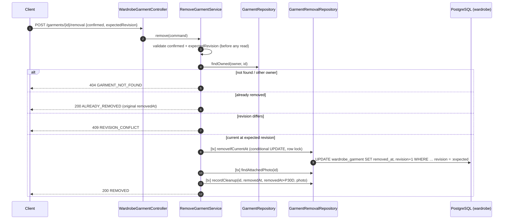
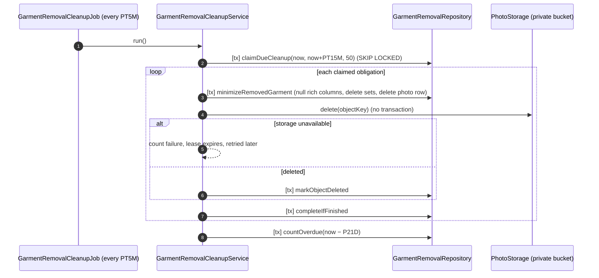
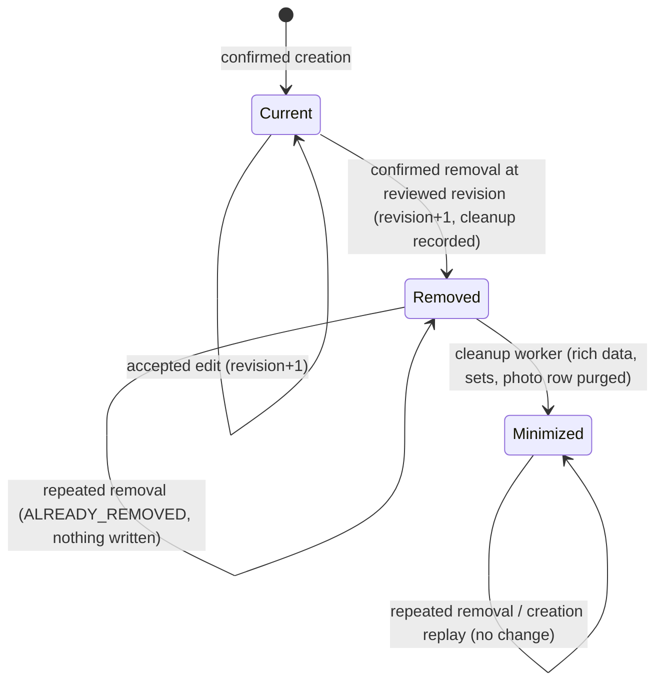

# US-GAR-005 — Remove a Garment While Preserving Minimal History: Implementation Guide

| Field | Value |
| --- | --- |
| Story | [US-GAR-005](../../../stories/garment/US-GAR-005-remove-current-garment-preserve-minimal-history.md) (Draft), parent PBI-016 |
| Sprint | Sprint 4, story 1 of 6 in the [recommended order](README.md#6-implementation-sequence) |
| Starting point | Repository at `33c579c` (branch `sprint_04`), with nothing from Sprint 4 applied |
| Approved decisions applied | S4-GAR-01, S4-GAR-02, S4-GAR-03, S4-INT-01, S4-INT-02, S4-INT-03, all **approved by the Product Owner on 2026-11-16** |
| Delegated defaults applied | OPEN-S4-01, 02, 03, 04, 05, 06, 31, 32, 33. These are `SELECTED BY CLAUDE — DELEGATED DEFAULT`, **not** Product Owner approvals ([record](open-questions.md)). |
| Shared conventions | [shared-architecture.md](shared-architecture.md), especially §5 (lock order) and §6 (logical-action identity) |
| Verification status | **Not applied to the repository and not run there.** Scratch evidence of 2026-11-17, after the Vietnamese search refinement: the six guides were applied in order to an isolated copy of `backend/`, `docs/05-api` and `.github/workflows`, plus the canonical alias document, and `clean verify` passed there (687 unit and 435 integration tests; none failed, errored or was skipped), including every test in §13. An earlier run on 2026-11-16 had also passed. A run in the repository and its CI is still required. The storage deletion boundary (OPEN-S4-05) needs operational evidence that no test can provide. |

## 1. Story Overview

**Story.** As an authenticated owner, I want to remove a garment I no longer own from my current wardrobe, after deliberate confirmation. I want only minimal understandable history to remain, and the garment's photo and nonessential personal data to be physically deleted within 30 days.

**Backend outcome.**

- **Confirmed removal:** `POST /api/v1/wardrobe/garments/{garmentId}/removal` with `{confirmed, expectedRevision}`:
  - removes the owner's current garment, under the revision the user reviewed;
  - immediately excludes it from browse, detail, edits and private photo delivery;
  - records one durable cleanup obligation in the same transaction.
- **Monotonic recovery:** repeating the request after a lost response answers `ALREADY_REMOVED` with the original removal time. It never creates a second event or resets the 30-day clock.
- **Minimal history:** only id, owner, creation key and fingerprint, Category, Color, provenance, creation and removal times, and the revision remain.
  - Every other property, both child sets and the photo record are purged by the cleanup worker at its first run after removal.
  - The photo object is deleted from private storage outside any transaction, with retries.
- **No resurrection:** a retried original creation request for a removed garment answers `410 GARMENT_NO_LONGER_CURRENT`. It never creates the garment again.
- **Deadline protection:** obligations older than 21 days that are still incomplete are logged as overdue (counts only), well before the 30-day limit.

**Out of scope:**

- restore or archive;
- removal of Wear Events, outfits or reports (none exist);
- account deletion;
- advice, Coverage or Multiplier invalidation (no consumer exists; recorded in §15);
- bulk removal;
- client confirmation screens.

## 2. Repository Baseline

| Item | State at `33c579c` | Relevance |
| --- | --- | --- |
| `Garment.removedAt` | Exists; `isCurrent()` is `removedAt == null` | Removal sets it; no transition method exists |
| `wardrobe.wardrobe_garment.removed_at` | Exists (V8); `CHECK (removed_at >= created_at)`; partial index `ix_wardrobe_garment_owner_current` on `removed_at IS NULL` | Current browse already excludes removed rows |
| `revision` | V9, starts at 1 | Removal advances it once |
| `InspectGarmentService`, `ReviseGarmentService`, `GarmentPhotoContentService` | Removed garment gives `410 GARMENT_NO_LONGER_CURRENT` | Immediate exclusion needs no change there |
| `AddGarmentService.replay` | Returns the recorded garment with `200`, whatever its removal state | P11 changes the answer to `410` for a removed garment |
| `wardrobe_photo_upload` | ATTACHED requires `garment_id` and `attached_at`; DISCARDED requires cleanup timestamps; pending cleanup never selects ATTACHED | The removal purge needs its own work table (S4-GAR-03) |
| `PhotoStorage.delete(objectKey)` | Idempotent key-only delete (`S3PhotoStorage`) | Reused. Versioning boundary: OPEN-S4-05. |
| Migrations | V1–V11 | This guide adds **V12** |
| OpenAPI | 0.11.0; description says removal is not introduced | P22 → 0.12.0 |
| CI | 95 report entries; PR trigger `[main, sprint_02, sprint_03]` | P23 adds `sprint_04` and 7 entries |
| Test support | `WardrobeIntegrationTestSupport` truncates 4 Wardrobe tables; `GarmentSchemaIT` lists them with `containsExactly` | T6 and T7 add the new table |

## 3. Original Business Requirements — Verbatim

> Sections 3–8 reproduce the cited sources verbatim. Only relative link targets were re-based to this file's location, and heading levels were shifted to nest under this guide; no wording was changed. Sprint 4 decision rows reproduce the plan's register (version 0.2), which records the Product Owner's approval of 2026-11-16. Paragraphs and lines dated 2026-11-17 were added to the sources by the Sprint 4 documentation synchronization.

From [BRD](../../../../01-business/BRD.md):

| ID | Requirement | Business Rationale | Priority | Related Goals |
|---|---|---|---|---|
| BR-005 | Users must be able to maintain, browse, search, and filter an accurate current wardrobe, including adding, changing, and removing garments. | Decisions must reflect accessible, current possessions. | Must | BG-01, BG-02, BG-03 |
| BR-006 | Users must be able to understand recorded garment use and discover overlooked clothing and combinations. | Encourage greater value from items already owned. | Must | BG-03 |
| BR-021 | Personal images, wardrobes, profile information, and behavior must remain private to authorized access, with understandable user control over their information. | Trust is necessary for participation across the value loop. | Must | BG-01, BG-02, BG-03, BG-04 |

| ID | Capability | Business Purpose |
|---|---|---|
| CAP-03 | Wardrobe Management | Keep the wardrobe current and discoverable through maintenance, browsing, search, and filtering. |

## 4. Original Product Requirements — Verbatim

From [PRD](../../../../02-product/PRD.md):

### 8.3 JRN-03 — Wardrobe Management

**Intent:** Keep the product aligned with what the user currently owns.

1. The user browses garment cards or searches/filters the wardrobe.
2. Garment detail presents confirmed information and recorded utilization without implying observed physical wear.
3. The user edits inaccurate or changed information and confirms the revision.
4. The user can remove a garment through an explicit, understandable removal action.
   - 4a. *(Added 2026-11-17, US-GAR-006.)* The user can add a photo to a garment that has none, after previewing and confirming it.
5. Subsequent recommendations and assessments reflect the current confirmed wardrobe; removed garments cannot remain selectable as owned items.

**Recovery:** Empty wardrobes prompt Add Garment; no search results offer changes to the search/filter; failed edits/removals retain a clear unconfirmed state and retry. Historical Wear Events/outfit records preserve understandable snapshots, labeling a removed garment “Removed from wardrobe” rather than treating it as currently owned. **Features:** FEAT-WAR-001–FEAT-WAR-003, FEAT-ANL-001.

### 14.2 FEAT-WAR-002 — Edit and Remove Garments

**Purpose:** Keep wardrobe-based advice aligned with current possessions and corrections.

**User value:** Inaccurate entries and garments no longer owned do not distort current recommendations.

**Related BRD:** BR-002, BR-004, BR-005, BR-021; CAP-03, CAP-04; BG-01–BG-04. **Primary users:** All personas.

**Entry points / trigger:** Garment detail or an identified incorrect entry. **Preconditions:** An existing garment belonging to the user.

**Product behavior:**

1. Allow supported profile information to be edited and explicitly confirmed.
2. Explain garment removal and require a deliberate confirmation before applying it.
3. After a successful change, current wardrobe displays use the new state.
4. Refresh or clearly require reevaluation of affected recommendations, coverage, and multiplier estimates.
5. Removed garments leave the active owned wardrobe and are excluded from new current recommendations, current coverage, and the current multiplier baseline.
6. Preserve sufficient historical snapshots for past Wear Events/outfit records to remain understandable, explicitly marking affected garments “Removed from wardrobe.” Do not erase meaningful history merely because ownership changed.
7. *(Added 2026-11-17, US-GAR-006.)* For a current garment that has no photo, allow the user to add one photo, captured or selected under the normal photo rules, preview it with the garment and explicitly confirm. The garment keeps its confirmed information; an existing photo is never replaced.

**User controls:** Edit, confirm/cancel edits, confirm/cancel removal. **Product states:** Viewing, editing, confirmation pending, updating/removing, complete, failed.

**Failure / fallback:** Do not claim a change succeeded if it did not. Preserve useful entered work where practical and offer retry; keep unresolved changes distinct from the authoritative current state.

**Feature-level acceptance criteria:**

- **AC-01:** A confirmed profile edit appears in detail and subsequently evaluated advice.
- **AC-02:** Canceling an edit/removal leaves the confirmed garment unchanged.
- **AC-03:** Successfully removed garments disappear from the current wardrobe and cannot be selected as owned items in new recommendations.
- **AC-04:** An affected older recommendation/utility result is refreshed or marked for reevaluation, not silently represented as current.
- **AC-05:** Failed changes remain visibly unconfirmed and offer recovery.
- **AC-06:** Removed garments do not count toward current coverage or the current Wardrobe Multiplier baseline.
- **AC-07:** Past Wear Events/outfit records remain understandable through historical snapshots with “Removed from wardrobe” labeling, without implying current ownership.
- **AC-08** *(added 2026-11-17)*: After explicit confirmation, a garment without a photo shows the attached photo, with every confirmed property unchanged; cancelling leaves it unchanged.
- **AC-09** *(added 2026-11-17)*: Attaching is refused, without any partial change, for a garment that already has a photo, a removed garment or a photo that is no longer usable; repeating the same confirmation does not attach twice.

**Out of scope / deferred detail:** Historical presentation is resolved: preserve understandable snapshots and mark removed garments. Physical storage/deletion/retention/privacy handling, snapshot implementation, and consistency mechanisms belong in SRS/Data View/Business Rules. No archive/restore feature is assumed.

**Sprint 4 resolution (2026-11-17):** US-GAR-005 settles removal for the current increment ([SRS Section 3.6.1](../../../../03-requirements/SRS.md#361-garment-removal-rules)): removal confirms the garment version the user reviewed; repeating it reports "already removed"; only Category, Color and times remain for history; a repeated creation request never brings the garment back; the photo is deleted within 30 days. Behavior 7 and AC-08–AC-09 come from US-GAR-006 ([SRS Section 3.6.3](../../../../03-requirements/SRS.md#363-existing-garment-photo-attachment-rules)); its detailed acceptance criteria are a delegated formalization awaiting Product Owner acceptance. See Section 34.3.

## 5. Original Software Requirements — Verbatim

From [SRS](../../../../03-requirements/SRS.md):

| ID | Requirement | Scope | Source | Verification |
|---|---|---|---|---|
| FR-WAR-004 | The system shall allow deliberate confirmation/cancellation of garment removal from active ownership. | MVP | FEAT-WAR-002; BR-005 | T: remove/confirm/cancel. |
| FR-WAR-005 | The system shall immediately exclude a removed garment from active ownership and current recommendation/coverage/multiplier inputs, retaining only minimal understandable historical snapshots and physically deleting its original image/nonessential removed personal data within 30 days. | MVP | FEAT-WAR-002; BR-005 | T/I: immediate current exclusion, minimal historical fields and deletion within 30 days. |
| FR-WAR-006 | The system shall refresh or mark affected prior advice for reevaluation after relevant edits/removal. | MVP | FEAT-WAR-002; BR-005 | T: affected assessment state. |
| DATA-INT-002 | The system shall exclude removed garments from effective current recommendation/coverage/multiplier inputs even when historical snapshots remain. | MVP | FEAT-WAR-002, FEAT-MULT-001, FEAT-ANL-002; BR-005, BR-014, BR-016 | A: current versus historical input. |
| DATA-HIST-001 | The system shall retain the minimal meaningful past event/outfit/garment snapshot and original event-local time context needed to understand history after garment removal or travel, without indefinitely retaining original removed-garment images or nonessential removed personal data. | MVP | FEAT-ANL-001; BR-006 | T/I: minimal snapshot, original timezone and removed-image/nonessential-data deletion within 30 days. |
| DATA-HIST-002 | The system shall identify removed garments in historical presentation as Removed from wardrobe without treating the snapshot as an active item. | MVP | FEAT-ANL-001; BR-006, BR-022 | I/A: removed snapshot. |
| DATA-RET-002 | The system shall retain required active-account profile/wardrobe/operational information and meaningful minimal history while the account is active and it remains necessary, while a removed garment's original image and nonessential personal data are physically deleted within 30 days. | MVP | FEAT-WAR-002, FEAT-ANL-001; BR-005, BR-006 | T/I: retained necessary active/minimal history versus removed images/nonessential data. |
| COM-002 | The system shall distinguish interrupted communication from accepted save, access/recovery or Wear action outcomes, applying Section 9 recovery without false completion or duplicated logical actions. | MVP | FEAT-AI-002, FEAT-PERS-002, FEAT-AUTH-001; BR-005, BR-011, BR-021 | T: interrupted save/reset/refresh/Wear actions and outcome review. |

Added to the [SRS](../../../../03-requirements/SRS.md) on 2026-11-17 by the Sprint 4 documentation synchronization (verbatim):

#### 3.6.1 Garment Removal Rules

Added 2026-11-17 for [US-GAR-005](../../../stories/garment/US-GAR-005-remove-current-garment-preserve-minimal-history.md). The approved decisions S4-GAR-01–03 (approved 2026-11-16) govern; details are delegated defaults ([OPEN-S4-01–06](open-questions.md#open-s4-01--removal-command-transport-and-outcomes)). These rules refine FR-WAR-004–FR-WAR-006, DATA-HIST-001 and DATA-RET-002 without changing them.

| Rule | Requirement |
|---|---|
| Explicit confirmation | Removal requires the owner's explicit confirmation and the garment revision the owner reviewed. A garment changed since that review is not removed; the owner is told and can review it. |
| Immediate exclusion | An accepted removal immediately excludes the garment from the current wardrobe, search, detail, edits, photo delivery and photo attachment. |
| Monotonic outcome | Repeating the removal of an already removed garment reports that it is already removed, with the original removal time. It creates no second removal and never restarts the 30-day deadline. |
| Minimal retained record | Only the identity, owner, creation identity, Category, Color, value provenance, creation and removal times and the revision are retained, so that history can show "Removed from wardrobe". Every other property, the Material and Style sets and the photo record are purged at the first cleanup after removal. |
| No resurrection | Replaying the original creation request of a removed garment never recreates it; it reports that the garment is no longer current. |
| Physical deletion | The photo object is deleted from private storage outside the database transaction, with retries, within 30 days of removal. Incomplete deletions older than 21 days are reported as overdue. Proof that no recoverable copy remains (storage versioning, object lock, replication, backups) is an operational verification obligation. |
| Ownership | Another account's garment is indistinguishable from an unknown one. |

## 6. Original Business Rules — Verbatim

From [Business Rules](../../../../03-requirements/business-rules.md):

### BRULE-GAR-009 — Accepted Edits and Removal

**Rule:** Only accepted edits/removal change current garment state; canceled, failed, or pending work must not be represented as accepted. Removal excludes the garment from new current outfits, current Coverage, and the current Multiplier baseline. Relevant accepted changes require refresh or an outdated indication for affected advice; historical meaning remains governed by BRULE-HIST-002. Accepted removal takes immediate effect in current ownership, recommendations, Coverage and the Multiplier baseline. Only necessary minimal historical information may remain; original removed-garment images and nonessential removed personal data must be physically deleted within 30 days.

**Applies To:** wardrobe maintenance and all dependent assessments.

**Source:** FR-WAR-003, FR-WAR-004, FR-WAR-005, FR-WAR-006, DATA-INT-002, DATA-INT-004, DATA-RET-002, DATA-HIST-001.

**Sprint 4 refinement (2026-11-17):** Removal requires explicit confirmation of the reviewed garment revision. Repeating a removal reports "already removed" with the original time and never restarts the 30-day deadline. The retained record is limited to identity, owner, creation identity, Category, Color, provenance, times and revision; the rest is purged at the first cleanup. A replayed creation never recreates a removed garment (approved S4-GAR-01–03; delegated OPEN-S4-01–06; SRS Section 3.6.1).

### BRULE-OUT-002 — Current Daily Garment Eligibility

**Rule:** Daily constituents must be authorized, confirmed, active and currently owned; removed garments, drafts and hypothetical candidates cannot become current ownership. Recommendation eligibility has not been evaluated. Future engine policy, not accepted saving or optional information absence, determines whether a combination can be recommended. The candidate exception remains limited to hypothetical evaluation.

**Source:** FR-OUT-001, FR-WAR-005, FR-MULT-001, DATA-INT-002.

### BRULE-HIST-002 — Historical Snapshots vs Current Wardrobe

**Rule:** Historical outfit/garment representations remain understandable after garment removal and are labeled Removed from wardrobe where applicable. Such snapshots do not establish active ownership or enter new current outfits, Coverage, or the Multiplier baseline. Historical views preserve original event-local time rather than travel-based re-dating. Retain only the minimal snapshot needed to understand past records. Original removed-garment images and other nonessential removed personal data are not required historical evidence and follow the 30-day physical-deletion boundary.

**Applies To:** history inspection and active inventory boundaries.

**Source:** FR-ANL-001, FR-ANL-006, FR-WAR-005, DATA-HIST-001, DATA-HIST-002, DATA-RET-002.

### BRULE-HIST-003 — Retention Boundaries

**Rule:** Accepted Wear history may remain necessary meaningful history while the account is active, subject to retention policy. Garment removal preserves only minimal understandable historical records and applies BRULE-GAR-009's 30-day removed-image/nonessential-data deletion. Accepted individual event removal applies BRULE-WEAR-005's immediate stored-history exclusion and 30-day applicable personal-data deletion.

User-linked engagement/measurement information has a separate maximum retention of 90 days; then delete or aggregate/de-identify it so it is no longer maintained as user-linked personal behavior. Ordinary engagement metrics do not require raw private images/sensitive profiles. This measurement boundary neither deletes necessary unremoved Wear history/functional feedback state nor extends removed-data deletion deadlines; it does not permit indefinite user-linked measurement copies.

**Applies To:** functional history/feedback retention versus separate user-linked measurement retention.

**Source:** DATA-RET-001, DATA-RET-002, DATA-HIST-001, FR-ANL-003, DATA-RET-003, FR-MET-006.

### BRULE-COV-006 — Relevant Changes Invalidate Current Coverage

**Rule:** Relevant changes to current wardrobe/confirmed attributes, common needs/priorities, assessment context, or applicable validity rules require reevaluation or a clear outdated indication. Removed garments are excluded from the next current calculation. Prior scores must not silently remain current after failed refresh.

**Applies To:** Coverage refresh and dependent gap evidence.

**Source:** FR-ANL-013, FR-ANL-014, FR-WAR-006, ERR-ANL-002.

### BRULE-MULT-008 — Input and Rule-Based Freshness

**Rule:** A previous result is Outdated when relevant active wardrobe composition, confirmed garment attributes, candidate attributes, assessment context, or validity/business rules no longer match its basis. Do not present its prior count/previews as current exact evidence. Freshness is input/rule based; no arbitrary fixed TTL is specified. Weather evidence follows BRULE-PROF-003; commercial currentness follows BRULE-SHOP-001. Commercial/destination unavailability alone does not change otherwise valid incremental outfit utility.

**Applies To:** assessment reuse and changed evaluation bases.

**Source:** FR-MULT-008, FR-OUT-009, DATA-ANL-004, ERR-ANL-002.

## 7. Original User Story and Acceptance Criteria — Verbatim

From [US-GAR-005](../../../../06-scrum/stories/garment/US-GAR-005-remove-current-garment-preserve-minimal-history.md):

### 1. Story

As an authenticated owner, I want to deliberately remove a garment from my current wardrobe, so that current advice reflects my possessions while past reports remain understandable.

### 3. Scope

Selected-garment confirmation/cancellation, immediate ownership/assessment exclusion, minimal historical presentation and applicable 30-day physical deletion.

### 4. Preconditions

- The selected garment is currently owned and authorized for the user; changed/unavailable selections are handled rather than assumed current.

### 5. Acceptance Criteria

#### AC-01 — Confirm the intended removal

Identify the selected garment and explain current-ownership removal and historical meaning. Only deliberate confirmation applies removal; cancellation preserves the accepted garment and dependent state.

#### AC-02 — Exclude immediately

On accepted removal, exclude the garment from current inventory, new current outfits, current Coverage and the Multiplier baseline. Old snapshots cannot restore eligibility.

#### AC-03 — Refresh dependent results

Refresh affected prior advice/assessments or clearly mark them outdated. Failed refresh is not a current result using removed inventory.

#### AC-04 — Keep minimal historical meaning

When past reports reference the garment, retain only necessary understandable snapshots labeled Removed from wardrobe. Do not delete unrelated Wear Events/outfits/garments merely because this garment was removed.

#### AC-05 — Delete applicable removed data

Physically delete the original removed-garment image and nonessential removed personal data within 30 days of accepted removal; necessary minimal historical meaning does not authorize indefinite original-image retention.

#### AC-06 — Resolve failure or uncertainty

Known rejected/failed removal keeps the accepted current state; uncertainty does not prove either removal or unchanged ownership. Offer outcome review and safe retry without removing another item or restoring an already removed selection.

#### AC-07 — Enforce ownership

Wrong-account/unusable-session attempts cannot disclose or remove the selected garment. A changed/already unavailable target yields current-state guidance rather than a different mutation.

### 6. Quality and Verification

Apply the [shared quality and completion conditions](../../../stories/README.md#2-shared-quality-and-completion) to this item's actual scope, together with its source-specific criteria below. Relevant automated, real integration, client and other triggered evidence must establish the outcome; drafted AC or backend smoke checks alone do not establish Done.

### 7. Dependencies

- Parent PBI capability inputs: PBI-007.
- Source-linked related stories describe collaborating outcomes; they do not change the Product Backlog's hard-dependency semantics or imply a serial development schedule.

### 8. Out of Scope

Wear Event withdrawal is [US-WEAR-004](../../../stories/wear/US-WEAR-004-withdraw-one-wear-event.md); privacy assurance is [US-PRIV-002](../../../stories/privacy/US-PRIV-002-verify-mvp-authorization-privacy-and-retention.md). No archive/restore, account deletion or automatic erasure of all historical reports is added.

### 10. Open Refinement Notes

The removal/deletion policies are established. Detailed minimal-snapshot fields, physical purge and recoverable integration mechanisms remain selected-story JIT work and must meet the existing deadline.

## 8. Original Use Cases, Flows and Architecture Decisions — Verbatim

### 8.1 [UC-010](../../../../03-requirements/use-cases/UC-010-remove-garment.md)

#### 1. Use Case Summary

| Field | Value |
| --- | --- |
| Use Case ID | UC-010 |
| Use Case Name | Remove Garment |
| Scope | CapsuleAI |
| Level | User Goal |
| Primary Actor | User |
| Supporting Actors | None |
| Version | 0.2 |
| Status | Baseline Draft |

Source authority: [BRD](../../../../01-business/BRD.md) defines business intent; [PRD](../../../../02-product/PRD.md) defines product behavior; [SRS](../../../../03-requirements/SRS.md) and [Business Rules](../../../../03-requirements/business-rules.md) constrain interaction; the [master Use Case Diagram](../../../../03-requirements/use-cases/use-case-diagram.puml) defines this goal and its actors. The [workflow](../../../../../Initial%20files/CapsuleAI_Scrum_Development_Workflow.md) governs artifact ownership and sequencing.

#### 2. Goal

Deliberately remove a garment from current wardrobe ownership so future current advice excludes it while past reported outfits remain understandable.

#### 4. Preconditions

- The User has authenticated access authorized for an existing current owned garment.

#### 5. Trigger

The User chooses to remove the selected garment.

#### 6. Main Success Scenario

1. The User requests removal of the selected current garment.
2. CapsuleAI identifies the affected garment and explains removal from current ownership and the preservation of understandable history.
3. The User deliberately confirms removal.
4. CapsuleAI acknowledges accepted removal and refreshes the current wardrobe without that garment.
5. CapsuleAI refreshes affected current recommendations/Coverage/Multiplier or marks them for reevaluation; new current evaluations exclude the garment.
6. When historical reports reference it, CapsuleAI shows necessary minimal snapshots labeled Removed from wardrobe and explains the 30-day deletion policy for original images/nonessential removed personal data.

#### 7. Alternative Flows

##### A1 — Cancel removal

At Main Step 3:

1. The User cancels rather than confirms.
2. CapsuleAI leaves current ownership, accepted profile and dependent state unchanged.

#### 8. Exception / Failure Flows

##### E1 — Removal failed or outcome uncertain

At Main Step 4:

1. CapsuleAI distinguishes known failure from an unconfirmed outcome and does not claim completed removal.
2. On known failure the garment remains current; after uncertainty the User reviews current ownership before safe retry.

##### E2 — Selected garment is already unavailable/current state changed

At Main Step 3:

1. CapsuleAI explains the actual current state rather than applying removal to another item or restoring old ownership.
2. The User returns to the current wardrobe; historical references remain governed separately.

##### E3 — Authorized access becomes unusable

At Main Step 1:

1. CapsuleAI pauses protected interaction if access expires, is revoked or is not authorized for the affected information, and explains the need to authenticate again.
2. The User can resume the appropriate goal after UC-002 establishes usable access. Protected information is not exposed or misrepresented as empty, and the interrupted request is not falsely reported as accepted.

#### 9. Success Postconditions

- The selected garment is excluded from active inventory, new current outfits, current Coverage and the current Multiplier baseline.
- Affected prior advice is refreshed or visibly outdated; past Wear Events/outfit/garment meaning remains understandable through necessary minimal snapshots with removed labeling; original images/nonessential removed personal data are physically deleted within 30 days.

#### 10. Minimal / Failure Postconditions

- Canceled/rejected/known failed removal leaves the accepted current garment state intact.
- Uncertain removal is not labeled accepted before outcome review.
- No Wear Event, underlying historical Outfit or unrelated garment is deleted solely because ownership changed.
- Loss of access pauses protected use; inaccessible personal data is not exposed or labeled empty. Prior accepted information remains governed by its authorized state.

#### 11. Business Rules

The following references constrain this interaction; detailed policy remains in the [Business Rules](../../../../03-requirements/business-rules.md).

| Rule ID | Relevance |
| --- | --- |
| `BRULE-AUTH-007` | Personal information is purpose-limited/private; MVP personal data is not used for AI training/improvement or unrestricted external sharing. |
| `BRULE-AUTH-001` | Personal information/actions require authorized access for the affected User. |
| `BRULE-GAR-009` | Accepted removal changes active state and affected advice; failed/canceled work does not. |
| `BRULE-OUT-002` | Removed items cannot enter new current daily outfits. |
| `BRULE-HIST-002` | Removed historical garments remain understandable without restoring current eligibility. |
| `BRULE-HIST-003` | Ownership removal is not history-retention expiry. |
| `BRULE-COV-006` | Current Coverage must reflect ownership changes. |
| `BRULE-MULT-008` | Changed current inventory invalidates prior candidate comparisons. |

#### 13. Special Requirements / Constraints

- Documentation is English; the Vietnamese MVP UI supports Android 10+ and iOS 15+. Translated labels preserve canonical meanings. Applicable actions/states have meaningful accessible names/roles/states and understandable labels beyond color, and remain operable with primary actions accessible at text scaling up to 200%. TalkBack/VoiceOver validation and platform primary touch-target criteria follow SRS Sections 6.7/12.4.
- This is active-ownership removal, not automatic erasure of historical reports or an archive/restore feature.
- Removed from wardrobe labeling must be understandable without relying only on the garment image/color.

- Removal immediately affects active ownership and current recommendations/Coverage/Multiplier. Necessary minimal historical meaning may remain; original removed-garment images are not retained indefinitely for history, and physical deletion occurs within 30 days.

#### 15. Open Issues

No unresolved Use Case-specific issue currently blocks this interaction.

### 8.2 Selected architecture decisions — verbatim from [selected decisions](../../../../04-architecture/selected-architecture-decisions.md)

| ADA ID | Decision Problem | Selected Option | Backend Impact | Status |
| --- | --- | --- | --- | --- |
| ADA-003 | Authoritative persistence model and database | Option A — One relational primary database: PostgreSQL | Use PostgreSQL as the primary relational authority. | Selected |
| ADA-006 | External integration boundaries | Option A — Narrow explicit ports/adapters for real dependencies | Isolate provider semantics behind narrow business ports/adapters. | Selected |
| ADA-007 | Private image persistence and access | Option A — Private object storage with application-controlled authorized delivery | Store media privately and authorize delivery through the application. | Selected |
| ADA-009 | Logical-action idempotency and accepted effects | Option A — Database-backed logical-action coordination and coherent effects | Coordinate accepted logical actions durably and coherently. | Selected |
| ADA-012 | Messaging and background coordination | Option A — Explicit core coordination with no broker initially | Coordinate core effects explicitly; make required later work recoverable. | Selected |
| ADA-014 | Protected observability and validation evidence | Option A — Minimal protected structured logs, metrics and health/recovery evidence | Expose protected outcome, timing, health and recovery evidence. | Selected |
| ADA-016 | Context Data Ownership | Option B — One PostgreSQL database initially with explicit context-owned logical persistence boundaries | Own persistence logically per context within one PostgreSQL. | Selected |

### 8.3 Sprint 4 decisions — verbatim from the [plan register](../sprint-plan.md#13-consolidated-decision-register)

> **Status:** the Product Owner approved all 30 Sprint 4 recommendations on **2026-11-16**. The plan's register, version 0.2 of 2026-11-17, records that approval and is reproduced below; see [open-questions.md](open-questions.md#1-decision-authority).

| Decision ID | Related Story | Question | Recommended Solution | Decision Status | Approval Owner |
| --- | --- | --- | --- | --- | --- |
| [S4-GAR-01](../sprint-plan.md#s4-gar-01) | US-GAR-005 | Confirmed removal and monotonic current ownership | Option A — guarded current-to-removed transition with atomic cleanup intent and prompt minimization. | APPROVED — 2026-11-16 | Product Owner with Backend Tech Lead |
| [S4-GAR-02](../sprint-plan.md#s4-gar-02) | US-GAR-005 | Minimal historical meaning and rich-data minimization | Option A — a deliberately minimized Wardrobe-owned removed representation, with a separate mapping from live profiles. | APPROVED — 2026-11-16 | Product Owner with BA and privacy reviewer |
| [S4-GAR-03](../sprint-plan.md#s4-gar-03) | US-GAR-005 | Attached-media purge and retention enforcement | Option A — separate durable removal cleanup, sharing infrastructure patterns but not pending-media semantics. | APPROVED — 2026-11-16 | Product Owner with Backend Tech Lead and operations owner |
| [S4-INT-01](../sprint-plan.md#s4-int-01) | US-GAR-005; US-GAR-006; US-BULK-001 | Shared lock order and transaction authority | Option A — canonical existing garment then photo order, preceded by any batch/item coordination locks. | APPROVED — 2026-11-16 | Product Owner with Backend Tech Lead and QA |
| [S4-INT-02](../sprint-plan.md#s4-int-02) | All six selected stories | Logical action outcomes and uncertainty recovery | Option A — targeted durable identities and explicit current-state review, adding a receipt only where natural state cannot prove the required outcome. | APPROVED — 2026-11-16 | Product Owner with Backend Tech Lead and QA |
| [S4-INT-03](../sprint-plan.md#s4-int-03) | All six selected stories | Compatible command transport and synchronized delivery contracts | Option A — compatible explicit confirmed commands, preserving existing PATCH/body-revision conventions and resource grouping. | APPROVED — 2026-11-16 | Product Owner with Backend Tech Lead and QA |

## 9. Engineering Interpretation

| Source obligation | Engineering meaning in this increment | Where |
| --- | --- | --- |
| AC-01: deliberate confirmation; cancellation preserves state | The server applies removal only for `confirmed: true` and a reviewed `expectedRevision`. Cancel is the client not sending the request. | P9, P13, T3, T9 |
| AC-02: exclude immediately | One conditional `UPDATE` sets `removed_at`. Browse, detail, edit and photo already exclude removed rows, so the effect is visible at commit. | P12, T9 |
| AC-02/03: Coverage, Multiplier, advice | **No consumer exists** (`outfitadviceanduse` and `wardrobeintelligence` are empty). Nothing to refresh; recorded as an evidence gap, not a pass. | §15 |
| AC-04: minimal history | The minimized row keeps Category, Color and the removal time (OPEN-S4-02). No report renderer exists to show "Removed from wardrobe"; `RemovedGarment.HISTORICAL_LABEL` is the code a renderer will use. | P3, P12 |
| AC-05: physical deletion within 30 days | Durable cleanup row with deadline `removed_at + P30D`. Prompt minimization, retried object deletion, overdue warning at `P21D`. Storage boundary per OPEN-S4-05. | P1, P10, P12, P17, §14 |
| AC-06: failure and uncertainty | A known failure changes nothing (one transaction). After a lost response, the identical request gives `ALREADY_REMOVED`, or `409` if a competing change happened first. `503` never claims either outcome. | P9, P16, T9, T10 |
| AC-07: ownership | The owner comes from the token. Another owner's garment, an unknown id and a malformed id all give the same `404`. A changed target gives `409` or `ALREADY_REMOVED`, never a different mutation. | P9, T9 |
| S4-INT-01 lock order | Garment conditional `UPDATE`, then photo read, then cleanup insert. The worker minimizes garment, then photo, then cleanup. | P12 |
| S4-INT-02 identity | Monotonic `removed_at`; creation replay of a removed garment gives `410` | P9, P11 |

## 10. Just-in-Time Detailed Design

### 10.1 Components and sequence





### 10.2 State of a garment



There is no transition back to Current (S4-GAR-01: monotonic).

### 10.3 API contract

| Item | Value |
| --- | --- |
| Route | `POST /api/v1/wardrobe/garments/{garmentId}/removal` |
| Request | `GarmentRemovalRequest {confirmed: boolean, expectedRevision: string}`; both required |
| Validation before lookup | `confirmed` missing → `REQUIRED`, `false` → `NOT_CONFIRMED`; `expectedRevision` missing or blank → `REQUIRED`, not `^[1-9][0-9]{0,17}$` → `INVALID_FORMAT` (`400 VALIDATION_FAILED`) |
| `200` | `GarmentRemovalResponse {id, outcome: REMOVED or ALREADY_REMOVED, state: REMOVED_FROM_WARDROBE, category, color, removedAt}` |
| `404 GARMENT_NOT_FOUND` | Unknown, malformed or another owner's id (indistinguishable) |
| `409 REVISION_CONFLICT` | Current garment changed after review |
| `401` / `503` | Unchanged shared meanings. `503` does not confirm the outcome. |
| Changed elsewhere | `POST /api/v1/wardrobe/garments` documents `410 GARMENT_NO_LONGER_CURRENT` for a replay of a removed garment |

Example exchange:

```http
POST /api/v1/wardrobe/garments/4b9f3c7e-2a1d-4c8e-9f6a-1e2d3c4b5a69/removal
Authorization: Bearer <access token>
Content-Type: application/json

{"confirmed": true, "expectedRevision": "3"}
```

```json
{
  "id": "4b9f3c7e-2a1d-4c8e-9f6a-1e2d3c4b5a69",
  "outcome": "REMOVED",
  "state": "REMOVED_FROM_WARDROBE",
  "category": "TOPS",
  "color": "NAVY",
  "removedAt": "2026-11-16T09:30:00.123456Z"
}
```

### 10.4 Data model (V12)

| Object | Change |
| --- | --- |
| `wardrobe.wardrobe_garment` | `minimized_at TIMESTAMPTZ NULL`; CHECK `ck_wardrobe_garment_minimized_shape`: a minimized row is removed and has every purgeable column NULL |
| `wardrobe.wardrobe_garment_removal_cleanup` | One row per removed garment. Columns:<br>• `garment_id` (PK, FK to the garment);<br>• `owner_account_id`, `removed_at`, `purge_deadline`;<br>• optional `photo_upload_id` and `photo_object_key`;<br>• `next_attempt_at` (lease), `attempts`;<br>• `data_minimized_at`, `object_deleted_at`, `completed_at`.<br>CHECKs keep the steps consistent. A partial index serves the due query. |

The garment row is never deleted. The creation key and fingerprint stay, so replay cannot recreate the garment (OPEN-S4-03).

### 10.5 Transactions and concurrency

| Race | Outcome |
| --- | --- |
| Two removals of the same revision | The first `UPDATE` wins. The second waits for the row lock, re-evaluates `removed_at IS NULL` and affects 0 rows. Its reread inside the same transaction sees the committed removal and answers `ALREADY_REMOVED`. |
| Removal against edit (same revision) | Exactly one conditional `UPDATE` succeeds. The loser answers `409` (edit after removal: `410`; removal after edit: `409`). |
| Removal against attachment (GAR-006) | Attachment locks the garment first (`FOR UPDATE OF g`) and advances the revision. The waiting removal then fails its revision predicate and answers `409`. |
| Removal against pending-photo cleanup | Disjoint: pending cleanup never selects ATTACHED rows |
| Cleanup worker against a second worker | `FOR UPDATE SKIP LOCKED` plus a lease of `PT15M`; a claimed row is invisible to others until the lease expires |
| Crash after object delete, before `markObjectDeleted` | The lease expires and the object is deleted again; `PhotoStorage.delete` is idempotent |

### 10.6 Security and privacy

- The owner comes from `AuthenticatedAccount`, and wrong-owner answers are non-disclosing.
- Problem Details never echo submitted values.
- The cleanup job logs counts only: no garment ids, owner ids or object keys.
- Minimized rows keep no Brand, Price, Material, Style, optional details or photo metadata.

### 10.7 Recovery

| Situation | Client action | Server guarantee |
| --- | --- | --- |
| Lost response | Repeat the identical request | `ALREADY_REMOVED` with the original time, or the real current state |
| `503` | Review the garment (detail `410` means removed) before retrying | No partial removal: one transaction |
| `409` | Reload the detail, show the current values, ask again | Nothing changed |

### 10.8 Configuration

`capsuleai.wardrobe.removal-cleanup.*` (OPEN-S4-33):

| Property | Default |
| --- | --- |
| `enabled` | `true` |
| `initial-delay` | `PT2M` |
| `interval` | `PT5M` |
| `batch-size` | `50` |
| `retry-delay` | `PT15M` |
| `purge-limit` | `P30D` (validated ≤ 30 days) |
| `overdue-warning-age` | `P21D` (validated < `purge-limit`) |

The test profile disables the scheduler.

### 10.9 Testing plan

| Level | Classes |
| --- | --- |
| Domain | `GarmentRemovalTest` |
| Application (fakes) | `RemoveGarmentServiceTest`, `GarmentRemovalCleanupServiceTest` |
| Schema (real PostgreSQL) | `GarmentRemovalSchemaIT`, updated `GarmentSchemaIT` |
| HTTP (real filter chain) | `GarmentRemovalApiIT` |
| Concurrency | `ConcurrentGarmentRemovalIT` |
| Cleanup (real PostgreSQL, fault-injecting storage) | `GarmentRemovalCleanupIT` |
| Contract | Existing `IdentityOpenApiContractIT` covers the new operation automatically |

## 11. File Change Matrix

Paths are relative to the repository root. `…/wardrobe/` is `backend/src/main/java/com/capsuleai/wardrobe/` and `…/test/wardrobe/` is `backend/src/test/java/com/capsuleai/wardrobe/`.

| Order | Action | Exact repository path | Purpose | Dependencies |
| --- | --- | --- | --- | --- |
| P1 | ADD | `backend/src/main/resources/db/migration/V12__add_wardrobe_garment_removal.sql` | Minimized shape; removal cleanup table | V11 applied |
| P2 | MODIFY | `…/wardrobe/domain/Garment.java` | `withRemovalAt` transition | — |
| P3 | ADD | `…/wardrobe/domain/RemovedGarment.java` | Minimal historical projection | P2 |
| P4 | ADD | `…/wardrobe/application/ports/GarmentRemovalRepository.java` | Removal and cleanup persistence port | P5 |
| P5 | ADD | `…/wardrobe/application/ports/GarmentRemovalCleanupTarget.java` | Claimed obligation | — |
| P6 | ADD | `…/wardrobe/application/GarmentRemovalPolicy.java` | Limits and schedule values | — |
| P7 | ADD | `…/wardrobe/application/RemoveGarmentCommand.java` | Submitted removal | — |
| P8 | ADD | `…/wardrobe/application/GarmentRemoval.java` | Removal outcome | P3 |
| P9 | ADD | `…/wardrobe/application/RemoveGarmentService.java` | Confirmed removal use case | P2–P8 |
| P10 | ADD | `…/wardrobe/application/GarmentRemovalCleanupService.java` | Cleanup worker logic | P4–P6 |
| P11 | MODIFY | `…/wardrobe/application/AddGarmentService.java` | Replay of a removed garment gives `410` | — |
| P12 | ADD | `…/wardrobe/adapter/out/persistence/JdbcGarmentRemovalRepository.java` | SQL for P4 | P1, P4 |
| P13 | ADD | `…/wardrobe/adapter/in/web/GarmentRemovalRequest.java` | Request body | P7 |
| P14 | ADD | `…/wardrobe/adapter/in/web/GarmentRemovalResponse.java` | Response body | P8 |
| P15 | MODIFY | `…/wardrobe/adapter/in/web/WardrobeGarmentController.java` | Removal endpoint | P9, P13, P14 |
| P16 | MODIFY | `…/wardrobe/adapter/in/web/WardrobeApiExceptionHandler.java` | Operation-neutral 409 and 503 texts | — |
| P17 | ADD | `…/wardrobe/adapter/in/scheduling/GarmentRemovalCleanupJob.java` | Scheduled trigger | P10 |
| P18 | ADD | `…/wardrobe/configuration/WardrobeRemovalProperties.java` | Typed configuration | — |
| P19 | ADD | `…/wardrobe/configuration/WardrobeRemovalConfiguration.java` | Beans | P6, P9, P10, P12, P18 |
| P20 | ADD | `…/wardrobe/configuration/WardrobeRemovalCleanupConfiguration.java` | Conditional scheduling | P17 |
| P21 | MODIFY | `backend/src/main/resources/application.properties` | Default values | P18 |
| P22 | MODIFY | `docs/05-api/openapi.yaml` | 0.11.0 → 0.12.0 | P13–P15 |
| P23 | MODIFY | `.github/workflows/backend-ci.yml` | `sprint_04` trigger; 7 report entries | T1–T11 |
| T1 | ADD | `…/test/wardrobe/domain/GarmentRemovalTest.java` | Domain transition | P2, P3 |
| T2 | ADD | `…/test/wardrobe/application/InMemoryGarmentRemovalRepository.java` | Fake of P4 | P4 |
| T3 | ADD | `…/test/wardrobe/application/RemoveGarmentServiceTest.java` | Removal rules | P9, T2 |
| T4 | ADD | `…/test/wardrobe/application/GarmentRemovalCleanupServiceTest.java` | Worker rules | P10, T2 |
| T5 | MODIFY | `backend/src/test/resources/application-test.properties` | Disable the scheduler | P20 |
| T6 | MODIFY | `…/test/wardrobe/support/WardrobeIntegrationTestSupport.java` | Truncate the new table | P1 |
| T7 | MODIFY | `…/test/wardrobe/adapter/out/persistence/GarmentSchemaIT.java` | Exact table list | P1 |
| T8 | ADD | `…/test/wardrobe/adapter/out/persistence/GarmentRemovalSchemaIT.java` | V12 constraints and upgrade | P1 |
| T9 | ADD | `…/test/wardrobe/adapter/in/web/GarmentRemovalApiIT.java` | HTTP behavior | P15, P22 |
| T10 | ADD | `…/test/wardrobe/application/ConcurrentGarmentRemovalIT.java` | Races | P9, P12 |
| T11 | ADD | `…/test/wardrobe/adapter/out/persistence/GarmentRemovalCleanupIT.java` | Worker on real PostgreSQL | P10, P12 |

## 12. Complete Production Implementation

Each step gives the complete file for an ADD. For a MODIFY it gives an exact BEFORE block (as the file stands at the starting point of this guide) and its AFTER replacement. Apply the steps in order. Commands run from `backend/`.

### Step P1 — [ADD] `backend/src/main/resources/db/migration/V12__add_wardrobe_garment_removal.sql`

```sql
-- US-GAR-005 (S4-GAR-01/02/03, approved 2026-11-16; OPEN-S4-02/04): confirmed removal keeps only a
-- minimized row of the garment, and one durable cleanup obligation per removed garment drives the
-- purge of rich data and of the private photo within 30 days of the original removal.
--
-- A minimized row keeps: id, owner_account_id, creation_key, creation_fingerprint, category, color,
-- value_provenance, created_at, removed_at, revision and minimized_at. Every other garment column is
-- NULL, and its Material/Style rows and attached photo row are deleted.
--
-- Owner: Wardrobe. Every object below is in the wardrobe schema (AR-01); no other schema is referenced.
ALTER TABLE wardrobe.wardrobe_garment
    ADD COLUMN minimized_at TIMESTAMPTZ NULL;

-- Explicit IS NULL tests on every purgeable column: a minimized row cannot keep rich data, even if a
-- future code path forgot one column (defence in depth for DATA-RET-002).
ALTER TABLE wardrobe.wardrobe_garment
    ADD CONSTRAINT ck_wardrobe_garment_minimized_shape CHECK (minimized_at IS NULL OR (
        removed_at IS NOT NULL AND minimized_at >= removed_at
        AND subtype IS NULL AND pattern IS NULL AND fit IS NULL AND neckline IS NULL
        AND sleeve_length IS NULL AND length IS NULL AND silhouette IS NULL
        AND brand IS NULL AND price_amount IS NULL AND price_currency IS NULL));

-- One obligation per removed garment. purge_deadline is fixed at insert time from the original
-- removal, so a retried removal can never restart the 30-day clock. next_attempt_at doubles as the
-- worker lease. photo_object_key is copied from the attached photo at removal time, so the object can
-- still be deleted after the photo row itself has been purged.
CREATE TABLE wardrobe.wardrobe_garment_removal_cleanup (
    garment_id        UUID        PRIMARY KEY REFERENCES wardrobe.wardrobe_garment (id),
    owner_account_id  UUID        NOT NULL,
    removed_at        TIMESTAMPTZ NOT NULL,
    purge_deadline    TIMESTAMPTZ NOT NULL,
    photo_upload_id   UUID        NULL,
    photo_object_key  TEXT        NULL,
    next_attempt_at   TIMESTAMPTZ NOT NULL,
    attempts          INTEGER     NOT NULL DEFAULT 0,
    data_minimized_at TIMESTAMPTZ NULL,
    object_deleted_at TIMESTAMPTZ NULL,
    completed_at      TIMESTAMPTZ NULL,

    CONSTRAINT ck_wardrobe_garment_removal_cleanup_deadline CHECK (purge_deadline > removed_at),
    CONSTRAINT ck_wardrobe_garment_removal_cleanup_photo_pair
        CHECK ((photo_upload_id IS NULL) = (photo_object_key IS NULL)),
    CONSTRAINT ck_wardrobe_garment_removal_cleanup_object_key
        CHECK (photo_object_key IS NULL OR photo_object_key ~ '^photos/[0-9a-f-]{36}\.jpg$'),
    CONSTRAINT ck_wardrobe_garment_removal_cleanup_object_deleted
        CHECK (object_deleted_at IS NULL OR photo_object_key IS NOT NULL),
    CONSTRAINT ck_wardrobe_garment_removal_cleanup_completed
        CHECK (completed_at IS NULL OR (data_minimized_at IS NOT NULL
            AND (photo_object_key IS NULL OR object_deleted_at IS NOT NULL))),
    CONSTRAINT ck_wardrobe_garment_removal_cleanup_attempts CHECK (attempts >= 0)
);

-- Incomplete obligations in due order, for the cleanup worker.
CREATE INDEX ix_wardrobe_garment_removal_cleanup_due
    ON wardrobe.wardrobe_garment_removal_cleanup (next_attempt_at)
    WHERE completed_at IS NULL;
```

**Explanation.**

- `ALTER TABLE … ADD COLUMN … NULL` without a default does not rewrite the table (PostgreSQL 11+).
- The CHECK constraint holds for every existing row, because `minimized_at` starts NULL.
- The `garment_id` foreign key stays inside `wardrobe`. Garments are never deleted, so it never blocks a purge.

**Database and API implications.** Adds one column and one table. No API change by itself.

**Common mistakes.**

- Editing V8–V11 instead of adding V12: their checksums would break Flyway validation.
- Adding a foreign key from `photo_upload_id` to `wardrobe_photo_upload`: the worker deletes that row while the obligation is still open.

**Verification.** After T8:

```powershell
.\mvnw.cmd -q "-Dtest=HarnessSmokeTest" "-Dit.test=GarmentRemovalSchemaIT" verify
```

### Step P2 — [MODIFY] `backend/src/main/java/com/capsuleai/wardrobe/domain/Garment.java`

BEFORE:

```java
    public boolean isCurrent() {
        return removedAt == null;
    }
```

AFTER:

```java
    /**
     * US-GAR-005 (S4-GAR-01): the same garment after an accepted removal from the current wardrobe.
     * Identity, owner, profile, provenance, creation time and photo are kept; the revision advances by
     * one, because leaving the current wardrobe changes what the owner reviewed. Removal is monotonic:
     * an already removed garment cannot be removed again (callers report ALREADY_REMOVED instead). A
     * removal time before the creation time (clock skew) is recorded as the creation time, which keeps
     * the V8 constraint removed_at >= created_at.
     */
    public Garment withRemovalAt(Instant removalTime) {
        Objects.requireNonNull(removalTime, "removalTime");
        if (!isCurrent()) {
            throw new IllegalStateException("Only a garment in the current wardrobe can be removed");
        }
        Instant effectiveRemovalTime = removalTime.isBefore(createdAt) ? createdAt : removalTime;
        return new Garment(id, ownerAccountId, profile, provenance, createdAt, effectiveRemovalTime,
                Math.addExact(revision, 1), photo);
    }

    public boolean isCurrent() {
        return removedAt == null;
    }
```

**Explanation.** A pure domain transition, mirroring `withRevisedProfile`. `java.time.Instant` and `java.util.Objects` are already imported.

**Common mistake.** Resetting `photo` to empty: the photo stays linked until the cleanup worker purges it, so it remains discoverable for deletion.

**Verification.** T1.

### Step P3 — [ADD] `backend/src/main/java/com/capsuleai/wardrobe/domain/RemovedGarment.java`

```java
package com.capsuleai.wardrobe.domain;

import java.time.Instant;
import java.util.Objects;
import java.util.UUID;

/**
 * US-GAR-005 (S4-GAR-02, OPEN-S4-02): the minimal historical meaning of a garment that left the owner's
 * current wardrobe. It deliberately carries only what makes a past reference understandable: the stable
 * id, Category, Color and the original removal time. It never exposes Brand, Price, optional details,
 * Materials, Styles or the photo, which are purged within 30 days of removal.
 *
 * <p>{@link #HISTORICAL_LABEL} is the code clients and future history consumers localize as
 * "Removed from wardrobe" (Vietnamese labels are a client concern).
 */
public record RemovedGarment(
        UUID id,
        UUID ownerAccountId,
        GarmentCategory category,
        GarmentColor color,
        Instant removedAt) {

    /** The label code of a removed garment in any historical reference (BRULE-HIST-002). */
    public static final String HISTORICAL_LABEL = "REMOVED_FROM_WARDROBE";

    public RemovedGarment {
        Objects.requireNonNull(id, "id");
        Objects.requireNonNull(ownerAccountId, "ownerAccountId");
        Objects.requireNonNull(category, "category");
        Objects.requireNonNull(color, "color");
        Objects.requireNonNull(removedAt, "removedAt");
    }

    /** The minimal meaning of a removed garment; a current garment has none. */
    public static RemovedGarment of(Garment garment) {
        Objects.requireNonNull(garment, "garment");
        if (garment.isCurrent()) {
            throw new IllegalArgumentException("A current garment has no removed representation");
        }
        return new RemovedGarment(garment.id(), garment.ownerAccountId(), garment.profile().category(),
                garment.profile().color(), garment.removedAt());
    }
}
```

**Explanation.** This is the deliberate separation between live profiles and removed outcomes that S4-GAR-02 asks for. A minimized row still maps to a valid minimum `GarmentProfile`, but removal outcomes only ever expose this projection.

**Verification.** T1.

### Step P4 — [ADD] `backend/src/main/java/com/capsuleai/wardrobe/application/ports/GarmentRemovalRepository.java`

```java
package com.capsuleai.wardrobe.application.ports;

import java.time.Instant;
import java.util.List;
import java.util.Optional;
import java.util.UUID;

/**
 * US-GAR-005 (S4-GAR-01/03): Wardrobe-owned persistence of confirmed removal and of the durable removal
 * cleanup obligation. Every state change is a conditional statement, so concurrent removals, edits,
 * attachments and cleanup runs each see the others' committed outcome.
 *
 * <p>Lock order (S4-INT-01): garment, then photo, then cleanup work. Call every method except
 * {@link #countOverdue} inside {@link WardrobeTransactions}.
 */
public interface GarmentRemovalRepository {

    /**
     * Removes the owner's garment from the current wardrobe only while it is current and at
     * {@code expectedRevision}; the revision advances by one. The garment row stays locked until the
     * surrounding transaction ends.
     *
     * @return {@code false} if the garment is unknown, another owner's, already removed or at another
     *         revision; nothing changed
     */
    boolean removeIfCurrentAt(UUID ownerAccountId, UUID garmentId, long expectedRevision, Instant removedAt);

    /** The photo attached to the garment, if any. Read while the caller holds the garment row lock. */
    Optional<PhotoCleanupTarget> findAttachedPhoto(UUID garmentId);

    /**
     * Records the cleanup obligation of a just-removed garment. Recorded at most once per garment: a
     * second call changes nothing, so the retention clock never restarts.
     */
    void recordCleanup(UUID garmentId, UUID ownerAccountId, Instant removedAt, Instant purgeDeadline,
                       Optional<PhotoCleanupTarget> attachedPhoto);

    /**
     * Claims up to {@code limit} incomplete obligations that are due, leasing each until
     * {@code leaseUntil} so that a concurrent or later run does not repeat it before then.
     */
    List<GarmentRemovalCleanupTarget> claimDueCleanup(Instant now, Instant leaseUntil, int limit);

    /**
     * Purges the removed garment's rich data: every optional property, Brand and Price, its Materials
     * and Styles, and its attached photo row. Category, Color, identity and creation identity remain.
     *
     * @return {@code true} if this call recorded the minimization; {@code false} if it was already recorded
     */
    boolean minimizeRemovedGarment(UUID garmentId, Instant minimizedAt);

    /** Records that the obligation's photo object is deleted. @return false if already recorded or no photo */
    boolean markObjectDeleted(UUID garmentId, Instant deletedAt);

    /** Completes the obligation if every step is done. @return true if this call completed it */
    boolean completeIfFinished(UUID garmentId, Instant completedAt);

    /** How many obligations are still incomplete although their garment was removed at or before {@code removedBefore}. */
    int countOverdue(Instant removedBefore);
}
```

**Explanation.** This is a separate port, so `GarmentRepository` and its in-memory fake stay unchanged ([shared architecture §4](shared-architecture.md#4-new-packages-and-classes-by-module)). It reuses the existing `PhotoCleanupTarget(photoUploadId, objectKey)`.

### Step P5 — [ADD] `backend/src/main/java/com/capsuleai/wardrobe/application/ports/GarmentRemovalCleanupTarget.java`

```java
package com.capsuleai.wardrobe.application.ports;

import java.time.Instant;
import java.util.Objects;
import java.util.Optional;
import java.util.UUID;

/**
 * One claimed removal-cleanup obligation (US-GAR-005, OPEN-S4-04): which garment, when it was removed,
 * its fixed purge deadline, the photo object still to delete (if any) and which steps are already done.
 */
public record GarmentRemovalCleanupTarget(
        UUID garmentId,
        Instant removedAt,
        Instant purgeDeadline,
        Optional<String> photoObjectKey,
        boolean dataMinimized,
        boolean objectDeleted) {

    public GarmentRemovalCleanupTarget {
        Objects.requireNonNull(garmentId, "garmentId");
        Objects.requireNonNull(removedAt, "removedAt");
        Objects.requireNonNull(purgeDeadline, "purgeDeadline");
        Objects.requireNonNull(photoObjectKey, "photoObjectKey must be Optional.empty() without a photo");
    }

    /** True while the photo object still has to be deleted. */
    public boolean needsObjectDeletion() {
        return photoObjectKey.isPresent() && !objectDeleted;
    }
}
```

### Step P6 — [ADD] `backend/src/main/java/com/capsuleai/wardrobe/application/GarmentRemovalPolicy.java`

```java
package com.capsuleai.wardrobe.application;

import java.time.Duration;
import java.util.Objects;

/**
 * Removal retention and cleanup settings, supplied by configuration (US-GAR-005, OPEN-S4-04/33).
 *
 * @param purgeLimit         time from the original removal by which the photo and nonessential data must
 *                           be physically deleted; the approved obligation is at most 30 days (AC-05)
 * @param overdueWarningAge  age after which an incomplete obligation is reported as overdue; must leave
 *                           time for intervention before {@code purgeLimit}
 * @param cleanupBatchSize   obligations claimed per worker run
 * @param cleanupRetryDelay  lease and retry delay after a claim
 */
public record GarmentRemovalPolicy(
        Duration purgeLimit,
        Duration overdueWarningAge,
        int cleanupBatchSize,
        Duration cleanupRetryDelay) {

    /** The approved maximum (DATA-RET-002, BRULE-GAR-009): physical deletion within 30 days of removal. */
    public static final Duration MAXIMUM_PURGE_LIMIT = Duration.ofDays(30);

    public GarmentRemovalPolicy {
        Objects.requireNonNull(purgeLimit, "purgeLimit");
        Objects.requireNonNull(overdueWarningAge, "overdueWarningAge");
        Objects.requireNonNull(cleanupRetryDelay, "cleanupRetryDelay");
        if (purgeLimit.isNegative() || purgeLimit.isZero() || purgeLimit.compareTo(MAXIMUM_PURGE_LIMIT) > 0) {
            throw new IllegalArgumentException("The purge limit must be positive and at most 30 days");
        }
        if (overdueWarningAge.isNegative() || overdueWarningAge.isZero()
                || overdueWarningAge.compareTo(purgeLimit) >= 0) {
            throw new IllegalArgumentException("The overdue warning age must be positive and shorter than the purge limit");
        }
        if (cleanupBatchSize < 1) {
            throw new IllegalArgumentException("The cleanup batch size must be positive");
        }
        if (cleanupRetryDelay.isNegative() || cleanupRetryDelay.isZero()) {
            throw new IllegalArgumentException("The cleanup retry delay must be positive");
        }
    }
}
```

**Common mistake.** Allowing a purge limit above 30 days through configuration would silently weaken the approved obligation. The constructor refuses it, so the application does not start.

### Step P7 — [ADD] `backend/src/main/java/com/capsuleai/wardrobe/application/RemoveGarmentCommand.java`

```java
package com.capsuleai.wardrobe.application;

import java.util.UUID;

/**
 * One submitted removal (US-GAR-005). The owner comes from the authenticated session, never from the
 * body. {@code garmentId} is the raw path text: a malformed id is "not found", like any id the owner
 * does not have. {@code expectedRevision} is the revision the user reviewed before confirming.
 */
public record RemoveGarmentCommand(UUID ownerAccountId, String garmentId, Boolean confirmed,
                                   String expectedRevision) {
}
```

### Step P8 — [ADD] `backend/src/main/java/com/capsuleai/wardrobe/application/GarmentRemoval.java`

```java
package com.capsuleai.wardrobe.application;

import com.capsuleai.wardrobe.domain.RemovedGarment;
import java.util.Objects;

/**
 * Outcome of a confirmed removal (US-GAR-005, OPEN-S4-01): the garment's minimal removed meaning and
 * whether this request removed it ({@code true}) or found it already removed ({@code false}, for example
 * when the response of an earlier identical request was lost). Either way the garment is not current.
 */
public record GarmentRemoval(RemovedGarment removedGarment, boolean newlyRemoved) {

    public GarmentRemoval {
        Objects.requireNonNull(removedGarment, "removedGarment");
    }
}
```

### Step P9 — [ADD] `backend/src/main/java/com/capsuleai/wardrobe/application/RemoveGarmentService.java`

```java
package com.capsuleai.wardrobe.application;

import com.capsuleai.wardrobe.application.ports.GarmentRemovalRepository;
import com.capsuleai.wardrobe.application.ports.GarmentRepository;
import com.capsuleai.wardrobe.application.ports.PhotoCleanupTarget;
import com.capsuleai.wardrobe.application.ports.WardrobeTransactions;
import com.capsuleai.wardrobe.domain.Garment;
import com.capsuleai.wardrobe.domain.GarmentValueProblem;
import com.capsuleai.wardrobe.domain.RemovedGarment;
import java.time.Clock;
import java.time.Instant;
import java.time.temporal.ChronoUnit;
import java.util.ArrayList;
import java.util.List;
import java.util.Objects;
import java.util.Optional;
import java.util.UUID;
import java.util.regex.Pattern;

/**
 * US-GAR-005 — removes one current garment of the authenticated owner after explicit confirmation of the
 * revision the owner reviewed (FR-WAR-004–006, BRULE-GAR-009; S4-GAR-01, S4-INT-01/02, OPEN-S4-01/06).
 *
 * <p>In one Wardrobe transaction the garment leaves the current wardrobe (its revision advances by one)
 * and its durable cleanup obligation is recorded with the fixed deadline {@code removedAt + purgeLimit}.
 * Browse, detail, edit and photo delivery exclude it from that commit on. Removal is monotonic: an
 * already removed garment of the owner is reported as ALREADY_REMOVED with its original removal time,
 * whatever revision the request names, and nothing is written. A garment that changed after the owner
 * reviewed it is a conflict; nothing is removed under an older view.
 */
public final class RemoveGarmentService {

    static final String CONFIRMED_FIELD = "confirmed";
    static final String EXPECTED_REVISION_FIELD = "expectedRevision";

    private static final Pattern CANONICAL_UUID =
            Pattern.compile("[0-9a-fA-F]{8}-[0-9a-fA-F]{4}-[0-9a-fA-F]{4}-[0-9a-fA-F]{4}-[0-9a-fA-F]{12}");

    /** A positive decimal that fits in a long; clients treat it as opaque (OPEN-S3-04). */
    private static final Pattern REVISION_TOKEN = Pattern.compile("[1-9][0-9]{0,17}");

    private final GarmentRepository garmentRepository;
    private final GarmentRemovalRepository garmentRemovalRepository;
    private final WardrobeTransactions wardrobeTransactions;
    private final Clock clock;
    private final GarmentRemovalPolicy removalPolicy;

    public RemoveGarmentService(GarmentRepository garmentRepository,
                                GarmentRemovalRepository garmentRemovalRepository,
                                WardrobeTransactions wardrobeTransactions, Clock clock,
                                GarmentRemovalPolicy removalPolicy) {
        this.garmentRepository = Objects.requireNonNull(garmentRepository, "garmentRepository");
        this.garmentRemovalRepository = Objects.requireNonNull(garmentRemovalRepository, "garmentRemovalRepository");
        this.wardrobeTransactions = Objects.requireNonNull(wardrobeTransactions, "wardrobeTransactions");
        this.clock = Objects.requireNonNull(clock, "clock");
        this.removalPolicy = Objects.requireNonNull(removalPolicy, "removalPolicy");
    }

    /**
     * @throws GarmentValidationException      if the removal is unconfirmed or lacks a usable expected revision
     *                                         (checked before anything is read; nothing changed)
     * @throws GarmentNotFoundException        if the owner has no garment with this id
     * @throws GarmentRevisionConflictException if the current garment changed after the owner reviewed it
     */
    public GarmentRemoval remove(RemoveGarmentCommand command) {
        UUID ownerAccountId = Objects.requireNonNull(command.ownerAccountId(), "ownerAccountId");
        long expectedRevision = checkRequest(command);
        UUID garmentId = garmentId(command.garmentId());

        Garment garment = garmentRepository.findOwned(ownerAccountId, garmentId)
                .orElseThrow(GarmentNotFoundException::new);
        if (!garment.isCurrent()) {
            return new GarmentRemoval(RemovedGarment.of(garment), false);
        }
        if (garment.revision() != expectedRevision) {
            throw new GarmentRevisionConflictException();
        }

        Garment removedGarment = garment.withRemovalAt(clock.instant().truncatedTo(ChronoUnit.MICROS));
        Instant removedAt = removedGarment.removedAt();
        return wardrobeTransactions.inTransaction(() -> {
            if (!garmentRemovalRepository.removeIfCurrentAt(ownerAccountId, garmentId, expectedRevision, removedAt)) {
                return outcomeAfterRefusal(ownerAccountId, garmentId);
            }
            Optional<PhotoCleanupTarget> attachedPhoto = garmentRemovalRepository.findAttachedPhoto(garmentId);
            garmentRemovalRepository.recordCleanup(garmentId, ownerAccountId, removedAt,
                    removedAt.plus(removalPolicy.purgeLimit()), attachedPhoto);
            return new GarmentRemoval(RemovedGarment.of(removedGarment), true);
        });
    }

    /** Problems visible without reading the garment; returns the expected revision. */
    private static long checkRequest(RemoveGarmentCommand command) {
        List<GarmentFieldViolation> violations = new ArrayList<>();
        if (command.confirmed() == null) {
            violations.add(new GarmentFieldViolation(CONFIRMED_FIELD, GarmentValueProblem.REQUIRED));
        } else if (!command.confirmed()) {
            violations.add(new GarmentFieldViolation(CONFIRMED_FIELD, GarmentValueProblem.NOT_CONFIRMED));
        }
        long expectedRevision = 0;
        String token = command.expectedRevision();
        if (token == null || token.isBlank()) {
            violations.add(new GarmentFieldViolation(EXPECTED_REVISION_FIELD, GarmentValueProblem.REQUIRED));
        } else if (!REVISION_TOKEN.matcher(token).matches()) {
            violations.add(new GarmentFieldViolation(EXPECTED_REVISION_FIELD, GarmentValueProblem.INVALID_FORMAT));
        } else {
            expectedRevision = Long.parseLong(token);
        }
        if (!violations.isEmpty()) {
            throw new GarmentValidationException(violations);
        }
        return expectedRevision;
    }

    private static UUID garmentId(String garmentId) {
        if (garmentId == null || !CANONICAL_UUID.matcher(garmentId).matches()) {
            throw new GarmentNotFoundException();
        }
        return UUID.fromString(garmentId);
    }

    /**
     * Why the conditional removal changed nothing, as seen inside the same transaction: a competing
     * removal committed first (monotonic outcome) or the garment changed (conflict).
     */
    private GarmentRemoval outcomeAfterRefusal(UUID ownerAccountId, UUID garmentId) {
        Garment latest = garmentRepository.findOwned(ownerAccountId, garmentId)
                .orElseThrow(GarmentNotFoundException::new);
        if (!latest.isCurrent()) {
            return new GarmentRemoval(RemovedGarment.of(latest), false);
        }
        throw new GarmentRevisionConflictException();
    }
}
```

**Explanation.**

- Validation happens before any read, as `IdentityOpenApiContractIT` requires: it calls with a random garment id and expects `400 REQUIRED`.
- The first read gives fast answers for the common outcomes.
- The conditional `UPDATE` is the authority. If it affects nothing, the reread inside the same READ COMMITTED transaction sees the competing commit that caused it.

**Database implications.** One transaction: an `UPDATE`, a `SELECT` and an `INSERT`. No network call.

**Common mistakes.**

- Using `garment.removedAt()` from the stale first read for the deadline: always use the time of this removal.
- Checking `confirmed` after the lookup, which would turn a missing field into a `404` for unknown ids.

**Verification.** T3, T9 and T10.

### Step P10 — [ADD] `backend/src/main/java/com/capsuleai/wardrobe/application/GarmentRemovalCleanupService.java`

```java
package com.capsuleai.wardrobe.application;

import com.capsuleai.wardrobe.application.ports.GarmentRemovalCleanupTarget;
import com.capsuleai.wardrobe.application.ports.GarmentRemovalRepository;
import com.capsuleai.wardrobe.application.ports.PhotoStorage;
import com.capsuleai.wardrobe.application.ports.PhotoStorageUnavailableException;
import com.capsuleai.wardrobe.application.ports.WardrobeTransactions;
import java.time.Clock;
import java.time.Instant;
import java.time.temporal.ChronoUnit;
import java.util.List;
import java.util.Objects;

/**
 * US-GAR-005 — the durable removal cleanup (S4-GAR-03, OPEN-S4-04). Each run claims due obligations,
 * minimizes each removed garment's data in a short transaction, deletes its private photo object outside
 * any transaction, records each step and completes the obligation when everything is done.
 *
 * <p>Separate from the pending-photo lifecycle: it never touches RECEIVING, READY or DISCARDED uploads,
 * and pending expiry never touches the garments it cleans. A storage failure leaves the lease to expire,
 * so a later run retries the deletion; a crash between deleting the object and recording it only repeats
 * an idempotent delete. The deadline was fixed at removal and is never extended by a retry.
 */
public final class GarmentRemovalCleanupService {

    /** What one run did. {@code overdue} counts incomplete obligations older than the warning age. */
    public record CleanupResult(int minimized, int objectsDeleted, int completed, int failed, int overdue) {
    }

    private final GarmentRemovalRepository garmentRemovalRepository;
    private final PhotoStorage photoStorage;
    private final WardrobeTransactions wardrobeTransactions;
    private final Clock clock;
    private final GarmentRemovalPolicy removalPolicy;

    public GarmentRemovalCleanupService(GarmentRemovalRepository garmentRemovalRepository, PhotoStorage photoStorage,
                                        WardrobeTransactions wardrobeTransactions, Clock clock,
                                        GarmentRemovalPolicy removalPolicy) {
        this.garmentRemovalRepository = Objects.requireNonNull(garmentRemovalRepository, "garmentRemovalRepository");
        this.photoStorage = Objects.requireNonNull(photoStorage, "photoStorage");
        this.wardrobeTransactions = Objects.requireNonNull(wardrobeTransactions, "wardrobeTransactions");
        this.clock = Objects.requireNonNull(clock, "clock");
        this.removalPolicy = Objects.requireNonNull(removalPolicy, "removalPolicy");
    }

    public CleanupResult run() {
        Instant runStart = now();
        List<GarmentRemovalCleanupTarget> dueObligations = wardrobeTransactions.inTransaction(() ->
                garmentRemovalRepository.claimDueCleanup(runStart, runStart.plus(removalPolicy.cleanupRetryDelay()),
                        removalPolicy.cleanupBatchSize()));
        int minimized = 0;
        int objectsDeleted = 0;
        int completed = 0;
        int failed = 0;
        for (GarmentRemovalCleanupTarget obligation : dueObligations) {
            if (!obligation.dataMinimized() && wardrobeTransactions.inTransaction(() ->
                    garmentRemovalRepository.minimizeRemovedGarment(obligation.garmentId(), now()))) {
                minimized++;
            }
            if (obligation.needsObjectDeletion()) {
                try {
                    photoStorage.delete(obligation.photoObjectKey().orElseThrow());
                } catch (PhotoStorageUnavailableException unavailable) {
                    failed++; // The lease expires and a later run retries this deletion.
                    continue;
                }
                if (wardrobeTransactions.inTransaction(() ->
                        garmentRemovalRepository.markObjectDeleted(obligation.garmentId(), now()))) {
                    objectsDeleted++;
                }
            }
            if (wardrobeTransactions.inTransaction(() ->
                    garmentRemovalRepository.completeIfFinished(obligation.garmentId(), now()))) {
                completed++;
            }
        }
        int overdue = wardrobeTransactions.inTransaction(() ->
                garmentRemovalRepository.countOverdue(runStart.minus(removalPolicy.overdueWarningAge())));
        return new CleanupResult(minimized, objectsDeleted, completed, failed, overdue);
    }

    private Instant now() {
        return clock.instant().truncatedTo(ChronoUnit.MICROS);
    }
}
```

**Explanation.** Minimization needs no network call, so it happens at the first run after removal ("prompt minimization"), even while storage is down. The object step is skipped when there is no photo.

**Common mistakes.**

- Calling `photoStorage.delete` inside `inTransaction`: a slow store would hold row locks.
- Marking the object deleted before the delete call returns.

**Verification.** T4 and T11.

### Step P11 — [MODIFY] `backend/src/main/java/com/capsuleai/wardrobe/application/AddGarmentService.java`

Two edits.

**Edit 1.** The `@throws` list documents the new outcome.

BEFORE:

```java
     * @throws PhotoUploadNotUsableException if the staged photo is not READY, has expired or is attached
     */
    public GarmentCreation add(AddGarmentCommand command) {
```

AFTER:

```java
     * @throws PhotoUploadNotUsableException if the staged photo is not READY, has expired or is attached
     * @throws GarmentNoLongerCurrentException if this logical addition was accepted earlier and its garment
     *                                         has since been removed (US-GAR-005, OPEN-S4-03)
     */
    public GarmentCreation add(AddGarmentCommand command) {
```

**Edit 2.** The photo-backed path checks for an earlier acceptance even when the photo row has since been purged. The replay of a removed garment answers `410`.

BEFORE:

```java
        return transactions.inTransaction(() -> {
            PhotoUpload upload = photoUploads.lockOwned(owner, photoUploadId)
                    .orElseThrow(PhotoUploadNotFoundException::new);
            if (garments.findCreation(owner, entry.creationKey()).isPresent()) {
                return replay(owner, entry.creationKey(), fingerprint);
            }
            if (!upload.isUsableAt(now)) {
```

AFTER:

```java
        return transactions.inTransaction(() -> {
            // Lock first (when the row still exists), then look for an earlier acceptance: after a removal
            // and its cleanup the photo row is gone, but the replay must still be recognized (OPEN-S4-03).
            Optional<PhotoUpload> lockedUpload = photoUploads.lockOwned(owner, photoUploadId);
            if (garments.findCreation(owner, entry.creationKey()).isPresent()) {
                return replay(owner, entry.creationKey(), fingerprint);
            }
            PhotoUpload upload = lockedUpload.orElseThrow(PhotoUploadNotFoundException::new);
            if (!upload.isUsableAt(now)) {
```

BEFORE:

```java
        if (!earlier.creationFingerprint().equals(fingerprint)) {
            throw new IdempotencyKeyReusedException();
        }
        return new GarmentCreation(earlier.garment(), false);
    }
```

AFTER:

```java
        if (!earlier.creationFingerprint().equals(fingerprint)) {
            throw new IdempotencyKeyReusedException();
        }
        if (!earlier.garment().isCurrent()) {
            // US-GAR-005 (OPEN-S4-03): accepted earlier and removed since. A retry never recreates the
            // garment and never presents a removed garment as the current result of the addition.
            throw new GarmentNoLongerCurrentException();
        }
        return new GarmentCreation(earlier.garment(), false);
    }
```

**Edit 3.** The import, in alphabetical position.

BEFORE:

```java
import java.util.Objects;
import java.util.UUID;
```

AFTER:

```java
import java.util.Objects;
import java.util.Optional;
import java.util.UUID;
```

**Explanation.**

- A key reused with different values is still `422`; the fingerprint check comes first.
- An identical replay of a removed garment is `410`.
- The lock on a still-existing photo row is taken first, as before, so the serialization of confirmation, cancellation and expiry is unchanged.

**Common mistakes.**

- Checking `isCurrent()` before the fingerprint, which would hide a key reuse.
- Leaving `orElseThrow` on `lockOwned`, which would answer `404 PHOTO_UPLOAD_NOT_FOUND` after the cleanup purged the photo row.

**Verification.**

- T9 (`replayingTheOriginalAdditionAfterRemovalIsGoneAndCreatesNothing`).
- The unchanged suites: `AddGarmentServiceTest`, `PhotoBackedGarmentCreationTest`, `AddGarmentApiIT` and `PhotoGarmentApiIT`.

### Step P12 — [ADD] `backend/src/main/java/com/capsuleai/wardrobe/adapter/out/persistence/JdbcGarmentRemovalRepository.java`

```java
package com.capsuleai.wardrobe.adapter.out.persistence;

import com.capsuleai.wardrobe.application.ports.GarmentRemovalCleanupTarget;
import com.capsuleai.wardrobe.application.ports.GarmentRemovalRepository;
import com.capsuleai.wardrobe.application.ports.PhotoCleanupTarget;
import java.sql.ResultSet;
import java.sql.SQLException;
import java.sql.Types;
import java.time.Instant;
import java.time.OffsetDateTime;
import java.time.ZoneOffset;
import java.util.List;
import java.util.Optional;
import java.util.UUID;
import org.springframework.jdbc.core.simple.JdbcClient;

/** PostgreSQL implementation of {@link GarmentRemovalRepository} (US-GAR-005, V12). */
public final class JdbcGarmentRemovalRepository implements GarmentRemovalRepository {

    /**
     * Removes the garment only while it is the owner's, current and at the expected revision. Under READ
     * COMMITTED a concurrent change of the same row makes this statement wait and then re-evaluate the
     * predicate against the committed row, so of two competing changes at most one applies (S4-GAR-01).
     */
    static final String REMOVE_IF_CURRENT_AT = """
            UPDATE wardrobe.wardrobe_garment
            SET removed_at = :removedAt, revision = revision + 1
            WHERE id = :garmentId AND owner_account_id = :ownerAccountId
              AND removed_at IS NULL AND revision = :expectedRevision
            """;

    static final String FIND_ATTACHED_PHOTO = """
            SELECT id, object_key FROM wardrobe.wardrobe_photo_upload
            WHERE garment_id = :garmentId AND status = 'ATTACHED'
            """;

    /** next_attempt_at = removed_at: due at once. ON CONFLICT keeps the first deadline forever. */
    static final String RECORD_CLEANUP = """
            INSERT INTO wardrobe.wardrobe_garment_removal_cleanup (
                garment_id, owner_account_id, removed_at, purge_deadline, photo_upload_id, photo_object_key,
                next_attempt_at)
            VALUES (:garmentId, :ownerAccountId, :removedAt, :purgeDeadline, :photoUploadId, :photoObjectKey,
                    :removedAt)
            ON CONFLICT (garment_id) DO NOTHING
            """;

    static final String CLAIM_DUE_CLEANUP = """
            UPDATE wardrobe.wardrobe_garment_removal_cleanup
            SET next_attempt_at = :leaseUntil, attempts = attempts + 1
            WHERE garment_id IN (
                SELECT c.garment_id FROM wardrobe.wardrobe_garment_removal_cleanup c
                WHERE c.completed_at IS NULL AND c.next_attempt_at <= :now
                ORDER BY c.next_attempt_at
                LIMIT :limit
                FOR UPDATE SKIP LOCKED)
            RETURNING garment_id, removed_at, purge_deadline, photo_object_key,
                      data_minimized_at IS NOT NULL AS data_minimized,
                      object_deleted_at IS NOT NULL AS object_deleted
            """;

    /** Garment first (S4-INT-01): purge every column the minimized shape requires to be NULL. */
    static final String MINIMIZE_GARMENT = """
            UPDATE wardrobe.wardrobe_garment
            SET subtype = NULL, pattern = NULL, fit = NULL, neckline = NULL, sleeve_length = NULL,
                length = NULL, silhouette = NULL, brand = NULL, price_amount = NULL, price_currency = NULL,
                minimized_at = GREATEST(:minimizedAt, removed_at)
            WHERE id = :garmentId AND removed_at IS NOT NULL AND minimized_at IS NULL
            """;

    static final String DELETE_MATERIALS = """
            DELETE FROM wardrobe.wardrobe_garment_material WHERE garment_id = :garmentId
            """;

    static final String DELETE_STYLES = """
            DELETE FROM wardrobe.wardrobe_garment_style WHERE garment_id = :garmentId
            """;

    /** Then the photo row (its key was copied into the obligation at removal time). */
    static final String DELETE_ATTACHED_PHOTO = """
            DELETE FROM wardrobe.wardrobe_photo_upload WHERE garment_id = :garmentId AND status = 'ATTACHED'
            """;

    /** Then the cleanup work. */
    static final String MARK_DATA_MINIMIZED = """
            UPDATE wardrobe.wardrobe_garment_removal_cleanup
            SET data_minimized_at = :minimizedAt
            WHERE garment_id = :garmentId AND data_minimized_at IS NULL
            """;

    static final String MARK_OBJECT_DELETED = """
            UPDATE wardrobe.wardrobe_garment_removal_cleanup
            SET object_deleted_at = :deletedAt
            WHERE garment_id = :garmentId AND photo_object_key IS NOT NULL AND object_deleted_at IS NULL
            """;

    static final String COMPLETE_IF_FINISHED = """
            UPDATE wardrobe.wardrobe_garment_removal_cleanup
            SET completed_at = :completedAt
            WHERE garment_id = :garmentId AND completed_at IS NULL AND data_minimized_at IS NOT NULL
              AND (photo_object_key IS NULL OR object_deleted_at IS NOT NULL)
            """;

    static final String COUNT_OVERDUE = """
            SELECT count(*) FROM wardrobe.wardrobe_garment_removal_cleanup
            WHERE completed_at IS NULL AND removed_at <= :removedBefore
            """;

    private final JdbcClient jdbcClient;

    public JdbcGarmentRemovalRepository(JdbcClient jdbcClient) {
        this.jdbcClient = jdbcClient;
    }

    @Override
    public boolean removeIfCurrentAt(UUID ownerAccountId, UUID garmentId, long expectedRevision, Instant removedAt) {
        return jdbcClient.sql(REMOVE_IF_CURRENT_AT)
                .param("garmentId", garmentId)
                .param("ownerAccountId", ownerAccountId)
                .param("expectedRevision", expectedRevision)
                .param("removedAt", toDatabase(removedAt))
                .update() == 1;
    }

    @Override
    public Optional<PhotoCleanupTarget> findAttachedPhoto(UUID garmentId) {
        return jdbcClient.sql(FIND_ATTACHED_PHOTO)
                .param("garmentId", garmentId)
                .query((row, rowNumber) ->
                        new PhotoCleanupTarget(row.getObject("id", UUID.class), row.getString("object_key")))
                .optional();
    }

    @Override
    public void recordCleanup(UUID garmentId, UUID ownerAccountId, Instant removedAt, Instant purgeDeadline,
                              Optional<PhotoCleanupTarget> attachedPhoto) {
        jdbcClient.sql(RECORD_CLEANUP)
                .param("garmentId", garmentId)
                .param("ownerAccountId", ownerAccountId)
                .param("removedAt", toDatabase(removedAt))
                .param("purgeDeadline", toDatabase(purgeDeadline))
                .param("photoUploadId", attachedPhoto.map(PhotoCleanupTarget::photoUploadId).orElse(null), Types.OTHER)
                .param("photoObjectKey", attachedPhoto.map(PhotoCleanupTarget::objectKey).orElse(null), Types.VARCHAR)
                .update();
    }

    @Override
    public List<GarmentRemovalCleanupTarget> claimDueCleanup(Instant now, Instant leaseUntil, int limit) {
        return jdbcClient.sql(CLAIM_DUE_CLEANUP)
                .param("now", toDatabase(now))
                .param("leaseUntil", toDatabase(leaseUntil))
                .param("limit", limit)
                .query((row, rowNumber) -> mapTarget(row))
                .list();
    }

    @Override
    public boolean minimizeRemovedGarment(UUID garmentId, Instant minimizedAt) {
        jdbcClient.sql(MINIMIZE_GARMENT)
                .param("garmentId", garmentId)
                .param("minimizedAt", toDatabase(minimizedAt))
                .update();
        jdbcClient.sql(DELETE_MATERIALS).param("garmentId", garmentId).update();
        jdbcClient.sql(DELETE_STYLES).param("garmentId", garmentId).update();
        jdbcClient.sql(DELETE_ATTACHED_PHOTO).param("garmentId", garmentId).update();
        return jdbcClient.sql(MARK_DATA_MINIMIZED)
                .param("garmentId", garmentId)
                .param("minimizedAt", toDatabase(minimizedAt))
                .update() == 1;
    }

    @Override
    public boolean markObjectDeleted(UUID garmentId, Instant deletedAt) {
        return jdbcClient.sql(MARK_OBJECT_DELETED)
                .param("garmentId", garmentId)
                .param("deletedAt", toDatabase(deletedAt))
                .update() == 1;
    }

    @Override
    public boolean completeIfFinished(UUID garmentId, Instant completedAt) {
        return jdbcClient.sql(COMPLETE_IF_FINISHED)
                .param("garmentId", garmentId)
                .param("completedAt", toDatabase(completedAt))
                .update() == 1;
    }

    @Override
    public int countOverdue(Instant removedBefore) {
        return jdbcClient.sql(COUNT_OVERDUE)
                .param("removedBefore", toDatabase(removedBefore))
                .query(Integer.class)
                .single();
    }

    private static GarmentRemovalCleanupTarget mapTarget(ResultSet row) throws SQLException {
        return new GarmentRemovalCleanupTarget(
                row.getObject("garment_id", UUID.class),
                row.getObject("removed_at", OffsetDateTime.class).toInstant(),
                row.getObject("purge_deadline", OffsetDateTime.class).toInstant(),
                Optional.ofNullable(row.getString("photo_object_key")),
                row.getBoolean("data_minimized"),
                row.getBoolean("object_deleted"));
    }

    private static OffsetDateTime toDatabase(Instant instant) {
        return instant.atOffset(ZoneOffset.UTC);
    }
}
```

**Explanation.**

- Every statement is complete, schema-qualified and bound.
- `Types.OTHER` lets the PostgreSQL driver bind a `null` UUID without guessing its type. The non-null case binds a `java.util.UUID`, which pgjdbc maps to `uuid`.
- `count(*)` maps to `Integer` through Spring's single-column conversion of `bigint`.
- The minimization deletes the photo row with `status = 'ATTACHED'`, so it can never touch a pending upload.

**Database implications.** `minimizeRemovedGarment` runs five statements in the caller's transaction, in lock order: garment, child rows, photo, cleanup.

**Common mistakes.**

- An unqualified table name in any string literal (`SqlOwnershipRules` fails the build).
- `FOR UPDATE` without `SKIP LOCKED` in the claim: workers would queue behind each other.
- Returning `update() > 0` from `minimizeRemovedGarment` based on the garment statement: on a retry after a crash the garment is already minimized while the marker is not.

**Verification.** T11, plus `PersistenceOwnershipSqlTest`.

### Step P13 — [ADD] `backend/src/main/java/com/capsuleai/wardrobe/adapter/in/web/GarmentRemovalRequest.java`

```java
package com.capsuleai.wardrobe.adapter.in.web;

import com.capsuleai.wardrobe.application.RemoveGarmentCommand;
import java.util.UUID;

/**
 * JSON body of POST /api/v1/wardrobe/garments/{garmentId}/removal (US-GAR-005, OPEN-S4-01): the explicit
 * confirmation and the revision the user reviewed. There is no owner field and no removal time: the
 * owner is the authenticated account and the server records the time of acceptance.
 */
public record GarmentRemovalRequest(Boolean confirmed, String expectedRevision) {

    RemoveGarmentCommand toCommand(UUID ownerAccountId, String garmentId) {
        return new RemoveGarmentCommand(ownerAccountId, garmentId, confirmed, expectedRevision);
    }
}
```

**Explanation.** The record components are exactly the documented request properties, which `IdentityOpenApiContractIT.requestSchemasListExactlyTheFieldsTheEndpointsRead` checks.

### Step P14 — [ADD] `backend/src/main/java/com/capsuleai/wardrobe/adapter/in/web/GarmentRemovalResponse.java`

```java
package com.capsuleai.wardrobe.adapter.in.web;

import com.capsuleai.wardrobe.application.GarmentRemoval;
import com.capsuleai.wardrobe.domain.RemovedGarment;
import java.util.UUID;

/**
 * The outcome of a confirmed removal (US-GAR-005, OPEN-S4-01). {@code outcome} is REMOVED when this request
 * removed the garment and ALREADY_REMOVED when it had been removed before (for example by an earlier
 * delivery of the same request); {@code removedAt} is always the original removal time. Only the minimal
 * historical meaning is returned: never Brand, Price, optional details or the photo.
 */
public record GarmentRemovalResponse(
        UUID id,
        String outcome,
        String state,
        String category,
        String color,
        String removedAt) {

    static final String REMOVED = "REMOVED";
    static final String ALREADY_REMOVED = "ALREADY_REMOVED";

    static GarmentRemovalResponse from(GarmentRemoval removal) {
        RemovedGarment removedGarment = removal.removedGarment();
        return new GarmentRemovalResponse(
                removedGarment.id(),
                removal.newlyRemoved() ? REMOVED : ALREADY_REMOVED,
                RemovedGarment.HISTORICAL_LABEL,
                removedGarment.category().name(),
                removedGarment.color().name(),
                removedGarment.removedAt().toString());
    }
}
```

### Step P15 — [MODIFY] `backend/src/main/java/com/capsuleai/wardrobe/adapter/in/web/WardrobeGarmentController.java`

**Edit 1.** Imports.

BEFORE:

```java
import com.capsuleai.wardrobe.application.InspectGarmentService;
import com.capsuleai.wardrobe.application.ReviseGarmentService;
```

AFTER:

```java
import com.capsuleai.wardrobe.application.InspectGarmentService;
import com.capsuleai.wardrobe.application.RemoveGarmentService;
import com.capsuleai.wardrobe.application.ReviseGarmentService;
```

**Edit 2.** Field and constructor.

BEFORE:

```java
    private final GarmentPhotoContentService garmentPhotoContentService;

    public WardrobeGarmentController(AddGarmentService addGarmentService,
                                     BrowseWardrobeService browseWardrobeService,
                                     InspectGarmentService inspectGarmentService,
                                     ReviseGarmentService reviseGarmentService,
                                     GarmentPhotoContentService garmentPhotoContentService) {
        this.addGarmentService = addGarmentService;
        this.browseWardrobeService = browseWardrobeService;
        this.inspectGarmentService = inspectGarmentService;
        this.reviseGarmentService = reviseGarmentService;
        this.garmentPhotoContentService = garmentPhotoContentService;
    }
```

AFTER:

```java
    private final GarmentPhotoContentService garmentPhotoContentService;
    private final RemoveGarmentService removeGarmentService;

    public WardrobeGarmentController(AddGarmentService addGarmentService,
                                     BrowseWardrobeService browseWardrobeService,
                                     InspectGarmentService inspectGarmentService,
                                     ReviseGarmentService reviseGarmentService,
                                     GarmentPhotoContentService garmentPhotoContentService,
                                     RemoveGarmentService removeGarmentService) {
        this.addGarmentService = addGarmentService;
        this.browseWardrobeService = browseWardrobeService;
        this.inspectGarmentService = inspectGarmentService;
        this.reviseGarmentService = reviseGarmentService;
        this.garmentPhotoContentService = garmentPhotoContentService;
        this.removeGarmentService = removeGarmentService;
    }
```

**Edit 3.** The endpoint, inserted after `reviseGarment`.

BEFORE:

```java
        GarmentRevision revision = reviseGarmentService.revise(request.toCommand(owner.accountId(), garmentId));
        return GarmentResponse.from(revision.garment());
    }
```

AFTER:

```java
        GarmentRevision revision = reviseGarmentService.revise(request.toCommand(owner.accountId(), garmentId));
        return GarmentResponse.from(revision.garment());
    }

    /**
     * US-GAR-005 — removes one current garment after explicit confirmation of the reviewed revision
     * (S4-GAR-01, S4-INT-03). 200 REMOVED, or 200 ALREADY_REMOVED with the original time when the garment
     * was already removed (safe repeat after a lost response). A stale revision is 409 and removes nothing.
     */
    @PostMapping("/{garmentId}/removal")
    public GarmentRemovalResponse removeGarment(@AuthenticationPrincipal AuthenticatedAccount owner,
                                                @PathVariable String garmentId,
                                                @RequestBody GarmentRemovalRequest request) {
        return GarmentRemovalResponse.from(removeGarmentService.remove(request.toCommand(owner.accountId(), garmentId)));
    }
```

**Explanation.**

- The route stays in the cohesive garment controller.
- The handler returns the record directly, so the success status is `200`.
- `@PostMapping`, `@PathVariable` and `@RequestBody` are already imported.

**Verification.** T9, plus `IdentityOpenApiContractIT` after P22.

### Step P16 — [MODIFY] `backend/src/main/java/com/capsuleai/wardrobe/adapter/in/web/WardrobeApiExceptionHandler.java`

The shared 409 and 503 texts must fit a removal as well as an edit (OPEN-S4-32). No test asserts these Wardrobe texts.

BEFORE:

```java
        return respond(problem(HttpStatus.CONFLICT, "REVISION_CONFLICT",
                "This garment changed after you opened it, so your edit was not applied. Reload it, review the "
                        + "current values and confirm your changes again."));
```

AFTER:

```java
        return respond(problem(HttpStatus.CONFLICT, "REVISION_CONFLICT",
                "This garment changed after you opened it, so your change was not applied. Reload it, review the "
                        + "current values and confirm again."));
```

BEFORE:

```java
                "The wardrobe could not be reached, so the outcome is not confirmed. Check the current state before "
                        + "retrying: an addition repeated with the same Idempotency-Key is never added twice, and an "
                        + "edit repeated with the same expectedRevision is never applied twice."));
```

AFTER:

```java
                "The wardrobe could not be reached, so the outcome is not confirmed. Check the current state before "
                        + "retrying: an addition repeated with the same Idempotency-Key is never added twice, an edit "
                        + "repeated with the same expectedRevision is never applied twice, and a repeated removal "
                        + "never removes anything else."));
```

### Step P17 — [ADD] `backend/src/main/java/com/capsuleai/wardrobe/adapter/in/scheduling/GarmentRemovalCleanupJob.java`

```java
package com.capsuleai.wardrobe.adapter.in.scheduling;

import com.capsuleai.wardrobe.application.GarmentRemovalCleanupService;
import com.capsuleai.wardrobe.application.GarmentRemovalCleanupService.CleanupResult;
import java.util.Objects;
import org.slf4j.Logger;
import org.slf4j.LoggerFactory;
import org.springframework.scheduling.annotation.Scheduled;

/**
 * Runs the removal cleanup periodically inside the application (US-GAR-005, S4-GAR-03); no external
 * scheduler or broker. A failed run is logged and the next run continues from durable state. Only counts
 * are logged: never garment ids, owner ids or object keys. Overdue obligations are logged as a warning
 * so operations can intervene before the 30-day limit.
 */
public class GarmentRemovalCleanupJob {

    private static final Logger log = LoggerFactory.getLogger(GarmentRemovalCleanupJob.class);

    private final GarmentRemovalCleanupService garmentRemovalCleanupService;

    public GarmentRemovalCleanupJob(GarmentRemovalCleanupService garmentRemovalCleanupService) {
        this.garmentRemovalCleanupService =
                Objects.requireNonNull(garmentRemovalCleanupService, "garmentRemovalCleanupService");
    }

    @Scheduled(initialDelayString = "${capsuleai.wardrobe.removal-cleanup.initial-delay}",
               fixedDelayString = "${capsuleai.wardrobe.removal-cleanup.interval}")
    public void run() {
        try {
            CleanupResult result = garmentRemovalCleanupService.run();
            if (result.minimized() + result.objectsDeleted() + result.completed() + result.failed() > 0) {
                log.info("Removal cleanup minimized {} garments, deleted {} photo objects, completed {} obligations, "
                                + "{} deletions to retry",
                        result.minimized(), result.objectsDeleted(), result.completed(), result.failed());
            }
            if (result.overdue() > 0) {
                log.warn("{} removal cleanup obligations are overdue and approach the 30-day deletion limit",
                        result.overdue());
            }
        } catch (RuntimeException failure) {
            log.warn("Removal cleanup failed and will run again at its next interval ({})",
                    failure.getClass().getSimpleName());
        }
    }
}
```

### Step P18 — [ADD] `backend/src/main/java/com/capsuleai/wardrobe/configuration/WardrobeRemovalProperties.java`

```java
package com.capsuleai.wardrobe.configuration;

import java.time.Duration;
import java.util.Objects;
import org.springframework.boot.context.properties.ConfigurationProperties;

/**
 * US-GAR-005 configuration: {@code capsuleai.wardrobe.removal-cleanup.*}. Values in application.properties
 * implement OPEN-S4-04/33 (delegated defaults selected on 2026-11-16, not Product Owner approvals of the
 * values). {@link com.capsuleai.wardrobe.application.GarmentRemovalPolicy} validates them at startup.
 */
@ConfigurationProperties("capsuleai.wardrobe.removal-cleanup")
public record WardrobeRemovalProperties(
        boolean enabled,
        Duration initialDelay,
        Duration interval,
        int batchSize,
        Duration retryDelay,
        Duration purgeLimit,
        Duration overdueWarningAge) {

    public WardrobeRemovalProperties {
        Objects.requireNonNull(initialDelay, "capsuleai.wardrobe.removal-cleanup.initial-delay");
        Objects.requireNonNull(interval, "capsuleai.wardrobe.removal-cleanup.interval");
        Objects.requireNonNull(retryDelay, "capsuleai.wardrobe.removal-cleanup.retry-delay");
        Objects.requireNonNull(purgeLimit, "capsuleai.wardrobe.removal-cleanup.purge-limit");
        Objects.requireNonNull(overdueWarningAge, "capsuleai.wardrobe.removal-cleanup.overdue-warning-age");
    }
}
```

### Step P19 — [ADD] `backend/src/main/java/com/capsuleai/wardrobe/configuration/WardrobeRemovalConfiguration.java`

```java
package com.capsuleai.wardrobe.configuration;

import com.capsuleai.wardrobe.adapter.out.persistence.JdbcGarmentRemovalRepository;
import com.capsuleai.wardrobe.application.GarmentRemovalCleanupService;
import com.capsuleai.wardrobe.application.GarmentRemovalPolicy;
import com.capsuleai.wardrobe.application.RemoveGarmentService;
import com.capsuleai.wardrobe.application.ports.GarmentRemovalRepository;
import com.capsuleai.wardrobe.application.ports.GarmentRepository;
import com.capsuleai.wardrobe.application.ports.PhotoStorage;
import com.capsuleai.wardrobe.application.ports.WardrobeTransactions;
import java.time.Clock;
import org.springframework.boot.context.properties.EnableConfigurationProperties;
import org.springframework.context.annotation.Bean;
import org.springframework.context.annotation.Configuration;
import org.springframework.jdbc.core.simple.JdbcClient;

/**
 * Wires US-GAR-005: the removal use case, its persistence and the cleanup service. Reuses the application's
 * single Clock, the Wardrobe transaction port and the private photo storage.
 */
@Configuration(proxyBeanMethods = false)
@EnableConfigurationProperties(WardrobeRemovalProperties.class)
public class WardrobeRemovalConfiguration {

    @Bean
    GarmentRemovalPolicy garmentRemovalPolicy(WardrobeRemovalProperties properties) {
        return new GarmentRemovalPolicy(properties.purgeLimit(), properties.overdueWarningAge(),
                properties.batchSize(), properties.retryDelay());
    }

    @Bean
    GarmentRemovalRepository garmentRemovalRepository(JdbcClient jdbcClient) {
        return new JdbcGarmentRemovalRepository(jdbcClient);
    }

    @Bean
    RemoveGarmentService removeGarmentService(GarmentRepository garmentRepository,
                                              GarmentRemovalRepository garmentRemovalRepository,
                                              WardrobeTransactions wardrobeTransactions, Clock clock,
                                              GarmentRemovalPolicy garmentRemovalPolicy) {
        return new RemoveGarmentService(garmentRepository, garmentRemovalRepository, wardrobeTransactions, clock,
                garmentRemovalPolicy);
    }

    @Bean
    GarmentRemovalCleanupService garmentRemovalCleanupService(GarmentRemovalRepository garmentRemovalRepository,
                                                              PhotoStorage photoStorage,
                                                              WardrobeTransactions wardrobeTransactions, Clock clock,
                                                              GarmentRemovalPolicy garmentRemovalPolicy) {
        return new GarmentRemovalCleanupService(garmentRemovalRepository, photoStorage, wardrobeTransactions, clock,
                garmentRemovalPolicy);
    }
}
```

**Common mistake.** Injecting `S3PhotoStorage` instead of the `PhotoStorage` port. Integration tests replace the port with `FaultInjectingPhotoStorage` (`@Primary`).

### Step P20 — [ADD] `backend/src/main/java/com/capsuleai/wardrobe/configuration/WardrobeRemovalCleanupConfiguration.java`

```java
package com.capsuleai.wardrobe.configuration;

import com.capsuleai.wardrobe.adapter.in.scheduling.GarmentRemovalCleanupJob;
import com.capsuleai.wardrobe.application.GarmentRemovalCleanupService;
import org.springframework.boot.autoconfigure.condition.ConditionalOnProperty;
import org.springframework.context.annotation.Bean;
import org.springframework.context.annotation.Configuration;
import org.springframework.scheduling.annotation.EnableScheduling;

/**
 * Schedules the removal cleanup (US-GAR-005, S4-GAR-03) with Spring's in-process scheduler. Disabled with
 * {@code capsuleai.wardrobe.removal-cleanup.enabled=false}; the test profile does this and calls
 * {@link GarmentRemovalCleanupService#run()} directly.
 */
@Configuration(proxyBeanMethods = false)
@EnableScheduling
@ConditionalOnProperty(name = "capsuleai.wardrobe.removal-cleanup.enabled", havingValue = "true")
public class WardrobeRemovalCleanupConfiguration {

    @Bean
    GarmentRemovalCleanupJob garmentRemovalCleanupJob(GarmentRemovalCleanupService garmentRemovalCleanupService) {
        return new GarmentRemovalCleanupJob(garmentRemovalCleanupService);
    }
}
```

### Step P21 — [MODIFY] `backend/src/main/resources/application.properties`

The file currently ends without a final newline after the last photo-storage property.

BEFORE (the last line of the file):

```properties
capsuleai.wardrobe.photo-storage.path-style=false
```

AFTER:

```properties
capsuleai.wardrobe.photo-storage.path-style=false

# US-GAR-005 removal cleanup (S4-GAR-03; values are OPEN-S4-04/33 delegated defaults selected on
# 2026-11-16). The purge limit implements the approved 30-day physical-deletion obligation and may not
# exceed P30D (startup fails otherwise). Obligations still incomplete after overdue-warning-age are
# logged as a warning. Physical deletion also requires the unversioned-bucket boundary of OPEN-S4-05.
capsuleai.wardrobe.removal-cleanup.enabled=true
capsuleai.wardrobe.removal-cleanup.initial-delay=PT2M
capsuleai.wardrobe.removal-cleanup.interval=PT5M
capsuleai.wardrobe.removal-cleanup.batch-size=50
capsuleai.wardrobe.removal-cleanup.retry-delay=PT15M
capsuleai.wardrobe.removal-cleanup.purge-limit=P30D
capsuleai.wardrobe.removal-cleanup.overdue-warning-age=P21D
```

**Common mistake.** `Duration` binding accepts `P30D`. A plain `30d` would also bind, but keep the ISO-8601 form used throughout the file.

### Step P22 — [MODIFY] `docs/05-api/openapi.yaml` (0.11.0 → 0.12.0)

**Edit 1.** Version.

BEFORE:

```yaml
  version: 0.11.0
```

AFTER:

```yaml
  version: 0.12.0
```

**Edit 2.** Covered stories.

BEFORE:

```yaml
      - US-PROF-001: Set and revise style preferences and common needs
```

AFTER:

```yaml
      - US-PROF-001: Set and revise style preferences and common needs
      - US-GAR-005: Remove a garment while preserving minimal history
```

**Edit 3.** Scope statement and removal semantics.

BEFORE:

```yaml
    This specification does not introduce endpoints for
    session listing, all-device logout, garment removal,
    attaching a photo to an existing garment, replacing a
    confirmed photo, search, filtering, body or gender
    profiles, location, or public profiles.
```

AFTER:

```yaml
    This specification does not introduce endpoints for
    session listing, all-device logout, attaching a photo to
    an existing garment, replacing a confirmed photo, search,
    filtering, body or gender profiles, location, or public
    profiles.

    Garment removal (US-GAR-005) is an explicitly confirmed
    command protected by the garment revision. It is
    monotonic: a repeated removal answers ALREADY_REMOVED with
    the original removal time and never restores the garment.
    Only minimal historical meaning (Category, Color, removal
    time) remains; the photo and other details are physically
    deleted within 30 days of the removal.
```

**Edit 4.** A replayed addition of a removed garment. This is in the `addGarment` responses.

BEFORE:

```yaml
        "409":
          $ref: "#/components/responses/PhotoUploadNotUsable"

        "422":
          $ref: "#/components/responses/IdempotencyKeyReused"
```

AFTER:

```yaml
        "409":
          $ref: "#/components/responses/PhotoUploadNotUsable"

        "410":
          $ref: "#/components/responses/GarmentNoLongerCurrent"

        "422":
          $ref: "#/components/responses/IdempotencyKeyReused"
```

**Edit 5.** The new operation, inserted before the photo path.

BEFORE:

```yaml
  /api/v1/wardrobe/garments/{garmentId}/photo:
    get:
```

AFTER:

```yaml
  /api/v1/wardrobe/garments/{garmentId}/removal:
    post:
      tags:
        - Wardrobe
      operationId: removeGarment
      summary: Remove one owned garment from the current wardrobe
      description: |
        US-GAR-005 (FR-WAR-004–006, DATA-RET-002, BRULE-GAR-009;
        approved S4-GAR-01/02/03 and S4-INT-01/02/03).

        Removes one current garment of the authenticated account
        after explicit confirmation (confirmed: true) of the revision
        the user reviewed. From that moment the garment is excluded
        from the wardrobe overview, detail, edits and its photo.

        - 200 REMOVED: this request removed the garment.
        - 200 ALREADY_REMOVED: the garment had been removed before;
          removedAt is the original time and nothing changed. This
          is the safe answer to a repeated request after a lost
          response, whatever expectedRevision it carries.
        - 409 REVISION_CONFLICT: the garment changed after the user
          reviewed it; nothing was removed. Reload, review, confirm
          again.
        - 404 GARMENT_NOT_FOUND: unknown, malformed or another
          account's id (indistinguishable).

        Only the minimal historical meaning is returned. The photo,
        Brand, Price and other details are physically deleted
        within 30 days of the removal. Cancelling before sending
        this request changes nothing.

      parameters:
        - name: garmentId
          in: path
          required: true
          description: The garment id from the wardrobe overview or detail.
          schema:
            type: string
            format: uuid

      requestBody:
        required: true
        content:
          application/json:
            schema:
              $ref: "#/components/schemas/GarmentRemovalRequest"
            example:
              confirmed: true
              expectedRevision: "3"

      responses:
        "200":
          description: The garment is not in the current wardrobe (removed now or before).
          content:
            application/json:
              schema:
                $ref: "#/components/schemas/GarmentRemovalResponse"
              examples:
                removed:
                  summary: Removed by this request
                  value:
                    id: "4b9f3c7e-2a1d-4c8e-9f6a-1e2d3c4b5a69"
                    outcome: "REMOVED"
                    state: "REMOVED_FROM_WARDROBE"
                    category: "TOPS"
                    color: "NAVY"
                    removedAt: "2026-11-16T09:30:00.123456Z"
                alreadyRemoved:
                  summary: Removed earlier (repeated request)
                  value:
                    id: "4b9f3c7e-2a1d-4c8e-9f6a-1e2d3c4b5a69"
                    outcome: "ALREADY_REMOVED"
                    state: "REMOVED_FROM_WARDROBE"
                    category: "TOPS"
                    color: "NAVY"
                    removedAt: "2026-11-16T09:30:00.123456Z"

        "400":
          $ref: "#/components/responses/GarmentRemovalRejected"

        "401":
          $ref: "#/components/responses/Unauthorized"

        "404":
          $ref: "#/components/responses/GarmentNotFound"

        "409":
          $ref: "#/components/responses/RevisionConflict"

        "503":
          $ref: "#/components/responses/Unavailable"

  /api/v1/wardrobe/garments/{garmentId}/photo:
    get:
```

**Edit 6.** Schemas, inserted before `FieldError`.

BEFORE:

```yaml
    FieldError:
      type: object
      description: A validation failure associated with a request field.
```

AFTER:

```yaml
    GarmentRemovalRequest:
      type: object
      description: |
        Explicit confirmation of removing one current garment
        (US-GAR-005). There is no owner field.
      required:
        - confirmed
        - expectedRevision
      properties:
        confirmed:
          type: boolean
          const: true
          description: Must be true; false is rejected with NOT_CONFIRMED.
        expectedRevision:
          type: string
          pattern: "^[1-9][0-9]{0,17}$"
          description: The revision of the garment the user reviewed (opaque).

    GarmentRemovalResponse:
      type: object
      description: |
        The minimal historical meaning of a garment that is not in
        the current wardrobe. Every field is always present.
      required:
        - id
        - outcome
        - state
        - category
        - color
        - removedAt
      properties:
        id:
          type: string
          format: uuid
        outcome:
          type: string
          enum: [REMOVED, ALREADY_REMOVED]
        state:
          type: string
          const: REMOVED_FROM_WARDROBE
          description: Label code clients show as "Removed from wardrobe".
        category:
          $ref: "#/components/schemas/GarmentCategoryCode"
        color:
          $ref: "#/components/schemas/GarmentColorCode"
        removedAt:
          type: string
          format: date-time
          description: The original removal time; never reset by a repeated request.

    FieldError:
      type: object
      description: A validation failure associated with a request field.
```

**Edit 7.** The conflict example text (now operation-neutral), and a new 400 response.

BEFORE:

```yaml
            detail: "This garment changed after you opened it, so your edit was not applied. Reload it, review the current values and confirm your changes again."
```

AFTER:

```yaml
            detail: "This garment changed after you opened it, so your change was not applied. Reload it, review the current values and confirm again."
```

BEFORE:

```yaml
    PhotoRejected:
      description: |
        The photo was not accepted and nothing was stored. Choose
```

AFTER:

```yaml
    GarmentRemovalRejected:
      description: |
        The removal was not applied; the garment is unchanged.
        VALIDATION_FAILED lists a missing or false confirmation
        (REQUIRED, NOT_CONFIRMED) and a missing or malformed
        expectedRevision (REQUIRED, INVALID_FORMAT). These are
        checked before the garment is looked up.
        MALFORMED_REQUEST means the body is not valid JSON.
      content:
        application/problem+json:
          schema:
            $ref: "#/components/schemas/Problem"
          example:
            title: "Bad Request"
            status: 400
            detail: "Some garment values are missing, unconfirmed or not allowed. Correct or clear them and confirm again; nothing was saved."
            instance: "/api/v1/wardrobe/garments/4b9f3c7e-2a1d-4c8e-9f6a-1e2d3c4b5a69/removal"
            code: "VALIDATION_FAILED"
            fieldErrors:
              - field: "confirmed"
                code: "NOT_CONFIRMED"

    PhotoRejected:
      description: |
        The photo was not accepted and nothing was stored. Choose
```

**Verification.**

```powershell
.\mvnw.cmd -q "-Dtest=HarnessSmokeTest" "-Dit.test=IdentityOpenApiContractIT" verify
```

**Common mistakes.**

- Documenting a property that the record does not have, or the reverse. The contract test fails on the exact set.
- An example missing a required field. The contract test removes each required field from the first example and expects `REQUIRED`.

### Step P23 — [MODIFY] `.github/workflows/backend-ci.yml`

**Edit 1.** Pull requests into `sprint_04` run the verification (OPEN-S4-31).

BEFORE:

```yaml
    branches: [main, sprint_02, sprint_03]
```

AFTER:

```yaml
    branches: [main, sprint_02, sprint_03, sprint_04]
```

**Edit 2.** Required reports. The minimum test counts equal the `@Test` methods written in §13.

BEFORE:

```powershell
            'failsafe-reports/TEST-com.capsuleai.personalcontext.application.CurrentPersonalContextIT.xml' = 2
          }
```

AFTER:

```powershell
            'failsafe-reports/TEST-com.capsuleai.personalcontext.application.CurrentPersonalContextIT.xml' = 2
            'surefire-reports/TEST-com.capsuleai.wardrobe.domain.GarmentRemovalTest.xml' = 4
            'surefire-reports/TEST-com.capsuleai.wardrobe.application.RemoveGarmentServiceTest.xml' = 8
            'surefire-reports/TEST-com.capsuleai.wardrobe.application.GarmentRemovalCleanupServiceTest.xml' = 4
            'failsafe-reports/TEST-com.capsuleai.wardrobe.adapter.out.persistence.GarmentRemovalSchemaIT.xml' = 4
            'failsafe-reports/TEST-com.capsuleai.wardrobe.adapter.in.web.GarmentRemovalApiIT.xml' = 10
            'failsafe-reports/TEST-com.capsuleai.wardrobe.application.ConcurrentGarmentRemovalIT.xml' = 2
            'failsafe-reports/TEST-com.capsuleai.wardrobe.adapter.out.persistence.GarmentRemovalCleanupIT.xml' = 4
          }
```

**Explanation.** There are now 102 required entries. Existing entries and counts are unchanged; `GarmentSchemaIT` keeps 12 tests, because T7 changes one assertion and adds no test.

## 13. Complete Automated Test Implementation

The counts in P23 equal the `@Test` methods below. **No test has been run.** Run each class after writing it, then the whole build.

### Step T1 — [ADD] `backend/src/test/java/com/capsuleai/wardrobe/domain/GarmentRemovalTest.java`

```java
package com.capsuleai.wardrobe.domain;

import java.time.Instant;
import java.util.Optional;
import java.util.UUID;
import org.junit.jupiter.api.Test;

import static org.assertj.core.api.Assertions.assertThat;
import static org.assertj.core.api.Assertions.assertThatThrownBy;

/** US-GAR-005 (S4-GAR-01/02): the removal transition and the minimal removed representation. */
class GarmentRemovalTest {

    private static final Instant CREATED_AT = Instant.parse("2026-11-01T08:00:00Z");
    private static final Instant REMOVED_AT = Instant.parse("2026-11-16T09:30:00Z");

    @Test
    void removalKeepsIdentityProfileAndPhotoAndAdvancesTheRevisionOnce() {
        Garment current = currentGarmentAtRevision(3);

        Garment removed = current.withRemovalAt(REMOVED_AT);

        assertThat(removed.isCurrent()).isFalse();
        assertThat(removed.removedAt()).isEqualTo(REMOVED_AT);
        assertThat(removed.revision()).isEqualTo(4);
        assertThat(removed.id()).isEqualTo(current.id());
        assertThat(removed.ownerAccountId()).isEqualTo(current.ownerAccountId());
        assertThat(removed.profile()).isEqualTo(current.profile());
        assertThat(removed.createdAt()).isEqualTo(CREATED_AT);
        assertThat(removed.photo()).isEqualTo(current.photo());
    }

    @Test
    void anAlreadyRemovedGarmentCannotBeRemovedAgain() {
        Garment removed = currentGarmentAtRevision(1).withRemovalAt(REMOVED_AT);

        assertThatThrownBy(() -> removed.withRemovalAt(REMOVED_AT.plusSeconds(60)))
                .isInstanceOf(IllegalStateException.class);
    }

    @Test
    void aRemovalTimeBeforeTheCreationTimeIsRecordedAsTheCreationTime() {
        Garment removed = currentGarmentAtRevision(1).withRemovalAt(CREATED_AT.minusSeconds(5));

        assertThat(removed.removedAt()).isEqualTo(CREATED_AT);
    }

    @Test
    void theRemovedRepresentationKeepsOnlyTheMinimalMeaningAndRefusesACurrentGarment() {
        Garment current = currentGarmentAtRevision(2);
        Garment removed = current.withRemovalAt(REMOVED_AT);

        RemovedGarment removedGarment = RemovedGarment.of(removed);

        assertThat(removedGarment.id()).isEqualTo(current.id());
        assertThat(removedGarment.ownerAccountId()).isEqualTo(current.ownerAccountId());
        assertThat(removedGarment.category()).isEqualTo(GarmentCategory.TOPS);
        assertThat(removedGarment.color()).isEqualTo(GarmentColor.NAVY);
        assertThat(removedGarment.removedAt()).isEqualTo(REMOVED_AT);
        assertThat(RemovedGarment.HISTORICAL_LABEL).isEqualTo("REMOVED_FROM_WARDROBE");
        assertThatThrownBy(() -> RemovedGarment.of(current)).isInstanceOf(IllegalArgumentException.class);
    }

    private static Garment currentGarmentAtRevision(long revision) {
        return new Garment(UUID.randomUUID(), UUID.randomUUID(),
                GarmentProfile.minimum(GarmentCategory.TOPS, GarmentColor.NAVY), ValueProvenance.USER_ENTERED,
                CREATED_AT, null, revision,
                Optional.of(new GarmentPhoto(UUID.randomUUID(), "image/jpeg", 800, 600)));
    }
}
```

```powershell
.\mvnw.cmd -q "-Dtest=GarmentRemovalTest" test
```

### Step T2 — [ADD] `backend/src/test/java/com/capsuleai/wardrobe/application/InMemoryGarmentRemovalRepository.java`

```java
package com.capsuleai.wardrobe.application;

import com.capsuleai.wardrobe.application.ports.GarmentRemovalCleanupTarget;
import com.capsuleai.wardrobe.application.ports.GarmentRemovalRepository;
import com.capsuleai.wardrobe.application.ports.PhotoCleanupTarget;
import com.capsuleai.wardrobe.domain.Garment;
import java.time.Instant;
import java.util.ArrayList;
import java.util.Comparator;
import java.util.HashMap;
import java.util.LinkedHashMap;
import java.util.List;
import java.util.Map;
import java.util.Optional;
import java.util.UUID;

/**
 * In-memory fake of {@link GarmentRemovalRepository} for application tests. Removal is recorded through
 * {@link InMemoryGarmentRepository}'s existing test helper, which keeps the revision unchanged; the real
 * revision increment is verified against PostgreSQL (GarmentRemovalApiIT, ConcurrentGarmentRemovalIT).
 */
final class InMemoryGarmentRemovalRepository implements GarmentRemovalRepository {

    /** One recorded obligation and its progress. */
    static final class Obligation {
        final UUID garmentId;
        final UUID ownerAccountId;
        final Instant removedAt;
        final Instant purgeDeadline;
        final Optional<PhotoCleanupTarget> attachedPhoto;
        Instant nextAttemptAt;
        int attempts;
        boolean dataMinimized;
        boolean objectDeleted;
        boolean completed;

        Obligation(UUID garmentId, UUID ownerAccountId, Instant removedAt, Instant purgeDeadline,
                   Optional<PhotoCleanupTarget> attachedPhoto) {
            this.garmentId = garmentId;
            this.ownerAccountId = ownerAccountId;
            this.removedAt = removedAt;
            this.purgeDeadline = purgeDeadline;
            this.attachedPhoto = attachedPhoto;
            this.nextAttemptAt = removedAt;
        }
    }

    private final InMemoryGarmentRepository garmentRepository;
    private final Map<UUID, PhotoCleanupTarget> attachedPhotos = new HashMap<>();
    private final Map<UUID, Obligation> obligations = new LinkedHashMap<>();
    private Instant competingRemovalTime;

    InMemoryGarmentRemovalRepository(InMemoryGarmentRepository garmentRepository) {
        this.garmentRepository = garmentRepository;
    }

    @Override
    public synchronized boolean removeIfCurrentAt(UUID ownerAccountId, UUID garmentId, long expectedRevision,
                                                  Instant removedAt) {
        if (competingRemovalTime != null) {
            garmentRepository.remove(garmentId, competingRemovalTime);
            competingRemovalTime = null;
            return false;
        }
        Optional<Garment> garment = garmentRepository.findOwned(ownerAccountId, garmentId);
        if (garment.isEmpty() || !garment.get().isCurrent() || garment.get().revision() != expectedRevision) {
            return false;
        }
        garmentRepository.remove(garmentId, removedAt);
        return true;
    }

    @Override
    public synchronized Optional<PhotoCleanupTarget> findAttachedPhoto(UUID garmentId) {
        return Optional.ofNullable(attachedPhotos.get(garmentId));
    }

    @Override
    public synchronized void recordCleanup(UUID garmentId, UUID ownerAccountId, Instant removedAt,
                                           Instant purgeDeadline, Optional<PhotoCleanupTarget> attachedPhoto) {
        obligations.putIfAbsent(garmentId,
                new Obligation(garmentId, ownerAccountId, removedAt, purgeDeadline, attachedPhoto));
    }

    @Override
    public synchronized List<GarmentRemovalCleanupTarget> claimDueCleanup(Instant now, Instant leaseUntil, int limit) {
        List<Obligation> due = obligations.values().stream()
                .filter(obligation -> !obligation.completed && !obligation.nextAttemptAt.isAfter(now))
                .sorted(Comparator.comparing(obligation -> obligation.nextAttemptAt))
                .limit(limit)
                .toList();
        List<GarmentRemovalCleanupTarget> claimed = new ArrayList<>();
        for (Obligation obligation : due) {
            obligation.nextAttemptAt = leaseUntil;
            obligation.attempts++;
            claimed.add(new GarmentRemovalCleanupTarget(obligation.garmentId, obligation.removedAt,
                    obligation.purgeDeadline, obligation.attachedPhoto.map(PhotoCleanupTarget::objectKey),
                    obligation.dataMinimized, obligation.objectDeleted));
        }
        return claimed;
    }

    @Override
    public synchronized boolean minimizeRemovedGarment(UUID garmentId, Instant minimizedAt) {
        Obligation obligation = obligations.get(garmentId);
        if (obligation == null || obligation.dataMinimized) {
            return false;
        }
        obligation.dataMinimized = true;
        return true;
    }

    @Override
    public synchronized boolean markObjectDeleted(UUID garmentId, Instant deletedAt) {
        Obligation obligation = obligations.get(garmentId);
        if (obligation == null || obligation.attachedPhoto.isEmpty() || obligation.objectDeleted) {
            return false;
        }
        obligation.objectDeleted = true;
        return true;
    }

    @Override
    public synchronized boolean completeIfFinished(UUID garmentId, Instant completedAt) {
        Obligation obligation = obligations.get(garmentId);
        if (obligation == null || obligation.completed || !obligation.dataMinimized
                || (obligation.attachedPhoto.isPresent() && !obligation.objectDeleted)) {
            return false;
        }
        obligation.completed = true;
        return true;
    }

    @Override
    public synchronized int countOverdue(Instant removedBefore) {
        return (int) obligations.values().stream()
                .filter(obligation -> !obligation.completed && !obligation.removedAt.isAfter(removedBefore))
                .count();
    }

    /** TEST HELPER: the garment has this attached photo when it is removed. */
    synchronized void attachPhoto(UUID garmentId, PhotoCleanupTarget photo) {
        attachedPhotos.put(garmentId, photo);
    }

    /** TEST HELPER: a competing removal at {@code removalTime} commits just before the next conditional removal. */
    synchronized void removeConcurrentlyBeforeNextAttempt(Instant removalTime) {
        competingRemovalTime = removalTime;
    }

    synchronized Optional<Obligation> obligation(UUID garmentId) {
        return Optional.ofNullable(obligations.get(garmentId));
    }

    synchronized int obligationCount() {
        return obligations.size();
    }
}
```

### Step T3 — [ADD] `backend/src/test/java/com/capsuleai/wardrobe/application/RemoveGarmentServiceTest.java`

```java
package com.capsuleai.wardrobe.application;

import com.capsuleai.wardrobe.application.ports.PhotoCleanupTarget;
import com.capsuleai.wardrobe.domain.Garment;
import com.capsuleai.wardrobe.domain.GarmentCategory;
import com.capsuleai.wardrobe.domain.GarmentColor;
import com.capsuleai.wardrobe.domain.GarmentProfile;
import com.capsuleai.wardrobe.domain.GarmentValueProblem;
import java.time.Clock;
import java.time.Duration;
import java.time.Instant;
import java.time.ZoneOffset;
import java.util.UUID;
import org.junit.jupiter.api.BeforeEach;
import org.junit.jupiter.api.Test;

import static org.assertj.core.api.Assertions.assertThat;
import static org.assertj.core.api.Assertions.assertThatThrownBy;

/** US-GAR-005 (S4-GAR-01, OPEN-S4-01/06): the confirmed, guarded and monotonic removal rules. */
class RemoveGarmentServiceTest {

    private static final UUID OWNER = UUID.randomUUID();
    private static final Instant CREATED_AT = Instant.parse("2026-11-01T08:00:00Z");
    private static final Instant NOW = Instant.parse("2026-11-16T09:30:00Z");
    private static final GarmentRemovalPolicy POLICY =
            new GarmentRemovalPolicy(Duration.ofDays(30), Duration.ofDays(21), 50, Duration.ofMinutes(15));

    private InMemoryGarmentRepository garmentRepository;
    private InMemoryGarmentRemovalRepository garmentRemovalRepository;
    private ImmediateWardrobeTransactions wardrobeTransactions;
    private RemoveGarmentService removeGarmentService;

    @BeforeEach
    void setUp() {
        garmentRepository = new InMemoryGarmentRepository();
        garmentRemovalRepository = new InMemoryGarmentRemovalRepository(garmentRepository);
        wardrobeTransactions = new ImmediateWardrobeTransactions();
        removeGarmentService = serviceAt(NOW);
    }

    @Test
    void aConfirmedRemovalOfTheReviewedRevisionRemovesItAndRecordsTheCleanupDeadline() {
        UUID garmentId = addCurrentGarment();

        GarmentRemoval removal = removeGarmentService.remove(command(garmentId.toString(), true, "1"));

        assertThat(removal.newlyRemoved()).isTrue();
        assertThat(removal.removedGarment().removedAt()).isEqualTo(NOW);
        assertThat(removal.removedGarment().category()).isEqualTo(GarmentCategory.TOPS);
        assertThat(garmentRepository.findOwned(OWNER, garmentId).orElseThrow().isCurrent()).isFalse();
        InMemoryGarmentRemovalRepository.Obligation obligation =
                garmentRemovalRepository.obligation(garmentId).orElseThrow();
        assertThat(obligation.removedAt).isEqualTo(NOW);
        assertThat(obligation.purgeDeadline).isEqualTo(NOW.plus(Duration.ofDays(30)));
        assertThat(obligation.attachedPhoto).isEmpty();
        assertThat(wardrobeTransactions.count()).isOne();
    }

    @Test
    void theAttachedPhotoIsRecordedForPhysicalDeletion() {
        UUID garmentId = addCurrentGarment();
        PhotoCleanupTarget photo = new PhotoCleanupTarget(UUID.randomUUID(), "photos/" + UUID.randomUUID() + ".jpg");
        garmentRemovalRepository.attachPhoto(garmentId, photo);

        removeGarmentService.remove(command(garmentId.toString(), true, "1"));

        assertThat(garmentRemovalRepository.obligation(garmentId).orElseThrow().attachedPhoto).contains(photo);
    }

    @Test
    void repeatingARemovalReportsAlreadyRemovedWithTheOriginalTimeAndWritesNothing() {
        UUID garmentId = addCurrentGarment();
        removeGarmentService.remove(command(garmentId.toString(), true, "1"));

        GarmentRemoval repeated = serviceAt(NOW.plus(Duration.ofMinutes(5)))
                .remove(command(garmentId.toString(), true, "1"));

        assertThat(repeated.newlyRemoved()).isFalse();
        assertThat(repeated.removedGarment().removedAt()).isEqualTo(NOW);
        assertThat(garmentRemovalRepository.obligationCount()).isOne();
        assertThat(wardrobeTransactions.count()).as("the repeat opens no transaction").isOne();
    }

    @Test
    void aStaleRevisionIsAConflictAndRemovesNothing() {
        UUID garmentId = addCurrentGarment();

        assertThatThrownBy(() -> removeGarmentService.remove(command(garmentId.toString(), true, "2")))
                .isInstanceOf(GarmentRevisionConflictException.class);

        assertThat(garmentRepository.findOwned(OWNER, garmentId).orElseThrow().isCurrent()).isTrue();
        assertThat(garmentRemovalRepository.obligationCount()).isZero();
    }

    @Test
    void anotherOwnersGarmentAndAnUnknownGarmentAreNotFound() {
        UUID garmentId = addCurrentGarment();

        assertThatThrownBy(() -> removeGarmentService.remove(
                new RemoveGarmentCommand(UUID.randomUUID(), garmentId.toString(), true, "1")))
                .isInstanceOf(GarmentNotFoundException.class);
        assertThatThrownBy(() -> removeGarmentService.remove(command(UUID.randomUUID().toString(), true, "1")))
                .isInstanceOf(GarmentNotFoundException.class);
        assertThat(garmentRepository.findOwned(OWNER, garmentId).orElseThrow().isCurrent()).isTrue();
    }

    @Test
    void anUnconfirmedOrRevisionlessRemovalIsRejectedBeforeAnyRead() {
        String unknownGarmentId = UUID.randomUUID().toString();

        assertThatThrownBy(() -> removeGarmentService.remove(command(unknownGarmentId, null, null)))
                .isInstanceOfSatisfying(GarmentValidationException.class, rejected ->
                        assertThat(rejected.violations()).containsExactly(
                                new GarmentFieldViolation("confirmed", GarmentValueProblem.REQUIRED),
                                new GarmentFieldViolation("expectedRevision", GarmentValueProblem.REQUIRED)));
        assertThatThrownBy(() -> removeGarmentService.remove(command(unknownGarmentId, false, "abc")))
                .isInstanceOfSatisfying(GarmentValidationException.class, rejected ->
                        assertThat(rejected.violations()).containsExactly(
                                new GarmentFieldViolation("confirmed", GarmentValueProblem.NOT_CONFIRMED),
                                new GarmentFieldViolation("expectedRevision", GarmentValueProblem.INVALID_FORMAT)));
    }

    @Test
    void aMalformedGarmentIdIsNotFound() {
        assertThatThrownBy(() -> removeGarmentService.remove(command("not-a-garment-id", true, "1")))
                .isInstanceOf(GarmentNotFoundException.class);
    }

    @Test
    void aRemovalRefusedBecauseOfACompetingRemovalReportsThatEarlierRemoval() {
        UUID garmentId = addCurrentGarment();
        Instant competingRemovalTime = NOW.minusSeconds(1);
        garmentRemovalRepository.removeConcurrentlyBeforeNextAttempt(competingRemovalTime);

        GarmentRemoval removal = removeGarmentService.remove(command(garmentId.toString(), true, "1"));

        assertThat(removal.newlyRemoved()).isFalse();
        assertThat(removal.removedGarment().removedAt()).isEqualTo(competingRemovalTime);
        assertThat(garmentRemovalRepository.obligationCount())
                .as("the competing removal records its own obligation; this call records none")
                .isZero();
    }

    private RemoveGarmentService serviceAt(Instant instant) {
        return new RemoveGarmentService(garmentRepository, garmentRemovalRepository, wardrobeTransactions,
                Clock.fixed(instant, ZoneOffset.UTC), POLICY);
    }

    private UUID addCurrentGarment() {
        Garment garment = Garment.confirmManualEntry(UUID.randomUUID(), OWNER,
                GarmentProfile.minimum(GarmentCategory.TOPS, GarmentColor.NAVY), CREATED_AT);
        garmentRepository.add(garment);
        return garment.id();
    }

    private static RemoveGarmentCommand command(String garmentId, Boolean confirmed, String expectedRevision) {
        return new RemoveGarmentCommand(OWNER, garmentId, confirmed, expectedRevision);
    }
}
```

`GarmentFieldViolation` is a record, so `containsExactly` compares by value.

```powershell
.\mvnw.cmd -q "-Dtest=RemoveGarmentServiceTest" test
```

### Step T4 — [ADD] `backend/src/test/java/com/capsuleai/wardrobe/application/GarmentRemovalCleanupServiceTest.java`

```java
package com.capsuleai.wardrobe.application;

import com.capsuleai.identity.support.MutableClock;
import com.capsuleai.wardrobe.application.GarmentRemovalCleanupService.CleanupResult;
import com.capsuleai.wardrobe.application.ports.PhotoCleanupTarget;
import com.capsuleai.wardrobe.support.FaultInjectingPhotoStorage;
import java.time.Duration;
import java.time.Instant;
import java.util.Optional;
import java.util.UUID;
import org.junit.jupiter.api.BeforeEach;
import org.junit.jupiter.api.Test;

import static org.assertj.core.api.Assertions.assertThat;

/** US-GAR-005 (S4-GAR-03, OPEN-S4-04): prompt minimization, retried deletion, completion and overdue counting. */
class GarmentRemovalCleanupServiceTest {

    private static final UUID OWNER = UUID.randomUUID();
    private static final Instant NOW = Instant.parse("2026-11-16T09:30:00Z");
    private static final GarmentRemovalPolicy POLICY =
            new GarmentRemovalPolicy(Duration.ofDays(30), Duration.ofDays(21), 50, Duration.ofMinutes(15));

    private InMemoryGarmentRemovalRepository garmentRemovalRepository;
    private FaultInjectingPhotoStorage photoStorage;
    private MutableClock clock;
    private GarmentRemovalCleanupService garmentRemovalCleanupService;

    @BeforeEach
    void setUp() {
        garmentRemovalRepository = new InMemoryGarmentRemovalRepository(new InMemoryGarmentRepository());
        photoStorage = new FaultInjectingPhotoStorage();
        clock = new MutableClock(NOW);
        garmentRemovalCleanupService = new GarmentRemovalCleanupService(garmentRemovalRepository, photoStorage,
                new ImmediateWardrobeTransactions(), clock, POLICY);
    }

    @Test
    void aDueObligationIsMinimizedItsObjectDeletedAndCompleted() {
        UUID garmentId = UUID.randomUUID();
        String objectKey = recordWithPhoto(garmentId, NOW);

        CleanupResult result = garmentRemovalCleanupService.run();

        assertThat(result).isEqualTo(new CleanupResult(1, 1, 1, 0, 0));
        assertThat(photoStorage.contains(objectKey)).isFalse();
        assertThat(garmentRemovalRepository.obligation(garmentId).orElseThrow().completed).isTrue();
    }

    @Test
    void aStorageFailureMinimizesTheDataAndRetriesTheObjectAfterTheLease() {
        UUID garmentId = UUID.randomUUID();
        String objectKey = recordWithPhoto(garmentId, NOW);
        photoStorage.failDeletes(true);

        assertThat(garmentRemovalCleanupService.run()).isEqualTo(new CleanupResult(1, 0, 0, 1, 0));
        assertThat(photoStorage.contains(objectKey)).isTrue();

        photoStorage.failDeletes(false);
        assertThat(garmentRemovalCleanupService.run())
                .as("the leased obligation is not claimed again before the retry delay")
                .isEqualTo(new CleanupResult(0, 0, 0, 0, 0));

        clock.advance(Duration.ofMinutes(16));
        assertThat(garmentRemovalCleanupService.run()).isEqualTo(new CleanupResult(0, 1, 1, 0, 0));
        assertThat(photoStorage.contains(objectKey)).isFalse();
    }

    @Test
    void anObligationWithoutAPhotoCompletesAfterMinimization() {
        UUID garmentId = UUID.randomUUID();
        garmentRemovalRepository.recordCleanup(garmentId, OWNER, NOW, NOW.plus(Duration.ofDays(30)), Optional.empty());

        assertThat(garmentRemovalCleanupService.run()).isEqualTo(new CleanupResult(1, 0, 1, 0, 0));
        assertThat(photoStorage.deletionCount()).isZero();
    }

    @Test
    void incompleteObligationsOlderThanTheWarningAgeAreCountedAsOverdue() {
        recordWithPhoto(UUID.randomUUID(), NOW.minus(Duration.ofDays(22)));
        recordWithPhoto(UUID.randomUUID(), NOW);
        photoStorage.failDeletes(true);

        CleanupResult result = garmentRemovalCleanupService.run();

        assertThat(result.failed()).isEqualTo(2);
        assertThat(result.overdue()).as("only the obligation removed 22 days ago is overdue").isOne();
    }

    private String recordWithPhoto(UUID garmentId, Instant removedAt) {
        String objectKey = "photos/" + UUID.randomUUID() + ".jpg";
        photoStorage.put(objectKey, new byte[] {1, 2, 3});
        garmentRemovalRepository.recordCleanup(garmentId, OWNER, removedAt, removedAt.plus(Duration.ofDays(30)),
                Optional.of(new PhotoCleanupTarget(UUID.randomUUID(), objectKey)));
        return objectKey;
    }
}
```

`CleanupResult` is a record, so the whole result is compared by value. The order is `(minimized, objectsDeleted, completed, failed, overdue)`.

```powershell
.\mvnw.cmd -q "-Dtest=GarmentRemovalCleanupServiceTest" test
```

### Step T5 — [MODIFY] `backend/src/test/resources/application-test.properties`

BEFORE (the last two lines; the file uses CRLF line endings, so keep them):

```properties
# Tests call PhotoUploadCleanupService directly instead of waiting for the scheduler.
capsuleai.wardrobe.photo-upload.cleanup.enabled=false
```

AFTER:

```properties
# Tests call PhotoUploadCleanupService directly instead of waiting for the scheduler.
capsuleai.wardrobe.photo-upload.cleanup.enabled=false

# US-GAR-005: tests call GarmentRemovalCleanupService directly instead of waiting for the scheduler.
capsuleai.wardrobe.removal-cleanup.enabled=false
```

### Step T6 — [MODIFY] `backend/src/test/java/com/capsuleai/wardrobe/support/WardrobeIntegrationTestSupport.java`

The new table references `wardrobe_garment`. PostgreSQL refuses to truncate a referenced table unless the referencing table is truncated in the same statement.

BEFORE:

```java
        jdbc.sql("TRUNCATE TABLE wardrobe.wardrobe_photo_upload, wardrobe.wardrobe_garment_material, "
                + "wardrobe.wardrobe_garment_style, wardrobe.wardrobe_garment").update();
```

AFTER:

```java
        jdbc.sql("TRUNCATE TABLE wardrobe.wardrobe_garment_removal_cleanup, wardrobe.wardrobe_photo_upload, "
                + "wardrobe.wardrobe_garment_material, wardrobe.wardrobe_garment_style, wardrobe.wardrobe_garment")
                .update();
```

### Step T7 — [MODIFY] `backend/src/test/java/com/capsuleai/wardrobe/adapter/out/persistence/GarmentSchemaIT.java`

BEFORE:

```java
                .containsExactly("wardrobe_garment", "wardrobe_garment_material", "wardrobe_garment_style",
                        "wardrobe_photo_upload"); // V10, US-GAR-003
```

AFTER:

```java
                .containsExactly("wardrobe_garment", "wardrobe_garment_material",
                        "wardrobe_garment_removal_cleanup", // V12, US-GAR-005
                        "wardrobe_garment_style",
                        "wardrobe_photo_upload"); // V10, US-GAR-003
```

**Explanation.** The query orders by `tablename`. `removal` sorts between `material` and `style` under both the `C` collation and `en_US`, which ignores underscores at the first level.

### Step T8 — [ADD] `backend/src/test/java/com/capsuleai/wardrobe/adapter/out/persistence/GarmentRemovalSchemaIT.java`

```java
package com.capsuleai.wardrobe.adapter.out.persistence;

import com.capsuleai.foundation.IsolatedMigrationDatabase;
import com.capsuleai.wardrobe.support.WardrobeIntegrationTestSupport;
import java.sql.Types;
import java.time.OffsetDateTime;
import java.time.ZoneOffset;
import java.util.UUID;
import org.flywaydb.core.Flyway;
import org.junit.jupiter.api.Test;
import org.springframework.beans.factory.annotation.Autowired;
import org.springframework.dao.DataIntegrityViolationException;
import org.springframework.jdbc.core.simple.JdbcClient;
import org.testcontainers.postgresql.PostgreSQLContainer;

import static org.assertj.core.api.Assertions.assertThat;
import static org.assertj.core.api.Assertions.assertThatThrownBy;

/** US-GAR-005: the V12 constraints on their own, and the upgrade of existing garments from V11. */
class GarmentRemovalSchemaIT extends WardrobeIntegrationTestSupport {

    private static final String REMOVAL_VERSION = "12";
    private static final OffsetDateTime CREATED_AT = OffsetDateTime.of(2026, 11, 1, 8, 0, 0, 0, ZoneOffset.UTC);
    private static final OffsetDateTime REMOVED_AT = CREATED_AT.plusDays(15);

    @Autowired
    private Flyway flyway;

    @Autowired
    private PostgreSQLContainer server;

    @Test
    void theRemovalMigrationIsApplied() {
        assertThat(flyway.info().applied())
                .extracting(migration -> migration.getVersion().getVersion())
                .contains(REMOVAL_VERSION);
    }

    @Test
    void aMinimizedGarmentKeepsNoRichValueAndIsNeverMinimizedBeforeItsRemoval() {
        UUID richRemoved = insertGarment(jdbc, REMOVED_AT, "Uniqlo");
        assertThatThrownBy(() -> minimize(richRemoved, REMOVED_AT))
                .as("a minimized row cannot keep its Brand").isInstanceOf(DataIntegrityViolationException.class);

        UUID current = insertGarment(jdbc, null, null);
        assertThatThrownBy(() -> minimize(current, REMOVED_AT))
                .as("a current garment cannot be minimized").isInstanceOf(DataIntegrityViolationException.class);

        UUID plainRemoved = insertGarment(jdbc, REMOVED_AT, null);
        assertThatThrownBy(() -> minimize(plainRemoved, REMOVED_AT.minusDays(1)))
                .as("minimization cannot precede removal").isInstanceOf(DataIntegrityViolationException.class);
        minimize(plainRemoved, REMOVED_AT);
        assertThat(jdbc.sql("SELECT minimized_at IS NOT NULL FROM wardrobe.wardrobe_garment WHERE id = :id")
                .param("id", plainRemoved).query(Boolean.class).single()).isTrue();
    }

    @Test
    void cleanupWorkBelongsToAnExistingGarmentAndRecordsItsStepsConsistently() {
        UUID garmentId = insertGarment(jdbc, REMOVED_AT, null);

        assertThatThrownBy(() -> insertCleanup(UUID.randomUUID(), null, null, null, null))
                .as("an obligation needs its garment").isInstanceOf(DataIntegrityViolationException.class);
        assertThatThrownBy(() -> insertCleanup(garmentId, UUID.randomUUID(), null, null, null))
                .as("photo id and object key come together").isInstanceOf(DataIntegrityViolationException.class);
        assertThatThrownBy(() -> insertCleanup(garmentId, null, null, null, REMOVED_AT))
                .as("completion needs minimization").isInstanceOf(DataIntegrityViolationException.class);
        assertThatThrownBy(() -> insertCleanup(garmentId, UUID.randomUUID(), "photos/not-a-key.png", null, null))
                .as("only server-generated photo keys").isInstanceOf(DataIntegrityViolationException.class);

        insertCleanup(garmentId, UUID.randomUUID(), "photos/" + UUID.randomUUID() + ".jpg", REMOVED_AT, null);
        assertThat(countRows("wardrobe.wardrobe_garment_removal_cleanup")).isOne();
        assertThatThrownBy(() -> insertCleanup(garmentId, null, null, null, null))
                .as("one obligation per garment").isInstanceOf(DataIntegrityViolationException.class);
    }

    /**
     * A database at V11 (end of Sprint 3) is upgraded by exactly the removal migration; existing garments
     * keep every value and are not minimized.
     */
    @Test
    void existingGarmentsSurviveTheUpgradeFromV11Unminimized() {
        try (IsolatedMigrationDatabase database = IsolatedMigrationDatabase.create(server, jdbc)) {
            database.migrateTo("11");
            JdbcClient existing = database.jdbc();
            UUID garmentId = insertGarment(existing, null, "Uniqlo");

            assertThat(database.migrateTo(REMOVAL_VERSION).migrationsExecuted).isOne();

            assertThat(existing.sql("SELECT brand FROM wardrobe.wardrobe_garment WHERE id = :id")
                    .param("id", garmentId).query(String.class).single()).isEqualTo("Uniqlo");
            assertThat(existing.sql("SELECT minimized_at IS NULL FROM wardrobe.wardrobe_garment WHERE id = :id")
                    .param("id", garmentId).query(Boolean.class).single()).isTrue();
            assertThat(existing.sql("SELECT count(*) FROM wardrobe.wardrobe_garment_removal_cleanup")
                    .query(Long.class).single()).isZero();
        }
    }

    private static UUID insertGarment(JdbcClient client, OffsetDateTime removedAt, String brand) {
        UUID id = UUID.randomUUID();
        client.sql("""
                        INSERT INTO wardrobe.wardrobe_garment (id, owner_account_id, creation_key, creation_fingerprint,
                            category, color, brand, value_provenance, created_at, removed_at)
                        VALUES (:id, :owner, :creationKey, :fingerprint, 'TOPS', 'NAVY', :brand, 'USER_ENTERED',
                            :createdAt, :removedAt)
                        """)
                .param("id", id)
                .param("owner", UUID.randomUUID())
                .param("creationKey", UUID.randomUUID())
                .param("fingerprint", "0".repeat(64))
                .param("brand", brand, Types.VARCHAR)
                .param("createdAt", CREATED_AT)
                .param("removedAt", removedAt, Types.TIMESTAMP_WITH_TIMEZONE)
                .update();
        return id;
    }

    private void minimize(UUID garmentId, OffsetDateTime minimizedAt) {
        jdbc.sql("UPDATE wardrobe.wardrobe_garment SET minimized_at = :minimizedAt WHERE id = :id")
                .param("id", garmentId)
                .param("minimizedAt", minimizedAt)
                .update();
    }

    private void insertCleanup(UUID garmentId, UUID photoUploadId, String objectKey, OffsetDateTime minimizedAt,
                               OffsetDateTime completedAt) {
        jdbc.sql("""
                        INSERT INTO wardrobe.wardrobe_garment_removal_cleanup (garment_id, owner_account_id,
                            removed_at, purge_deadline, photo_upload_id, photo_object_key, next_attempt_at,
                            data_minimized_at, completed_at)
                        VALUES (:garmentId, :owner, :removedAt, :deadline, :photoUploadId, :objectKey, :removedAt,
                            :minimizedAt, :completedAt)
                        """)
                .param("garmentId", garmentId)
                .param("owner", UUID.randomUUID())
                .param("removedAt", REMOVED_AT)
                .param("deadline", REMOVED_AT.plusDays(30))
                .param("photoUploadId", photoUploadId, Types.OTHER)
                .param("objectKey", objectKey, Types.VARCHAR)
                .param("minimizedAt", minimizedAt, Types.TIMESTAMP_WITH_TIMEZONE)
                .param("completedAt", completedAt, Types.TIMESTAMP_WITH_TIMEZONE)
                .update();
    }
}
```

**Explanation.**

- The typed `param(…, sqlType)` overloads let the driver bind `null` values unambiguously.
- `countRows` comes from `IdentityIntegrationTestSupport`.
- `IsolatedMigrationDatabase` is the existing helper from `GarmentSchemaIT`.

### Step T9 — [ADD] `backend/src/test/java/com/capsuleai/wardrobe/adapter/in/web/GarmentRemovalApiIT.java`

```java
package com.capsuleai.wardrobe.adapter.in.web;

import com.capsuleai.wardrobe.support.TestImages;
import com.capsuleai.wardrobe.support.WardrobeIntegrationTestSupport;
import com.jayway.jsonpath.JsonPath;
import java.nio.charset.StandardCharsets;
import java.time.Duration;
import java.util.LinkedHashMap;
import java.util.List;
import java.util.Map;
import java.util.UUID;
import org.junit.jupiter.api.Test;
import org.springframework.http.HttpHeaders;
import org.springframework.http.MediaType;
import org.springframework.test.web.servlet.ResultActions;
import tools.jackson.databind.json.JsonMapper;

import static org.assertj.core.api.Assertions.assertThat;
import static org.springframework.test.web.servlet.request.MockMvcRequestBuilders.get;
import static org.springframework.test.web.servlet.request.MockMvcRequestBuilders.patch;
import static org.springframework.test.web.servlet.request.MockMvcRequestBuilders.post;
import static org.springframework.test.web.servlet.result.MockMvcResultMatchers.jsonPath;
import static org.springframework.test.web.servlet.result.MockMvcResultMatchers.status;

/**
 * US-GAR-005 through the real filter chain and PostgreSQL: confirmed, guarded and monotonic removal,
 * immediate exclusion, non-disclosing ownership, private-photo exclusion and no resurrection by replay
 * (AC-01, AC-02, AC-05, AC-06, AC-07).
 */
class GarmentRemovalApiIT extends WardrobeIntegrationTestSupport {

    private static final JsonMapper JSON = JsonMapper.builder().build();

    @Test
    void aConfirmedRemovalExcludesTheGarmentFromTheOverviewDetailAndEdits() throws Exception {
        IssuedTokens tokens = registerAndLogIn("removal-basic@example.com");
        UUID garmentId = addGarmentAndReturnId(tokens.accessToken(), garment("TOPS", "NAVY", "brand", "Uniqlo"));

        removeGarment(tokens.accessToken(), garmentId, confirmedRemoval("1"))
                .andExpect(status().isOk())
                .andExpect(jsonPath("$.id").value(garmentId.toString()))
                .andExpect(jsonPath("$.outcome").value("REMOVED"))
                .andExpect(jsonPath("$.state").value("REMOVED_FROM_WARDROBE"))
                .andExpect(jsonPath("$.category").value("TOPS"))
                .andExpect(jsonPath("$.color").value("NAVY"))
                .andExpect(jsonPath("$.removedAt").isString())
                .andExpect(jsonPath("$.brand").doesNotExist());

        mockMvc.perform(get(GARMENTS).header(HttpHeaders.AUTHORIZATION, "Bearer " + tokens.accessToken()))
                .andExpect(status().isOk())
                .andExpect(jsonPath("$.garments").isEmpty());
        mockMvc.perform(get(GARMENTS + "/" + garmentId)
                        .header(HttpHeaders.AUTHORIZATION, "Bearer " + tokens.accessToken()))
                .andExpect(status().isGone())
                .andExpect(jsonPath("$.code").value("GARMENT_NO_LONGER_CURRENT"));
        mockMvc.perform(patch(GARMENTS + "/" + garmentId)
                        .header(HttpHeaders.AUTHORIZATION, "Bearer " + tokens.accessToken())
                        .contentType(MediaType.APPLICATION_JSON)
                        .content(JSON.writeValueAsString(Map.of("confirmed", true, "expectedRevision", "2",
                                "color", "RED"))))
                .andExpect(status().isGone());
    }

    @Test
    void repeatingTheRemovalAfterALostResponseReportsAlreadyRemovedWithTheOriginalTime() throws Exception {
        IssuedTokens tokens = registerAndLogIn("removal-repeat@example.com");
        UUID garmentId = addGarmentAndReturnId(tokens.accessToken(), minimumGarment("SHOES", "BLACK"));
        String firstRemovedAt = JsonPath.read(responseBody(
                removeGarment(tokens.accessToken(), garmentId, confirmedRemoval("1")).andExpect(status().isOk())),
                "$.removedAt");

        clock.advance(Duration.ofMinutes(5));
        removeGarment(tokens.accessToken(), garmentId, confirmedRemoval("1"))
                .andExpect(status().isOk())
                .andExpect(jsonPath("$.outcome").value("ALREADY_REMOVED"))
                .andExpect(jsonPath("$.removedAt").value(firstRemovedAt));

        assertThat(jdbc.sql("SELECT revision FROM wardrobe.wardrobe_garment WHERE id = :id")
                .param("id", garmentId).query(Long.class).single()).isEqualTo(2L);
        assertThat(countRows("wardrobe.wardrobe_garment_removal_cleanup")).isOne();
    }

    @Test
    void aStaleRevisionIsAConflictAndTheGarmentStaysCurrent() throws Exception {
        IssuedTokens tokens = registerAndLogIn("removal-stale@example.com");
        UUID garmentId = addGarmentAndReturnId(tokens.accessToken(), minimumGarment("TOPS", "WHITE"));
        mockMvc.perform(patch(GARMENTS + "/" + garmentId)
                        .header(HttpHeaders.AUTHORIZATION, "Bearer " + tokens.accessToken())
                        .contentType(MediaType.APPLICATION_JSON)
                        .content(JSON.writeValueAsString(Map.of("confirmed", true, "expectedRevision", "1",
                                "color", "RED"))))
                .andExpect(status().isOk());

        removeGarment(tokens.accessToken(), garmentId, confirmedRemoval("1"))
                .andExpect(status().isConflict())
                .andExpect(jsonPath("$.code").value("REVISION_CONFLICT"));

        mockMvc.perform(get(GARMENTS + "/" + garmentId)
                        .header(HttpHeaders.AUTHORIZATION, "Bearer " + tokens.accessToken()))
                .andExpect(status().isOk())
                .andExpect(jsonPath("$.color").value("RED"));
    }

    @Test
    void anotherAccountsGarmentIsNotFoundAndStaysCurrent() throws Exception {
        IssuedTokens owner = registerAndLogIn("removal-owner@example.com");
        IssuedTokens intruder = registerAndLogIn("removal-intruder@example.com");
        UUID garmentId = addGarmentAndReturnId(owner.accessToken(), minimumGarment("BAGS", "BROWN"));

        removeGarment(intruder.accessToken(), garmentId, confirmedRemoval("1"))
                .andExpect(status().isNotFound())
                .andExpect(jsonPath("$.code").value("GARMENT_NOT_FOUND"));

        mockMvc.perform(get(GARMENTS + "/" + garmentId)
                        .header(HttpHeaders.AUTHORIZATION, "Bearer " + owner.accessToken()))
                .andExpect(status().isOk());
    }

    @Test
    void missingConfirmationAndRevisionAreRejectedBeforeTheGarmentIsLookedUp() throws Exception {
        IssuedTokens tokens = registerAndLogIn("removal-missing@example.com");

        removeGarment(tokens.accessToken(), UUID.randomUUID(), Map.of())
                .andExpect(status().isBadRequest())
                .andExpect(jsonPath("$.code").value("VALIDATION_FAILED"))
                .andExpect(jsonPath("$.fieldErrors[?(@.field == 'confirmed')].code").value("REQUIRED"))
                .andExpect(jsonPath("$.fieldErrors[?(@.field == 'expectedRevision')].code").value("REQUIRED"));
    }

    @Test
    void anUnconfirmedRemovalChangesNothing() throws Exception {
        IssuedTokens tokens = registerAndLogIn("removal-unconfirmed@example.com");
        UUID garmentId = addGarmentAndReturnId(tokens.accessToken(), minimumGarment("PANTS", "KHAKI"));

        removeGarment(tokens.accessToken(), garmentId, Map.of("confirmed", false, "expectedRevision", "1"))
                .andExpect(status().isBadRequest())
                .andExpect(jsonPath("$.fieldErrors[?(@.field == 'confirmed')].code").value("NOT_CONFIRMED"));

        assertThat(isStillCurrent(garmentId)).isTrue();
    }

    @Test
    void withoutAUsableSessionNothingIsRemoved() throws Exception {
        IssuedTokens tokens = registerAndLogIn("removal-session@example.com");
        UUID garmentId = addGarmentAndReturnId(tokens.accessToken(), minimumGarment("SKIRTS", "BLACK"));

        mockMvc.perform(post(GARMENTS + "/" + garmentId + "/removal")
                        .contentType(MediaType.APPLICATION_JSON)
                        .content(JSON.writeValueAsString(confirmedRemoval("1"))))
                .andExpect(status().isUnauthorized());

        assertThat(isStillCurrent(garmentId)).isTrue();
        assertThat(countRows("wardrobe.wardrobe_garment_removal_cleanup")).isZero();
    }

    @Test
    void thePhotoOfARemovedGarmentIsNoLongerServed() throws Exception {
        IssuedTokens tokens = registerAndLogIn("removal-photo@example.com");
        UUID photoUploadId = stagePhotoAndReturnId(tokens.accessToken(), TestImages.jpeg(800, 600));
        UUID garmentId = addGarmentAndReturnId(tokens.accessToken(),
                garment("TOPS", "NAVY", "photoUploadId", photoUploadId.toString()));
        mockMvc.perform(get(GARMENTS + "/" + garmentId + "/photo")
                        .header(HttpHeaders.AUTHORIZATION, "Bearer " + tokens.accessToken()))
                .andExpect(status().isOk());

        removeGarment(tokens.accessToken(), garmentId, confirmedRemoval("1")).andExpect(status().isOk());

        mockMvc.perform(get(GARMENTS + "/" + garmentId + "/photo")
                        .header(HttpHeaders.AUTHORIZATION, "Bearer " + tokens.accessToken()))
                .andExpect(status().isGone());
        assertThat(jdbc.sql("SELECT photo_object_key FROM wardrobe.wardrobe_garment_removal_cleanup "
                        + "WHERE garment_id = :id")
                .param("id", garmentId).query(String.class).single()).startsWith("photos/");
    }

    @Test
    void replayingTheOriginalAdditionAfterRemovalIsGoneAndCreatesNothing() throws Exception {
        IssuedTokens tokens = registerAndLogIn("removal-replay@example.com");
        String creationKey = UUID.randomUUID().toString();
        Map<String, Object> addition = garment("OUTERWEAR", "CAMEL", "brand", "Mango");
        UUID garmentId = UUID.fromString(JsonPath.read(responseBody(
                addGarment(tokens.accessToken(), creationKey, addition).andExpect(status().isCreated())), "$.id"));
        removeGarment(tokens.accessToken(), garmentId, confirmedRemoval("1")).andExpect(status().isOk());

        addGarment(tokens.accessToken(), creationKey, addition)
                .andExpect(status().isGone())
                .andExpect(jsonPath("$.code").value("GARMENT_NO_LONGER_CURRENT"));
        Map<String, Object> changedAddition = new LinkedHashMap<>(addition);
        changedAddition.put("brand", "Zara");
        addGarment(tokens.accessToken(), creationKey, changedAddition)
                .andExpect(status().isUnprocessableContent())
                .andExpect(jsonPath("$.code").value("IDEMPOTENCY_KEY_REUSED"));

        assertThat(countGarmentsOf(tokens.accountId())).isOne();
    }

    @Test
    void removalRecordsOneCleanupObligationDueAtOnceWithTheThirtyDayDeadline() throws Exception {
        IssuedTokens tokens = registerAndLogIn("removal-deadline@example.com");
        UUID garmentId = addGarmentAndReturnId(tokens.accessToken(),
                garment("TOPS", "NAVY", "materials", List.of("COTTON")));

        removeGarment(tokens.accessToken(), garmentId, confirmedRemoval("1")).andExpect(status().isOk());

        assertThat(jdbc.sql("""
                        SELECT c.purge_deadline - c.removed_at = INTERVAL '30 days'
                               AND c.next_attempt_at = c.removed_at
                               AND c.removed_at = g.removed_at
                        FROM wardrobe.wardrobe_garment_removal_cleanup c
                        JOIN wardrobe.wardrobe_garment g ON g.id = c.garment_id
                        WHERE c.garment_id = :id
                        """)
                .param("id", garmentId).query(Boolean.class).single()).isTrue();
        assertThat(jdbc.sql("SELECT count(*) FROM wardrobe.wardrobe_garment_material WHERE garment_id = :id")
                .param("id", garmentId).query(Long.class).single())
                .as("rich data stays until the cleanup worker minimizes it").isOne();
    }

    private ResultActions removeGarment(String accessToken, UUID garmentId, Map<String, ?> body) throws Exception {
        return mockMvc.perform(post(GARMENTS + "/" + garmentId + "/removal")
                .header(HttpHeaders.AUTHORIZATION, "Bearer " + accessToken)
                .contentType(MediaType.APPLICATION_JSON)
                .content(JSON.writeValueAsString(body)));
    }

    private static Map<String, Object> confirmedRemoval(String expectedRevision) {
        return Map.of("confirmed", true, "expectedRevision", expectedRevision);
    }

    private static String responseBody(ResultActions response) throws Exception {
        return response.andReturn().getResponse().getContentAsString(StandardCharsets.UTF_8);
    }

    private boolean isStillCurrent(UUID garmentId) {
        return jdbc.sql("SELECT removed_at IS NULL FROM wardrobe.wardrobe_garment WHERE id = :id")
                .param("id", garmentId).query(Boolean.class).single();
    }
}
```

**Explanation.** `status().isUnprocessableContent()` matches the `HttpStatus.UNPROCESSABLE_CONTENT` the handler already uses. The NULL check is done in SQL (`removed_at IS NULL`), because `JdbcClient` single-value queries reject a NULL result.

### Step T10 — [ADD] `backend/src/test/java/com/capsuleai/wardrobe/application/ConcurrentGarmentRemovalIT.java`

```java
package com.capsuleai.wardrobe.application;

import com.capsuleai.wardrobe.support.WardrobeIntegrationTestSupport;
import java.util.List;
import java.util.UUID;
import java.util.concurrent.Callable;
import java.util.concurrent.CyclicBarrier;
import java.util.concurrent.ExecutorService;
import java.util.concurrent.Executors;
import java.util.concurrent.Future;
import org.junit.jupiter.api.Test;
import org.springframework.beans.factory.annotation.Autowired;

import static java.util.concurrent.TimeUnit.SECONDS;
import static org.assertj.core.api.Assertions.assertThat;

/**
 * US-GAR-005 with real transactions on PostgreSQL READ COMMITTED (S4-GAR-01, S4-INT-01, OPEN-S4-06): of two
 * removals exactly one removes and the other reports the same removal; a removal and an edit of the same
 * reviewed revision have exactly one winner. No deadlock within the timeout.
 */
class ConcurrentGarmentRemovalIT extends WardrobeIntegrationTestSupport {

    @Autowired
    private RemoveGarmentService removeGarmentService;

    @Autowired
    private ReviseGarmentService reviseGarmentService;

    @Test
    void ofTwoConcurrentRemovalsOneRemovesAndTheOtherReportsAlreadyRemoved() throws Exception {
        IssuedTokens tokens = registerAndLogIn("race-removal-twice@example.com");
        UUID garmentId = addGarmentAndReturnId(tokens.accessToken(), minimumGarment("TOPS", "WHITE"));
        CyclicBarrier start = new CyclicBarrier(2);
        ExecutorService executor = Executors.newFixedThreadPool(2);
        try {
            Future<String> first = executor.submit(removal(start, tokens.accountId(), garmentId));
            Future<String> second = executor.submit(removal(start, tokens.accountId(), garmentId));

            assertThat(List.of(first.get(20, SECONDS), second.get(20, SECONDS)))
                    .containsExactlyInAnyOrder("removed", "already-removed");
        } finally {
            executor.shutdownNow();
        }
        assertThat(jdbc.sql("SELECT revision FROM wardrobe.wardrobe_garment WHERE id = :id")
                .param("id", garmentId).query(Long.class).single()).isEqualTo(2L);
        assertThat(countRows("wardrobe.wardrobe_garment_removal_cleanup")).isOne();
    }

    @Test
    void ofARemovalAndAnEditOfTheSameRevisionExactlyOneWins() throws Exception {
        IssuedTokens tokens = registerAndLogIn("race-removal-edit@example.com");
        UUID garmentId = addGarmentAndReturnId(tokens.accessToken(), minimumGarment("TOPS", "WHITE"));
        CyclicBarrier start = new CyclicBarrier(2);
        ExecutorService executor = Executors.newFixedThreadPool(2);
        try {
            Future<String> removal = executor.submit(removal(start, tokens.accountId(), garmentId));
            Future<String> edit = executor.submit(edit(start, tokens.accountId(), garmentId));
            List<String> outcomes = List.of(removal.get(20, SECONDS), edit.get(20, SECONDS));

            assertThat(outcomes)
                    .as("removal wins (the edit finds it gone) or the edit wins (the removal conflicts)")
                    .isIn(List.of("removed", "gone"), List.of("conflict", "edited"));
        } finally {
            executor.shutdownNow();
        }
        assertThat(jdbc.sql("SELECT revision FROM wardrobe.wardrobe_garment WHERE id = :id")
                .param("id", garmentId).query(Long.class).single()).isEqualTo(2L);
    }

    private Callable<String> removal(CyclicBarrier start, UUID owner, UUID garmentId) {
        return () -> {
            start.await(10, SECONDS);
            try {
                GarmentRemoval removal = removeGarmentService.remove(
                        new RemoveGarmentCommand(owner, garmentId.toString(), true, "1"));
                return removal.newlyRemoved() ? "removed" : "already-removed";
            } catch (GarmentRevisionConflictException conflict) {
                return "conflict";
            }
        };
    }

    private Callable<String> edit(CyclicBarrier start, UUID owner, UUID garmentId) {
        GarmentChanges recolor = new GarmentChanges(FieldChange.keep(), FieldChange.keep(), FieldChange.replace("RED"),
                FieldChange.keep(), FieldChange.keep(), FieldChange.keep(), FieldChange.keep(), FieldChange.keep(),
                FieldChange.keep(), FieldChange.keep(), FieldChange.keep(), FieldChange.keep(), FieldChange.keep());
        return () -> {
            start.await(10, SECONDS);
            try {
                reviseGarmentService.revise(new ReviseGarmentCommand(owner, garmentId.toString(), true, "1", recolor));
                return "edited";
            } catch (GarmentNoLongerCurrentException gone) {
                return "gone";
            } catch (GarmentRevisionConflictException conflict) {
                return "conflict";
            }
        };
    }
}
```

**Explanation.**

- When the removal wins, the edit's conditional `UPDATE` re-evaluates `removed_at IS NULL` and fails. Its refusal reason is "no longer current" (`gone`).
- When the edit wins, the removal fails its revision predicate and rereads a current garment (`conflict`).
- Either way the revision is exactly 2.

### Step T11 — [ADD] `backend/src/test/java/com/capsuleai/wardrobe/adapter/out/persistence/GarmentRemovalCleanupIT.java`

```java
package com.capsuleai.wardrobe.adapter.out.persistence;

import com.capsuleai.wardrobe.application.GarmentRemovalCleanupService;
import com.capsuleai.wardrobe.application.GarmentRemovalCleanupService.CleanupResult;
import com.capsuleai.wardrobe.application.RemoveGarmentCommand;
import com.capsuleai.wardrobe.application.RemoveGarmentService;
import com.capsuleai.wardrobe.application.ports.GarmentRemovalRepository;
import com.capsuleai.wardrobe.support.TestImages;
import com.capsuleai.wardrobe.support.WardrobeIntegrationTestSupport;
import java.time.Duration;
import java.time.Instant;
import java.util.List;
import java.util.Map;
import java.util.UUID;
import org.junit.jupiter.api.Test;
import org.springframework.beans.factory.annotation.Autowired;

import static org.assertj.core.api.Assertions.assertThat;

/**
 * US-GAR-005 removal cleanup on real PostgreSQL with fault-injecting private storage (S4-GAR-03,
 * OPEN-S4-02/04): minimization, object deletion, retry after the lease, leased work exclusion and overdue
 * counting. Unrelated garments are never touched.
 */
class GarmentRemovalCleanupIT extends WardrobeIntegrationTestSupport {

    @Autowired
    private RemoveGarmentService removeGarmentService;

    @Autowired
    private GarmentRemovalCleanupService garmentRemovalCleanupService;

    @Autowired
    private GarmentRemovalRepository garmentRemovalRepository;

    @Test
    void cleanupMinimizesTheRemovedGarmentDeletesItsPhotoAndCompletes() throws Exception {
        IssuedTokens tokens = registerAndLogIn("cleanup-complete@example.com");
        UUID photoUploadId = stagePhotoAndReturnId(tokens.accessToken(), TestImages.jpeg(800, 600));
        UUID garmentId = addGarmentAndReturnId(tokens.accessToken(), richGarmentWithPhoto(photoUploadId));
        String objectKey = objectKeyOf(photoUploadId);
        String fingerprint = jdbc.sql("SELECT creation_fingerprint FROM wardrobe.wardrobe_garment WHERE id = :id")
                .param("id", garmentId).query(String.class).single();
        remove(tokens.accountId(), garmentId);

        CleanupResult result = garmentRemovalCleanupService.run();

        assertThat(result).isEqualTo(new CleanupResult(1, 1, 1, 0, 0));
        Map<String, Object> garmentRow = jdbc.sql("""
                        SELECT category, color, subtype, brand, price_amount, price_currency, creation_fingerprint,
                               minimized_at IS NOT NULL AS minimized
                        FROM wardrobe.wardrobe_garment WHERE id = :id
                        """)
                .param("id", garmentId).query().singleRow();
        assertThat(garmentRow).containsEntry("category", "TOPS").containsEntry("color", "NAVY")
                .containsEntry("subtype", null).containsEntry("brand", null)
                .containsEntry("price_amount", null).containsEntry("price_currency", null)
                .containsEntry("creation_fingerprint", fingerprint).containsEntry("minimized", true);
        assertThat(childRows(garmentId)).isZero();
        assertThat(jdbc.sql("SELECT count(*) FROM wardrobe.wardrobe_photo_upload WHERE id = :id")
                .param("id", photoUploadId).query(Long.class).single()).isZero();
        assertThat(photoStorage.contains(objectKey)).isFalse();
        assertThat(jdbc.sql("SELECT completed_at IS NOT NULL FROM wardrobe.wardrobe_garment_removal_cleanup "
                        + "WHERE garment_id = :id")
                .param("id", garmentId).query(Boolean.class).single()).isTrue();
    }

    @Test
    void aFailedDeletionIsRetriedAfterTheLeaseAndUnrelatedGarmentsAreUntouched() throws Exception {
        IssuedTokens tokens = registerAndLogIn("cleanup-retry@example.com");
        UUID removedPhotoId = stagePhotoAndReturnId(tokens.accessToken(), TestImages.jpeg(800, 600));
        UUID keptPhotoId = stagePhotoAndReturnId(tokens.accessToken(), TestImages.jpeg(640, 640));
        UUID removedGarmentId = addGarmentAndReturnId(tokens.accessToken(), richGarmentWithPhoto(removedPhotoId));
        UUID keptGarmentId = addGarmentAndReturnId(tokens.accessToken(), richGarmentWithPhoto(keptPhotoId));
        String removedObjectKey = objectKeyOf(removedPhotoId);
        String keptObjectKey = objectKeyOf(keptPhotoId);
        remove(tokens.accountId(), removedGarmentId);
        photoStorage.failDeletes(true);

        assertThat(garmentRemovalCleanupService.run()).isEqualTo(new CleanupResult(1, 0, 0, 1, 0));
        assertThat(photoStorage.contains(removedObjectKey)).isTrue();

        photoStorage.failDeletes(false);
        assertThat(garmentRemovalCleanupService.run()).isEqualTo(new CleanupResult(0, 0, 0, 0, 0));
        clock.advance(Duration.ofMinutes(16));
        assertThat(garmentRemovalCleanupService.run()).isEqualTo(new CleanupResult(0, 1, 1, 0, 0));
        assertThat(photoStorage.contains(removedObjectKey)).isFalse();

        assertThat(photoStorage.contains(keptObjectKey)).isTrue();
        assertThat(photoUploadStatus(keptPhotoId)).isEqualTo("ATTACHED");
        assertThat(jdbc.sql("SELECT brand FROM wardrobe.wardrobe_garment WHERE id = :id")
                .param("id", keptGarmentId).query(String.class).single()).isEqualTo("Uniqlo");
        assertThat(childRows(keptGarmentId)).isEqualTo(2);
    }

    @Test
    void leasedWorkIsNotClaimedByAConcurrentRun() throws Exception {
        IssuedTokens tokens = registerAndLogIn("cleanup-lease@example.com");
        UUID garmentId = addGarmentAndReturnId(tokens.accessToken(), minimumGarment("SHOES", "BLACK"));
        remove(tokens.accountId(), garmentId);
        Instant now = clock.instant();

        assertThat(garmentRemovalRepository.claimDueCleanup(now, now.plus(Duration.ofMinutes(15)), 10))
                .singleElement().satisfies(target -> assertThat(target.garmentId()).isEqualTo(garmentId));
        assertThat(garmentRemovalRepository.claimDueCleanup(now, now.plus(Duration.ofMinutes(15)), 10)).isEmpty();
    }

    @Test
    void anOverdueObligationIsCountedAndItsDeadlineNeverMoves() throws Exception {
        IssuedTokens tokens = registerAndLogIn("cleanup-overdue@example.com");
        UUID photoUploadId = stagePhotoAndReturnId(tokens.accessToken(), TestImages.jpeg(800, 600));
        UUID garmentId = addGarmentAndReturnId(tokens.accessToken(), richGarmentWithPhoto(photoUploadId));
        remove(tokens.accountId(), garmentId);
        String deadlineBefore = deadlineOf(garmentId);
        photoStorage.failDeletes(true);

        clock.advance(Duration.ofDays(22));
        CleanupResult result = garmentRemovalCleanupService.run();

        assertThat(result.overdue()).isOne();
        assertThat(deadlineOf(garmentId)).isEqualTo(deadlineBefore);
    }

    private void remove(UUID owner, UUID garmentId) {
        removeGarmentService.remove(new RemoveGarmentCommand(owner, garmentId.toString(), true, "1"));
    }

    private static Map<String, Object> richGarmentWithPhoto(UUID photoUploadId) {
        return garment("TOPS", "NAVY", "subtype", "T_SHIRTS", "brand", "Uniqlo",
                "materials", List.of("COTTON"), "styles", List.of("CASUAL"),
                "price", Map.of("amount", "10.50", "currency", "USD"),
                "photoUploadId", photoUploadId.toString());
    }

    private String objectKeyOf(UUID photoUploadId) {
        return jdbc.sql("SELECT object_key FROM wardrobe.wardrobe_photo_upload WHERE id = :id")
                .param("id", photoUploadId).query(String.class).single();
    }

    private long childRows(UUID garmentId) {
        return jdbc.sql("""
                        SELECT (SELECT count(*) FROM wardrobe.wardrobe_garment_material m WHERE m.garment_id = :id)
                             + (SELECT count(*) FROM wardrobe.wardrobe_garment_style s WHERE s.garment_id = :id)
                        """)
                .param("id", garmentId).query(Long.class).single();
    }

    private String deadlineOf(UUID garmentId) {
        return jdbc.sql("SELECT purge_deadline::text FROM wardrobe.wardrobe_garment_removal_cleanup "
                        + "WHERE garment_id = :id")
                .param("id", garmentId).query(String.class).single();
    }
}
```

**Explanation.**

- `photoStorage` is the `@Primary FaultInjectingPhotoStorage` that every integration context uses. It is reset before each test by `WardrobeIntegrationTestSupport`.
- The clock starts at `MutableClock.DEFAULT_START` in every test.
- Run the integration tests:

```powershell
.\mvnw.cmd -q "-Dtest=HarnessSmokeTest" "-Dit.test=GarmentRemovalSchemaIT,GarmentRemovalApiIT,ConcurrentGarmentRemovalIT,GarmentRemovalCleanupIT,GarmentSchemaIT" verify
```

Then the full build:

```powershell
.\mvnw.cmd clean verify
```

## 14. Manual Verification

**Prerequisites.**

- The backend runs locally with the `local` profile against the Compose PostgreSQL and S3Mock (see `backend/README.md`).
- `curl.exe` is available; it ships with Windows 10 and later.
- The script uses a synthetic, local-only account. It prints no token and no credential.

The helper below is reused by every Sprint 4 guide. Save it once as `manual-helpers.ps1` next to the story scripts, outside the repository.

```powershell
# manual-helpers.ps1: shared by the Sprint 4 manual checks. Dot-source it: . .\manual-helpers.ps1
$ErrorActionPreference = 'Stop'
$base = 'http://127.0.0.1:8080/api/v1'
$work = Join-Path $env:TEMP ('capsuleai-manual-' + [guid]::NewGuid().ToString('N'))
New-Item -ItemType Directory -Path $work | Out-Null
$utf8NoBom = New-Object System.Text.UTF8Encoding($false)

function Invoke-Api([string]$Method, [string]$Path, [string]$Json = $null, [hashtable]$Headers = @{}) {
    $responseFile = Join-Path $work 'response.json'
    $arguments = @('-s', '-o', $responseFile, '-w', '%{http_code}', '-X', $Method, "$base$Path")
    foreach ($name in $Headers.Keys) { $arguments += @('-H', "${name}: $($Headers[$name])") }
    if ($Json) {
        $requestFile = Join-Path $work 'request.json'
        [System.IO.File]::WriteAllText($requestFile, $Json, $utf8NoBom)
        $arguments += @('-H', 'Content-Type: application/json', '--data-binary', "@$requestFile")
    }
    $status = [int](& curl.exe @arguments)
    $text = if (Test-Path $responseFile) { [System.IO.File]::ReadAllText($responseFile, $utf8NoBom) } else { '' }
    Remove-Item $responseFile -ErrorAction SilentlyContinue
    [pscustomobject]@{ Status = $status; Json = $(if ($text) { $text | ConvertFrom-Json } else { $null }); Text = $text }
}

function Check([string]$Label, [bool]$Ok) { '{0,-80} {1}' -f $Label, $(if ($Ok) { 'PASS' } else { 'FAIL' }) }

function New-LocalAccount([string]$Prefix) {
    $email = $Prefix + '.' + [guid]::NewGuid().ToString('N').Substring(0, 8) + '@example.com'
    $password = 'correct horse battery staple'   # synthetic, local-only
    Invoke-Api POST '/auth/registrations' ('{"email":"' + $email + '","password":"' + $password + '","confirmPassword":"' + $password + '"}') | Out-Null
    $login = Invoke-Api POST '/auth/login' ('{"email":"' + $email + '","password":"' + $password + '"}')
    @{ Authorization = 'Bearer ' + $login.Json.accessToken }
}
```

US-GAR-005 checks (M1–M7):

```powershell
# manual-gar005.ps1: run with: powershell -ExecutionPolicy Bypass -File .\manual-gar005.ps1
. (Join-Path $PSScriptRoot 'manual-helpers.ps1')
$owner = New-LocalAccount 'removal.demo'
$other = New-LocalAccount 'removal.other'
$creationKey = [guid]::NewGuid().ToString()
$addition = '{"confirmed":true,"category":"TOPS","color":"NAVY","brand":"Uniqlo"}'

$added = Invoke-Api POST '/wardrobe/garments' $addition ($owner + @{ 'Idempotency-Key' = $creationKey })
Check 'M1 add -> 201, revision 1' ($added.Status -eq 201 -and $added.Json.revision -eq '1')
$id = $added.Json.id

$unconfirmed = Invoke-Api POST "/wardrobe/garments/$id/removal" '{"confirmed":false,"expectedRevision":"1"}' $owner
Check 'M2 unconfirmed removal -> 400 NOT_CONFIRMED' ($unconfirmed.Status -eq 400 -and $unconfirmed.Text -match 'NOT_CONFIRMED')

$intruder = Invoke-Api POST "/wardrobe/garments/$id/removal" '{"confirmed":true,"expectedRevision":"1"}' $other
Check 'M3 another account -> 404 GARMENT_NOT_FOUND' ($intruder.Status -eq 404 -and $intruder.Json.code -eq 'GARMENT_NOT_FOUND')

$removed = Invoke-Api POST "/wardrobe/garments/$id/removal" '{"confirmed":true,"expectedRevision":"1"}' $owner
Check 'M4 confirmed removal -> 200 REMOVED, minimal fields only' ($removed.Status -eq 200 -and $removed.Json.outcome -eq 'REMOVED' -and -not ($removed.Text -match 'Uniqlo'))

$repeat = Invoke-Api POST "/wardrobe/garments/$id/removal" '{"confirmed":true,"expectedRevision":"1"}' $owner
Check 'M5 repeat -> 200 ALREADY_REMOVED, same removedAt' ($repeat.Json.outcome -eq 'ALREADY_REMOVED' -and $repeat.Json.removedAt -eq $removed.Json.removedAt)

$overview = Invoke-Api GET '/wardrobe/garments' $null $owner
$detail = Invoke-Api GET "/wardrobe/garments/$id" $null $owner
Check 'M6 overview empty, detail 410' ($overview.Json.garments.Count -eq 0 -and $detail.Status -eq 410)

$replay = Invoke-Api POST '/wardrobe/garments' $addition ($owner + @{ 'Idempotency-Key' = $creationKey })
Check 'M7 replayed original addition -> 410, nothing recreated' ($replay.Status -eq 410)
```

**M8. Database check (optional).** This runs inside the container, using the container's own environment, so nothing secret is typed:

```powershell
docker compose --env-file .env exec postgres sh -c 'psql -U "$POSTGRES_USER" -d "$POSTGRES_DB" -c "SELECT purge_deadline - removed_at AS limit, completed_at FROM wardrobe.wardrobe_garment_removal_cleanup"'
```

- Expect `30 days` and an empty `completed_at` until the cleanup job runs (`initial-delay` `PT2M`, then every `PT5M`).
- After it runs, `completed_at` is set and the garment's `brand` is NULL.

**M9. Storage deletion boundary (OPEN-S4-05).** Operations performs this in the target environment. **It has not been done.** Run it with the deployment's own AWS credentials, which are never pasted into a document or ticket:

```powershell
aws s3api get-bucket-versioning --bucket <photo-bucket>            # expect no "Status" (never enabled)
aws s3api get-object-lock-configuration --bucket <photo-bucket>    # expect ObjectLockConfigurationNotFoundError
aws s3api get-bucket-replication --bucket <photo-bucket>           # expect ReplicationConfigurationNotFoundError
```

Also confirm from the backup inventory that no backup keeps photo objects longer than 30 days. Record the date, environment and outputs (without account identifiers) in the review. If any check fails, AC-05 is **not** met; see §17.

## 15. Acceptance Criteria and Requirements-to-Test Matrices

### 15.1 Acceptance criteria to evidence

| AC | Backend evidence (planned, not run) | Status after this guide | Remaining evidence |
| --- | --- | --- | --- |
| AC-01 Confirm the intended removal | T3 `anUnconfirmedOrRevisionlessRemovalIsRejectedBeforeAnyRead`; T9 `anUnconfirmedRemovalChangesNothing`, `aStaleRevisionIsAConflictAndTheGarmentStaysCurrent`; M2 | Backend specified | Client: identification, explanation, cancel |
| AC-02 Exclude immediately | T9 `aConfirmedRemovalExcludesTheGarmentFromTheOverviewDetailAndEdits`, `thePhotoOfARemovedGarmentIsNoLongerServed`; M6 | Backend specified for inventory and photo | **New current outfits, Coverage, Multiplier baseline: no consumer exists.** Untriggered in this increment; must be proved when those engines arrive. |
| AC-03 Refresh dependent results | — | **Not demonstrable**: no advice or assessment store exists | Recorded gap; PO/QA applicability review (plan §11.2) |
| AC-04 Keep minimal historical meaning | T1 `theRemovedRepresentationKeepsOnlyTheMinimalMeaning…`; T11 `cleanupMinimizesTheRemovedGarment…` (Category and Color kept; unrelated garments untouched in T11 `aFailedDeletion…`) | Minimal representation specified | **Report rendering "Removed from wardrobe": no report exists.** Wear Events and outfits do not exist to be preserved. |
| AC-05 Delete applicable removed data | T4, T11 (minimization, object deletion, retry, overdue, fixed deadline); T9 `removalRecordsOneCleanupObligation…`; M8 | Mechanism specified | **M9 storage boundary (OPEN-S4-05)**; deployed job monitoring |
| AC-06 Resolve failure or uncertainty | T3 `repeatingARemoval…`, `aRemovalRefusedBecauseOfACompetingRemoval…`; T9 `repeatingTheRemovalAfterALostResponse…`, `replayingTheOriginalAddition…`; T10 | Specified | Client outcome-review UX |
| AC-07 Enforce ownership | T3 `anotherOwnersGarmentAndAnUnknownGarmentAreNotFound`; T9 `anotherAccountsGarmentIsNotFound…`, `withoutAUsableSessionNothingIsRemoved`; M3 | Specified | — |

### 15.2 Requirements to tests

| Requirement | Tests |
| --- | --- |
| FR-WAR-004 (confirm/cancel removal) | T3, T9 |
| FR-WAR-005 (exclusion after removal) | T9, T10 |
| FR-WAR-006 (history and invalidation) | T1, T11; consumer part outstanding |
| DATA-INT-002 (consistent accepted state) | T10, T9 `repeating…` |
| DATA-HIST-001/002 (minimal history) | T1, T11 |
| DATA-RET-002 (30-day deletion) | T4, T8, T11; M9 |
| COM-002 | T9 (Problem Details codes) |
| BRULE-GAR-009 | T3, T9, T11 |
| BRULE-OUT-002, BRULE-COV-006, BRULE-MULT-008 | Current-only browse exclusion (T9); consumers absent |
| BRULE-HIST-002/003 | T1, T11 |
| S4-INT-01 (lock order) | T10; GAR-006 T5 (attachment against removal) |
| S4-INT-02 (identity) | T3, T9 |
| S4-INT-03 (transport) | T9; `IdentityOpenApiContractIT` |

## 16. Definition of Done

- [ ] P1–P23 applied exactly. No source, migration or test outside §11 changed.
- [ ] T1–T11 written. Each class passes on its own, and `.\mvnw.cmd clean verify` passes, including `PersistenceOwnershipSqlTest`, `ArchitectureDependencyTest`, `DatabaseSchemaOwnershipIT` and `IdentityOpenApiContractIT`.
- [ ] CI on a PR to `sprint_04` runs and finds all 102 required reports with no failures or skips.
- [ ] V12 applied to a copy of a V11 database: the upgrade test passes, and V1–V11 checksums are unchanged.
- [ ] **Storage deletion boundary verified (M9, OPEN-S4-05)**, or version-aware deletion implemented. Without this, AC-05 is not met.
- [ ] Cleanup job observed running in the deployment, with overdue warnings routed to operations.
- [ ] The AC-02 consumer and AC-03/AC-04 report evidence gaps are recorded in the story review and accepted or deferred by the PO. They must not be reported as passing.
- [ ] Client evidence: confirm, cancel, removed label, and recovery in Vietnamese with accessibility.
- [ ] Code review completed. No secret, real photo or personal data in fixtures, logs or evidence.

## 17. Troubleshooting

| Symptom | Likely cause | Fix |
| --- | --- | --- |
| `TRUNCATE` fails with "cannot truncate a table referenced in a foreign key constraint" | T6 not applied | Add `wardrobe.wardrobe_garment_removal_cleanup` to the `TRUNCATE` list |
| `GarmentSchemaIT.wardrobeTablesLiveOnlyInTheWardrobeSchema` fails | T7 not applied | Add the table name in sorted order |
| Startup fails: "The purge limit must be positive and at most 30 days" | `purge-limit` above `P30D` or malformed | Restore `P30D`. The obligation cannot be relaxed by configuration. |
| Removal answers `400` with `REQUIRED` although the body has the fields | Content type not `application/json`, or field names misspelled | Send `Content-Type: application/json` with `confirmed` and `expectedRevision` |
| Removal answers `409` right after a successful edit | The client sent the pre-edit revision | Reread the detail and use its `revision` |
| Replay of a photo-backed addition answers `404 PHOTO_UPLOAD_NOT_FOUND` after a removal | P11 edit 2 not applied | Apply the `lockedUpload` change |
| `PersistenceOwnershipSqlTest` reports an unqualified table | A table name without `wardrobe.` in a Java string | Qualify it, including in comments inside strings |
| Cleanup never completes; logs show "deletions to retry" | Storage unreachable or misconfigured | Fix the storage configuration. Obligations retry every `retry-delay`; watch for the overdue warning. |
| **M9: versioning is `Enabled` or `Suspended`** | The bucket keeps noncurrent versions | AC-05 is not met. Either move photos to a never-versioned bucket (migration of objects is an operations task), or implement version-aware deletion: add `PhotoStorage.deleteAllVersions(objectKey)` using `ListObjectVersions` and `DeleteObject` with `versionId` for every version and delete marker, grant `s3:DeleteObjectVersion`, and test against a versioned S3-compatible fixture. Record this as a new delegated decision before implementing it. |
| `IdentityOpenApiContractIT.successResponseSchemas…` fails for the removal | `GarmentRemovalResponse` schema properties differ from the record | Make the property set and `required` list equal to the six record components |

## 18. Final Checklist

- [ ] V12 is the only new migration, and it touches only `wardrobe`.
- [ ] Every new SQL statement is complete, schema-qualified and bound. No network call happens inside `inTransaction`.
- [ ] Lock order: garment, then photo, then cleanup, in both the removal and the minimization.
- [ ] Removal validates `confirmed` and `expectedRevision` before any lookup.
- [ ] A repeat answers `ALREADY_REMOVED` with the original time; the deadline is never reset.
- [ ] A replay of a removed garment's creation answers `410` after the fingerprint check.
- [ ] Minimization nulls exactly the ten purgeable columns, deletes both child sets and the ATTACHED photo row, and keeps Category, Color and the creation identity.
- [ ] The object is deleted outside any transaction; failures are retried after the lease.
- [ ] Logs contain counts only.
- [ ] OpenAPI is 0.12.0; the removal schemas match the records; `410` is documented on `addGarment`.
- [ ] CI: `sprint_04` is in the trigger; 7 entries added.
- [ ] The storage boundary is verified, or the gap is recorded as blocking AC-05.
