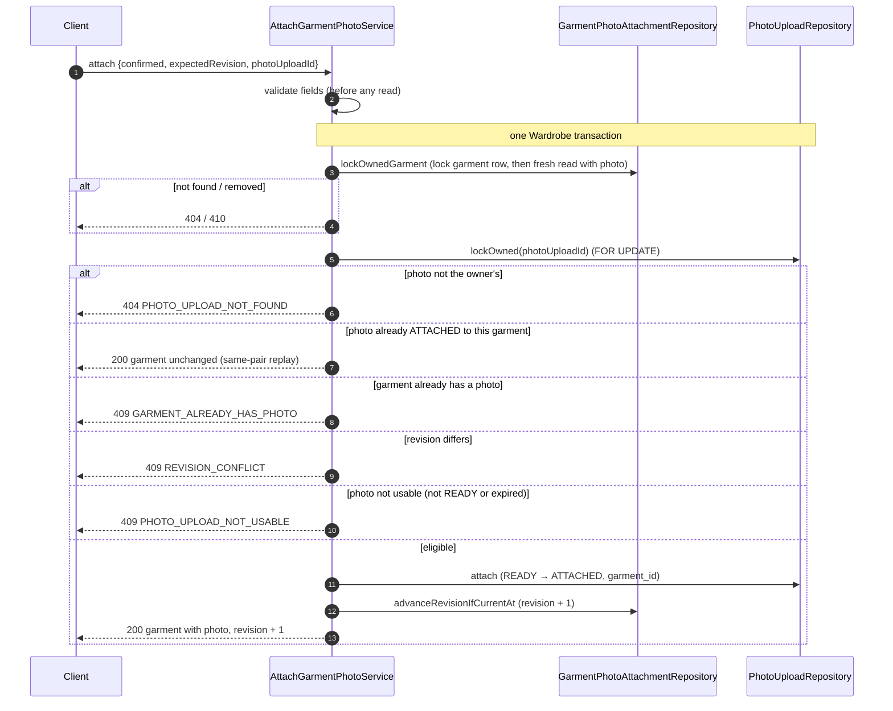

# US-GAR-006 — Attach a Photo to an Existing Garment (Provisional): Implementation Guide

| Field | Value |
| --- | --- |
| Story | **Provisional.** There is no story file and no parent PBI. The only source is [Sprint 4 plan §6.5](../sprint-plan.md#65-us-gar-006--attach-a-photo-to-an-existing-garment-provisional). |
| Sprint | Sprint 4, story 2 of 6 in the [recommended order](README.md#6-implementation-sequence) |
| Starting point | After [US-GAR-005](US-GAR-005-guide.md) P1–P23 and T1–T11 are applied |
| Approved decisions applied | S4-GAR-04, S4-GAR-05, S4-GAR-06, S4-INT-01, S4-INT-02, S4-INT-03, all **approved by the Product Owner on 2026-11-16** |
| Delegated defaults applied | OPEN-S4-07, 08, 09, 10, 31, 32 (`SELECTED BY CLAUDE — DELEGATED DEFAULT`, [record](open-questions.md)) |
| Acceptance criteria | **P-AC-01–P-AC-06 are provisional** names chosen under OPEN-S4-09. They are not approved story AC. Formal refinement and PBI mapping by the PO and BA remain outstanding. |
| Verification status | **Not applied to the repository and not run there.** Scratch evidence of 2026-11-16: the six guides were applied in order to an isolated copy of `backend/`, `docs/05-api` and `.github/workflows`, and `clean verify` passed there (677 unit and 433 integration tests; none failed, errored or was skipped), including every test in §13. A run in the repository and its CI is still required. |

## 1. Story Overview

**Provisional story (plan §6.5, verbatim).** As an authenticated owner, I want to attach a permitted photo to an existing garment that currently has no photo, so that I can make my wardrobe visually recognizable without recreating that garment.

**Backend outcome.**

- **Confirmed attachment:** `POST /api/v1/wardrobe/garments/{garmentId}/photo-attachment` with `{confirmed, expectedRevision, photoUploadId}`:
  - attaches the owner's READY, unexpired staged photo to the owner's current, imageless garment;
  - runs in one Wardrobe transaction under the reviewed revision;
  - the garment keeps every property, its creation time and creation identity;
  - its revision advances once;
  - the stage becomes ATTACHED.
- **Same-pair recovery:** repeating the identical request after a lost response returns the garment unchanged, without another revision.
- **Refusals:**
  - a garment that already has a photo, a stale revision, a removed garment, or an unusable, unknown or foreign photo are each refused;
  - nothing half-attached remains.
- **Reuse:**
  - no upload, no decoding and no object-store call at confirmation (S4-GAR-06);
  - delivery uses the existing private route;
  - pending cleanup never touches the ATTACHED photo;
  - removal (GAR-005) purges it within 30 days.

**Out of scope:**

- replacing or removing a photo;
- several photos per garment;
- AI analysis or attribute inference;
- creating a garment;
- client screens.

## 2. Repository Baseline

| Item | State after US-GAR-005 | Relevance |
| --- | --- | --- |
| `PhotoUploadRepository` | `lockOwned` (`FOR UPDATE`), `attach` (`WHERE status = 'READY'`), `findAttachedTo` | Reused unchanged. No new photo-port method. |
| `wardrobe_photo_upload` | `UNIQUE (garment_id)`; ATTACHED ⇔ `garment_id` and `attached_at`; pending expiry selects only RECEIVING and READY | The database already forbids a second photo per garment and a second consumption of a stage |
| `JdbcGarmentRepository.SELECT_GARMENT` | Garment + `LEFT JOIN` ATTACHED photo; package-private `mapGarment` | Reused for the fresh read after the garment row is locked |
| `Garment` | Has `photo()`, `withRevisedProfile`, `withRemovalAt` (GAR-005) | P1 adds `withAttachedPhoto` |
| `GarmentPhotoContentService` | Owner and currency check, then `findAttachedTo`, then `storage.open`; a missing object gives `404 GARMENT_PHOTO_UNAVAILABLE` | Serves attached photos without change |
| `WardrobeGarmentController` | Includes removal (GAR-005 P15) | P9 adds the attachment endpoint |
| Migrations | V1–V12 | **None added** |
| OpenAPI | 0.12.0 | → 0.13.0 |
| CI | 102 entries; `sprint_04` trigger present | +4 entries |

## 3. Original Business Requirements — Verbatim

> Sections 3–8 reproduce the cited sources verbatim. Only relative link targets were re-based to this file's location, and heading levels were shifted to nest under this guide; no wording was changed. Sprint 4 decision rows show the plan's historical status cell; the Product Owner's approval of 2026-11-16 supersedes it.

From [BRD](../../../../01-business/BRD.md):

| ID | Requirement | Business Rationale | Priority | Related Goals |
|---|---|---|---|---|
| BR-005 | Users must be able to maintain, browse, search, and filter an accurate current wardrobe, including adding, changing, and removing garments. | Decisions must reflect accessible, current possessions. | Must | BG-01, BG-02, BG-03 |

| ID | Capability | Business Purpose |
|---|---|---|
| CAP-03 | Wardrobe Management | Keep the wardrobe current and discoverable through maintenance, browsing, search, and filtering. |

These provide **supporting Wardrobe context only**. No exact approved attachment business requirement exists ([plan §14.1](../sprint-plan.md#141-outcome-and-source-matrix)).

## 4. Original Product Requirements — Verbatim

**None.** No PRD feature or journey maps to attaching a photo to an existing garment; the plan records that formal refinement is required. Nothing is quoted because nothing exists.

## 5. Original Software Requirements — Verbatim

From [SRS](../../../../03-requirements/SRS.md):

| ID | Requirement | Scope | Source | Verification |
|---|---|---|---|---|
| DATA-GAR-004 | The system shall associate available image/preview information with the appropriate draft or garment without requiring an image for manually saved entries. | MVP | FEAT-AI-001, FEAT-AI-002; BR-001, BR-002 | T: imageless and image entry. |
| NFR-PRIV-001 | The system shall limit personal data to necessary functionality, authorized bounded outfit sharing, personalization, history/utilization, measurement, security and operational integrity, respecting omission/correction/removal/permission controls. Only an explicitly approved shared-outfit/creator/media projection may be available to its authorized audience; this grants no access to private wardrobe inventories, source images, purchase information, profile, feedback or history. No entire-wardrobe sharing, unrestricted third-party sharing or personal-data sale is permitted. Sharing audience, consent and publishable fields remain MVP-Q01, not inferred permission. | MVP | FEAT-AUTH-001, FEAT-COM-001/002, FEAT-CHAT-001, FEAT-TRY-001; BR-021, BR-025–BR-028 | I/T: permitted shared projection versus denied private operations; explicit sharing and account isolation; policy approval required before sharing stories are Ready. |
| NFR-PRIV-002 | The MVP shall not use personal wardrobe images, profiles, Wear Events, feedback or corrections for AI model training/improvement; any future use requires separate explicit opt-in and an approved future product/privacy change, and external navigation does not grant unrestricted sharing consent. | MVP | FEAT-AUTH-001, FEAT-AI-002, FEAT-MET-001, FEAT-SHOP-002; BR-002, BR-018, BR-021 | I: complete MVP data-use boundary and future opt-in/change control; private data absent from training/improvement inputs. |

DATA-GAR-004 and the privacy requirements **constrain** the proposal; no exact attachment FR is claimed.

## 6. Original Business Rules — Verbatim

From [Business Rules](../../../../03-requirements/business-rules.md):

### BRULE-AUTH-001 — Authorized Personal Operations

**Rule:** Personal wardrobe, profile, feedback, history, and assessment operations require authentication and authorization for the affected user's information. Unavailable authorized access is not an empty wardrobe and does not change personal state.

**Applies To:** all personal domain operations.

**Source:** FR-AUTH-008, ERR-AUTH-001, DATA-GAR-001.

### BRULE-AUTH-007 — Purpose-Limited Private Data Use

**Rule:** Personal data is used only as necessary for CapsuleAI functionality, personalization, wardrobe/history/utilization, validation/measurement, security and operational integrity within the authorized User's private experience, plus explicitly authorized bounded outfit sharing under BRULE-COM-001. MVP personal images, profiles, Wear Events, feedback and corrections are not used for AI model training/improvement. Future personal-data training requires separate explicit opt-in and an approved future product/privacy change.

Only an approved shared outfit/creator/media projection may be exposed to its authorized audience. This never authorizes private inventory, source-image, purchase-information, profile or history access. Entire-wardrobe sharing, unrestricted third-party sharing and personal-data sale remain excluded; sharing audience/consent/fields require MVP-Q01 approval. External dependencies receive only purpose-minimal information: required selected weather location, email/necessary recovery-delivery information, explicitly chosen shopping navigation, or necessary authorized Chat/preview/analysis input under its approved minimal contract; unrelated wardrobe/profile/history disclosure is prohibited. Provider/context choices remain MVP-Q03/Q04/Q09. Necessary active-account information and minimal history follow the retention/removal rules; this policy adds no Delete Account goal or legal certification.

**Applies To:** personal information, account/profile/wardrobe/history, validation/measurement and external exchanges.

**Source:** FR-AUTH-008, NFR-PRIV-001, NFR-PRIV-002, SI-002, SI-003, COM-003, FR-MET-006, DATA-RET-001, DATA-RET-002, DATA-RET-003.

The general user-authority and private-ownership rules above apply. **No attachment-specific rule ID exists or is invented.**

## 7. Original User Story and Acceptance Criteria — Verbatim

From [Sprint 4 plan §6.5](../sprint-plan.md#65-us-gar-006--attach-a-photo-to-an-existing-garment-provisional) (the only source; there is no story file):

### 6.5 US-GAR-006 — Attach a photo to an existing garment (provisional)

**Status: PROPOSED — PENDING FORMAL STORY REFINEMENT AND APPROVAL.** No formal story, PBI mapping or exact approved attachment requirement was found anywhere in the tracked repository. Selection authorizes planning this outcome; it does not approve its detailed AC or fabricate a source link.

> As an authenticated owner, I want to attach a permitted photo to an existing garment that currently has no photo, so that I can make my wardrobe visually recognizable without recreating that garment.

The following are **newly proposed expectations**, named for discussion rather than assigned approved AC IDs:

| Provisional expectation | Proposed bounded behavior requiring confirmation |
| --- | --- |
| Eligibility | Only the authorized owner's current imageless garment is eligible. Wrong owner, removed garment and an already photographed garment cannot be silently changed. |
| Confirm / cancel | Review a genuinely validated owned READY photo and identify the existing target. Only explicit confirmation attaches; pre-submit cancellation leaves the garment unchanged. |
| Atomicity / authority | In one Wardrobe transaction, claim the still-usable photo and associate it with that exact garment under a current revision check. Preserve all 13 properties, original creation identity and time; increment the garment revision on an accepted association change. |
| Retry / uncertainty | Same target/photo intent cannot duplicate or replace an association; lost responses permit outcome review/same-action retry. A competing accepted change is reported, not overwritten or undone. |
| Privacy / availability | Application-authorized photo delivery only; no public URL. A missing object after acceptance produces a truthful photo limitation while available garment information remains readable. |
| Cleanup / races | Unclaimed canceled/expired media uses existing pending cleanup; ATTACHED media is protected from it. Removal/attachment and competing attachments have coherent, testable outcomes; rejected attachment leaves no half-association. |

**Backend responsibility.** Reuse staging, original image validation, normalized private storage, existing revision discipline and owner transaction ports. Acceptance changes database authority, not object contents; no additional upload or AI call is needed. The READY stage was already validated against original-input rules; it must not be reinterpreted as a new unvalidated image.

**Client responsibility.** Offer attachment only where applicable, reuse permitted photo capture/library/manual continuity, preview and confirm the intended target, preserve cancellation and show uncertain/rejected/current state. Account switching cannot reuse another owner's pending upload.

**Evidence/refinement.** Existing BR-005, DATA-GAR-004, privacy and photo rules constrain the proposal but do not constitute a specific approved attachment FR/UC/AD. Formal refinement must settle the target/confirmation/retry policy and PBI/source mapping before implementation of the provisional behavior. Prior Sprint 3 exclusion of existing-garment attachment remains historically correct; this is a newly selected extension, not retroactive approval. No replacement, multiple photos, AI analysis, attribute auto-update or new garment creation is included. No separate story file is created by this task.

## 8. Original Use Cases, Flows and Architecture Decisions — Verbatim

### 8.1 Selected architecture decisions — verbatim from [selected decisions](../../../../04-architecture/selected-architecture-decisions.md)

| ADA ID | Decision Problem | Selected Option | Backend Impact | Status |
| --- | --- | --- | --- | --- |
| ADA-006 | External integration boundaries | Option A — Narrow explicit ports/adapters for real dependencies | Isolate provider semantics behind narrow business ports/adapters. | Selected |
| ADA-007 | Private image persistence and access | Option A — Private object storage with application-controlled authorized delivery | Store media privately and authorize delivery through the application. | Selected |
| ADA-009 | Logical-action idempotency and accepted effects | Option A — Database-backed logical-action coordination and coherent effects | Coordinate accepted logical actions durably and coherently. | Selected |
| ADA-016 | Context Data Ownership | Option B — One PostgreSQL database initially with explicit context-owned logical persistence boundaries | Own persistence logically per context within one PostgreSQL. | Selected |

### 8.2 Sprint 4 decisions — verbatim from the [plan register](../sprint-plan.md#13-consolidated-decision-register)

> **Status update (binding):** the Product Owner approved all 30 Sprint 4 recommendations on **2026-11-16**. The plan's `PROPOSED — PENDING PO APPROVAL` cells below are reproduced verbatim and are superseded by that approval; see [open-questions.md](open-questions.md#1-decision-authority).

| Decision ID | Related Story | Question | Recommended Solution | Decision Status | Approval Owner |
| --- | --- | --- | --- | --- | --- |
| [S4-GAR-04](../sprint-plan.md#s4-gar-04) | US-GAR-006 | Provisional attachment eligibility and confirmation boundary | Option A — a narrow explicit confirmation of an existing imageless target and owned READY photo, after formal story approval. | PROPOSED — PENDING PO APPROVAL | Product Owner and BA with Backend Tech Lead |
| [S4-GAR-05](../sprint-plan.md#s4-gar-05) | US-GAR-006 | Atomic association, revision scope and short locks | Option A — one meaningful garment revision plus short transactional locking and conditional stage consumption. | PROPOSED — PENDING PO APPROVAL | Product Owner with Backend Tech Lead and QA |
| [S4-GAR-06](../sprint-plan.md#s4-gar-06) | US-GAR-006 | Photo availability evidence and shared lifecycle reuse | Option A — reuse validated READY evidence, with explicit private-read limitation and cleanup safety. | PROPOSED — PENDING PO APPROVAL | Product Owner with Backend Tech Lead and QA |
| [S4-INT-01](../sprint-plan.md#s4-int-01) | US-GAR-005; US-GAR-006; US-BULK-001 | Shared lock order and transaction authority | Option A — canonical existing garment then photo order, preceded by any batch/item coordination locks. | PROPOSED — PENDING PO APPROVAL | Product Owner with Backend Tech Lead and QA |
| [S4-INT-02](../sprint-plan.md#s4-int-02) | All six selected stories | Logical action outcomes and uncertainty recovery | Option A — targeted durable identities and explicit current-state review, adding a receipt only where natural state cannot prove the required outcome. | PROPOSED — PENDING PO APPROVAL | Product Owner with Backend Tech Lead and QA |
| [S4-INT-03](../sprint-plan.md#s4-int-03) | All six selected stories | Compatible command transport and synchronized delivery contracts | Option A — compatible explicit confirmed commands, preserving existing PATCH/body-revision conventions and resource grouping. | PROPOSED — PENDING PO APPROVAL | Product Owner with Backend Tech Lead and QA |

## 9. Engineering Interpretation

The provisional expectations are named **P-AC-01–P-AC-06** under OPEN-S4-09. These are not approved AC identifiers.

| Provisional criterion (plan §6.5 expectation) | Engineering meaning | Where |
| --- | --- | --- |
| **P-AC-01** Eligibility | Only the authenticated owner's **current** garment **without a photo** is eligible. Another owner's garment gives `404`; a removed garment `410`; a photographed garment `409 GARMENT_ALREADY_HAS_PHOTO`. | P6, T3, T4 |
| **P-AC-02** Confirm / cancel | `confirmed: true` and the reviewed `expectedRevision` are required, and the photo must be the owner's READY stage. Cancelling means not sending the request; the stage then keeps its unchanged `PT24H` TTL. | P6, T3, T4 |
| **P-AC-03** Atomicity / authority | One transaction locks the garment, then the photo; checks; attaches (READY → ATTACHED); advances the revision by one. All 13 properties, the creation time and the creation fingerprint are unchanged. | P1, P6, P7, T4, T5 |
| **P-AC-04** Retry / uncertainty | The identical pair already attached answers `200` with the current garment, without another revision. A different pair is never attached over an existing one. A competing accepted change is reported, never overwritten. | P6, T3, T4, T5 |
| **P-AC-05** Privacy / availability | Delivery only through `GET /garments/{id}/photo` after the owner check. A missing object gives `404 GARMENT_PHOTO_UNAVAILABLE` while the detail stays readable. No public URL. | Existing service, T4 |
| **P-AC-06** Cleanup / races | Pending cleanup never selects ATTACHED rows. An expired or cancelled stage cannot be attached. Competing attachments and removal have one coherent winner. A rejected attachment leaves no half-association. | P6, T4, T5 |

## 10. Just-in-Time Detailed Design

### 10.1 Sequence



### 10.2 API contract

| Item | Value |
| --- | --- |
| Route | `POST /api/v1/wardrobe/garments/{garmentId}/photo-attachment` |
| Request | `GarmentPhotoAttachmentRequest {confirmed, expectedRevision, photoUploadId}`, all required |
| Validation before lookup | `confirmed`: `REQUIRED` or `NOT_CONFIRMED`<br>`expectedRevision`: `REQUIRED` or `INVALID_FORMAT`<br>`photoUploadId`: `REQUIRED` or `INVALID_FORMAT` (not a UUID) |
| `200` | `Garment` (the existing schema) with `photo` set |
| `404` | `GARMENT_NOT_FOUND` or `PHOTO_UPLOAD_NOT_FOUND` (both non-disclosing) |
| `409` | `GARMENT_ALREADY_HAS_PHOTO`, `REVISION_CONFLICT` or `PHOTO_UPLOAD_NOT_USABLE` |
| `410` | `GARMENT_NO_LONGER_CURRENT` |

### 10.3 Data

No migration. Integrity relies on the V10 constraints:

- `uq_wardrobe_photo_upload_garment`: one photo per garment;
- `ck_wardrobe_photo_upload_attached`;
- the conditional `attach … WHERE status = 'READY'`;

plus the garment revision. Removal (GAR-005) later copies the attached photo's key into the cleanup obligation.

### 10.4 Concurrency (S4-INT-01 order: garment, then photo)

| Race | Outcome |
| --- | --- |
| Two photos for one garment | The second transaction waits on the garment lock, then sees the photo and answers `409 GARMENT_ALREADY_HAS_PHOTO` |
| One photo for two garments | The second waits on the photo lock, then sees ATTACHED to another garment and answers `409 PHOTO_UPLOAD_NOT_USABLE` |
| Attachment against removal | Both serialize on the garment row. Attachment first: the removal fails its revision predicate (`409`). Removal first: the attachment finds the garment removed (`410`). |
| Attachment against edit | The edit's conditional `UPDATE` waits; after attachment it fails its revision (`409`). Edit first: the attachment sees the new revision (`409`). |
| Attachment against pending expiry | Expiry claims with `SKIP LOCKED` and skips the locked photo. After expiry the photo is DISCARDED and not usable (`409`). |
| Attachment against cancellation | Cancellation `UPDATE`s RECEIVING or READY rows only. After attachment it affects nothing; before attachment, the attachment answers `409`. |

### 10.5 Security, privacy and recovery

- The owner comes from the token. No object call is made, so no storage latency inside the transaction.
- Recovery:
  - a lost response: repeat the identical request (same-pair replay);
  - `409`: reread the detail and the photo status;
  - `503`: reread before retrying.

### 10.6 Testing plan

| Level | Classes |
| --- | --- |
| Domain | `GarmentPhotoAttachmentTest` |
| Application with fakes | `AttachGarmentPhotoServiceTest` |
| HTTP | `GarmentPhotoAttachmentApiIT` |
| Concurrency | `ConcurrentGarmentPhotoAttachmentIT` |
| Contract | `IdentityOpenApiContractIT` (existing) |

## 11. File Change Matrix

| Order | Action | Exact repository path | Purpose | Dependencies |
| --- | --- | --- | --- | --- |
| P1 | MODIFY | `backend/src/main/java/com/capsuleai/wardrobe/domain/Garment.java` | `withAttachedPhoto` | GAR-005 P2 |
| P2 | ADD | `backend/src/main/java/com/capsuleai/wardrobe/application/ports/GarmentPhotoAttachmentRepository.java` | Locking read and revision advance | — |
| P3 | ADD | `backend/src/main/java/com/capsuleai/wardrobe/application/AttachGarmentPhotoCommand.java` | Submitted attachment | — |
| P4 | ADD | `backend/src/main/java/com/capsuleai/wardrobe/application/GarmentPhotoAttachment.java` | Outcome | P1 |
| P5 | ADD | `backend/src/main/java/com/capsuleai/wardrobe/application/GarmentAlreadyHasPhotoException.java` | Refusal | — |
| P6 | ADD | `backend/src/main/java/com/capsuleai/wardrobe/application/AttachGarmentPhotoService.java` | Use case | P1–P5 |
| P7 | ADD | `backend/src/main/java/com/capsuleai/wardrobe/adapter/out/persistence/JdbcGarmentPhotoAttachmentRepository.java` | SQL for P2 | P2 |
| P8 | ADD | `backend/src/main/java/com/capsuleai/wardrobe/adapter/in/web/GarmentPhotoAttachmentRequest.java` | Request body | P3 |
| P9 | MODIFY | `backend/src/main/java/com/capsuleai/wardrobe/adapter/in/web/WardrobeGarmentController.java` | Endpoint | P6, P8; GAR-005 P15 |
| P10 | MODIFY | `backend/src/main/java/com/capsuleai/wardrobe/adapter/in/web/WardrobeApiExceptionHandler.java` | `GARMENT_ALREADY_HAS_PHOTO` | P5; GAR-005 P16 |
| P11 | MODIFY | `backend/src/main/java/com/capsuleai/wardrobe/configuration/WardrobePhotoConfiguration.java` | Beans | P6, P7 |
| P12 | MODIFY | `docs/05-api/openapi.yaml` | 0.12.0 → 0.13.0 | P8, P9 |
| P13 | MODIFY | `.github/workflows/backend-ci.yml` | 4 report entries | T1–T5 |
| T1 | ADD | `backend/src/test/java/com/capsuleai/wardrobe/domain/GarmentPhotoAttachmentTest.java` | Domain transition | P1 |
| T2 | ADD | `backend/src/test/java/com/capsuleai/wardrobe/application/InMemoryGarmentPhotoAttachmentRepository.java` | Fake of P2 | P2 |
| T3 | ADD | `backend/src/test/java/com/capsuleai/wardrobe/application/AttachGarmentPhotoServiceTest.java` | Use-case rules | P6, T2 |
| T4 | ADD | `backend/src/test/java/com/capsuleai/wardrobe/adapter/in/web/GarmentPhotoAttachmentApiIT.java` | HTTP behavior | P9, P12 |
| T5 | ADD | `backend/src/test/java/com/capsuleai/wardrobe/application/ConcurrentGarmentPhotoAttachmentIT.java` | Races | P6, P7 |

## 12. Complete Production Implementation

The BEFORE blocks are the files as left by US-GAR-005. Commands run from `backend/`.

### Step P1 — [MODIFY] `backend/src/main/java/com/capsuleai/wardrobe/domain/Garment.java`

BEFORE:

```java
    public boolean isCurrent() {
        return removedAt == null;
    }
```

AFTER:

```java
    /**
     * Provisional US-GAR-006 (S4-GAR-05): the same garment with the reviewed photo attached. Every property,
     * the creation time and provenance are kept; the revision advances by one, because the attached photo
     * is part of the garment's visible current state. Only a current garment without a photo can receive
     * one: attachment never replaces a photo and never applies to a removed garment.
     */
    public Garment withAttachedPhoto(GarmentPhoto attachedPhoto) {
        Objects.requireNonNull(attachedPhoto, "attachedPhoto");
        if (!isCurrent()) {
            throw new IllegalStateException("Only a garment in the current wardrobe can receive a photo");
        }
        if (photo.isPresent()) {
            throw new IllegalStateException("A garment that already has a photo cannot receive another");
        }
        return new Garment(id, ownerAccountId, profile, provenance, createdAt, removedAt,
                Math.addExact(revision, 1), Optional.of(attachedPhoto));
    }

    public boolean isCurrent() {
        return removedAt == null;
    }
```

**Explanation.** `Optional` and `Objects` are already imported by `Garment`.

**Verification.** T1.

### Step P2 — [ADD] `backend/src/main/java/com/capsuleai/wardrobe/application/ports/GarmentPhotoAttachmentRepository.java`

```java
package com.capsuleai.wardrobe.application.ports;

import com.capsuleai.wardrobe.domain.Garment;
import java.util.Optional;
import java.util.UUID;

/**
 * Provisional US-GAR-006 (S4-GAR-05, S4-INT-01): the garment side of attaching a staged photo to an existing
 * garment. The garment is locked before any photo lock, so attachment, removal, edits and competing
 * attachments meet at the garment row first. Call both methods inside {@link WardrobeTransactions}.
 */
public interface GarmentPhotoAttachmentRepository {

    /**
     * The owner's garment in any state, with its attached photo if any, locked until the surrounding
     * transaction ends. Another owner's garment is never returned.
     */
    Optional<Garment> lockOwnedGarment(UUID ownerAccountId, UUID garmentId);

    /**
     * Advances the revision of the owner's current garment by one, only while it is at
     * {@code expectedRevision}. @return false if nothing changed
     */
    boolean advanceRevisionIfCurrentAt(UUID ownerAccountId, UUID garmentId, long expectedRevision);
}
```

### Step P3 — [ADD] `backend/src/main/java/com/capsuleai/wardrobe/application/AttachGarmentPhotoCommand.java`

```java
package com.capsuleai.wardrobe.application;

import java.util.UUID;

/**
 * One submitted attachment of a staged photo to an existing garment (provisional US-GAR-006). The owner
 * comes from the authenticated session. Ids are raw request text: a malformed garment id is "not found";
 * a malformed photo id is a validation error, because the client supplied it in the body.
 */
public record AttachGarmentPhotoCommand(UUID ownerAccountId, String garmentId, Boolean confirmed,
                                        String expectedRevision, String photoUploadId) {
}
```

### Step P4 — [ADD] `backend/src/main/java/com/capsuleai/wardrobe/application/GarmentPhotoAttachment.java`

```java
package com.capsuleai.wardrobe.application;

import com.capsuleai.wardrobe.domain.Garment;
import java.util.Objects;

/**
 * Outcome of an accepted attachment (provisional US-GAR-006, OPEN-S4-07): the garment as it now is, and
 * whether this request attached the photo ({@code false}: the same pair was already attached, for example
 * by an earlier delivery of the same request; nothing changed and the revision is the same).
 */
public record GarmentPhotoAttachment(Garment garment, boolean newlyAttached) {

    public GarmentPhotoAttachment {
        Objects.requireNonNull(garment, "garment");
    }
}
```

### Step P5 — [ADD] `backend/src/main/java/com/capsuleai/wardrobe/application/GarmentAlreadyHasPhotoException.java`

```java
package com.capsuleai.wardrobe.application;

/**
 * The garment already has a photo, so another one is not attached (provisional US-GAR-006; replacement is
 * out of scope). Nothing changed.
 */
public final class GarmentAlreadyHasPhotoException extends RuntimeException {

    public GarmentAlreadyHasPhotoException() {
        super("The garment already has a photo; it was not replaced");
    }
}
```

### Step P6 — [ADD] `backend/src/main/java/com/capsuleai/wardrobe/application/AttachGarmentPhotoService.java`

```java
package com.capsuleai.wardrobe.application;

import com.capsuleai.wardrobe.application.ports.GarmentPhotoAttachmentRepository;
import com.capsuleai.wardrobe.application.ports.PhotoUploadRepository;
import com.capsuleai.wardrobe.application.ports.WardrobeTransactions;
import com.capsuleai.wardrobe.domain.Garment;
import com.capsuleai.wardrobe.domain.GarmentValueProblem;
import com.capsuleai.wardrobe.domain.PhotoUpload;
import com.capsuleai.wardrobe.domain.PhotoUploadStatus;
import java.time.Clock;
import java.time.Instant;
import java.time.temporal.ChronoUnit;
import java.util.ArrayList;
import java.util.List;
import java.util.Objects;
import java.util.UUID;
import java.util.regex.Pattern;

/**
 * Provisional US-GAR-006 — attaches the owner's reviewed READY photo to the owner's current garment that has
 * no photo (S4-GAR-04/05/06, S4-INT-01/02, OPEN-S4-07/08/10).
 *
 * <p>One Wardrobe transaction locks the garment, then the photo (S4-INT-01), and checks in this order:
 * an identical pair already attached is a replay and changes nothing; a garment that already has a photo
 * is refused; a garment that changed after review is a conflict; a photo that is not READY or has expired
 * is not usable. Otherwise the photo becomes ATTACHED to the garment and the garment's revision advances by
 * one, together. No object is read or written: READY already proves validated, privately stored bytes.
 */
public final class AttachGarmentPhotoService {

    static final String CONFIRMED_FIELD = "confirmed";
    static final String EXPECTED_REVISION_FIELD = "expectedRevision";
    static final String PHOTO_UPLOAD_ID_FIELD = "photoUploadId";

    private static final Pattern CANONICAL_UUID =
            Pattern.compile("[0-9a-fA-F]{8}-[0-9a-fA-F]{4}-[0-9a-fA-F]{4}-[0-9a-fA-F]{4}-[0-9a-fA-F]{12}");

    /** A positive decimal that fits in a long; clients treat it as opaque (OPEN-S3-04). */
    private static final Pattern REVISION_TOKEN = Pattern.compile("[1-9][0-9]{0,17}");

    /** The validated body of a request. */
    private record ReviewedPair(long expectedRevision, UUID photoUploadId) {
    }

    private final GarmentPhotoAttachmentRepository garmentPhotoAttachmentRepository;
    private final PhotoUploadRepository photoUploadRepository;
    private final WardrobeTransactions wardrobeTransactions;
    private final Clock clock;

    public AttachGarmentPhotoService(GarmentPhotoAttachmentRepository garmentPhotoAttachmentRepository,
                                     PhotoUploadRepository photoUploadRepository,
                                     WardrobeTransactions wardrobeTransactions, Clock clock) {
        this.garmentPhotoAttachmentRepository =
                Objects.requireNonNull(garmentPhotoAttachmentRepository, "garmentPhotoAttachmentRepository");
        this.photoUploadRepository = Objects.requireNonNull(photoUploadRepository, "photoUploadRepository");
        this.wardrobeTransactions = Objects.requireNonNull(wardrobeTransactions, "wardrobeTransactions");
        this.clock = Objects.requireNonNull(clock, "clock");
    }

    /**
     * @throws GarmentValidationException      if a field is missing or malformed (checked before any read)
     * @throws GarmentNotFoundException        if the owner has no garment with this id
     * @throws GarmentNoLongerCurrentException if the owner's garment was removed
     * @throws PhotoUploadNotFoundException    if the photo is not among the owner's staged photos
     * @throws GarmentAlreadyHasPhotoException if the garment already has another photo
     * @throws GarmentRevisionConflictException if the garment changed after the owner reviewed it
     * @throws PhotoUploadNotUsableException   if the photo is not READY, has expired or belongs to another garment
     */
    public GarmentPhotoAttachment attach(AttachGarmentPhotoCommand command) {
        UUID ownerAccountId = Objects.requireNonNull(command.ownerAccountId(), "ownerAccountId");
        ReviewedPair reviewedPair = checkRequest(command);
        UUID garmentId = garmentId(command.garmentId());
        Instant now = clock.instant().truncatedTo(ChronoUnit.MICROS);

        return wardrobeTransactions.inTransaction(() -> {
            Garment garment = garmentPhotoAttachmentRepository.lockOwnedGarment(ownerAccountId, garmentId)
                    .orElseThrow(GarmentNotFoundException::new);
            if (!garment.isCurrent()) {
                throw new GarmentNoLongerCurrentException();
            }
            PhotoUpload photoUpload = photoUploadRepository.lockOwned(ownerAccountId, reviewedPair.photoUploadId())
                    .orElseThrow(PhotoUploadNotFoundException::new);
            if (photoUpload.status() == PhotoUploadStatus.ATTACHED && garmentId.equals(photoUpload.garmentId())) {
                return new GarmentPhotoAttachment(garment, false);
            }
            if (garment.photo().isPresent()) {
                throw new GarmentAlreadyHasPhotoException();
            }
            if (garment.revision() != reviewedPair.expectedRevision()) {
                throw new GarmentRevisionConflictException();
            }
            if (!photoUpload.isUsableAt(now)) {
                throw new PhotoUploadNotUsableException();
            }
            if (!photoUploadRepository.attach(photoUpload.id(), garmentId, now)) {
                throw new IllegalStateException("A locked READY photo could not be attached");
            }
            if (!garmentPhotoAttachmentRepository.advanceRevisionIfCurrentAt(ownerAccountId, garmentId,
                    reviewedPair.expectedRevision())) {
                throw new IllegalStateException("A locked current garment could not be revised");
            }
            return new GarmentPhotoAttachment(garment.withAttachedPhoto(photoUpload.asGarmentPhoto()), true);
        });
    }

    /** Problems visible without reading anything. */
    private static ReviewedPair checkRequest(AttachGarmentPhotoCommand command) {
        List<GarmentFieldViolation> violations = new ArrayList<>();
        if (command.confirmed() == null) {
            violations.add(new GarmentFieldViolation(CONFIRMED_FIELD, GarmentValueProblem.REQUIRED));
        } else if (!command.confirmed()) {
            violations.add(new GarmentFieldViolation(CONFIRMED_FIELD, GarmentValueProblem.NOT_CONFIRMED));
        }
        long expectedRevision = 0;
        String revisionToken = command.expectedRevision();
        if (revisionToken == null || revisionToken.isBlank()) {
            violations.add(new GarmentFieldViolation(EXPECTED_REVISION_FIELD, GarmentValueProblem.REQUIRED));
        } else if (!REVISION_TOKEN.matcher(revisionToken).matches()) {
            violations.add(new GarmentFieldViolation(EXPECTED_REVISION_FIELD, GarmentValueProblem.INVALID_FORMAT));
        } else {
            expectedRevision = Long.parseLong(revisionToken);
        }
        UUID photoUploadId = null;
        String photoText = command.photoUploadId();
        if (photoText == null || photoText.isBlank()) {
            violations.add(new GarmentFieldViolation(PHOTO_UPLOAD_ID_FIELD, GarmentValueProblem.REQUIRED));
        } else if (!CANONICAL_UUID.matcher(photoText).matches()) {
            violations.add(new GarmentFieldViolation(PHOTO_UPLOAD_ID_FIELD, GarmentValueProblem.INVALID_FORMAT));
        } else {
            photoUploadId = UUID.fromString(photoText);
        }
        if (!violations.isEmpty()) {
            throw new GarmentValidationException(violations);
        }
        return new ReviewedPair(expectedRevision, photoUploadId);
    }

    private static UUID garmentId(String garmentId) {
        if (garmentId == null || !CANONICAL_UUID.matcher(garmentId).matches()) {
            throw new GarmentNotFoundException();
        }
        return UUID.fromString(garmentId);
    }
}
```

**Explanation.**

- The replay check comes before every refusal, so a lost response is answered truthfully even though the revision has moved on (S4-INT-02).
- Pending expiry selects rows with `FOR UPDATE SKIP LOCKED`, so it never waits for this transaction. A photo it expired earlier is DISCARDED and is refused as not usable.

**Database implications.** One transaction with two row locks, in the canonical order, plus two `UPDATE`s. No object call.

**Common mistakes.**

- Locking the photo before the garment (inverts S4-INT-01).
- Checking the revision before the replay: a lost response would turn into a false `409`.
- Calling `PhotoStorage` here (S4-GAR-06).

**Verification.** T3, T4 and T5.

### Step P7 — [ADD] `backend/src/main/java/com/capsuleai/wardrobe/adapter/out/persistence/JdbcGarmentPhotoAttachmentRepository.java`

```java
package com.capsuleai.wardrobe.adapter.out.persistence;

import com.capsuleai.wardrobe.application.ports.GarmentPhotoAttachmentRepository;
import com.capsuleai.wardrobe.domain.Garment;
import java.util.Optional;
import java.util.UUID;
import org.springframework.jdbc.core.simple.JdbcClient;

/** PostgreSQL implementation of {@link GarmentPhotoAttachmentRepository} (provisional US-GAR-006). */
public final class JdbcGarmentPhotoAttachmentRepository implements GarmentPhotoAttachmentRepository {

    /**
     * Step 1: lock only the garment row. When this statement had to wait for a competing transaction,
     * PostgreSQL (READ COMMITTED) re-checks the locked row only; rows joined from other tables would still
     * come from the statement's original snapshot. So the photo is never read in this statement.
     */
    static final String LOCK_OWNED_GARMENT_ROW = """
            SELECT id FROM wardrobe.wardrobe_garment
            WHERE owner_account_id = :ownerAccountId AND id = :garmentId
            FOR UPDATE
            """;

    /**
     * Step 2: a new statement, so a new READ COMMITTED snapshot taken after the lock was granted: the garment
     * and its attached photo as committed by any transaction that held the lock before.
     */
    static final String SELECT_OWNED_GARMENT = JdbcGarmentRepository.SELECT_GARMENT + """
            WHERE g.owner_account_id = :ownerAccountId AND g.id = :garmentId
            """;

    static final String ADVANCE_REVISION_IF_CURRENT_AT = """
            UPDATE wardrobe.wardrobe_garment
            SET revision = revision + 1
            WHERE id = :garmentId AND owner_account_id = :ownerAccountId
              AND removed_at IS NULL AND revision = :expectedRevision
            """;

    private final JdbcClient jdbcClient;

    public JdbcGarmentPhotoAttachmentRepository(JdbcClient jdbcClient) {
        this.jdbcClient = jdbcClient;
    }

    @Override
    public Optional<Garment> lockOwnedGarment(UUID ownerAccountId, UUID garmentId) {
        Optional<UUID> lockedGarmentId = jdbcClient.sql(LOCK_OWNED_GARMENT_ROW)
                .param("ownerAccountId", ownerAccountId)
                .param("garmentId", garmentId)
                .query(UUID.class)
                .optional();
        if (lockedGarmentId.isEmpty()) {
            return Optional.empty();
        }
        return jdbcClient.sql(SELECT_OWNED_GARMENT)
                .param("ownerAccountId", ownerAccountId)
                .param("garmentId", garmentId)
                .query((row, rowNumber) -> JdbcGarmentRepository.mapGarment(row))
                .optional();
    }

    @Override
    public boolean advanceRevisionIfCurrentAt(UUID ownerAccountId, UUID garmentId, long expectedRevision) {
        return jdbcClient.sql(ADVANCE_REVISION_IF_CURRENT_AT)
                .param("garmentId", garmentId)
                .param("ownerAccountId", ownerAccountId)
                .param("expectedRevision", expectedRevision)
                .update() == 1;
    }
}
```

**Explanation.**

- **Lock, then read.** A single `SELECT_GARMENT … FOR UPDATE OF g` would be wrong under concurrency. When it waits for a competing attachment, PostgreSQL re-checks the garment row (revision 2) but keeps the photo `LEFT JOIN` from its original snapshot (no photo). The losing attachment would then answer `REVISION_CONFLICT` instead of `GARMENT_ALREADY_HAS_PHOTO`. A scratch run of T5 exposed exactly this. The second statement takes a fresh snapshot after the lock, so garment and photo are consistent.
- `SELECT_GARMENT` and `mapGarment` are reused from the same package, so the garment mapping exists once.
- The concatenation of two compile-time constants is the existing repository pattern.

**Common mistakes.**

- Merging the two statements into one locking join (see above).
- `FOR UPDATE` on the joined query without `OF g`: PostgreSQL rejects it ("FOR UPDATE cannot be applied to the nullable side of an outer join").

### Step P8 — [ADD] `backend/src/main/java/com/capsuleai/wardrobe/adapter/in/web/GarmentPhotoAttachmentRequest.java`

```java
package com.capsuleai.wardrobe.adapter.in.web;

import com.capsuleai.wardrobe.application.AttachGarmentPhotoCommand;
import java.util.UUID;

/**
 * JSON body of POST /api/v1/wardrobe/garments/{garmentId}/photo-attachment (provisional US-GAR-006): the
 * explicit confirmation, the garment revision the user reviewed and the reviewed staged photo. There is no
 * owner field.
 */
public record GarmentPhotoAttachmentRequest(Boolean confirmed, String expectedRevision, String photoUploadId) {

    AttachGarmentPhotoCommand toCommand(UUID ownerAccountId, String garmentId) {
        return new AttachGarmentPhotoCommand(ownerAccountId, garmentId, confirmed, expectedRevision, photoUploadId);
    }
}
```

### Step P9 — [MODIFY] `backend/src/main/java/com/capsuleai/wardrobe/adapter/in/web/WardrobeGarmentController.java`

**Edit 1.** Imports.

BEFORE:

```java
import com.capsuleai.wardrobe.application.AddGarmentService;
import com.capsuleai.wardrobe.application.BrowseWardrobeService;
```

AFTER:

```java
import com.capsuleai.wardrobe.application.AddGarmentService;
import com.capsuleai.wardrobe.application.AttachGarmentPhotoService;
import com.capsuleai.wardrobe.application.BrowseWardrobeService;
```

**Edit 2.** Field and constructor (as left by US-GAR-005 P15).

BEFORE:

```java
    private final RemoveGarmentService removeGarmentService;

    public WardrobeGarmentController(AddGarmentService addGarmentService,
                                     BrowseWardrobeService browseWardrobeService,
                                     InspectGarmentService inspectGarmentService,
                                     ReviseGarmentService reviseGarmentService,
                                     GarmentPhotoContentService garmentPhotoContentService,
                                     RemoveGarmentService removeGarmentService) {
```

AFTER:

```java
    private final RemoveGarmentService removeGarmentService;
    private final AttachGarmentPhotoService attachGarmentPhotoService;

    public WardrobeGarmentController(AddGarmentService addGarmentService,
                                     BrowseWardrobeService browseWardrobeService,
                                     InspectGarmentService inspectGarmentService,
                                     ReviseGarmentService reviseGarmentService,
                                     GarmentPhotoContentService garmentPhotoContentService,
                                     RemoveGarmentService removeGarmentService,
                                     AttachGarmentPhotoService attachGarmentPhotoService) {
```

BEFORE:

```java
        this.removeGarmentService = removeGarmentService;
    }
```

AFTER:

```java
        this.removeGarmentService = removeGarmentService;
        this.attachGarmentPhotoService = attachGarmentPhotoService;
    }
```

**Edit 3.** The endpoint, after the removal endpoint.

BEFORE:

```java
        return GarmentRemovalResponse.from(removeGarmentService.remove(request.toCommand(owner.accountId(), garmentId)));
    }
```

AFTER:

```java
        return GarmentRemovalResponse.from(removeGarmentService.remove(request.toCommand(owner.accountId(), garmentId)));
    }

    /**
     * Provisional US-GAR-006 — attaches the owner's reviewed READY photo to the owner's current garment without
     * a photo, under the reviewed revision (S4-GAR-04/05). 200 with the garment as it now is; repeating the
     * same pair returns the same garment without another revision.
     */
    @PostMapping("/{garmentId}/photo-attachment")
    public GarmentResponse attachGarmentPhoto(@AuthenticationPrincipal AuthenticatedAccount owner,
                                              @PathVariable String garmentId,
                                              @RequestBody GarmentPhotoAttachmentRequest request) {
        return GarmentResponse.from(
                attachGarmentPhotoService.attach(request.toCommand(owner.accountId(), garmentId)).garment());
    }
```

### Step P10 — [MODIFY] `backend/src/main/java/com/capsuleai/wardrobe/adapter/in/web/WardrobeApiExceptionHandler.java`

BEFORE:

```java
import com.capsuleai.wardrobe.application.GarmentFieldViolation;
```

AFTER:

```java
import com.capsuleai.wardrobe.application.GarmentAlreadyHasPhotoException;
import com.capsuleai.wardrobe.application.GarmentFieldViolation;
```

BEFORE (the conflict handler as left by US-GAR-005 P16):

```java
                "This garment changed after you opened it, so your change was not applied. Reload it, review the "
                        + "current values and confirm again."));
    }
```

AFTER:

```java
                "This garment changed after you opened it, so your change was not applied. Reload it, review the "
                        + "current values and confirm again."));
    }

    /** Provisional US-GAR-006 (OPEN-S4-07/32): attachment never replaces an existing photo. */
    @ExceptionHandler(GarmentAlreadyHasPhotoException.class)
    public ResponseEntity<ProblemDetail> handleGarmentAlreadyHasPhoto(GarmentAlreadyHasPhotoException exception) {
        return respond(problem(HttpStatus.CONFLICT, "GARMENT_ALREADY_HAS_PHOTO",
                "This garment already has a photo, so the chosen photo was not attached. Reload the garment to see "
                        + "its current photo."));
    }
```

### Step P11 — [MODIFY] `backend/src/main/java/com/capsuleai/wardrobe/configuration/WardrobePhotoConfiguration.java`

**Edit 1.** Imports.

BEFORE:

```java
import com.capsuleai.wardrobe.adapter.out.imaging.ImageIoPhotoInspector;
import com.capsuleai.wardrobe.adapter.out.storage.S3PhotoStorage;
import com.capsuleai.wardrobe.application.CancelPhotoUploadService;
```

AFTER:

```java
import com.capsuleai.wardrobe.adapter.out.imaging.ImageIoPhotoInspector;
import com.capsuleai.wardrobe.adapter.out.persistence.JdbcGarmentPhotoAttachmentRepository;
import com.capsuleai.wardrobe.adapter.out.storage.S3PhotoStorage;
import com.capsuleai.wardrobe.application.AttachGarmentPhotoService;
import com.capsuleai.wardrobe.application.CancelPhotoUploadService;
```

BEFORE:

```java
import com.capsuleai.wardrobe.application.ports.PhotoInspector;
```

AFTER:

```java
import com.capsuleai.wardrobe.application.ports.GarmentPhotoAttachmentRepository;
import com.capsuleai.wardrobe.application.ports.PhotoInspector;
```

BEFORE:

```java
import org.springframework.context.annotation.Configuration;
import software.amazon.awssdk.auth.credentials.AwsBasicCredentials;
```

AFTER:

```java
import org.springframework.context.annotation.Configuration;
import org.springframework.jdbc.core.simple.JdbcClient;
import software.amazon.awssdk.auth.credentials.AwsBasicCredentials;
```

**Edit 2.** Beans, before the private helper.

BEFORE:

```java
    private static boolean hasText(String value) {
```

AFTER:

```java
    /** Provisional US-GAR-006: the garment side of attachment (garment lock before photo lock). */
    @Bean
    GarmentPhotoAttachmentRepository garmentPhotoAttachmentRepository(JdbcClient jdbcClient) {
        return new JdbcGarmentPhotoAttachmentRepository(jdbcClient);
    }

    @Bean
    AttachGarmentPhotoService attachGarmentPhotoService(GarmentPhotoAttachmentRepository garmentPhotoAttachmentRepository,
                                                        PhotoUploadRepository photoUploadRepository,
                                                        WardrobeTransactions wardrobeTransactions, Clock clock) {
        return new AttachGarmentPhotoService(garmentPhotoAttachmentRepository, photoUploadRepository,
                wardrobeTransactions, clock);
    }

    private static boolean hasText(String value) {
```

**Explanation.** Attachment is part of the photo capability, so its beans join the other photo use cases. `JdbcClient` is allowed in `configuration` (ArchUnit rule `springJdbcStaysInPersistenceAdaptersRule`).

### Step P12 — [MODIFY] `docs/05-api/openapi.yaml` (0.12.0 → 0.13.0)

**Edit 1.** Version and coverage.

BEFORE:

```yaml
  version: 0.12.0
```

AFTER:

```yaml
  version: 0.13.0
```

BEFORE:

```yaml
      - US-GAR-005: Remove a garment while preserving minimal history
```

AFTER:

```yaml
      - US-GAR-005: Remove a garment while preserving minimal history
      - US-GAR-006 (provisional): Attach a photo to an existing garment
```

**Edit 2.** Scope statement.

BEFORE:

```yaml
    This specification does not introduce endpoints for
    session listing, all-device logout, attaching a photo to
    an existing garment, replacing a confirmed photo, search,
    filtering, body or gender profiles, location, or public
    profiles.
```

AFTER:

```yaml
    This specification does not introduce endpoints for
    session listing, all-device logout, replacing or removing a
    garment's photo, search, filtering, body or gender
    profiles, location, or public profiles.

    A staged photo can be attached to an existing garment that
    has no photo (provisional US-GAR-006) through an explicitly
    confirmed command protected by the garment revision. The
    photo is not uploaded again; repeating the same garment and
    photo pair changes nothing.
```

**Edit 3.** The new operation, after the removal operation.

BEFORE:

```yaml
  /api/v1/wardrobe/garments/{garmentId}/photo:
    get:
```

AFTER:

```yaml
  /api/v1/wardrobe/garments/{garmentId}/photo-attachment:
    post:
      tags:
        - Wardrobe
      operationId: attachGarmentPhoto
      summary: Attach a reviewed staged photo to an existing garment
      description: |
        Provisional US-GAR-006 (approved S4-GAR-04/05/06 and
        S4-INT-01/02/03; acceptance criteria pending formal story
        refinement).

        Attaches the account's READY, unexpired staged photo to the
        account's current garment that has no photo, after explicit
        confirmation of the revision the user reviewed. Every garment
        property, the creation time and provenance are kept; the
        revision increases by one. The photo is not uploaded or
        processed again.

        - 200: the garment as it now is, with photo metadata. The
          same garment and photo pair repeated after a lost response
          returns the same garment without another revision.
        - 409 GARMENT_ALREADY_HAS_PHOTO: the garment has a photo;
          it is never replaced.
        - 409 REVISION_CONFLICT: the garment changed after review.
        - 409 PHOTO_UPLOAD_NOT_USABLE: the photo is not READY, has
          expired or belongs to another garment.
        - 404 GARMENT_NOT_FOUND / PHOTO_UPLOAD_NOT_FOUND: unknown or
          another account's resource (indistinguishable).
        - 410 GARMENT_NO_LONGER_CURRENT: the garment was removed.

      parameters:
        - name: garmentId
          in: path
          required: true
          description: The garment id from the wardrobe overview or detail.
          schema:
            type: string
            format: uuid

      requestBody:
        required: true
        content:
          application/json:
            schema:
              $ref: "#/components/schemas/GarmentPhotoAttachmentRequest"
            example:
              confirmed: true
              expectedRevision: "2"
              photoUploadId: "7c2e4b1a-9d3f-4e6a-8b5c-0a1b2c3d4e5f"

      responses:
        "200":
          description: The photo is attached (now or by an earlier identical request).
          content:
            application/json:
              schema:
                $ref: "#/components/schemas/Garment"

        "400":
          $ref: "#/components/responses/GarmentPhotoAttachmentRejected"

        "401":
          $ref: "#/components/responses/Unauthorized"

        "404":
          $ref: "#/components/responses/AttachmentTargetNotFound"

        "409":
          $ref: "#/components/responses/AttachmentConflict"

        "410":
          $ref: "#/components/responses/GarmentNoLongerCurrent"

        "503":
          $ref: "#/components/responses/Unavailable"

  /api/v1/wardrobe/garments/{garmentId}/photo:
    get:
```

**Edit 4.** Schema, before `FieldError`.

BEFORE:

```yaml
    FieldError:
      type: object
      description: A validation failure associated with a request field.
```

AFTER:

```yaml
    GarmentPhotoAttachmentRequest:
      type: object
      description: |
        Explicit confirmation of attaching one reviewed staged photo
        to one existing garment (provisional US-GAR-006). There is
        no owner field.
      required:
        - confirmed
        - expectedRevision
        - photoUploadId
      properties:
        confirmed:
          type: boolean
          const: true
          description: Must be true; false is rejected with NOT_CONFIRMED.
        expectedRevision:
          type: string
          pattern: "^[1-9][0-9]{0,17}$"
          description: The revision of the garment the user reviewed (opaque).
        photoUploadId:
          type: string
          format: uuid
          description: The account's READY staged photo the user reviewed.

    FieldError:
      type: object
      description: A validation failure associated with a request field.
```

**Edit 5.** Responses, before `PhotoRejected`.

BEFORE:

```yaml
    PhotoRejected:
      description: |
        The photo was not accepted and nothing was stored. Choose
```

AFTER:

```yaml
    GarmentPhotoAttachmentRejected:
      description: |
        The attachment was not applied. VALIDATION_FAILED lists a
        missing or false confirmation, a missing or malformed
        expectedRevision and a missing or malformed photoUploadId,
        checked before anything is looked up. MALFORMED_REQUEST
        means the body is not valid JSON.
      content:
        application/problem+json:
          schema:
            $ref: "#/components/schemas/Problem"
          example:
            title: "Bad Request"
            status: 400
            detail: "Some garment values are missing, unconfirmed or not allowed. Correct or clear them and confirm again; nothing was saved."
            code: "VALIDATION_FAILED"
            fieldErrors:
              - field: "photoUploadId"
                code: "REQUIRED"

    AttachmentTargetNotFound:
      description: |
        GARMENT_NOT_FOUND: the account has no garment with this id.
        PHOTO_UPLOAD_NOT_FOUND: the photo is not among the account's
        staged photos. Another account's resources give the same
        answers.
      content:
        application/problem+json:
          schema:
            $ref: "#/components/schemas/Problem"
          example:
            title: "Not Found"
            status: 404
            detail: "This photo is not among your staged photos. Choose the photo again."
            code: "PHOTO_UPLOAD_NOT_FOUND"

    AttachmentConflict:
      description: |
        Nothing changed. GARMENT_ALREADY_HAS_PHOTO: the garment has a
        photo (never replaced). REVISION_CONFLICT: the garment changed
        after review. PHOTO_UPLOAD_NOT_USABLE: the photo is not READY,
        expired or belongs to another garment.
      content:
        application/problem+json:
          schema:
            $ref: "#/components/schemas/Problem"
          example:
            title: "Conflict"
            status: 409
            detail: "This garment already has a photo, so the chosen photo was not attached. Reload the garment to see its current photo."
            code: "GARMENT_ALREADY_HAS_PHOTO"

    PhotoRejected:
      description: |
        The photo was not accepted and nothing was stored. Choose
```

### Step P13 — [MODIFY] `.github/workflows/backend-ci.yml`

BEFORE:

```powershell
            'failsafe-reports/TEST-com.capsuleai.wardrobe.adapter.out.persistence.GarmentRemovalCleanupIT.xml' = 4
          }
```

AFTER:

```powershell
            'failsafe-reports/TEST-com.capsuleai.wardrobe.adapter.out.persistence.GarmentRemovalCleanupIT.xml' = 4
            'surefire-reports/TEST-com.capsuleai.wardrobe.domain.GarmentPhotoAttachmentTest.xml' = 3
            'surefire-reports/TEST-com.capsuleai.wardrobe.application.AttachGarmentPhotoServiceTest.xml' = 8
            'failsafe-reports/TEST-com.capsuleai.wardrobe.adapter.in.web.GarmentPhotoAttachmentApiIT.xml' = 10
            'failsafe-reports/TEST-com.capsuleai.wardrobe.application.ConcurrentGarmentPhotoAttachmentIT.xml' = 3
          }
```

This brings the total to 106 required entries.

## 13. Complete Automated Test Implementation

The counts in P13 equal the `@Test` methods below. **No test has been run in the repository.**

### Step T1 — [ADD] `backend/src/test/java/com/capsuleai/wardrobe/domain/GarmentPhotoAttachmentTest.java`

```java
package com.capsuleai.wardrobe.domain;

import java.time.Instant;
import java.util.Optional;
import java.util.Set;
import java.util.UUID;
import org.junit.jupiter.api.Test;

import static org.assertj.core.api.Assertions.assertThat;
import static org.assertj.core.api.Assertions.assertThatThrownBy;

/** Provisional US-GAR-006 (S4-GAR-05): attaching a photo keeps the garment and advances its revision once. */
class GarmentPhotoAttachmentTest {

    private static final Instant CREATED_AT = Instant.parse("2026-11-01T08:00:00Z");
    private static final GarmentPhoto PHOTO = new GarmentPhoto(UUID.randomUUID(), "image/jpeg", 1536, 2048);

    @Test
    void attachingKeepsEveryPropertyAndAdvancesTheRevisionOnce() {
        Garment imageless = imagelessGarmentAtRevision(2);

        Garment photographed = imageless.withAttachedPhoto(PHOTO);

        assertThat(photographed.photo()).contains(PHOTO);
        assertThat(photographed.revision()).isEqualTo(3);
        assertThat(photographed.profile()).isEqualTo(imageless.profile());
        assertThat(photographed.id()).isEqualTo(imageless.id());
        assertThat(photographed.createdAt()).isEqualTo(CREATED_AT);
        assertThat(photographed.provenance()).isEqualTo(ValueProvenance.USER_ENTERED);
        assertThat(photographed.isCurrent()).isTrue();
    }

    @Test
    void aGarmentWithAPhotoCannotReceiveAnother() {
        Garment photographed = imagelessGarmentAtRevision(1).withAttachedPhoto(PHOTO);

        assertThatThrownBy(() -> photographed.withAttachedPhoto(
                new GarmentPhoto(UUID.randomUUID(), "image/jpeg", 800, 600)))
                .isInstanceOf(IllegalStateException.class);
    }

    @Test
    void aRemovedGarmentCannotReceiveAPhoto() {
        Garment removed = imagelessGarmentAtRevision(1).withRemovalAt(CREATED_AT.plusSeconds(60));

        assertThatThrownBy(() -> removed.withAttachedPhoto(PHOTO)).isInstanceOf(IllegalStateException.class);
    }

    private static Garment imagelessGarmentAtRevision(long revision) {
        GarmentProfile profile = new GarmentProfile(GarmentCategory.TOPS, Optional.of(GarmentSubtype.T_SHIRTS),
                GarmentColor.NAVY, Set.of(GarmentMaterial.COTTON), Optional.empty(), Set.of(GarmentStyle.CASUAL),
                Optional.empty(), Optional.empty(), Optional.empty(), Optional.empty(), Optional.empty(),
                Optional.of(new Brand("Uniqlo")), Optional.empty());
        return new Garment(UUID.randomUUID(), UUID.randomUUID(), profile, ValueProvenance.USER_ENTERED,
                CREATED_AT, null, revision);
    }
}
```

The `GarmentProfile` constructor takes the 13 properties in the order used by `JdbcGarmentRepository.mapGarment`.

### Step T2 — [ADD] `backend/src/test/java/com/capsuleai/wardrobe/application/InMemoryGarmentPhotoAttachmentRepository.java`

```java
package com.capsuleai.wardrobe.application;

import com.capsuleai.wardrobe.application.ports.GarmentPhotoAttachmentRepository;
import com.capsuleai.wardrobe.domain.Garment;
import com.capsuleai.wardrobe.domain.GarmentPhoto;
import com.capsuleai.wardrobe.domain.PhotoUpload;
import java.util.LinkedHashMap;
import java.util.Map;
import java.util.Optional;
import java.util.UUID;

/**
 * In-memory fake of {@link GarmentPhotoAttachmentRepository}. Like the SQL LEFT JOIN, a locked garment carries
 * the photo the photo repository has ATTACHED to it.
 */
final class InMemoryGarmentPhotoAttachmentRepository implements GarmentPhotoAttachmentRepository {

    private final Map<UUID, Garment> garments = new LinkedHashMap<>();
    private final InMemoryPhotoUploadRepository photoUploadRepository;

    InMemoryGarmentPhotoAttachmentRepository(InMemoryPhotoUploadRepository photoUploadRepository) {
        this.photoUploadRepository = photoUploadRepository;
    }

    @Override
    public synchronized Optional<Garment> lockOwnedGarment(UUID ownerAccountId, UUID garmentId) {
        Garment stored = garments.get(garmentId);
        if (stored == null || !stored.isOwnedBy(ownerAccountId)) {
            return Optional.empty();
        }
        Optional<GarmentPhoto> attachedPhoto = photoUploadRepository.findAttachedTo(ownerAccountId, garmentId)
                .map(PhotoUpload::asGarmentPhoto);
        return Optional.of(new Garment(stored.id(), stored.ownerAccountId(), stored.profile(), stored.provenance(),
                stored.createdAt(), stored.removedAt(), stored.revision(), attachedPhoto));
    }

    @Override
    public synchronized boolean advanceRevisionIfCurrentAt(UUID ownerAccountId, UUID garmentId, long expectedRevision) {
        Garment stored = garments.get(garmentId);
        if (stored == null || !stored.isOwnedBy(ownerAccountId) || !stored.isCurrent()
                || stored.revision() != expectedRevision) {
            return false;
        }
        garments.put(garmentId, new Garment(stored.id(), stored.ownerAccountId(), stored.profile(),
                stored.provenance(), stored.createdAt(), stored.removedAt(), expectedRevision + 1));
        return true;
    }

    synchronized void add(Garment garment) {
        garments.put(garment.id(), garment);
    }

    synchronized long revisionOf(UUID garmentId) {
        return garments.get(garmentId).revision();
    }
}
```

### Step T3 — [ADD] `backend/src/test/java/com/capsuleai/wardrobe/application/AttachGarmentPhotoServiceTest.java`

```java
package com.capsuleai.wardrobe.application;

import com.capsuleai.wardrobe.domain.Garment;
import com.capsuleai.wardrobe.domain.GarmentCategory;
import com.capsuleai.wardrobe.domain.GarmentColor;
import com.capsuleai.wardrobe.domain.GarmentProfile;
import com.capsuleai.wardrobe.domain.GarmentValueProblem;
import com.capsuleai.wardrobe.domain.PhotoUpload;
import com.capsuleai.wardrobe.domain.PhotoUploadStatus;
import java.time.Clock;
import java.time.Duration;
import java.time.Instant;
import java.time.ZoneOffset;
import java.util.UUID;
import org.junit.jupiter.api.BeforeEach;
import org.junit.jupiter.api.Test;

import static org.assertj.core.api.Assertions.assertThat;
import static org.assertj.core.api.Assertions.assertThatThrownBy;

/** Provisional US-GAR-006 (S4-GAR-04/05/06, OPEN-S4-07/08): eligibility, replay, refusals and validation. */
class AttachGarmentPhotoServiceTest {

    private static final UUID OWNER = UUID.randomUUID();
    private static final Instant CREATED_AT = Instant.parse("2026-11-01T08:00:00Z");
    private static final Instant NOW = Instant.parse("2026-11-16T09:30:00Z");

    private InMemoryPhotoUploadRepository photoUploadRepository;
    private InMemoryGarmentPhotoAttachmentRepository garmentPhotoAttachmentRepository;
    private AttachGarmentPhotoService attachGarmentPhotoService;

    @BeforeEach
    void setUp() {
        photoUploadRepository = new InMemoryPhotoUploadRepository();
        garmentPhotoAttachmentRepository = new InMemoryGarmentPhotoAttachmentRepository(photoUploadRepository);
        attachGarmentPhotoService = new AttachGarmentPhotoService(garmentPhotoAttachmentRepository,
                photoUploadRepository, new ImmediateWardrobeTransactions(), Clock.fixed(NOW, ZoneOffset.UTC));
    }

    @Test
    void aConfirmedAttachmentOfAReadyPhotoAttachesItAndAdvancesTheRevision() {
        UUID garmentId = addImagelessGarment(OWNER);
        PhotoUpload photo = readyPhoto(OWNER, NOW.minus(Duration.ofHours(1)));

        GarmentPhotoAttachment attachment = attachGarmentPhotoService.attach(command(garmentId, "1", photo.id()));

        assertThat(attachment.newlyAttached()).isTrue();
        assertThat(attachment.garment().revision()).isEqualTo(2);
        assertThat(attachment.garment().photo()).contains(photo.asGarmentPhoto());
        assertThat(photoUploadRepository.findOwned(OWNER, photo.id()).orElseThrow().status())
                .isEqualTo(PhotoUploadStatus.ATTACHED);
        assertThat(garmentPhotoAttachmentRepository.revisionOf(garmentId)).isEqualTo(2);
    }

    @Test
    void repeatingTheSamePairReturnsTheGarmentWithoutAnotherRevision() {
        UUID garmentId = addImagelessGarment(OWNER);
        PhotoUpload photo = readyPhoto(OWNER, NOW.minus(Duration.ofHours(1)));
        attachGarmentPhotoService.attach(command(garmentId, "1", photo.id()));

        GarmentPhotoAttachment repeated = attachGarmentPhotoService.attach(command(garmentId, "1", photo.id()));

        assertThat(repeated.newlyAttached()).isFalse();
        assertThat(repeated.garment().revision()).isEqualTo(2);
        assertThat(repeated.garment().photo()).isPresent();
        assertThat(garmentPhotoAttachmentRepository.revisionOf(garmentId)).isEqualTo(2);
    }

    @Test
    void aGarmentThatAlreadyHasAnotherPhotoIsRefusedAndTheOtherPhotoStaysReady() {
        UUID garmentId = addImagelessGarment(OWNER);
        attachGarmentPhotoService.attach(command(garmentId, "1",
                readyPhoto(OWNER, NOW.minus(Duration.ofHours(1))).id()));
        PhotoUpload second = readyPhoto(OWNER, NOW.minus(Duration.ofMinutes(5)));

        assertThatThrownBy(() -> attachGarmentPhotoService.attach(command(garmentId, "2", second.id())))
                .isInstanceOf(GarmentAlreadyHasPhotoException.class);
        assertThat(photoUploadRepository.findOwned(OWNER, second.id()).orElseThrow().status())
                .isEqualTo(PhotoUploadStatus.READY);
    }

    @Test
    void aStaleRevisionIsAConflictAndNothingIsAttached() {
        UUID garmentId = addImagelessGarment(OWNER);
        PhotoUpload photo = readyPhoto(OWNER, NOW.minus(Duration.ofHours(1)));

        assertThatThrownBy(() -> attachGarmentPhotoService.attach(command(garmentId, "7", photo.id())))
                .isInstanceOf(GarmentRevisionConflictException.class);
        assertThat(photoUploadRepository.findOwned(OWNER, photo.id()).orElseThrow().status())
                .isEqualTo(PhotoUploadStatus.READY);
    }

    @Test
    void anExpiredOrCancelledPhotoIsNotUsable() {
        UUID garmentId = addImagelessGarment(OWNER);
        PhotoUpload expired = readyPhoto(OWNER, NOW.minus(Duration.ofHours(25)));
        PhotoUpload cancelled = readyPhoto(OWNER, NOW.minus(Duration.ofHours(1)));
        photoUploadRepository.cancel(OWNER, cancelled.id(), NOW, Duration.ZERO);

        assertThatThrownBy(() -> attachGarmentPhotoService.attach(command(garmentId, "1", expired.id())))
                .isInstanceOf(PhotoUploadNotUsableException.class);
        assertThatThrownBy(() -> attachGarmentPhotoService.attach(command(garmentId, "1", cancelled.id())))
                .isInstanceOf(PhotoUploadNotUsableException.class);
        assertThat(garmentPhotoAttachmentRepository.revisionOf(garmentId)).isEqualTo(1);
    }

    @Test
    void anotherOwnersPhotoOrGarmentIsNotFound() {
        UUID otherOwner = UUID.randomUUID();
        UUID ownGarmentId = addImagelessGarment(OWNER);
        UUID foreignGarmentId = addImagelessGarment(otherOwner);
        PhotoUpload ownPhoto = readyPhoto(OWNER, NOW.minus(Duration.ofHours(1)));
        PhotoUpload foreignPhoto = readyPhoto(otherOwner, NOW.minus(Duration.ofHours(1)));

        assertThatThrownBy(() -> attachGarmentPhotoService.attach(command(ownGarmentId, "1", foreignPhoto.id())))
                .isInstanceOf(PhotoUploadNotFoundException.class);
        assertThatThrownBy(() -> attachGarmentPhotoService.attach(command(foreignGarmentId, "1", ownPhoto.id())))
                .isInstanceOf(GarmentNotFoundException.class);
    }

    @Test
    void aRemovedGarmentIsNoLongerCurrent() {
        Garment removed = Garment.confirmManualEntry(UUID.randomUUID(), OWNER,
                GarmentProfile.minimum(GarmentCategory.SHOES, GarmentColor.BLACK), CREATED_AT)
                .withRemovalAt(CREATED_AT.plusSeconds(60));
        garmentPhotoAttachmentRepository.add(removed);
        PhotoUpload photo = readyPhoto(OWNER, NOW.minus(Duration.ofHours(1)));

        assertThatThrownBy(() -> attachGarmentPhotoService.attach(command(removed.id(), "2", photo.id())))
                .isInstanceOf(GarmentNoLongerCurrentException.class);
    }

    @Test
    void missingFieldsAreRejectedBeforeAnyLookup() {
        AttachGarmentPhotoCommand empty =
                new AttachGarmentPhotoCommand(OWNER, UUID.randomUUID().toString(), null, null, null);
        AttachGarmentPhotoCommand malformed =
                new AttachGarmentPhotoCommand(OWNER, UUID.randomUUID().toString(), false, "0", "photo-1");

        assertThatThrownBy(() -> attachGarmentPhotoService.attach(empty))
                .isInstanceOfSatisfying(GarmentValidationException.class, rejected ->
                        assertThat(rejected.violations()).containsExactly(
                                new GarmentFieldViolation("confirmed", GarmentValueProblem.REQUIRED),
                                new GarmentFieldViolation("expectedRevision", GarmentValueProblem.REQUIRED),
                                new GarmentFieldViolation("photoUploadId", GarmentValueProblem.REQUIRED)));
        assertThatThrownBy(() -> attachGarmentPhotoService.attach(malformed))
                .isInstanceOfSatisfying(GarmentValidationException.class, rejected ->
                        assertThat(rejected.violations()).containsExactly(
                                new GarmentFieldViolation("confirmed", GarmentValueProblem.NOT_CONFIRMED),
                                new GarmentFieldViolation("expectedRevision", GarmentValueProblem.INVALID_FORMAT),
                                new GarmentFieldViolation("photoUploadId", GarmentValueProblem.INVALID_FORMAT)));
    }

    private UUID addImagelessGarment(UUID owner) {
        Garment garment = Garment.confirmManualEntry(UUID.randomUUID(), owner,
                GarmentProfile.minimum(GarmentCategory.TOPS, GarmentColor.NAVY), CREATED_AT);
        garmentPhotoAttachmentRepository.add(garment);
        return garment.id();
    }

    /** A READY staged photo created at {@code stagedAt} with the approved 24-hour pending TTL. */
    private PhotoUpload readyPhoto(UUID owner, Instant stagedAt) {
        PhotoUpload intent = PhotoUpload.receiving(UUID.randomUUID(), owner, UUID.randomUUID(), "c".repeat(64),
                stagedAt, Duration.ofHours(24));
        photoUploadRepository.addIfUploadKeyUnused(intent);
        photoUploadRepository.markReady(intent.id(), PhotoUpload.STORED_CONTENT_TYPE, 1536, 2048, stagedAt);
        return photoUploadRepository.findOwned(owner, intent.id()).orElseThrow();
    }

    private static AttachGarmentPhotoCommand command(UUID garmentId, String expectedRevision, UUID photoUploadId) {
        return new AttachGarmentPhotoCommand(OWNER, garmentId.toString(), true, expectedRevision,
                photoUploadId.toString());
    }
}
```

```powershell
.\mvnw.cmd -q "-Dtest=GarmentPhotoAttachmentTest,AttachGarmentPhotoServiceTest" test
```

### Step T4 — [ADD] `backend/src/test/java/com/capsuleai/wardrobe/adapter/in/web/GarmentPhotoAttachmentApiIT.java`

```java
package com.capsuleai.wardrobe.adapter.in.web;

import com.capsuleai.wardrobe.application.PhotoUploadCleanupService;
import com.capsuleai.wardrobe.support.TestImages;
import com.capsuleai.wardrobe.support.WardrobeIntegrationTestSupport;
import java.time.Duration;
import java.util.List;
import java.util.Map;
import java.util.UUID;
import org.junit.jupiter.api.Test;
import org.springframework.beans.factory.annotation.Autowired;
import org.springframework.http.HttpHeaders;
import org.springframework.http.MediaType;
import org.springframework.test.web.servlet.ResultActions;
import tools.jackson.databind.json.JsonMapper;

import static org.assertj.core.api.Assertions.assertThat;
import static org.springframework.test.web.servlet.request.MockMvcRequestBuilders.delete;
import static org.springframework.test.web.servlet.request.MockMvcRequestBuilders.get;
import static org.springframework.test.web.servlet.request.MockMvcRequestBuilders.post;
import static org.springframework.test.web.servlet.result.MockMvcResultMatchers.jsonPath;
import static org.springframework.test.web.servlet.result.MockMvcResultMatchers.status;

/**
 * Provisional US-GAR-006 through the real filter chain and PostgreSQL: P-AC-01 eligibility, P-AC-02
 * confirmation, P-AC-03 atomic association, P-AC-04 same-pair replay, P-AC-05 private availability,
 * P-AC-06 cleanup safety.
 */
class GarmentPhotoAttachmentApiIT extends WardrobeIntegrationTestSupport {

    private static final JsonMapper JSON = JsonMapper.builder().build();

    @Autowired
    private PhotoUploadCleanupService photoUploadCleanupService;

    @Test
    void attachingAReviewedPhotoToAnImagelessGarmentShowsItInDetailAndServesIt() throws Exception {
        IssuedTokens tokens = registerAndLogIn("attach-basic@example.com");
        UUID garmentId = addGarmentAndReturnId(tokens.accessToken(),
                garment("TOPS", "NAVY", "brand", "Uniqlo", "materials", List.of("COTTON")));
        UUID photoUploadId = stagePhotoAndReturnId(tokens.accessToken(), TestImages.jpeg(1600, 1200));

        attachPhoto(tokens.accessToken(), garmentId, confirmedAttachment("1", photoUploadId))
                .andExpect(status().isOk())
                .andExpect(jsonPath("$.revision").value("2"))
                .andExpect(jsonPath("$.photo.contentType").value("image/jpeg"))
                .andExpect(jsonPath("$.brand").value("Uniqlo"))
                .andExpect(jsonPath("$.materials[0]").value("COTTON"));

        mockMvc.perform(get(GARMENTS + "/" + garmentId + "/photo")
                        .header(HttpHeaders.AUTHORIZATION, "Bearer " + tokens.accessToken()))
                .andExpect(status().isOk());
        assertThat(photoUploadStatus(photoUploadId)).isEqualTo("ATTACHED");
    }

    @Test
    void repeatingTheSameAttachmentAfterALostResponseChangesNothing() throws Exception {
        IssuedTokens tokens = registerAndLogIn("attach-repeat@example.com");
        UUID garmentId = addGarmentAndReturnId(tokens.accessToken(), minimumGarment("SHOES", "WHITE"));
        UUID photoUploadId = stagePhotoAndReturnId(tokens.accessToken(), TestImages.jpeg(800, 600));
        attachPhoto(tokens.accessToken(), garmentId, confirmedAttachment("1", photoUploadId))
                .andExpect(status().isOk());

        attachPhoto(tokens.accessToken(), garmentId, confirmedAttachment("1", photoUploadId))
                .andExpect(status().isOk())
                .andExpect(jsonPath("$.revision").value("2"))
                .andExpect(jsonPath("$.photo").isMap());
    }

    @Test
    void aGarmentWithAPhotoNeverReceivesAnotherOne() throws Exception {
        IssuedTokens tokens = registerAndLogIn("attach-twice@example.com");
        UUID firstPhotoId = stagePhotoAndReturnId(tokens.accessToken(), TestImages.jpeg(800, 600));
        UUID garmentId = addGarmentAndReturnId(tokens.accessToken(),
                garment("TOPS", "NAVY", "photoUploadId", firstPhotoId.toString()));
        UUID secondPhotoId = stagePhotoAndReturnId(tokens.accessToken(), TestImages.jpeg(640, 640));

        attachPhoto(tokens.accessToken(), garmentId, confirmedAttachment("1", secondPhotoId))
                .andExpect(status().isConflict())
                .andExpect(jsonPath("$.code").value("GARMENT_ALREADY_HAS_PHOTO"));

        assertThat(photoUploadStatus(secondPhotoId)).isEqualTo("READY");
        assertThat(photoUploadStatus(firstPhotoId)).isEqualTo("ATTACHED");
    }

    @Test
    void aStaleRevisionIsAConflictAndThePhotoStaysReady() throws Exception {
        IssuedTokens tokens = registerAndLogIn("attach-stale@example.com");
        UUID garmentId = addGarmentAndReturnId(tokens.accessToken(), minimumGarment("PANTS", "BLUE"));
        UUID photoUploadId = stagePhotoAndReturnId(tokens.accessToken(), TestImages.jpeg(800, 600));

        attachPhoto(tokens.accessToken(), garmentId, confirmedAttachment("4", photoUploadId))
                .andExpect(status().isConflict())
                .andExpect(jsonPath("$.code").value("REVISION_CONFLICT"));
        assertThat(photoUploadStatus(photoUploadId)).isEqualTo("READY");
    }

    @Test
    void aCancelledPhotoCannotBeAttached() throws Exception {
        IssuedTokens tokens = registerAndLogIn("attach-cancelled@example.com");
        UUID garmentId = addGarmentAndReturnId(tokens.accessToken(), minimumGarment("BAGS", "BLACK"));
        UUID photoUploadId = stagePhotoAndReturnId(tokens.accessToken(), TestImages.jpeg(800, 600));
        mockMvc.perform(delete(PHOTO_UPLOADS + "/" + photoUploadId)
                        .header(HttpHeaders.AUTHORIZATION, "Bearer " + tokens.accessToken()))
                .andExpect(status().is2xxSuccessful());

        attachPhoto(tokens.accessToken(), garmentId, confirmedAttachment("1", photoUploadId))
                .andExpect(status().isConflict())
                .andExpect(jsonPath("$.code").value("PHOTO_UPLOAD_NOT_USABLE"));
    }

    @Test
    void anotherAccountsPhotoOrGarmentIsNotFound() throws Exception {
        IssuedTokens owner = registerAndLogIn("attach-owner@example.com");
        IssuedTokens other = registerAndLogIn("attach-other@example.com");
        UUID ownGarmentId = addGarmentAndReturnId(owner.accessToken(), minimumGarment("TOPS", "WHITE"));
        UUID foreignGarmentId = addGarmentAndReturnId(other.accessToken(), minimumGarment("TOPS", "WHITE"));
        UUID ownPhotoId = stagePhotoAndReturnId(owner.accessToken(), TestImages.jpeg(800, 600));
        UUID foreignPhotoId = stagePhotoAndReturnId(other.accessToken(), TestImages.jpeg(800, 600));

        attachPhoto(owner.accessToken(), ownGarmentId, confirmedAttachment("1", foreignPhotoId))
                .andExpect(status().isNotFound())
                .andExpect(jsonPath("$.code").value("PHOTO_UPLOAD_NOT_FOUND"));
        attachPhoto(owner.accessToken(), foreignGarmentId, confirmedAttachment("1", ownPhotoId))
                .andExpect(status().isNotFound())
                .andExpect(jsonPath("$.code").value("GARMENT_NOT_FOUND"));
        assertThat(photoUploadStatus(foreignPhotoId)).isEqualTo("READY");
    }

    @Test
    void aRemovedGarmentCannotReceiveAPhoto() throws Exception {
        IssuedTokens tokens = registerAndLogIn("attach-removed@example.com");
        UUID garmentId = addGarmentAndReturnId(tokens.accessToken(), minimumGarment("SKIRTS", "RED"));
        UUID photoUploadId = stagePhotoAndReturnId(tokens.accessToken(), TestImages.jpeg(800, 600));
        mockMvc.perform(post(GARMENTS + "/" + garmentId + "/removal")
                        .header(HttpHeaders.AUTHORIZATION, "Bearer " + tokens.accessToken())
                        .contentType(MediaType.APPLICATION_JSON)
                        .content(JSON.writeValueAsString(Map.of("confirmed", true, "expectedRevision", "1"))))
                .andExpect(status().isOk());

        attachPhoto(tokens.accessToken(), garmentId, confirmedAttachment("2", photoUploadId))
                .andExpect(status().isGone())
                .andExpect(jsonPath("$.code").value("GARMENT_NO_LONGER_CURRENT"));
        assertThat(photoUploadStatus(photoUploadId)).isEqualTo("READY");
    }

    @Test
    void missingFieldsAreRejectedBeforeAnyLookup() throws Exception {
        IssuedTokens tokens = registerAndLogIn("attach-missing@example.com");

        attachPhoto(tokens.accessToken(), UUID.randomUUID(), Map.of())
                .andExpect(status().isBadRequest())
                .andExpect(jsonPath("$.fieldErrors[?(@.field == 'confirmed')].code").value("REQUIRED"))
                .andExpect(jsonPath("$.fieldErrors[?(@.field == 'expectedRevision')].code").value("REQUIRED"))
                .andExpect(jsonPath("$.fieldErrors[?(@.field == 'photoUploadId')].code").value("REQUIRED"));
    }

    @Test
    void aMissingObjectAfterAttachmentLimitsOnlyThePhoto() throws Exception {
        IssuedTokens tokens = registerAndLogIn("attach-missing-object@example.com");
        UUID garmentId = addGarmentAndReturnId(tokens.accessToken(), minimumGarment("HEADWEAR", "BEIGE"));
        UUID photoUploadId = stagePhotoAndReturnId(tokens.accessToken(), TestImages.jpeg(800, 600));
        attachPhoto(tokens.accessToken(), garmentId, confirmedAttachment("1", photoUploadId))
                .andExpect(status().isOk());
        photoStorage.lose(jdbc.sql("SELECT object_key FROM wardrobe.wardrobe_photo_upload WHERE id = :id")
                .param("id", photoUploadId).query(String.class).single());

        mockMvc.perform(get(GARMENTS + "/" + garmentId + "/photo")
                        .header(HttpHeaders.AUTHORIZATION, "Bearer " + tokens.accessToken()))
                .andExpect(status().isNotFound())
                .andExpect(jsonPath("$.code").value("GARMENT_PHOTO_UNAVAILABLE"));
        mockMvc.perform(get(GARMENTS + "/" + garmentId)
                        .header(HttpHeaders.AUTHORIZATION, "Bearer " + tokens.accessToken()))
                .andExpect(status().isOk())
                .andExpect(jsonPath("$.category").value("HEADWEAR"));
    }

    @Test
    void pendingCleanupNeverTouchesAnAttachedPhoto() throws Exception {
        IssuedTokens tokens = registerAndLogIn("attach-cleanup@example.com");
        UUID garmentId = addGarmentAndReturnId(tokens.accessToken(), minimumGarment("OUTERWEAR", "OLIVE"));
        UUID photoUploadId = stagePhotoAndReturnId(tokens.accessToken(), TestImages.jpeg(800, 600));
        attachPhoto(tokens.accessToken(), garmentId, confirmedAttachment("1", photoUploadId))
                .andExpect(status().isOk());
        String objectKey = jdbc.sql("SELECT object_key FROM wardrobe.wardrobe_photo_upload WHERE id = :id")
                .param("id", photoUploadId).query(String.class).single();

        clock.advance(Duration.ofHours(25));
        photoUploadCleanupService.run();

        assertThat(photoUploadStatus(photoUploadId)).isEqualTo("ATTACHED");
        assertThat(photoStorage.contains(objectKey)).isTrue();
    }

    private ResultActions attachPhoto(String accessToken, UUID garmentId, Map<String, ?> body) throws Exception {
        return mockMvc.perform(post(GARMENTS + "/" + garmentId + "/photo-attachment")
                .header(HttpHeaders.AUTHORIZATION, "Bearer " + accessToken)
                .contentType(MediaType.APPLICATION_JSON)
                .content(JSON.writeValueAsString(body)));
    }

    private static Map<String, Object> confirmedAttachment(String expectedRevision, UUID photoUploadId) {
        return Map.of("confirmed", true, "expectedRevision", expectedRevision,
                "photoUploadId", photoUploadId.toString());
    }
}
```

### Step T5 — [ADD] `backend/src/test/java/com/capsuleai/wardrobe/application/ConcurrentGarmentPhotoAttachmentIT.java`

```java
package com.capsuleai.wardrobe.application;

import com.capsuleai.wardrobe.support.TestImages;
import com.capsuleai.wardrobe.support.WardrobeIntegrationTestSupport;
import java.util.List;
import java.util.UUID;
import java.util.concurrent.Callable;
import java.util.concurrent.CyclicBarrier;
import java.util.concurrent.ExecutorService;
import java.util.concurrent.Executors;
import java.util.concurrent.Future;
import org.junit.jupiter.api.Test;
import org.springframework.beans.factory.annotation.Autowired;

import static java.util.concurrent.TimeUnit.SECONDS;
import static org.assertj.core.api.Assertions.assertThat;

/**
 * Provisional US-GAR-006 with real transactions on PostgreSQL READ COMMITTED (S4-GAR-05, S4-INT-01,
 * OPEN-S4-08): competing photos for one garment, one photo for competing garments, and attachment against
 * removal each have exactly one coherent winner and no half-association.
 */
class ConcurrentGarmentPhotoAttachmentIT extends WardrobeIntegrationTestSupport {

    @Autowired
    private AttachGarmentPhotoService attachGarmentPhotoService;

    @Autowired
    private RemoveGarmentService removeGarmentService;

    @Test
    void ofTwoPhotosCompetingForOneGarmentExactlyOneIsAttached() throws Exception {
        IssuedTokens tokens = registerAndLogIn("race-attach-two-photos@example.com");
        UUID garmentId = addGarmentAndReturnId(tokens.accessToken(), minimumGarment("TOPS", "WHITE"));
        UUID firstPhotoId = stagePhotoAndReturnId(tokens.accessToken(), TestImages.jpeg(800, 600));
        UUID secondPhotoId = stagePhotoAndReturnId(tokens.accessToken(), TestImages.jpeg(640, 640));

        List<String> outcomes = race(attachment(tokens.accountId(), garmentId, firstPhotoId),
                attachment(tokens.accountId(), garmentId, secondPhotoId));

        assertThat(outcomes).containsExactlyInAnyOrder("attached", "already-has-photo");
        assertThat(jdbc.sql("SELECT count(*) FROM wardrobe.wardrobe_photo_upload WHERE garment_id = :id")
                .param("id", garmentId).query(Long.class).single()).isOne();
        assertThat(List.of(photoUploadStatus(firstPhotoId), photoUploadStatus(secondPhotoId)))
                .containsExactlyInAnyOrder("ATTACHED", "READY");
    }

    @Test
    void ofOnePhotoCompetingForTwoGarmentsExactlyOneReceivesIt() throws Exception {
        IssuedTokens tokens = registerAndLogIn("race-attach-two-garments@example.com");
        UUID firstGarmentId = addGarmentAndReturnId(tokens.accessToken(), minimumGarment("TOPS", "WHITE"));
        UUID secondGarmentId = addGarmentAndReturnId(tokens.accessToken(), minimumGarment("PANTS", "BLACK"));
        UUID photoUploadId = stagePhotoAndReturnId(tokens.accessToken(), TestImages.jpeg(800, 600));

        List<String> outcomes = race(attachment(tokens.accountId(), firstGarmentId, photoUploadId),
                attachment(tokens.accountId(), secondGarmentId, photoUploadId));

        assertThat(outcomes).containsExactlyInAnyOrder("attached", "not-usable");
        assertThat(jdbc.sql("""
                        SELECT count(*) FROM wardrobe.wardrobe_garment
                        WHERE id IN (:first, :second) AND revision = 2
                        """)
                .param("first", firstGarmentId).param("second", secondGarmentId)
                .query(Long.class).single()).as("only the receiving garment advanced its revision").isOne();
    }

    @Test
    void anAttachmentAndARemovalOfTheSameRevisionHaveOneCoherentWinner() throws Exception {
        IssuedTokens tokens = registerAndLogIn("race-attach-removal@example.com");
        UUID garmentId = addGarmentAndReturnId(tokens.accessToken(), minimumGarment("SHOES", "BROWN"));
        UUID photoUploadId = stagePhotoAndReturnId(tokens.accessToken(), TestImages.jpeg(800, 600));

        List<String> outcomes = race(attachment(tokens.accountId(), garmentId, photoUploadId),
                removal(tokens.accountId(), garmentId));

        assertThat(outcomes)
                .as("attachment wins (removal conflicts) or removal wins (attachment finds it gone)")
                .isIn(List.of("attached", "conflict"), List.of("gone", "removed"));
        assertThat(photoUploadStatus(photoUploadId))
                .isEqualTo(outcomes.getFirst().equals("attached") ? "ATTACHED" : "READY");
    }

    private List<String> race(Callable<String> first, Callable<String> second) throws Exception {
        CyclicBarrier start = new CyclicBarrier(2);
        ExecutorService executor = Executors.newFixedThreadPool(2);
        try {
            Future<String> firstOutcome = executor.submit(() -> {
                start.await(10, SECONDS);
                return first.call();
            });
            Future<String> secondOutcome = executor.submit(() -> {
                start.await(10, SECONDS);
                return second.call();
            });
            return List.of(firstOutcome.get(20, SECONDS), secondOutcome.get(20, SECONDS));
        } finally {
            executor.shutdownNow();
        }
    }

    private Callable<String> attachment(UUID owner, UUID garmentId, UUID photoUploadId) {
        return () -> {
            try {
                attachGarmentPhotoService.attach(new AttachGarmentPhotoCommand(owner, garmentId.toString(), true, "1",
                        photoUploadId.toString()));
                return "attached";
            } catch (GarmentAlreadyHasPhotoException alreadyHasPhoto) {
                return "already-has-photo";
            } catch (PhotoUploadNotUsableException notUsable) {
                return "not-usable";
            } catch (GarmentNoLongerCurrentException gone) {
                return "gone";
            }
        };
    }

    private Callable<String> removal(UUID owner, UUID garmentId) {
        return () -> {
            try {
                GarmentRemoval removal = removeGarmentService.remove(
                        new RemoveGarmentCommand(owner, garmentId.toString(), true, "1"));
                return removal.newlyRemoved() ? "removed" : "already-removed";
            } catch (GarmentRevisionConflictException conflict) {
                return "conflict";
            }
        };
    }
}
```

```powershell
.\mvnw.cmd "-Dtest=HarnessSmokeTest" "-Dit.test=GarmentPhotoAttachmentApiIT,ConcurrentGarmentPhotoAttachmentIT,IdentityOpenApiContractIT" verify
```

## 14. Manual Verification

Prerequisites: the same as [US-GAR-005 §14](US-GAR-005-guide.md#14-manual-verification), including `manual-helpers.ps1`. A JPEG photo is generated locally, so no personal photo is used.

```powershell
# manual-gar006.ps1: run with: powershell -ExecutionPolicy Bypass -File .\manual-gar006.ps1
. (Join-Path $PSScriptRoot 'manual-helpers.ps1')
Add-Type -AssemblyName System.Drawing
$photoFile = Join-Path $work 'synthetic.jpg'
$bitmap = New-Object System.Drawing.Bitmap 1024, 768
$graphics = [System.Drawing.Graphics]::FromImage($bitmap); $graphics.Clear([System.Drawing.Color]::SteelBlue); $graphics.Dispose()
$bitmap.Save($photoFile, [System.Drawing.Imaging.ImageFormat]::Jpeg); $bitmap.Dispose()

$owner = New-LocalAccount 'attach.demo'
function Stage-Photo($headers) {
    $out = Join-Path $work 'stage.json'
    $status = & curl.exe -s -o $out -w '%{http_code}' -X POST "$base/wardrobe/photo-uploads" `
        -H "Authorization: $($headers.Authorization)" -H "Idempotency-Key: $([guid]::NewGuid())" `
        -F "photo=@$photoFile;type=image/jpeg"
    if ($status -ne '201') { throw "staging failed with $status" }
    ([System.IO.File]::ReadAllText($out) | ConvertFrom-Json).id
}

$garment = (Invoke-Api POST '/wardrobe/garments' '{"confirmed":true,"category":"TOPS","color":"NAVY"}' ($owner + @{ 'Idempotency-Key' = [guid]::NewGuid().ToString() })).Json
$photoId = Stage-Photo $owner
$body = '{"confirmed":true,"expectedRevision":"1","photoUploadId":"' + $photoId + '"}'

$attached = Invoke-Api POST "/wardrobe/garments/$($garment.id)/photo-attachment" $body $owner
Check 'M1 attach -> 200, revision 2, photo present' ($attached.Status -eq 200 -and $attached.Json.revision -eq '2' -and $null -ne $attached.Json.photo)
$repeat = Invoke-Api POST "/wardrobe/garments/$($garment.id)/photo-attachment" $body $owner
Check 'M2 identical repeat -> 200, still revision 2' ($repeat.Status -eq 200 -and $repeat.Json.revision -eq '2')
$secondPhoto = Stage-Photo $owner
$again = Invoke-Api POST "/wardrobe/garments/$($garment.id)/photo-attachment" ('{"confirmed":true,"expectedRevision":"2","photoUploadId":"' + $secondPhoto + '"}') $owner
Check 'M3 second photo -> 409 GARMENT_ALREADY_HAS_PHOTO' ($again.Status -eq 409 -and $again.Json.code -eq 'GARMENT_ALREADY_HAS_PHOTO')
$photoStatus = & curl.exe -s -o NUL -w '%{http_code}' -H "Authorization: $($owner.Authorization)" "$base/wardrobe/garments/$($garment.id)/photo"
Check 'M4 private photo delivery -> 200' ($photoStatus -eq '200')
```

## 15. Acceptance Criteria and Requirements-to-Test Matrices

### 15.1 Provisional criteria to evidence

| Provisional criterion | Evidence (planned) | Remaining |
| --- | --- | --- |
| P-AC-01 Eligibility | T1; T3 `aRemovedGarmentIsNoLongerCurrent`, `anotherOwnersPhotoOrGarmentIsNotFound`, `aGarmentThatAlreadyHasAnotherPhoto…`; T4 equivalents | **Formal story approval** |
| P-AC-02 Confirm / cancel | T3 `missingFieldsAreRejectedBeforeAnyLookup`; T4 `missingFields…`, `aCancelledPhotoCannotBeAttached` | Client preview, confirm and cancel |
| P-AC-03 Atomicity / authority | T1; T3 `aConfirmedAttachment…`; T4 `attachingAReviewedPhoto…` (properties kept); T5 (no half-association) | — |
| P-AC-04 Retry / uncertainty | T3 `repeatingTheSamePair…`; T4 `repeatingTheSameAttachment…`; T5 | Client outcome review |
| P-AC-05 Privacy / availability | T4 `attachingAReviewedPhoto…` (private route), `aMissingObjectAfterAttachmentLimitsOnlyThePhoto` | — |
| P-AC-06 Cleanup / races | T4 `pendingCleanupNeverTouchesAnAttachedPhoto`; T3 `anExpiredOrCancelledPhotoIsNotUsable`; T5 (all three races) | — |

### 15.2 Requirements to tests

| Source (supporting only) | Tests |
| --- | --- |
| BR-005 (maintain an accurate wardrobe) | T4 |
| DATA-GAR-004 (garment media association) | T3, T4, T5 |
| NFR-PRIV-001/002 | T4 (`anotherAccounts…`, private delivery) |
| BRULE-AUTH-001/007 | T3, T4 |
| S4-INT-01 / S4-INT-02 / S4-INT-03 | T5 / T3, T4 / `IdentityOpenApiContractIT` |

## 16. Definition of Done

- [ ] **The PO and BA formally refine and approve US-GAR-006, with a PBI mapping.** Until then, this story cannot be Done. The provisional names P-AC-01–06 are replaced by the approved AC.
- [ ] P1–P13 and T1–T5 applied. `.\mvnw.cmd clean verify` passes, including `IdentityOpenApiContractIT`, `ArchitectureDependencyTest` and `PersistenceOwnershipSqlTest`.
- [ ] CI on a PR to `sprint_04` finds 106 required reports with no failure or skip.
- [ ] US-GAR-005 regression stays green: removal of an attached photo is purged by the cleanup worker (GAR-005 T11 covers photo-backed removal).
- [ ] Client evidence: offered only for imageless garments; preview; confirm; cancel; conflict and outcome review, in Vietnamese with accessibility.
- [ ] No real personal photo in tests or evidence.

## 17. Troubleshooting

| Symptom | Likely cause | Fix |
| --- | --- | --- |
| `PSQLException: FOR UPDATE cannot be applied to the nullable side of an outer join` | The lock was put on the joined garment query | Lock with `LOCK_OWNED_GARMENT_ROW` (garment table only), then read with `SELECT_OWNED_GARMENT` |
| The loser of two competing attachments answers `REVISION_CONFLICT` instead of `GARMENT_ALREADY_HAS_PHOTO` | Garment and photo read in the locking statement itself | Keep the two statements: lock first, then read in a new statement (P7 explanation) |
| `NoSuchBeanDefinitionException: AttachGarmentPhotoService` | P11 not applied | Add the two beans to `WardrobePhotoConfiguration` |
| The controller fails to start with an unsatisfied constructor parameter | The constructor parameter order changed but the bean is missing | Apply P9 and P11 together |
| A repeat after a lost response answers `409 REVISION_CONFLICT` | The replay check is placed after the revision check | Keep the order: replay, photographed, revision, usable |
| `IdentityOpenApiContractIT` requires `photoUploadId` to be `REQUIRED` but receives `404` | Validation runs after the lookup | Keep `checkRequest` first |
| A photo attached to a removed garment is never deleted | GAR-005 cleanup not running | Check `capsuleai.wardrobe.removal-cleanup.enabled` and the job logs |

## 18. Final Checklist

- [ ] Lock order: garment row (`FOR UPDATE`, then a fresh read), then photo (`lockOwned`).
- [ ] Check order: replay, already photographed, revision, usable.
- [ ] Exactly one revision increment per real attachment; none on replay.
- [ ] No `PhotoStorage` call in the attachment path.
- [ ] No migration; OpenAPI 0.13.0; 4 CI entries.
- [ ] Every mention of acceptance criteria is labelled **provisional**.
