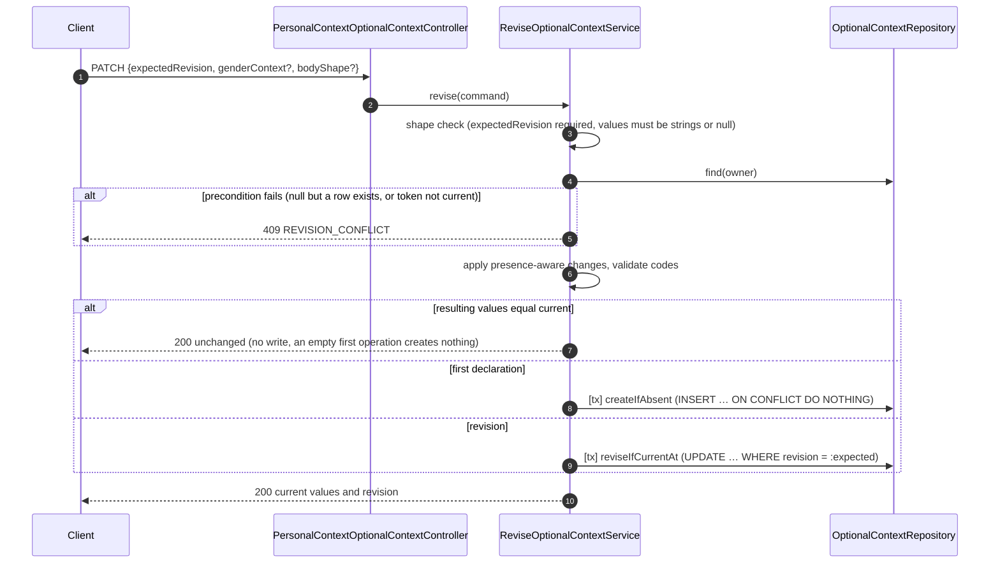

# US-PROF-002 — Control Optional Body and Gender Context: Implementation Guide

| Field | Value |
| --- | --- |
| Story | [US-PROF-002](../../../stories/profile/US-PROF-002-control-optional-personal-context.md) (Draft), parent PBI-010 |
| Sprint | Sprint 4, story 4 of 6 in the [recommended order](README.md#6-implementation-sequence). Independent of the Wardrobe stories; it follows them only for exact shared-file anchors (OpenAPI, CI). |
| Starting point | After US-GAR-005, US-GAR-006 and US-WAR-003 |
| Approved decisions applied | S4-PROF-01, S4-PROF-02, S4-PROF-03, S4-PROF-04, S4-INT-02, S4-INT-03, all **approved by the Product Owner on 2026-11-16** |
| Delegated defaults applied | OPEN-S4-16 (**newly selected values**), OPEN-S4-17, 31, 32 (`SELECTED BY CLAUDE — DELEGATED DEFAULT`, [record](open-questions.md)) |
| Verification status | **Not applied to the repository and not run there.** Scratch evidence of 2026-11-16: the six guides were applied in order to an isolated copy of `backend/`, `docs/05-api` and `.github/workflows`, and `clean verify` passed there (677 unit and 433 integration tests; none failed, errored or was skipped), including every test in §13. A run in the repository and its CI is still required. An inclusive-representation and privacy review of the selected values is strongly advised before release. |

## 1. Story Overview

**Story.** As an authenticated user, I want to optionally declare, revise or remove body-shape and gender context, so that advice can be personalized without restricting what I may own or wear.

**Backend outcome.**

- **New resource** `GET`/`PATCH /api/v1/personal-context/optional-context`, owned by Personal Context and separate from preferences:
  - **`genderContext`** (optional, user-declared): `WOMAN`, `MAN`, `NON_BINARY` or `ANOTHER_GENDER`;
  - **`bodyShape`** (optional, user-declared, a geometric silhouette): `RECTANGLE`, `TRIANGLE`, `INVERTED_TRIANGLE`, `HOURGLASS` or `ROUND`.

  **These values are newly selected by Claude under the delegation (OPEN-S4-16).** They do not come from any source document and are not Product Owner approved. `null` means "not provided"; there is no separate "prefer not to say" value. No measurement is collected, nothing is inferred, and nothing restricts a garment category.
- **Revision rules:**
  - its own revision (S4-PROF-02);
  - presence-aware PATCH: omitted keeps a value, `null` clears it, a code sets it (S4-PROF-03);
  - guarded first write with `expectedRevision: null`;
  - a no-op writes nothing;
  - a stale revision gives `409`.
- **Clearing:** the value becomes absent for every later read. The row keeps its revision line, and no copy remains. An empty first operation creates nothing.
- **No new published API** (S4-PROF-04): `CurrentPersonalContext` stays styles and common needs only. Values never reach logs, other modules, providers or training.

**Out of scope:**

- body measurements;
- inference from photos or devices;
- ranking or soft-influence implementation (no consumer exists);
- account deletion or export;
- public profiles;
- client screens.

## 2. Repository Baseline

| Item | State after US-WAR-003 | Relevance |
| --- | --- | --- |
| `personal_context` schema | V11: `personal_context_preferences`, `_preferred_style`, `_common_need` | V13 adds one table in the same owner schema |
| `ExpectedRevision`, `ValueChange` | Module-generic types in `personalcontext.application` | Reused unchanged |
| `PreferenceFieldViolation`, `PreferenceValueProblem` | `(field, problem)` with `REQUIRED`, `INVALID_FORMAT`, `UNSUPPORTED_VALUE` | Reused for optional-context field errors |
| `PreferencesRevisionRequest.expectedRevision(JsonNode)` | Package-private static mapper (missing, null or token) | Reused by the new request record |
| `PersonalContextApiExceptionHandler` | Validation, conflict, malformed body, 503 ("Your preferences could not be reached…") | P18 adds two handlers and makes the 503 text module-neutral |
| `CurrentPersonalContext` | Publishes styles and needs; empty when no preferences row exists | **Unchanged** (S4-PROF-04) |
| `PersonalContextIntegrationTestSupport` | Truncates the three V11 tables | T5 adds the new table and helpers |
| Migrations | V1–V12 | This guide adds **V13** |
| OpenAPI | 0.14.0; tag `PersonalContext` "own declared preferences" | → 0.15.0 |
| CI | 115 entries | +6 entries |

## 3. Original Business Requirements — Verbatim

> Sections 3–8 reproduce the cited sources verbatim. Only relative link targets were re-based to this file's location, and heading levels were shifted to nest under this guide; no wording was changed. Sprint 4 decision rows show the plan's historical status cell; the Product Owner's approval of 2026-11-16 supersedes it.

From [BRD](../../../../01-business/BRD.md):

| ID | Requirement | Business Rationale | Priority | Related Goals |
|---|---|---|---|---|
| BR-010 | Declared style preferences and selected occasion must actively influence initial advice and relevant wardrobe analysis. | Serve the user's actual clothing needs. | Must | BG-02, BG-03, BG-04 |
| BR-012 | Users must be able to omit or modify body-shape and gender information without restrictive garment eligibility rules. | Provide inclusive assistance and preserve individual choice. | Must | BG-02, BG-03, BG-04 |

| ID | Capability | Business Purpose |
|---|---|---|
| CAP-01 | Account & Personalization | Maintain a private personal wardrobe context, style preferences, and optional profile information. |
| CAP-06 | Behavioral Personalization | Use explicit feedback and recorded wear choices to improve relevance and diversity. |

## 4. Original Product Requirements — Verbatim

From [PRD](../../../../02-product/PRD.md):

### 8.1 JRN-01 — Account Onboarding & Personalization

**Intent:** Establish private access and relevant everyday needs through progressive onboarding. The initial interface is Vietnamese; English terms below describe product meaning and do not prescribe English UI copy.

1. **Welcome / Product Value Introduction:** Explain wardrobe intelligence, user authority, and the connected product value.
2. **Register or Login:** Register with Email, Password, and Confirm Password; Display Name is optional. Login uses Email and Password. Forgot Password provides email-based password reset.
3. **Style Preferences:** Select from the initial controlled style vocabulary in Section 11.3.
4. **Common Occasion Needs:** Set relevant common needs/priorities for the Personalized Everyday Capsule. These ongoing needs are distinct from the current occasion of an outfit request.
5. **Optional Personal Context:** Offer gender/body profile with omission, later edit, and removal.
6. **Location:** Permit device location, manually select city/location, or skip with a limited-context explanation. Manual location remains available after permission denial.
7. **Recommended Add First Garment:** Explain its value and offer the action without making it an access blocker or requiring an arbitrary garment quota.
8. **Enter Today / Wardrobe:** Open the product; an empty wardrobe explains limited recommendations and offers Add Garment. Users can return later to complete skipped optional information.

**Completion:** The authenticated user can access Today/Wardrobe without body/gender, device-location permission, or a first garment. Incomplete optional setup is distinct from failed authentication.

**Recovery:** Explain account/reset/connectivity failures and offer retry; manual location and manual garment entry preserve available alternatives. **Features:** FEAT-AUTH-001, FEAT-PROF-001, FEAT-PROF-002, FEAT-AI-002.

### 11.1 FEAT-PROF-001 — Preferences and Inclusive Optional Profile

**Purpose:** Make relevant style and occasion needs available while respecting personal choice.

**User value:** Advice reflects the user's needs without requiring sensitive context or restricting clothing choices.

**Related BRD:** BR-010, BR-012, BR-014, BR-021, BR-022; CAP-01, CAP-06; BG-02–BG-04. **Primary users:** All three personas.

**Entry points / trigger:** Onboarding, Profile, occasion selection on Today, or coverage context review. **Preconditions:** Authenticated access; the controlled style/occasion vocabularies and Personalized Everyday Capsule needs in Section 11.3 define initial choices.

**Product behavior:**

1. Explain and allow selection/revision of the controlled style preferences and common occasion need priorities in Section 11.3.
2. Use one Personalized Everyday Capsule informed by common needs, style, climate/context, and confirmed wardrobe. Distinguish these long-term/common priorities from the current occasion selected for an individual recommendation.
3. Offer body-profile and gender information as optional; allow omission, later edits, and removal.
4. Apply explicit preferences to relevant ranking and wardrobe analysis; body-profile context may softly refine ranking.
5. Explain that optional personal attributes do not prohibit garment categories or override the user's confirmed wardrobe and explicit preferences.

**User controls:** Select/change preferences, choose the current occasion, skip optional context, edit/remove optional information. **Product states:** Unset, partially configured, configured, editing, update failed.

**Failure / fallback:** Without complete context, disclose which assumptions or limited context advice uses. A failed change is not shown as saved.

**Feature-level acceptance criteria:**

- **AC-01:** The user can continue without body/gender information and later add, change, or remove it.
- **AC-02:** In a controlled comparison with relevant choices available, changing style or occasion meaningfully changes applicable advice or explanations.
- **AC-03:** Body/gender omission or changes do not independently exclude any of the eight supported garment categories.
- **AC-04:** The chosen context is visible in the relevant assessment; removing optional information stops future use of that information.
- **AC-05:** Incomplete preferences produce an explained limited-context experience rather than invented personal attributes.
- **AC-06:** Users can mark common needs as more/less relevant; coverage reflects relevant needs rather than a universal checklist.
- **AC-07:** A current recommendation occasion can differ from ongoing common needs without automatically redefining those long-term priorities.

**Out of scope / deferred detail:** Initial vocabularies and onboarding progression are resolved in Sections 11.3 and 8.1. Detailed compatibility semantics, need weighting, translated content design, and internal profile representation are downstream. Body measurement, inferred gender, and restrictive eligibility are outside scope.

## 5. Original Software Requirements — Verbatim

From [SRS](../../../../03-requirements/SRS.md):

| ID | Requirement | Scope | Source | Verification |
|---|---|---|---|---|
| FR-PROF-005 | The system shall allow body-profile information to be omitted, edited, or removed. | MVP | FEAT-PROF-001; BR-012 | T: optional-field lifecycle. |
| FR-PROF-006 | The system shall allow gender information to be omitted, edited, or removed without prohibiting supported garment categories. | MVP | FEAT-PROF-001; BR-012 | T: gender/category combinations. |
| FR-PROF-007 | The system shall stop using removed optional personal information as current personalization input. | MVP | FEAT-PROF-001, FEAT-PERS-003; BR-012, BR-021 | T: subsequent request after removal. |
| FR-AUTH-011 | The system shall allow authenticated product entry without body/gender, device-location permission, first garment, or Display Name. | MVP | FEAT-AUTH-001, FEAT-PROF-001; BR-012, BR-021 | T: omitted optional information. |
| FR-PERS-010 | The system shall use optional body context only softly and avoid category restrictions or prerequisite eligibility based on body/gender. | MVP | FEAT-PERS-003, FEAT-PROF-001; BR-012 | T/A: optional context and eligibility. |
| DATA-AUTH-004 | The system shall represent omitted/removed body/gender as absent current context rather than inferred replacements. | MVP | FEAT-PROF-001; BR-012, BR-021 | T/I: removed optional values. |
| NFR-PRIV-001 | The system shall limit personal data to necessary functionality, authorized bounded outfit sharing, personalization, history/utilization, measurement, security and operational integrity, respecting omission/correction/removal/permission controls. Only an explicitly approved shared-outfit/creator/media projection may be available to its authorized audience; this grants no access to private wardrobe inventories, source images, purchase information, profile, feedback or history. No entire-wardrobe sharing, unrestricted third-party sharing or personal-data sale is permitted. Sharing audience, consent and publishable fields remain MVP-Q01, not inferred permission. | MVP | FEAT-AUTH-001, FEAT-COM-001/002, FEAT-CHAT-001, FEAT-TRY-001; BR-021, BR-025–BR-028 | I/T: permitted shared projection versus denied private operations; explicit sharing and account isolation; policy approval required before sharing stories are Ready. |
| NFR-PRIV-002 | The MVP shall not use personal wardrobe images, profiles, Wear Events, feedback or corrections for AI model training/improvement; any future use requires separate explicit opt-in and an approved future product/privacy change, and external navigation does not grant unrestricted sharing consent. | MVP | FEAT-AUTH-001, FEAT-AI-002, FEAT-MET-001, FEAT-SHOP-002; BR-002, BR-018, BR-021 | I: complete MVP data-use boundary and future opt-in/change control; private data absent from training/improvement inputs. |

## 6. Original Business Rules — Verbatim

From [Business Rules](../../../../03-requirements/business-rules.md):

### BRULE-PROF-001 — Inclusive Optional Personal Context

**Rule:** Body/gender information may be omitted, edited, or removed. It may influence ranking only softly and never prohibit a supported garment category or gate account entry. Removed information stops influencing future personalization and is represented as absent rather than replaced by an inferred profile.

**Applies To:** onboarding, profile revision, recommendation and candidate ranking.

**Source:** FR-AUTH-011, FR-PROF-005, FR-PROF-006, FR-PROF-007, FR-PERS-010, DATA-AUTH-004.

### BRULE-AUTH-007 — Purpose-Limited Private Data Use

**Rule:** Personal data is used only as necessary for CapsuleAI functionality, personalization, wardrobe/history/utilization, validation/measurement, security and operational integrity within the authorized User's private experience, plus explicitly authorized bounded outfit sharing under BRULE-COM-001. MVP personal images, profiles, Wear Events, feedback and corrections are not used for AI model training/improvement. Future personal-data training requires separate explicit opt-in and an approved future product/privacy change.

Only an approved shared outfit/creator/media projection may be exposed to its authorized audience. This never authorizes private inventory, source-image, purchase-information, profile or history access. Entire-wardrobe sharing, unrestricted third-party sharing and personal-data sale remain excluded; sharing audience/consent/fields require MVP-Q01 approval. External dependencies receive only purpose-minimal information: required selected weather location, email/necessary recovery-delivery information, explicitly chosen shopping navigation, or necessary authorized Chat/preview/analysis input under its approved minimal contract; unrelated wardrobe/profile/history disclosure is prohibited. Provider/context choices remain MVP-Q03/Q04/Q09. Necessary active-account information and minimal history follow the retention/removal rules; this policy adds no Delete Account goal or legal certification.

**Applies To:** personal information, account/profile/wardrobe/history, validation/measurement and external exchanges.

**Source:** FR-AUTH-008, NFR-PRIV-001, NFR-PRIV-002, SI-002, SI-003, COM-003, FR-MET-006, DATA-RET-001, DATA-RET-002, DATA-RET-003.

### BRULE-OUT-008 — Validity Before Personalized Ranking

**Rule:** Preserve authorized confirmed ownership and valid-before-ranking intent. Actual composition/compatibility/eligibility policy is deferred to engine development; no old property predicate or category-to-role mapping is active. Soft preferences cannot override a future approved hard rule or impose body/gender category restrictions. User-profile context and feedback/history remain separate from the 13 garment properties.

**Source:** FR-OUT-003/005, FR-PERS-006/010/011; Section 3.7.1 of SRS.

## 7. Original User Story and Acceptance Criteria — Verbatim

From [US-PROF-002](../../../../06-scrum/stories/profile/US-PROF-002-control-optional-personal-context.md):

### 1. Story

As an authenticated user, I want to omit, revise or remove optional body/gender information, so that I control sensitive context without losing wardrobe access or clothing choices.

### 3. Scope

Optional-context lifecycle during initial/later profile use and its effect as current soft personalization input.

### 4. Preconditions

- The user has authorized access to their profile; body/gender information need not already exist.

### 5. Acceptance Criteria

#### AC-01 — Omit without penalty

The user can skip body/gender and continue authenticated entry without garment-category restrictions or fabricated inferred personal attributes.

#### AC-02 — Supply or revise optionally

The user can submit supported optional-context changes through initial or later profile use; only accepted information becomes current. The story does not require body measurements or inferred gender.

#### AC-03 — Remove current input

After accepted removal, the information is represented as absent and stops affecting future personalization; it is not silently replaced by inferred values.

#### AC-04 — Keep influence soft

With or without this context, all eight supported garment categories remain eligible under the same garment/validity rules. Body/gender cannot override hard validity, owned wardrobe or explicit preferences.

#### AC-05 — Handle canceled or uncertain revision

Canceling before submission and known rejection/failure preserve accepted context. Uncertain acceptance remains unconfirmed pending review/safe retry; expired/revoked or other-account access grants no private read or mutation.

#### AC-06 — Preserve purpose

Optional information is private and used only for supported purposes, with no MVP personal-data AI training/improvement or unrestricted sharing. Removing it does not imply an invented account deletion/export workflow.

### 6. Quality and Verification

Apply the [shared quality and completion conditions](../../../stories/README.md#2-shared-quality-and-completion) to this item's actual scope, together with its source-specific criteria below. Relevant automated, real integration, client and other triggered evidence must establish the outcome; drafted AC or backend smoke checks alone do not establish Done.

### 7. Dependencies

- Parent PBI capability inputs: PBI-004. Useful sequencing: PBI-003, PBI-006; this does not add a hard dependency.
- Source-linked related stories describe collaborating outcomes; they do not change the Product Backlog's hard-dependency semantics or imply a serial development schedule.

### 8. Out of Scope

Style/common needs are [US-PROF-001](../../../stories/profile/US-PROF-001-set-and-revise-style-and-common-needs.md); exact ranking calculation is [US-PERS-002](../../../stories/personalization/US-PERS-002-adapt-valid-ranking-from-feedback-and-wear.md). No new body taxonomy, measurement capture, inferred identity or physical-deletion deadline for optional profile fields is invented.

### 10. Open Refinement Notes

No unresolved policy is identified. The source allows supported optional information without prescribing a new body/gender taxonomy; do not create one in AC.

## 8. Original Use Cases, Flows and Architecture Decisions — Verbatim

### 8.1 [UC-005](../../../../03-requirements/use-cases/UC-005-update-personalization-profile.md)

#### 1. Use Case Summary

| Field | Value |
| --- | --- |
| Use Case ID | UC-005 |
| Use Case Name | Update Personalization Profile |
| Scope | CapsuleAI |
| Level | User Goal |
| Primary Actor | User |
| Supporting Actors | None |
| Version | 0.2 |
| Status | Baseline Draft |

Source authority: [BRD](../../../../01-business/BRD.md) defines business intent; [PRD](../../../../02-product/PRD.md) defines product behavior; [SRS](../../../../03-requirements/SRS.md) and [Business Rules](../../../../03-requirements/business-rules.md) constrain interaction; the [master Use Case Diagram](../../../../03-requirements/use-cases/use-case-diagram.puml) defines this goal and its actors. The [workflow](../../../../../Initial%20files/CapsuleAI_Scrum_Development_Workflow.md) governs artifact ownership and sequencing.

#### 2. Goal

Set or revise declared style, common capsule need priorities and optional personal context so future advice reflects the User's needs while preserving omission/removal choices.

#### 4. Preconditions

- The User has authenticated access authorized for the personal profile.

#### 5. Trigger

The User reaches personalization setup or chooses to revise the profile.

#### 6. Main Success Scenario

1. The User requests personalization setup or revision.
2. CapsuleAI presents current or unset style choices, common need priorities and optional body/gender information using the controlled vocabularies.
3. The User selects or revises relevant styles and common need priorities, and chooses whether to provide optional personal information.
4. CapsuleAI makes the selected information and its meaning understandable, including the distinction between ongoing needs and a current outfit request occasion.
5. The User submits the intended profile changes.
6. CapsuleAI acknowledges accepted changes, displays the current profile and uses it in subsequent relevant ranking/assessments; affected assessments are reevaluated or identified as outdated where required.

#### 7. Alternative Flows

##### A1 — Initial or partial setup

At Main Step 2:

1. CapsuleAI shows unset information as absent rather than an inferred personal profile.
2. The User supplies only the information they choose and resumes at Main Step 3.

##### A2 — Skip or defer optional context

At Main Step 3:

1. The User omits body/gender or defers optional setup.
2. CapsuleAI permits authenticated product entry; later setup remains available and relevant limited-context explanations identify missing information.

##### A3 — Remove optional personal information

At Main Step 3:

1. The User removes previously provided body/gender information and submits the revision.
2. After acceptance, CapsuleAI represents it as absent and stops using it in future personalization; resume at Main Step 6.

##### A4 — Change common priorities

At Main Step 3:

1. The User selects Not Relevant, Low, Medium or High for the applicable capsule needs.
2. Accepted priorities affect contextual Coverage/gaps without overwriting a separately selected current recommendation occasion.

##### A5 — Cancel an unsubmitted revision

At Main Step 5:

1. The User leaves without submitting the proposed change.
2. The last accepted profile remains current.

#### 8. Exception / Failure Flows

##### E1 — Unsupported or unusable profile values

At Main Step 5:

1. CapsuleAI explains the values that cannot be accepted under the controlled vocabularies/priorities.
2. The User corrects the applicable choices and resumes at Main Step 3; no invented replacement profile is saved.

##### E2 — Profile update failed or uncertain

At Main Step 6:

1. CapsuleAI distinguishes rejected/failed changes from accepted updates, retaining prior accepted context on known failure.
2. The User reviews the outcome or retries the intended revision; an uncertain outcome is not reported as saved.

##### E3 — Authorized access becomes unusable

At Main Step 1:

1. CapsuleAI pauses protected interaction if access expires, is revoked or is not authorized for the affected information, and explains the need to authenticate again.
2. The User can resume the appropriate goal after UC-002 establishes usable access. Protected information is not exposed or misrepresented as empty, and the interrupted request is not falsely reported as accepted.

#### 9. Success Postconditions

- The accepted style/common priorities and optional personal context are current for the User.
- Removed optional information stops influencing future personalization; supported garment categories remain eligible regardless of body/gender.
- The current request occasion remains separate from persistent common need priorities.

#### 10. Minimal / Failure Postconditions

- Canceled/rejected/known failed revisions do not replace the last accepted profile.
- Uncertain updates remain visibly unconfirmed until the accepted outcome is reviewed; private profile data stays authorized.
- Loss of access pauses protected use; inaccessible personal data is not exposed or labeled empty. Prior accepted information remains governed by its authorized state.

#### 11. Business Rules

The following references constrain this interaction; detailed policy remains in the [Business Rules](../../../../03-requirements/business-rules.md).

| Rule ID | Relevance |
| --- | --- |
| `BRULE-AUTH-007` | Personal information is purpose-limited/private; MVP personal data is not used for AI training/improvement or unrestricted external sharing. |
| `BRULE-AUTH-001` | Personal information/actions require authorized access for the affected User. |
| `BRULE-PROF-001` | Body/gender may be omitted, revised or removed and influence ranking only softly. |
| `BRULE-PROF-002` | Declared styles/common priorities remain distinct from the request occasion. |
| `BRULE-COV-002` | Priority weights are Not Relevant=0, Low=1, Medium=2 and High=3. |
| `BRULE-GAR-004` | Styles, occasions and capsule need dimensions use the current controlled meanings. |
| `BRULE-PERS-006` | Accepted context/evidence revisions affect future effective personalization. |
| `BRULE-COV-006` | Relevant need/context changes refresh or invalidate prior Coverage. |

#### 13. Special Requirements / Constraints

- Documentation is English; the Vietnamese MVP UI supports Android 10+ and iOS 15+. Translated labels preserve canonical meanings. Applicable actions/states have meaningful accessible names/roles/states and understandable labels beyond color, and remain operable with primary actions accessible at text scaling up to 200%. TalkBack/VoiceOver validation and platform primary touch-target criteria follow SRS Sections 6.7/12.4.
- The initial capsule contains six contextual need dimensions rather than separate persona-based or universal wardrobe checklists; their mapping remains in BRULE-COV-001.
- Body/gender never prohibit a supported category or override hard validity. Omission is not replaced by inferred measurements or gender.

- Optional profile/body/gender data supports purpose-limited functionality/personalization and is not used for MVP model training/improvement. Accepted omission/removal stops future use of that context; necessary active information follows DATA-RET-002.

#### 15. Open Issues

No unresolved Use Case-specific issue currently blocks this interaction.

### 8.2 Selected architecture decisions — verbatim from [selected decisions](../../../../04-architecture/selected-architecture-decisions.md)

| ADA ID | Decision Problem | Selected Option | Backend Impact | Status |
| --- | --- | --- | --- | --- |
| ADA-003 | Authoritative persistence model and database | Option A — One relational primary database: PostgreSQL | Use PostgreSQL as the primary relational authority. | Selected |
| ADA-015 | Internal Module Architecture | Option B — Pragmatic Clean Architecture inside each business module | Keep domain/application dependencies inward with useful ports/adapters. | Selected |
| ADA-016 | Context Data Ownership | Option B — One PostgreSQL database initially with explicit context-owned logical persistence boundaries | Own persistence logically per context within one PostgreSQL. | Selected |
| ADA-017 | Inter-Context Communication | Option B — Explicit published module contracts, choosing synchronous local interaction or event-based interaction according to business semantics | Choose local calls/events through public contracts by business semantics. | Selected |
| ADA-018 | Context Model Isolation and Anti-Corruption | Option B — Published contracts + Anti-Corruption Layer translation at meaningful semantic boundaries | Keep models private and translate meanings at real semantic boundaries. | Selected |

### 8.3 Sprint 4 decisions — verbatim from the [plan register](../sprint-plan.md#13-consolidated-decision-register)

> **Status update (binding):** the Product Owner approved all 30 Sprint 4 recommendations on **2026-11-16**. The plan's `PROPOSED — PENDING PO APPROVAL` cells below are reproduced verbatim and are superseded by that approval; see [open-questions.md](open-questions.md#1-decision-authority).

| Decision ID | Related Story | Question | Recommended Solution | Decision Status | Approval Owner |
| --- | --- | --- | --- | --- | --- |
| [S4-PROF-01](../sprint-plan.md#s4-prof-01) | US-PROF-002 | Supported optional information without an invented taxonomy | Option B — obtain explicit confirmation of supported optional meanings/choices before coding them; no new taxonomy is approved here. | PROPOSED — PENDING PO APPROVAL | Product Owner and BA with privacy reviewer and Backend Tech Lead |
| [S4-PROF-02](../sprint-plan.md#s4-prof-02) | US-PROF-002 | Optional-context persistence and revision ownership | Option B — a separately revisioned optional-context resource within the existing Personal Context owner. | PROPOSED — PENDING PO APPROVAL | Product Owner with Backend Tech Lead |
| [S4-PROF-03](../sprint-plan.md#s4-prof-03) | US-PROF-002 | Presence-aware changes, explicit clearing and conflicts | Option A — reuse presence-aware absolute PATCH semantics and guarded first write for this resource. | PROPOSED — PENDING PO APPROVAL | Product Owner with Backend Tech Lead and QA |
| [S4-PROF-04](../sprint-plan.md#s4-prof-04) | US-PROF-002 | Published optional context and purpose-limited future use | Option B — preserve the current published contract and keep optional-context access purpose-specific. | PROPOSED — PENDING PO APPROVAL | Product Owner with Backend Tech Lead and privacy reviewer |
| [S4-INT-02](../sprint-plan.md#s4-int-02) | All six selected stories | Logical action outcomes and uncertainty recovery | Option A — targeted durable identities and explicit current-state review, adding a receipt only where natural state cannot prove the required outcome. | PROPOSED — PENDING PO APPROVAL | Product Owner with Backend Tech Lead and QA |
| [S4-INT-03](../sprint-plan.md#s4-int-03) | All six selected stories | Compatible command transport and synchronized delivery contracts | Option A — compatible explicit confirmed commands, preserving existing PATCH/body-revision conventions and resource grouping. | PROPOSED — PENDING PO APPROVAL | Product Owner with Backend Tech Lead and QA |

## 9. Engineering Interpretation

| Source obligation | Engineering meaning | Where |
| --- | --- | --- |
| AC-01: skip without penalty | Absence is the default. Nothing is required for authenticated use, and no garment rule reads this context. | P4, T7 |
| AC-02: supply or revise supported context | Two bounded choice fields (OPEN-S4-16). Guarded first write, presence-aware revision. Only accepted values become current. No measurements, no inference. | P2, P3, P13, T3, T7 |
| AC-03: remove current input | `null` clears a field; the stored value becomes NULL and every later read shows `null`. No inferred replacement, no hidden copy (one row, no history). | P13, P14, T3, T7 |
| AC-04: influence stays soft | No validity, category or access rule reads this context: all eight garment categories remain creatable with and without it. **Real soft ranking does not exist and is not demonstrated.** | T7 `everyGarmentCategoryStaysCreatable…`; §15 |
| AC-05: cancelled or uncertain revision | Cancel means no request. A known rejection changes nothing. After a lost response, reread and resubmit with the current revision. Other sessions or accounts cannot read or change it. | P13, P17, T7, T8 |
| AC-06: purpose | Private to the owner, with no published API, no logs, no provider or measurement payload. Clearing does not imply account deletion or export. | P17, P18, P19 |
| S4-PROF-02 separate revision | Own table and revision. Preferences and optional context never overwrite or block each other. | P1, P14, T8 |
| S4-PROF-04 publication | `CurrentPersonalContext` unchanged | T7 |

## 10. Just-in-Time Detailed Design

### 10.1 Sequence



### 10.2 Vocabulary (OPEN-S4-16, newly selected)

| Field | Codes | Notes for client labels |
| --- | --- | --- |
| `genderContext` | `WOMAN`, `MAN`, `NON_BINARY`, `ANOTHER_GENDER` | Respectful, localized labels. `ANOTHER_GENDER` is "a gender not listed", with no free text. Leaving it empty means "prefer not to say". |
| `bodyShape` | `RECTANGLE`, `TRIANGLE`, `INVERTED_TRIANGLE`, `HOURGLASS`, `ROUND` | Neutral geometric silhouettes with neutral illustrations; no fruit names or judgmental wording. Optional and never inferred. |

Codes are exact. `woman` or `Woman` gives `UNSUPPORTED_VALUE`; nothing is case-folded or guessed.

### 10.3 API contract

| Operation | Contract |
| --- | --- |
| `GET /api/v1/personal-context/optional-context` | `200 OptionalContext {revision, genderContext, bodyShape, updatedAt}`, always. A user who never declared anything gets all `null`. |
| `PATCH /api/v1/personal-context/optional-context` | Body `{expectedRevision (required: null or token), genderContext?, bodyShape?}`. `200` with the current state. `400 VALIDATION_FAILED` (`expectedRevision`: `REQUIRED` or `INVALID_FORMAT`; field: `UNSUPPORTED_VALUE`). `409 REVISION_CONFLICT`. |

```json
{"expectedRevision": null, "genderContext": "NON_BINARY"}
```

```json
{"revision": "1", "genderContext": "NON_BINARY", "bodyShape": null, "updatedAt": "2026-11-16T09:30:00.123456Z"}
```

### 10.4 Data (V13)

The table `personal_context.personal_context_optional_context` has one row per owner:

- `gender_context` and `body_shape`, both nullable, each with a CHECK constraint on the vocabulary;
- `revision` (≥ 1);
- `created_at` and `updated_at` (`updated_at ≥ created_at`).

There is no foreign key to Identity (AR-04) and none to preferences, so the two lifecycles stay independent.

### 10.5 Concurrency, privacy and recovery

- Two first declarations: `ON CONFLICT DO NOTHING`, so one wins and the other gets `409`.
- Two revisions of the same revision: the conditional `UPDATE` lets one win and the other gets `409`.
- Preferences and optional context touch different rows, so they never block or overwrite each other.
- The values appear only in the owner's HTTP responses. No log statement prints them, and Problem Details never echo them.
- After a `503` or a lost response: `GET`, review, then resubmit with the current revision.

### 10.6 Testing plan

| Level | Classes |
| --- | --- |
| Domain | `OptionalContextTest` |
| Application | `ReviseOptionalContextServiceTest` (with `InMemoryOptionalContextRepository`) |
| Web unit | `OptionalContextRevisionRequestTest` |
| Schema | `OptionalContextSchemaIT` |
| HTTP | `OptionalContextApiIT` |
| Concurrency | `ConcurrentOptionalContextIT` |
| Regression | `PreferencesApiIT`, `CurrentPersonalContextIT`, `IdentityOpenApiContractIT` (unchanged) |

## 11. File Change Matrix

`…/pc/` is `backend/src/main/java/com/capsuleai/personalcontext/` and `…/test/pc/` is `backend/src/test/java/com/capsuleai/personalcontext/`.

| Order | Action | Exact repository path | Purpose | Dependencies |
| --- | --- | --- | --- | --- |
| P1 | ADD | `backend/src/main/resources/db/migration/V13__create_personal_context_optional_context.sql` | Table | V12 |
| P2 | ADD | `…/pc/domain/GenderContext.java` | Vocabulary | — |
| P3 | ADD | `…/pc/domain/BodyShape.java` | Vocabulary | — |
| P4 | ADD | `…/pc/domain/OptionalContext.java` | Declared values | P2, P3 |
| P5 | ADD | `…/pc/domain/OptionalContextProfile.java` | Owner, values, revision | P4 |
| P6 | ADD | `…/pc/application/OptionalContextChanges.java` | Presence-aware changes | — |
| P7 | ADD | `…/pc/application/ReviseOptionalContextCommand.java` | Command | P6 |
| P8 | ADD | `…/pc/application/OptionalContextValidationException.java` | Rejection | — |
| P9 | ADD | `…/pc/application/OptionalContextRevisionConflictException.java` | Conflict | — |
| P10 | ADD | `…/pc/application/OptionalContextRevision.java` | Outcome | P5 |
| P11 | ADD | `…/pc/application/ports/OptionalContextRepository.java` | Port | P4, P5 |
| P12 | ADD | `…/pc/application/ViewOptionalContextService.java` | Read | P11 |
| P13 | ADD | `…/pc/application/ReviseOptionalContextService.java` | Revise | P6–P11 |
| P14 | ADD | `…/pc/adapter/out/persistence/JdbcOptionalContextRepository.java` | SQL | P1, P11 |
| P15 | ADD | `…/pc/adapter/in/web/OptionalContextRevisionRequest.java` | Request | P7 |
| P16 | ADD | `…/pc/adapter/in/web/OptionalContextResponse.java` | Response | P5 |
| P17 | ADD | `…/pc/adapter/in/web/PersonalContextOptionalContextController.java` | Endpoints | P12, P13, P15, P16 |
| P18 | MODIFY | `…/pc/adapter/in/web/PersonalContextApiExceptionHandler.java` | Two handlers; neutral 503 text | P8, P9 |
| P19 | MODIFY | `…/pc/configuration/PersonalContextConfiguration.java` | Beans | P12–P14 |
| P20 | MODIFY | `…/pc/package-info.java` | Ownership note | — |
| P21 | MODIFY | `docs/05-api/openapi.yaml` | 0.14.0 → 0.15.0 | P15–P17 |
| P22 | MODIFY | `.github/workflows/backend-ci.yml` | 6 entries | T1–T8 |
| T1 | ADD | `…/test/pc/domain/OptionalContextTest.java` | Domain | P2–P5 |
| T2 | ADD | `…/test/pc/application/InMemoryOptionalContextRepository.java` | Fake | P11 |
| T3 | ADD | `…/test/pc/application/ReviseOptionalContextServiceTest.java` | Rules | P13 |
| T4 | ADD | `…/test/pc/adapter/in/web/OptionalContextRevisionRequestTest.java` | Presence mapping | P15 |
| T5 | MODIFY | `…/test/pc/support/PersonalContextIntegrationTestSupport.java` | Truncate and helpers | P1 |
| T6 | ADD | `…/test/pc/adapter/out/persistence/OptionalContextSchemaIT.java` | V13 | P1 |
| T7 | ADD | `…/test/pc/adapter/in/web/OptionalContextApiIT.java` | HTTP | P17 |
| T8 | ADD | `…/test/pc/application/ConcurrentOptionalContextIT.java` | Races | P13, P14 |
| T9 | MODIFY | `…/test/pc/adapter/out/persistence/PreferencesSchemaIT.java` | Exact table list | P1 |

## 12. Complete Production Implementation

The BEFORE blocks are the files as left by US-WAR-003. Several Personal Context files use CRLF line endings; keep them when editing. Commands run from `backend/`.

### Step P1 — [ADD] `backend/src/main/resources/db/migration/V13__create_personal_context_optional_context.sql`

```sql
-- US-PROF-002 (S4-PROF-01/02/03, approved 2026-11-16; OPEN-S4-16/17): the user's optional, self-declared
-- gender and body-shape context. Separate from the preferences of V11, with its own revision, so that a
-- change of one never rewrites, blocks or clears the other (S4-PROF-02).
--
-- A NULL value means "not provided" (absent context). Clearing sets NULL and keeps the row, so the
-- revision line continues and a stale client can never pass the first-write guard again. Values are
-- declared by the user only: never inferred, never measurements, never a garment-category gate. The
-- vocabularies are delegated defaults selected on 2026-11-16 (OPEN-S4-16), not Product Owner approvals.
--
-- Owner: Personal Context. Every object below is in the personal_context schema (AR-01); owner_account_id
-- is the authenticated Identity account id with no foreign key into Identity (ADA-016, AR-04).
CREATE TABLE personal_context.personal_context_optional_context (
    owner_account_id UUID        PRIMARY KEY,
    gender_context   TEXT        NULL,
    body_shape       TEXT        NULL,
    revision         BIGINT      NOT NULL,
    created_at       TIMESTAMPTZ NOT NULL,
    updated_at       TIMESTAMPTZ NOT NULL,

    CONSTRAINT ck_personal_context_optional_context_gender CHECK (gender_context IS NULL OR gender_context IN (
        'WOMAN', 'MAN', 'NON_BINARY', 'ANOTHER_GENDER')),
    CONSTRAINT ck_personal_context_optional_context_body_shape CHECK (body_shape IS NULL OR body_shape IN (
        'RECTANGLE', 'TRIANGLE', 'INVERTED_TRIANGLE', 'HOURGLASS', 'ROUND')),
    CONSTRAINT ck_personal_context_optional_context_revision CHECK (revision >= 1),
    CONSTRAINT ck_personal_context_optional_context_updated_after_created CHECK (updated_at >= created_at)
);
```

**Common mistake.** Adding these columns to `personal_context_preferences`. That would couple the two revisions, against S4-PROF-02.

### Step P2 — [ADD] `backend/src/main/java/com/capsuleai/personalcontext/domain/GenderContext.java`

```java
package com.capsuleai.personalcontext.domain;

import java.util.Arrays;
import java.util.Optional;

/**
 * US-PROF-002 — optional, self-declared gender context (BR-012, BRULE-PROF-001). The values are a delegated
 * default selected on 2026-11-16 (OPEN-S4-16), chosen to be small and inclusive without collecting free text;
 * they are not Product Owner approved and need an inclusive-representation review. "Prefer not to say" is
 * absence (no value). A value never restricts garments, requests or validity; it is never inferred.
 */
public enum GenderContext {
    WOMAN,
    MAN,
    NON_BINARY,
    /** A gender not listed above; no free text is collected. */
    ANOTHER_GENDER;

    /** The value whose code equals {@code code} exactly; no case folding, trimming or fallback. */
    public static Optional<GenderContext> fromCode(String code) {
        return Arrays.stream(values()).filter(value -> value.name().equals(code)).findFirst();
    }
}
```

### Step P3 — [ADD] `backend/src/main/java/com/capsuleai/personalcontext/domain/BodyShape.java`

```java
package com.capsuleai.personalcontext.domain;

import java.util.Arrays;
import java.util.Optional;

/**
 * US-PROF-002 — optional, self-declared body shape as a neutral geometric silhouette (BR-012,
 * BRULE-PROF-001). The values are a delegated default selected on 2026-11-16 (OPEN-S4-16), not Product Owner
 * approved. No measurement is collected and no shape is ever inferred from photos, garments or devices. A
 * value is soft context only: it never restricts garment categories or validity.
 */
public enum BodyShape {
    RECTANGLE,
    TRIANGLE,
    INVERTED_TRIANGLE,
    HOURGLASS,
    ROUND;

    /** The value whose code equals {@code code} exactly; no case folding, trimming or fallback. */
    public static Optional<BodyShape> fromCode(String code) {
        return Arrays.stream(values()).filter(value -> value.name().equals(code)).findFirst();
    }
}
```

### Step P4 — [ADD] `backend/src/main/java/com/capsuleai/personalcontext/domain/OptionalContext.java`

```java
package com.capsuleai.personalcontext.domain;

import java.util.Objects;
import java.util.Optional;

/**
 * US-PROF-002 — what the user currently declares as optional context. An empty value is not provided (absent
 * context, not a default or an inferred attribute).
 */
public record OptionalContext(Optional<GenderContext> genderContext, Optional<BodyShape> bodyShape) {

    public OptionalContext {
        Objects.requireNonNull(genderContext, "genderContext must be Optional.empty() when not provided");
        Objects.requireNonNull(bodyShape, "bodyShape must be Optional.empty() when not provided");
    }

    /** Nothing declared. */
    public static OptionalContext none() {
        return new OptionalContext(Optional.empty(), Optional.empty());
    }

    public boolean declaresNothing() {
        return genderContext.isEmpty() && bodyShape.isEmpty();
    }
}
```

### Step P5 — [ADD] `backend/src/main/java/com/capsuleai/personalcontext/domain/OptionalContextProfile.java`

```java
package com.capsuleai.personalcontext.domain;

import java.time.Instant;
import java.util.Objects;
import java.util.UUID;

/**
 * US-PROF-002 — one account's optional context record (S4-PROF-02): its current values and its own revision,
 * independent of the preferences revision. {@code revision} is concurrency metadata, not a preference. A
 * record whose values were all cleared still exists, so the revision line continues.
 */
public record OptionalContextProfile(
        UUID ownerAccountId,
        OptionalContext values,
        long revision,
        Instant createdAt,
        Instant updatedAt) {

    public static final long FIRST_REVISION = 1;

    public OptionalContextProfile {
        Objects.requireNonNull(ownerAccountId, "ownerAccountId");
        Objects.requireNonNull(values, "values");
        Objects.requireNonNull(createdAt, "createdAt");
        Objects.requireNonNull(updatedAt, "updatedAt");
        if (revision < FIRST_REVISION) {
            throw new IllegalArgumentException("An optional-context revision starts at " + FIRST_REVISION);
        }
        if (updatedAt.isBefore(createdAt)) {
            throw new IllegalArgumentException("Optional context cannot be updated before it was created");
        }
    }

    public static OptionalContextProfile firstDeclaration(UUID ownerAccountId, OptionalContext values,
                                                          Instant declaredAt) {
        return new OptionalContextProfile(ownerAccountId, values, FIRST_REVISION, declaredAt, declaredAt);
    }

    /** The accepted change: one more revision; the update time never moves before the creation time. */
    public OptionalContextProfile revisedTo(OptionalContext revisedValues, Instant revisedAt) {
        Instant updated = revisedAt.isBefore(createdAt) ? createdAt : revisedAt;
        return new OptionalContextProfile(ownerAccountId, revisedValues, Math.addExact(revision, 1), createdAt,
                updated);
    }
}
```

### Step P6 — [ADD] `backend/src/main/java/com/capsuleai/personalcontext/application/OptionalContextChanges.java`

```java
package com.capsuleai.personalcontext.application;

import java.util.Objects;

/**
 * US-PROF-002 (S4-PROF-03) — the requested change of each optional field: keep (omitted), clear (null),
 * replace (a submitted code, validated by the service) or malformed (a value of the wrong JSON kind).
 */
public record OptionalContextChanges(ValueChange<String> genderContext, ValueChange<String> bodyShape) {

    public OptionalContextChanges {
        Objects.requireNonNull(genderContext, "genderContext");
        Objects.requireNonNull(bodyShape, "bodyShape");
    }
}
```

### Step P7 — [ADD] `backend/src/main/java/com/capsuleai/personalcontext/application/ReviseOptionalContextCommand.java`

```java
package com.capsuleai.personalcontext.application;

import java.util.UUID;

/** One submitted optional-context change. The owner comes from the authenticated session, never the request. */
public record ReviseOptionalContextCommand(UUID ownerAccountId, ExpectedRevision expectedRevision,
                                           OptionalContextChanges changes) {
}
```

### Step P8 — [ADD] `backend/src/main/java/com/capsuleai/personalcontext/application/OptionalContextValidationException.java`

```java
package com.capsuleai.personalcontext.application;

import java.util.List;

/** The optional-context change was rejected and nothing was stored; every problem is listed (UC-005 E1). */
public final class OptionalContextValidationException extends RuntimeException {

    private final List<PreferenceFieldViolation> violations;

    public OptionalContextValidationException(List<PreferenceFieldViolation> violations) {
        super("Optional-context change rejected with " + violations.size() + " field violation(s)");
        this.violations = List.copyOf(violations);
    }

    public List<PreferenceFieldViolation> violations() {
        return violations;
    }
}
```

**Explanation.** It reuses `PreferenceFieldViolation(field, problem)` and `PreferenceValueProblem`, which are the module's generic field-error types. The exception message never contains a submitted value.

### Step P9 — [ADD] `backend/src/main/java/com/capsuleai/personalcontext/application/OptionalContextRevisionConflictException.java`

```java
package com.capsuleai.personalcontext.application;

/**
 * The optional context changed (or was first created) after the user read it (S4-PROF-03). Nothing changed;
 * the client rereads and lets the user review. It never resubmits automatically.
 */
public final class OptionalContextRevisionConflictException extends RuntimeException {

    public OptionalContextRevisionConflictException() {
        super("The optional context changed after it was read; the change was not applied");
    }
}
```

### Step P10 — [ADD] `backend/src/main/java/com/capsuleai/personalcontext/application/OptionalContextRevision.java`

```java
package com.capsuleai.personalcontext.application;

import com.capsuleai.personalcontext.domain.OptionalContextProfile;
import java.util.Objects;
import java.util.Optional;

/**
 * Outcome of an accepted optional-context change: the record as it now is (empty if the owner still has
 * never declared anything) and whether this change wrote anything (a no-op keeps the revision).
 */
public record OptionalContextRevision(Optional<OptionalContextProfile> profile, boolean changed) {

    public OptionalContextRevision {
        Objects.requireNonNull(profile, "profile");
    }
}
```

### Step P11 — [ADD] `backend/src/main/java/com/capsuleai/personalcontext/application/ports/OptionalContextRepository.java`

```java
package com.capsuleai.personalcontext.application.ports;

import com.capsuleai.personalcontext.domain.OptionalContext;
import com.capsuleai.personalcontext.domain.OptionalContextProfile;
import java.time.Instant;
import java.util.Optional;
import java.util.UUID;

/** Personal Context-owned persistence of optional context (US-PROF-002, S4-PROF-02, V13). */
public interface OptionalContextRepository {

    /** The owner's record, or empty if they have never declared optional context. */
    Optional<OptionalContextProfile> find(UUID ownerAccountId);

    /**
     * Stores the owner's first declaration unless a record exists (guarded creation). Of concurrent first
     * declarations exactly one returns {@code true}. Call inside {@link PersonalContextTransactions}.
     */
    boolean createIfAbsent(OptionalContextProfile profile);

    /**
     * Replaces both values only while the revision is still {@code expectedRevision}; the revision increases
     * by one. Call inside {@link PersonalContextTransactions}.
     *
     * @return {@code false} if the revision changed or there is no record (nothing changed)
     */
    boolean reviseIfCurrentAt(UUID ownerAccountId, long expectedRevision, OptionalContext values, Instant updatedAt);
}
```

### Step P12 — [ADD] `backend/src/main/java/com/capsuleai/personalcontext/application/ViewOptionalContextService.java`

```java
package com.capsuleai.personalcontext.application;

import com.capsuleai.personalcontext.application.ports.OptionalContextRepository;
import com.capsuleai.personalcontext.domain.OptionalContextProfile;
import java.util.Objects;
import java.util.Optional;
import java.util.UUID;

/** US-PROF-002 AC-01/03 — the owner's current or absent optional context. Read-only. */
public final class ViewOptionalContextService {

    private final OptionalContextRepository optionalContextRepository;

    public ViewOptionalContextService(OptionalContextRepository optionalContextRepository) {
        this.optionalContextRepository = Objects.requireNonNull(optionalContextRepository, "optionalContextRepository");
    }

    public Optional<OptionalContextProfile> view(UUID ownerAccountId) {
        return optionalContextRepository.find(Objects.requireNonNull(ownerAccountId, "ownerAccountId"));
    }
}
```

### Step P13 — [ADD] `backend/src/main/java/com/capsuleai/personalcontext/application/ReviseOptionalContextService.java`

```java
package com.capsuleai.personalcontext.application;

import com.capsuleai.personalcontext.application.ports.OptionalContextRepository;
import com.capsuleai.personalcontext.application.ports.PersonalContextTransactions;
import com.capsuleai.personalcontext.domain.BodyShape;
import com.capsuleai.personalcontext.domain.GenderContext;
import com.capsuleai.personalcontext.domain.OptionalContext;
import com.capsuleai.personalcontext.domain.OptionalContextProfile;
import com.capsuleai.personalcontext.domain.PreferenceValueProblem;
import java.time.Clock;
import java.time.Instant;
import java.time.temporal.ChronoUnit;
import java.util.ArrayList;
import java.util.List;
import java.util.Objects;
import java.util.Optional;
import java.util.UUID;
import java.util.function.Function;

/**
 * US-PROF-002 — accepts one submitted change of the owner's optional gender and body-shape context
 * (FR-PROF-005–007, BRULE-PROF-001; S4-PROF-01/02/03, OPEN-S4-16/17).
 *
 * <p>Presence-aware: an omitted field keeps its value, null clears it (absent), a supported code sets it. The
 * change is accepted only against the record the user read: {@code expectedRevision} null for the first
 * declaration (guarded: one wins), the current revision afterwards, both enforced atomically in the database.
 * A change that alters nothing writes nothing; in particular an empty first operation creates no record. The
 * preferences of US-PROF-001 are never read or written here.
 */
public final class ReviseOptionalContextService {

    static final String EXPECTED_REVISION_FIELD = "expectedRevision";
    static final String GENDER_CONTEXT_FIELD = "genderContext";
    static final String BODY_SHAPE_FIELD = "bodyShape";

    private final OptionalContextRepository optionalContextRepository;
    private final PersonalContextTransactions personalContextTransactions;
    private final Clock clock;

    public ReviseOptionalContextService(OptionalContextRepository optionalContextRepository,
                                        PersonalContextTransactions personalContextTransactions, Clock clock) {
        this.optionalContextRepository = Objects.requireNonNull(optionalContextRepository, "optionalContextRepository");
        this.personalContextTransactions =
                Objects.requireNonNull(personalContextTransactions, "personalContextTransactions");
        this.clock = Objects.requireNonNull(clock, "clock");
    }

    /**
     * @throws OptionalContextValidationException       if the request or a value is not acceptable (nothing changed)
     * @throws OptionalContextRevisionConflictException if the record changed after the user read it
     */
    public OptionalContextRevision revise(ReviseOptionalContextCommand command) {
        UUID ownerAccountId = Objects.requireNonNull(command.ownerAccountId(), "ownerAccountId");
        OptionalContextChanges changes = Objects.requireNonNull(command.changes(), "changes");
        checkShape(command.expectedRevision(), changes);

        Optional<OptionalContextProfile> current = optionalContextRepository.find(ownerAccountId);
        if (!preconditionHolds(command.expectedRevision(), current)) {
            throw new OptionalContextRevisionConflictException();
        }
        OptionalContext base = current.map(OptionalContextProfile::values).orElse(OptionalContext.none());
        OptionalContext resulting = apply(base, changes);
        if (resulting.equals(base)) {
            return new OptionalContextRevision(current, false);
        }

        Instant now = clock.instant().truncatedTo(ChronoUnit.MICROS);
        if (current.isEmpty()) {
            OptionalContextProfile created = OptionalContextProfile.firstDeclaration(ownerAccountId, resulting, now);
            if (!personalContextTransactions.inTransaction(() -> optionalContextRepository.createIfAbsent(created))) {
                throw new OptionalContextRevisionConflictException();
            }
            return new OptionalContextRevision(Optional.of(created), true);
        }
        OptionalContextProfile existing = current.get();
        OptionalContextProfile revised = existing.revisedTo(resulting, now);
        if (!personalContextTransactions.inTransaction(() -> optionalContextRepository.reviseIfCurrentAt(
                ownerAccountId, existing.revision(), resulting, revised.updatedAt()))) {
            throw new OptionalContextRevisionConflictException();
        }
        return new OptionalContextRevision(Optional.of(revised), true);
    }

    /** Problems visible without reading anything. */
    private static void checkShape(ExpectedRevision expectedRevision, OptionalContextChanges changes) {
        List<PreferenceFieldViolation> violations = new ArrayList<>();
        if (expectedRevision == null || expectedRevision instanceof ExpectedRevision.Missing) {
            violations.add(new PreferenceFieldViolation(EXPECTED_REVISION_FIELD, PreferenceValueProblem.REQUIRED));
        } else if (expectedRevision instanceof ExpectedRevision.Malformed) {
            violations.add(new PreferenceFieldViolation(EXPECTED_REVISION_FIELD, PreferenceValueProblem.INVALID_FORMAT));
        }
        if (changes.genderContext() instanceof ValueChange.Malformed<?>) {
            violations.add(new PreferenceFieldViolation(GENDER_CONTEXT_FIELD, PreferenceValueProblem.UNSUPPORTED_VALUE));
        }
        if (changes.bodyShape() instanceof ValueChange.Malformed<?>) {
            violations.add(new PreferenceFieldViolation(BODY_SHAPE_FIELD, PreferenceValueProblem.UNSUPPORTED_VALUE));
        }
        if (!violations.isEmpty()) {
            throw new OptionalContextValidationException(violations);
        }
    }

    private static boolean preconditionHolds(ExpectedRevision expected, Optional<OptionalContextProfile> current) {
        if (expected instanceof ExpectedRevision.Unset) {
            return current.isEmpty();
        }
        if (expected instanceof ExpectedRevision.At at) {
            return current.isPresent() && current.get().revision() == at.revision();
        }
        throw new IllegalStateException("A missing or malformed precondition was already rejected");
    }

    private static OptionalContext apply(OptionalContext base, OptionalContextChanges changes) {
        List<PreferenceFieldViolation> violations = new ArrayList<>();
        Optional<GenderContext> genderContext = resolve(base.genderContext(), changes.genderContext(),
                GenderContext::fromCode, GENDER_CONTEXT_FIELD, violations);
        Optional<BodyShape> bodyShape = resolve(base.bodyShape(), changes.bodyShape(),
                BodyShape::fromCode, BODY_SHAPE_FIELD, violations);
        if (!violations.isEmpty()) {
            throw new OptionalContextValidationException(violations);
        }
        return new OptionalContext(genderContext, bodyShape);
    }

    private static <V> Optional<V> resolve(Optional<V> current, ValueChange<String> change,
                                           Function<String, Optional<V>> fromCode, String field,
                                           List<PreferenceFieldViolation> violations) {
        if (change instanceof ValueChange.Clear<?>) {
            return Optional.empty();
        }
        if (change instanceof ValueChange.Replace<String> replace) {
            Optional<V> value = fromCode.apply(replace.value());
            if (value.isEmpty()) {
                violations.add(new PreferenceFieldViolation(field, PreferenceValueProblem.UNSUPPORTED_VALUE));
            }
            return value;
        }
        return current;
    }
}
```

**Explanation.**

- This mirrors the approved `RevisePreferencesService` rules (S3-PROF-03/04) on an independent record.
- Clearing a field that is already absent is a no-op, so clearing on an empty first operation creates nothing.

**Common mistakes.**

- Treating an empty string as "clear". It is an unsupported value, because empty strings are not an undocumented third state (S4-PROF-03).
- Logging the values in an exception message.

### Step P14 — [ADD] `backend/src/main/java/com/capsuleai/personalcontext/adapter/out/persistence/JdbcOptionalContextRepository.java`

```java
package com.capsuleai.personalcontext.adapter.out.persistence;

import com.capsuleai.personalcontext.application.ports.OptionalContextRepository;
import com.capsuleai.personalcontext.domain.BodyShape;
import com.capsuleai.personalcontext.domain.GenderContext;
import com.capsuleai.personalcontext.domain.OptionalContext;
import com.capsuleai.personalcontext.domain.OptionalContextProfile;
import java.sql.ResultSet;
import java.sql.SQLException;
import java.sql.Types;
import java.time.Instant;
import java.time.OffsetDateTime;
import java.time.ZoneOffset;
import java.util.Optional;
import java.util.UUID;
import org.springframework.jdbc.core.simple.JdbcClient;

/** PostgreSQL implementation of {@link OptionalContextRepository} (V13, schema personal_context). */
public final class JdbcOptionalContextRepository implements OptionalContextRepository {

    static final String SELECT_OPTIONAL_CONTEXT = """
            SELECT owner_account_id, gender_context, body_shape, revision, created_at, updated_at
            FROM personal_context.personal_context_optional_context
            WHERE owner_account_id = :ownerAccountId
            """;

    static final String CREATE_IF_ABSENT = """
            INSERT INTO personal_context.personal_context_optional_context (
                owner_account_id, gender_context, body_shape, revision, created_at, updated_at)
            VALUES (:ownerAccountId, :genderContext, :bodyShape, :revision, :createdAt, :updatedAt)
            ON CONFLICT (owner_account_id) DO NOTHING
            """;

    static final String REVISE_IF_CURRENT_AT = """
            UPDATE personal_context.personal_context_optional_context
            SET gender_context = :genderContext, body_shape = :bodyShape, revision = revision + 1,
                updated_at = :updatedAt
            WHERE owner_account_id = :ownerAccountId AND revision = :expectedRevision
            """;

    private final JdbcClient jdbcClient;

    public JdbcOptionalContextRepository(JdbcClient jdbcClient) {
        this.jdbcClient = jdbcClient;
    }

    @Override
    public Optional<OptionalContextProfile> find(UUID ownerAccountId) {
        return jdbcClient.sql(SELECT_OPTIONAL_CONTEXT)
                .param("ownerAccountId", ownerAccountId)
                .query((row, rowNumber) -> mapProfile(row))
                .optional();
    }

    @Override
    public boolean createIfAbsent(OptionalContextProfile profile) {
        return jdbcClient.sql(CREATE_IF_ABSENT)
                .param("ownerAccountId", profile.ownerAccountId())
                .param("genderContext", profile.values().genderContext().map(Enum::name).orElse(null), Types.VARCHAR)
                .param("bodyShape", profile.values().bodyShape().map(Enum::name).orElse(null), Types.VARCHAR)
                .param("revision", profile.revision())
                .param("createdAt", toDatabase(profile.createdAt()))
                .param("updatedAt", toDatabase(profile.updatedAt()))
                .update() == 1;
    }

    @Override
    public boolean reviseIfCurrentAt(UUID ownerAccountId, long expectedRevision, OptionalContext values,
                                     Instant updatedAt) {
        return jdbcClient.sql(REVISE_IF_CURRENT_AT)
                .param("ownerAccountId", ownerAccountId)
                .param("expectedRevision", expectedRevision)
                .param("genderContext", values.genderContext().map(Enum::name).orElse(null), Types.VARCHAR)
                .param("bodyShape", values.bodyShape().map(Enum::name).orElse(null), Types.VARCHAR)
                .param("updatedAt", toDatabase(updatedAt))
                .update() == 1;
    }

    private static OptionalContextProfile mapProfile(ResultSet row) throws SQLException {
        return new OptionalContextProfile(
                row.getObject("owner_account_id", UUID.class),
                new OptionalContext(
                        Optional.ofNullable(row.getString("gender_context")).map(code -> GenderContext.fromCode(code)
                                .orElseThrow(() -> new IllegalStateException("Stored gender context is unknown"))),
                        Optional.ofNullable(row.getString("body_shape")).map(code -> BodyShape.fromCode(code)
                                .orElseThrow(() -> new IllegalStateException("Stored body shape is unknown")))),
                row.getLong("revision"),
                row.getObject("created_at", OffsetDateTime.class).toInstant(),
                row.getObject("updated_at", OffsetDateTime.class).toInstant());
    }

    private static OffsetDateTime toDatabase(Instant instant) {
        return instant.atOffset(ZoneOffset.UTC);
    }
}
```

**Explanation.** Both values are written on every revision, so clearing sets the column to NULL in the same conditional statement. The `IllegalStateException` messages name the column, never the stored value.

### Step P15 — [ADD] `backend/src/main/java/com/capsuleai/personalcontext/adapter/in/web/OptionalContextRevisionRequest.java`

```java
package com.capsuleai.personalcontext.adapter.in.web;

import com.capsuleai.personalcontext.application.OptionalContextChanges;
import com.capsuleai.personalcontext.application.ReviseOptionalContextCommand;
import com.capsuleai.personalcontext.application.ValueChange;
import java.util.UUID;
import tools.jackson.databind.JsonNode;

/**
 * JSON body of PATCH /api/v1/personal-context/optional-context (US-PROF-002). Each component is a raw
 * {@link JsonNode}, so omitted (Jackson leaves it null), JSON null (a NullNode) and a value can be told apart
 * (S4-PROF-03). There is no owner field.
 */
public record OptionalContextRevisionRequest(JsonNode expectedRevision, JsonNode genderContext, JsonNode bodyShape) {

    ReviseOptionalContextCommand toCommand(UUID ownerAccountId) {
        return new ReviseOptionalContextCommand(ownerAccountId,
                PreferencesRevisionRequest.expectedRevision(expectedRevision),
                new OptionalContextChanges(code(genderContext), code(bodyShape)));
    }

    /** Omitted keeps; null clears; a string replaces; anything else is malformed. */
    static ValueChange<String> code(JsonNode node) {
        if (node == null) {
            return ValueChange.keep();
        }
        if (node.isNull()) {
            return ValueChange.clear();
        }
        return node.isString() ? ValueChange.replace(node.stringValue()) : ValueChange.malformed();
    }
}
```

**Explanation.** It reuses the approved `expectedRevision` mapping of US-PROF-001 (missing, null, token or malformed) from the same package.

### Step P16 — [ADD] `backend/src/main/java/com/capsuleai/personalcontext/adapter/in/web/OptionalContextResponse.java`

```java
package com.capsuleai.personalcontext.adapter.in.web;

import com.capsuleai.personalcontext.domain.OptionalContextProfile;
import java.util.Optional;

/**
 * The account's optional context (US-PROF-002). Every field is always present: {@code revision} and
 * {@code updatedAt} are null while nothing has ever been declared; a value is null when not provided or cleared.
 */
public record OptionalContextResponse(String revision, String genderContext, String bodyShape, String updatedAt) {

    static OptionalContextResponse from(Optional<OptionalContextProfile> profile) {
        return new OptionalContextResponse(
                profile.map(record -> Long.toString(record.revision())).orElse(null),
                profile.flatMap(record -> record.values().genderContext()).map(Enum::name).orElse(null),
                profile.flatMap(record -> record.values().bodyShape()).map(Enum::name).orElse(null),
                profile.map(record -> record.updatedAt().toString()).orElse(null));
    }
}
```

### Step P17 — [ADD] `backend/src/main/java/com/capsuleai/personalcontext/adapter/in/web/PersonalContextOptionalContextController.java`

```java
package com.capsuleai.personalcontext.adapter.in.web;

import com.capsuleai.identity.api.AuthenticatedAccount;
import com.capsuleai.personalcontext.application.ReviseOptionalContextService;
import com.capsuleai.personalcontext.application.ViewOptionalContextService;
import org.springframework.security.core.annotation.AuthenticationPrincipal;
import org.springframework.web.bind.annotation.GetMapping;
import org.springframework.web.bind.annotation.PatchMapping;
import org.springframework.web.bind.annotation.RequestBody;
import org.springframework.web.bind.annotation.RequestMapping;
import org.springframework.web.bind.annotation.RestController;

/**
 * The authenticated user's optional gender and body-shape context (US-PROF-002). Always "my" context: the owner
 * is the authenticated account and no request names another (FR-AUTH-008). A separate resource from the
 * preferences of US-PROF-001 (S4-PROF-02). Protected by the application's default-deny filter chain.
 */
@RestController
@RequestMapping("/api/v1/personal-context/optional-context")
public class PersonalContextOptionalContextController {

    private final ViewOptionalContextService viewOptionalContextService;
    private final ReviseOptionalContextService reviseOptionalContextService;

    public PersonalContextOptionalContextController(ViewOptionalContextService viewOptionalContextService,
                                                    ReviseOptionalContextService reviseOptionalContextService) {
        this.viewOptionalContextService = viewOptionalContextService;
        this.reviseOptionalContextService = reviseOptionalContextService;
    }

    /** AC-01/03: current or absent; never 404 for a user who has declared nothing. */
    @GetMapping
    public OptionalContextResponse viewOptionalContext(@AuthenticationPrincipal AuthenticatedAccount owner) {
        return OptionalContextResponse.from(viewOptionalContextService.view(owner.accountId()));
    }

    /** AC-02/03/05: one presence-aware change against the revision the user read. */
    @PatchMapping
    public OptionalContextResponse reviseOptionalContext(@AuthenticationPrincipal AuthenticatedAccount owner,
                                                         @RequestBody OptionalContextRevisionRequest request) {
        return OptionalContextResponse.from(
                reviseOptionalContextService.revise(request.toCommand(owner.accountId())).profile());
    }
}
```

### Step P18 — [MODIFY] `backend/src/main/java/com/capsuleai/personalcontext/adapter/in/web/PersonalContextApiExceptionHandler.java`

**Edit 1.** Imports.

BEFORE:

```java
import com.capsuleai.personalcontext.application.PreferenceFieldViolation;
```

AFTER:

```java
import com.capsuleai.personalcontext.application.OptionalContextRevisionConflictException;
import com.capsuleai.personalcontext.application.OptionalContextValidationException;
import com.capsuleai.personalcontext.application.PreferenceFieldViolation;
```

**Edit 2.** Handlers, after the preferences conflict handler.

BEFORE:

```java
        return respond(problem(HttpStatus.CONFLICT, "REVISION_CONFLICT",
                "Your preferences changed after you opened them, so this change was not applied. Reload them, "
                        + "review the current choices and submit again."));
    }
```

AFTER:

```java
        return respond(problem(HttpStatus.CONFLICT, "REVISION_CONFLICT",
                "Your preferences changed after you opened them, so this change was not applied. Reload them, "
                        + "review the current choices and submit again."));
    }

    /** US-PROF-002: the same body shape as preferences; no submitted value is echoed. */
    @ExceptionHandler(OptionalContextValidationException.class)
    public ResponseEntity<ProblemDetail> handleOptionalContextValidation(OptionalContextValidationException exception) {
        ProblemDetail problem = problem(HttpStatus.BAD_REQUEST, "VALIDATION_FAILED",
                "Some choices are not available. Correct them and submit again; nothing was saved.");
        problem.setProperty("fieldErrors", fieldErrors(exception.violations()));
        return respond(problem);
    }

    @ExceptionHandler(OptionalContextRevisionConflictException.class)
    public ResponseEntity<ProblemDetail> handleOptionalContextConflict(OptionalContextRevisionConflictException exception) {
        return respond(problem(HttpStatus.CONFLICT, "REVISION_CONFLICT",
                "Your optional profile information changed after you opened it, so this change was not applied. "
                        + "Reload it, review it and submit again."));
    }
```

**Edit 3.** The 503 text now covers every Personal Context resource. No test asserts it.

BEFORE:

```java
                "Your preferences could not be reached, so the outcome is not confirmed. Reload them before "
                        + "retrying; a change repeated with the same expectedRevision is never applied twice."));
```

AFTER:

```java
                "Your personal context could not be reached, so the outcome is not confirmed. Reload it before "
                        + "retrying; a change repeated with the same expectedRevision is never applied twice."));
```

### Step P19 — [MODIFY] `backend/src/main/java/com/capsuleai/personalcontext/configuration/PersonalContextConfiguration.java`

**Edit 1.** Imports.

BEFORE:

```java
import com.capsuleai.personalcontext.adapter.out.persistence.JdbcPreferenceProfileRepository;
```

AFTER:

```java
import com.capsuleai.personalcontext.adapter.out.persistence.JdbcOptionalContextRepository;
import com.capsuleai.personalcontext.adapter.out.persistence.JdbcPreferenceProfileRepository;
```

BEFORE:

```java
import com.capsuleai.personalcontext.application.RevisePreferencesService;
import com.capsuleai.personalcontext.application.ViewPreferencesService;
import com.capsuleai.personalcontext.application.ports.PersonalContextTransactions;
```

AFTER:

```java
import com.capsuleai.personalcontext.application.ReviseOptionalContextService;
import com.capsuleai.personalcontext.application.RevisePreferencesService;
import com.capsuleai.personalcontext.application.ViewOptionalContextService;
import com.capsuleai.personalcontext.application.ViewPreferencesService;
import com.capsuleai.personalcontext.application.ports.OptionalContextRepository;
import com.capsuleai.personalcontext.application.ports.PersonalContextTransactions;
```

**Edit 2.** Beans, after the published contract bean. The file ends with `}` and no final newline.

BEFORE:

```java
    @Bean
    CurrentPersonalContext currentPersonalContext(PreferenceProfileRepository profiles) {
        return new CurrentPersonalContextService(profiles);
    }
}
```

AFTER:

```java
    @Bean
    CurrentPersonalContext currentPersonalContext(PreferenceProfileRepository profiles) {
        return new CurrentPersonalContextService(profiles);
    }

    /** US-PROF-002: optional context, a separately revisioned record (S4-PROF-02). Not published (S4-PROF-04). */
    @Bean
    OptionalContextRepository optionalContextRepository(JdbcClient jdbcClient) {
        return new JdbcOptionalContextRepository(jdbcClient);
    }

    @Bean
    ViewOptionalContextService viewOptionalContextService(OptionalContextRepository optionalContextRepository) {
        return new ViewOptionalContextService(optionalContextRepository);
    }

    @Bean
    ReviseOptionalContextService reviseOptionalContextService(OptionalContextRepository optionalContextRepository,
                                                              PersonalContextTransactions personalContextTransactions,
                                                              Clock clock) {
        return new ReviseOptionalContextService(optionalContextRepository, personalContextTransactions, clock);
    }
}
```

### Step P20 — [MODIFY] `backend/src/main/java/com/capsuleai/personalcontext/package-info.java`

BEFORE:

```java
 * <p>Owns the user's declared preferences and needs, selected location,
 * and the meaning of current or limited contextual information, including
 * weather evidence used by other capabilities.
```

AFTER:

```java
 * <p>Owns the user's declared preferences and needs, optional self-declared
 * gender and body-shape context (US-PROF-002, never published to other
 * modules), selected location, and the meaning of current or limited
 * contextual information, including weather evidence used by other capabilities.
```

### Step P21 — [MODIFY] `docs/05-api/openapi.yaml` (0.14.0 → 0.15.0)

**Edit 1.** Version, coverage, scope and tag.

BEFORE:

```yaml
  version: 0.14.0
```

AFTER:

```yaml
  version: 0.15.0
```

BEFORE:

```yaml
      - US-WAR-003: Find owned garments through search and filters
```

AFTER:

```yaml
      - US-WAR-003: Find owned garments through search and filters
      - US-PROF-002: Control optional body and gender context
```

BEFORE:

```yaml
    This specification does not introduce endpoints for
    session listing, all-device logout, replacing or removing a
    garment's photo, body or gender profiles, location, or
    public profiles.
```

AFTER:

```yaml
    This specification does not introduce endpoints for
    session listing, all-device logout, replacing or removing a
    garment's photo, location, or public profiles.

    Optional context (US-PROF-002) is the account's own,
    optional, self-declared gender and body-shape context. It is
    never required, never inferred, never a measurement and never
    restricts garments; null means not provided.
```

BEFORE:

```yaml
  - name: PersonalContext
    description: The authenticated user's own declared preferences
```

AFTER:

```yaml
  - name: PersonalContext
    description: The authenticated user's own declared preferences and optional context
```

**Edit 2.** The new path, before `components`.

BEFORE:

```yaml
        "409":
          $ref: "#/components/responses/RevisionConflict"
        "503":
          $ref: "#/components/responses/Unavailable"

components:
```

AFTER:

```yaml
        "409":
          $ref: "#/components/responses/RevisionConflict"
        "503":
          $ref: "#/components/responses/Unavailable"

  /api/v1/personal-context/optional-context:
    get:
      tags:
        - PersonalContext
      operationId: viewOptionalContext
      summary: The account's optional gender and body-shape context
      description: |
        US-PROF-002 AC-01/03 (FR-PROF-005–007, BRULE-PROF-001). Always
        200: an account that declared nothing has every field null.
        Absent context is not a default and is never inferred.
      responses:
        "200":
          description: The current optional context.
          content:
            application/json:
              schema:
                $ref: "#/components/schemas/OptionalContext"
        "401":
          $ref: "#/components/responses/Unauthorized"
        "503":
          $ref: "#/components/responses/Unavailable"
    patch:
      tags:
        - PersonalContext
      operationId: reviseOptionalContext
      summary: Declare, revise or clear optional gender and body-shape context
      description: |
        US-PROF-002 (approved S4-PROF-01/02/03/04; values selected
        under OPEN-S4-16). A separate record from preferences, with
        its own revision.

        - An omitted field keeps its value; null clears it; a code
          sets it. Codes are exact.
        - expectedRevision is required: null for the first
          declaration (only one can be created), otherwise the
          revision last read. A mismatch is 409 REVISION_CONFLICT.
        - A change that would change nothing returns 200 with the
          same revision; an empty first change creates nothing.

        The values never restrict garment categories or validity
        and are not shared with other capabilities.
      requestBody:
        required: true
        content:
          application/json:
            schema:
              $ref: "#/components/schemas/OptionalContextRevisionRequest"
            examples:
              firstDeclaration:
                summary: First declaration of one field
                value:
                  expectedRevision: null
                  genderContext: "NON_BINARY"
              clear:
                summary: Clear the body shape, keep the gender context
                value:
                  expectedRevision: "2"
                  bodyShape: null
      responses:
        "200":
          description: The change was accepted (or changed nothing); the optional context as it now is.
          content:
            application/json:
              schema:
                $ref: "#/components/schemas/OptionalContext"
        "400":
          $ref: "#/components/responses/BadRequest"
        "401":
          $ref: "#/components/responses/Unauthorized"
        "409":
          $ref: "#/components/responses/RevisionConflict"
        "503":
          $ref: "#/components/responses/Unavailable"

components:
```

**Edit 3.** Schemas, before `FieldError`.

BEFORE:

```yaml
    FieldError:
      type: object
      description: A validation failure associated with a request field.
```

AFTER:

```yaml
    OptionalContextRevisionRequest:
      type: object
      description: |
        A presence-aware change of the account's optional context
        (US-PROF-002). There is no owner field.
      required:
        - expectedRevision
      properties:
        expectedRevision:
          type: [string, "null"]
          pattern: "^[1-9][0-9]{0,17}$"
          description: null for the first declaration; otherwise the revision last read (opaque).
        genderContext:
          anyOf:
            - $ref: "#/components/schemas/GenderContextCode"
            - type: "null"
        bodyShape:
          anyOf:
            - $ref: "#/components/schemas/BodyShapeCode"
            - type: "null"

    OptionalContext:
      type: object
      description: |
        The account's optional context. Every field is always present;
        revision and updatedAt are null while nothing was ever declared;
        a value is null when not provided or cleared.
      required:
        - revision
        - genderContext
        - bodyShape
        - updatedAt
      properties:
        revision:
          type: [string, "null"]
          pattern: "^[1-9][0-9]*$"
        genderContext:
          anyOf:
            - $ref: "#/components/schemas/GenderContextCode"
            - type: "null"
        bodyShape:
          anyOf:
            - $ref: "#/components/schemas/BodyShapeCode"
            - type: "null"
        updatedAt:
          type: [string, "null"]
          format: date-time

    GenderContextCode:
      type: string
      description: |
        Optional self-declared gender context (values selected under
        OPEN-S4-16; inclusive-representation review pending).
        ANOTHER_GENDER means a gender not listed; leave the field null
        to not provide it.
      enum: [WOMAN, MAN, NON_BINARY, ANOTHER_GENDER]

    BodyShapeCode:
      type: string
      description: |
        Optional self-declared body shape as a neutral geometric
        silhouette (values selected under OPEN-S4-16). No measurement.
      enum: [RECTANGLE, TRIANGLE, INVERTED_TRIANGLE, HOURGLASS, ROUND]

    FieldError:
      type: object
      description: A validation failure associated with a request field.
```

**Explanation.** The anchor in edit 2 is the end of the preferences `patch` operation, the last path before `components`. Its `"409"`/`"503"` pair is followed directly by `components:`, so the anchor is unique.

### Step P22 — [MODIFY] `.github/workflows/backend-ci.yml`

BEFORE:

```powershell
            'failsafe-reports/TEST-com.capsuleai.wardrobe.adapter.in.web.SearchWardrobeFailureIT.xml' = 2
          }
```

AFTER:

```powershell
            'failsafe-reports/TEST-com.capsuleai.wardrobe.adapter.in.web.SearchWardrobeFailureIT.xml' = 2
            'surefire-reports/TEST-com.capsuleai.personalcontext.domain.OptionalContextTest.xml' = 4
            'surefire-reports/TEST-com.capsuleai.personalcontext.application.ReviseOptionalContextServiceTest.xml' = 8
            'surefire-reports/TEST-com.capsuleai.personalcontext.adapter.in.web.OptionalContextRevisionRequestTest.xml' = 3
            'failsafe-reports/TEST-com.capsuleai.personalcontext.adapter.out.persistence.OptionalContextSchemaIT.xml' = 3
            'failsafe-reports/TEST-com.capsuleai.personalcontext.adapter.in.web.OptionalContextApiIT.xml' = 8
            'failsafe-reports/TEST-com.capsuleai.personalcontext.application.ConcurrentOptionalContextIT.xml' = 3
          }
```

This brings the total to 121 required entries. That is six new classes; `PersonalContextIntegrationTestSupport` is support code, not a report.

## 13. Complete Automated Test Implementation

The counts in P22 equal the `@Test` methods below. **No test has been run in the repository.**

### Step T1 — [ADD] `backend/src/test/java/com/capsuleai/personalcontext/domain/OptionalContextTest.java`

```java
package com.capsuleai.personalcontext.domain;

import java.time.Instant;
import java.util.Arrays;
import java.util.Optional;
import java.util.UUID;
import org.junit.jupiter.api.Test;

import static org.assertj.core.api.Assertions.assertThat;

/** US-PROF-002 (S4-PROF-01/02, OPEN-S4-16): absence, revisions and exact codes of optional context. */
class OptionalContextTest {

    private static final Instant DECLARED_AT = Instant.parse("2026-11-16T09:30:00Z");

    @Test
    void absenceIsTheDefaultAndDeclaresNothing() {
        assertThat(OptionalContext.none().declaresNothing()).isTrue();
        assertThat(new OptionalContext(Optional.of(GenderContext.NON_BINARY), Optional.empty()).declaresNothing())
                .isFalse();
    }

    @Test
    void aRevisionAdvancesByOneAndNeverMovesTheUpdateBeforeTheCreation() {
        OptionalContextProfile first = OptionalContextProfile.firstDeclaration(UUID.randomUUID(),
                new OptionalContext(Optional.empty(), Optional.of(BodyShape.ROUND)), DECLARED_AT);

        OptionalContextProfile revised = first.revisedTo(OptionalContext.none(), DECLARED_AT.minusSeconds(30));

        assertThat(first.revision()).isEqualTo(OptionalContextProfile.FIRST_REVISION);
        assertThat(revised.revision()).isEqualTo(2);
        assertThat(revised.updatedAt()).isEqualTo(DECLARED_AT);
        assertThat(revised.values().declaresNothing()).isTrue();
    }

    @Test
    void codesAreExactWithoutCaseFoldingOrTrimming() {
        assertThat(GenderContext.fromCode("WOMAN")).contains(GenderContext.WOMAN);
        assertThat(GenderContext.fromCode("woman")).isEmpty();
        assertThat(GenderContext.fromCode(" WOMAN")).isEmpty();
        assertThat(BodyShape.fromCode("Round")).isEmpty();
        assertThat(BodyShape.fromCode(null)).isEmpty();
    }

    /** Pins the delegated vocabulary (OPEN-S4-16) so that any change is a deliberate, reviewed decision. */
    @Test
    void theVocabulariesAreExactlyTheSelectedDelegatedDefaults() {
        assertThat(Arrays.stream(GenderContext.values()).map(Enum::name))
                .containsExactly("WOMAN", "MAN", "NON_BINARY", "ANOTHER_GENDER");
        assertThat(Arrays.stream(BodyShape.values()).map(Enum::name))
                .containsExactly("RECTANGLE", "TRIANGLE", "INVERTED_TRIANGLE", "HOURGLASS", "ROUND");
    }
}
```

### Step T2 — [ADD] `backend/src/test/java/com/capsuleai/personalcontext/application/InMemoryOptionalContextRepository.java`

```java
package com.capsuleai.personalcontext.application;

import com.capsuleai.personalcontext.application.ports.OptionalContextRepository;
import com.capsuleai.personalcontext.domain.OptionalContext;
import com.capsuleai.personalcontext.domain.OptionalContextProfile;
import java.time.Instant;
import java.util.HashMap;
import java.util.Map;
import java.util.Optional;
import java.util.UUID;

/** In-memory fake of {@link OptionalContextRepository} with the same guarded-write semantics. */
final class InMemoryOptionalContextRepository implements OptionalContextRepository {

    private final Map<UUID, OptionalContextProfile> profiles = new HashMap<>();
    private int writes;

    @Override
    public synchronized Optional<OptionalContextProfile> find(UUID ownerAccountId) {
        return Optional.ofNullable(profiles.get(ownerAccountId));
    }

    @Override
    public synchronized boolean createIfAbsent(OptionalContextProfile profile) {
        if (profiles.putIfAbsent(profile.ownerAccountId(), profile) != null) {
            return false;
        }
        writes++;
        return true;
    }

    @Override
    public synchronized boolean reviseIfCurrentAt(UUID ownerAccountId, long expectedRevision, OptionalContext values,
                                                  Instant updatedAt) {
        OptionalContextProfile current = profiles.get(ownerAccountId);
        if (current == null || current.revision() != expectedRevision) {
            return false;
        }
        profiles.put(ownerAccountId, current.revisedTo(values, updatedAt));
        writes++;
        return true;
    }

    synchronized int writes() {
        return writes;
    }
}
```

### Step T3 — [ADD] `backend/src/test/java/com/capsuleai/personalcontext/application/ReviseOptionalContextServiceTest.java`

```java
package com.capsuleai.personalcontext.application;

import com.capsuleai.personalcontext.domain.BodyShape;
import com.capsuleai.personalcontext.domain.GenderContext;
import com.capsuleai.personalcontext.domain.OptionalContextProfile;
import com.capsuleai.personalcontext.domain.PreferenceValueProblem;
import java.time.Clock;
import java.time.Instant;
import java.time.ZoneOffset;
import java.util.UUID;
import org.junit.jupiter.api.BeforeEach;
import org.junit.jupiter.api.Test;

import static org.assertj.core.api.Assertions.assertThat;
import static org.assertj.core.api.Assertions.assertThatThrownBy;

/** US-PROF-002 (S4-PROF-03, OPEN-S4-17): presence-aware changes, clearing, no-ops, conflicts and validation. */
class ReviseOptionalContextServiceTest {

    private static final UUID OWNER = UUID.randomUUID();
    private static final Instant NOW = Instant.parse("2026-11-16T09:30:00Z");

    private InMemoryOptionalContextRepository optionalContextRepository;
    private ReviseOptionalContextService reviseOptionalContextService;

    @BeforeEach
    void setUp() {
        optionalContextRepository = new InMemoryOptionalContextRepository();
        reviseOptionalContextService = new ReviseOptionalContextService(optionalContextRepository,
                new ImmediatePersonalContextTransactions(), Clock.fixed(NOW, ZoneOffset.UTC));
    }

    @Test
    void aFirstDeclarationCreatesRevisionOne() {
        OptionalContextRevision revision = revise(new ExpectedRevision.Unset(),
                ValueChange.replace("NON_BINARY"), ValueChange.keep());

        assertThat(revision.changed()).isTrue();
        OptionalContextProfile profile = revision.profile().orElseThrow();
        assertThat(profile.revision()).isEqualTo(1);
        assertThat(profile.values().genderContext()).contains(GenderContext.NON_BINARY);
        assertThat(profile.values().bodyShape()).isEmpty();
    }

    @Test
    void anOmittedFieldIsKeptAndNullClearsOnlyThatField() {
        revise(new ExpectedRevision.Unset(), ValueChange.replace("WOMAN"), ValueChange.replace("ROUND"));

        OptionalContextProfile cleared = revise(new ExpectedRevision.At(1), ValueChange.keep(), ValueChange.clear())
                .profile().orElseThrow();

        assertThat(cleared.revision()).isEqualTo(2);
        assertThat(cleared.values().genderContext()).contains(GenderContext.WOMAN);
        assertThat(cleared.values().bodyShape()).isEmpty();
    }

    @Test
    void clearingEverythingKeepsTheRecordWithAbsentValuesAndAdvancesTheRevision() {
        revise(new ExpectedRevision.Unset(), ValueChange.replace("MAN"), ValueChange.replace("TRIANGLE"));

        OptionalContextProfile cleared = revise(new ExpectedRevision.At(1), ValueChange.clear(), ValueChange.clear())
                .profile().orElseThrow();

        assertThat(cleared.values().declaresNothing()).isTrue();
        assertThat(cleared.revision()).isEqualTo(2);
    }

    @Test
    void anEmptyFirstOperationCreatesNothing() {
        OptionalContextRevision revision = revise(new ExpectedRevision.Unset(), ValueChange.clear(), ValueChange.keep());

        assertThat(revision.changed()).isFalse();
        assertThat(revision.profile()).isEmpty();
        assertThat(optionalContextRepository.writes()).isZero();
    }

    @Test
    void aChangeToTheCurrentValuesKeepsTheRevisionAndWritesNothing() {
        revise(new ExpectedRevision.Unset(), ValueChange.replace("NON_BINARY"), ValueChange.keep());

        OptionalContextRevision repeated = revise(new ExpectedRevision.At(1), ValueChange.replace("NON_BINARY"),
                ValueChange.keep());

        assertThat(repeated.changed()).isFalse();
        assertThat(repeated.profile().orElseThrow().revision()).isEqualTo(1);
        assertThat(optionalContextRepository.writes()).isOne();
    }

    @Test
    void aStaleRevisionAndASecondFirstDeclarationAreConflicts() {
        revise(new ExpectedRevision.Unset(), ValueChange.replace("WOMAN"), ValueChange.keep());

        assertThatThrownBy(() -> revise(new ExpectedRevision.Unset(), ValueChange.replace("MAN"), ValueChange.keep()))
                .isInstanceOf(OptionalContextRevisionConflictException.class);
        assertThatThrownBy(() -> revise(new ExpectedRevision.At(4), ValueChange.replace("MAN"), ValueChange.keep()))
                .isInstanceOf(OptionalContextRevisionConflictException.class);
        assertThat(optionalContextRepository.find(OWNER).orElseThrow().values().genderContext())
                .contains(GenderContext.WOMAN);
    }

    @Test
    void unsupportedValuesAreRejectedPerFieldAndChangeNothing() {
        assertThatThrownBy(() -> revise(new ExpectedRevision.Unset(), ValueChange.replace("woman"),
                ValueChange.replace("SLIM")))
                .isInstanceOfSatisfying(OptionalContextValidationException.class, rejected ->
                        assertThat(rejected.violations()).containsExactly(
                                new PreferenceFieldViolation("genderContext", PreferenceValueProblem.UNSUPPORTED_VALUE),
                                new PreferenceFieldViolation("bodyShape", PreferenceValueProblem.UNSUPPORTED_VALUE)));
        assertThatThrownBy(() -> revise(new ExpectedRevision.Unset(), ValueChange.malformed(), ValueChange.keep()))
                .isInstanceOf(OptionalContextValidationException.class);
        assertThat(optionalContextRepository.find(OWNER)).isEmpty();
        assertThat(BodyShape.fromCode("SLIM")).isEmpty();
    }

    @Test
    void aMissingOrMalformedExpectedRevisionIsRejectedBeforeAnyRead() {
        assertThatThrownBy(() -> revise(new ExpectedRevision.Missing(), ValueChange.replace("MAN"), ValueChange.keep()))
                .isInstanceOfSatisfying(OptionalContextValidationException.class, rejected ->
                        assertThat(rejected.violations()).containsExactly(
                                new PreferenceFieldViolation("expectedRevision", PreferenceValueProblem.REQUIRED)));
        assertThatThrownBy(() -> revise(new ExpectedRevision.Malformed(), ValueChange.keep(), ValueChange.keep()))
                .isInstanceOfSatisfying(OptionalContextValidationException.class, rejected ->
                        assertThat(rejected.violations()).containsExactly(
                                new PreferenceFieldViolation("expectedRevision", PreferenceValueProblem.INVALID_FORMAT)));
    }

    private OptionalContextRevision revise(ExpectedRevision expectedRevision, ValueChange<String> genderContext,
                                           ValueChange<String> bodyShape) {
        return reviseOptionalContextService.revise(new ReviseOptionalContextCommand(OWNER, expectedRevision,
                new OptionalContextChanges(genderContext, bodyShape)));
    }
}
```

### Step T4 — [ADD] `backend/src/test/java/com/capsuleai/personalcontext/adapter/in/web/OptionalContextRevisionRequestTest.java`

```java
package com.capsuleai.personalcontext.adapter.in.web;

import com.capsuleai.personalcontext.application.ExpectedRevision;
import com.capsuleai.personalcontext.application.OptionalContextChanges;
import com.capsuleai.personalcontext.application.ReviseOptionalContextCommand;
import com.capsuleai.personalcontext.application.ValueChange;
import java.util.UUID;
import org.junit.jupiter.api.Test;
import tools.jackson.databind.json.JsonMapper;

import static org.assertj.core.api.Assertions.assertThat;

/** US-PROF-002 (S4-PROF-03): omitted, null and values stay distinct with Jackson 3. */
class OptionalContextRevisionRequestTest {

    private static final JsonMapper JSON = JsonMapper.builder().build();

    @Test
    void omittedNullAndStringValuesAreToldApart() {
        OptionalContextChanges changes = changes("{\"expectedRevision\":\"1\",\"genderContext\":null}");

        assertThat(changes.genderContext()).isInstanceOf(ValueChange.Clear.class);
        assertThat(changes.bodyShape()).isInstanceOf(ValueChange.Keep.class);
        assertThat(changes("{\"bodyShape\":\"ROUND\"}").bodyShape()).isEqualTo(ValueChange.replace("ROUND"));
    }

    @Test
    void valuesOfAnotherJsonKindAreMalformed() {
        OptionalContextChanges changes = changes("{\"genderContext\":3,\"bodyShape\":[\"ROUND\"]}");

        assertThat(changes.genderContext()).isInstanceOf(ValueChange.Malformed.class);
        assertThat(changes.bodyShape()).isInstanceOf(ValueChange.Malformed.class);
    }

    @Test
    void theExpectedRevisionIsMissingNullOrAToken() {
        assertThat(command("{}").expectedRevision()).isInstanceOf(ExpectedRevision.Missing.class);
        assertThat(command("{\"expectedRevision\":null}").expectedRevision())
                .isInstanceOf(ExpectedRevision.Unset.class);
        assertThat(command("{\"expectedRevision\":\"3\"}").expectedRevision()).isEqualTo(new ExpectedRevision.At(3));
        assertThat(command("{\"expectedRevision\":3}").expectedRevision())
                .isInstanceOf(ExpectedRevision.Malformed.class);
    }

    private static ReviseOptionalContextCommand command(String json) {
        return JSON.readValue(json, OptionalContextRevisionRequest.class).toCommand(UUID.randomUUID());
    }

    private static OptionalContextChanges changes(String json) {
        return command(json).changes();
    }
}
```

### Step T5 — [MODIFY] `backend/src/test/java/com/capsuleai/personalcontext/support/PersonalContextIntegrationTestSupport.java`

BEFORE:

```java
    protected static final String PREFERENCES = "/api/v1/personal-context/preferences";
```

AFTER:

```java
    protected static final String PREFERENCES = "/api/v1/personal-context/preferences";
    protected static final String OPTIONAL_CONTEXT = "/api/v1/personal-context/optional-context";
```

BEFORE:

```java
        jdbc.sql("TRUNCATE TABLE personal_context.personal_context_common_need, "
                + "personal_context.personal_context_preferred_style, personal_context.personal_context_preferences")
                .update();
```

AFTER:

```java
        jdbc.sql("TRUNCATE TABLE personal_context.personal_context_common_need, "
                + "personal_context.personal_context_preferred_style, personal_context.personal_context_preferences, "
                + "personal_context.personal_context_optional_context")
                .update();
```

BEFORE:

```java
    protected ResultActions revisePreferences(String accessToken, Map<String, ?> body) throws Exception {
        return mockMvc.perform(patch(PREFERENCES)
                .header(HttpHeaders.AUTHORIZATION, "Bearer " + accessToken)
                .contentType(MediaType.APPLICATION_JSON)
                .content(JSON.writeValueAsString(body)));
    }
```

AFTER:

```java
    protected ResultActions revisePreferences(String accessToken, Map<String, ?> body) throws Exception {
        return mockMvc.perform(patch(PREFERENCES)
                .header(HttpHeaders.AUTHORIZATION, "Bearer " + accessToken)
                .contentType(MediaType.APPLICATION_JSON)
                .content(JSON.writeValueAsString(body)));
    }

    /** US-PROF-002. */
    protected ResultActions viewOptionalContext(String accessToken) throws Exception {
        return mockMvc.perform(get(OPTIONAL_CONTEXT).header(HttpHeaders.AUTHORIZATION, "Bearer " + accessToken));
    }

    /** US-PROF-002. The body may contain JSON nulls; build it with {@link #json(Object...)}. */
    protected ResultActions reviseOptionalContext(String accessToken, Map<String, ?> body) throws Exception {
        return mockMvc.perform(patch(OPTIONAL_CONTEXT)
                .header(HttpHeaders.AUTHORIZATION, "Bearer " + accessToken)
                .contentType(MediaType.APPLICATION_JSON)
                .content(JSON.writeValueAsString(body)));
    }

    /** A JSON object from alternating names and values; unlike Map.of it keeps null values. */
    protected static Map<String, Object> json(Object... namesAndValues) {
        Map<String, Object> body = new java.util.LinkedHashMap<>();
        for (int index = 0; index < namesAndValues.length; index += 2) {
            body.put((String) namesAndValues[index], namesAndValues[index + 1]);
        }
        return body;
    }
```

**Explanation.** `java.util.LinkedHashMap` is written fully qualified so that no import edit is needed. The existing `java.util.Map` import, and the `get` and `patch` static imports, already exist.

### Step T6 — [ADD] `backend/src/test/java/com/capsuleai/personalcontext/adapter/out/persistence/OptionalContextSchemaIT.java`

```java
package com.capsuleai.personalcontext.adapter.out.persistence;

import com.capsuleai.foundation.IsolatedMigrationDatabase;
import com.capsuleai.personalcontext.support.PersonalContextIntegrationTestSupport;
import java.sql.Types;
import java.util.UUID;
import org.flywaydb.core.Flyway;
import org.junit.jupiter.api.Test;
import org.springframework.beans.factory.annotation.Autowired;
import org.springframework.dao.DataIntegrityViolationException;
import org.springframework.jdbc.core.simple.JdbcClient;
import org.testcontainers.postgresql.PostgreSQLContainer;

import static org.assertj.core.api.Assertions.assertThat;
import static org.assertj.core.api.Assertions.assertThatThrownBy;

/** US-PROF-002: the V13 constraints on their own and the upgrade of existing preferences from V12. */
class OptionalContextSchemaIT extends PersonalContextIntegrationTestSupport {

    @Autowired
    private Flyway flyway;

    @Autowired
    private PostgreSQLContainer server;

    @Test
    void theOptionalContextTableLivesInThePersonalContextSchema() {
        assertThat(flyway.info().applied()).extracting(migration -> migration.getVersion().getVersion()).contains("13");
        assertThat(jdbc.sql("SELECT count(*) FROM pg_tables WHERE schemaname = 'personal_context' "
                        + "AND tablename = 'personal_context_optional_context'")
                .query(Long.class).single()).isOne();
    }

    @Test
    void onlySupportedCodesAndConsistentRevisionsAreStored() {
        assertThatThrownBy(() -> insert(UUID.randomUUID(), "woman", null, 1))
                .isInstanceOf(DataIntegrityViolationException.class);
        assertThatThrownBy(() -> insert(UUID.randomUUID(), null, "SLIM", 1))
                .isInstanceOf(DataIntegrityViolationException.class);
        assertThatThrownBy(() -> insert(UUID.randomUUID(), null, null, 0))
                .isInstanceOf(DataIntegrityViolationException.class);
        insert(UUID.randomUUID(), "ANOTHER_GENDER", "INVERTED_TRIANGLE", 1);
        insert(UUID.randomUUID(), null, null, 3);
        assertThat(countRows("personal_context.personal_context_optional_context")).isEqualTo(2);
    }

    @Test
    void existingPreferencesSurviveTheUpgradeFromV12() {
        try (IsolatedMigrationDatabase database = IsolatedMigrationDatabase.create(server, jdbc)) {
            database.migrateTo("12");
            JdbcClient existing = database.jdbc();
            UUID owner = UUID.randomUUID();
            existing.sql("""
                            INSERT INTO personal_context.personal_context_preferences (owner_account_id, revision,
                                created_at, updated_at)
                            VALUES (:owner, 4, now(), now())
                            """)
                    .param("owner", owner).update();

            assertThat(database.migrateTo("13").migrationsExecuted).isOne();

            assertThat(existing.sql("SELECT revision FROM personal_context.personal_context_preferences "
                            + "WHERE owner_account_id = :owner")
                    .param("owner", owner).query(Long.class).single()).isEqualTo(4L);
            assertThat(existing.sql("SELECT count(*) FROM personal_context.personal_context_optional_context")
                    .query(Long.class).single()).as("no optional context is invented").isZero();
        }
    }

    private void insert(UUID owner, String genderContext, String bodyShape, long revision) {
        jdbc.sql("""
                        INSERT INTO personal_context.personal_context_optional_context (owner_account_id,
                            gender_context, body_shape, revision, created_at, updated_at)
                        VALUES (:owner, :gender, :body, :revision, now(), now())
                        """)
                .param("owner", owner)
                .param("gender", genderContext, Types.VARCHAR)
                .param("body", bodyShape, Types.VARCHAR)
                .param("revision", revision)
                .update();
    }
}
```

### Step T7 — [ADD] `backend/src/test/java/com/capsuleai/personalcontext/adapter/in/web/OptionalContextApiIT.java`

```java
package com.capsuleai.personalcontext.adapter.in.web;

import com.capsuleai.personalcontext.api.CurrentPersonalContext;
import com.capsuleai.personalcontext.api.DeclaredPersonalContext;
import com.capsuleai.personalcontext.support.PersonalContextIntegrationTestSupport;
import java.util.List;
import java.util.Map;
import java.util.Optional;
import java.util.UUID;
import org.junit.jupiter.api.Test;
import org.springframework.beans.factory.annotation.Autowired;
import org.springframework.http.HttpHeaders;
import org.springframework.http.MediaType;
import tools.jackson.databind.json.JsonMapper;

import static org.assertj.core.api.Assertions.assertThat;
import static org.hamcrest.Matchers.containsString;
import static org.hamcrest.Matchers.not;
import static org.hamcrest.Matchers.nullValue;
import static org.springframework.test.web.servlet.request.MockMvcRequestBuilders.get;
import static org.springframework.test.web.servlet.request.MockMvcRequestBuilders.post;
import static org.springframework.test.web.servlet.result.MockMvcResultMatchers.jsonPath;
import static org.springframework.test.web.servlet.result.MockMvcResultMatchers.status;

/**
 * US-PROF-002 through the real filter chain and PostgreSQL: absence by default, declare/revise/clear, conflicts,
 * validation, independence from preferences and the published contract, no category restriction, and access
 * control (AC-01–AC-06).
 */
class OptionalContextApiIT extends PersonalContextIntegrationTestSupport {

    private static final JsonMapper JSON = JsonMapper.builder().build();

    @Autowired
    private CurrentPersonalContext currentPersonalContext;

    @Test
    void anAccountThatDeclaredNothingHasAbsentOptionalContext() throws Exception {
        IssuedTokens tokens = registerAndLogIn("optional-absent@example.com");

        viewOptionalContext(tokens.accessToken())
                .andExpect(status().isOk())
                .andExpect(jsonPath("$.revision").value(nullValue()))
                .andExpect(jsonPath("$.genderContext").value(nullValue()))
                .andExpect(jsonPath("$.bodyShape").value(nullValue()))
                .andExpect(jsonPath("$.updatedAt").value(nullValue()));
    }

    @Test
    void optionalContextCanBeDeclaredRevisedAndCleared() throws Exception {
        IssuedTokens tokens = registerAndLogIn("optional-lifecycle@example.com");

        reviseOptionalContext(tokens.accessToken(), json("expectedRevision", null, "genderContext", "NON_BINARY"))
                .andExpect(status().isOk())
                .andExpect(jsonPath("$.revision").value("1"))
                .andExpect(jsonPath("$.genderContext").value("NON_BINARY"))
                .andExpect(jsonPath("$.bodyShape").value(nullValue()));
        reviseOptionalContext(tokens.accessToken(), json("expectedRevision", "1", "bodyShape", "HOURGLASS"))
                .andExpect(jsonPath("$.revision").value("2"))
                .andExpect(jsonPath("$.genderContext").value("NON_BINARY"))
                .andExpect(jsonPath("$.bodyShape").value("HOURGLASS"));
        reviseOptionalContext(tokens.accessToken(), json("expectedRevision", "2", "genderContext", null))
                .andExpect(jsonPath("$.revision").value("3"))
                .andExpect(jsonPath("$.genderContext").value(nullValue()))
                .andExpect(jsonPath("$.bodyShape").value("HOURGLASS"));

        assertThat(jdbc.sql("SELECT gender_context IS NULL FROM personal_context.personal_context_optional_context "
                        + "WHERE owner_account_id = :owner")
                .param("owner", tokens.accountId()).query(Boolean.class).single())
                .as("a cleared value is gone from persistence").isTrue();
    }

    @Test
    void aStaleRevisionIsAConflictAndChangesNothing() throws Exception {
        IssuedTokens tokens = registerAndLogIn("optional-stale@example.com");
        reviseOptionalContext(tokens.accessToken(), json("expectedRevision", null, "bodyShape", "ROUND"));

        reviseOptionalContext(tokens.accessToken(), json("expectedRevision", null, "bodyShape", "TRIANGLE"))
                .andExpect(status().isConflict())
                .andExpect(jsonPath("$.code").value("REVISION_CONFLICT"));
        viewOptionalContext(tokens.accessToken()).andExpect(jsonPath("$.bodyShape").value("ROUND"));
    }

    @Test
    void unsupportedValuesAreRejectedWithoutEchoingThem() throws Exception {
        IssuedTokens tokens = registerAndLogIn("optional-invalid@example.com");

        reviseOptionalContext(tokens.accessToken(), json("expectedRevision", null, "genderContext", "woman",
                "bodyShape", "SLIM"))
                .andExpect(status().isBadRequest())
                .andExpect(jsonPath("$.code").value("VALIDATION_FAILED"))
                .andExpect(jsonPath("$.fieldErrors[?(@.field == 'genderContext')].code").value("UNSUPPORTED_VALUE"))
                .andExpect(jsonPath("$.fieldErrors[?(@.field == 'bodyShape')].code").value("UNSUPPORTED_VALUE"))
                .andExpect(jsonPath("$.detail").value(not(containsString("woman"))));
        viewOptionalContext(tokens.accessToken()).andExpect(jsonPath("$.revision").value(nullValue()));
    }

    @Test
    void theExpectedRevisionIsRequired() throws Exception {
        IssuedTokens tokens = registerAndLogIn("optional-required@example.com");

        reviseOptionalContext(tokens.accessToken(), Map.of("genderContext", "MAN"))
                .andExpect(status().isBadRequest())
                .andExpect(jsonPath("$.fieldErrors[0].field").value("expectedRevision"))
                .andExpect(jsonPath("$.fieldErrors[0].code").value("REQUIRED"));
    }

    @Test
    void optionalContextNeverChangesPreferencesOrThePublishedContext() throws Exception {
        IssuedTokens tokens = registerAndLogIn("optional-independent@example.com");
        revisePreferences(tokens.accessToken(), json("expectedRevision", null, "styles", List.of("MINIMAL")))
                .andExpect(status().isOk());
        Optional<DeclaredPersonalContext> publishedBefore = currentPersonalContext.find(tokens.accountId());

        reviseOptionalContext(tokens.accessToken(), json("expectedRevision", null, "genderContext", "WOMAN",
                "bodyShape", "RECTANGLE")).andExpect(status().isOk());

        viewPreferences(tokens.accessToken())
                .andExpect(jsonPath("$.revision").value("1"))
                .andExpect(jsonPath("$.styles[0]").value("MINIMAL"));
        assertThat(currentPersonalContext.find(tokens.accountId())).isEqualTo(publishedBefore);
        assertThat(currentPersonalContext.find(tokens.accountId()).orElseThrow().styleCodes())
                .containsExactly("MINIMAL");
    }

    @Test
    void everyGarmentCategoryStaysCreatableWithDeclaredContext() throws Exception {
        IssuedTokens tokens = registerAndLogIn("optional-soft@example.com");
        reviseOptionalContext(tokens.accessToken(), json("expectedRevision", null, "genderContext", "MAN",
                "bodyShape", "TRIANGLE")).andExpect(status().isOk());

        for (String category : List.of("TOPS", "DRESSES_JUMPSUITS", "PANTS", "SKIRTS", "OUTERWEAR", "SHOES", "BAGS",
                "HEADWEAR")) {
            mockMvc.perform(post("/api/v1/wardrobe/garments")
                            .header(HttpHeaders.AUTHORIZATION, "Bearer " + tokens.accessToken())
                            .header("Idempotency-Key", UUID.randomUUID().toString())
                            .contentType(MediaType.APPLICATION_JSON)
                            .content(JSON.writeValueAsString(Map.of("confirmed", true, "category", category,
                                    "color", "BLACK"))))
                    .andExpect(status().isCreated());
        }
    }

    @Test
    void noOtherSessionOrAccountCanReadOrChangeIt() throws Exception {
        IssuedTokens owner = registerAndLogIn("optional-owner@example.com");
        IssuedTokens other = registerAndLogIn("optional-other@example.com");
        reviseOptionalContext(owner.accessToken(), json("expectedRevision", null, "genderContext", "NON_BINARY"));

        viewOptionalContext(other.accessToken()).andExpect(jsonPath("$.genderContext").value(nullValue()));
        mockMvc.perform(get(OPTIONAL_CONTEXT)).andExpect(status().isUnauthorized());
        postJson("/api/v1/auth/logout", Map.of(), owner.accessToken()).andExpect(status().is2xxSuccessful());
        viewOptionalContext(owner.accessToken()).andExpect(status().isUnauthorized());
    }
}
```

**Explanation.**

- `everyGarmentCategoryStaysCreatable…` demonstrates the no-gate part of AC-04 through the real API. It is not evidence of soft ranking, which does not exist.
- The garments it creates are left in place. Every Wardrobe test truncates its tables before it runs, and Personal Context tests never read them.
- `postJson` with a token is the existing helper in `IdentityIntegrationTestSupport`.

### Step T8 — [ADD] `backend/src/test/java/com/capsuleai/personalcontext/application/ConcurrentOptionalContextIT.java`

```java
package com.capsuleai.personalcontext.application;

import com.capsuleai.personalcontext.support.PersonalContextIntegrationTestSupport;
import java.util.List;
import java.util.Map;
import java.util.UUID;
import java.util.concurrent.Callable;
import java.util.concurrent.CyclicBarrier;
import java.util.concurrent.ExecutorService;
import java.util.concurrent.Executors;
import java.util.concurrent.Future;
import org.junit.jupiter.api.Test;
import org.springframework.beans.factory.annotation.Autowired;

import static java.util.concurrent.TimeUnit.SECONDS;
import static org.assertj.core.api.Assertions.assertThat;

/**
 * US-PROF-002 with real transactions (S4-PROF-02/03): one first declaration and one revision of a revision win,
 * and optional-context and preference changes never block or overwrite each other.
 */
class ConcurrentOptionalContextIT extends PersonalContextIntegrationTestSupport {

    @Autowired
    private ReviseOptionalContextService reviseOptionalContextService;

    @Autowired
    private RevisePreferencesService revisePreferencesService;

    @Test
    void ofTwoFirstDeclarationsExactlyOneIsAccepted() throws Exception {
        UUID owner = registerAndLogIn("race-optional-first@example.com").accountId();

        List<String> outcomes = race(declare(owner, new ExpectedRevision.Unset(), "WOMAN"),
                declare(owner, new ExpectedRevision.Unset(), "MAN"));

        assertThat(outcomes).containsExactlyInAnyOrder("accepted", "conflict");
        assertThat(countRows("personal_context.personal_context_optional_context")).isOne();
    }

    @Test
    void ofTwoRevisionsOfTheSameRevisionExactlyOneIsAccepted() throws Exception {
        UUID owner = registerAndLogIn("race-optional-revision@example.com").accountId();
        declare(owner, new ExpectedRevision.Unset(), "WOMAN").call();

        List<String> outcomes = race(declare(owner, new ExpectedRevision.At(1), "MAN"),
                declare(owner, new ExpectedRevision.At(1), "NON_BINARY"));

        assertThat(outcomes).containsExactlyInAnyOrder("accepted", "conflict");
        assertThat(jdbc.sql("SELECT revision FROM personal_context.personal_context_optional_context "
                        + "WHERE owner_account_id = :owner")
                .param("owner", owner).query(Long.class).single()).isEqualTo(2L);
    }

    @Test
    void preferenceAndOptionalContextChangesNeverConflict() throws Exception {
        UUID owner = registerAndLogIn("race-optional-preferences@example.com").accountId();

        List<String> outcomes = race(declare(owner, new ExpectedRevision.Unset(), "ANOTHER_GENDER"), () -> {
            revisePreferencesService.revise(new RevisePreferencesCommand(owner, new ExpectedRevision.Unset(),
                    new PreferenceChanges(ValueChange.replace(List.of("CLASSIC")), Map.of(), false)));
            return "accepted";
        });

        assertThat(outcomes).containsExactly("accepted", "accepted");
    }

    private Callable<String> declare(UUID owner, ExpectedRevision expectedRevision, String genderContext) {
        return () -> {
            try {
                reviseOptionalContextService.revise(new ReviseOptionalContextCommand(owner, expectedRevision,
                        new OptionalContextChanges(ValueChange.replace(genderContext), ValueChange.keep())));
                return "accepted";
            } catch (OptionalContextRevisionConflictException conflict) {
                return "conflict";
            }
        };
    }

    private static List<String> race(Callable<String> first, Callable<String> second) throws Exception {
        CyclicBarrier start = new CyclicBarrier(2);
        ExecutorService executor = Executors.newFixedThreadPool(2);
        try {
            Future<String> firstOutcome = executor.submit(() -> {
                start.await(10, SECONDS);
                return first.call();
            });
            Future<String> secondOutcome = executor.submit(() -> {
                start.await(10, SECONDS);
                return second.call();
            });
            return List.of(firstOutcome.get(20, SECONDS), secondOutcome.get(20, SECONDS));
        } finally {
            executor.shutdownNow();
        }
    }
}
```

### Step T9 — [MODIFY] `backend/src/test/java/com/capsuleai/personalcontext/adapter/out/persistence/PreferencesSchemaIT.java`

The existing test asserts the exact list of `personal_context` tables. V13 adds one. A scratch run showed that the suite fails without this edit.

BEFORE:

```java
    void theMigrationCreatesOnlyThePersonalContextSchemaAndItsThreeTables() {
        assertThat(jdbc.sql("""
                        SELECT table_name FROM information_schema.tables
                        WHERE table_schema = 'personal_context' ORDER BY table_name
                        """).query(String.class).list())
                .containsExactly("personal_context_common_need", "personal_context_preferences",
                        "personal_context_preferred_style");
    }
```

AFTER:

```java
    void theMigrationsCreateOnlyThePersonalContextSchemaAndItsTables() {
        assertThat(jdbc.sql("""
                        SELECT table_name FROM information_schema.tables
                        WHERE table_schema = 'personal_context' ORDER BY table_name
                        """).query(String.class).list())
                .containsExactly("personal_context_common_need",
                        "personal_context_optional_context", // V13, US-PROF-002
                        "personal_context_preferences",
                        "personal_context_preferred_style");
    }
```

**Explanation.** The method is renamed because "three tables" is no longer true. The class keeps its 3 tests, so its CI count is unchanged.

Run:

```powershell
.\mvnw.cmd -q "-Dtest=OptionalContextTest,ReviseOptionalContextServiceTest,OptionalContextRevisionRequestTest" test
.\mvnw.cmd "-Dtest=HarnessSmokeTest" "-Dit.test=OptionalContextSchemaIT,OptionalContextApiIT,ConcurrentOptionalContextIT,PreferencesApiIT,PreferencesSchemaIT,CurrentPersonalContextIT,DatabaseSchemaOwnershipIT,IdentityOpenApiContractIT" verify
```

## 14. Manual Verification

Prerequisites: as in [US-GAR-005 §14](US-GAR-005-guide.md#14-manual-verification), with `manual-helpers.ps1`. A synthetic account only; the script prints no personal values beyond PASS/FAIL.

```powershell
# manual-prof002.ps1: run with: powershell -ExecutionPolicy Bypass -File .\manual-prof002.ps1
. (Join-Path $PSScriptRoot 'manual-helpers.ps1')
$owner = New-LocalAccount 'optional.demo'
$path = '/personal-context/optional-context'

$absent = Invoke-Api GET $path $null $owner
Check 'M1 nothing declared -> 200, all null' ($absent.Status -eq 200 -and $null -eq $absent.Json.revision -and $null -eq $absent.Json.genderContext)
$first = Invoke-Api PATCH $path '{"expectedRevision":null,"genderContext":"NON_BINARY"}' $owner
Check 'M2 first declaration -> revision 1' ($first.Json.revision -eq '1' -and $first.Json.genderContext -eq 'NON_BINARY')
$keep = Invoke-Api PATCH $path '{"expectedRevision":"1","bodyShape":"ROUND"}' $owner
Check 'M3 omitted field kept' ($keep.Json.genderContext -eq 'NON_BINARY' -and $keep.Json.bodyShape -eq 'ROUND')
$clear = Invoke-Api PATCH $path '{"expectedRevision":"2","genderContext":null,"bodyShape":null}' $owner
Check 'M4 clear both -> absent, revision 3' ($clear.Json.revision -eq '3' -and $null -eq $clear.Json.genderContext -and $null -eq $clear.Json.bodyShape)
$bad = Invoke-Api PATCH $path '{"expectedRevision":"3","genderContext":"woman"}' $owner
Check 'M5 lower-case code -> 400 UNSUPPORTED_VALUE' ($bad.Status -eq 400 -and $bad.Text -match 'UNSUPPORTED_VALUE')
$prefs = Invoke-Api GET '/personal-context/preferences' $null $owner
Check 'M6 preferences untouched (still undeclared)' ($null -eq $prefs.Json.revision)
```

**M7. Privacy check.** Search the application log of the run for the codes used (`NON_BINARY`, `ROUND`). Expect no occurrence.

## 15. Acceptance Criteria and Requirements-to-Test Matrices

### 15.1 Acceptance criteria to evidence

| AC | Evidence (planned) | Remaining |
| --- | --- | --- |
| AC-01 Omit without penalty | T1 `absenceIsTheDefault…`; T7 `anAccountThatDeclaredNothing…`, `everyGarmentCategoryStaysCreatable…`; M1 | Client skip flow |
| AC-02 Supply or revise optionally | T3 `aFirstDeclaration…`, `anOmittedFieldIsKept…`; T7 `optionalContextCanBeDeclared…`; M2–M3 | **The values are delegated defaults (OPEN-S4-16); an inclusive-representation review is advised** |
| AC-03 Remove current input | T3 `clearingEverything…`; T7 (`gender_context IS NULL` after clearing); M4 | "Stops affecting future personalization": no personalization consumer exists. Recorded gap. |
| AC-04 Keep influence soft | T7 `everyGarmentCategoryStaysCreatable…` (no gate) | **Soft influence on real rankings is not demonstrable; no ranking exists** |
| AC-05 Cancelled or uncertain revision | T3 `aStaleRevision…`; T7 `aStaleRevision…`, `noOtherSessionOrAccount…`; T8 | Client uncertain-outcome review |
| AC-06 Preserve purpose | T7 `optionalContextNeverChangesPreferencesOrThePublishedContext`, `unsupportedValues…` (no echo); M7 | Privacy review |

### 15.2 Requirements to tests

| Requirement | Tests |
| --- | --- |
| FR-PROF-005–007 | T3, T4, T7 |
| FR-AUTH-011 (session-bound private access) | T7 `noOtherSessionOrAccount…` |
| FR-PERS-010 (soft, subordinate personal context) | T7 `everyGarmentCategoryStaysCreatable…`; consumer absent |
| DATA-AUTH-004 | T6, T7 |
| NFR-PRIV-001/002 | T7 (no echo, no publication), M7 |
| BRULE-PROF-001, BRULE-AUTH-007, BRULE-OUT-008 | T1, T7 |
| S4-PROF-02 independence | T7 `optionalContextNeverChangesPreferences…`, T8 `preferenceAndOptionalContextChangesNeverConflict` |

## 16. Definition of Done

- [ ] P1–P22 and T1–T9 applied. `.\mvnw.cmd clean verify` passes, including `PreferencesApiIT`, `CurrentPersonalContextIT`, `DatabaseSchemaOwnershipIT`, `PersistenceOwnershipSqlTest` and `IdentityOpenApiContractIT`.
- [ ] CI on a PR to `sprint_04` finds 121 required reports with no failure or skip.
- [ ] **Inclusive-representation and privacy review of `GenderContextCode` and `BodyShapeCode` and their client labels (OPEN-S4-16).** Any change goes through a new migration plus the enum and OpenAPI.
- [ ] The AC-03/AC-04 consumer gap is recorded as untriggered or outstanding; it is never reported as passing.
- [ ] Client evidence: skip, initial and later entry, clear, cancel, uncertain review, account switch, Vietnamese and accessibility.

## 17. Troubleshooting

| Symptom | Likely cause | Fix |
| --- | --- | --- |
| `IdentityOpenApiContractIT`: removing `expectedRevision` from the example does not give `REQUIRED` | The first OpenAPI example lacks `expectedRevision` | Keep `expectedRevision: null` in the first example |
| `400` for `{"expectedRevision": null}` alone | Treated as malformed | `PreferencesRevisionRequest.expectedRevision` maps null to `Unset`; check P15 uses it |
| `TRUNCATE` in Personal Context tests fails | T5 not applied | Add the V13 table |
| `PreferencesSchemaIT` lists one table too many | T9 not applied | Add `personal_context_optional_context` to the exact list |
| A cleared value still shows up | `REVISE_IF_CURRENT_AT` does not write both columns | Always bind both values, with `Types.VARCHAR` for NULL |
| `CurrentPersonalContextIT` changes behavior | Optional context was added to the published contract | Revert. S4-PROF-04 keeps the contract styles-only. |

## 18. Final Checklist

- [ ] V13 touches only `personal_context`, with CHECKs on both vocabularies.
- [ ] Separate revision; preferences are never read or written by the optional-context service.
- [ ] Omitted keeps, null clears, a code sets; an empty first operation creates nothing; a no-op keeps the revision.
- [ ] Exact codes; unsupported values are rejected without being echoed.
- [ ] No value in logs, published APIs, providers or other modules.
- [ ] Every vocabulary mention says "delegated default, review advised".
- [ ] OpenAPI 0.15.0; 6 CI entries.
