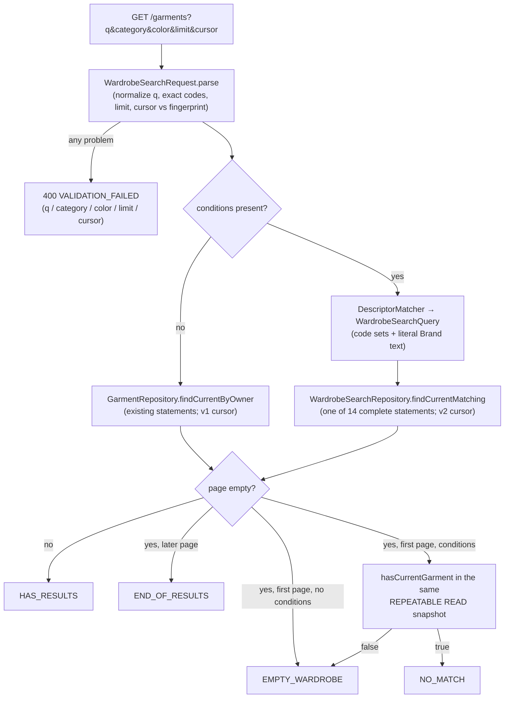

# US-WAR-003 — Find Owned Garments Through Search and Filters: Implementation Guide

| Field | Value |
| --- | --- |
| Story | [US-WAR-003](../../../stories/wardrobe/US-WAR-003-find-garments-with-search-and-filters.md) (Draft), parent PBI-015 |
| Sprint | Sprint 4, story 3 of 6 in the [recommended order](README.md#6-implementation-sequence). Functionally independent of the media stories; it follows them only for exact shared-file anchors. |
| Starting point | After [US-GAR-005](US-GAR-005-guide.md) and [US-GAR-006](US-GAR-006-guide.md) |
| Approved decisions applied | S4-WAR-01, S4-WAR-02, S4-WAR-03, S4-WAR-04, S4-INT-02, S4-INT-03, all **approved by the Product Owner on 2026-11-16** |
| Delegated defaults applied | OPEN-S4-11, 12, 13, 14, 15, 31, 32 (`SELECTED BY CLAUDE — DELEGATED DEFAULT`, [record](open-questions.md)). Together they settle CAT-Q01 for this increment. |
| Verification status | **Not applied to the repository and not run there.** Scratch evidence of 2026-11-16: the six guides were applied in order to an isolated copy of `backend/`, `docs/05-api` and `.github/workflows`, and `clean verify` passed there (677 unit and 433 integration tests; none failed, errored or was skipped), including every test in §13. A run in the repository and its CI is still required. The index decision (OPEN-S4-15) needs a measurement. |

## 1. Story Overview

**Story.** As an authenticated owner, I want to find my garments through search and category/color filters, so that I can locate what I own without scrolling through my whole wardrobe.

**Backend outcome.** The existing overview `GET /api/v1/wardrobe/garments` gains optional conditions:

- **`q`:** one literal text phrase. It matches when it is contained, case-insensitively but accent-sensitively, in any of these:
  - the label or code of Category, Subtype, Color, Material, Pattern or Style;
  - the Brand text.

  Price, the other optional details, personal context and images are never searched.
- **`category` and `color`:** repeatable exact codes. The rule is OR within a group, AND across groups and with `q`. A missing group means no restriction.
- **Paging** stays keyset (`created_at DESC, id DESC`, bounded `limit`):
  - a filtered page issues a **criteria-bound cursor** (`v2`);
  - reusing it with other conditions is refused with `400 CONDITIONS_CHANGED` (reset path);
  - unfiltered browsing keeps its existing `v1` cursor.
- **Result state:**
  - `HAS_RESULTS`;
  - `NO_MATCH`: conditions matched nothing, but the owner has current garments;
  - `EMPTY_WARDROBE`: the owner has no current garment;
  - `END_OF_RESULTS`: a later page came back empty.

  The empty first page is resolved in one read-only snapshot.
- **Active conditions** are echoed back normalized (`conditions`), so the client can show, change and clear them.
- Search is read-only: it creates no garment, feedback or Wear Event.

**Out of scope:**

- accent-insensitive or fuzzy matching;
- Vietnamese descriptor labels on the server (OPEN-S4-11);
- sorting options;
- catalog or visual search;
- ranking;
- new indexes without measurement (OPEN-S4-15);
- client screens.

## 2. Repository Baseline

| Item | State after US-GAR-006 | Relevance |
| --- | --- | --- |
| `GET /api/v1/wardrobe/garments` | `limit` and `cursor` only (`WardrobePageRequest`, `WardrobeCursor` v1); response `{garments, nextCursor}` | Gains `q`, `category` and `color`; the response gains `resultState` and `conditions` |
| `BrowseWardrobeService` + `GarmentRepository.findCurrentByOwner` | Two complete statements (first page, after position) on `ix_wardrobe_garment_owner_current` | The unfiltered overview keeps this exact path, so `WardrobeFailureIT` keeps covering it |
| Vocabularies | `ControlledValue` enums with approved **English** labels; no Vietnamese labels anywhere in the backend | OPEN-S4-11: labels and codes are matched in Java |
| Child sets | `wardrobe_garment_material` and `wardrobe_garment_style` with primary keys `(garment_id, value)` | `EXISTS` probes use the primary keys |
| `WardrobeTransactions` | One method, `inTransaction`; two fakes implement it (`ImmediateWardrobeTransactions`, `AddGarmentServiceTest.FailingCommit`) | P7 adds a **default** method, so the fakes stay unchanged |
| `InvalidWardrobePageException` | List of `(field, code)`; handler gives `400 VALIDATION_FAILED` | Reused for every search-condition error |
| Browse tests | `BrowseWardrobeApiIT`, `WardrobeCursorTest`, `WardrobePageRequestTest`, `WardrobeFailureIT` assert `garments`, `nextCursor` and field errors only | Unchanged; they stay green because the unfiltered path is untouched |
| Migrations | V1–V12 | **None added** (OPEN-S4-15) |
| OpenAPI | 0.13.0 | → 0.14.0 |
| CI | 106 entries | +9 entries |

## 3. Original Business Requirements — Verbatim

> Sections 3–8 reproduce the cited sources verbatim. Only relative link targets were re-based to this file's location, and heading levels were shifted to nest under this guide; no wording was changed. Sprint 4 decision rows show the plan's historical status cell; the Product Owner's approval of 2026-11-16 supersedes it.

From [BRD](../../../../01-business/BRD.md):

| ID | Requirement | Business Rationale | Priority | Related Goals |
|---|---|---|---|---|
| BR-005 | Users must be able to maintain, browse, search, and filter an accurate current wardrobe, including adding, changing, and removing garments. | Decisions must reflect accessible, current possessions. | Must | BG-01, BG-02, BG-03 |

| ID | Capability | Business Purpose |
|---|---|---|
| CAP-03 | Wardrobe Management | Keep the wardrobe current and discoverable through maintenance, browsing, search, and filtering. |

## 4. Original Product Requirements — Verbatim

From [PRD](../../../../02-product/PRD.md):

### 8.3 JRN-03 — Wardrobe Management

**Intent:** Keep the product aligned with what the user currently owns.

1. The user browses garment cards or searches/filters the wardrobe.
2. Garment detail presents confirmed information and recorded utilization without implying observed physical wear.
3. The user edits inaccurate or changed information and confirms the revision.
4. The user can remove a garment through an explicit, understandable removal action.
5. Subsequent recommendations and assessments reflect the current confirmed wardrobe; removed garments cannot remain selectable as owned items.

**Recovery:** Empty wardrobes prompt Add Garment; no search results offer changes to the search/filter; failed edits/removals retain a clear unconfirmed state and retry. Historical Wear Events/outfit records preserve understandable snapshots, labeling a removed garment “Removed from wardrobe” rather than treating it as currently owned. **Features:** FEAT-WAR-001–FEAT-WAR-003, FEAT-ANL-001.

### 14.3 FEAT-WAR-003 — Wardrobe Search and Filtering

**Purpose:** Make a growing wardrobe discoverable.

**User value:** Users can locate garments without scrolling through unrelated items.

**Related BRD:** BR-005; CAP-03; BG-01–BG-03. **Primary users:** All personas.

**Entry points / trigger:** Wardrobe Overview. **Preconditions:** Authenticated access; confirmed garments with searchable/relevant attributes.

**Product behavior:**

1. Offer text search across understandable garment descriptors and filters for useful confirmed attributes, including category and color.
2. Display active search/filter conditions and allow their removal.
3. Open matching garment detail without changing wardrobe information.
4. Distinguish no match from an empty wardrobe and suggest changing or clearing conditions.

**User controls:** Enter/change search, select/clear filters, open a result. **Product states:** Unfiltered, searching/filtering, matches, no matches, retrieval failed.

**Failure / fallback:** Explain retrieval failure and retry without implying the wardrobe or matching garments were deleted.

**Feature-level acceptance criteria:**

- **AC-01:** Category/color filters show matching confirmed garments and exclude known nonmatches.
- **AC-02:** Searching a known supported descriptor can find the corresponding garment.
- **AC-03:** Clearing conditions restores the unfiltered wardrobe.
- **AC-04:** No-match feedback provides a useful reset path distinct from Add Garment guidance for an empty wardrobe.

**Out of scope / deferred detail:** Exact searchable vocabularies, matching semantics, optional extra filters/sort order, and search implementation are downstream. Visual similarity search is not an MVP requirement.

## 5. Original Software Requirements — Verbatim

From [SRS](../../../../03-requirements/SRS.md):

| ID | Requirement | Scope | Source | Verification |
|---|---|---|---|---|
| FR-WAR-001 | The system shall present identifiable current confirmed garments across all eight categories, page by page in a stable newest-first order with explicit continuation that neither omits nor repeats garments remaining current, and retrieve all available applicable accepted properties in detail, including multiple Materials and Styles and optional Brand/Price, without requiring an image or every detail field in collection summaries. | MVP | FEAT-WAR-001; BR-005 | T: browse, pagination and imageless detail. |
| FR-WAR-007 | The system shall provide descriptor search and category/color filtering of confirmed garments with visible conditions and reset. | MVP | FEAT-WAR-003; BR-005 | T: match, filter, clear. |
| FR-WAR-008 | The system shall distinguish an empty wardrobe, no matching results, loading, and unavailable data with applicable Add Garment or reset/retry actions. | MVP | FEAT-WAR-001, FEAT-WAR-003; BR-005 | T: empty/no-match/failure states. |
| DATA-GAR-005 | The system shall represent active/removed ownership independently from missing optional properties and unevaluated recommendation eligibility, without a readiness/compatibility gate or a physical schema prescribed by this SRS; preserve the implemented API's `NOT_EVALUATED` result. | MVP | FEAT-GAR-001, FEAT-WAR-002; BR-003, BR-005 | T/I: ownership and unevaluated eligibility remain distinct; no property gate. |
| UI-003 | The system shall distinguish loading, empty, no-match, pending, confirmed and failed states plus Exact/Evaluated Zero/Incomplete/Unavailable/Outdated multiplier states where applicable. | MVP | FEAT-WAR-001, FEAT-OUT-001, FEAT-MULT-001; BR-005, BR-016, BR-022 | T/I: generic state inventory and five multiplier result states. |
| UI-004 | The system shall display garment identity/category/color, guidance that eligibility is not evaluated, and available image without hiding imageless manual entries. | MVP | FEAT-WAR-001, FEAT-GAR-001; BR-005, BR-003 | I: cards and minimum-only detail. |

| ID | Failure Condition | Required System Behavior | Continuation / State Protection | Source | Verification |
|---|---|---|---|---|---|
| ERR-NET-001 | Network/communication fails during an action. | The system shall distinguish interrupted communication and uncertain mutation outcomes from confirmed success or empty data, providing applicable outcome review/retry without accidental duplicate actions. | Previously confirmed information is preserved; an already accepted action is not repeated as a new one. No general offline guarantee. | FEAT-AI-002, FEAT-PERS-002, FEAT-WAR-001; BR-005, BR-011, BR-022 | T: interruption before/after action acceptance. |

| ID | Requirement | Scope | Source | Verification |
|---|---|---|---|---|
| LOC-004 | The system shall preserve Vietnamese text and diacritics accurately in supported user entry and display. | MVP | FEAT-AUTH-001, FEAT-PROF-001; BR-010, BR-021, BR-023 | T: Vietnamese names and applicable text round-trip. |

## 6. Original Business Rules — Verbatim

From [Business Rules](../../../../03-requirements/business-rules.md):

### BRULE-AUTH-001 — Authorized Personal Operations

**Rule:** Personal wardrobe, profile, feedback, history, and assessment operations require authentication and authorization for the affected user's information. Unavailable authorized access is not an empty wardrobe and does not change personal state.

**Applies To:** all personal domain operations.

**Source:** FR-AUTH-008, ERR-AUTH-001, DATA-GAR-001.

### BRULE-GAR-004 — Controlled Classification and Context Vocabularies

**Rule:** Category is one of the eight approved codes. Every supplied optional Subtype must belong to that Category and its complete approved source list; missing Subtype is valid. No invented fallback or silent replacement is permitted. MINI_DRESS and other overlapping names remain subtypes without automatic derivation. All Bags/Headwear choices are approved, not pending research.

The [garment-property authority](../../../../../Initial%20files/Image%20to%20Properties%20Extraction.md) owns garment values. Profile style preferences, request Occasion and common needs keep their separate SRS Section 4.10 vocabularies; they are not garment Style or a garment Occasion property.

**Source:** FR-GAR-001/002, DATA-GAR-002; FR-PROF-002/004 for separate context.

### BRULE-GAR-009 — Accepted Edits and Removal

**Rule:** Only accepted edits/removal change current garment state; canceled, failed, or pending work must not be represented as accepted. Removal excludes the garment from new current outfits, current Coverage, and the current Multiplier baseline. Relevant accepted changes require refresh or an outdated indication for affected advice; historical meaning remains governed by BRULE-HIST-002. Accepted removal takes immediate effect in current ownership, recommendations, Coverage and the Multiplier baseline. Only necessary minimal historical information may remain; original removed-garment images and nonessential removed personal data must be physically deleted within 30 days.

**Applies To:** wardrobe maintenance and all dependent assessments.

**Source:** FR-WAR-003, FR-WAR-004, FR-WAR-005, FR-WAR-006, DATA-INT-002, DATA-INT-004, DATA-RET-002, DATA-HIST-001.

## 7. Original User Story and Acceptance Criteria — Verbatim

From [US-WAR-003](../../../../06-scrum/stories/wardrobe/US-WAR-003-find-garments-with-search-and-filters.md):

### 1. Story

As an authenticated owner, I want to search supported descriptors and filter my wardrobe, so that I can locate relevant clothing without browsing every entry.

### 3. Scope

Supported descriptor search, category/color filters, visible conditions/reset, current owned results and relevant detail/return navigation.

**PR #4 scope boundary — 2026-11-09:** This story searches only the user's current owned Wardrobe. Internal catalog search and confirmed catalog addition are US-CAT-001/002 (PBI-046/047), distinct approved future work; they do not enter this story.

### 4. Preconditions

- The user can access their current wardrobe; existing garments or a match are not prerequisites to using the search area.

### 5. Acceptance Criteria

#### AC-01 — Find supported descriptors

For agreed supported searchable descriptors and their source meanings, a known matching confirmed garment can be found and known nonmatches are excluded under the agreed matching semantics. Those fields/semantics require CAT-Q01 clarification before this criterion is fully specified.

#### AC-02 — Filter category and color

Applying supported category/color conditions returns matching current confirmed garments of the authorized wardrobe; removed, other-account and hypothetical items are not substituted as results.

#### AC-03 — Show and clear conditions

Active search/filter conditions are understandable and can be changed or cleared. Clearing them restores the unfiltered current wardrobe rather than changing garment information.

#### AC-04 — Distinguish result states

A loaded wardrobe with no matches shows a change/reset path, while a genuinely empty wardrobe offers Add Garment. Loading, failed retrieval and denied access are neither no-match nor empty results.

#### AC-05 — Inspect real results

Matching imageless or incomplete entries remain identifiable, with the established garment-detail/return path and unevaluated-eligibility meaning preserved.

#### AC-06 — Recover without mutation

Failed/unavailable search offers retry or return and does not delete accepted garments. Access loss pauses private use; changing conditions or viewing results creates no garment, feedback or Wear Event.

### 6. Quality and Verification

Apply the [shared quality and completion conditions](../../../stories/README.md#2-shared-quality-and-completion) to this item's actual scope, together with its source-specific criteria below. Relevant automated, real integration, client and other triggered evidence must establish the outcome; drafted AC or backend smoke checks alone do not establish Done.

### 7. Dependencies

- Parent PBI capability inputs: PBI-007.
- Source-linked related stories describe collaborating outcomes; they do not change the Product Backlog's hard-dependency semantics or imply a serial development schedule.

### 8. Out of Scope

Base browsing/detail are [US-WAR-001](../../../stories/wardrobe/US-WAR-001-browse-current-wardrobe.md)/002. No catalogue/visual-similarity search, new categories, sorting rule or search implementation is introduced.

### 10. Open Refinement Notes

CAT-Q01: PO/BA with Developers must identify supported descriptor fields and matching behavior, including relevant Vietnamese input treatment. Do not infer accent-insensitive matching, free-text scope or AND/OR combinations from generic search conventions.

Question ownership and impact: [catalogue questions CAT-Q01](../../../stories/README.md#4-open-questions-and-readiness). These are unresolved refinements, not new requirement identifiers.

## 8. Original Use Cases, Flows and Architecture Decisions — Verbatim

### 8.1 [UC-008](../../../../03-requirements/use-cases/UC-008-view-wardrobe.md)

#### 1. Use Case Summary

| Field | Value |
| --- | --- |
| Use Case ID | UC-008 |
| Use Case Name | View Wardrobe |
| Scope | CapsuleAI |
| Level | User Goal |
| Primary Actor | User |
| Supporting Actors | None |
| Version | 0.4 |
| Status | Baseline Draft |
| Product revision | 2026-11-05: Approved taxonomy and optional Brand/purchase Price synchronized; goals, alternate/failure paths and ownership/retry semantics preserved. |

Source authority: [BRD](../../../../01-business/BRD.md) defines business intent; [PRD](../../../../02-product/PRD.md) defines product behavior; [SRS](../../../../03-requirements/SRS.md) and [Business Rules](../../../../03-requirements/business-rules.md) constrain interaction; the [master Use Case Diagram](../../../../03-requirements/use-cases/use-case-diagram.puml) defines this goal and its actors. The [workflow](../../../../../Initial%20files/CapsuleAI_Scrum_Development_Workflow.md) governs artifact ownership and sequencing.

#### 2. Goal

Browse and find current owned garments, inspect their confirmed details and unevaluated recommendation eligibility and understand available reported-use information without changing wardrobe ownership.

#### 4. Preconditions

- The User has authenticated access authorized for the wardrobe; an empty wardrobe is permitted.

#### 5. Trigger

The User opens the wardrobe or requests garment search/detail.

#### 6. Main Success Scenario

1. The User requests the current wardrobe.
2. CapsuleAI distinguishes loading from loaded data and presents identifiable current confirmed garments, including entries without images.
3. The User browses or enters descriptor search and category/color filter conditions.
4. CapsuleAI shows active conditions and the matching current garments.
5. The User selects a garment to inspect.
6. CapsuleAI presents all available applicable accepted properties from the source catalogue, including multiple distinct Materials, one dominant Color, category-specific details, Brand and original purchase Price with currency; available image/provenance remain separate. Missing optional values are not fabricated and eligibility is not evaluated. Collection summaries need only sufficient identifying information, not the complete detail payload.
7. The User returns to browsing or chooses a separate supported maintenance/insight action.

#### 7. Alternative Flows

##### A1 — Unfiltered browsing/reset

At Main Step 3:

1. The User supplies no conditions or clears existing search/filter conditions.
2. CapsuleAI restores the unfiltered current wardrobe; continue at Main Step 5 if the User selects an item.

##### A2 — No matching results

At Main Step 4:

1. CapsuleAI explains that the current conditions match no garments, without calling the wardrobe empty.
2. The User adjusts or resets conditions and resumes at Main Step 3.

##### A3 — Genuinely empty wardrobe

At Main Step 2:

1. CapsuleAI explains the confirmed empty state and offers Add Garment.
2. The User may start UC-007 or leave the wardrobe without a fixed garment-quota requirement.

##### A4 — Imageless, minimum-only or no-recorded-use entry

At Main Step 6:

1. CapsuleAI keeps the entry identifiable without an image, explains missing eligibility under a future approved policy fields and labels missing reports as no recorded use.
2. The User can inspect/enrich the garment without an inference that it has never been physically worn.

##### A5 — Large wardrobe

At Main Step 2 (PO decision 2026-11-07, FR-WAR-001):

1. CapsuleAI presents the first page of current garments, newest first, and indicates whether more are available.
2. The User asks for more; CapsuleAI continues after the last presented garment without repeating or omitting garments that remain current. Garments added after browsing began appear when the User starts again from the first page.

#### 8. Exception / Failure Flows

##### E1 — Wardrobe/search/detail retrieval fails

At Main Step 2:

1. CapsuleAI identifies unavailable data and offers retry or return to usable prior context.
2. It does not display an empty wardrobe/no matches as a substitute for a failed retrieval; accepted inventory is unchanged.

##### E2 — Selected garment is no longer current

At Main Step 6:

1. CapsuleAI explains the changed/removed item and refreshes the current wardrobe where possible.
2. The User returns to current browsing; historical snapshots remain separate and do not restore ownership.

##### E3 — Authorized access becomes unusable

At Main Step 1:

1. CapsuleAI pauses protected interaction if access expires, is revoked or is not authorized for the affected information, and explains the need to authenticate again.
2. The User can resume the appropriate goal after UC-002 establishes usable access. Protected information is not exposed or misrepresented as empty, and the interrupted request is not falsely reported as accepted.

#### 9. Success Postconditions

- Displayed inventory/details match the available current confirmed wardrobe and visible search/filter conditions.
- Unevaluated eligibility and recorded-use limitations are understandable, and no item is added/edited/removed by viewing.

#### 10. Minimal / Failure Postconditions

- Failed browsing/search/detail does not delete or change accepted garments.
- Unavailable access/data is distinct from a true empty or no-match result; removed items are not restored as current.
- Loss of access pauses protected use; inaccessible personal data is not exposed or labeled empty. Prior accepted information remains governed by its authorized state.

#### 11. Business Rules

The following references constrain this interaction; detailed policy remains in the [Business Rules](../../../../03-requirements/business-rules.md).

| Rule ID | Relevance |
| --- | --- |
| `BRULE-AUTH-007` | Personal information is purpose-limited/private; MVP personal data is not used for AI training/improvement or unrestricted external sharing. |
| `BRULE-AUTH-001` | Personal information/actions require authorized access for the affected User. |
| `BRULE-GAR-001` | Confirmed garment values govern displayed current information. |
| `BRULE-GAR-010` | Optional Brand and purchase Price; supplied values, missing information, currency and confirmed authority. |
| `BRULE-GAR-003` | Show that recommendation eligibility is not evaluated, without hiding any saveable entry or labelling it ready or unready. |
| `BRULE-HIST-001` | Usage indicators are reported evidence, not verified physical behavior. |
| `BRULE-HIST-002` | Historical removed snapshots do not enter current inventory. |

#### 13. Special Requirements / Constraints

Exactly 13 fashion properties are approved: Category, Subtype, Color, Material, Pattern, Style, Fit, Neckline, Sleeve Length, Length, Silhouette, Brand, Price. Category and one dominant Color plus explicit user confirmation form the saving minimum. All other applicable properties are optional. Material supports zero or multiple distinct selections; Pattern is single and optional. Fit, Neckline and Sleeve Length apply only to Tops; Length uses separate Tops/Pants vocabularies; Silhouette applies only to Pants. Every supplied controlled value must match the source vocabulary and category; correct or clear invalid/inapplicable input rather than silently substitute or discard it. Unknown optional information is absent, not an invented UNKNOWN/OTHER/Etc value. Preserve real listed fallbacks such as Other, Other Materials and Colorful only where defined.

Recommendation eligibility has not been evaluated. A saved garment is not invalid, unsuitable or ineligible because an engine policy is undefined or an optional property is absent. No ready/unready result, required compatibility field, fixed outfit composition or category-to-role mapping is approved for the current phase. Define composition, compatibility and sufficient-evidence policy during recommendation-engine development, using only approved properties unless the Product Owner approves a future model change. Sprint 2 exposes truthful accepted information and missing values; the smallest contract representation is selected during story-specific design, without mandating a NOT_EVALUATED enum or database field.

The [property authority](../../../../../Initial%20files/Image%20to%20Properties%20Extraction.md) owns every vocabulary label; all applicable properties belong to Sprint 2 manual creation and detail. Metadata/provenance/media are separate. Price is the original amount paid with decimal amount and explicit currency; Brand is text. No future AI output silently overwrites accepted values.

- No image, no recorded use, unevaluated eligibility, loading and unavailable data remain distinct meanings.
- Viewing is confined to the current authorized wardrobe. Historical references retain only necessary meaning and do not expose indefinitely retained original removed-garment images.

#### 15. Open Issues

PRD OPQ-012 defers readiness/composition to engine development; OPQ-013 (Brand/Price validation) and OPQ-014 are resolved, and OPQ-016–018 (multiple Styles, Tanks & Camis, paged overview) were decided on 2026-11-07. Earlier issue review below predates this revision.

The earlier review recorded no Use Case-specific blocker. The current revision must resolve applicable optional-field validation before dependent implementation; unresolved recommendation policy does not prevent minimum saving or inspection.

### 8.2 Selected architecture decisions — verbatim from [selected decisions](../../../../04-architecture/selected-architecture-decisions.md)

| ADA ID | Decision Problem | Selected Option | Backend Impact | Status |
| --- | --- | --- | --- | --- |
| ADA-003 | Authoritative persistence model and database | Option A — One relational primary database: PostgreSQL | Use PostgreSQL as the primary relational authority. | Selected |
| ADA-010 | Advice and wardrobe-intelligence computation | Option A — Request-time evaluation from authoritative inputs with shared semantics | Evaluate current inputs with shared validity/identity and truthful results. | Selected |
| ADA-011 | Dedicated cache strategy | Option A — No dedicated cache initially | Start without a dedicated cache and measure complete operations. | Selected |
| ADA-014 | Protected observability and validation evidence | Option A — Minimal protected structured logs, metrics and health/recovery evidence | Expose protected outcome, timing, health and recovery evidence. | Selected |
| ADA-016 | Context Data Ownership | Option B — One PostgreSQL database initially with explicit context-owned logical persistence boundaries | Own persistence logically per context within one PostgreSQL. | Selected |

### 8.3 Sprint 4 decisions — verbatim from the [plan register](../sprint-plan.md#13-consolidated-decision-register)

> **Status update (binding):** the Product Owner approved all 30 Sprint 4 recommendations on **2026-11-16**. The plan's `PROPOSED — PENDING PO APPROVAL` cells below are reproduced verbatim and are superseded by that approval; see [open-questions.md](open-questions.md#1-decision-authority).

| Decision ID | Related Story | Question | Recommended Solution | Decision Status | Approval Owner |
| --- | --- | --- | --- | --- | --- |
| [S4-WAR-01](../sprint-plan.md#s4-war-01) | US-WAR-003 | Searchable descriptors and Vietnamese matching semantics | Option B — the stated bounded descriptor set and literal substring semantics, subject to CAT-Q01 approval. | PROPOSED — PENDING PO APPROVAL | Product Owner and BA with Backend Tech Lead |
| [S4-WAR-02](../sprint-plan.md#s4-war-02) | US-WAR-003 | Combined filters and complete bound SQL | Option B — a small catalogue of complete bound statements for the approved condition shapes. | PROPOSED — PENDING PO APPROVAL | Product Owner with Backend Tech Lead |
| [S4-WAR-03](../sprint-plan.md#s4-war-03) | US-WAR-003 | Filtered cursor continuity and concurrent current state | Option A — current keyset pages with criteria-bound cursors and explicit live-view semantics. | PROPOSED — PENDING PO APPROVAL | Product Owner with Backend Tech Lead and QA |
| [S4-WAR-04](../sprint-plan.md#s4-war-04) | US-WAR-003 | Proportional search indexing and performance evidence | Option A — measured relational indexing first; retain trigram indexing as an evidence-driven option. | PROPOSED — PENDING PO APPROVAL | Product Owner with Backend Tech Lead and QA |
| [S4-INT-02](../sprint-plan.md#s4-int-02) | All six selected stories | Logical action outcomes and uncertainty recovery | Option A — targeted durable identities and explicit current-state review, adding a receipt only where natural state cannot prove the required outcome. | PROPOSED — PENDING PO APPROVAL | Product Owner with Backend Tech Lead and QA |
| [S4-INT-03](../sprint-plan.md#s4-int-03) | All six selected stories | Compatible command transport and synchronized delivery contracts | Option A — compatible explicit confirmed commands, preserving existing PATCH/body-revision conventions and resource grouping. | PROPOSED — PENDING PO APPROVAL | Product Owner with Backend Tech Lead and QA |

## 9. Engineering Interpretation

| Source obligation | Engineering meaning | Where |
| --- | --- | --- |
| AC-01: supported descriptors and semantics (CAT-Q01) | Resolved by OPEN-S4-11/12 under delegation:<br>• six controlled vocabularies (label or code) plus Brand;<br>• literal phrase, OR across fields;<br>• case-insensitive, accent-sensitive, NFC;<br>• `%`, `_` and `\` are literal;<br>• Price excluded. | P1–P3, P10, P11; T2, T3, T7 |
| AC-02: category and color filters over current owned garments only | Exact codes; OR within a group, AND across groups. Every statement carries `owner_account_id = :owner AND removed_at IS NULL`. | P10, P11; T6, T7, T8 |
| AC-03: understandable, changeable, clearable conditions | Normalized conditions are echoed. A blank `q` and absent groups mean "no condition", so clearing restores the unfiltered overview. A changed condition needs a new first page (`CONDITIONS_CHANGED`). | P1, P12–P16; T4, T8 |
| AC-04: no match versus empty wardrobe versus failure or denial | `resultState` comes from one snapshot. `401` and `503` are never a result state. | P4, P5, P7–P9; T1, T8, T9 |
| AC-05: imageless and incomplete entries identifiable | Results use the existing `GarmentSummaryResponse` (Category and Color always present; `NOT_EVALUATED`) | P15; T8 |
| AC-06: recover without mutation | Read-only. A failure is `503`, never an empty page. A retry with the same cursor works. | P9; T8, T9 |
| S4-WAR-02: finite catalogue of complete statements | 7 restricted shapes × (first page, after position) = 14 compile-time constant statements. The unrestricted overview keeps the 2 existing statements. | P10; T6 |
| S4-WAR-03: criteria-bound cursor, live view | `v2` cursor with a 16-hex SHA-256 fingerprint of the canonical conditions; current membership read on every page | P1, P13; T5, T8 |
| S4-WAR-04: measured indexes first | No new index; documented EXPLAIN procedure | §14 M6–M7 |

## 10. Just-in-Time Detailed Design

### 10.1 Request flow



### 10.2 Matching semantics (OPEN-S4-11/12)

| Aspect | Rule |
| --- | --- |
| Input | `q` is stripped of outer Unicode whitespace; blank means no text condition. Then NFC. 1–100 code points, otherwise `OUT_OF_RANGE`. Any ISO control character gives `INVALID_FORMAT`. |
| Fields | Category, Subtype, Color, Material, Pattern, Style (approved label **or** code) and Brand. Not Price, Fit, Neckline, Sleeve Length, Length or Silhouette. |
| Case | Controlled values: both sides lower-cased with `Locale.ROOT` in Java. Brand: `lower()` on both sides in PostgreSQL. |
| Accents | Significant: `"đầm"` matches `"Đầm Xinh"`; `"dam"` does not |
| Normalization | Query in NFC (Java); Brand compared as `normalize(brand, NFC)` (stored text is unchanged) |
| Literal | The phrase is one substring: no tokens, no wildcards. In the Brand pattern, `\`, `%` and `_` are escaped with `\`. |
| Combination | Text condition = OR across fields. Filters: OR within `category` and within `color`. AND across text, `category` and `color`. |
| Duplicates | `EXISTS` for Materials and Styles, so a garment appears once |

### 10.3 Statement catalogue (S4-WAR-02, OPEN-S4-13)

| Shape | Conditions | First page | After position |
| --- | --- | --- | --- |
| (unrestricted) | — | existing `SELECT_CURRENT_FIRST_PAGE` | existing `SELECT_CURRENT_PAGE_AFTER` |
| TEXT | text | ✔ | ✔ |
| CATEGORY | category | ✔ | ✔ |
| COLOR | color | ✔ | ✔ |
| TEXT_CATEGORY | text + category | ✔ | ✔ |
| TEXT_COLOR | text + color | ✔ | ✔ |
| CATEGORY_COLOR | category + color | ✔ | ✔ |
| TEXT_CATEGORY_COLOR | all three | ✔ | ✔ |

Each statement is a compile-time concatenation of constant text blocks: the guard, the conditions, the optional keyset predicate, then the order and limit. The SQL never contains request text. Every value is bound. Code sets are bound as one comma-joined text and expanded with `string_to_array(CAST(:x AS text), ',')`; codes never contain commas.

### 10.4 Cursor (S4-WAR-03, OPEN-S4-14)

| Request | Issued cursor | Accepted cursor |
| --- | --- | --- |
| No conditions | `v1\|createdAt\|id` (unchanged) | `v1` only; a `v2` cursor gives `CONDITIONS_CHANGED` |
| Conditions | `v2\|createdAt\|id\|fp` | `v2` with the same `fp`. Another `fp`, or a `v1` cursor, gives `CONDITIONS_CHANGED`. |
| Anything else | — | `INVALID_FORMAT` |

`fp` is the first 16 hex characters of SHA-256 over `m1|q=<NFC, lower-cased>|c=<sorted category codes>|k=<sorted color codes>`. `m1` names the matching policy. Equivalent conditions (reordered codes, different letter case) have the same fingerprint. The cursor is not authorization: every page is owner- and current-scoped.

### 10.5 API contract

| Item | Value |
| --- | --- |
| Route | `GET /api/v1/wardrobe/garments` |
| New query parameters | `q` (string, at most 100 code points); `category` (repeatable `GarmentCategoryCode`); `color` (repeatable `GarmentColorCode`) |
| Response | `WardrobeOverview {garments, nextCursor, resultState, conditions}`; `conditions = {q, categories, colors}`, where `q` is null when absent and the lists are `[]` when absent |
| New field-error codes | `CONDITIONS_CHANGED` (cursor). `q`: `OUT_OF_RANGE` or `INVALID_FORMAT`. `category` and `color`: `UNSUPPORTED_VALUE` or `OUT_OF_RANGE`. |

Example:

```http
GET /api/v1/wardrobe/garments?q=uniqlo&category=TOPS&category=OUTERWEAR&color=NAVY&limit=20
```

```json
{
  "garments": [
    {"id": "4b9f3c7e-2a1d-4c8e-9f6a-1e2d3c4b5a69", "category": "TOPS", "subtype": "T_SHIRTS", "color": "NAVY",
     "brand": "Uniqlo", "recommendationEligibility": "NOT_EVALUATED", "createdAt": "2026-11-05T09:31:00.123456Z"}
  ],
  "nextCursor": null,
  "resultState": "HAS_RESULTS",
  "conditions": {"q": "uniqlo", "categories": ["TOPS", "OUTERWEAR"], "colors": ["NAVY"]}
}
```

### 10.6 Transactions, security and recovery

- First pages run in `WardrobeTransactions.inReadOnlySnapshot`: PostgreSQL REPEATABLE READ, read-only. The page and the existence fact come from one snapshot.
- Later pages are single statements.
- Nothing is written, and no lock is taken.
- The owner comes from the token. Problem Details never echo `q`. The success response echoes the caller's own normalized conditions.
- A failure is `503`. The client retries the same request: a cursor stays valid while its conditions are unchanged.

### 10.7 Testing plan

| Level | Classes |
| --- | --- |
| Application | `SearchWardrobeServiceTest`, `DescriptorMatcherTest`, `WardrobeSearchCriteriaTest` |
| Web units | `WardrobeSearchRequestTest`, `FilteredWardrobeCursorTest` |
| SQL catalogue | `SearchStatementCatalogueTest` |
| Real PostgreSQL | `JdbcWardrobeSearchRepositoryIT` |
| HTTP | `SearchWardrobeApiIT`, `SearchWardrobeFailureIT` |
| Regression (unchanged) | `BrowseWardrobeApiIT`, `WardrobeCursorTest`, `WardrobePageRequestTest`, `WardrobeFailureIT`, `IdentityOpenApiContractIT` |

## 11. File Change Matrix

`…/wardrobe/` is `backend/src/main/java/com/capsuleai/wardrobe/` and `…/test/wardrobe/` is `backend/src/test/java/com/capsuleai/wardrobe/`.

| Order | Action | Exact repository path | Purpose | Dependencies |
| --- | --- | --- | --- | --- |
| P1 | ADD | `…/wardrobe/application/WardrobeSearchCriteria.java` | Normalized conditions and fingerprint | — |
| P2 | ADD | `…/wardrobe/application/WardrobeSearchQuery.java` | What the repository executes | — |
| P3 | ADD | `…/wardrobe/application/DescriptorMatcher.java` | Labels and codes to code sets | P1, P2 |
| P4 | ADD | `…/wardrobe/application/WardrobeResultState.java` | Result states | — |
| P5 | ADD | `…/wardrobe/application/WardrobeSearchPage.java` | One page plus state | P4 |
| P6 | ADD | `…/wardrobe/application/ports/WardrobeSearchRepository.java` | Search port | P2 |
| P7 | MODIFY | `…/wardrobe/application/ports/WardrobeTransactions.java` | `default inReadOnlySnapshot` | — |
| P8 | MODIFY | `…/wardrobe/adapter/out/persistence/SpringWardrobeTransactions.java` | REPEATABLE READ snapshot | P7 |
| P9 | ADD | `…/wardrobe/application/SearchWardrobeService.java` | Use case | P1–P7 |
| P10 | ADD | `…/wardrobe/adapter/out/persistence/SearchStatementCatalogue.java` | 14 complete statements | — |
| P11 | ADD | `…/wardrobe/adapter/out/persistence/JdbcWardrobeSearchRepository.java` | SQL for P6 | P6, P10 |
| P12 | ADD | `…/wardrobe/adapter/in/web/WardrobeSearchRequest.java` | Parse and validate the query | P1, P13 |
| P13 | MODIFY | `…/wardrobe/adapter/in/web/WardrobeCursor.java` | `v2` cursor | — |
| P14 | ADD | `…/wardrobe/adapter/in/web/WardrobeConditionsResponse.java` | Echoed conditions | P1 |
| P15 | MODIFY | `…/wardrobe/adapter/in/web/WardrobeResponse.java` | `resultState`, `conditions` | P5, P14 |
| P16 | MODIFY | `…/wardrobe/adapter/in/web/WardrobeGarmentController.java` | Search parameters | P9, P12, P15 |
| P17 | MODIFY | `…/wardrobe/adapter/in/web/WardrobeApiExceptionHandler.java` | Page/condition error text | — |
| P18 | MODIFY | `…/wardrobe/configuration/WardrobeConfiguration.java` | Beans | P9, P11 |
| P19 | MODIFY | `docs/05-api/openapi.yaml` | 0.13.0 → 0.14.0 | P12–P16 |
| P20 | MODIFY | `.github/workflows/backend-ci.yml` | 9 report entries | T1–T9 |
| T1 | ADD | `…/test/wardrobe/application/SearchWardrobeServiceTest.java` | Result states | P9 |
| T2 | ADD | `…/test/wardrobe/application/DescriptorMatcherTest.java` | Matching | P3 |
| T3 | ADD | `…/test/wardrobe/application/WardrobeSearchCriteriaTest.java` | Normalization, limits, fingerprint | P1 |
| T4 | ADD | `…/test/wardrobe/adapter/in/web/WardrobeSearchRequestTest.java` | Parameter errors | P12 |
| T5 | ADD | `…/test/wardrobe/adapter/in/web/FilteredWardrobeCursorTest.java` | `v2` cursor | P13 |
| T6 | ADD | `…/test/wardrobe/adapter/out/persistence/SearchStatementCatalogueTest.java` | Guards in every statement | P10 |
| T7 | ADD | `…/test/wardrobe/adapter/out/persistence/JdbcWardrobeSearchRepositoryIT.java` | Real matching | P11 |
| T8 | ADD | `…/test/wardrobe/adapter/in/web/SearchWardrobeApiIT.java` | HTTP states and paging | P16, P19 |
| T9 | ADD | `…/test/wardrobe/adapter/in/web/SearchWardrobeFailureIT.java` | Failure is not "no match" | P16 |

## 12. Complete Production Implementation

The BEFORE blocks are the files as left by US-GAR-006. Commands run from `backend/`.

### Step P1 — [ADD] `backend/src/main/java/com/capsuleai/wardrobe/application/WardrobeSearchCriteria.java`

```java
package com.capsuleai.wardrobe.application;

import com.capsuleai.wardrobe.domain.GarmentCategory;
import com.capsuleai.wardrobe.domain.GarmentColor;
import java.nio.charset.StandardCharsets;
import java.security.MessageDigest;
import java.security.NoSuchAlgorithmException;
import java.text.Normalizer;
import java.util.Collections;
import java.util.EnumSet;
import java.util.HexFormat;
import java.util.Locale;
import java.util.Objects;
import java.util.Optional;
import java.util.Set;
import java.util.stream.Collectors;

/**
 * US-WAR-003 — the owner's validated search conditions (S4-WAR-01/02/03; OPEN-S4-11/12/13/14).
 *
 * <p>{@code text} is one literal phrase, already stripped of outer whitespace and NFC-normalized; empty
 * means no text condition. {@code categories} and {@code colors} are exact approved codes; an empty set
 * means no restriction. Equivalent conditions (reordered codes, different letter case in the text) have
 * the same {@link #fingerprint()}, which binds a cursor to its conditions.
 */
public record WardrobeSearchCriteria(Optional<String> text, Set<GarmentCategory> categories,
                                     Set<GarmentColor> colors) {

    /** OPEN-S4-12: the longest accepted search text, in Unicode code points. */
    public static final int MAXIMUM_TEXT_CODE_POINTS = 100;

    /** The matching policy the fingerprint is computed for; a later policy change gets a new tag. */
    static final String MATCHING_POLICY = "m1";

    /** Why a normalized search text is not acceptable. */
    public enum TextProblem {
        TOO_LONG,
        CONTROL_CHARACTER
    }

    public WardrobeSearchCriteria {
        Objects.requireNonNull(text, "text must be Optional.empty() without a text condition");
        Objects.requireNonNull(categories, "categories must be empty without a category condition");
        Objects.requireNonNull(colors, "colors must be empty without a color condition");
        text.ifPresent(value -> {
            if (!normalizeText(value).equals(Optional.of(value)) || problemOf(value).isPresent()) {
                throw new IllegalArgumentException("The search text must be normalized and acceptable");
            }
        });
        categories = Collections.unmodifiableSet(categories.isEmpty()
                ? EnumSet.noneOf(GarmentCategory.class) : EnumSet.copyOf(categories));
        colors = Collections.unmodifiableSet(colors.isEmpty()
                ? EnumSet.noneOf(GarmentColor.class) : EnumSet.copyOf(colors));
    }

    /** No condition at all: the plain current-wardrobe overview. */
    public static WardrobeSearchCriteria unrestricted() {
        return new WardrobeSearchCriteria(Optional.empty(), Set.of(), Set.of());
    }

    /**
     * The NFC-normalized text without outer spaces, or empty when it is missing or blank. Every Unicode space
     * counts, including no-break spaces, which {@link String#strip()} would keep.
     */
    public static Optional<String> normalizeText(String rawText) {
        if (rawText == null) {
            return Optional.empty();
        }
        String normalized = withoutOuterSpaces(Normalizer.normalize(rawText, Normalizer.Form.NFC));
        return normalized.isEmpty() ? Optional.empty() : Optional.of(normalized);
    }

    /** Why the normalized text is not acceptable, if it is not (OPEN-S4-12). */
    public static Optional<TextProblem> problemOf(String normalizedText) {
        if (normalizedText.codePoints().anyMatch(Character::isISOControl)) {
            return Optional.of(TextProblem.CONTROL_CHARACTER);
        }
        if (normalizedText.codePointCount(0, normalizedText.length()) > MAXIMUM_TEXT_CODE_POINTS) {
            return Optional.of(TextProblem.TOO_LONG);
        }
        return Optional.empty();
    }

    public boolean isUnrestricted() {
        return text.isEmpty() && categories.isEmpty() && colors.isEmpty();
    }

    /**
     * The first 16 hexadecimal characters of SHA-256 over the canonical conditions
     * {@code m1|q=<lower-cased text>|c=<sorted category codes>|k=<sorted color codes>}.
     */
    public String fingerprint() {
        String canonical = MATCHING_POLICY + "|q=" + text.map(value -> value.toLowerCase(Locale.ROOT)).orElse("")
                + "|c=" + sortedCodes(categories) + "|k=" + sortedCodes(colors);
        try {
            byte[] digest = MessageDigest.getInstance("SHA-256").digest(canonical.getBytes(StandardCharsets.UTF_8));
            return HexFormat.of().formatHex(digest).substring(0, 16);
        } catch (NoSuchAlgorithmException unavailable) {
            throw new IllegalStateException("SHA-256 is required on every Java platform", unavailable);
        }
    }

    private static String sortedCodes(Set<? extends Enum<?>> values) {
        return values.stream().map(Enum::name).sorted().collect(Collectors.joining(","));
    }

    private static String withoutOuterSpaces(String text) {
        int start = 0;
        int end = text.length();
        while (start < end && isSpace(text.codePointAt(start))) {
            start += Character.charCount(text.codePointAt(start));
        }
        while (end > start && isSpace(text.codePointBefore(end))) {
            end -= Character.charCount(text.codePointBefore(end));
        }
        return text.substring(start, end);
    }

    private static boolean isSpace(int codePoint) {
        return Character.isWhitespace(codePoint) || Character.isSpaceChar(codePoint);
    }
}
```

**Explanation.**

- Outer spaces are removed by code point, including U+00A0 and U+2003. A scratch run of T3 showed that `String.strip()` keeps U+00A0.
- Text codes are upper-case, while the text is lower-cased in the canonical form, so a text containing `|c=` cannot collide with a category list.
- `java.text`, `java.security` and `HexFormat` are JDK APIs, which the application layer may use. The ArchUnit rule bans only frameworks, JDBC and HTTP.

**Verification.** T3.

### Step P2 — [ADD] `backend/src/main/java/com/capsuleai/wardrobe/application/WardrobeSearchQuery.java`

```java
package com.capsuleai.wardrobe.application;

import com.capsuleai.wardrobe.domain.GarmentCategory;
import com.capsuleai.wardrobe.domain.GarmentColor;
import com.capsuleai.wardrobe.domain.GarmentMaterial;
import com.capsuleai.wardrobe.domain.GarmentPattern;
import com.capsuleai.wardrobe.domain.GarmentStyle;
import com.capsuleai.wardrobe.domain.GarmentSubtype;
import java.util.Objects;
import java.util.Optional;
import java.util.Set;

/**
 * US-WAR-003 — the search the repository executes (OPEN-S4-11/13): for the text condition, the controlled
 * values whose label or code contains the text plus the literal Brand text; and the exact category and
 * color filters. An empty filter set means no restriction; an empty code set inside a text match means no
 * value of that vocabulary matched (the garment may still match through another field).
 */
public record WardrobeSearchQuery(Optional<TextMatch> textMatch, Set<GarmentCategory> categories,
                                  Set<GarmentColor> colors) {

    /** What the text condition matches; a garment matches when any of these fields does (OR). */
    public record TextMatch(Set<GarmentCategory> categories, Set<GarmentSubtype> subtypes, Set<GarmentColor> colors,
                            Set<GarmentMaterial> materials, Set<GarmentPattern> patterns, Set<GarmentStyle> styles,
                            String brandText) {

        public TextMatch {
            categories = Set.copyOf(categories);
            subtypes = Set.copyOf(subtypes);
            colors = Set.copyOf(colors);
            materials = Set.copyOf(materials);
            patterns = Set.copyOf(patterns);
            styles = Set.copyOf(styles);
            Objects.requireNonNull(brandText, "brandText");
        }
    }

    public WardrobeSearchQuery {
        Objects.requireNonNull(textMatch, "textMatch must be Optional.empty() without a text condition");
        categories = Set.copyOf(categories);
        colors = Set.copyOf(colors);
    }

    public boolean restrictsText() {
        return textMatch.isPresent();
    }

    public boolean restrictsCategories() {
        return !categories.isEmpty();
    }

    public boolean restrictsColors() {
        return !colors.isEmpty();
    }
}
```

### Step P3 — [ADD] `backend/src/main/java/com/capsuleai/wardrobe/application/DescriptorMatcher.java`

```java
package com.capsuleai.wardrobe.application;

import com.capsuleai.wardrobe.application.WardrobeSearchQuery.TextMatch;
import com.capsuleai.wardrobe.domain.ControlledValue;
import com.capsuleai.wardrobe.domain.GarmentCategory;
import com.capsuleai.wardrobe.domain.GarmentColor;
import com.capsuleai.wardrobe.domain.GarmentMaterial;
import com.capsuleai.wardrobe.domain.GarmentPattern;
import com.capsuleai.wardrobe.domain.GarmentStyle;
import com.capsuleai.wardrobe.domain.GarmentSubtype;
import java.util.EnumSet;
import java.util.Locale;
import java.util.Optional;
import java.util.Set;

/**
 * US-WAR-003 (S4-WAR-01, OPEN-S4-11): translates validated conditions into the query the repository runs.
 * A controlled value matches the text when its approved label or its code contains the text, compared
 * case-insensitively with {@link Locale#ROOT} and accent-sensitively. Matching happens here, against the
 * vocabulary authority, so it never depends on the database locale. Brand is matched by the repository.
 */
public final class DescriptorMatcher {

    private DescriptorMatcher() {
    }

    public static WardrobeSearchQuery queryFor(WardrobeSearchCriteria criteria) {
        Optional<TextMatch> textMatch = criteria.text().map(DescriptorMatcher::match);
        return new WardrobeSearchQuery(textMatch, criteria.categories(), criteria.colors());
    }

    static TextMatch match(String text) {
        String needle = text.toLowerCase(Locale.ROOT);
        return new TextMatch(
                matching(GarmentCategory.class, needle),
                matching(GarmentSubtype.class, needle),
                matching(GarmentColor.class, needle),
                matching(GarmentMaterial.class, needle),
                matching(GarmentPattern.class, needle),
                matching(GarmentStyle.class, needle),
                text);
    }

    private static <E extends Enum<E> & ControlledValue> Set<E> matching(Class<E> vocabulary, String needle) {
        Set<E> matches = EnumSet.noneOf(vocabulary);
        for (E value : vocabulary.getEnumConstants()) {
            if (value.label().toLowerCase(Locale.ROOT).contains(needle)
                    || value.name().toLowerCase(Locale.ROOT).contains(needle)) {
                matches.add(value);
            }
        }
        return matches;
    }
}
```

**Explanation.** The approved labels are English (for example `T-shirts`, `Light-Gray`). Matching labels and codes gives useful partial matches (`shirt`, `gray`) without inventing a Vietnamese label table (OPEN-S4-11).

### Step P4 — [ADD] `backend/src/main/java/com/capsuleai/wardrobe/application/WardrobeResultState.java`

```java
package com.capsuleai.wardrobe.application;

/**
 * US-WAR-003 AC-04 (S4-WAR-03, OPEN-S4-14): what one page means. A failure or denied access is never a
 * result state: it is an error response.
 */
public enum WardrobeResultState {

    /** The page lists at least one garment. */
    HAS_RESULTS,

    /** First page with conditions: nothing matches, but the owner has current garments (change or reset). */
    NO_MATCH,

    /** First page: the owner has no current garment at all (Add Garment). */
    EMPTY_WARDROBE,

    /** A later page is empty because matching garments left meanwhile: the end of this traversal. */
    END_OF_RESULTS
}
```

### Step P5 — [ADD] `backend/src/main/java/com/capsuleai/wardrobe/application/WardrobeSearchPage.java`

```java
package com.capsuleai.wardrobe.application;

import com.capsuleai.wardrobe.application.ports.WardrobePosition;
import com.capsuleai.wardrobe.domain.Garment;
import java.util.List;
import java.util.Objects;
import java.util.Optional;

/** US-WAR-003 — one page of current garments matching the conditions, newest first, and what it means. */
public record WardrobeSearchPage(List<Garment> garments, Optional<WardrobePosition> next,
                                 WardrobeResultState resultState) {

    public WardrobeSearchPage {
        garments = List.copyOf(garments);
        Objects.requireNonNull(next, "next must be Optional.empty() on the last page");
        Objects.requireNonNull(resultState, "resultState");
    }
}
```

### Step P6 — [ADD] `backend/src/main/java/com/capsuleai/wardrobe/application/ports/WardrobeSearchRepository.java`

```java
package com.capsuleai.wardrobe.application.ports;

import com.capsuleai.wardrobe.application.WardrobeSearchQuery;
import com.capsuleai.wardrobe.domain.Garment;
import java.util.List;
import java.util.Optional;
import java.util.UUID;

/**
 * US-WAR-003 (S4-WAR-02/03): Wardrobe-owned read access for searches with at least one condition. Every
 * result is the owner's current garment; removed and other owners' garments never match. The order is
 * creation time, then id, both descending, as in the overview.
 */
public interface WardrobeSearchRepository {

    /**
     * Up to {@code maximumCount} matching current garments, strictly after {@code after} when present.
     *
     * @param query a query with at least one condition (an unrestricted overview uses {@link GarmentRepository})
     */
    List<Garment> findCurrentMatching(UUID ownerAccountId, WardrobeSearchQuery query,
                                      Optional<WardrobePosition> after, int maximumCount);

    /** Whether the owner has at least one current garment (no match versus empty wardrobe). */
    boolean hasCurrentGarment(UUID ownerAccountId);
}
```

**Explanation.** The port imports `WardrobeSearchQuery` from `application`. Ports are part of the application layer, so this is an inward dependency.

### Step P7 — [MODIFY] `backend/src/main/java/com/capsuleai/wardrobe/application/ports/WardrobeTransactions.java`

BEFORE:

```java
public interface WardrobeTransactions {

    <T> T inTransaction(Supplier<T> work);
}
```

AFTER:

```java
public interface WardrobeTransactions {

    <T> T inTransaction(Supplier<T> work);

    /**
     * US-WAR-003 (S4-WAR-03): runs read-only work on one consistent snapshot, so that several statements
     * observe the same committed state (for example a search page and the "owner has garments" fact).
     * Implementations backed by a database must give the whole transaction one snapshot (PostgreSQL
     * REPEATABLE READ). The default, an ordinary transaction, is enough for in-memory test doubles.
     */
    default <T> T inReadOnlySnapshot(Supplier<T> work) {
        return inTransaction(work);
    }
}
```

**Explanation.** A `default` method keeps `ImmediateWardrobeTransactions` and `AddGarmentServiceTest.FailingCommit` compiling unchanged.

### Step P8 — [MODIFY] `backend/src/main/java/com/capsuleai/wardrobe/adapter/out/persistence/SpringWardrobeTransactions.java`

BEFORE:

```java
import org.springframework.transaction.PlatformTransactionManager;
import org.springframework.transaction.support.TransactionTemplate;
```

AFTER:

```java
import org.springframework.transaction.PlatformTransactionManager;
import org.springframework.transaction.TransactionDefinition;
import org.springframework.transaction.support.TransactionTemplate;
```

BEFORE:

```java
    private final TransactionTemplate transactionTemplate;

    public SpringWardrobeTransactions(PlatformTransactionManager transactionManager) {
        this.transactionTemplate = new TransactionTemplate(transactionManager);
    }

    @Override
    public <T> T inTransaction(Supplier<T> work) {
        return transactionTemplate.execute(status -> work.get());
    }
```

AFTER:

```java
    private final TransactionTemplate transactionTemplate;
    private final TransactionTemplate snapshotTemplate;

    public SpringWardrobeTransactions(PlatformTransactionManager transactionManager) {
        this.transactionTemplate = new TransactionTemplate(transactionManager);
        this.snapshotTemplate = new TransactionTemplate(transactionManager);
        this.snapshotTemplate.setIsolationLevel(TransactionDefinition.ISOLATION_REPEATABLE_READ);
        this.snapshotTemplate.setReadOnly(true);
    }

    @Override
    public <T> T inTransaction(Supplier<T> work) {
        return transactionTemplate.execute(status -> work.get());
    }

    /** US-WAR-003: PostgreSQL REPEATABLE READ gives the whole read-only transaction one snapshot. */
    @Override
    public <T> T inReadOnlySnapshot(Supplier<T> work) {
        return snapshotTemplate.execute(status -> work.get());
    }
```

**Explanation.** A read-only REPEATABLE READ transaction never waits for writers and cannot fail with a serialization error, because it writes nothing.

### Step P9 — [ADD] `backend/src/main/java/com/capsuleai/wardrobe/application/SearchWardrobeService.java`

```java
package com.capsuleai.wardrobe.application;

import com.capsuleai.wardrobe.application.ports.GarmentRepository;
import com.capsuleai.wardrobe.application.ports.WardrobePosition;
import com.capsuleai.wardrobe.application.ports.WardrobeSearchRepository;
import com.capsuleai.wardrobe.application.ports.WardrobeTransactions;
import com.capsuleai.wardrobe.domain.Garment;
import java.util.List;
import java.util.Objects;
import java.util.Optional;
import java.util.UUID;

/**
 * US-WAR-003 — one page of the owner's current garments matching optional conditions, newest first, with
 * its meaning (FR-WAR-001/007/008; S4-WAR-01/02/03; OPEN-S4-11–14).
 *
 * <p>Without conditions it reads exactly like the overview (US-WAR-001), through {@link GarmentRepository}.
 * With conditions it uses {@link WardrobeSearchRepository}. An empty first page with conditions is resolved
 * in one read-only snapshot into NO_MATCH or EMPTY_WARDROBE. A later empty page is END_OF_RESULTS. Every
 * page reads current membership (live view): a garment removed meanwhile is simply absent. Read-only: it
 * changes no garment and records no feedback or Wear Event. A failure propagates and is never an empty page.
 */
public final class SearchWardrobeService {

    private final GarmentRepository garmentRepository;
    private final WardrobeSearchRepository wardrobeSearchRepository;
    private final WardrobeTransactions wardrobeTransactions;

    public SearchWardrobeService(GarmentRepository garmentRepository,
                                 WardrobeSearchRepository wardrobeSearchRepository,
                                 WardrobeTransactions wardrobeTransactions) {
        this.garmentRepository = Objects.requireNonNull(garmentRepository, "garmentRepository");
        this.wardrobeSearchRepository = Objects.requireNonNull(wardrobeSearchRepository, "wardrobeSearchRepository");
        this.wardrobeTransactions = Objects.requireNonNull(wardrobeTransactions, "wardrobeTransactions");
    }

    /**
     * @param pageSize from 1 to {@link BrowseWardrobeService#MAXIMUM_PAGE_SIZE}
     * @param after    the {@code next} position of the previous page with the same conditions; empty for the first page
     */
    public WardrobeSearchPage search(UUID ownerAccountId, WardrobeSearchCriteria criteria, int pageSize,
                                     Optional<WardrobePosition> after) {
        Objects.requireNonNull(ownerAccountId, "ownerAccountId");
        Objects.requireNonNull(criteria, "criteria");
        Objects.requireNonNull(after, "after must be Optional.empty() for the first page");
        if (pageSize < 1 || pageSize > BrowseWardrobeService.MAXIMUM_PAGE_SIZE) {
            throw new IllegalArgumentException("pageSize must be from 1 to " + BrowseWardrobeService.MAXIMUM_PAGE_SIZE);
        }
        if (after.isPresent()) {
            List<Garment> found = find(ownerAccountId, criteria, after, pageSize + 1);
            return page(found, pageSize, found.isEmpty() ? WardrobeResultState.END_OF_RESULTS
                    : WardrobeResultState.HAS_RESULTS);
        }
        if (criteria.isUnrestricted()) {
            List<Garment> found = find(ownerAccountId, criteria, after, pageSize + 1);
            return page(found, pageSize, found.isEmpty() ? WardrobeResultState.EMPTY_WARDROBE
                    : WardrobeResultState.HAS_RESULTS);
        }
        WardrobeSearchQuery query = DescriptorMatcher.queryFor(criteria);
        return wardrobeTransactions.inReadOnlySnapshot(() -> {
            List<Garment> found = wardrobeSearchRepository.findCurrentMatching(ownerAccountId, query,
                    Optional.empty(), pageSize + 1);
            if (!found.isEmpty()) {
                return page(found, pageSize, WardrobeResultState.HAS_RESULTS);
            }
            WardrobeResultState emptyMeaning = wardrobeSearchRepository.hasCurrentGarment(ownerAccountId)
                    ? WardrobeResultState.NO_MATCH : WardrobeResultState.EMPTY_WARDROBE;
            return new WardrobeSearchPage(List.of(), Optional.empty(), emptyMeaning);
        });
    }

    private List<Garment> find(UUID ownerAccountId, WardrobeSearchCriteria criteria, Optional<WardrobePosition> after,
                               int maximumCount) {
        if (criteria.isUnrestricted()) {
            return garmentRepository.findCurrentByOwner(ownerAccountId, after, maximumCount);
        }
        return wardrobeSearchRepository.findCurrentMatching(ownerAccountId, DescriptorMatcher.queryFor(criteria),
                after, maximumCount);
    }

    /** One extra row tells whether another page follows, without a second query or a count. */
    private static WardrobeSearchPage page(List<Garment> found, int pageSize, WardrobeResultState resultState) {
        if (found.size() <= pageSize) {
            return new WardrobeSearchPage(found, Optional.empty(), resultState);
        }
        List<Garment> page = found.subList(0, pageSize);
        return new WardrobeSearchPage(page, Optional.of(WardrobePosition.of(page.getLast())), resultState);
    }
}
```

**Explanation.**

- The unrestricted path is the existing overview path, so `WardrobeFailureIT`'s `@Primary` failing `GarmentRepository` still injects its failures.
- Only filtered first pages pay for a snapshot transaction.

**Verification.** T1, T8 and T9.

### Step P10 — [ADD] `backend/src/main/java/com/capsuleai/wardrobe/adapter/out/persistence/SearchStatementCatalogue.java`

```java
package com.capsuleai.wardrobe.adapter.out.persistence;

/**
 * US-WAR-003 (S4-WAR-02, OPEN-S4-13): the finite catalogue of complete search statements. Each of the 14
 * statements is a compile-time constant composed from the text blocks below: the owner/current guard, the
 * conditions of one shape, an optional keyset predicate, then the order and limit. Request text never
 * becomes SQL: every value is bound, and code sets are bound as one comma-joined text expanded with
 * string_to_array (approved codes never contain commas). The unrestricted overview keeps the two
 * statements of {@link JdbcGarmentRepository}.
 */
final class SearchStatementCatalogue {

    /** Every statement starts with the owner's current garments (AR-03, BRULE-GAR-009). */
    static final String CURRENT_OF_OWNER = JdbcGarmentRepository.SELECT_GARMENT + """
            WHERE g.owner_account_id = :ownerAccountId AND g.removed_at IS NULL
            """;

    /**
     * The text condition: the garment matches when any participating field does (OR). EXISTS keeps a garment
     * with several matching Materials or Styles to one row. Brand is folded with lower() on both sides
     * after NFC normalization; the pattern escapes backslash, percent and underscore with a backslash.
     */
    static final String TEXT_CONDITION = """
              AND (g.category = ANY(string_to_array(CAST(:textCategories AS text), ','))
                   OR g.subtype = ANY(string_to_array(CAST(:textSubtypes AS text), ','))
                   OR g.color = ANY(string_to_array(CAST(:textColors AS text), ','))
                   OR g.pattern = ANY(string_to_array(CAST(:textPatterns AS text), ','))
                   OR EXISTS (SELECT 1 FROM wardrobe.wardrobe_garment_material tm
                              WHERE tm.garment_id = g.id
                                AND tm.material = ANY(string_to_array(CAST(:textMaterials AS text), ',')))
                   OR EXISTS (SELECT 1 FROM wardrobe.wardrobe_garment_style ts
                              WHERE ts.garment_id = g.id
                                AND ts.style = ANY(string_to_array(CAST(:textStyles AS text), ',')))
                   OR lower(normalize(g.brand, NFC)) LIKE lower(CAST(:brandPattern AS text)) ESCAPE '\\')
            """;

    /** Any of the selected categories (OR within the group). */
    static final String CATEGORY_CONDITION = """
              AND g.category = ANY(string_to_array(CAST(:categories AS text), ','))
            """;

    /** Any of the selected colors (OR within the group). */
    static final String COLOR_CONDITION = """
              AND g.color = ANY(string_to_array(CAST(:colors AS text), ','))
            """;

    /** Strictly after the (created_at, id) position of the previous page. */
    static final String AFTER_POSITION = """
              AND (g.created_at, g.id) < (:afterCreatedAt, :afterGarmentId)
            """;

    /** The overview's stable order and the bounded page. */
    static final String NEWEST_FIRST = """
            ORDER BY g.created_at DESC, g.id DESC
            LIMIT :maximumCount
            """;

    private SearchStatementCatalogue() {
    }

    /** The seven shapes with at least one condition; conditions are ANDed. */
    enum SearchShape {
        TEXT(true, false, false,
                CURRENT_OF_OWNER + TEXT_CONDITION + NEWEST_FIRST,
                CURRENT_OF_OWNER + TEXT_CONDITION + AFTER_POSITION + NEWEST_FIRST),
        CATEGORY(false, true, false,
                CURRENT_OF_OWNER + CATEGORY_CONDITION + NEWEST_FIRST,
                CURRENT_OF_OWNER + CATEGORY_CONDITION + AFTER_POSITION + NEWEST_FIRST),
        COLOR(false, false, true,
                CURRENT_OF_OWNER + COLOR_CONDITION + NEWEST_FIRST,
                CURRENT_OF_OWNER + COLOR_CONDITION + AFTER_POSITION + NEWEST_FIRST),
        TEXT_CATEGORY(true, true, false,
                CURRENT_OF_OWNER + TEXT_CONDITION + CATEGORY_CONDITION + NEWEST_FIRST,
                CURRENT_OF_OWNER + TEXT_CONDITION + CATEGORY_CONDITION + AFTER_POSITION + NEWEST_FIRST),
        TEXT_COLOR(true, false, true,
                CURRENT_OF_OWNER + TEXT_CONDITION + COLOR_CONDITION + NEWEST_FIRST,
                CURRENT_OF_OWNER + TEXT_CONDITION + COLOR_CONDITION + AFTER_POSITION + NEWEST_FIRST),
        CATEGORY_COLOR(false, true, true,
                CURRENT_OF_OWNER + CATEGORY_CONDITION + COLOR_CONDITION + NEWEST_FIRST,
                CURRENT_OF_OWNER + CATEGORY_CONDITION + COLOR_CONDITION + AFTER_POSITION + NEWEST_FIRST),
        TEXT_CATEGORY_COLOR(true, true, true,
                CURRENT_OF_OWNER + TEXT_CONDITION + CATEGORY_CONDITION + COLOR_CONDITION + NEWEST_FIRST,
                CURRENT_OF_OWNER + TEXT_CONDITION + CATEGORY_CONDITION + COLOR_CONDITION + AFTER_POSITION
                        + NEWEST_FIRST);

        private final boolean text;
        private final boolean category;
        private final boolean color;
        private final String firstPage;
        private final String afterPosition;

        SearchShape(boolean text, boolean category, boolean color, String firstPage, String afterPosition) {
            this.text = text;
            this.category = category;
            this.color = color;
            this.firstPage = firstPage;
            this.afterPosition = afterPosition;
        }

        /** The shape of a query with these conditions; an unrestricted query has none. */
        static SearchShape of(boolean text, boolean category, boolean color) {
            for (SearchShape shape : values()) {
                if (shape.text == text && shape.category == category && shape.color == color) {
                    return shape;
                }
            }
            throw new IllegalArgumentException("An unrestricted overview uses the JdbcGarmentRepository statements");
        }

        String statement(boolean continuesAfterPosition) {
            return continuesAfterPosition ? afterPosition : firstPage;
        }

        boolean hasText() {
            return text;
        }

        boolean hasCategory() {
            return category;
        }

        boolean hasColor() {
            return color;
        }
    }
}
```

**Explanation.**

- In a Java text block `'\\'` is the two characters `'\'`. With PostgreSQL's default `standard_conforming_strings = on`, that is a one-character escape string.
- `string_to_array('', ',')` returns an empty array, so an empty code set matches nothing in its own field. The other text fields can still match.
- The single-letter aliases (`g`, `tm`, `ts`) follow the existing `SELECT_GARMENT`.

**Common mistake.** Building the statement at run time from request flags with a `StringBuilder`. The catalogue must stay a finite set of constants, so that each statement can be reviewed and tested (T6).

### Step P11 — [ADD] `backend/src/main/java/com/capsuleai/wardrobe/adapter/out/persistence/JdbcWardrobeSearchRepository.java`

```java
package com.capsuleai.wardrobe.adapter.out.persistence;

import com.capsuleai.wardrobe.adapter.out.persistence.SearchStatementCatalogue.SearchShape;
import com.capsuleai.wardrobe.application.WardrobeSearchQuery;
import com.capsuleai.wardrobe.application.WardrobeSearchQuery.TextMatch;
import com.capsuleai.wardrobe.application.ports.WardrobePosition;
import com.capsuleai.wardrobe.application.ports.WardrobeSearchRepository;
import com.capsuleai.wardrobe.domain.Garment;
import java.time.ZoneOffset;
import java.util.List;
import java.util.Optional;
import java.util.Set;
import java.util.UUID;
import java.util.stream.Collectors;
import org.springframework.jdbc.core.simple.JdbcClient;

/** PostgreSQL implementation of {@link WardrobeSearchRepository} (US-WAR-003). */
public final class JdbcWardrobeSearchRepository implements WardrobeSearchRepository {

    static final String HAS_CURRENT_GARMENT = """
            SELECT EXISTS (SELECT 1 FROM wardrobe.wardrobe_garment g
                           WHERE g.owner_account_id = :ownerAccountId AND g.removed_at IS NULL)
            """;

    private final JdbcClient jdbcClient;

    public JdbcWardrobeSearchRepository(JdbcClient jdbcClient) {
        this.jdbcClient = jdbcClient;
    }

    @Override
    public List<Garment> findCurrentMatching(UUID ownerAccountId, WardrobeSearchQuery query,
                                             Optional<WardrobePosition> after, int maximumCount) {
        SearchShape shape = SearchShape.of(query.restrictsText(), query.restrictsCategories(), query.restrictsColors());
        JdbcClient.StatementSpec statement = jdbcClient.sql(shape.statement(after.isPresent()))
                .param("ownerAccountId", ownerAccountId)
                .param("maximumCount", maximumCount);
        if (shape.hasText()) {
            TextMatch textMatch = query.textMatch().orElseThrow();
            statement = statement
                    .param("textCategories", codes(textMatch.categories()))
                    .param("textSubtypes", codes(textMatch.subtypes()))
                    .param("textColors", codes(textMatch.colors()))
                    .param("textPatterns", codes(textMatch.patterns()))
                    .param("textMaterials", codes(textMatch.materials()))
                    .param("textStyles", codes(textMatch.styles()))
                    .param("brandPattern", containsPattern(textMatch.brandText()));
        }
        if (shape.hasCategory()) {
            statement = statement.param("categories", codes(query.categories()));
        }
        if (shape.hasColor()) {
            statement = statement.param("colors", codes(query.colors()));
        }
        if (after.isPresent()) {
            statement = statement
                    .param("afterCreatedAt", after.get().createdAt().atOffset(ZoneOffset.UTC))
                    .param("afterGarmentId", after.get().garmentId());
        }
        return statement.query((row, rowNumber) -> JdbcGarmentRepository.mapGarment(row)).list();
    }

    @Override
    public boolean hasCurrentGarment(UUID ownerAccountId) {
        return jdbcClient.sql(HAS_CURRENT_GARMENT)
                .param("ownerAccountId", ownerAccountId)
                .query(Boolean.class)
                .single();
    }

    /**
     * A LIKE pattern matching the text anywhere, with every LIKE metacharacter literal (OPEN-S4-12): backslash,
     * percent and underscore are escaped with a backslash, which the statement declares as ESCAPE.
     */
    static String containsPattern(String text) {
        StringBuilder pattern = new StringBuilder(text.length() + 8).append('%');
        text.codePoints().forEach(codePoint -> {
            if (codePoint == '\\' || codePoint == '%' || codePoint == '_') {
                pattern.append('\\');
            }
            pattern.appendCodePoint(codePoint);
        });
        return pattern.append('%').toString();
    }

    /** Approved codes as one comma-joined text, in a stable order (codes contain no commas). */
    private static String codes(Set<? extends Enum<?>> values) {
        return values.stream().map(Enum::name).sorted().collect(Collectors.joining(","));
    }
}
```

**Explanation.**

- Only the parameters of the chosen shape are bound.
- `codes` produces `""` for an empty set, which matches nothing in that field.
- `containsPattern` walks code points, so a surrogate pair is never split.

**Verification.** T7, plus `PersistenceOwnershipSqlTest`.

### Step P12 — [ADD] `backend/src/main/java/com/capsuleai/wardrobe/adapter/in/web/WardrobeSearchRequest.java`

```java
package com.capsuleai.wardrobe.adapter.in.web;

import com.capsuleai.wardrobe.application.BrowseWardrobeService;
import com.capsuleai.wardrobe.application.WardrobeSearchCriteria;
import com.capsuleai.wardrobe.application.ports.WardrobePosition;
import com.capsuleai.wardrobe.domain.ControlledValue;
import com.capsuleai.wardrobe.domain.GarmentCategory;
import com.capsuleai.wardrobe.domain.GarmentColor;
import java.util.ArrayList;
import java.util.EnumSet;
import java.util.List;
import java.util.Optional;
import java.util.Set;
import java.util.regex.Pattern;

/**
 * US-WAR-003 — the overview's query parameters: {@code q}, repeated {@code category} and {@code color},
 * {@code limit} and {@code cursor} (OPEN-S4-12/13/14). Every problem is reported at once and nothing is
 * guessed. A cursor issued for other conditions is CONDITIONS_CHANGED: the client starts again from the
 * first page of the new conditions.
 */
record WardrobeSearchRequest(WardrobeSearchCriteria criteria, int pageSize, Optional<WardrobePosition> after) {

    static final String QUERY = "q";
    static final String CATEGORY = "category";
    static final String COLOR = "color";

    /** Far above the 8 categories and 34 colors; more raw values are rejected unread. */
    static final int MAXIMUM_VALUES_PER_GROUP = 50;

    private static final Pattern INTEGER = Pattern.compile("-?[0-9]{1,9}");

    static WardrobeSearchRequest parse(String query, List<String> categories, List<String> colors, String limit,
                                       String cursor) {
        List<InvalidWardrobePageException.FieldError> errors = new ArrayList<>();
        Optional<String> text = WardrobeSearchCriteria.normalizeText(query);
        if (text.isPresent()) {
            WardrobeSearchCriteria.problemOf(text.get()).ifPresent(problem -> errors.add(
                    new InvalidWardrobePageException.FieldError(QUERY,
                            problem == WardrobeSearchCriteria.TextProblem.TOO_LONG ? "OUT_OF_RANGE" : "INVALID_FORMAT")));
        }
        Set<GarmentCategory> categorySet = codes(GarmentCategory.class, CATEGORY, categories, errors);
        Set<GarmentColor> colorSet = codes(GarmentColor.class, COLOR, colors, errors);
        boolean conditionsValid = errors.isEmpty();
        int pageSize = pageSize(limit, errors);

        // The cursor's fingerprint depends only on the conditions, so it is checked whenever they are valid,
        // also when the limit is not (every problem is reported at once).
        WardrobeSearchCriteria criteria = null;
        Optional<WardrobePosition> after = Optional.empty();
        if (conditionsValid) {
            criteria = new WardrobeSearchCriteria(text, categorySet, colorSet);
            if (cursor != null) {
                Optional<String> fingerprint = criteria.isUnrestricted()
                        ? Optional.empty() : Optional.of(criteria.fingerprint());
                WardrobeCursor.Reading reading = WardrobeCursor.read(cursor, fingerprint);
                if (reading instanceof WardrobeCursor.Reading.At at) {
                    after = Optional.of(at.position());
                } else {
                    errors.add(new InvalidWardrobePageException.FieldError(WardrobePageRequest.CURSOR,
                            reading instanceof WardrobeCursor.Reading.ConditionsChanged
                                    ? "CONDITIONS_CHANGED" : "INVALID_FORMAT"));
                }
            }
        }
        if (!errors.isEmpty()) {
            throw new InvalidWardrobePageException(errors);
        }
        return new WardrobeSearchRequest(criteria, pageSize, after);
    }

    private static <E extends Enum<E> & ControlledValue> Set<E> codes(Class<E> vocabulary, String field,
                                                                      List<String> submitted,
                                                                      List<InvalidWardrobePageException.FieldError> errors) {
        Set<E> values = EnumSet.noneOf(vocabulary);
        if (submitted == null || submitted.isEmpty()) {
            return values;
        }
        if (submitted.size() > MAXIMUM_VALUES_PER_GROUP) {
            errors.add(new InvalidWardrobePageException.FieldError(field, "OUT_OF_RANGE"));
            return values;
        }
        boolean unsupported = false;
        for (String code : submitted) {
            Optional<E> value = ControlledValue.fromCode(vocabulary, code);
            if (value.isPresent()) {
                values.add(value.get());
            } else {
                unsupported = true;
            }
        }
        if (unsupported) {
            errors.add(new InvalidWardrobePageException.FieldError(field, "UNSUPPORTED_VALUE"));
        }
        return values;
    }

    /** The same rules as the overview's limit (OPEN-S2-10). */
    private static int pageSize(String limit, List<InvalidWardrobePageException.FieldError> errors) {
        if (limit == null) {
            return BrowseWardrobeService.DEFAULT_PAGE_SIZE;
        }
        if (!INTEGER.matcher(limit).matches()) {
            errors.add(new InvalidWardrobePageException.FieldError(WardrobePageRequest.LIMIT, "INVALID_FORMAT"));
            return BrowseWardrobeService.DEFAULT_PAGE_SIZE;
        }
        int pageSize = Integer.parseInt(limit);
        if (pageSize < 1 || pageSize > BrowseWardrobeService.MAXIMUM_PAGE_SIZE) {
            errors.add(new InvalidWardrobePageException.FieldError(WardrobePageRequest.LIMIT, "OUT_OF_RANGE"));
        }
        return pageSize;
    }
}
```

**Explanation.**

- The error order matches the existing overview (`limit` before `cursor`). `BrowseWardrobeApiIT` asserts `fieldErrors[0]` is `limit` and `fieldErrors[1]` is `cursor`, and still passes.
- A blank `q` (for example `q=`) is the cleared condition, not an error.
- The cursor is checked whenever the conditions are valid, because its fingerprint depends on them, including when `limit` is invalid. The existing `BrowseWardrobeApiIT` expects both the `limit` and `cursor` errors for `limit=ten&cursor=not-a-cursor`. A scratch run caught an earlier draft that skipped the cursor in that case.

**Common mistake.** Reporting an unknown category through the cursor check, which yields a misleading `CONDITIONS_CHANGED`.

### Step P13 — [MODIFY] `backend/src/main/java/com/capsuleai/wardrobe/adapter/in/web/WardrobeCursor.java`

**Edit 1.** Constants.

BEFORE:

```java
    private static final String VERSION = "v1";
```

AFTER:

```java
    private static final String VERSION = "v1";

    /** US-WAR-003 (OPEN-S4-14): a cursor issued for a page with conditions carries their fingerprint. */
    private static final String FILTERED_VERSION = "v2";
    private static final Pattern FINGERPRINT = Pattern.compile("[0-9a-f]{16}");
```

**Edit 2.** Reading for conditions, appended after `decode`. The file ends with `}` and no final newline.

BEFORE:

```java
            WardrobePosition position = new WardrobePosition(createdAt, UUID.fromString(parts[2]));
            return encode(position).equals(cursor) ? Optional.of(position) : Optional.empty();
        } catch (IllegalArgumentException | DateTimeParseException notACursor) {
            return Optional.empty();
        }
    }
}
```

AFTER:

```java
            WardrobePosition position = new WardrobePosition(createdAt, UUID.fromString(parts[2]));
            return encode(position).equals(cursor) ? Optional.of(position) : Optional.empty();
        } catch (IllegalArgumentException | DateTimeParseException notACursor) {
            return Optional.empty();
        }
    }

    /** US-WAR-003: the outcome of reading a cursor for given search conditions. */
    sealed interface Reading permits Reading.At, Reading.Malformed, Reading.ConditionsChanged {

        /** A usable position for these conditions. */
        record At(WardrobePosition position) implements Reading {
        }

        /** Not a cursor this API issued. */
        record Malformed() implements Reading {
        }

        /** A real cursor, issued for other conditions (or without any): start again from the first page. */
        record ConditionsChanged() implements Reading {
        }
    }

    /** A {@code v2|<createdAt>|<garment id>|<conditions fingerprint>} cursor for a filtered page. */
    static String encodeFiltered(WardrobePosition position, String conditionsFingerprint) {
        String text = FILTERED_VERSION + "|" + position.createdAt() + "|" + position.garmentId() + "|"
                + conditionsFingerprint;
        return Base64.getUrlEncoder().withoutPadding().encodeToString(text.getBytes(StandardCharsets.UTF_8));
    }

    /**
     * Reads a cursor for a request whose conditions have {@code conditionsFingerprint} (empty: no conditions).
     * An unfiltered request accepts only v1 cursors and a filtered one only v2 cursors with its own fingerprint.
     */
    static Reading read(String cursor, Optional<String> conditionsFingerprint) {
        if (cursor == null || cursor.isEmpty() || cursor.length() > MAXIMUM_LENGTH) {
            return new Reading.Malformed();
        }
        Optional<WardrobePosition> unfiltered = decode(cursor);
        if (unfiltered.isPresent()) {
            return conditionsFingerprint.isEmpty() ? new Reading.At(unfiltered.get()) : new Reading.ConditionsChanged();
        }
        try {
            String text = new String(Base64.getUrlDecoder().decode(cursor), StandardCharsets.UTF_8);
            String[] parts = text.split("\\|", -1);
            if (parts.length != 4 || !parts[0].equals(FILTERED_VERSION) || !CANONICAL_UUID.matcher(parts[2]).matches()
                    || !FINGERPRINT.matcher(parts[3]).matches()) {
                return new Reading.Malformed();
            }
            Instant createdAt = Instant.parse(parts[1]);
            if (createdAt.isBefore(EARLIEST_POSITION) || createdAt.isAfter(LATEST_POSITION)) {
                return new Reading.Malformed();
            }
            WardrobePosition position = new WardrobePosition(createdAt, UUID.fromString(parts[2]));
            if (!encodeFiltered(position, parts[3]).equals(cursor)) {
                return new Reading.Malformed();
            }
            return conditionsFingerprint.filter(parts[3]::equals).isPresent()
                    ? new Reading.At(position) : new Reading.ConditionsChanged();
        } catch (IllegalArgumentException | DateTimeParseException notACursor) {
            return new Reading.Malformed();
        }
    }
}
```

**Explanation.**

- `encode` and `decode` are unchanged, so `WardrobeCursorTest` (15 tests) is unaffected.
- A v2 cursor is accepted only in its canonical encoding, as v1 is.
- The fingerprint is not a secret. Every page stays owner- and current-scoped.

### Step P14 — [ADD] `backend/src/main/java/com/capsuleai/wardrobe/adapter/in/web/WardrobeConditionsResponse.java`

```java
package com.capsuleai.wardrobe.adapter.in.web;

import com.capsuleai.wardrobe.application.WardrobeSearchCriteria;
import java.util.List;

/**
 * US-WAR-003 AC-03 — the active, normalized conditions of a page, so the client can show, change and clear
 * them. {@code q} is null without a text condition; the code lists are in catalogue order and [] when absent.
 */
public record WardrobeConditionsResponse(String q, List<String> categories, List<String> colors) {

    static WardrobeConditionsResponse from(WardrobeSearchCriteria criteria) {
        return new WardrobeConditionsResponse(
                criteria.text().orElse(null),
                criteria.categories().stream().map(Enum::name).toList(),
                criteria.colors().stream().map(Enum::name).toList());
    }
}
```

### Step P15 — [MODIFY] `backend/src/main/java/com/capsuleai/wardrobe/adapter/in/web/WardrobeResponse.java`

BEFORE (the whole file):

```java
package com.capsuleai.wardrobe.adapter.in.web;

import com.capsuleai.wardrobe.application.WardrobePage;
import java.util.List;

/**
 * One page of the current wardrobe overview, newest first. {@code garments} is
 * {@code []} on the first page only when the owner genuinely has no current garment
 * (US-WAR-001 AC-04). {@code nextCursor} is {@code null} on the last page; otherwise
 * the client sends it back as {@code cursor} to load the next page (AC-12).
 */
public record WardrobeResponse(List<GarmentSummaryResponse> garments, String nextCursor) {

    static WardrobeResponse from(WardrobePage page) {
        return new WardrobeResponse(page.garments().stream().map(GarmentSummaryResponse::from).toList(),
                page.next().map(WardrobeCursor::encode).orElse(null));
    }
}
```

AFTER:

```java
package com.capsuleai.wardrobe.adapter.in.web;

import com.capsuleai.wardrobe.application.WardrobeSearchCriteria;
import com.capsuleai.wardrobe.application.WardrobeSearchPage;
import java.util.List;

/**
 * One page of the current wardrobe overview, newest first, optionally restricted by conditions (US-WAR-001,
 * US-WAR-003). {@code nextCursor} is {@code null} on the last page; otherwise the client sends it back as
 * {@code cursor} with the same conditions. {@code resultState} tells a genuinely empty wardrobe (Add Garment)
 * from no match (change or reset the conditions) and from the end of a traversal (AC-04).
 * {@code conditions} echoes the active, normalized conditions (AC-03).
 */
public record WardrobeResponse(List<GarmentSummaryResponse> garments, String nextCursor, String resultState,
                               WardrobeConditionsResponse conditions) {

    static WardrobeResponse from(WardrobeSearchPage page, WardrobeSearchCriteria criteria) {
        String nextCursor = page.next()
                .map(position -> criteria.isUnrestricted()
                        ? WardrobeCursor.encode(position)
                        : WardrobeCursor.encodeFiltered(position, criteria.fingerprint()))
                .orElse(null);
        return new WardrobeResponse(page.garments().stream().map(GarmentSummaryResponse::from).toList(), nextCursor,
                page.resultState().name(), WardrobeConditionsResponse.from(criteria));
    }
}
```

**Explanation.** These are compatible additions: existing clients ignore the new fields, and the unfiltered cursor is unchanged.

### Step P16 — [MODIFY] `backend/src/main/java/com/capsuleai/wardrobe/adapter/in/web/WardrobeGarmentController.java`

**Edit 1.** Imports. `BrowseWardrobeService` is no longer used by the controller (its bean and unit tests stay).

BEFORE:

```java
import com.capsuleai.wardrobe.application.AttachGarmentPhotoService;
import com.capsuleai.wardrobe.application.BrowseWardrobeService;
```

AFTER:

```java
import com.capsuleai.wardrobe.application.AttachGarmentPhotoService;
```

BEFORE:

```java
import com.capsuleai.wardrobe.application.ReviseGarmentService;
import org.springframework.core.io.Resource;
```

AFTER:

```java
import com.capsuleai.wardrobe.application.ReviseGarmentService;
import com.capsuleai.wardrobe.application.SearchWardrobeService;
import java.util.List;
import org.springframework.core.io.Resource;
```

**Edit 2.** Field, constructor parameter and assignment.

BEFORE:

```java
    private final BrowseWardrobeService browseWardrobeService;
```

AFTER:

```java
    private final SearchWardrobeService searchWardrobeService;
```

BEFORE:

```java
                                     BrowseWardrobeService browseWardrobeService,
```

AFTER:

```java
                                     SearchWardrobeService searchWardrobeService,
```

BEFORE:

```java
        this.browseWardrobeService = browseWardrobeService;
```

AFTER:

```java
        this.searchWardrobeService = searchWardrobeService;
```

**Edit 3.** The overview handler.

BEFORE:

```java
    /**
     * US-WAR-001 — one page of the current wardrobe, newest first. A genuinely empty
     * wardrobe is 200 with an empty list; a failure or an unusable page request is never
     * turned into an empty list.
     */
    @GetMapping
    public WardrobeResponse browseWardrobe(@AuthenticationPrincipal AuthenticatedAccount owner,
                                           @RequestParam(name = WardrobePageRequest.LIMIT, required = false)
                                           String limit,
                                           @RequestParam(name = WardrobePageRequest.CURSOR, required = false)
                                           String cursor) {
        WardrobePageRequest page = WardrobePageRequest.parse(limit, cursor);
        return WardrobeResponse.from(browseWardrobeService.browse(owner.accountId(), page.pageSize(), page.after()));
    }
```

AFTER:

```java
    /**
     * US-WAR-001 / US-WAR-003 — one page of the current wardrobe, newest first, optionally restricted by a
     * literal text phrase and category/color conditions. A genuinely empty wardrobe, no match and the end of
     * a traversal are told apart by resultState; a failure or an unusable request is never an empty list.
     */
    @GetMapping
    public WardrobeResponse browseWardrobe(@AuthenticationPrincipal AuthenticatedAccount owner,
                                           @RequestParam(name = WardrobeSearchRequest.QUERY, required = false)
                                           String query,
                                           @RequestParam(name = WardrobeSearchRequest.CATEGORY, required = false)
                                           List<String> categories,
                                           @RequestParam(name = WardrobeSearchRequest.COLOR, required = false)
                                           List<String> colors,
                                           @RequestParam(name = WardrobePageRequest.LIMIT, required = false)
                                           String limit,
                                           @RequestParam(name = WardrobePageRequest.CURSOR, required = false)
                                           String cursor) {
        WardrobeSearchRequest request = WardrobeSearchRequest.parse(query, categories, colors, limit, cursor);
        return WardrobeResponse.from(searchWardrobeService.search(owner.accountId(), request.criteria(),
                request.pageSize(), request.after()), request.criteria());
    }
```

**Explanation.** A repeated `?category=TOPS&category=PANTS` binds to the `List`. `category=TOPS,PANTS` would bind as two values as well, because Spring splits comma-separated text for list parameters; OpenAPI documents the repeated form.

### Step P17 — [MODIFY] `backend/src/main/java/com/capsuleai/wardrobe/adapter/in/web/WardrobeApiExceptionHandler.java`

BEFORE:

```java
                "This page of the wardrobe cannot be loaded. Load the wardrobe again from the first page.");
```

AFTER:

```java
                "These wardrobe conditions or this page cannot be used. Correct the conditions, or load the wardrobe "
                        + "again from the first page.");
```

**Explanation.** One handler serves both the page and condition errors. No test asserts this text (checked: `BrowseWardrobeApiIT` asserts codes only).

### Step P18 — [MODIFY] `backend/src/main/java/com/capsuleai/wardrobe/configuration/WardrobeConfiguration.java`

BEFORE:

```java
import com.capsuleai.wardrobe.adapter.out.persistence.JdbcPhotoUploadRepository;
```

AFTER:

```java
import com.capsuleai.wardrobe.adapter.out.persistence.JdbcPhotoUploadRepository;
import com.capsuleai.wardrobe.adapter.out.persistence.JdbcWardrobeSearchRepository;
```

BEFORE:

```java
import com.capsuleai.wardrobe.application.ReviseGarmentService;
import com.capsuleai.wardrobe.application.ports.GarmentRepository;
import com.capsuleai.wardrobe.application.ports.PhotoUploadRepository;
import com.capsuleai.wardrobe.application.ports.WardrobeTransactions;
```

AFTER:

```java
import com.capsuleai.wardrobe.application.ReviseGarmentService;
import com.capsuleai.wardrobe.application.SearchWardrobeService;
import com.capsuleai.wardrobe.application.ports.GarmentRepository;
import com.capsuleai.wardrobe.application.ports.PhotoUploadRepository;
import com.capsuleai.wardrobe.application.ports.WardrobeSearchRepository;
import com.capsuleai.wardrobe.application.ports.WardrobeTransactions;
```

BEFORE:

```java
    @Bean
    ReviseGarmentService reviseGarmentService(GarmentRepository garments, WardrobeTransactions transactions) {
        return new ReviseGarmentService(garments, transactions);
    }
}
```

AFTER:

```java
    @Bean
    ReviseGarmentService reviseGarmentService(GarmentRepository garments, WardrobeTransactions transactions) {
        return new ReviseGarmentService(garments, transactions);
    }

    /** US-WAR-003: read access for searches with conditions. */
    @Bean
    WardrobeSearchRepository wardrobeSearchRepository(JdbcClient jdbcClient) {
        return new JdbcWardrobeSearchRepository(jdbcClient);
    }

    @Bean
    SearchWardrobeService searchWardrobeService(GarmentRepository garmentRepository,
                                                WardrobeSearchRepository wardrobeSearchRepository,
                                                WardrobeTransactions wardrobeTransactions) {
        return new SearchWardrobeService(garmentRepository, wardrobeSearchRepository, wardrobeTransactions);
    }
}
```

### Step P19 — [MODIFY] `docs/05-api/openapi.yaml` (0.13.0 → 0.14.0)

**Edit 1.** Version, coverage and scope.

BEFORE:

```yaml
  version: 0.13.0
```

AFTER:

```yaml
  version: 0.14.0
```

BEFORE:

```yaml
      - US-GAR-006 (provisional): Attach a photo to an existing garment
```

AFTER:

```yaml
      - US-GAR-006 (provisional): Attach a photo to an existing garment
      - US-WAR-003: Find owned garments through search and filters
```

BEFORE:

```yaml
    This specification does not introduce endpoints for
    session listing, all-device logout, replacing or removing a
    garment's photo, search, filtering, body or gender
    profiles, location, or public profiles.
```

AFTER:

```yaml
    This specification does not introduce endpoints for
    session listing, all-device logout, replacing or removing a
    garment's photo, body or gender profiles, location, or
    public profiles.
```

**Edit 2.** The overview's description and parameters.

BEFORE:

```yaml
        200 with an empty first page means the wardrobe is
        genuinely empty. A 400, 401 or 503 is never an empty
        wardrobe. Browsing changes nothing. There is no sorting
        option, filter or search in this release.

      parameters:
```

AFTER:

```yaml
        Search and filters (US-WAR-003; approved S4-WAR-01–04):
        q is one literal phrase matched, case-insensitively but
        accent-sensitively, inside the approved label or code of
        Category, Subtype, Color, Material, Pattern or Style, or
        inside Brand; Price is never searched. category and color
        are repeatable exact codes: any listed category (OR) and any
        listed color (OR), combined with each other and with q (AND).
        A missing or blank condition means no restriction, so
        clearing every condition shows the whole current wardrobe.
        A cursor belongs to the conditions it was issued for; reuse
        with other conditions is 400 CONDITIONS_CHANGED.

        resultState: HAS_RESULTS; NO_MATCH (conditions matched
        nothing, the wardrobe has garments); EMPTY_WARDROBE (no
        current garment); END_OF_RESULTS (a later page is empty).
        A 400, 401 or 503 is never an empty wardrobe or no match.
        Searching changes nothing. There is no sorting option.

      parameters:
        - name: q
          in: query
          required: false
          description: |
            One literal phrase, at most 100 Unicode code points after
            trimming. Percent, underscore and backslash are literal.
            Blank means no text condition.
          schema:
            type: string
            maxLength: 100
        - name: category
          in: query
          required: false
          description: Repeat for several categories (OR). Exact codes.
          style: form
          explode: true
          schema:
            type: array
            maxItems: 50
            items:
              $ref: "#/components/schemas/GarmentCategoryCode"
        - name: color
          in: query
          required: false
          description: Repeat for several colors (OR). Exact codes.
          style: form
          explode: true
          schema:
            type: array
            maxItems: 50
            items:
              $ref: "#/components/schemas/GarmentColorCode"
```

**Edit 3.** The cursor parameter and the examples.

BEFORE:

```yaml
            The nextCursor of the previous page, unchanged. An
            altered or unknown value is rejected with 400; it
            never restarts or ends the overview silently.
```

AFTER:

```yaml
            The nextCursor of the previous page, unchanged, sent
            with the same conditions. An altered or unknown value is
            400 INVALID_FORMAT; a cursor of other conditions is 400
            CONDITIONS_CHANGED. Neither restarts or ends the
            overview silently.
```

BEFORE:

```yaml
                    nextCursor: "djF8MjAyNi0xMS0wNVQwOTozMDowMC4xMjM0NTZafDlhOGI3YzZkLTVlNGYtNGEzYi04YzJkLTFlMGY5YThiN2M2ZA"
                empty:
                  summary: A genuinely empty wardrobe
                  value:
                    garments: []
                    nextCursor: null
```

AFTER:

```yaml
                    nextCursor: "djF8MjAyNi0xMS0wNVQwOTozMDowMC4xMjM0NTZafDlhOGI3YzZkLTVlNGYtNGEzYi04YzJkLTFlMGY5YThiN2M2ZA"
                    resultState: "HAS_RESULTS"
                    conditions:
                      q: null
                      categories: []
                      colors: []
                empty:
                  summary: A genuinely empty wardrobe
                  value:
                    garments: []
                    nextCursor: null
                    resultState: "EMPTY_WARDROBE"
                    conditions:
                      q: null
                      categories: []
                      colors: []
                noMatch:
                  summary: Conditions that match nothing in a non-empty wardrobe
                  value:
                    garments: []
                    nextCursor: null
                    resultState: "NO_MATCH"
                    conditions:
                      q: "linen"
                      categories: ["SHOES"]
                      colors: []
```

**Edit 4.** The overview schema.

BEFORE:

```yaml
    WardrobeOverview:
      type: object
      description: One page of the current wardrobe, newest first.
      required:
        - garments
        - nextCursor
      properties:
```

AFTER:

```yaml
    WardrobeOverview:
      type: object
      description: One page of the current wardrobe, newest first, optionally restricted by conditions.
      required:
        - garments
        - nextCursor
        - resultState
        - conditions
      properties:
        resultState:
          type: string
          enum: [HAS_RESULTS, NO_MATCH, EMPTY_WARDROBE, END_OF_RESULTS]
        conditions:
          $ref: "#/components/schemas/WardrobeConditions"
```

BEFORE:

```yaml
    GarmentSummary:
      type: object
      description: |
        Enough to recognize and select a garment. Subtype and
```

AFTER:

```yaml
    WardrobeConditions:
      type: object
      description: The active, normalized conditions of the page.
      required:
        - q
        - categories
        - colors
      properties:
        q:
          type: [string, "null"]
          description: The normalized text; null without a text condition.
        categories:
          type: array
          items:
            $ref: "#/components/schemas/GarmentCategoryCode"
        colors:
          type: array
          items:
            $ref: "#/components/schemas/GarmentColorCode"

    GarmentSummary:
      type: object
      description: |
        Enough to recognize and select a garment. Subtype and
```

**Edit 5.** Field-error codes and the 400 description.

BEFORE:

```yaml
            - UNSUPPORTED_CURRENCY
            - OUT_OF_RANGE
```

AFTER:

```yaml
            - UNSUPPORTED_CURRENCY
            - OUT_OF_RANGE
            - CONDITIONS_CHANGED
```

BEFORE:

```yaml
        The limit is not an integer from 1 to 100, or the cursor
        is not a nextCursor this API issued (INVALID_FORMAT). No
        garment was read; load the wardrobe again from the first
        page.
```

AFTER:

```yaml
        A condition or page parameter is unusable; no garment was
        read. q longer than 100 code points (OUT_OF_RANGE) or with
        a control character (INVALID_FORMAT); an unknown category
        or color code (UNSUPPORTED_VALUE) or more than 50 values
        (OUT_OF_RANGE); a limit outside 1–100; a cursor this API
        did not issue (INVALID_FORMAT) or issued for other
        conditions (CONDITIONS_CHANGED). Correct the conditions or
        load the wardrobe again from the first page.
```

BEFORE:

```yaml
            detail: "This page of the wardrobe cannot be loaded. Load the wardrobe again from the first page."
```

AFTER:

```yaml
            detail: "These wardrobe conditions or this page cannot be used. Correct the conditions, or load the wardrobe again from the first page."
```

**Verification.** `IdentityOpenApiContractIT` checks that the `WardrobeOverview` properties equal the four `WardrobeResponse` components and that all four are required.

### Step P20 — [MODIFY] `.github/workflows/backend-ci.yml`

BEFORE:

```powershell
            'failsafe-reports/TEST-com.capsuleai.wardrobe.application.ConcurrentGarmentPhotoAttachmentIT.xml' = 3
          }
```

AFTER:

```powershell
            'failsafe-reports/TEST-com.capsuleai.wardrobe.application.ConcurrentGarmentPhotoAttachmentIT.xml' = 3
            'surefire-reports/TEST-com.capsuleai.wardrobe.application.SearchWardrobeServiceTest.xml' = 5
            'surefire-reports/TEST-com.capsuleai.wardrobe.application.DescriptorMatcherTest.xml' = 4
            'surefire-reports/TEST-com.capsuleai.wardrobe.application.WardrobeSearchCriteriaTest.xml' = 6
            'surefire-reports/TEST-com.capsuleai.wardrobe.adapter.in.web.WardrobeSearchRequestTest.xml' = 9
            'surefire-reports/TEST-com.capsuleai.wardrobe.adapter.in.web.FilteredWardrobeCursorTest.xml' = 4
            'surefire-reports/TEST-com.capsuleai.wardrobe.adapter.out.persistence.SearchStatementCatalogueTest.xml' = 3
            'failsafe-reports/TEST-com.capsuleai.wardrobe.adapter.out.persistence.JdbcWardrobeSearchRepositoryIT.xml' = 7
            'failsafe-reports/TEST-com.capsuleai.wardrobe.adapter.in.web.SearchWardrobeApiIT.xml' = 8
            'failsafe-reports/TEST-com.capsuleai.wardrobe.adapter.in.web.SearchWardrobeFailureIT.xml' = 2
          }
```

The total is now 115 required entries.

## 13. Complete Automated Test Implementation

The counts in P20 equal the `@Test` methods below. **No test has been run in the repository.**

### Step T1 — [ADD] `backend/src/test/java/com/capsuleai/wardrobe/application/SearchWardrobeServiceTest.java`

```java
package com.capsuleai.wardrobe.application;

import com.capsuleai.wardrobe.application.ports.WardrobePosition;
import com.capsuleai.wardrobe.application.ports.WardrobeSearchRepository;
import com.capsuleai.wardrobe.domain.Garment;
import com.capsuleai.wardrobe.domain.GarmentCategory;
import com.capsuleai.wardrobe.domain.GarmentColor;
import com.capsuleai.wardrobe.domain.GarmentProfile;
import java.time.Instant;
import java.util.List;
import java.util.Optional;
import java.util.Set;
import java.util.UUID;
import org.junit.jupiter.api.BeforeEach;
import org.junit.jupiter.api.Test;

import static org.assertj.core.api.Assertions.assertThat;

/** US-WAR-003 (S4-WAR-03, OPEN-S4-14): which result state a page has and when the snapshot is used. */
class SearchWardrobeServiceTest {

    private static final UUID OWNER = UUID.randomUUID();
    private static final Instant CREATED_AT = Instant.parse("2026-11-01T08:00:00Z");
    private static final WardrobeSearchCriteria NAVY_TEXT =
            new WardrobeSearchCriteria(Optional.of("navy"), Set.of(), Set.of());

    /** A search repository that returns prepared rows and counts existence checks. */
    private static final class PreparedSearchRepository implements WardrobeSearchRepository {

        private List<Garment> matches = List.of();
        private boolean ownerHasCurrentGarments;
        private int existenceChecks;

        @Override
        public List<Garment> findCurrentMatching(UUID ownerAccountId, WardrobeSearchQuery query,
                                                 Optional<WardrobePosition> after, int maximumCount) {
            return matches.stream().limit(maximumCount).toList();
        }

        @Override
        public boolean hasCurrentGarment(UUID ownerAccountId) {
            existenceChecks++;
            return ownerHasCurrentGarments;
        }
    }

    private InMemoryGarmentRepository garmentRepository;
    private PreparedSearchRepository wardrobeSearchRepository;
    private ImmediateWardrobeTransactions wardrobeTransactions;
    private SearchWardrobeService searchWardrobeService;

    @BeforeEach
    void setUp() {
        garmentRepository = new InMemoryGarmentRepository();
        wardrobeSearchRepository = new PreparedSearchRepository();
        wardrobeTransactions = new ImmediateWardrobeTransactions();
        searchWardrobeService = new SearchWardrobeService(garmentRepository, wardrobeSearchRepository,
                wardrobeTransactions);
    }

    @Test
    void aFilteredFirstPageWithMoreMatchesHasResultsAndANextPosition() {
        wardrobeSearchRepository.matches = List.of(garment(3), garment(2), garment(1));

        WardrobeSearchPage page = searchWardrobeService.search(OWNER, NAVY_TEXT, 2, Optional.empty());

        assertThat(page.garments()).hasSize(2);
        assertThat(page.next()).contains(WardrobePosition.of(page.garments().getLast()));
        assertThat(page.resultState()).isEqualTo(WardrobeResultState.HAS_RESULTS);
        assertThat(wardrobeTransactions.count()).as("a filtered first page reads in one snapshot").isOne();
    }

    @Test
    void anUnrestrictedEmptyFirstPageIsAnEmptyWardrobeWithoutAnExistenceCheck() {
        WardrobeSearchPage page = searchWardrobeService.search(OWNER, WardrobeSearchCriteria.unrestricted(), 20,
                Optional.empty());

        assertThat(page.resultState()).isEqualTo(WardrobeResultState.EMPTY_WARDROBE);
        assertThat(wardrobeSearchRepository.existenceChecks).isZero();
        assertThat(wardrobeTransactions.count()).isZero();
    }

    @Test
    void aFilteredEmptyFirstPageIsNoMatchWhenTheOwnerHasCurrentGarments() {
        wardrobeSearchRepository.ownerHasCurrentGarments = true;

        WardrobeSearchPage page = searchWardrobeService.search(OWNER, NAVY_TEXT, 20, Optional.empty());

        assertThat(page.resultState()).isEqualTo(WardrobeResultState.NO_MATCH);
        assertThat(page.garments()).isEmpty();
        assertThat(wardrobeSearchRepository.existenceChecks).isOne();
    }

    @Test
    void aFilteredEmptyFirstPageIsAnEmptyWardrobeWhenTheOwnerHasNone() {
        WardrobeSearchPage page = searchWardrobeService.search(OWNER,
                new WardrobeSearchCriteria(Optional.empty(), Set.of(GarmentCategory.SHOES), Set.of()), 20,
                Optional.empty());

        assertThat(page.resultState()).isEqualTo(WardrobeResultState.EMPTY_WARDROBE);
    }

    @Test
    void anEmptyLaterPageIsTheEndOfResults() {
        WardrobePosition position = WardrobePosition.of(garment(1));

        WardrobeSearchPage page = searchWardrobeService.search(OWNER, NAVY_TEXT, 20, Optional.of(position));

        assertThat(page.resultState()).isEqualTo(WardrobeResultState.END_OF_RESULTS);
        assertThat(page.next()).isEmpty();
        assertThat(wardrobeSearchRepository.existenceChecks).isZero();
    }

    private static Garment garment(int secondsAfterCreation) {
        return Garment.confirmManualEntry(UUID.randomUUID(), OWNER,
                GarmentProfile.minimum(GarmentCategory.TOPS, GarmentColor.NAVY),
                CREATED_AT.plusSeconds(secondsAfterCreation));
    }
}
```

### Step T2 — [ADD] `backend/src/test/java/com/capsuleai/wardrobe/application/DescriptorMatcherTest.java`

```java
package com.capsuleai.wardrobe.application;

import com.capsuleai.wardrobe.application.WardrobeSearchQuery.TextMatch;
import com.capsuleai.wardrobe.domain.GarmentCategory;
import com.capsuleai.wardrobe.domain.GarmentColor;
import com.capsuleai.wardrobe.domain.GarmentMaterial;
import com.capsuleai.wardrobe.domain.GarmentStyle;
import com.capsuleai.wardrobe.domain.GarmentSubtype;
import java.util.Optional;
import java.util.Set;
import org.junit.jupiter.api.Test;

import static org.assertj.core.api.Assertions.assertThat;

/** US-WAR-003 (S4-WAR-01, OPEN-S4-11): label-or-code substring matching of the controlled vocabularies. */
class DescriptorMatcherTest {

    @Test
    void anApprovedLabelOrCodeContainingTheTextMatchesCaseInsensitively() {
        assertThat(DescriptorMatcher.match("SHIRT").subtypes())
                .contains(GarmentSubtype.T_SHIRTS, GarmentSubtype.LONG_SLEEVE_T_SHIRTS, GarmentSubtype.SHIRTS);
        assertThat(DescriptorMatcher.match("light-gray").colors()).as("label Light-Gray").contains(GarmentColor.LIGHT_GRAY);
        assertThat(DescriptorMatcher.match("light_gray").colors()).as("code LIGHT_GRAY").contains(GarmentColor.LIGHT_GRAY);
        assertThat(DescriptorMatcher.match("NaVy").colors()).containsExactly(GarmentColor.NAVY);
    }

    @Test
    void materialsAndStylesMatchThroughTheirOwnVocabularies() {
        TextMatch cotton = DescriptorMatcher.match("cotton");
        TextMatch street = DescriptorMatcher.match("street");

        assertThat(cotton.materials()).containsExactly(GarmentMaterial.COTTON);
        assertThat(cotton.categories()).isEmpty();
        assertThat(street.styles()).contains(GarmentStyle.STREET);
    }

    @Test
    void aTextMatchingNoControlledValueStillCarriesTheLiteralBrandTextWithItsAccents() {
        TextMatch brandOnly = DescriptorMatcher.match("Đầm Xinh");

        assertThat(brandOnly.categories()).isEmpty();
        assertThat(brandOnly.subtypes()).isEmpty();
        assertThat(brandOnly.colors()).isEmpty();
        assertThat(brandOnly.materials()).isEmpty();
        assertThat(brandOnly.patterns()).isEmpty();
        assertThat(brandOnly.styles()).isEmpty();
        assertThat(brandOnly.brandText()).isEqualTo("Đầm Xinh");
    }

    @Test
    void filtersPassThroughAndNoTextMeansNoTextCondition() {
        WardrobeSearchQuery query = DescriptorMatcher.queryFor(new WardrobeSearchCriteria(Optional.empty(),
                Set.of(GarmentCategory.TOPS), Set.of(GarmentColor.NAVY, GarmentColor.BLACK)));

        assertThat(query.textMatch()).isEmpty();
        assertThat(query.categories()).containsExactly(GarmentCategory.TOPS);
        assertThat(query.colors()).containsExactlyInAnyOrder(GarmentColor.NAVY, GarmentColor.BLACK);
    }
}
```

### Step T3 — [ADD] `backend/src/test/java/com/capsuleai/wardrobe/application/WardrobeSearchCriteriaTest.java`

```java
package com.capsuleai.wardrobe.application;

import com.capsuleai.wardrobe.domain.GarmentCategory;
import com.capsuleai.wardrobe.domain.GarmentColor;
import java.util.Optional;
import java.util.Set;
import org.junit.jupiter.api.Test;

import static org.assertj.core.api.Assertions.assertThat;
import static org.assertj.core.api.Assertions.assertThatThrownBy;

/** US-WAR-003 (OPEN-S4-12/14): text normalization and limits, and the condition fingerprint. */
class WardrobeSearchCriteriaTest {

    @Test
    void aMissingOrBlankTextMeansNoTextCondition() {
        assertThat(WardrobeSearchCriteria.normalizeText(null)).isEmpty();
        assertThat(WardrobeSearchCriteria.normalizeText("")).isEmpty();
        assertThat(WardrobeSearchCriteria.normalizeText("    ")).isEmpty();
    }

    @Test
    void textIsStrippedAndComposedToNfc() {
        String decomposed = "  Đầm  ";

        assertThat(WardrobeSearchCriteria.normalizeText(decomposed)).contains("Đầm");
    }

    @Test
    void textLongerThanOneHundredCodePointsIsTooLong() {
        assertThat(WardrobeSearchCriteria.problemOf("a".repeat(100))).isEmpty();
        assertThat(WardrobeSearchCriteria.problemOf("😀".repeat(100))).as("code points, not chars").isEmpty();
        assertThat(WardrobeSearchCriteria.problemOf("a".repeat(101)))
                .contains(WardrobeSearchCriteria.TextProblem.TOO_LONG);
    }

    @Test
    void controlCharactersAreRejected() {
        assertThat(WardrobeSearchCriteria.problemOf("a\u0000b"))
                .contains(WardrobeSearchCriteria.TextProblem.CONTROL_CHARACTER);
        assertThat(WardrobeSearchCriteria.problemOf("line\nbreak"))
                .contains(WardrobeSearchCriteria.TextProblem.CONTROL_CHARACTER);
    }

    @Test
    void equivalentConditionsShareOneFingerprintAndDifferentOnesDoNot() {
        WardrobeSearchCriteria original = new WardrobeSearchCriteria(Optional.of("Navy"),
                Set.of(GarmentCategory.TOPS, GarmentCategory.PANTS), Set.of(GarmentColor.NAVY));
        WardrobeSearchCriteria reordered = new WardrobeSearchCriteria(Optional.of("navy"),
                Set.of(GarmentCategory.PANTS, GarmentCategory.TOPS), Set.of(GarmentColor.NAVY));
        WardrobeSearchCriteria otherColor = new WardrobeSearchCriteria(Optional.of("navy"),
                Set.of(GarmentCategory.PANTS, GarmentCategory.TOPS), Set.of(GarmentColor.BLACK));

        assertThat(original.fingerprint()).matches("[0-9a-f]{16}").isEqualTo(reordered.fingerprint());
        assertThat(otherColor.fingerprint()).isNotEqualTo(original.fingerprint());
    }

    @Test
    void onlyTheAbsenceOfEveryConditionIsUnrestrictedAndTextMustBeNormalized() {
        assertThat(WardrobeSearchCriteria.unrestricted().isUnrestricted()).isTrue();
        assertThat(new WardrobeSearchCriteria(Optional.empty(), Set.of(GarmentCategory.SHOES), Set.of())
                .isUnrestricted()).isFalse();
        assertThatThrownBy(() -> new WardrobeSearchCriteria(Optional.of(" navy"), Set.of(), Set.of()))
                .isInstanceOf(IllegalArgumentException.class);
    }
}
```

### Step T4 — [ADD] `backend/src/test/java/com/capsuleai/wardrobe/adapter/in/web/WardrobeSearchRequestTest.java`

```java
package com.capsuleai.wardrobe.adapter.in.web;

import com.capsuleai.wardrobe.application.WardrobeSearchCriteria;
import com.capsuleai.wardrobe.application.ports.WardrobePosition;
import com.capsuleai.wardrobe.domain.GarmentCategory;
import com.capsuleai.wardrobe.domain.GarmentColor;
import java.time.Instant;
import java.util.Collections;
import java.util.List;
import java.util.Optional;
import java.util.Set;
import java.util.UUID;
import org.junit.jupiter.api.Test;
import org.junit.jupiter.api.function.Executable;

import static org.assertj.core.api.Assertions.assertThat;
import static org.junit.jupiter.api.Assertions.assertThrows;

/** US-WAR-003 (OPEN-S4-12/13/14): parsing and validation of the overview's search parameters. */
class WardrobeSearchRequestTest {

    private static final WardrobePosition POSITION =
            new WardrobePosition(Instant.parse("2026-11-05T09:30:00.123456Z"), UUID.randomUUID());

    @Test
    void noParametersIsTheUnrestrictedFirstPage() {
        WardrobeSearchRequest request = WardrobeSearchRequest.parse(null, null, null, null, null);

        assertThat(request.criteria().isUnrestricted()).isTrue();
        assertThat(request.pageSize()).isEqualTo(20);
        assertThat(request.after()).isEmpty();
    }

    @Test
    void categoryAndColorCodesAreCollectedWithoutDuplicates() {
        WardrobeSearchRequest request = WardrobeSearchRequest.parse(null, List.of("TOPS", "PANTS", "TOPS"),
                List.of("NAVY"), "5", null);

        assertThat(request.criteria().categories()).containsExactlyInAnyOrder(GarmentCategory.TOPS, GarmentCategory.PANTS);
        assertThat(request.criteria().colors()).containsExactly(GarmentColor.NAVY);
        assertThat(request.pageSize()).isEqualTo(5);
    }

    @Test
    void unknownOrLowerCaseCodesAreUnsupported() {
        assertThat(errorsOf(() -> WardrobeSearchRequest.parse(null, List.of("SOCKS"), List.of("navy"), null, null)))
                .containsExactly(new InvalidWardrobePageException.FieldError("category", "UNSUPPORTED_VALUE"),
                        new InvalidWardrobePageException.FieldError("color", "UNSUPPORTED_VALUE"));
    }

    @Test
    void moreThanFiftyValuesInOneGroupAreOutOfRange() {
        assertThat(errorsOf(() -> WardrobeSearchRequest.parse(null, Collections.nCopies(51, "TOPS"), null, null,
                null))).containsExactly(new InvalidWardrobePageException.FieldError("category", "OUT_OF_RANGE"));
    }

    @Test
    void anOverlongOrControlCharacterQueryIsRejectedAndABlankQueryIsNoCondition() {
        assertThat(errorsOf(() -> WardrobeSearchRequest.parse("a".repeat(101), null, null, null, null)))
                .containsExactly(new InvalidWardrobePageException.FieldError("q", "OUT_OF_RANGE"));
        assertThat(errorsOf(() -> WardrobeSearchRequest.parse("a\u0007", null, null, null, null)))
                .containsExactly(new InvalidWardrobePageException.FieldError("q", "INVALID_FORMAT"));
        assertThat(WardrobeSearchRequest.parse("   ", null, null, null, null).criteria().isUnrestricted()).isTrue();
    }

    @Test
    void aCursorIssuedForOtherConditionsIsConditionsChanged() {
        String cursor = WardrobeCursor.encodeFiltered(POSITION, criteria("navy", Set.of()).fingerprint());

        assertThat(errorsOf(() -> WardrobeSearchRequest.parse("linen", null, null, null, cursor)))
                .containsExactly(new InvalidWardrobePageException.FieldError("cursor", "CONDITIONS_CHANGED"));
    }

    @Test
    void aMalformedCursorIsInvalidFormat() {
        assertThat(errorsOf(() -> WardrobeSearchRequest.parse("navy", null, null, null, "not-a-cursor")))
                .containsExactly(new InvalidWardrobePageException.FieldError("cursor", "INVALID_FORMAT"));
    }

    @Test
    void aCursorForTheSameConditionsContinuesWhateverTheOrderOrCase() {
        String cursor = WardrobeCursor.encodeFiltered(POSITION,
                criteria("Navy", Set.of(GarmentCategory.TOPS, GarmentCategory.PANTS)).fingerprint());

        WardrobeSearchRequest request = WardrobeSearchRequest.parse("navy", List.of("PANTS", "TOPS"), null, null,
                cursor);

        assertThat(request.after()).contains(POSITION);
    }

    @Test
    void unfilteredAndFilteredCursorsAreNotInterchangeable() {
        String unfiltered = WardrobeCursor.encode(POSITION);
        String filtered = WardrobeCursor.encodeFiltered(POSITION, criteria("navy", Set.of()).fingerprint());

        assertThat(errorsOf(() -> WardrobeSearchRequest.parse("navy", null, null, null, unfiltered)))
                .containsExactly(new InvalidWardrobePageException.FieldError("cursor", "CONDITIONS_CHANGED"));
        assertThat(errorsOf(() -> WardrobeSearchRequest.parse(null, null, null, null, filtered)))
                .containsExactly(new InvalidWardrobePageException.FieldError("cursor", "CONDITIONS_CHANGED"));
    }

    private static WardrobeSearchCriteria criteria(String text, Set<GarmentCategory> categories) {
        return new WardrobeSearchCriteria(Optional.of(text), categories, Set.of());
    }

    private static List<InvalidWardrobePageException.FieldError> errorsOf(Executable parse) {
        return assertThrows(InvalidWardrobePageException.class, parse).errors();
    }
}
```

### Step T5 — [ADD] `backend/src/test/java/com/capsuleai/wardrobe/adapter/in/web/FilteredWardrobeCursorTest.java`

```java
package com.capsuleai.wardrobe.adapter.in.web;

import com.capsuleai.wardrobe.application.ports.WardrobePosition;
import java.nio.charset.StandardCharsets;
import java.time.Instant;
import java.util.Base64;
import java.util.Optional;
import java.util.UUID;
import org.junit.jupiter.api.Test;

import static org.assertj.core.api.Assertions.assertThat;

/** US-WAR-003 (S4-WAR-03, OPEN-S4-14): the criteria-bound v2 cursor beside the unchanged v1 cursor. */
class FilteredWardrobeCursorTest {

    private static final WardrobePosition POSITION =
            new WardrobePosition(Instant.parse("2026-11-05T09:30:00.123456Z"), UUID.randomUUID());
    private static final String FINGERPRINT = "0123456789abcdef";

    @Test
    void aFilteredCursorRoundTripsForItsOwnConditions() {
        String cursor = WardrobeCursor.encodeFiltered(POSITION, FINGERPRINT);

        assertThat(cursor).startsWith("djJ8").doesNotContain("=");
        assertThat(WardrobeCursor.read(cursor, Optional.of(FINGERPRINT)))
                .isEqualTo(new WardrobeCursor.Reading.At(POSITION));
    }

    @Test
    void aFilteredCursorIsRefusedForOtherConditionsAndWithoutConditions() {
        String cursor = WardrobeCursor.encodeFiltered(POSITION, FINGERPRINT);

        assertThat(WardrobeCursor.read(cursor, Optional.of("fedcba9876543210")))
                .isInstanceOf(WardrobeCursor.Reading.ConditionsChanged.class);
        assertThat(WardrobeCursor.read(cursor, Optional.empty()))
                .isInstanceOf(WardrobeCursor.Reading.ConditionsChanged.class);
    }

    @Test
    void theUnfilteredCursorIsUnchangedAndRefusedForConditions() {
        String cursor = WardrobeCursor.encode(POSITION);

        assertThat(cursor).startsWith("djF8");
        assertThat(WardrobeCursor.read(cursor, Optional.empty())).isEqualTo(new WardrobeCursor.Reading.At(POSITION));
        assertThat(WardrobeCursor.read(cursor, Optional.of(FINGERPRINT)))
                .isInstanceOf(WardrobeCursor.Reading.ConditionsChanged.class);
    }

    @Test
    void alteredFilteredCursorsAreMalformed() {
        String upperCaseFingerprint = encoded("v2|" + POSITION.createdAt() + "|" + POSITION.garmentId()
                + "|0123456789ABCDEF");
        String missingFingerprint = encoded("v2|" + POSITION.createdAt() + "|" + POSITION.garmentId());
        String padded = WardrobeCursor.encodeFiltered(POSITION, FINGERPRINT) + "=";

        assertThat(WardrobeCursor.read(upperCaseFingerprint, Optional.of(FINGERPRINT)))
                .isInstanceOf(WardrobeCursor.Reading.Malformed.class);
        assertThat(WardrobeCursor.read(missingFingerprint, Optional.of(FINGERPRINT)))
                .isInstanceOf(WardrobeCursor.Reading.Malformed.class);
        assertThat(WardrobeCursor.read(padded, Optional.of(FINGERPRINT)))
                .isInstanceOf(WardrobeCursor.Reading.Malformed.class);
        assertThat(WardrobeCursor.read("x".repeat(201), Optional.of(FINGERPRINT)))
                .isInstanceOf(WardrobeCursor.Reading.Malformed.class);
    }

    private static String encoded(String text) {
        return Base64.getUrlEncoder().withoutPadding().encodeToString(text.getBytes(StandardCharsets.UTF_8));
    }
}
```

### Step T6 — [ADD] `backend/src/test/java/com/capsuleai/wardrobe/adapter/out/persistence/SearchStatementCatalogueTest.java`

```java
package com.capsuleai.wardrobe.adapter.out.persistence;

import com.capsuleai.wardrobe.adapter.out.persistence.SearchStatementCatalogue.SearchShape;
import java.util.HashSet;
import java.util.Set;
import org.junit.jupiter.api.Test;

import static org.assertj.core.api.Assertions.assertThat;
import static org.assertj.core.api.Assertions.assertThatThrownBy;

/**
 * US-WAR-003 (S4-WAR-02): consistency of the finite statement catalogue, which duplicates parts of its
 * statements by design. No variant may drop the owner/current guard, the order or the bound limit.
 */
class SearchStatementCatalogueTest {

    private static final String GUARD = "g.owner_account_id = :ownerAccountId AND g.removed_at IS NULL";
    private static final String ORDER = "ORDER BY g.created_at DESC, g.id DESC";
    private static final String KEYSET = "(g.created_at, g.id) < (:afterCreatedAt, :afterGarmentId)";

    @Test
    void everyStatementIsGuardedOrderedAndBounded() {
        Set<String> statements = new HashSet<>();
        for (SearchShape shape : SearchShape.values()) {
            for (boolean continuesAfterPosition : new boolean[] {false, true}) {
                String statement = shape.statement(continuesAfterPosition);
                assertThat(statement).as("%s after=%s", shape, continuesAfterPosition)
                        .contains(GUARD).contains(ORDER).contains("LIMIT :maximumCount");
                statements.add(statement);
            }
        }
        assertThat(statements).as("14 distinct complete statements").hasSize(14);
    }

    @Test
    void eachShapeContainsExactlyItsConditions() {
        for (SearchShape shape : SearchShape.values()) {
            String statement = shape.statement(false);
            assertThat(statement.contains(":brandPattern")).as("%s text", shape).isEqualTo(shape.hasText());
            assertThat(statement.contains("CAST(:categories AS text)")).as("%s category", shape)
                    .isEqualTo(shape.hasCategory());
            assertThat(statement.contains("CAST(:colors AS text)")).as("%s color", shape).isEqualTo(shape.hasColor());
        }
        assertThatThrownBy(() -> SearchShape.of(false, false, false)).isInstanceOf(IllegalArgumentException.class);
    }

    @Test
    void onlyContinuationStatementsUseTheKeysetPosition() {
        for (SearchShape shape : SearchShape.values()) {
            assertThat(shape.statement(true)).contains(KEYSET);
            assertThat(shape.statement(false)).doesNotContain(KEYSET);
        }
    }
}
```

### Step T7 — [ADD] `backend/src/test/java/com/capsuleai/wardrobe/adapter/out/persistence/JdbcWardrobeSearchRepositoryIT.java`

```java
package com.capsuleai.wardrobe.adapter.out.persistence;

import com.capsuleai.wardrobe.application.DescriptorMatcher;
import com.capsuleai.wardrobe.application.WardrobeSearchCriteria;
import com.capsuleai.wardrobe.application.WardrobeSearchQuery;
import com.capsuleai.wardrobe.application.ports.WardrobePosition;
import com.capsuleai.wardrobe.application.ports.WardrobeSearchRepository;
import com.capsuleai.wardrobe.domain.Garment;
import com.capsuleai.wardrobe.domain.GarmentCategory;
import com.capsuleai.wardrobe.domain.GarmentColor;
import com.capsuleai.wardrobe.support.WardrobeIntegrationTestSupport;
import java.time.Duration;
import java.util.List;
import java.util.Map;
import java.util.Optional;
import java.util.Set;
import java.util.UUID;
import org.junit.jupiter.api.Test;
import org.springframework.beans.factory.annotation.Autowired;

import static org.assertj.core.api.Assertions.assertThat;

/**
 * US-WAR-003 matching on real PostgreSQL (S4-WAR-01/02, OPEN-S4-11/12/13): descriptor and Brand semantics,
 * literal LIKE metacharacters, filter combination, owner/current isolation, exclusions and keyset paging.
 * Run against the deployed-compatible database settings; a Java substring is not evidence of SQL semantics.
 */
class JdbcWardrobeSearchRepositoryIT extends WardrobeIntegrationTestSupport {

    @Autowired
    private WardrobeSearchRepository wardrobeSearchRepository;

    @Test
    void aGarmentWithSeveralMatchingMaterialsIsReturnedOnce() throws Exception {
        IssuedTokens tokens = registerAndLogIn("search-once@example.com");
        UUID matching = addGarmentAndReturnId(tokens.accessToken(),
                garment("TOPS", "WHITE", "materials", List.of("COTTON", "CORDUROY")));
        addGarmentAndReturnId(tokens.accessToken(), minimumGarment("SHOES", "BLACK"));

        assertThat(matchingIds(tokens.accountId(), query("co", Set.of(), Set.of()))).containsExactly(matching);
    }

    @Test
    void brandMatchingIsCaseInsensitiveAndAccentSensitive() throws Exception {
        IssuedTokens tokens = registerAndLogIn("search-vietnamese@example.com");
        UUID dress = addGarmentAndReturnId(tokens.accessToken(),
                garment("DRESSES_JUMPSUITS", "RED", "brand", "Đầm Xinh"));

        assertThat(matchingIds(tokens.accountId(), query("đầm", Set.of(), Set.of()))).containsExactly(dress);
        assertThat(matchingIds(tokens.accountId(), query("ĐẦM XINH", Set.of(), Set.of()))).containsExactly(dress);
        assertThat(matchingIds(tokens.accountId(), query("Đầm", Set.of(), Set.of())))
                .as("decomposed input is composed before matching").containsExactly(dress);
        assertThat(matchingIds(tokens.accountId(), query("dam", Set.of(), Set.of())))
                .as("accents are significant").isEmpty();
    }

    @Test
    void likeMetacharactersInTheTextAreLiteral() throws Exception {
        IssuedTokens tokens = registerAndLogIn("search-literal@example.com");
        UUID percent = addGarmentAndReturnId(tokens.accessToken(), garment("TOPS", "NAVY", "brand", "100% Organic"));
        UUID underscore = addGarmentAndReturnId(tokens.accessToken(), garment("TOPS", "NAVY", "brand", "A_B Studio"));
        UUID backslash = addGarmentAndReturnId(tokens.accessToken(), garment("TOPS", "NAVY", "brand", "Back\\Slash"));
        addGarmentAndReturnId(tokens.accessToken(), garment("TOPS", "NAVY", "brand", "Plain"));

        assertThat(matchingIds(tokens.accountId(), query("%", Set.of(), Set.of()))).containsExactly(percent);
        assertThat(matchingIds(tokens.accountId(), query("_", Set.of(), Set.of()))).containsExactly(underscore);
        assertThat(matchingIds(tokens.accountId(), query("\\", Set.of(), Set.of()))).containsExactly(backslash);
        assertThat(matchingIds(tokens.accountId(), query("0% o", Set.of(), Set.of()))).containsExactly(percent);
    }

    @Test
    void categoryAndColorFiltersAreOrWithinAGroupAndAndAcrossGroups() throws Exception {
        IssuedTokens tokens = registerAndLogIn("search-filters@example.com");
        UUID navyTop = addGarmentAndReturnId(tokens.accessToken(), minimumGarment("TOPS", "NAVY"));
        UUID redTop = addGarmentAndReturnId(tokens.accessToken(), minimumGarment("TOPS", "RED"));
        UUID navyPants = addGarmentAndReturnId(tokens.accessToken(), minimumGarment("PANTS", "NAVY"));
        UUID blackShoes = addGarmentAndReturnId(tokens.accessToken(), minimumGarment("SHOES", "BLACK"));
        UUID owner = tokens.accountId();

        assertThat(matchingIds(owner, query(null, Set.of(GarmentCategory.TOPS, GarmentCategory.PANTS),
                Set.of(GarmentColor.NAVY)))).containsExactlyInAnyOrder(navyTop, navyPants);
        assertThat(matchingIds(owner, query(null, Set.of(GarmentCategory.TOPS), Set.of())))
                .containsExactlyInAnyOrder(navyTop, redTop);
        assertThat(matchingIds(owner, query(null, Set.of(), Set.of(GarmentColor.NAVY, GarmentColor.BLACK))))
                .containsExactlyInAnyOrder(navyTop, navyPants, blackShoes);
        assertThat(matchingIds(owner, query("navy", Set.of(GarmentCategory.PANTS), Set.of())))
                .containsExactly(navyPants);
    }

    @Test
    void removedAndOtherOwnersGarmentsNeverMatch() throws Exception {
        IssuedTokens owner = registerAndLogIn("search-owner@example.com");
        IssuedTokens other = registerAndLogIn("search-other@example.com");
        UUID removed = addGarmentAndReturnId(owner.accessToken(), minimumGarment("TOPS", "NAVY"));
        addGarmentAndReturnId(other.accessToken(), minimumGarment("TOPS", "NAVY"));
        jdbc.sql("UPDATE wardrobe.wardrobe_garment SET removed_at = created_at, revision = revision + 1 WHERE id = :id")
                .param("id", removed).update();

        assertThat(matchingIds(owner.accountId(), query("navy", Set.of(), Set.of()))).isEmpty();
        assertThat(wardrobeSearchRepository.hasCurrentGarment(owner.accountId())).isFalse();
        assertThat(wardrobeSearchRepository.hasCurrentGarment(other.accountId())).isTrue();
    }

    @Test
    void priceAndOtherOptionalDetailsAreNotSearchable() throws Exception {
        IssuedTokens tokens = registerAndLogIn("search-excluded@example.com");
        addGarmentAndReturnId(tokens.accessToken(), garment("TOPS", "WHITE", "fit", "SLIM",
                "price", Map.of("amount", "299000", "currency", "VND")));

        assertThat(matchingIds(tokens.accountId(), query("299", Set.of(), Set.of()))).isEmpty();
        assertThat(matchingIds(tokens.accountId(), query("slim", Set.of(), Set.of()))).isEmpty();
    }

    @Test
    void pagesContinueStrictlyAfterThePositionNewestFirst() throws Exception {
        IssuedTokens tokens = registerAndLogIn("search-paging@example.com");
        UUID oldest = addGarmentAndReturnId(tokens.accessToken(), minimumGarment("TOPS", "NAVY"));
        clock.advance(Duration.ofSeconds(1));
        UUID middle = addGarmentAndReturnId(tokens.accessToken(), minimumGarment("PANTS", "NAVY"));
        clock.advance(Duration.ofSeconds(1));
        UUID newest = addGarmentAndReturnId(tokens.accessToken(), minimumGarment("SHOES", "NAVY"));
        WardrobeSearchQuery navy = query("navy", Set.of(), Set.of());

        List<Garment> firstPage = wardrobeSearchRepository.findCurrentMatching(tokens.accountId(), navy,
                Optional.empty(), 2);
        List<Garment> secondPage = wardrobeSearchRepository.findCurrentMatching(tokens.accountId(), navy,
                Optional.of(WardrobePosition.of(firstPage.getLast())), 2);

        assertThat(firstPage).extracting(Garment::id).containsExactly(newest, middle);
        assertThat(secondPage).extracting(Garment::id).containsExactly(oldest);
    }

    private static WardrobeSearchQuery query(String text, Set<GarmentCategory> categories, Set<GarmentColor> colors) {
        return DescriptorMatcher.queryFor(new WardrobeSearchCriteria(WardrobeSearchCriteria.normalizeText(text),
                categories, colors));
    }

    private List<UUID> matchingIds(UUID owner, WardrobeSearchQuery query) {
        return wardrobeSearchRepository.findCurrentMatching(owner, query, Optional.empty(), 100).stream()
                .map(Garment::id).toList();
    }
}
```

**Explanation.**

- The `_` query matches only the Brand `A_B Studio`, because the test garments use codes without underscores (`TOPS`, `NAVY`). A garment with an underscore code such as `T_SHIRTS` would match through its code, which is the agreed literal semantics.
- Vietnamese case folding relies on the database ctype (`en_US.utf8` in `postgres:17.11-bookworm`). Repeat this test on the deployed database (OPEN-S4-11).

### Step T8 — [ADD] `backend/src/test/java/com/capsuleai/wardrobe/adapter/in/web/SearchWardrobeApiIT.java`

```java
package com.capsuleai.wardrobe.adapter.in.web;

import com.capsuleai.wardrobe.support.WardrobeIntegrationTestSupport;
import com.jayway.jsonpath.JsonPath;
import java.nio.charset.StandardCharsets;
import java.time.Duration;
import java.util.Map;
import java.util.UUID;
import org.junit.jupiter.api.Test;
import org.springframework.http.HttpHeaders;
import org.springframework.http.MediaType;
import org.springframework.test.web.servlet.ResultActions;
import org.springframework.test.web.servlet.request.MockHttpServletRequestBuilder;
import tools.jackson.databind.json.JsonMapper;

import static org.assertj.core.api.Assertions.assertThat;
import static org.hamcrest.Matchers.nullValue;
import static org.springframework.test.web.servlet.request.MockMvcRequestBuilders.get;
import static org.springframework.test.web.servlet.request.MockMvcRequestBuilders.post;
import static org.springframework.test.web.servlet.result.MockMvcResultMatchers.jsonPath;
import static org.springframework.test.web.servlet.result.MockMvcResultMatchers.status;

/**
 * US-WAR-003 through the real filter chain and PostgreSQL: matching, active conditions, the four result
 * states, criteria-bound paging, validation, live view after removal, no mutation and owner isolation
 * (AC-01–AC-06).
 */
class SearchWardrobeApiIT extends WardrobeIntegrationTestSupport {

    private static final JsonMapper JSON = JsonMapper.builder().build();

    @Test
    void aSearchReturnsMatchingCurrentGarmentsWithTheNormalizedConditions() throws Exception {
        IssuedTokens tokens = registerAndLogIn("search-api-basic@example.com");
        UUID uniqloTop = addGarmentAndReturnId(tokens.accessToken(), garment("TOPS", "NAVY", "brand", "Uniqlo"));
        addGarmentAndReturnId(tokens.accessToken(), garment("SHOES", "BLACK", "brand", "Uniqlo"));

        search(tokens.accessToken(), Map.of("q", "  UNIQLO ", "category", "TOPS"))
                .andExpect(status().isOk())
                .andExpect(jsonPath("$.garments.length()").value(1))
                .andExpect(jsonPath("$.garments[0].id").value(uniqloTop.toString()))
                .andExpect(jsonPath("$.garments[0].recommendationEligibility").value("NOT_EVALUATED"))
                .andExpect(jsonPath("$.resultState").value("HAS_RESULTS"))
                .andExpect(jsonPath("$.conditions.q").value("UNIQLO"))
                .andExpect(jsonPath("$.conditions.categories[0]").value("TOPS"))
                .andExpect(jsonPath("$.conditions.colors").isEmpty());
    }

    @Test
    void noMatchIsDistinguishedFromAGenuinelyEmptyWardrobe() throws Exception {
        IssuedTokens tokens = registerAndLogIn("search-api-states@example.com");
        search(tokens.accessToken(), Map.of("q", "navy"))
                .andExpect(jsonPath("$.resultState").value("EMPTY_WARDROBE"));
        search(tokens.accessToken(), Map.of())
                .andExpect(jsonPath("$.resultState").value("EMPTY_WARDROBE"))
                .andExpect(jsonPath("$.conditions.q").value(nullValue()));

        addGarmentAndReturnId(tokens.accessToken(), minimumGarment("SHOES", "BLACK"));

        search(tokens.accessToken(), Map.of("q", "navy"))
                .andExpect(jsonPath("$.garments").isEmpty())
                .andExpect(jsonPath("$.resultState").value("NO_MATCH"));
        search(tokens.accessToken(), Map.of("category", "TOPS"))
                .andExpect(jsonPath("$.resultState").value("NO_MATCH"));
    }

    @Test
    void aFilteredCursorContinuesOnlyForTheSameConditions() throws Exception {
        IssuedTokens tokens = registerAndLogIn("search-api-cursor@example.com");
        UUID older = addGarmentAndReturnId(tokens.accessToken(), minimumGarment("TOPS", "NAVY"));
        clock.advance(Duration.ofSeconds(1));
        UUID newer = addGarmentAndReturnId(tokens.accessToken(), minimumGarment("TOPS", "NAVY"));
        String firstPage = body(mockMvc.perform(authorized(get(GARMENTS), tokens.accessToken())
                .queryParam("category", "TOPS").queryParam("color", "NAVY").queryParam("limit", "1")));
        assertThat((String) JsonPath.read(firstPage, "$.garments[0].id")).isEqualTo(newer.toString());
        String cursor = JsonPath.read(firstPage, "$.nextCursor");
        assertThat(cursor).startsWith("djJ8");

        mockMvc.perform(authorized(get(GARMENTS), tokens.accessToken())
                        .queryParam("color", "NAVY").queryParam("category", "TOPS").queryParam("limit", "1")
                        .queryParam("cursor", cursor))
                .andExpect(status().isOk())
                .andExpect(jsonPath("$.garments[0].id").value(older.toString()))
                .andExpect(jsonPath("$.nextCursor").value(nullValue()));
        mockMvc.perform(authorized(get(GARMENTS), tokens.accessToken())
                        .queryParam("q", "linen").queryParam("cursor", cursor))
                .andExpect(status().isBadRequest())
                .andExpect(jsonPath("$.fieldErrors[0].field").value("cursor"))
                .andExpect(jsonPath("$.fieldErrors[0].code").value("CONDITIONS_CHANGED"));
    }

    @Test
    void theUnfilteredOverviewKeepsItsVersionOneCursorAndRefusesAFilteredOne() throws Exception {
        IssuedTokens tokens = registerAndLogIn("search-api-v1@example.com");
        addGarmentAndReturnId(tokens.accessToken(), minimumGarment("TOPS", "NAVY"));
        clock.advance(Duration.ofSeconds(1));
        addGarmentAndReturnId(tokens.accessToken(), minimumGarment("TOPS", "NAVY"));

        String unfiltered = body(mockMvc.perform(authorized(get(GARMENTS), tokens.accessToken())
                .queryParam("limit", "1")));
        assertThat((String) JsonPath.read(unfiltered, "$.nextCursor")).startsWith("djF8");
        String filteredCursor = JsonPath.read(body(mockMvc.perform(authorized(get(GARMENTS), tokens.accessToken())
                .queryParam("q", "navy").queryParam("limit", "1"))), "$.nextCursor");

        mockMvc.perform(authorized(get(GARMENTS), tokens.accessToken()).queryParam("cursor", filteredCursor))
                .andExpect(status().isBadRequest())
                .andExpect(jsonPath("$.fieldErrors[0].code").value("CONDITIONS_CHANGED"));
    }

    @Test
    void invalidConditionsAreAllReportedAndNothingIsRead() throws Exception {
        IssuedTokens tokens = registerAndLogIn("search-api-invalid@example.com");

        search(tokens.accessToken(), Map.of("q", "a".repeat(101), "category", "SOCKS", "color", "navy"))
                .andExpect(status().isBadRequest())
                .andExpect(jsonPath("$.code").value("VALIDATION_FAILED"))
                .andExpect(jsonPath("$.fieldErrors.length()").value(3))
                .andExpect(jsonPath("$.fieldErrors[?(@.field == 'q')].code").value("OUT_OF_RANGE"))
                .andExpect(jsonPath("$.fieldErrors[?(@.field == 'category')].code").value("UNSUPPORTED_VALUE"))
                .andExpect(jsonPath("$.fieldErrors[?(@.field == 'color')].code").value("UNSUPPORTED_VALUE"))
                .andExpect(jsonPath("$.garments").doesNotExist());
    }

    @Test
    void aGarmentRemovedBetweenPagesIsAbsentAndAnEmptyLaterPageIsTheEnd() throws Exception {
        IssuedTokens tokens = registerAndLogIn("search-api-live@example.com");
        UUID older = addGarmentAndReturnId(tokens.accessToken(), minimumGarment("TOPS", "NAVY"));
        clock.advance(Duration.ofSeconds(1));
        addGarmentAndReturnId(tokens.accessToken(), minimumGarment("PANTS", "NAVY"));
        String cursor = JsonPath.read(body(mockMvc.perform(authorized(get(GARMENTS), tokens.accessToken())
                .queryParam("q", "navy").queryParam("limit", "1"))), "$.nextCursor");
        mockMvc.perform(authorized(post(GARMENTS + "/" + older + "/removal"), tokens.accessToken())
                        .contentType(MediaType.APPLICATION_JSON)
                        .content(JSON.writeValueAsString(Map.of("confirmed", true, "expectedRevision", "1"))))
                .andExpect(status().isOk());

        mockMvc.perform(authorized(get(GARMENTS), tokens.accessToken())
                        .queryParam("q", "navy").queryParam("limit", "1").queryParam("cursor", cursor))
                .andExpect(status().isOk())
                .andExpect(jsonPath("$.garments").isEmpty())
                .andExpect(jsonPath("$.resultState").value("END_OF_RESULTS"))
                .andExpect(jsonPath("$.nextCursor").value(nullValue()));
    }

    @Test
    void searchingChangesNothing() throws Exception {
        IssuedTokens tokens = registerAndLogIn("search-api-readonly@example.com");
        addGarmentAndReturnId(tokens.accessToken(), garment("TOPS", "NAVY", "brand", "Uniqlo"));
        Map<String, Object> before = garmentState(tokens.accountId());

        search(tokens.accessToken(), Map.of("q", "uniqlo")).andExpect(status().isOk());
        search(tokens.accessToken(), Map.of("color", "NAVY")).andExpect(status().isOk());
        search(tokens.accessToken(), Map.of("q", "nothing-matches")).andExpect(status().isOk());

        assertThat(garmentState(tokens.accountId())).isEqualTo(before);
    }

    @Test
    void anotherAccountsGarmentsNeverMatch() throws Exception {
        IssuedTokens owner = registerAndLogIn("search-api-owner@example.com");
        IssuedTokens other = registerAndLogIn("search-api-other@example.com");
        addGarmentAndReturnId(other.accessToken(), minimumGarment("TOPS", "NAVY"));
        addGarmentAndReturnId(owner.accessToken(), minimumGarment("SHOES", "BLACK"));

        search(owner.accessToken(), Map.of("q", "navy"))
                .andExpect(jsonPath("$.garments").isEmpty())
                .andExpect(jsonPath("$.resultState").value("NO_MATCH"));
    }

    private ResultActions search(String accessToken, Map<String, String> parameters) throws Exception {
        MockHttpServletRequestBuilder request = authorized(get(GARMENTS), accessToken);
        parameters.forEach(request::queryParam);
        return mockMvc.perform(request);
    }

    private static MockHttpServletRequestBuilder authorized(MockHttpServletRequestBuilder request, String accessToken) {
        return request.header(HttpHeaders.AUTHORIZATION, "Bearer " + accessToken);
    }

    private static String body(ResultActions response) throws Exception {
        return response.andExpect(status().isOk()).andReturn().getResponse().getContentAsString(StandardCharsets.UTF_8);
    }

    private Map<String, Object> garmentState(UUID owner) {
        return jdbc.sql("""
                        SELECT count(*) AS garments, sum(revision) AS revisions,
                               count(*) FILTER (WHERE removed_at IS NOT NULL) AS removed
                        FROM wardrobe.wardrobe_garment WHERE owner_account_id = :owner
                        """)
                .param("owner", owner).query().singleRow();
    }
}
```

**Explanation.** `MockHttpServletRequestBuilder.queryParam(String, String...)` adds one value per call, so the `Map` form sends one value per key. The repeated-value cases use explicit `queryParam` calls.

### Step T9 — [ADD] `backend/src/test/java/com/capsuleai/wardrobe/adapter/in/web/SearchWardrobeFailureIT.java`

```java
package com.capsuleai.wardrobe.adapter.in.web;

import com.capsuleai.wardrobe.adapter.out.persistence.JdbcWardrobeSearchRepository;
import com.capsuleai.wardrobe.application.WardrobeSearchQuery;
import com.capsuleai.wardrobe.application.ports.WardrobePosition;
import com.capsuleai.wardrobe.application.ports.WardrobeSearchRepository;
import com.capsuleai.wardrobe.domain.Garment;
import com.capsuleai.wardrobe.support.WardrobeIntegrationTestSupport;
import java.util.List;
import java.util.Optional;
import java.util.UUID;
import java.util.concurrent.atomic.AtomicBoolean;
import org.junit.jupiter.api.AfterEach;
import org.junit.jupiter.api.Test;
import org.springframework.beans.factory.annotation.Autowired;
import org.springframework.boot.test.context.TestConfiguration;
import org.springframework.context.annotation.Bean;
import org.springframework.context.annotation.Import;
import org.springframework.context.annotation.Primary;
import org.springframework.dao.DataAccessResourceFailureException;
import org.springframework.http.HttpHeaders;
import org.springframework.jdbc.core.simple.JdbcClient;

import static org.springframework.test.web.servlet.request.MockMvcRequestBuilders.get;
import static org.springframework.test.web.servlet.result.MockMvcResultMatchers.jsonPath;
import static org.springframework.test.web.servlet.result.MockMvcResultMatchers.status;

/**
 * US-WAR-003 AC-04/AC-06: a failed search is unavailable, never "no match" or an empty wardrobe, and a retry
 * shows the actual result. The unfiltered overview's failures stay covered by WardrobeFailureIT.
 */
@Import(SearchWardrobeFailureIT.FailureInjectionConfiguration.class)
class SearchWardrobeFailureIT extends WardrobeIntegrationTestSupport {

    @Autowired
    private FailingWardrobeSearchRepository failingWardrobeSearchRepository;

    @TestConfiguration(proxyBeanMethods = false)
    static class FailureInjectionConfiguration {

        @Bean
        @Primary
        FailingWardrobeSearchRepository failingWardrobeSearchRepository(JdbcClient jdbcClient) {
            return new FailingWardrobeSearchRepository(new JdbcWardrobeSearchRepository(jdbcClient));
        }
    }

    /** TEST-ONLY. The real search repository, which can be told to lose the database connection. */
    static final class FailingWardrobeSearchRepository implements WardrobeSearchRepository {

        private final WardrobeSearchRepository delegate;
        private final AtomicBoolean failSearches = new AtomicBoolean();
        private final AtomicBoolean failExistenceChecks = new AtomicBoolean();

        FailingWardrobeSearchRepository(WardrobeSearchRepository delegate) {
            this.delegate = delegate;
        }

        @Override
        public List<Garment> findCurrentMatching(UUID ownerAccountId, WardrobeSearchQuery query,
                                                 Optional<WardrobePosition> after, int maximumCount) {
            if (failSearches.get()) {
                throw new DataAccessResourceFailureException("connection lost during the search (simulated)");
            }
            return delegate.findCurrentMatching(ownerAccountId, query, after, maximumCount);
        }

        @Override
        public boolean hasCurrentGarment(UUID ownerAccountId) {
            if (failExistenceChecks.get()) {
                throw new DataAccessResourceFailureException("connection lost during the check (simulated)");
            }
            return delegate.hasCurrentGarment(ownerAccountId);
        }

        void reset() {
            failSearches.set(false);
            failExistenceChecks.set(false);
        }
    }

    @AfterEach
    void stopInjectingFailures() {
        failingWardrobeSearchRepository.reset();
    }

    @Test
    void aFailedSearchIsUnavailableNotNoMatchAndARetryShowsTheMatches() throws Exception {
        IssuedTokens tokens = registerAndLogIn("search-failure@example.com");
        UUID garmentId = addGarmentAndReturnId(tokens.accessToken(), minimumGarment("TOPS", "NAVY"));
        failingWardrobeSearchRepository.failSearches.set(true);

        mockMvc.perform(get(GARMENTS).queryParam("q", "navy")
                        .header(HttpHeaders.AUTHORIZATION, "Bearer " + tokens.accessToken()))
                .andExpect(status().isServiceUnavailable())
                .andExpect(jsonPath("$.code").value("TEMPORARILY_UNAVAILABLE"))
                .andExpect(jsonPath("$.resultState").doesNotExist());

        failingWardrobeSearchRepository.reset();
        mockMvc.perform(get(GARMENTS).queryParam("q", "navy")
                        .header(HttpHeaders.AUTHORIZATION, "Bearer " + tokens.accessToken()))
                .andExpect(status().isOk())
                .andExpect(jsonPath("$.resultState").value("HAS_RESULTS"))
                .andExpect(jsonPath("$.garments[0].id").value(garmentId.toString()));
    }

    @Test
    void aFailedExistenceCheckIsUnavailableNotAnEmptyWardrobe() throws Exception {
        IssuedTokens tokens = registerAndLogIn("search-failure-existence@example.com");
        addGarmentAndReturnId(tokens.accessToken(), minimumGarment("SHOES", "BLACK"));
        failingWardrobeSearchRepository.failExistenceChecks.set(true);

        mockMvc.perform(get(GARMENTS).queryParam("q", "navy")
                        .header(HttpHeaders.AUTHORIZATION, "Bearer " + tokens.accessToken()))
                .andExpect(status().isServiceUnavailable())
                .andExpect(jsonPath("$.resultState").doesNotExist());
    }
}
```

Run:

```powershell
.\mvnw.cmd -q "-Dtest=SearchWardrobeServiceTest,DescriptorMatcherTest,WardrobeSearchCriteriaTest,WardrobeSearchRequestTest,FilteredWardrobeCursorTest,SearchStatementCatalogueTest" test
.\mvnw.cmd "-Dtest=HarnessSmokeTest" "-Dit.test=JdbcWardrobeSearchRepositoryIT,SearchWardrobeApiIT,SearchWardrobeFailureIT,BrowseWardrobeApiIT,WardrobeFailureIT,IdentityOpenApiContractIT" verify
```

## 14. Manual Verification

Prerequisites: as in [US-GAR-005 §14](US-GAR-005-guide.md#14-manual-verification), with `manual-helpers.ps1`. The checks use synthetic garments only.

```powershell
# manual-war003.ps1: run with: powershell -ExecutionPolicy Bypass -File .\manual-war003.ps1
. (Join-Path $PSScriptRoot 'manual-helpers.ps1')
$owner = New-LocalAccount 'search.demo'
function Add-Garment($json) { (Invoke-Api POST '/wardrobe/garments' $json ($owner + @{ 'Idempotency-Key' = [guid]::NewGuid().ToString() })).Json.id }
function Get-Encoded([string]$text) { [System.Uri]::EscapeDataString($text) }

$empty = Invoke-Api GET ('/wardrobe/garments?q=' + (Get-Encoded 'navy')) $null $owner
Check 'M1 empty wardrobe with a condition -> EMPTY_WARDROBE' ($empty.Json.resultState -eq 'EMPTY_WARDROBE')

$top = Add-Garment '{"confirmed":true,"category":"TOPS","color":"NAVY","brand":"Đầm Xinh"}'
Add-Garment '{"confirmed":true,"category":"SHOES","color":"BLACK","brand":"100% Organic"}' | Out-Null

$accent = Invoke-Api GET ('/wardrobe/garments?q=' + (Get-Encoded 'đầm')) $null $owner
$noAccent = Invoke-Api GET ('/wardrobe/garments?q=' + (Get-Encoded 'dam')) $null $owner
Check 'M2 accented Brand found; unaccented is NO_MATCH' ($accent.Json.garments.Count -eq 1 -and $noAccent.Json.resultState -eq 'NO_MATCH')

$percent = Invoke-Api GET ('/wardrobe/garments?q=' + (Get-Encoded '%')) $null $owner
Check 'M3 percent is literal (one match)' ($percent.Json.garments.Count -eq 1 -and $percent.Json.garments[0].brand -eq '100% Organic')

$filtered = Invoke-Api GET '/wardrobe/garments?category=TOPS&category=PANTS&color=NAVY' $null $owner
Check 'M4 category OR, AND color; conditions echoed' ($filtered.Json.garments.Count -eq 1 -and $filtered.Json.conditions.categories.Count -eq 2)

$invalid = Invoke-Api GET '/wardrobe/garments?category=SOCKS&color=navy' $null $owner
Check 'M5 invalid codes -> 400 with two field errors' ($invalid.Status -eq 400 -and $invalid.Json.fieldErrors.Count -eq 2)
```

**M6. Query plans (OPEN-S4-15).** This step needs a measurement; it has not been done. Run it in a local database with synthetic data only.

1. Seed one owner with 0, 50, 500 and 5,000 synthetic garments, for example with a throwaway script that calls the API, or with SQL inserts into a disposable database.
2. Capture plans in `psql`, binding the same values as the application:

```sql
EXPLAIN (ANALYZE, BUFFERS)
SELECT g.id FROM wardrobe.wardrobe_garment g
WHERE g.owner_account_id = '<owner uuid>' AND g.removed_at IS NULL
  AND g.category = ANY(string_to_array('TOPS,PANTS', ','))
ORDER BY g.created_at DESC, g.id DESC
LIMIT 21;
```

3. Repeat for a text shape: use the full `TEXT_CONDITION` from P10 with `'%navy%'`.

**M7. Decision rule.** Keep the current indexes if every filtered first page uses `ix_wardrobe_garment_owner_current` or another owner-restricted access path and runs under 50 ms at 5,000 garments on the reference machine. Otherwise add a forward migration, V16 or later, owner `wardrobe`, with the candidate index from OPEN-S4-15, and record the evidence. Do not claim a benchmark threshold from these numbers; they are an engineering trigger only.

## 15. Acceptance Criteria and Requirements-to-Test Matrices

### 15.1 Acceptance criteria to evidence

| AC | Evidence (planned) | Remaining |
| --- | --- | --- |
| AC-01 Find supported descriptors | T2; T3; T7 `aGarmentWithSeveralMatchingMaterials…`, `brandMatching…`, `likeMetacharacters…`, `priceAndOtherOptionalDetails…`; T8 `aSearchReturns…`; M2–M3 | CAT-Q01 resolved by delegated defaults OPEN-S4-11/12. A PO/BA review of the examples is advised. The source "no search implementation" wording should be clarified. |
| AC-02 Filter category and color | T6; T7 `categoryAndColorFilters…`, `removedAndOtherOwners…`; T8 `anotherAccountsGarmentsNeverMatch`; M4 | — |
| AC-03 Show and clear conditions | T4 (blank `q`); T8 `aSearchReturns…` (echo), `aFilteredCursorContinuesOnly…` | Client: chips, change and reset |
| AC-04 Distinguish result states | T1; T8 `noMatchIsDistinguished…`, `aGarmentRemovedBetweenPages…`; T9 | Client: loading, denied and failed states |
| AC-05 Inspect real results | T8 (summary with `NOT_EVALUATED`; minimum-only garments listed) | Client detail and return navigation |
| AC-06 Recover without mutation | T8 `searchingChangesNothing`; T9 (failure is `503`; retry works) | Client retry UX |

### 15.2 Requirements to tests

| Requirement | Tests |
| --- | --- |
| FR-WAR-001 (owned current browse) | T7, T8, unchanged `BrowseWardrobeApiIT` |
| FR-WAR-007/008 (search, filter, result states) | T1–T9 |
| DATA-GAR-005 (unevaluated eligibility kept) | T8 |
| UI-003/004 (understandable states and conditions) | T8 (`resultState`, `conditions`); client evidence |
| ERR-NET-001 (failure is not empty) | T9, unchanged `WardrobeFailureIT` |
| LOC-004 (Vietnamese meanings) | T7 `brandMatching…` (Vietnamese Brand); descriptor labels remain English (OPEN-S4-11) |
| BRULE-AUTH-001 | T7 `removedAndOtherOwners…`, T8 `anotherAccounts…` |
| BRULE-GAR-004 (controlled vocabularies) | T2, T4 |
| BRULE-GAR-009 (removed garments excluded) | T7, T8 |

## 16. Definition of Done

- [ ] P1–P20 and T1–T9 applied. `.\mvnw.cmd clean verify` passes, including the unchanged `BrowseWardrobeApiIT`, `WardrobeCursorTest`, `WardrobePageRequestTest`, `WardrobeFailureIT` and `IdentityOpenApiContractIT`.
- [ ] CI on a PR to `sprint_04` finds 115 required reports with no failure or skip.
- [ ] `JdbcWardrobeSearchRepositoryIT` repeated against the deployed database's collation and ctype (Vietnamese case folding).
- [ ] M6–M7 query-plan evidence recorded; an index migration added only if the rule requires it.
- [ ] PO/BA informed of the delegated CAT-Q01 semantics (OPEN-S4-11–14). The source wording "no search implementation" is clarified in refinement.
- [ ] Client evidence: active conditions, change and reset, the five states (loading, results, no match, empty, failed or denied), detail and return; Vietnamese and accessibility.

## 17. Troubleshooting

| Symptom | Likely cause | Fix |
| --- | --- | --- |
| `BrowseWardrobeApiIT` fails on the field-error order | `WardrobeSearchRequest` reports `cursor` before `limit` | Keep the `limit` check before the cursor check (P12) |
| `WardrobeFailureIT` no longer sees `503` on the overview | The unrestricted path was routed through `WardrobeSearchRepository` | Keep `SearchWardrobeService.find` using `GarmentRepository` for unrestricted criteria |
| `PSQLException: function normalize(text, unknown)` or a syntax error near `NFC` | Database below PostgreSQL 13, or `NFC` was quoted | Use PostgreSQL 13+ (17.11 here), with `NFC` as a keyword, unquoted |
| `ERROR: invalid escape string` | `ESCAPE '\'` with `standard_conforming_strings = off` | Keep the default `on`. The text block must contain `'\\'`, which becomes `'\'` in SQL. |
| A search for `_` returns garments whose Brand has no underscore | Their codes contain underscores (for example `T_SHIRTS`) | Expected under the agreed literal label-or-code semantics |
| Vietnamese upper-case text does not match | Database ctype `C` or `POSIX` folds only ASCII in `lower()` | Use a UTF-8 ctype (for example `en_US.utf8`), or record the limitation |
| `IdentityOpenApiContractIT` reports the overview response fields | OpenAPI lacks `resultState` or `conditions` in `required` | Apply P19 edit 4 |
| `UnsatisfiedDependencyException` for `SearchWardrobeService` | P18 not applied | Add both beans |

## 18. Final Checklist

- [ ] The unrestricted overview path, cursor and error order are unchanged.
- [ ] 14 constant statements, each with the owner/current guard, order and bound limit (T6). No runtime SQL assembly.
- [ ] Every value bound. Code sets as comma-joined text. The Brand pattern escaped for `\`, `%` and `_`.
- [ ] Matching is case-insensitive and accent-sensitive with NFC. Price and the other optional details are not searched.
- [ ] `v2` cursors are bound to the fingerprint; a mismatch gives `CONDITIONS_CHANGED`.
- [ ] `resultState` comes from one REPEATABLE READ snapshot for filtered first pages.
- [ ] Read-only: no writes, no locks.
- [ ] OpenAPI 0.14.0 documents `q`, `category`, `color`, `resultState`, `conditions` and `CONDITIONS_CHANGED`.
- [ ] CI: 9 entries added; no index migration without M6–M7 evidence.
