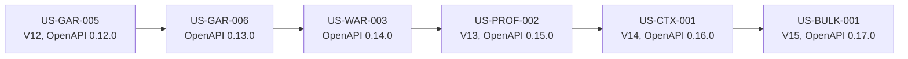

# Sprint 4 — Shared Architecture and Cross-Story Conventions

| Field | Value |
| --- | --- |
| Applies to | [US-GAR-005](US-GAR-005-guide.md), [US-GAR-006](US-GAR-006-guide.md), [US-WAR-003](US-WAR-003-guide.md), [US-PROF-002](US-PROF-002-guide.md), [US-CTX-001](US-CTX-001-guide.md), [US-BULK-001](US-BULK-001-guide.md) |
| Repository baseline | `sprint_04` at `33c579c` |
| Decisions | S4-INT-01, S4-INT-02, S4-INT-03 (approved by the Product Owner on 2026-11-16) and OPEN-S4-31–33 (delegated defaults, [record](open-questions.md)) |
| Verification status | **Proposed design, not implemented in the repository.** The six guides that realize it compiled and passed `clean verify` in an isolated scratch copy on 2026-11-16 ([README §11](README.md#11-status)). |

## 1. Purpose

The six guides change several of the same files. This document fixes the conventions, order and numbering that keep the six change sets cumulative and conflict-free. Read it before starting any guide, and again before each guide's shared-file steps.

## 2. Verified repository baseline

These facts were inspected in the repository at `33c579c`. They are not assumptions.

| Area | Fact | Consequence for Sprint 4 |
| --- | --- | --- |
| Stack | Java 21, Spring Boot 4.1.1, Spring Security 7, `JdbcClient`, Flyway, PostgreSQL 17.11 (Testcontainers `postgres:17.11-bookworm`), Jackson 3 (`tools.jackson`), AWS SDK v2 2.46.13, S3Mock 5.1.0, ArchUnit | No new framework or ORM |
| Modules | `identity`, `wardrobe`, `personalcontext` implemented; `outfitadviceanduse`, `wardrobeintelligence`, `productmeasurement` are package declarations only | No consumer exists for removal, optional context or environment facts |
| Schemas | `identity`, `wardrobe`, `personal_context`; V1–V11 applied | Next free version: **V12** |
| Wardrobe tables | `wardrobe_garment` (with `revision`, `removed_at`), `wardrobe_garment_material`, `wardrobe_garment_style`, `wardrobe_photo_upload` | `removed_at` exists, but no removal operation does |
| Photo states | RECEIVING → READY → ATTACHED, or DISCARDED. Constraint `(status = 'ATTACHED') = (garment_id IS NOT NULL AND attached_at IS NOT NULL)`, `UNIQUE (garment_id)` | An ATTACHED row cannot become DISCARDED while it keeps its garment link |
| Personal Context tables | `personal_context_preferences`, `_preferred_style`, `_common_need` | Optional context and location get their own tables |
| HTTP | `/api/v1/wardrobe/garments` (POST, GET), `/{id}` (GET, PATCH), `/{id}/photo` (GET); `/api/v1/wardrobe/photo-uploads/**`; `/api/v1/personal-context/preferences` (GET, PATCH) | Sprint 4 adds routes under the same base paths |
| CORS | Methods GET, POST, PATCH, DELETE; headers `Authorization`, `Content-Type`, `Accept`, `Idempotency-Key` | **No CORS change is needed**: every new command is POST or PATCH, and only `Idempotency-Key` is reused |
| Contract test | `IdentityOpenApiContractIT` checks every `/api/**` handler:<br>• documented operations match served operations;<br>• security is protected;<br>• request properties equal the record components;<br>• every response property is required;<br>• each documented required field yields `400 VALIDATION_FAILED` with `REQUIRED` | Every new endpoint needs exact OpenAPI schemas. Requests must validate presence **before** any lookup, because the test calls with random path ids. |
| Architecture tests | Domain, application and `api` packages are framework-free (no Spring, `java.sql`, `java.net.http` or Jackson). JDBC only in `adapter.out` and `configuration`. Adapters `in` and `out` independent. Cross-module access only through `api`. | The weather HTTP client lives in `personalcontext.adapter.out.weather` |
| SQL scanner | `SqlOwnershipRules` flags any **unqualified** known table name in **any** Java string literal, and any migration touching more than one owner schema | Never write a table name without its schema, even in a comment-like string or message |
| OpenAPI | Version 0.11.0 | Sprint 4: 0.12.0 → 0.17.0 |
| CI | `pull_request.branches: [main, sprint_02, sprint_03]`; 95 required report entries; libheif installed | GAR-005 adds `sprint_04`; each guide appends its reports |
| Test fakes | `InMemoryGarmentRepository implements GarmentRepository`; two `WardrobeTransactions` fakes (`ImmediateWardrobeTransactions`, `AddGarmentServiceTest.FailingCommit`) | New persistence needs go to **new ports**. A new `WardrobeTransactions` method must be a `default` method. |

## 3. Cumulative delivery order and shared files

**Order (OPEN-S4-31):** GAR-005 → GAR-006 → WAR-003 → PROF-002 → CTX-001 → BULK-001.

Every BEFORE anchor in a guide is the file **as left by the previous guide**. A guide applied out of order must rebase its anchors and renumber its migration.

| Shared file | GAR-005 | GAR-006 | WAR-003 | PROF-002 | CTX-001 | BULK-001 |
| --- | --- | --- | --- | --- | --- | --- |
| `wardrobe/domain/Garment.java` | P2 `withRemovalAt` | P1 `withAttachedPhoto` | — | — | — | — |
| `wardrobe/application/AddGarmentService.java` | P11 replay of a removed garment gives `410` | — | — | — | — | P8 delegates to `GarmentAcceptance` (whole file) |
| `wardrobe/application/ports/WardrobeTransactions.java` | — | — | P7 `default inReadOnlySnapshot` | — | — | — |
| `wardrobe/adapter/out/persistence/SpringWardrobeTransactions.java` | — | — | P8 | — | — | — |
| `wardrobe/adapter/in/web/WardrobeGarmentController.java` | P15 (removal) | P9 (attachment) | P16 (search) | — | — | — |
| `wardrobe/adapter/in/web/WardrobeApiExceptionHandler.java` | P16 (neutral texts) | P10 | P17 | — | — | P30 |
| `wardrobe/adapter/in/web/WardrobeCursor.java` | — | — | P13 | — | — | — |
| `wardrobe/adapter/in/web/WardrobeResponse.java` | — | — | P15 | — | — | — |
| `wardrobe/configuration/WardrobeConfiguration.java` | — | — | P18 | — | — | — |
| `wardrobe/configuration/WardrobePhotoConfiguration.java` | — | P11 | — | — | — | — |
| `personalcontext/adapter/in/web/PersonalContextApiExceptionHandler.java` | — | — | — | P18 | P28 | — |
| `personalcontext/configuration/PersonalContextConfiguration.java` | — | — | — | P19 | — | — |
| `src/main/resources/application.properties` | P21 | — | — | — | P31 | P33 |
| `docs/05-api/openapi.yaml` | P22 → 0.12.0 | P12 → 0.13.0 | P19 → 0.14.0 | P21 → 0.15.0 | P32 → 0.16.0 | P34 → 0.17.0 |
| `.github/workflows/backend-ci.yml` | P23 (+`sprint_04`) | P13 | P20 | P22 | P33 | P35 |
| `src/test/resources/application-test.properties` | T5 | — | — | — | T7 | — |
| `wardrobe/support/WardrobeIntegrationTestSupport.java` | T6 | — | — | — | — | T4 |
| `wardrobe/adapter/out/persistence/GarmentSchemaIT.java` | T7 | — | — | — | — | T5 |
| `personalcontext/support/PersonalContextIntegrationTestSupport.java` | — | — | — | T5 | T8 | — |
| `identity/support/IdentityTestConfiguration.java` | — | — | — | — | T6 | — |
| `personalcontext/adapter/out/persistence/PreferencesSchemaIT.java` | — | — | — | T9 | T14 | — |

Paths are relative to `backend/src/main/java/com/capsuleai/` or `backend/src/test/java/com/capsuleai/` unless they start with `docs/`, `.github/` or `src/`.



The arrows are file order for this package, not product dependencies. WAR-003, PROF-002 and CTX-001 are functionally independent of the media stories (plan §7). They follow this order only so that their anchors on shared files are exact.

## 4. New packages and classes by module

New code stays inside the owning module and follows the existing `domain` / `application` / `application.ports` / `adapter.in.web` / `adapter.out.*` / `configuration` layout.

| Module | Package | New in Sprint 4 |
| --- | --- | --- |
| Wardrobe | `domain` | `RemovedGarment`; `BulkImportBatch`, `BulkImportItem` and their status enums |
| Wardrobe | `application` | `RemoveGarmentService`, `GarmentRemovalCleanupService`, `AttachGarmentPhotoService`, `SearchWardrobeService`, `DescriptorMatcher`, `GarmentAcceptance`, `BulkImportService`, `AcceptBulkImportItemService`, plus commands, outcomes and exceptions |
| Wardrobe | `application.ports` | `GarmentRemovalRepository`, `GarmentPhotoAttachmentRepository`, `WardrobeSearchRepository`, `BulkImportRepository` |
| Wardrobe | `adapter.out.persistence` | `JdbcGarmentRemovalRepository`, `JdbcGarmentPhotoAttachmentRepository`, `SearchStatementCatalogue`, `JdbcWardrobeSearchRepository`, `JdbcBulkImportRepository` |
| Wardrobe | `adapter.in.web` | removal, attachment, search and bulk request/response records; `WardrobeBulkImportController` |
| Wardrobe | `adapter.in.scheduling` | `GarmentRemovalCleanupJob` |
| Personal Context | `domain` | `GenderContext`, `BodyShape`, `OptionalContext`, `OptionalContextProfile`, `LocationSource`, `LocationSelection`, `LocationProfile`, `WeatherCondition`, `WeatherReading`, `WeatherFreshness`, `EnvironmentUnavailableReason` |
| Personal Context | `application` (+ `ports`) | optional-context and location services, `EnvironmentalContextService`, `WeatherProvider` port |
| Personal Context | `adapter.out.weather` | `OpenMeteoWeatherProvider`, `OpenMeteoResponseTranslator` |
| Personal Context | `adapter.in.web` | `PersonalContextOptionalContextController`, `PersonalContextLocationController` and their records |

**Why new ports instead of new `GarmentRepository` methods.** `GarmentRepository` has an in-memory fake used by about ten unit tests. Each new port is cohesive (removal lifecycle, attachment, search, bulk), and its JDBC implementation reuses the package-private `JdbcGarmentRepository.SELECT_GARMENT` and `mapGarment`. That way no existing fake changes and no SQL is duplicated. All the ports are owned by Wardrobe and touch only the `wardrobe` schema (AR-01–04).

**Controllers.** There is one controller per cohesive base path:

- removal, attachment and search extend `WardrobeGarmentController` (`/api/v1/wardrobe/garments`);
- bulk import gets `WardrobeBulkImportController` (`/api/v1/wardrobe/bulk-imports`);
- optional context gets `PersonalContextOptionalContextController` (`/api/v1/personal-context/optional-context`);
- location gets `PersonalContextLocationController` (`/api/v1/personal-context/location`).

## 5. Lock order and transaction authority

**S4-INT-01 (approved):** batch/item coordination locks come first, then the existing garment, then the photo.

The canonical order across every Sprint 4 transaction is:

```
wardrobe_bulk_import_batch  →  wardrobe_bulk_import_item  →  wardrobe_garment (existing)
    →  wardrobe_photo_upload  →  wardrobe_garment_removal_cleanup
```


| Operation (story) | Locks, in order | Notes |
| --- | --- | --- |
| Remove garment (GAR-005) | garment: conditional `UPDATE … WHERE revision = :expected AND removed_at IS NULL` → photo: plain read of the ATTACHED row → cleanup row: `INSERT … ON CONFLICT DO NOTHING` | The garment row lock is held from the `UPDATE` to commit |
| Minimize removed garment (GAR-005 worker) | garment `UPDATE` → material/style `DELETE` → photo `DELETE` → cleanup `UPDATE` | Runs only for removed garments |
| Claim cleanup work (GAR-005 worker) | cleanup rows only (`FOR UPDATE SKIP LOCKED`) | Own short transaction; no garment lock |
| Attach photo (GAR-006) | garment row `SELECT id … FOR UPDATE`, then a fresh read of garment and photo → photo `lockOwned` (`FOR UPDATE`) → photo `attach` → garment revision `UPDATE` | Same-pair replay is detected after both locks |
| Edit garment (existing) | garment conditional `UPDATE` → child sets | Unchanged |
| Create garment with photo (existing) | photo `FOR UPDATE` → garment `INSERT` | The new garment is not addressable before commit, so this is not an inversion (S4-INT-01 rationale) |
| Pending photo expiry and cleanup (existing) | photo rows only, `SKIP LOCKED` | Never selects ATTACHED rows |
| Bulk batch start (BULK-001) | per-owner `pg_advisory_xact_lock` → batch and item `INSERT` | Serializes the active-batch count of one owner; no row lock is involved |
| Bulk item link, accept or cancel (BULK-001) | batch `FOR SHARE` → item `FOR UPDATE` → photo (`lockOwned` or `cancel`) → garment `INSERT` | Several item commands can run at once |
| Bulk stop (BULK-001) | batch `FOR UPDATE` → items `FOR UPDATE` → photos (`cancel`) | Waits for in-flight item commands; later ones see `STOPPED` |
| Publish weather evidence (CTX-001) | location `SELECT … FOR SHARE` → evidence upsert | Personal Context schema; independent of Wardrobe |
| Change or clear location (CTX-001) | location conditional `UPDATE` → evidence `DELETE` | Weather is acquired **after** commit |

**Rules.**

- Never acquire an earlier lock while holding a later one.
- Never call storage or a provider inside a transaction.
- Keep transactions short: no decoding, upload, sleep or network call inside one.
- A revision predicate protects the user's reviewed intent, and a row lock serializes the actual effect. Every mutating operation on an existing garment uses both.

## 6. Logical-action identity and recovery (S4-INT-02)

| Operation | Identity that proves the outcome | Same-action retry returns | Changed request under the same identity |
| --- | --- | --- | --- |
| Garment creation (existing) | `(owner, creation_key)` + fingerprint | `200` with the current garment; **`410` if it was removed since** (OPEN-S4-03) | `422 IDEMPOTENCY_KEY_REUSED` |
| Removal (GAR-005) | Monotonic `removed_at` on the owner's garment | `200 ALREADY_REMOVED` with the original `removedAt` | — (removal has no payload beyond the revision) |
| Attachment (GAR-006) | The pair: photo row ATTACHED with `garment_id = target` | `200` with the current garment, no new revision | A different photo on a photographed garment gives `409 GARMENT_ALREADY_HAS_PHOTO` |
| Search (WAR-003) | Read-only | Same page for the same cursor while membership is unchanged | A changed condition with an old cursor gives `400 CONDITIONS_CHANGED` |
| Optional context and location (PROF-002, CTX-001) | Absolute values + revision | Reread. A stale revision gives `409`; the client reviews and resubmits. | — |
| Bulk batch creation (BULK-001) | `(owner, creation_key)` + fingerprint of `itemCount` | `200` with the same batch | `422 IDEMPOTENCY_KEY_REUSED` |
| Bulk item acceptance (BULK-001) | Item `ACCEPTED` + its acceptance key used as the garment creation key | `200` with the item already accepted, even after its garment was removed (`garmentCurrent: false`) | `409 BULK_IMPORT_CLOSED` (the item's outcome is final) |
| Bulk photo link and item cancellation (BULK-001) | The item already links that photo, or is `CANCELED` | `200` with the batch, nothing changed | A stale revision gives `409 REVISION_CONFLICT` |
| Bulk stop (BULK-001) | Batch `STOPPED` | `200` with the batch as stopped | — |

**A `503 TEMPORARILY_UNAVAILABLE` never proves that nothing happened.** Clients review the current state before retrying. They retry with the **same** identity and never generate a new key after a lost response.

## 7. Error vocabulary

Existing codes keep their meaning. These are added (OPEN-S4-32):

| Code | HTTP | Raised when | Story |
| --- | --- | --- | --- |
| `GARMENT_ALREADY_HAS_PHOTO` | 409 | Attaching to a garment that already has a different photo | GAR-006 |
| field code `CONDITIONS_CHANGED` (field `cursor`) | 400 | A cursor issued for other search conditions | WAR-003 |
| field codes on `q`, `category`, `color` | 400 | Invalid search input (`OUT_OF_RANGE`, `INVALID_FORMAT`, `UNSUPPORTED_VALUE`) | WAR-003 |
| `BULK_IMPORT_NOT_FOUND` | 404 | Unknown batch or item, or another owner's | BULK-001 |
| `BULK_IMPORT_CLOSED` | 409 | Batch stopped or expired, or the item's outcome is final (cancelled, or accepted with other values) | BULK-001 |
| `BULK_IMPORT_LIMIT_REACHED` | 409 | Too many active batches | BULK-001 |
| `BULK_IMPORT_ITEM_NOT_READY` | 409 | Item has no linked photo yet (an expired linked photo is `PHOTO_UPLOAD_NOT_USABLE`) | BULK-001 |

GAR-005 P16 makes two shared texts operation-neutral:

- `REVISION_CONFLICT` now says "your change" instead of "your edit";
- `TEMPORARILY_UNAVAILABLE` now also covers a removal or attachment retried with the same request.

BULK-001 P30 makes `IDEMPOTENCY_KEY_REUSED` neutral ("used with different values"), because a batch start also carries an `Idempotency-Key`. A stale item revision reuses `REVISION_CONFLICT` with item wording.

No test asserts the Wardrobe detail text. The Identity outage test asserts only Identity's own handler.

## 8. Transport conventions (S4-INT-03)

- Confirmed maintenance commands are `POST` subresources with a JSON body: `/removal`, `/photo-attachment`, `/acceptance`, `/cancellation`, `/stop`. A garment PATCH never gains `removedAt` or a media field.
- A revision is an opaque decimal string, sent back as `expectedRevision` in the body. A stale revision gives `409 REVISION_CONFLICT`.
- Presence-aware PATCH (PROF-002, CTX-001) is decoded through raw `JsonNode` components: omitted keeps the value, `null` clears it, a value replaces it.
- `confirmed: true` is required wherever the user's deliberate confirmation is the acceptance boundary: removal, attachment, bulk acceptance and bulk stop.
- The owner always comes from `@AuthenticationPrincipal AuthenticatedAccount`. No request carries an owner id.
- Path ids are read as `String`. A malformed id behaves like an unknown one (non-disclosing `404`).

## 9. Migrations

| Version | Story | Owner schema | Content |
| --- | --- | --- | --- |
| V12 | GAR-005 | `wardrobe` | `wardrobe_garment.minimized_at` + minimized-shape CHECK; table `wardrobe_garment_removal_cleanup` |
| V13 | PROF-002 | `personal_context` | table `personal_context_optional_context` |
| V14 | CTX-001 | `personal_context` | tables `personal_context_location`, `personal_context_weather_evidence` |
| V15 | BULK-001 | `wardrobe` | tables `wardrobe_bulk_import_batch`, `wardrobe_bulk_import_item` |

Each migration:

- touches exactly one owner schema, checked by `PersistenceOwnershipSqlTest`;
- has no cross-schema foreign key, view or routine (`DatabaseSchemaOwnershipIT`);
- is forward-only;
- leaves V1–V11 checksums unchanged;
- comes with an upgrade test from the previous version using `IsolatedMigrationDatabase`.

## 10. OpenAPI evolution

The contract stays one file, and each guide bumps the minor version. Every new response record is documented with all of its fields `required` (nullable where empty). Every new request record documents its required fields, and its first example contains them all. New nested records (for example bulk items and weather) are separate component schemas.

## 11. Background work

| Job | Story | Selects | Interval | Test profile |
| --- | --- | --- | --- | --- |
| `PhotoUploadCleanupJob` (existing) | GAR-003 | RECEIVING/READY expiry; DISCARDED object deletion | `PT5M` | disabled |
| `GarmentRemovalCleanupJob` (new) | GAR-005 | Removal cleanup rows due | `PT5M` | disabled (`capsuleai.wardrobe.removal-cleanup.enabled=false`) |

There is no weather polling job (S4-CTX-04) and no bulk worker (S4-BULK-03). Tests call `GarmentRemovalCleanupService.run()` directly.

## 12. Configuration

All new values are typed `@ConfigurationProperties` records, validated at startup (OPEN-S4-33):

- `capsuleai.wardrobe.removal-cleanup.*` (GAR-005 P18–P21);
- `capsuleai.personal-context.weather.*` (CTX-001 P29–P31);
- `capsuleai.wardrobe.bulk-import.*` (BULK-001 P31–P33).

No secret is added: Open-Meteo is called without a key. Never commit credentials. Existing environment-variable placeholders stay unchanged.

## 13. Testing and CI

- Tests are written alongside each production step (§13 of each guide):
  - unit tests for domain and application;
  - real PostgreSQL integration tests through `WardrobeIntegrationTestSupport` and `PersonalContextIntegrationTestSupport` (Testcontainers);
  - HTTP tests through the real filter chain;
  - barrier-based concurrency tests.
- Weather integration tests use a `@Primary` test double, and the adapter is exercised against a local `com.sun.net.httpserver.HttpServer`. No test calls the public internet.
- **CI:**
  - GAR-005 P23 adds `sprint_04` to `pull_request.branches`;
  - each guide's CI step appends exactly its new report entries, with each class's `@Test` count as the minimum;
  - existing entries and counts are never lowered.
- Commands (from `backend/`):
  - `.\mvnw.cmd -q -Dtest=<UnitTest> test` for one unit class;
  - `.\mvnw.cmd "-Dtest=HarnessSmokeTest" "-Dit.test=<IT>[,<IT>…]" verify` for integration classes (the Sprint 3 convention: the smoke test satisfies Surefire, which otherwise fails when no unit test is selected);
  - `.\mvnw.cmd clean verify` for everything.

  Docker must be running for integration tests.

**No repository test result is claimed by this package.** Every count in a CI step is the number of `@Test` methods written in the guide. The only run so far is the scratch run described in [README §11](README.md#11-status); the repository's own run and CI must confirm it.

## 14. SQL conventions (reminders that the scanner enforces)

- Write each statement complete, in one text block or literal, or as a compile-time concatenation of constant text blocks (the existing `SELECT_GARMENT + """ … """` pattern). Never build SQL from request data.
- Always schema-qualify: `wardrobe.wardrobe_garment`, `personal_context.personal_context_location`.
- **Never** write a known table name unqualified in any Java string, including messages and comments-in-strings.
- Lower-case identifiers; no double quotes.
- Bind every value. Code sets in WAR-003 are bound as one comma-joined text and expanded with `string_to_array(CAST(:x AS text), ',')`; codes never contain commas.
- Do not lock through a `LEFT JOIN` query. PostgreSQL rejects locking the nullable side of an outer join. Even `FOR UPDATE OF g` is unsafe here: after waiting, READ COMMITTED re-checks only the locked row, while joined rows keep the old snapshot. Lock the row with a single-table statement, then read the joined data in a new statement.

## 15. Privacy and logging

Never log any of these:

- garment values;
- photo object keys combined with user identifiers;
- optional gender/body values;
- coordinates, location labels or provider URLs with query strings;
- tokens.

Jobs log counts only. Problem Details never echo submitted values.

Removal minimization deletes rich data within the 30-day obligation. Physical photo deletion depends on the storage boundary in [OPEN-S4-05](open-questions.md#open-s4-05--storage-versioning-and-physical-deletion-boundary).

## 16. Naming

New code uses descriptive names:

- `garmentRepository`, `garmentRemovalRepository`, `photoUploadRepository`;
- `wardrobeTransactions`, `personalContextTransactions`;
- `optionalContextRepository`, `locationRepository`, `weatherProvider`, `bulkImportRepository`.

Abbreviated names such as `repo`, `tx`, `g`, `p` or `res` are not used for variables or fields. Single-letter SQL table aliases (`g`, `p`, `m`, `s`) are kept only where the existing statements already use them, because the guides reuse `SELECT_GARMENT`.

Existing classes keep their current field names when a guide only patches a method, so that BEFORE anchors stay exact. Where a guide replaces a whole existing class (BULK-001 P8 `AddGarmentService`), it renames the fields to the descriptive form.

## 17. External and operational obligations (not satisfied by this package)

| Obligation | Story | Owner | Status |
| --- | --- | --- | --- |
| Photo bucket: versioning never enabled, no object lock, no replication, backup retention ≤ 30 days | GAR-005 | Operations | **Unverified** |
| Removal cleanup job running in the deployment; overdue warnings monitored | GAR-005 | Operations | Unverified |
| Open-Meteo terms of use, attribution and eligibility for the actual deployment | CTX-001 | PO + operations | **Unverified** |
| One real authorized Open-Meteo request; measured 2-second behavior in the agreed environment | CTX-001 | Developers + QA | Unverified |
| Inclusive-representation review of the optional gender/body values | PROF-002 | PO + privacy reviewer | Advised |
| Formal US-GAR-006 story and PBI mapping | GAR-006 | PO + BA | Outstanding |
| Mobile evidence for all six stories, in Vietnamese, with accessibility | All | Mobile + QA | Outstanding |
| Real consumers for removal, optional context and environment (advice, Coverage, Multiplier, history) | GAR-005, PROF-002, CTX-001 | Future stories | Absent |
