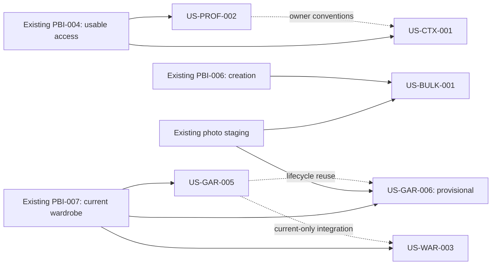
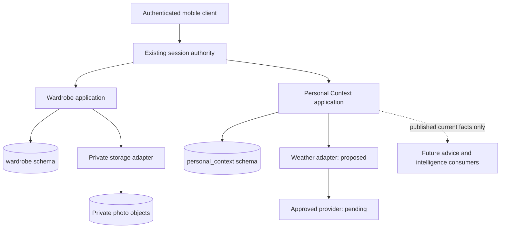
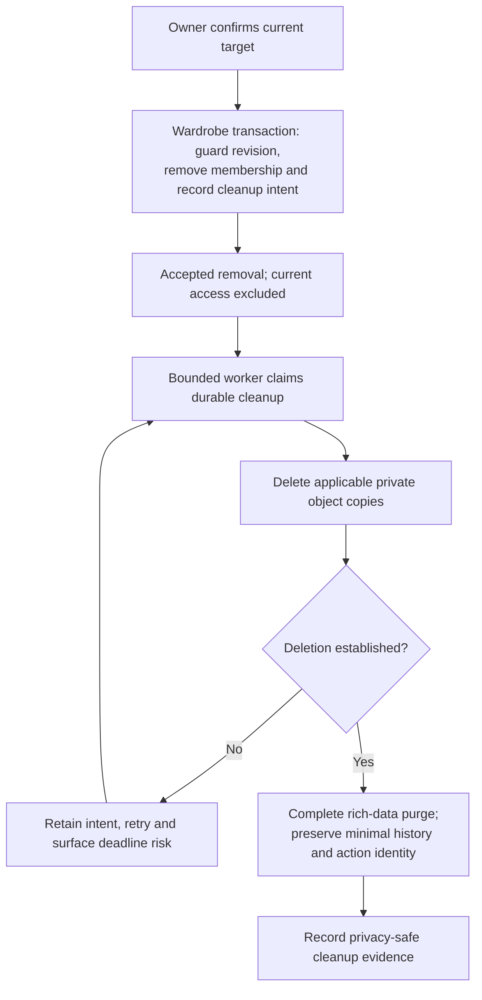

# CapsuleAI — Sprint 4 Backend Sprint Planning

## 1. Sprint Overview

| Field | Value |
| --- | --- |
| Artifact / version | Sprint 4 Backend Sprint Plan / 0.1 |
| Status | Planning draft. Six stories selected by the Product Owner; new solutions remain proposed. No implementation or approval is claimed. |
| Repository baseline | `sprint_04`, commit `33c579c` (`Merge pull request #5 from luubinhdeptrai/sprint_03`); working tree clean before this document was created |
| Scope authority | Product Owner's explicit six-story Sprint 4 selection; this does not approve detailed policies, contracts or the provisional attachment story |
| Structural reference | [Sprint 3 plan](../sprint-03/sprint-plan.md), especially Section 9; its current approvals and later detailed choices take precedence over historical pending wording |
| Revision | Initial source-grounded plan following repository-wide inspection; no changes to upstream artifacts |
| Accountability | Product Owner: product policy and provisional-story approval. Backend Tech Lead: technical direction and boundary compliance. Developers: JIT design, implementation and evidence. QA: independent coverage and recovery evidence. Mobile contributor: integrated client acceptance. |
| Planning convention | Functional cohesion, dependency reuse and learning progression determine the recommended sequence. No delivery estimates or calendar commitment are introduced. |
| Change boundary | This document only. Implementation, tests, migrations, OpenAPI, configuration, stories, guides, backlog ordering and architecture records are unchanged. |

**Status vocabulary.** *Implemented* means current source contains behavior; it does not imply a successful current build, deployed integration or complete story acceptance. *Source test coverage* means inspectable tests exist, not that they were executed for this plan. *Approved* applies only to an explicit existing authority. All 30 new Section 9 recommendations are **PROPOSED — PENDING PO APPROVAL**. Planned evidence is not a result.

The five existing selected story files remain Draft in the repository. Their selection is now explicit, while policy/refinement and completion gaps remain visible. US-GAR-006 has no formal source story or parent PBI and is **PROPOSED — PENDING FORMAL STORY REFINEMENT AND APPROVAL**. This plan does not silently promote any source artifact to Ready or Done.

## 2. Sprint Goal

**Enable owners to maintain a trustworthy, findable wardrobe and control their personal and environmental context, using the existing private-photo and confirmed-garment foundations, with safe removal, attachment and bulk-entry recovery.**

Removal and search make current ownership useful and accurate; attachment and manually reviewed bulk entry reduce repeated data-entry effort. Optional personal context and real, bounded weather acquisition establish user-controlled context without requiring an outfit engine. Together these extend the existing Wardrobe and Personal Context capabilities toward the [Product Goal](../../product-goal.md), while protecting accepted state and user authority.

The intended increment is CRUD-centered, but environmental context includes a real external dependency and bulk import includes recoverable multi-item coordination. Neither can be called complete through CRUD endpoints alone. No AI extraction, outfit generation, Coverage, Multiplier, Wear or analytics engine is selected to fill an evidence gap.

## 3. Current Repository and Backend Baseline

### 3.1 Inspection coverage and limitations

Inspection preceded drafting. The inventory covered all **563 tracked text files** (7,878,281 bytes), including all 137 Markdown files, 26 PlantUML files, 376 Java production/test sources, 11 migrations, OpenAPI, build/Wrapper files, configuration, Compose and CI. Complete tracked-file contents were read into the inspection inventory; documentation relationships, application behavior, SQL, tests and configuration were then checked across that inventory. This included initial authority/research documents, all current requirements and architecture documents, all story domains, refinement/delivery records, all three previous Sprint plans and every existing implementation guide.

No substantive tracked file was inaccessible. Git internals, generated outputs, dependency caches, credentials and secret contents were excluded. The inventory records the source baseline, not production infrastructure state. No Maven build, backend test suite, Docker deployment, remote CI run, cloud-storage check or live weather integration was executed for this documentation-only task. External documentation informs the alternatives; it does not prove deployed behavior.

### 3.2 Source precedence

| Authority / evidence | Use in this plan |
| --- | --- |
| [Workflow](../../../../Initial%20files/CapsuleAI_Scrum_Development_Workflow.md), [delivery decisions](../../delivery-decisions.md), [DoD](../../definition-of-done.md) | Scrum/JIT sequence, accountability and completion obligations; selection precedes story-specific detailed design |
| [BRD](../../../01-business/BRD.md), [PRD](../../../02-product/PRD.md), [SRS](../../../03-requirements/SRS.md), [Business Rules](../../../03-requirements/business-rules.md) | Approved intended product behavior, privacy, consistency and retention; historical proposals do not override later decisions |
| [Selected architecture decisions](../../../04-architecture/selected-architecture-decisions.md), [decision analysis](../../../04-architecture/architecture-decision-analysis.md), [ADD](../../../04-architecture/ADD.md) and four views | Binding system boundaries and trade-off history, including ADA-001–018 and AR-01–08 |
| [Backlog](../../product-backlog.md), [stories](../../stories/README.md), [refinement review](../../backlog-refinement-review.md) | Stable PBI/story/AC identifiers and known policy gaps; selected Sprint order does not alter global Order fields |
| Previous Sprint plans and guides, especially [Sprint 3 detailed approvals](../sprint-03/implementation-guides/open-questions.md) | Explicit previously approved implementation policies, read with later approvals rather than earlier provisional wording |
| Current Java, SQL, OpenAPI and test sources | What is implemented and what checks exist; source is not proof of a passing execution or satisfaction of client AC |
| Research/proposal/reference documents | Product evolution and documentation context; not authority to reintroduce superseded hard gender gates or older garment/property models |

System-wide architecture already exists. Test Strategy and Engineering Baseline also exist. This plan does not restart those activities or require standalone ADRs. Story-specific API, data, sequence or state design occurs Just-In-Time during execution only where complexity warrants it.

### 3.3 Actual technology and module inventory

[pom.xml](../../../../backend/pom.xml), [Compose](../../../../compose.yaml) and current source establish Java 21, Spring Boot 4.1.1, servlet MVC/Security, Spring JDBC, PostgreSQL, Flyway and Maven Wrapper. Local/test PostgreSQL is 17.11. The photo implementation uses the AWS SDK Java v2 BOM 2.46.13; local integration uses S3Mock 5.1.0. These are inspected pins, not upgrade recommendations. There is no ORM, dedicated cache, broker or additional deployed microservice in this baseline.

| Business owner | Actual source and persistence | Relevant Sprint 4 reuse / gap |
| --- | --- | --- |
| Identity | Implemented account registration/login, persistent session authority, access-token verification, refresh rotation/reuse handling, logout and email password recovery; `identity` schema | Reuse `AuthenticatedAccount` and usable-session checks. No new identity/profile authority or account-deletion workflow. |
| Wardrobe | Implemented 13-property confirmed creation, owner-scoped cursor browse/detail, versioned partial editing, photo staging/normalization, photo-backed new creation and private media delivery; `wardrobe` schema | No removal command, descriptor/filter search, existing-garment attachment or bulk coordination yet. |
| Personal Context | Implemented declared style/common-needs GET/PATCH, guarded first declaration, revisions and narrow published `CurrentPersonalContext`; `personal_context` schema | No persisted body/gender, selected location, weather evidence or provider adapter. |
| Outfit Advice and Use | Package boundary declaration only | No outfit, ranking, Wear or result-invalidation implementation to reuse or claim verified. |
| Wardrobe Intelligence | Package boundary declaration only | No Coverage/Multiplier computation or historical assessment store. |
| Product Measurement | Package boundary declaration only | No measurement intake/producer. Existing optional-measurement noninterference rule still applies without selecting implementation. |

A separate private Python analysis runtime is an approved architecture boundary, not an implemented garment-analysis service in the inspected backend.

### 3.4 Existing HTTP surface and durable state

| Surface | Implemented behavior |
| --- | --- |
| `/api/v1/auth/*` | Registration, login, logout, refresh, password-reset request/check/completion |
| `/api/v1/wardrobe/garments` | POST confirmed new creation; GET current wardrobe cursor page |
| `/api/v1/wardrobe/garments/{garmentId}` | GET owned detail; PATCH confirmed profile revision |
| `/api/v1/wardrobe/garments/{garmentId}/photo` | Authenticated application-streamed private bytes; garment ownership/current-state check precedes delivery |
| `/api/v1/wardrobe/photo-uploads` and item routes | Multipart staging, owner-scoped status, cancellation and READY-content review |
| `/api/v1/personal-context/preferences` | GET current/unset styles and common needs; presence-aware PATCH with explicit revision semantics |

The [current OpenAPI](../../../05-api/openapi.yaml) contains these surfaces; there are **no Sprint 4 endpoints**. Coherent resource controllers already exist; a controller per story would break the established convention. Problem Details carry stable codes, and private reads distinguish unavailable authority, absence and failure without fabricating an empty result.

V1–V7 establish the foundation and Identity, including schema separation and recovery. V8 adds Wardrobe profiles and child sets; V9 adds garment revisions; V10 adds photo-upload state; V11 adds Personal Context preferences. [Existing migrations](../../../../backend/src/main/resources/db/migration/) are immutable. Sprint 4 needs only justified forward, owner-specific evolution; no new migration number or physical schema is reserved here.

### 3.5 Reusable behavior and source-test evidence

| Area | Current behavior to preserve | Source evidence / limit |
| --- | --- | --- |
| Garment edits | Opaque string revision; request-body `expectedRevision`; owner/current guarded update; real changes increment revision, no-op writes nothing; omitted fields preserved, explicit optional clearing validated against the complete resulting profile | `ReviseGarmentService`, `JdbcGarmentRepository`; [concurrent revision tests](../../../../backend/src/test/java/com/capsuleai/wardrobe/application/ConcurrentGarmentRevisionIT.java) and request/schema tests exist. |
| Creation/retry | Owner-scoped creation key with fingerprint of the original accepted input and optional staged-photo identity; same-action replay does not create a second garment, changed payload is rejected; replay returns current accepted state | Existing creation identity must survive edits/removal sufficiently to prevent accidental resurrection. Current replay is not an immutable original-response ledger. |
| Photo staging | Genuine JPEG/PNG/HEIC/HEIF decoding; approved validation; metadata-free, orientation-correct normalized JPEG retained; original discarded; durable RECEIVING → READY → ATTACHED or DISCARDED | [Photo tests](../../../../backend/src/test/java/com/capsuleai/wardrobe/adapter/in/web/PhotoUploadApiIT.java), [confirmation concurrency](../../../../backend/src/test/java/com/capsuleai/wardrobe/application/ConcurrentPhotoConfirmationIT.java), [S3 adapter tests](../../../../backend/src/test/java/com/capsuleai/wardrobe/adapter/out/storage/S3PhotoStorageIT.java) exist. Real deployment/provider evidence remains distinct. |
| Media acceptance/cleanup | Photo-backed creation locks its owned pending record and atomically creates the garment, associates the photo and consumes READY state in one owner transaction; object calls occur outside it. Leased cleanup retries discarded/expired pending objects. | ATTACHED media never expires under the pending TTL and is not selected by that cleanup. There is no attached-media purge or removed-rich-profile purge yet. |
| Personal Context | Separate garment/profile style vocabularies; optional common needs distinguish absent from explicit zero; first write/no-op/concurrent update rules; `CurrentPersonalContext` currently publishes styles/common needs only | [Preferences API](../../../../backend/src/test/java/com/capsuleai/personalcontext/adapter/in/web/PreferencesApiIT.java), [concurrency](../../../../backend/src/test/java/com/capsuleai/personalcontext/application/ConcurrentPreferencesIT.java), [published contract](../../../../backend/src/test/java/com/capsuleai/personalcontext/application/CurrentPersonalContextIT.java) tests exist. No future advice consumer is implemented. |
| Foundation | Transaction ports, real PostgreSQL Testcontainers, protected errors, private storage port, native HEIF fixtures, SQL ownership and compiled architecture rules, all-handler OpenAPI contract checking | Reuse [test strategy](../../../07-testing/test-strategy.md), [engineering guide](../../../engineering/engineering-baseline-setup-guide.md) and [backend conventions](../../../engineering/backend-conventions.md); tests are not newly executed evidence. |

The backend CI workflow runs Wrapper verification and explicitly checks required integration reports. It currently triggers PRs targeting `main`, `sprint_02` or `sprint_03`, not `sprint_04`. A PR to `main` is already covered. If the delivery target is `sprint_04`, implementation must synchronize the trigger; this plan neither modifies CI nor claims it ran.

### 3.6 Discrepancies and constraints discovered

| Observation | Controlling truth / Sprint 4 consequence |
| --- | --- |
| Backend README still describes editing/images as future work and other owners as empty; conventions' persistence-status table also lags Wardrobe/Personal Context | Current code, V8–V11 and contracts prove those foundations exist. Keep binding conventions but do not duplicate implemented capabilities. Synchronize affected navigation during implementation, outside this task. |
| Historical Sprint 3 text left TTL/technical details pending; its current plan and later OPEN-S3-01–16 explicitly record approval | Reuse approved choices, including **24-hour (`PT24H`) pending-photo TTL**, rather than reopen or mislabel them. Approval does not prove deployment verification. |
| `Garment.removedAt` and removed-detail handling exist without a removal operation | A lifecycle hook is not delivered US-GAR-005. No retention worker or complete minimal history exists yet. |
| V10 permits ATTACHED linkage only in ATTACHED state; DISCARDED has its own cleanup invariants | Changing ATTACHED to DISCARDED without a considered forward model would violate constraints. New removal cleanup must address the real schema. |
| S3 delete currently accepts a key, not a version identifier; cloud versioning/replication/backup behavior is not established | A delete response or unreadable object alone cannot prove physical deletion. Verify applicable copies/versions before claiming retention compliance. |
| WAR-003 Section 8 says no “search implementation” is introduced, while its scope/AC explicitly require search | Treat that wording as a source ambiguity, not permission to omit the selected outcome. PO/BA clarify the intended exclusion during refinement; CAT-Q01 remains open. |
| PROF-002 says no unresolved policy is identified, but does not define supported body/gender values | Existing optional/soft/privacy rules are binding; a concrete supported representation still needs confirmation without inventing a taxonomy. |
| CTX-001 and removal AC describe future advice/assessment behavior; those consumers are absent | Implement current ownership/context truth and test contracts. Identify untriggered versus unavailable consumer evidence explicitly; no engine is silently added and no whole-story acceptance is inferred. |
| GAR-006 has no matching formal story; bulk is in the unranked pool | Formal attachment refinement and bulk policy review remain outstanding. Selection does not create a PBI, change rank or settle MVP-Q08/Q09. |

## 4. Approved Business and Architecture Constraints

The following constraints are reused, not reopened as new decisions. Section 9 compares only approaches consistent with them.

| Binding area | Constraint and implementation consequence |
| --- | --- |
| Confirmed garment authority | Exactly 13 properties: Category, Subtype, Color, Material, Pattern, Style, Fit, Neckline, Sleeve Length, Length, Silhouette, Brand, Price. Category plus one Color and explicit confirmation are the saveable minimum. Upload/analysis does not establish ownership. Missing optional fields remain absent and `recommendationEligibility: NOT_EVALUATED` stays truthful. |
| Controlled values / applicability | Preserve eight categories, approved vocabularies and category-specific applicability. Material and Style are distinct-value sets; Pattern is single-valued. Do not introduce TOP/BOTTOM/FOOTWEAR completeness gates or infer properties from a photo. |
| Brand / Price | Preserve Unicode Brand meaning and approved maximum; Price is user-reported original purchase amount plus explicit ISO 4217 currency, with approved decimal/minor-unit validation. Zero is meaningful; no inferred currency, rounding or shopping-price substitution. |
| Removal and history | Immediate current-ownership exclusion; affected results refresh or become explicitly outdated. Preserve only necessary understandable historical meaning, marked Removed from wardrobe. Physically delete applicable image and nonessential removed personal data within **30 days of accepted removal**. No archive/restore or unrelated-history deletion. |
| Media input | Reuse approved formats, **15,000,000-byte** maximum and original shortest dimension of at least 512 pixels. Original validation dimensions differ from normalized derivative dimensions; do not reject a valid READY derivative by reapplying the original-size rule. |
| Approved media lifecycle | Owner-scoped private staging; unchanged **24-hour pending TTL**, cancellation/expiry recovery; metadata-free normalized JPEG, long edge at most 2048, quality 0.9, original discarded; existing HEIF primary-image/decoder policies and bounded technical processing settings remain binding. ATTACHED images are not pending uploads. |
| User control / privacy | Optional body/gender can be omitted or cleared; never inferred, never a category/access gate and only soft context subordinate to owned wardrobe, hard validity and explicit preferences. Private, purpose-limited data; no MVP personal-data AI training/improvement or unrestricted sharing. No new body measurement or account deletion/export scope. |
| Environmental evidence | Device/manual/skip choices independent of permission. A city is not weather. Age exactly **30 minutes is current**; older weather is refreshed before current use. Weather acquisition may delay an assessment by at most **2 seconds**. Unavailable weather is disclosed; remaining validity still applies. No continuous tracking or unrelated-data exchange. |
| Batch authority | Per-item review and explicit confirmation preserve all supplied applicable properties. Mixed accepted/failed/uncertain outcomes and safe same-action retry remain distinct. No upload-only ownership or AI prerequisite. Batch numerical limits and retention/resumption policy are not approved yet. |
| Identity / errors | Reuse JWT plus persistent usable-session authority and owner from the authenticated principal. Owner identifiers in requests cannot grant access. Preserve non-disclosing wrong-owner behavior, stable Problem Details, truthful failures and protected diagnostics. |
| Selected architecture | ADA-001–018: one modular monolith, PostgreSQL authority, private storage, narrow external ports, durable logical actions, no dedicated cache/broker initially, pragmatic Clean Architecture and private models. No new service merely for anticipated scale. |
| Ownership | AR-01–08: one schema per persisting owner; lower-case schema-qualified `<schema>_<name>` tables. No cross-owner SQL, foreign keys, private repository access or internal HTTP. Published local APIs translate meanings. Single application DB role means build-time enforcement, not runtime privilege isolation. |
| SQL / transactions | Complete statements in individual literals/text blocks, bound values, no fragmented production SQL assembly or owner-schema routines. Reuse owner transaction abstractions; perform slow network/object operations outside DB transactions. Deliberate local atomicity stays within owning contracts. |
| Scrum / documentation | Architecture early; detailed design JIT per selected story during execution, together with automated tests and implementation. No all-Sprint design gate or mandatory separate ADR. Update only artifacts whose delivered truth changes; documentation volume is not completion. |

## 5. Selected Sprint 4 Backlog

Exactly these six stories are selected. Source PBI links remain unchanged, including the unranked PBI-048.

| Story / exact or provisional title | Parent PBI | Business value / bounded outcome | Refinement status |
| --- | --- | --- | --- |
| [US-GAR-005 — Remove a garment while preserving minimal history](../../stories/garment/US-GAR-005-remove-current-garment-preserve-minimal-history.md) | PBI-016 | Accurate current possessions; confirmed removal, minimal history and enforceable physical cleanup | Existing Draft selected; mechanisms and evidence pending |
| [US-WAR-003 — Find owned garments through search and filters](../../stories/wardrobe/US-WAR-003-find-garments-with-search-and-filters.md) | PBI-015 | Locate owned items through approved descriptor semantics and category/color conditions | Existing Draft selected; CAT-Q01 blocks complete matching specification |
| [US-PROF-002 — Control optional body and gender context](../../stories/profile/US-PROF-002-control-optional-personal-context.md) | PBI-010 | Declare, revise, skip or clear private soft context independently of wardrobe access | Existing Draft selected; supported representation requires confirmation |
| [US-CTX-001 — Choose environmental context with safe fallback](../../stories/context/US-CTX-001-choose-location-and-recover-limited-context.md) | PBI-011 | User-controlled selection plus actual fresh weather acquisition and truthful bounded fallback | Existing Draft selected; provider/precision decisions and future-consumer evidence pending |
| **US-GAR-006 — Attach a photo to an existing garment** (provisional) | **Not assigned** | Attach one permitted staged photo to a current imageless owned garment without recreating it | **PROPOSED — PENDING FORMAL STORY REFINEMENT AND APPROVAL** |
| [US-BULK-001 — Review and confirm bulk garment import](../../stories/bulk-import/US-BULK-001-review-and-confirm-bulk-garment-import.md) | PBI-048, unranked pool | Recoverable manually reviewed multiphoto additions with truthful per-item results | Existing Draft selected; MVP-Q08 and relevant ownership refinement pending |

## 6. User Story Scope and Acceptance Overview

The following five source-AC tables preserve the existing criterion wording, including conditions and recovery obligations. They do not replace the canonical stories. Backend checks, client demonstrations and unavailable consumer behavior are distinguished below each table. Provisional attachment expectations are separately labeled and have no fabricated AC identifiers.

### 6.1 US-GAR-005 — Remove a garment while preserving minimal history

| Source AC | Exact criterion |
| --- | --- |
| AC-01 — Confirm the intended removal | Identify the selected garment and explain current-ownership removal and historical meaning. Only deliberate confirmation applies removal; cancellation preserves the accepted garment and dependent state. |
| AC-02 — Exclude immediately | On accepted removal, exclude the garment from current inventory, new current outfits, current Coverage and the Multiplier baseline. Old snapshots cannot restore eligibility. |
| AC-03 — Refresh dependent results | Refresh affected prior advice/assessments or clearly mark them outdated. Failed refresh is not a current result using removed inventory. |
| AC-04 — Keep minimal historical meaning | When past reports reference the garment, retain only necessary understandable snapshots labeled Removed from wardrobe. Do not delete unrelated Wear Events/outfits/garments merely because this garment was removed. |
| AC-05 — Delete applicable removed data | Physically delete the original removed-garment image and nonessential removed personal data within 30 days of accepted removal; necessary minimal historical meaning does not authorize indefinite original-image retention. |
| AC-06 — Resolve failure or uncertainty | Known rejected/failed removal keeps the accepted current state; uncertainty does not prove either removal or unchanged ownership. Offer outcome review and safe retry without removing another item or restoring an already removed selection. |
| AC-07 — Enforce ownership | Wrong-account/unusable-session attempts cannot disclose or remove the selected garment. A changed/already unavailable target yields current-state guidance rather than a different mutation. |

**Backend responsibility.** Add explicit owner/current-target removal with a reviewed revision precondition. Atomically remove current membership, advance the meaningful garment revision, preserve minimal historical/action identity and establish durable cleanup. Exclude the item from current browse/detail-photo access and future published current inputs immediately; cleanup failure cannot restore ownership. Current detail already refuses a removed item, so outcome review must deliberately distinguish an already removed result from an inaccessible target without exposing another owner's data.

**Client responsibility.** Identify the chosen garment, explain removal versus historical meaning, obtain confirmation, allow pre-submit cancel, refresh inventory and show truthful accepted/failed/uncertain outcomes. Review the exact same action after a lost response; do not silently select another garment or issue a new intent. Provide Vietnamese labels and accessible confirmation/recovery.

**Edges/dependencies.** Reuse implemented PBI-007 and Identity authority. Race removal against edit, attachment, repeated removal, a late creation replay and cleanup. No separate hard dependency on GAR-006 is invented. The stored normalized photo and applicable retained copies must be purged even though original uploads are already discarded. Rich removed fields cannot remain indefinitely for retry convenience.

**Evidence boundary/exclusions.** Database and HTTP tests can establish immediate exclusion, privacy, minimum historical projection and recovery; operational verification must establish the 30-day deletion obligation. No existing advice/history store is present to invalidate or render. AC-03's real consumer behavior and AC-04's report rendering therefore cannot be claimed demonstrated by an isolated contract fixture. Record whether each branch is untriggered in the delivered increment or remains outstanding; full acceptance requires PO/QA review of that applicability without altering the AC. No Wear withdrawal, restore, account deletion or unrelated report erasure is selected.

### 6.2 US-WAR-003 — Find owned garments through search and filters

| Source AC | Exact criterion |
| --- | --- |
| AC-01 — Find supported descriptors | For agreed supported searchable descriptors and their source meanings, a known matching confirmed garment can be found and known nonmatches are excluded under the agreed matching semantics. Those fields/semantics require CAT-Q01 clarification before this criterion is fully specified. |
| AC-02 — Filter category and color | Applying supported category/color conditions returns matching current confirmed garments of the authorized wardrobe; removed, other-account and hypothetical items are not substituted as results. |
| AC-03 — Show and clear conditions | Active search/filter conditions are understandable and can be changed or cleared. Clearing them restores the unfiltered current wardrobe rather than changing garment information. |
| AC-04 — Distinguish result states | A loaded wardrobe with no matches shows a change/reset path, while a genuinely empty wardrobe offers Add Garment. Loading, failed retrieval and denied access are neither no-match nor empty results. |
| AC-05 — Inspect real results | Matching imageless or incomplete entries remain identifiable, with the established garment-detail/return path and unevaluated-eligibility meaning preserved. |
| AC-06 — Recover without mutation | Failed/unavailable search offers retry or return and does not delete accepted garments. Access loss pauses private use; changing conditions or viewing results creates no garment, feedback or Wear Event. |

**Backend responsibility.** Extend current owner-scoped browsing rather than build a catalog search system. Agree searchable descriptors, Vietnamese matching and filter combinations before implementing those semantics. Preserve current-only selection, `NOT_EVALUATED`, stable existing ordering and bounded pages; support a cursor bound to effective query conditions. Distinguish no match from an empty current wardrobe and from failed authorization/retrieval.

**Client responsibility.** Show active conditions, change/reset them, restart paging on changed conditions and preserve detail/return navigation. Distinguish loading, no match, genuine empty, denied and failed states; reset changes the query only. Display imageless/minimum-profile results without an eligibility penalty.

**Edges/dependencies.** PBI-007 is implemented. Removal integration is useful sequencing, not a new hard PBI dependency. Exercise combined categories/colors, distinct multi-value descriptors, Unicode and Vietnamese diacritics, literal wildcard characters, malformed or mismatched cursors, concurrent removal/edit and no accidental mutation. CAT-Q01 is a policy blocker for complete AC-01, not authorization to implement arbitrary search defaults.

**Evidence/exclusions.** Real PostgreSQL matching/paging and owner-isolation checks plus client query/reset/state evidence are required. No visual similarity, shared catalog, recommendation ranking, new garment taxonomy, arbitrary sort order or feedback/Wear creation is selected.

### 6.3 US-PROF-002 — Control optional body and gender context

| Source AC | Exact criterion |
| --- | --- |
| AC-01 — Omit without penalty | The user can skip body/gender and continue authenticated entry without garment-category restrictions or fabricated inferred personal attributes. |
| AC-02 — Supply or revise optionally | The user can submit supported optional-context changes through initial or later profile use; only accepted information becomes current. The story does not require body measurements or inferred gender. |
| AC-03 — Remove current input | After accepted removal, the information is represented as absent and stops affecting future personalization; it is not silently replaced by inferred values. |
| AC-04 — Keep influence soft | With or without this context, all eight supported garment categories remain eligible under the same garment/validity rules. Body/gender cannot override hard validity, owned wardrobe or explicit preferences. |
| AC-05 — Handle canceled or uncertain revision | Canceling before submission and known rejection/failure preserve accepted context. Uncertain acceptance remains unconfirmed pending review/safe retry; expired/revoked or other-account access grants no private read or mutation. |
| AC-06 — Preserve purpose | Optional information is private and used only for supported purposes, with no MVP personal-data AI training/improvement or unrestricted sharing. Removing it does not imply an invented account deletion/export workflow. |

**Backend responsibility.** Persist only explicitly supplied supported optional context inside Personal Context, independently of Identity account data. Support initially absent values, guarded first write, presence-aware edits and explicit clearing. Preserve accepted style/common-needs values and their existing revision meaning. Cleared information becomes absent for subsequent reads; no inferred fallback or hidden copy may remain active.

**Client responsibility.** Make skip, later revision and clearing understandable; show accepted versus uncertain state and maintain authenticated access without disclosure pressure. User declaration is authoritative; device/image behavior is not evidence of gender/body characteristics. Verify labels, accessible controls and account-switch behavior.

**Edges/dependencies.** Existing PBI-004 access is the hard input; PROF-001's code is reusable context, not a new selection. Decide the supported representation without inventing body/gender categories or numeric measurements. Concurrent first writes, stale revisions, empty/omitted/null distinctions and no-op clears require coverage. A missing preferences record currently means no styles/common needs; it must not incorrectly mean that all other Personal Context is absent.

**Evidence/exclusions.** Current persistence/API absence and privacy can be verified. Soft influence on real future rankings cannot yet be exercised; contract tests must prevent a hard validity/category gate but are not ranking evidence. No new body taxonomy is approved by this plan; no measurement capture, inferred identity, public profile, training use or deletion/export workflow is included.

### 6.4 US-CTX-001 — Choose environmental context with safe fallback

| Source AC | Exact criterion |
| --- | --- |
| AC-01 — Offer permission-independent choices | Explain location purpose and allow consented device access, independent manual city/location, or skip. Denial/device failure retains manual and skip choices and does not deny authenticated entry. |
| AC-02 — Identify actual evidence | Show the selected location and available environmental information with the applicable retrieval/observation timestamp actually used; a selected city alone is not a known forecast. |
| AC-03 — Respect weather freshness | Weather age exactly 30 minutes is current; older information is refreshed before current use. An external weather request may delay an assessment by at most 2 seconds. |
| AC-04 — Disclose bounded fallback | If usable current weather is not obtained within that boundary, disclose unavailable environmental context and skip only unavailable environmental hard filtering where appropriate. Remaining validity still applies; no invented forecast or blanket rejection of all outfits. |
| AC-05 — Handle accepted changes | Accepted location/environment changes inform later relevant advice and trigger reevaluation or an explicit outdated indication for affected results. Failed refresh never makes prior advice current for a new selection. |
| AC-06 — Protect accepted context | Known rejected/failed changes retain the last accepted selection; uncertain changes require outcome review rather than a saved claim. Wrong-account/unusable access cannot inspect or change private context. |
| AC-07 — Minimize external exchange | Weather retrieval receives only the selected location necessary for its purpose, not unrelated wardrobe/profile/history. Continuous background tracking and permission as a prerequisite are not introduced. |

**Backend responsibility.** Implement selected-location lifecycle **and an actual provider adapter** with translated, timestamped environmental evidence. Distinguish accepted location from successful weather retrieval. Enforce the existing inclusive 30-minute freshness boundary and the 2-second external-acquisition budget, with explicit unavailable context on failure/deadline. Weather from a previous selection or a late response must not become current for a changed/cleared selection.

**Client responsibility.** Explain purpose before device permission, retain manual/skip choices on denial and show the selected location separately from known weather and its actual evidence time. Verify device failure, manual location correction, clearing, re-entry and truthful limited-context messaging on supported mobile platforms.

**Edges/dependencies.** PBI-004 is implemented. A provider, location precision, manual city-source realization and credentials/terms need approval and delivery access. Exact 30-minute, just-older, stale provider reading newly fetched, malformed/future timestamp, slow body, timeout, provider failure and cross-selection response races require tests. A provider call outside a DB transaction is mandatory; a separate connect timeout and read timeout do not by themselves establish the overall assessment limit.

**Acceptance gap.** Saving a city is not AC-02/03/04. Actual acquisition/fallback and its live external compatibility are required for the selected work. Recommendation, Coverage and Multiplier are absent: the real consumer's selective environmental filtering in AC-04 and affected-result refresh/outdated behavior in AC-05 remain unavailable for integrated verification. Provide a truthful published current/unavailable basis and contract tests now; neither stubs nor fixtures complete those future consumers. Do not declare the whole story Done while applicable evidence is missing. No continuous tracking, provider-specific profile sharing or outfit implementation is added.

### 6.5 US-GAR-006 — Attach a photo to an existing garment (provisional)

**Status: PROPOSED — PENDING FORMAL STORY REFINEMENT AND APPROVAL.** No formal story, PBI mapping or exact approved attachment requirement was found anywhere in the tracked repository. Selection authorizes planning this outcome; it does not approve its detailed AC or fabricate a source link.

> As an authenticated owner, I want to attach a permitted photo to an existing garment that currently has no photo, so that I can make my wardrobe visually recognizable without recreating that garment.

The following are **newly proposed expectations**, named for discussion rather than assigned approved AC IDs:

| Provisional expectation | Proposed bounded behavior requiring confirmation |
| --- | --- |
| Eligibility | Only the authorized owner's current imageless garment is eligible. Wrong owner, removed garment and an already photographed garment cannot be silently changed. |
| Confirm / cancel | Review a genuinely validated owned READY photo and identify the existing target. Only explicit confirmation attaches; pre-submit cancellation leaves the garment unchanged. |
| Atomicity / authority | In one Wardrobe transaction, claim the still-usable photo and associate it with that exact garment under a current revision check. Preserve all 13 properties, original creation identity and time; increment the garment revision on an accepted association change. |
| Retry / uncertainty | Same target/photo intent cannot duplicate or replace an association; lost responses permit outcome review/same-action retry. A competing accepted change is reported, not overwritten or undone. |
| Privacy / availability | Application-authorized photo delivery only; no public URL. A missing object after acceptance produces a truthful photo limitation while available garment information remains readable. |
| Cleanup / races | Unclaimed canceled/expired media uses existing pending cleanup; ATTACHED media is protected from it. Removal/attachment and competing attachments have coherent, testable outcomes; rejected attachment leaves no half-association. |

**Backend responsibility.** Reuse staging, original image validation, normalized private storage, existing revision discipline and owner transaction ports. Acceptance changes database authority, not object contents; no additional upload or AI call is needed. The READY stage was already validated against original-input rules; it must not be reinterpreted as a new unvalidated image.

**Client responsibility.** Offer attachment only where applicable, reuse permitted photo capture/library/manual continuity, preview and confirm the intended target, preserve cancellation and show uncertain/rejected/current state. Account switching cannot reuse another owner's pending upload.

**Evidence/refinement.** Existing BR-005, DATA-GAR-004, privacy and photo rules constrain the proposal but do not constitute a specific approved attachment FR/UC/AD. Formal refinement must settle the target/confirmation/retry policy and PBI/source mapping before implementation of the provisional behavior. Prior Sprint 3 exclusion of existing-garment attachment remains historically correct; this is a newly selected extension, not retroactive approval. No replacement, multiple photos, AI analysis, attribute auto-update or new garment creation is included. No separate story file is created by this task.

### 6.6 US-BULK-001 — Review and confirm bulk garment import

| Source AC | Exact criterion |
| --- | --- |
| AC-01 — Multiphoto queue correspondence and invalid item | Given the authorized source and applicable approved policy, the system shall allow selection of multiple garment photos into an identifiable import batch queue under applicable photo permissions and input-validation rules. **Source / verification:** FR-BULK-001; verify multiphoto queue correspondence and invalid item. |
| AC-02 — Mixed item outcomes and no upload-only ownership | Given the authorized source and applicable approved policy, the system shall show each queued item's pending, reviewable, accepted, failed or uncertain outcome independently, without representing an uploaded photo as a confirmed owned garment. **Source / verification:** FR-BULK-002; verify mixed item outcomes and no upload-only ownership. |
| AC-03 — Review/correction and unknown optional information | Given the authorized source and applicable approved policy, the system shall allow each reviewable item's applicable approved garment profile to be reviewed/corrected, supporting all 13 properties, optional distinct Materials/Styles, category applicability and user authority. **Source / verification:** FR-BULK-003; verify review/correction and unknown optional information. |
| AC-04 — Confirmed versus uploaded/proposed entries | Given the authorized source and applicable approved policy, the system shall save only entries explicitly confirmed by the user with Category and one Color, retaining all accepted optional information and truthful unevaluated recommendation eligibility; upload or AI completion alone shall not confirm an item. **Source / verification:** FR-BULK-004; verify confirmed versus uploaded/proposed entries. |
| AC-05 — Partial failure, uncertain acknowledgment and accepted survivors | Given the authorized source and applicable approved policy, the system shall distinguish each failed or uncertain item from accepted additions, preserve known accepted outcomes and offer correction/outcome review/safe retry without falsely claiming the whole batch succeeded. **Source / verification:** FR-BULK-005; verify partial failure, uncertain acknowledgment and accepted survivors. |
| AC-06 — Item retry versus separate intent; cross-account/cross-item checks | Given the authorized source and applicable approved policy, the system shall preserve one accepted garment per logical confirmed item action across retries/reprocessing, while permitting separately intentional additions, enforcing affected-user/media authorization and preventing cross-item association errors. **Source / verification:** FR-BULK-006; verify item retry versus separate intent; cross-account/cross-item checks. |
| AC-07 — Accepted, canceled and uncertain actions | Cancellation or known rejection/failure does not apply the requested mutation. An interrupted response does not prove success or failure: retain an unconfirmed outcome, allow outcome review/safe same-action retry and avoid duplicate accepted effects. A read, preview, Like, Follow, Save or draft copy alone never creates a confirmed Garment or Wear Event. An expired/revoked/wrong-account operation reveals no private state or unauthorized mutation. Optional measurement failure cannot reverse a valid accepted action. |

**Backend responsibility.** Coordinate an identifiable bounded owner batch and independent items, each linking its own draft, staged media, confirmation identity and accepted garment. Reuse existing validation, stage and creation authority. Preserve manual entry and correction of all 13 applicable properties. Upload success is not acceptance; partial accepted outcomes survive other item failures, cancellation and interrupted acknowledgments.

**Client responsibility.** Select multiple permitted photos into a recognizable queue, review/correct each item, explicitly confirm the intended entries and show independent pending/reviewable/accepted/failed/uncertain states. Resume/retry the same logical item after interruption; do not generate a replacement creation key merely because the response was lost. Show invalid input and expired-stage recovery without losing known accepted results.

**Edges/dependencies.** Implemented PBI-012 photo review and PBI-006 confirmed creation are hard inputs. PBI-013 AI is conditional and not required. Existing-garment attachment is **not** a hard prerequisite: bulk creates new garments. MVP-Q08 governs limits, processing, resumption, atomicity and lifecycle; values are not silently chosen. MVP-Q09 addresses extension ownership in the wider baseline; confirm the applicable allocation without expanding this story into Community/Catalog/Chat/Try-On.

**Evidence/exclusions.** Real item/garment/media transaction and restart/concurrency tests must prove partial success, no cross-item association and safe same-action replay. A client queue alone is not server-side accepted-outcome recovery. No broker, job platform, automatic AI confirmation, automatic purchase verification, feedback/measurement feature or neighboring approved-MVP extension is selected.

## 7. Dependencies and Recommended Implementation Order

### 7.1 Hard inputs, sequencing and absent consumers

| Story | Existing hard capability input | Required within selected work | Useful sequence only / future evidence |
| --- | --- | --- | --- |
| GAR-005 | PBI-007 owned garment access, plus common usable-session authority | Coherent removal/cleanup and tested current exclusion | Establish before attachment and final search integration; real assessment/history consumers absent |
| WAR-003 | PBI-007 current owned browse/detail | CAT-Q01 resolution; filtered/current-only queries | Benefits from removal fixtures; does not require removal or media implementation to begin query work |
| PROF-002 | PBI-004 authenticated access | Supported-context confirmation and owner-scoped lifecycle | Reuse PROF-001 code; independent of Wardrobe stories; real ranking absent |
| CTX-001 | PBI-004 authenticated access | Location/privacy/provider decisions, real external acquisition and fallback | Same owner as PROF-002, but no hard dependency on its optional information; real advice/assessment consumers absent |
| GAR-006 | Provisional technical inputs: owned current garment, existing READY-stage/private-media path | Formal story refinement and coherent attachment/removal concurrency | Benefits from GAR-005 lock/lifecycle decisions; no new global PBI dependency is declared |
| BULK-001 | PBI-006 confirmed creation and PBI-012 photo review | MVP-Q08 and applicable ownership refinement, independent accepted-item recovery | Benefits from shared lifecycle conventions, not from GAR-006 completion. AI dependency is conditional and unused. |

Selection is fixed; unresolved approvals block the affected behavior, not unrelated selected work. Provider access and client evidence are delivery dependencies even though they are not new selected PBIs. No backlog reordering is performed.

### 7.2 Recommended sequence

1. **Resolve the shared seams early, within selected work:** review removal/attachment lock order, privacy and outcome identity; clarify CAT-Q01, supported optional information, weather/provider access and batch policies. Formally refine GAR-006. This is targeted investigation, not full-Sprint detailed design or an added story.
2. **US-GAR-005:** establish current-to-removed lifecycle, minimal data and durable physical cleanup. Verify the hardest privacy/concurrency risks before adding another way to associate media.
3. **US-GAR-006:** once its provisional policy is approved, extend the same guarded media authority to an existing imageless garment. If refinement is pending, proceed with independent search/context work rather than stall the Sprint.
4. **US-WAR-003:** extend established current-only browsing under CAT-Q01, verify removal integration and filtered paging. Its policy/query investigation can run alongside media work.
5. **US-PROF-002:** deliver private optional-context lifecycle while preserving style/common-needs behavior. This is an independent workstream, not dependent on the Wardrobe sequence.
6. **US-CTX-001:** reuse owner/security conventions, add location and actual bounded provider acquisition. Provider feasibility can be investigated early in parallel with other selected work; it does not wait for optional body/gender input.
7. **US-BULK-001:** integrate bounded queue/item recovery with proven single-item creation/staging and the shared concurrency rules, then verify all six outcomes together and gather client/operational evidence.

The recommended story sequence is **GAR-005 → GAR-006 → WAR-003 → PROF-002 → CTX-001 → BULK-001**. It optimizes lifecycle reuse and learning; the arrows in this sentence are delivery order, not additional hard dependencies. JIT detail and automated tests/implementation proceed story by story, with review and integration throughout.

The diagram separates implemented capability inputs from useful sequencing. Solid arrows are required capability inputs; dotted arrows are useful sequence only.

No solid selected-story-to-selected-story edge is asserted. In particular, bulk does not attach photos to existing garments and has no hard GAR-006 dependency. Cross-story races require final integration regardless of implementation order.

## 8. Architecture and Integration Impact

### 8.1 Component responsibility changes

| Existing boundary | Necessary Sprint 4 evolution | Constraint / recovery impact |
| --- | --- | --- |
| Wardrobe domain | Current/removed transition, minimum historical meaning, association eligibility, query meanings and bulk-item authority | Preserve `GarmentProfile`, input vocabularies and immutable creation identity; photo remains metadata outside 13 properties |
| Wardrobe application / ports | Confirmed removal/attachment, query coordination and proposed batch/item commands; durable owner cleanup | Reuse transaction and storage ports; explicit owner/current/revision outcomes; no provider call inside a lock-holding transaction |
| Wardrobe persistence | Forward removal/minimization/cleanup, association and batch records only as needed; filtered SQL | One `wardrobe` owner; atomic child sets and accepted-action linkage; complete bound statements, no cross-owner SQL |
| Existing creation/revision | Preserve original-key fingerprint and current-result replay; serialize meaningful shared revision changes | Bulk must not wrap existing service calls in a way that commits a garment without its item outcome; removal cannot cause retry to recreate it |
| Photo lifecycle / storage | Separate ATTACHED-removal cleanup from pending expiry; verified private delivery and deletion evidence | V10 state constraints and versioned-storage deletion need explicit handling; do not cancel an ATTACHED record as if READY |
| Personal Context domain/application | Optional declaration and selected-location lifecycles; current/unavailable environmental basis | Explicit absence/clearing, independent revision proposal, sensitive purpose limits; no coupling to garment eligibility |
| Personal Context persistence | Only necessary owner records for optional information, selection and latest usable environmental evidence | Separate record proposal must preserve existing styles/common needs; no location-history archive or indefinite provider payload |
| Published module interfaces | Add only narrow current/absent/unavailable facts justified by the delivered boundary | No private domain/repository types; preserve current styles-only API meaning; no speculative engine implementation |
| Weather port/adapter | Actual location-only request, provider semantic translation, freshness and one deadline | Fixed/configured trusted destinations, credentials outside source/logs, bounded resources, no profile/wardrobe sharing |
| Identity / web / configuration | Reuse usable principal, coherent resource controllers, stable errors and configuration conventions | No new authentication chain, client-supplied owner authority or public media URL; verify applicable CORS/transport choices |
| OpenAPI / Flyway / CI during implementation | Synchronize changed contracts and real migrations; extend relevant coverage/triggers | No files changed now. Preserve migration history and required test-report guards; no empty-owner schemas. |

### 8.2 Bounded interaction view

This view shows the proposed extension of existing owners, not final classes or new deployable services. Solid edges are current or selected implementation responsibilities; the dotted edge marks a future, unimplemented consumer boundary.

Each owner accesses only its own persistence; authentication does not authorize a direct Identity-table join. No internal HTTP, cache, broker or new context is introduced by the recommendation. The private object store remains outside the database transaction.

### 8.3 Removal/media coordination

This proposed flow makes the immediate business effect distinct from asynchronous physical cleanup. Both are required; accepted removal is not a claim that all object copies have already been erased.

Minimization may happen earlier than object deletion; neither waits beyond the existing 30-day limit. Once accepted, removal is monotonic: retry, cleanup failure or a delayed attachment cannot restore current membership. A worker lease alone is not proof of physical deletion. See S4-GAR-01–03 and S4-INT-01–02.

### 8.4 JIT scope and living contracts

Detailed endpoints, DTOs, tables, exact indexes, transactions and necessary sequence/state diagrams are resolved only for the selected story currently being implemented, after relevant policy approval. Simple reads need no mandatory sequence/state artifact. Complex attachment, removal and batch races justify focused JIT interaction/lifecycle reasoning. Tests and implementation evolve together; selective TDD is useful for domain/concurrency policies but is not universal ceremony.

Affected contracts, schemas, diagrams, configuration and evidence must follow implemented truth. Update requirements only if requirement truth changes, and architecture records only if architecture truth changes. Existing decision analysis plus selected decisions and ADD/views remain authoritative; this Sprint plan neither creates separate ADRs nor a duplicate architecture baseline.

## 9. Decision Analysis & Proposed Solutions

Each decision below addresses a genuinely open implementation/policy choice within the approved boundaries. All alternatives in the tables preserve confirmed-user authority, privacy and module ownership. Indefinite rich-data soft deletion, public photo buckets, automatic AI ownership, cross-owner SQL and mandatory new services are excluded constraints, not equally viable options.

All **30** recommendations are **PROPOSED — PENDING PO APPROVAL**. Selection of the stories is already approved; it does not approve these options, new limits, providers or the provisional attachment expectations. The stated approval owner coordinates PO approval with the relevant contributors. Previously approved Sprint 1–3 choices are context, not reopened decisions.

Trace entries link to the source story/AC and cite stable source IDs; [Section 14](#14-requirements-traceability) links the corresponding BRD/PRD/SRS/Rules, interactions, architecture and verification baseline. Implementation implications describe behavior and responsibility, not final DTOs, table definitions or a replacement detailed-design phase. Related decisions share a mechanism rather than select it twice.

### 9.1 US-GAR-005 — Garment removal

#### S4-GAR-01 — Confirmed removal and monotonic current ownership

**Problem**

How should deliberate removal take effect immediately, remain safe under a stale selection or lost response, and still allow required physical deletion and minimal history?

**Context**

`Garment` already carries `removedAt` and a revision, while current queries exclude removed rows and owned detail rejects them. There is no removal command. FR-WAR-004–006 and DATA-RET-002 require immediate business exclusion and bounded physical cleanup; neither indefinite soft deletion nor deleting every historical reference is permissible. Existing revision checks protect a user's reviewed state across requests; a short lock alone does not protect that intent.

**Viable Solutions**

| Option | Solution | Advantages | Disadvantages / Trade-offs |
| --- | --- | --- | --- |
| A | Mark current ownership removed under the reviewed garment revision, preserve a minimal identity, and record durable cleanup in the same owner transaction; minimize/purge in recoverable steps. | Fits current row/read semantics, produces immediate exclusion and retains an inspectable outcome after a lost response. Cleanup can progress despite external storage failure. | Until minimization finishes, rich removed fields require strict access exclusion and deadline enforcement. A committed removal is distinct from completed physical cleanup. |
| B | Atomically replace the live representation with a minimal removed-identity projection, deleting rich database fields immediately; separately track private object cleanup. | Reduces residual personal data immediately and makes current versus historical representations explicit. | Requires a larger change to existing repository mapping, creation-key lookup and media relationships. All current/replay paths must understand the new projection before it is safe. |

**Recommended Solution**

Option A — guarded current-to-removed transition with atomic cleanup intent and prompt minimization.

**Rationale**

Option A reuses the implemented current predicate and revision mechanism while containing external failure. Require explicit confirmation of the exact owner-scoped target and its reviewed revision. A competing edit or attachment must force review rather than be silently removed under an older view. After an accepted removal, repeated same-target removal is a monotonic already-removed outcome, not a new event or a reset of `removedAt`. Unknown and other-owner targets remain non-disclosing. Immediate physical purge remains allowed as an optimization once safe; it cannot be the only recovery mechanism.

**Implementation Implications**

Add a domain transition and owner-transaction operation, with conditional current/revision enforcement and a durable cleanup identity. Do not restore membership on worker failure or increment revisions on repeated removal. Establish privacy-safe outcome review without turning the existing removed-detail response into a rich historical-profile API. Client confirmation/cancel and uncertainty behavior need integrated evidence. Retention runs from the original accepted removal, not the latest retry.

**Decision Status**

PROPOSED — PENDING PO APPROVAL

**Approval Owner**

Product Owner with Backend Tech Lead

**Traceability**

[US-GAR-005](../../stories/garment/US-GAR-005-remove-current-garment-preserve-minimal-history.md) AC-01–03, AC-05–07; SRS FR-WAR-004–006, DATA-INT-002, DATA-RET-002; BRULE-GAR-009; ADA-003/009/012; S3-GAR revision and S3-INT recovery conventions. Related: S4-GAR-02/03, S4-INT-01/02.

#### S4-GAR-02 — Minimal historical meaning and rich-data minimization

**Problem**

What should survive removal without retaining an entire private garment profile or inventing a history/report feature?

**Context**

DATA-HIST-001/002 and BRULE-HIST-002/003 preserve necessary understandable history, while AC-05 requires nonessential removed personal data to be physically deleted within 30 days. Current rows include rich properties, Brand/Price, provenance, creation fingerprint and photo linkage. The backend has no implemented Wear or historical outfit/report consumer. A theoretical future need does not authorize retaining all of these indefinitely.

**Viable Solutions**

| Option | Solution | Advantages | Disadvantages / Trade-offs |
| --- | --- | --- | --- |
| A | Keep a minimized removed row/action marker within the Wardrobe lifecycle model, with only reviewed historical identity and anti-duplication facts. | Preserves identifiers and current creation-key behavior with the smallest ownership/model change. Historical facts remain controlled by the existing owner. | The current complete `GarmentProfile` mapper cannot blindly read a minimized row; current reads, removed outcomes and cleanup projections must be separated deliberately. |
| B | Move necessary historical identity and replay markers into a separate Wardrobe-owned minimal projection, physically removing the rich garment representation. | Makes the privacy boundary explicit and permits simpler independent historical retention/mapping. | Adds a second lifecycle representation, transition/reconciliation work and more changes to current replay/media references; it must not become a duplicate authoritative current record. |

**Recommended Solution**

Option A — a deliberately minimized Wardrobe-owned removed representation, with a separate mapping from live profiles.

**Rationale**

The existing row identity is already used by creation and media, so a minimized lifecycle representation avoids unnecessary movement of authority. Candidate minimum facts are the stable garment reference, removal label/time and only the category/color meaning necessary for understandable references, plus narrowly justified action markers. These are proposed fields for PO/privacy review, not a finalized data schema. Do not retain Brand, purchase Price, the full material/style profile, raw requests or images just in case a future report needs them. Existing consumers, when introduced, own their necessary event-time snapshots rather than querying a deleted rich profile.

**Implementation Implications**

Review each retained fact and its purpose; distinguish a minimum historical projection from current detail. Purge nonessential scalar/child data and rich batch drafts, while preserving enough non-reversible action identity to refuse resurrection. Do not fabricate a new general historical endpoint or a physical deletion deadline for optional profile fields. Tests must prove removed history is marked and unrelated records are untouched. Real report rendering remains absent and must be recorded as such.

**Decision Status**

PROPOSED — PENDING PO APPROVAL

**Approval Owner**

Product Owner with BA and privacy reviewer

**Traceability**

[US-GAR-005](../../stories/garment/US-GAR-005-remove-current-garment-preserve-minimal-history.md) AC-04/05/06; SRS DATA-HIST-001/002, DATA-RET-002, FR-WAR-006; BRULE-HIST-002/003; ADA-009/016/018. Related: S4-GAR-01/03, S4-BULK-05/06.

#### S4-GAR-03 — Attached-media purge and retention enforcement

**Problem**

How can removed-garment photos and nonessential data be physically purged on time despite storage failure, process interruption and existing pending-upload constraints?

**Context**

Current cleanup claims only expired RECEIVING/READY and DISCARDED uploads; ATTACHED rows never expire. V10 requires state-consistent linkage and cleanup timestamps, so simply marking ATTACHED as DISCARDED is not a valid reuse. The application retains normalized JPEGs rather than original uploads; those retained personal images and applicable copies still need deletion. The current key-only S3 adapter does not establish version-aware erasure.

**Viable Solutions**

| Option | Solution | Advantages | Disadvantages / Trade-offs |
| --- | --- | --- | --- |
| A | Add Wardrobe-owned durable removed-garment cleanup work, reusing the storage port and bounded lease/retry pattern while keeping pending-upload cleanup distinct. | Separates the 30-day removal obligation from the approved 24-hour pending lifecycle. Survives crashes and handles image and rich-data purge as one reviewable obligation. | Needs new forward persistence and explicit coordination with photo linkage; duplicate cleanup delivery and partial progress must be safe. |
| B | Extend the existing photo lifecycle with a retired/removal state and generalize its worker; coordinate non-media data purge with the same removed-garment authority. | Reuses more scheduling and claim infrastructure and provides one media lifecycle vocabulary. | Broadens an already implemented state machine and V10 constraints; pending cancellation and attached removal must never share the wrong expiration/authorization rules. Rich-data cleanup still needs coordination. |

**Recommended Solution**

Option A — separate durable removal cleanup, sharing infrastructure patterns but not pending-media semantics.

**Rationale**

The two obligations start for different reasons and have different clocks. A separate work identity makes it harder to delete an accepted photo through pending expiry or to extend removal retention through a retry. Claim bounded work, delete outside the database transaction, persist progress, retry idempotently after interruption and expose protected deadline-risk evidence early enough for intervention. Neither a successful DELETE nor a denied GET proves all copies are gone: [S3 DeleteObject](https://docs.aws.amazon.com/AmazonS3/latest/API/API_DeleteObject.html) documents that a bare delete in a versioned bucket can create a delete marker. Lifecycle expiration also requires attention to [noncurrent versions and retention conditions](https://docs.aws.amazon.com/AmazonS3/latest/userguide/lifecycle-expire-general-considerations.html).

**Implementation Implications**

JIT design must reconcile association constraints, worker races, leases and rich-data progress without deleting unrelated pending/attached objects. Verify actual bucket versioning, object-lock/replication and applicable backups; either establish an unversioned deletion boundary or implement verified deletion of applicable versions/copies. Do not infer production policy from ephemeral S3Mock. Mark cleanup complete only with adequate proof, retain no image in evidence, and keep the original 30-day clock through retries. An unreachable provider is a retention risk requiring action, not an approved extension.

**Decision Status**

PROPOSED — PENDING PO APPROVAL

**Approval Owner**

Product Owner with Backend Tech Lead and operations owner

**Traceability**

[US-GAR-005](../../stories/garment/US-GAR-005-remove-current-garment-preserve-minimal-history.md) AC-02/05/06; DATA-RET-002, DATA-GAR-004, NFR-PRIV-001/002; BRULE-GAR-009, BRULE-HIST-003; ADA-006/007/012/014; OPEN-S3-07/10/13. Related: S4-GAR-05/06, S4-INT-01.

### 9.2 US-WAR-003 — Search and filters

#### S4-WAR-01 — Searchable descriptors and Vietnamese matching semantics

**Problem**

Which accepted garment facts can be searched, and what constitutes a match without silently deciding CAT-Q01?

**Context**

Current browsing has no query/filter parameters. AC-01 explicitly leaves descriptor scope and matching unresolved; LOC-004 preserves Vietnamese meanings but does not prescribe accent folding. Stored category/subtype/color and other controlled values use canonical codes, while Brand preserves user text. Price is a purchase amount/currency, not an arbitrary textual descriptor. Catalog/visual search remains outside this story.

**Viable Solutions**

| Option | Solution | Advantages | Disadvantages / Trade-offs |
| --- | --- | --- | --- |
| A | Search a confirmed small descriptor set by exact controlled-value/label matching, with a separately defined Brand prefix rule. | Predictable matching and straightforward validation/index opportunities; helps users find named approved categories or colors. | Requires users to know exact terms, behaves differently for Brand and descriptors, and can miss recognizable partial input. |
| B | Literal case-insensitive, accent-sensitive substring search over Category, Subtype, Color, Material, Pattern, Style labels/codes and Brand, with one literal query matching any participating field. | Supports ordinary partial descriptor entry without a query language, full-text service or new vocabulary. Explicit field scope is testable. | May scan more data; users must retain diacritics. Canonical codes alone do not provide Vietnamese label matching, and cross-field word interpretation is deliberately limited. |

**Recommended Solution**

Option B — the stated bounded descriptor set and literal substring semantics, subject to CAT-Q01 approval.

**Rationale**

This gives useful partial search while keeping policy and implementation small. Treat the entered query as one literal phrase, OR across participating fields, rather than silently inventing tokenization, fuzzy matching or accent removal. Preserve input/stored diacritics and agree Unicode normalization and Vietnamese label-to-code mapping with PO/BA. [PostgreSQL pattern matching](https://www.postgresql.org/docs/17/functions-matching.html) supports substring matching through surrounding wildcards, but ILIKE case behavior depends on locale; it does not establish accent-insensitive Vietnamese search. Escape literal percent, underscore and the escape character so user text is not a wildcard instruction. Explicitly exclude Price, private personal context and image analysis from free-text scope.

**Implementation Implications**

Approve examples including Vietnamese accented terms, partial Brand, unknown optional descriptors and exact nonmatches before implementation. Decide the accepted input/locale representation without storing a second authoritative garment profile. Unsupported/malformed conditions need validation, not silent reinterpretation. The recommendation is not an approved taxonomy or promise of unaccented/fuzzy matching; adopting those later would require a policy and performance review.

**Decision Status**

PROPOSED — PENDING PO APPROVAL

**Approval Owner**

Product Owner and BA with Backend Tech Lead

**Traceability**

[US-WAR-003](../../stories/wardrobe/US-WAR-003-find-garments-with-search-and-filters.md) AC-01/03/05; CAT-Q01; SRS FR-WAR-007/008, DATA-GAR-005, LOC-004; BRULE-GAR-004; approved garment vocabularies. Related: S4-WAR-02/04.

#### S4-WAR-02 — Combined filters and complete bound SQL

**Problem**

How should category/color conditions combine with search without injection, duplicate rows or violating the repository SQL convention?

**Context**

The current repository uses complete schema-qualified JDBC statements and owner/current predicates. Materials and Styles are child sets. The engineering convention requires each production statement in one literal/text block; fragment assembly and owner-schema routines are not a suitable escape hatch. CAT-Q01 has not approved AND/OR behavior or the meaning of an empty selection.

**Viable Solutions**

| Option | Solution | Advantages | Disadvantages / Trade-offs |
| --- | --- | --- | --- |
| A | One complete parameterized query with explicit optional predicates for query/category/color conditions. | Few statements to maintain, easy to audit owner/current guards, and no dynamic SQL construction. | Optional predicates can produce less selective/generic plans; all combinations need integration tests and explicit parameter types. |
| B | A finite catalogue of complete query statements selected by validated condition shape; bind every value. | Each shape can expose selective predicates and query plans while satisfying the complete-statement convention. | Duplicates parts of statements and requires consistency tests so no variant drops owner/current guards; expansion must remain bounded. |

**Recommended Solution**

Option B — a small catalogue of complete bound statements for the approved condition shapes.

**Rationale**

Only query presence and category/color groups are selected, so the shape space is finite and reviewable. Recommend OR within each selected category or color set and AND across nonempty groups and the text condition; an empty group means no restriction. These combination semantics remain part of CAT-Q01 approval. Bind all codes/text/cursor values and select statements only from an internal allowlist; client text never supplies identifiers, clauses or sort direction. Use existence semantics for set-valued descriptor matching so a garment appears once even if several Materials/Styles match. Neither an unrestricted string builder nor a database routine is needed.

**Implementation Implications**

JIT design chooses request representation and complete statements, retaining one schema owner and a shared validation/mapping path. Cover every permitted shape, invalid codes, empty/multiple groups, literal wildcard input, injection-like strings and unknown optional fields. Review plans against Option A if duplicated statements cease to be justified; changing construction strategy must still preserve full literal statements and the agreed matching policy.

**Decision Status**

PROPOSED — PENDING PO APPROVAL

**Approval Owner**

Product Owner with Backend Tech Lead

**Traceability**

[US-WAR-003](../../stories/wardrobe/US-WAR-003-find-garments-with-search-and-filters.md) AC-01/02/03/06; CAT-Q01; FR-WAR-001/007/008; BRULE-AUTH-001, BRULE-GAR-009; AR-01–08; backend SQL conventions and PersistenceOwnershipSqlTest. Related: S4-WAR-01/03.

#### S4-WAR-03 — Filtered cursor continuity and concurrent current state

**Problem**

How can filtered paging stay understandable when query conditions or current garments change, without claiming a frozen wardrobe snapshot?

**Context**

Current keyset pages sort by immutable `created_at DESC, id DESC`, with a bounded limit and opaque cursor. An existing cursor contains no search-condition binding. Removal or an edit may change result membership between requests. AC-04 requires distinguishing genuine empty inventory from no matches, and AC-06 requires failed retrieval to remain a failure.

**Viable Solutions**

| Option | Solution | Advantages | Disadvantages / Trade-offs |
| --- | --- | --- | --- |
| A | Retain current keyset paging and bind the cursor to normalized conditions, matching-policy/label basis and existing order. Read authoritative current membership on every page. | Reuses the implemented traversal, avoids large offsets and immediately excludes removed garments. No server-held snapshot or result store is needed. | Concurrent edits/additions can change membership across pages; this is a current view, not an exact complete snapshot. Changed conditions require restarting. |
| B | Materialize an owner-scoped result snapshot for traversal, while rechecking current ownership before returning any item. | Provides more stable traversal membership and can reproduce an original search selection. | Adds storage/lifecycle and snapshot-expiration policy; rechecks still remove entries, and frozen descriptor matches can lag edits unless explicitly disclosed. |

**Recommended Solution**

Option A — current keyset pages with criteria-bound cursors and explicit live-view semantics.

**Rationale**

Current ownership must win over a historical cursor. Canonicalize unordered filter sets and agreed query/locale semantics for the cursor fingerprint; reject mismatched or malformed cursors with a reset path. Cursor opacity is not authorization: every query still constrains the authenticated owner and current state. On an initial empty filtered page, distinguish no matches from no current garments using one coherent database observation (for example, a shared read snapshot or same-statement existence fact). An exhausted later page means end of that traversal, not a newly empty wardrobe. Explain that edits may move matches into or out of later pages; refresh restarts the current view.

**Implementation Implications**

Keep the established immutable sort and bounded page contract rather than introduce ranking. Test tied timestamps, page boundaries, removal before/after a cursor, descriptor changes, new rows, query reset and cursor reuse with reordered equivalent filter sets. No query may return a removed item merely to stabilize pages. Do not add a new snapshot-retention policy or claim exhaustive snapshot consistency.

**Decision Status**

PROPOSED — PENDING PO APPROVAL

**Approval Owner**

Product Owner with Backend Tech Lead and QA

**Traceability**

[US-WAR-003](../../stories/wardrobe/US-WAR-003-find-garments-with-search-and-filters.md) AC-02–06; SRS FR-WAR-001/007/008, UI-003/004, ERR-NET-001; BRULE-GAR-009; ADA-003/010/011. Related: S4-GAR-01, S4-WAR-01/02.

#### S4-WAR-04 — Proportional search indexing and performance evidence

**Problem**

What database support is justified for filtered search before real wardrobe/query evidence exists?

**Context**

The current owner/current keyset index supports browse ordering, not arbitrary substring matches across several fields and set-valued descriptors. There is no approved per-user wardrobe-size cap or new search latency target. PostgreSQL already fits the selected architecture; a search service or dedicated cache would reopen approved boundaries without evidence.

**Viable Solutions**

| Option | Solution | Advantages | Disadvantages / Trade-offs |
| --- | --- | --- | --- |
| A | Start with current indexes and selectively add owner/current category/color or set-lookup indexes only where representative plans justify them. | Keeps write/migration/storage cost low and focuses evidence on actual selected queries. | Substring scans can become expensive; representative data and plan review are essential before release, not deferred indefinitely. |
| B | Introduce PostgreSQL trigram indexes for approved substring fields and supporting relational indexes during the story. | Can accelerate leading-wildcard LIKE/ILIKE on larger text sets without a separate service. | Requires extension availability, additional write/storage cost and maintenance; short queries or low-selectivity labels may still need scanning, and normalized label mapping must be settled first. |

**Recommended Solution**

Option A — measured relational indexing first; retain trigram indexing as an evidence-driven option.

**Rationale**

Most selected filtering is structured, and existing wardrobes have no established measured scale. Optimize the actual complete queries, including owner/current guards and child-set lookups, before adopting an extension. [PostgreSQL pg_trgm](https://www.postgresql.org/docs/17/pgtrgm.html) provides GIN/GiST support for LIKE/ILIKE, so Option B is credible if measured substring cost warrants it; it is not a prerequisite for correctness. Do not manufacture a small wardrobe cap to make a slow plan look acceptable or claim a new benchmark threshold is approved.

**Implementation Implications**

Use safe representative fixtures for empty, small and substantially populated wardrobes and selective/nonselective combinations. Inspect EXPLAIN evidence and complete request behavior under the applicable existing SRS validation conditions. Add justified forward indexes, verify migration compatibility and preserve creation/edit/removal costs. Record remaining performance risk with QA rather than declare success from a tiny mock test. No dedicated cache, Elasticsearch or separate search owner is proposed.

**Decision Status**

PROPOSED — PENDING PO APPROVAL

**Approval Owner**

Product Owner with Backend Tech Lead and QA

**Traceability**

[US-WAR-003](../../stories/wardrobe/US-WAR-003-find-garments-with-search-and-filters.md) AC-01/02/04/06; relevant SRS quality/verification conditions; Test Strategy; ADA-003/011/014; AR-01–08. Related: S4-WAR-01/02/03.

### 9.3 US-PROF-002 — Optional personal context

#### S4-PROF-01 — Supported optional information without an invented taxonomy

**Problem**

What can users actually declare when the story allows supported body/gender context but the repository defines no concrete value taxonomy?

**Context**

The current Personal Context model contains only approved style/common-needs values. PROF-002 explicitly excludes a new body taxonomy, measurements and inferred identity from its AC, and says no unresolved policy is identified. This establishes optionality and purpose, not an implemented or approved list of values. Developers cannot derive gender/body enums from research examples, garment categories, photographs or conventional fashion labels.

**Viable Solutions**

| Option | Solution | Advantages | Disadvantages / Trade-offs |
| --- | --- | --- | --- |
| A | Use optional, bounded user-declared text labels after PO approval of each field meaning and validation policy. | Avoids imposing a fixed identity taxonomy and supports the user's own declaration. | Unstructured sensitive text can collect unnecessary detail and has ambiguous downstream semantics; bounds, normalization and permitted use still need explicit approval. |
| B | Use only a PO-confirmed supported choice vocabulary, maintaining genuine absence and user authority; define no vocabulary values in this plan. | Minimizes free-form sensitive collection and makes accepted meanings/validation reproducible for the client and future soft consumers. | Requires an explicit inclusive representation review before implementation; a poorly chosen vocabulary could exclude users or imply authority it does not have. |

**Recommended Solution**

Option B — obtain explicit confirmation of supported optional meanings/choices before coding them; no new taxonomy is approved here.

**Rationale**

The purpose is limited soft context, not collecting arbitrary personal narratives or measuring bodies. A reviewed bounded choice surface is easier to explain, clear and verify than unconstrained text. The recommendation is conditional on PO/BA confirming what is actually supported; until then, absence remains valid and no developer-created enum is a fallback. The review may select Option A if controlled choices cannot represent the intended user control, but that also requires approved field meanings and bounds. Neither approach permits inferred attributes, required disclosure or category restrictions.

**Implementation Implications**

Formalize only the agreed supported representation during selected-story refinement/JIT work, preserve skip and clear, and test every approved value plus unsupported input. Do not invent a numerical text limit, gender/body list, measurements or a purpose beyond the source. This unresolved representation blocks affected validation/contract implementation and complete AC-02 verification; it does not block unrelated selected stories or current preference use.

**Decision Status**

PROPOSED — PENDING PO APPROVAL

**Approval Owner**

Product Owner and BA with privacy reviewer and Backend Tech Lead

**Traceability**

[US-PROF-002](../../stories/profile/US-PROF-002-control-optional-personal-context.md) AC-01/02/04/06 and Section 10; FR-PROF-005–007, FR-PERS-010, NFR-PRIV-001/002; BRULE-PROF-001, BRULE-OUT-008; ADA-018. Related: S4-PROF-02/03/04.

#### S4-PROF-02 — Optional-context persistence and revision ownership

**Problem**

Should optional body/gender information share the existing preferences root/revision or use a separate record inside the same owner?

**Context**

V11 and `PreferenceProfile` manage style/common-needs with one revision. Its repository rewrites its own child sets on a real preference change. It does not contain optional body/gender fields. Both kinds of information belong to Personal Context, but independent forms can be edited concurrently and sensitive clearing should not require resubmitting unrelated preferences.

**Viable Solutions**

| Option | Solution | Advantages | Disadvantages / Trade-offs |
| --- | --- | --- | --- |
| A | Extend the existing preferences aggregate and revision with optional information. | One owner snapshot/revision is easy for consumers to compare; reuses first-write and conditional-update machinery. | Unrelated style and sensitive-context edits conflict, and an initially absent preferences record gains broader meaning. Existing mappings/tests must preserve all fields during every update. |
| B | Add a separate optional-context record and revision within `personal_context`, sharing application conventions rather than a physical aggregate. | Separates sensitive lifecycle and concurrency from style/common-needs; existing clients and revisions retain their current meaning. | Adds a small persistence/application surface, and any future combined context basis must compare more than one revision. |

**Recommended Solution**

Option B — a separately revisioned optional-context resource within the existing Personal Context owner.

**Rationale**

There is no business requirement for atomic cross-form updates. Separate lifecycle/revision scope avoids unnecessary conflicts and accidental clearing when the existing preference repository rewrites child sets. It also makes the absence of optional context independent from whether a user ever set styles. This is an ownership-internal modeling choice, not a new bounded context or database. Preserve the present preference contract; a new optional declaration must not increment its revision or invent default common needs.

**Implementation Implications**

Use a necessary owner-specific forward migration, guarded first declaration and current reads. Reuse the revision/value-change concepts through coherent application policy without accessing Identity tables. When a genuine consumer needs the whole context, expose purpose-limited current facts and separate basis revisions rather than duplicate authoritative profile state. Verify simultaneous preference and optional-context updates neither overwrite nor unnecessarily reject one another.

**Decision Status**

PROPOSED — PENDING PO APPROVAL

**Approval Owner**

Product Owner with Backend Tech Lead

**Traceability**

[US-PROF-002](../../stories/profile/US-PROF-002-control-optional-personal-context.md) AC-02/03/05/06; FR-PROF-005–007, DATA-AUTH-004; ADA-003/015/016/018, AR-01–08; existing S3-PROF and OPEN-S3-15/16 conventions. Related: S4-PROF-03/04.

#### S4-PROF-03 — Presence-aware changes, explicit clearing and conflicts

**Problem**

How should an optional-context update preserve omitted information, clearly remove supplied information and recover from stale or uncertain writes?

**Context**

The implemented preferences endpoint uses `application/json`, request-body `expectedRevision`, guarded first declaration, omitted-field preservation and explicit per-field clearing. No-op updates do not write or advance a revision. These approved conventions are reusable, but new sensitive field meanings and validation still require S4-PROF-01. Clearing must stop future use; it is not an inferred replacement.

**Viable Solutions**

| Option | Solution | Advantages | Disadvantages / Trade-offs |
| --- | --- | --- | --- |
| A | Presence-aware absolute assignments on the independent optional resource, using the existing revision/body semantics. | Familiar to current clients and backend; permits independent clearing and progressive entry without resending sensitive data. | Transport mapping must distinguish omitted, explicit null and invalid input; full resulting-state validation is still required. |
| B | Replace the complete optional-context representation under an explicit revision precondition. | One complete reviewed form is simple to validate, and a clear-all representation is direct. | A partially populated client form can unintentionally erase another value; every write resends all optional sensitive fields and replacement semantics need clear client treatment. |

**Recommended Solution**

Option A — reuse presence-aware absolute PATCH semantics and guarded first write for this resource.

**Rationale**

The existing pattern already solves progressive optional input and safe no-op behavior. An omitted field stays unchanged; explicit clearing removes its active value; unsupported/ambiguous values fail without substituting a default. Use an independent revision as proposed in S4-PROF-02 and preserve absence on an empty first operation. Stale writes should lead to reread/review, not silently merge declarations from an outdated form. After a lost response, review current accepted state before choosing a new revision or intent.

**Implementation Implications**

Centralize mapping and complete-result validation; do not use empty strings as an undocumented third state. Clearing must remove the live value from persistence/current contracts and any active derived use, without retaining a rich before-image in logs or retry payloads. No new physical-deletion deadline for optional profile data is invented. Test omitted/null/invalid, first clear, no-op, concurrent first writes, stale revisions, rollback and cross-account recovery. Final DTO/response codes are JIT details consistent with current errors.

**Decision Status**

PROPOSED — PENDING PO APPROVAL

**Approval Owner**

Product Owner with Backend Tech Lead and QA

**Traceability**

[US-PROF-002](../../stories/profile/US-PROF-002-control-optional-personal-context.md) AC-01–03/05/06; FR-PROF-005–007, FR-AUTH-011, NFR-PRIV-001/002; S3-INT revision/recovery and OPEN-S3-04/05/06/15; S4-INT-02.

#### S4-PROF-04 — Published optional context and purpose-limited future use

**Problem**

How should new optional context coexist with the existing styles-only published API without leaking sensitive data or pretending a ranking consumer exists?

**Context**

`CurrentPersonalContext.find` currently returns styles/common needs and their revision; no preferences record yields an empty optional. It neither refreshes results nor implements a personalization engine. Extending its absence meaning without care could hide separately stored optional information or cause callers to infer a persona. The story permits only soft supported use subordinate to hard validity and explicit user preferences.

**Viable Solutions**

| Option | Solution | Advantages | Disadvantages / Trade-offs |
| --- | --- | --- | --- |
| A | Evolve one combined published Personal Context view with separate optional sections and all relevant basis revisions. | One coherent owner API for a consumer that genuinely needs several kinds of context; avoids callers combining internal models. | Broadens a currently small contract and can expose sensitive fields to consumers that need only styles; combined absence and compatibility need careful migration. |
| B | Preserve the current styles/common-needs contract and expose a separate narrow optional-context view only when a real cross-owner use needs it. | Keeps least-purpose access and current absence semantics; avoids speculative expansion for unimplemented engines. | A later consumer needing both must use a composed owner contract or compare multiple supplied bases; more than one narrow view may exist. |

**Recommended Solution**

Option B — preserve the current published contract and keep optional-context access purpose-specific.

**Rationale**

Sensitive context should not be added to every context read merely because it shares an owner. The delivered HTTP lifecycle must return current/absent values for its authorized user; new inter-context publication is added only for a demonstrated boundary need. A later combined view can be composed by Personal Context, without cross-owner SQL or copying private domain models. Clearing must make subsequent supported reads absent; test fixtures must show no hard category/validity interpretation. Such fixtures do not prove future ranking behavior.

**Implementation Implications**

Keep published types framework-free and explicit about declaration/absence and revision. Do not put body/gender values into generic logs, measurement payloads, weather requests or training data. Record unimplemented real-consumer evidence separately; no new recommendation weights, ranking service or mandatory publication artifact is required just to make this story appear complete. Check existing `CurrentPersonalContextIT` for backward-compatible styles-only behavior.

**Decision Status**

PROPOSED — PENDING PO APPROVAL

**Approval Owner**

Product Owner with Backend Tech Lead and privacy reviewer

**Traceability**

[US-PROF-002](../../stories/profile/US-PROF-002-control-optional-personal-context.md) AC-03/04/06; FR-PERS-010, DATA-AUTH-004, NFR-PRIV-001/002; BRULE-PROF-001, BRULE-OUT-008; ADA-016/017/018; OPEN-S3-16. Related: S4-CTX-06.

### 9.4 US-CTX-001 — Environmental context

#### S4-CTX-01 — Manual and device-selected location representation

**Problem**

What location should the owner store and send to weather without turning consent into continuous precise tracking?

**Context**

No current location record or device integration exists. AC-01 requires consented device, independent manual and skip routes; AC-07 limits external exchange. A selected city needs a real weather lookup basis, not just a display string. Neither precision nor supported-city realization is already approved. The backend cannot attest that a mobile permission dialog was actually shown.

**Viable Solutions**

| Option | Solution | Advantages | Disadvantages / Trade-offs |
| --- | --- | --- | --- |
| A | Use an approved city/location reference mapped to a weather point for both manual and consented device selection. | Strong minimization, understandable labels and one shared resolution basis; precise device coordinates need not be retained. | Requires a reviewed reference/resolution source and treatment of locations outside it; coarse city context may differ from local conditions. |
| B | Store only the currently selected necessary point, display label and selection source; manual selection resolves to a reviewed location point and device input is reduced to approved precision before retention. | Supports both routes without requiring continuous history or a single exhaustive city catalogue; gives the provider an explicit real lookup basis. | Precision, label/source validation and manual resolution still require approval; storing a point is sensitive and needs protected handling. |

**Recommended Solution**

Option B — one minimal current selection with PO-reviewed precision and manual resolution.

**Rationale**

A small selected-location value supports actual weather and truthful display without retaining raw device traces. Prefer a deliberate city/approximate point over unrestricted precision; do not choose decimal precision or a city list in this plan. Review whether manual resolution uses a small approved reference or a narrowly scoped geocoding dependency and confirm access/terms before relying on it. The client handles consent and denied permission; the backend validates submitted location semantics and ownership, not an invented permission proof. Skip/clear remain valid without any provider request.

**Implementation Implications**

Validate finite coordinates and geographic ranges, permitted source/label meanings and configured provider destinations. Do not accept a client-supplied provider URL. Avoid location history, background polling and coordinates in general logs or request-URL traces. Store only the accepted selection; discard unnecessary raw device precision. Client evidence must establish permission-independent manual/skip behavior. Final representation and privacy choices remain pending, not implicit product policy.

**Decision Status**

PROPOSED — PENDING PO APPROVAL

**Approval Owner**

Product Owner with Backend Tech Lead, Mobile and privacy reviewer

**Traceability**

[US-CTX-001](../../stories/context/US-CTX-001-choose-location-and-recover-limited-context.md) AC-01/02/06/07; FR-WEATHER-001/002, HW-003, SI-002; BRULE-PROF-003; ADA-006/014/018. Related: S4-CTX-02/03.

#### S4-CTX-02 — Location persistence, revision and weather failure separation

**Problem**

How should accepted selection, explicit clearing and concurrent changes behave when weather retrieval fails or completes late?

**Context**

Current preferences have one revision for styles/common needs only. Location is independently selectable and must not depend on optional body/gender. AC-06 preserves the last accepted selection on rejected/failed changes; AC-05 forbids old weather/advice becoming current for a new selection. Provider failure after a committed location change is different from failure to save that location.

**Viable Solutions**

| Option | Solution | Advantages | Disadvantages / Trade-offs |
| --- | --- | --- | --- |
| A | Extend the preference aggregate with selected location and one aggregate revision. | One current-context revision is easy to compare and can atomically update context sections where needed. | Unrelated style/location changes conflict, first-location semantics alter the existing contract, and provider work can tempt long transactions or accidental field overwrites. |
| B | Persist selected location as its own versioned resource inside Personal Context, associating weather evidence with that selection revision. | Independent lifecycle, clear accepted-selection truth and explicit protection against late results for previous locations. | Adds owner-local persistence and multiple basis revisions; responses must explain location success and weather limitation separately. |

**Recommended Solution**

Option B — independently revisioned current location, with provider evidence bound to that revision.

**Rationale**

Location CRUD should remain useful even when a provider is unavailable. Validate and commit selection under the owner/revision guard, then acquire weather outside the transaction. If validation or the location transaction fails, retain the previous accepted selection. If selection commits and retrieval fails, report the accepted selection plus unavailable weather rather than roll back or claim the old forecast applies. Clearing removes current selection and makes its evidence unusable; late retrieval must conditionally publish only if that same selection revision remains current.

**Implementation Implications**

Reuse guarded first-write/no-op/revision conventions and uncertainty review. Keep style/common-needs and optional information untouched. A provider refresh must not increment the user's location revision; it records its own evidence time. JIT design resolves consistent reads/publication and clear-versus-refresh races. Do not add a location history or introduce a new retention number; minimize replaced evidence and remove unnecessary current-location copies.

**Decision Status**

PROPOSED — PENDING PO APPROVAL

**Approval Owner**

Product Owner with Backend Tech Lead and QA

**Traceability**

[US-CTX-001](../../stories/context/US-CTX-001-choose-location-and-recover-limited-context.md) AC-01/02/05/06/07; FR-WEATHER-001–005; COM-003; BRULE-PROF-003; ADA-003/009/016; S4-PROF-02 and S4-INT-02 conventions.

#### S4-CTX-03 — Actual weather provider and semantic translation

**Problem**

Which real provider can supply permitted environmental data within the selected architecture and acquisition budget?

**Context**

No weather dependency, credentials or adapter is implemented. Provider selection is JIT, not already settled by SI-002. The port must translate a real response into current evidence or an explicit limitation, not hide a stub behind a provider-shaped interface. Deployment eligibility, external terms and measured access are unverified.

**Viable Solutions**

| Option | Solution | Advantages | Disadvantages / Trade-offs |
| --- | --- | --- | --- |
| A | Use Open-Meteo through a narrow Personal Context adapter, only under a plan/usage basis compatible with the actual deployment. | Official coordinate-based current-weather API, comparatively small integration surface and useful model/time metadata; suitable for evaluating a noncommercial capstone deployment. | Free endpoint use has noncommercial/attribution/quota conditions; a future commercial product needs an appropriate arrangement. Modeled conditions must not be mislabeled as observed station readings. |
| B | Use OpenWeather Current Weather through the same narrow port after confirming account, key, terms and required coverage. | A concrete alternative with timestamped weather data and explicit account-based operational ownership. | Requires secret/account setup, response/units translation and plan/usage review; latency and availability still require real verification. |

**Recommended Solution**

Option A — evaluate Open-Meteo first, conditional on confirmed deployment eligibility, terms and actual integration evidence.

**Rationale**

The selection should minimize integration burden without pretending that a capstone and a commercial product have the same usage permission. The [official Open-Meteo API](https://open-meteo.com/en/docs) provides modeled current environmental data from coordinates; its [terms](https://open-meteo.com/en/terms) constrain free usage and require attribution. [OpenWeather Current Weather](https://openweathermap.org/api/current) is a viable keyed alternative if those conditions do not fit. These facts support the recommendation, not an approval or availability guarantee. PO/operations must confirm the intended deployment; no provider quota or price is copied as a CapsuleAI product limit.

**Implementation Implications**

Keep trusted HTTPS destination/configuration and credentials in the outer adapter. Send only necessary selected location and weather query parameters, never account identity, wardrobe, optional body/gender or history. Translate units, current-condition codes, model/observation basis, location correspondence and applicable timestamps; discard unrelated raw payload. Verify malformed/error responses, privacy-safe diagnostics, terms/attribution and a real authorized request. Provider choice is blocked until this review; integration cannot be declared working from mocks.

**Decision Status**

PROPOSED — PENDING PO APPROVAL

**Approval Owner**

Product Owner with Backend Tech Lead and operations owner

**Traceability**

[US-CTX-001](../../stories/context/US-CTX-001-choose-location-and-recover-limited-context.md) AC-02/03/04/07; SI-002, FR-WEATHER-002–005, ERR-WEATHER-001; ADA-006/014/018. Related: S4-CTX-01/04/05.

#### S4-CTX-04 — Freshness, latest evidence and truthful stale handling

**Problem**

How should weather reuse obey the inclusive freshness boundary without a dedicated cache or a false claim that a recent fetch makes old data current?

**Context**

Exactly 30-minute-old weather is current; older information must be refreshed before current use. A provider can return old readings/model times in a newly received response. The selected architecture has no dedicated cache, and no weather history or polling policy is required. Evidence must remain bound to its selected location and carry the time actually used.

**Viable Solutions**

| Option | Solution | Advantages | Disadvantages / Trade-offs |
| --- | --- | --- | --- |
| A | Acquire weather on each relevant request; keep no reusable provider result beyond the response. | Minimal persistence and no retained weather history; straightforward fresh acquisition path. | Repeated external calls increase dependence on quotas and latency; provider timestamps still need validation and unavailable fallback remains necessary. |
| B | Store only the latest necessary owner/selection-bound environmental evidence and reuse it while current; refresh on demand when absent/stale. | Reduces duplicate calls within the approved freshness window, supports current evidence review after interrupted responses and needs no Redis. | Requires guarded publication, clock/freshness checks and removal/replacement of unnecessary old data; database presence must never imply freshness. |

**Recommended Solution**

Option B — minimal latest evidence inside Personal Context, with on-demand refresh and no separate cache/history service.

**Rationale**

Current context already has a persistent owner, so one latest evidence value is sufficient. Keep acquisition time distinct from the applicable provider evidence time; a new fetch must not rejuvenate an old observation/model basis. Make the chosen effective freshness basis explicit during provider translation, reject unusable time/location/units and recheck age at use, including exactly 30 minutes and just beyond. If refresh fails, stale data may be labeled as historical information only if useful and approved, but cannot pass as current weather. No indefinite raw response archive or additional retention period is selected.

**Implementation Implications**

Use a testable clock and bind evidence to location revision. Distinguish no selection, no usable weather and usable current weather without invented numeric forecasts. Avoid background polling and do not extend freshness by rereading the record. Verify clear/change/refresh races, stale provider data, future/malformed timestamps and timezone display. Any simultaneous refresh coordination must remain bounded within the owning module and must not prolong the acquisition budget.

**Decision Status**

PROPOSED — PENDING PO APPROVAL

**Approval Owner**

Product Owner with Backend Tech Lead and QA

**Traceability**

[US-CTX-001](../../stories/context/US-CTX-001-choose-location-and-recover-limited-context.md) AC-02/03/04/05/07; FR-WEATHER-002–005; ERR-WEATHER-001, COM-003; BRULE-OUT-006; ADA-003/010/011. Related: S4-CTX-02/03/05/06.

#### S4-CTX-05 — One acquisition deadline and explicit unavailable fallback

**Problem**

How can the actual external weather path respect the two-second assessment delay, including queued work and slow bodies, without exhausted workers or fabricated context?

**Context**

The approved two-second boundary is not a new timeout to choose. Current photo/storage calls use different budgets and cannot be copied. Spring client timeout behavior depends on the selected HTTP request factory; connect/read settings alone are not proof of an end-to-end deadline. No assessment engine exists, but the selected provider acquisition path must already be bounded and testable.

**Viable Solutions**

| Option | Solution | Advantages | Disadvantages / Trade-offs |
| --- | --- | --- | --- |
| A | Use the existing Spring web-stack-compatible synchronous client behind a weather port, backed by a deliberately chosen bounded request factory and one elapsed acquisition deadline. | Fits current imperative application flow; concentrates provider translation, deadlines and protected error handling in one adapter. | Must verify queue/connect/TLS/body/parse behavior and late-result cancellation for the concrete client; wrapping an unbounded call in a timer would still leak resources. |
| B | Use the JDK asynchronous HTTP client inside the adapter and translate a deadline-bounded future into the application outcome. | Cancellation/completion can be explicit and slow external work need not hold the calling thread. | Adds asynchronous coordination and careful cancellation/resource semantics; asynchronous completion alone still does not establish a total deadline or prevent late publication. |

**Recommended Solution**

Option A — one bounded adapter attempt under a single elapsed deadline, with explicit unavailable outcome.

**Rationale**

An imperative narrow adapter is consistent with the current backend and needs no new reactive architecture. Start one acquisition budget before waiting for provider capacity; any queueing, connection, response body and translation must fit the remaining two seconds. Do not assign two seconds independently to each phase or retry the full budget. Verify the actual factory/runtime behavior; [the Spring client source](https://github.com/spring-projects/spring-framework/blob/main/spring-web/src/main/java/org/springframework/http/client/JdkClientHttpRequest.java) illustrates why concrete handling matters rather than proving the pinned deployment configuration. Cancel or safely ignore late results and release bounded resources. Never hold a database transaction while waiting.

**Implementation Implications**

Test elapsed completion, slow headers/body, unavailable capacity, DNS/connect/TLS failure, malformed payload and late completion. Return current location plus an explicit environmental limitation, not zero temperature or a made-up forecast. Only unavailable environmental hard filtering may be skipped by future consumers; other validity remains mandatory. Measurements must use the source-defined delay boundary and applicable reference conditions. Real acquisition timing and future consumer filtering require different evidence; neither is inferred from a mocked timeout.

**Decision Status**

PROPOSED — PENDING PO APPROVAL

**Approval Owner**

Product Owner with Backend Tech Lead and QA

**Traceability**

[US-CTX-001](../../stories/context/US-CTX-001-choose-location-and-recover-limited-context.md) AC-03/04/05; FR-WEATHER-003–005, ERR-WEATHER-001; BRULE-OUT-006; Test Strategy timing conditions; ADA-006/014. Related: S4-CTX-03/04/06.

#### S4-CTX-06 — Current environmental basis and unavailable consumer evidence

**Problem**

How should current context reach future advice/assessment owners, and what can this Sprint honestly verify before those consumers exist?

**Context**

AC-04 preserves non-environmental validity during fallback and AC-05 requires reevaluation/outdated indication after changes. Current Personal Context publication contains only styles/common needs; Outfit Advice and Use and Wardrobe Intelligence contain no real consumers, result stores or invalidation mechanisms. Copying tables across owners or adding placeholder engines would violate scope and obscure the evidence gap.

**Viable Solutions**

| Option | Solution | Advantages | Disadvantages / Trade-offs |
| --- | --- | --- | --- |
| A | Publish a narrow current environmental basis from Personal Context when a boundary needs it: selection revision, usable evidence time or explicit absence/unavailability; consumers compare bases at use. | Matches request-time authoritative inputs and local published APIs, with no replicated state or broker. Late weather can be fenced by the current owner selection. | Real consumer reevaluation and selective filtering still need later implementation/evidence; a contract cannot enforce what an absent consumer has not built. |
| B | Provide owner-local durable change notifications for later consumers to maintain their own derived current/outdated projections through published contracts. | Can support proactive invalidation once actual stored results exist, without allowing cross-owner SQL. | Requires delivery/replay/reconciliation semantics and real subscribers; before such consumers exist it adds speculative machinery. No broker is justified by the current story. |

**Recommended Solution**

Option A — authoritative current/unavailable facts and basis comparison, without speculative result invalidation infrastructure.

**Rationale**

ADA-010 already prefers current inputs, and there is no result store that needs proactive propagation now. Protect publication with the location revision so an old response cannot overwrite changed/cleared context. Tests can prove the owner emits truthful absent/unavailable/current facts, including effective evidence time; later consumers must prove remaining validity and outdated-result behavior. Explicitly retain the AC-04/05 consumer gap in the acceptance record. A PO review may assess applicability to the actual increment, but it cannot rename the source outcome as location-only CRUD or count an unimplemented required branch as passing.

**Implementation Implications**

Extend published types only as needed by real delivered boundaries, keeping provider payloads/private models out. No outfit, Coverage or Multiplier engine is added. Link future consumer verification to the original AC and basis contract rather than creating a replacement requirement. Until applicable integrated behavior and mobile evidence exist, report backend subset completion separately from whole-story Done.

**Decision Status**

PROPOSED — PENDING PO APPROVAL

**Approval Owner**

Product Owner with Backend Tech Lead and QA

**Traceability**

[US-CTX-001](../../stories/context/US-CTX-001-choose-location-and-recover-limited-context.md) AC-02–05/07; FR-WEATHER-001–005, COM-003; BRULE-OUT-006, BRULE-COV-006, BRULE-MULT-008; ADA-010/012/017/018. Related: S4-PROF-04, Section 11.

### 9.5 US-GAR-006 — Provisional existing-garment attachment

#### S4-GAR-04 — Provisional attachment eligibility and confirmation boundary

**Problem**

How should the newly selected attachment intent be refined into a bounded explicit action without expanding into replacement, multiple photos or new-garment creation?

**Context**

There is no formal US-GAR-006, parent PBI or exact approved attachment FR/UC/AD. Existing photo staging and photo-backed creation prove reusable infrastructure, not approval of this extension. A current garment may be imageless; an uploaded photo alone cannot change that garment or its confirmed properties. The source requirement gap must remain visible.

**Viable Solutions**

| Option | Solution | Advantages | Disadvantages / Trade-offs |
| --- | --- | --- | --- |
| A | Confirm the explicit pair of current imageless garment and owned usable READY photo directly after review, using the existing pending-photo identity. | Reuses current staging and target detail without a second draft resource; the acceptance boundary is easy to explain and test. | Client must preserve the reviewed pair/revision through confirmation and uncertain-response recovery; formal policy is still needed. |
| B | Persist a minimal owner-scoped attachment draft containing the reviewed target/photo pair before a separate confirmation. | Can restore a reviewed association after client interruption and explicitly represent pending review. | Adds a draft lifecycle, cancellation/minimization policy and more persistence even though the existing stage already preserves the photo; it still cannot reserve ownership or prevent later conflicts. |

**Recommended Solution**

Option A — a narrow explicit confirmation of an existing imageless target and owned READY photo, after formal story approval.

**Rationale**

The intended user value is visual recognition of an existing item, not a new editing workspace. Existing target detail and pending-photo review already supply the necessary state. Check exact ownership, current membership, no existing photo and unchanged reviewed revision at acceptance. Removed or photographed targets cannot be repurposed into a replacement operation. Record the proposed named expectations in Section 6.5 for PO/BA refinement, including source/PBI mapping and observable rejection/recovery behavior; do not manufacture approved AC identifiers.

**Implementation Implications**

Keep attachment separate from the generic 13-property patch and from new-garment creation. Reuse genuine supported-input validation, the private normalized object and explicit target review. A changed target requires reread/review, not silently choosing another garment. No replacement, multi-photo, AI extraction or attribute inference is included. Formal refinement blocks implementation of the provisional behavior; no separate story or downstream design document is created by this planning task.

**Decision Status**

PROPOSED — PENDING PO APPROVAL

**Approval Owner**

Product Owner and BA with Backend Tech Lead

**Traceability**

[provisional US-GAR-006](#65-us-gar-006--attach-a-photo-to-an-existing-garment-provisional) provisional Eligibility and Confirm / cancel expectations; supporting BR-005, DATA-GAR-004 and privacy/image rules only, not an approved exact attachment requirement. Existing S3-IMG staging constraints; S4-GAR-05/06.

#### S4-GAR-05 — Atomic association, revision scope and short locks

**Problem**

How should attachment serialize with edits, removal and another photo confirmation without half-associations or stale user intent?

**Context**

Current new-garment photo confirmation locks the stage, checks READY/expiry and creates/attaches in one Wardrobe transaction. Existing garments already have a shared revision for profile edits. Attaching to an existing row introduces an additional mutable resource and races with removal; a lock protects only the transaction interval, while a revision protects what the user reviewed.

**Viable Solutions**

| Option | Solution | Advantages | Disadvantages / Trade-offs |
| --- | --- | --- | --- |
| A | Guard the existing garment revision and current/imageless predicates, use short owner-local row locks, and atomically consume the stage and advance the garment revision. | One observable garment revision covers changes visible in detail, serializes conflicting intents and reuses current application conventions. | Attachment can conflict with an independent profile edit; the transaction must obey a shared lock order across all related operations. |
| B | Use a separately revisioned photo association plus guarded current garment state and explicit synchronization with removal. | Reduces unnecessary conflicts between attribute editing and photo work and gives media its own concurrency scope. | Introduces composite preconditions and more lifecycle coordination; clients must compare both profile and association truth, and removal still needs a shared serialization point. |

**Recommended Solution**

Option A — one meaningful garment revision plus short transactional locking and conditional stage consumption.

**Rationale**

The garment is the resource the user reviewed, and one attached photo is part of its visible current state. The shared revision is therefore an understandable conservative conflict boundary. The transaction must recheck same owner, current membership, imageless target, expected revision and still-usable stage, then persist association and READY-to-ATTACHED together. No object PUT/HEAD/delete belongs inside it. Competing confirmations cannot consume one stage twice or associate two photos with the same garment; a removal winner cannot be undone by delayed attachment.

**Implementation Implications**

Coordinate the canonical lock order with S4-INT-01; retain database uniqueness/conditional checks as well as application validation. A real attachment increments once; same-action replay does not increment again. Preserve every garment property, created time, provenance and original creation fingerprint. Rollback must leave no attached stage without its target or target association without its stage. Review/refresh after a profile or removal conflict rather than upgrading the expected revision automatically.

**Decision Status**

PROPOSED — PENDING PO APPROVAL

**Approval Owner**

Product Owner with Backend Tech Lead and QA

**Traceability**

[provisional US-GAR-006](#65-us-gar-006--attach-a-photo-to-an-existing-garment-provisional) provisional Atomicity / authority, Retry / uncertainty and Cleanup / races; DATA-GAR-004, DATA-INT-002; ADA-003/007/009; AR-01–08; existing revision and photo-confirmation conventions. Related: S4-GAR-01, S4-INT-01/02.

#### S4-GAR-06 — Photo availability evidence and shared lifecycle reuse

**Problem**

Should confirmation make another object-store request, and what should happen if private bytes later become unavailable?

**Context**

READY is already persisted only after validated normalization and successful private storage. The pending stage retains trusted metadata; its original image rules were checked before normalization. A normalized derivative can have a shorter side below the original-input minimum. Existing garment reads must remain usable if media is missing; a second network check cannot make object storage and a DB commit atomic.

**Viable Solutions**

| Option | Solution | Advantages | Disadvantages / Trade-offs |
| --- | --- | --- | --- |
| A | Accept from trusted usable READY authority and validated metadata, then serve the associated bytes through the existing authorized garment route. | Avoids another external dependency in confirmation, reuses real staging evidence and keeps the association transaction small. | An out-of-band missing object can still yield an accepted association with unavailable photo bytes; that limitation must be truthful and operationally detectable. |
| B | Perform a bounded private object existence/metadata check before entering the association transaction, then revalidate stage/target authority in the transaction. | Can detect already missing or inconsistent objects before accepting association. | Adds latency and failure dependence; a check-to-commit race remains, so it cannot guarantee future availability or replace authorization and durable stage checks. |

**Recommended Solution**

Option A — reuse validated READY evidence, with explicit private-read limitation and cleanup safety.

**Rationale**

There is no new untrusted image at attachment time. Re-decoding or re-uploading the derivative adds cost and can incorrectly reject a valid original. Transfer the existing trusted metadata and association atomically, protect ATTACHED from pending expiry and use the same private delivery authority. If bytes disappear, return a truthful photo-unavailable outcome while retaining readable garment information; do not undo accepted properties or pretend a blank image is a successful download. A future object-integrity requirement could justify Option B, but no atomicity guarantee should be claimed for it.

**Implementation Implications**

Retain the approved pending TTL/cancel/expiry behavior for unclaimed stages without extending it on review/retry. Reject wrong-owner, canceled, expired or consumed stages unless same-pair accepted replay is established under S4-INT-02. Never cancel ATTACHED as pending cleanup. Removal uses S4-GAR-03's distinct purge obligation. Verify metadata consistency, successful authorized delivery, missing bytes, cleanup/attachment races and repeat confirmation without a second storage write.

**Decision Status**

PROPOSED — PENDING PO APPROVAL

**Approval Owner**

Product Owner with Backend Tech Lead and QA

**Traceability**

[provisional US-GAR-006](#65-us-gar-006--attach-a-photo-to-an-existing-garment-provisional) provisional Privacy / availability and Cleanup / races; DATA-GAR-004, NFR-PRIV-001/002; ADA-006/007/009; OPEN-S3-07–14; S4-GAR-03/05 and S4-INT-02.

### 9.6 US-BULK-001 — Reviewed bulk import

#### S4-BULK-01 — Wardrobe coordination and single-item acceptance reuse

**Problem**

How should batch confirmation reuse existing creation/staging without copying business rules or leaving a committed garment without its item outcome?

**Context**

PBI-048 depends on implemented confirmed creation and photo review. AddGarmentService currently owns validation, original-input fingerprint and photo-backed acceptance inside a Wardrobe transaction. Bulk adds item/outcome authority. ADD Section 15 and MVP-Q09 require ownership discipline; the question table principally names other approved extensions, so its link is not approval of a new bulk context. Confirmed garments and private media already belong to Wardrobe.

**Viable Solutions**

| Option | Solution | Advantages | Disadvantages / Trade-offs |
| --- | --- | --- | --- |
| A | Keep coordination inside Wardrobe and extract/reuse a focused internal acceptance operation within one explicit per-item transaction covering item, garment and photo. | Makes the atomic boundary visible, shares validation/action identity and avoids cross-owner persistence or duplicate creation rules. | Requires a careful refactoring seam and strong regression tests to preserve existing single-item behavior; it must not become a generic orchestration framework. |
| B | Keep coordination inside Wardrobe and compose the existing creation application service under a proven participating owner transaction, adding the item outcome before the same commit. | Can reuse more of the existing service unchanged and keeps transaction participation explicit in integration tests. | Nested transaction behavior, rollback-only outcomes and replay paths need proof; if the existing service commits independently, composition is unsafe and must be changed. |

**Recommended Solution**

Option A — Wardrobe-owned coordination with a focused shared acceptance operation and explicit item transaction.

**Rationale**

Garment/media authority is already cohesive in Wardrobe; there is no demonstrated need for another service or owner. Share the actual validation, fingerprints and association rules, not merely a controller call or copied SQL. The shared operation gives bulk a clear way to commit item linkage alongside the existing effects without changing single-create semantics. This is a proposed realization within the approved boundaries, not a claim that batch ownership has already been implemented or approved by MVP-Q09.

**Implementation Implications**

JIT review confirms the narrow internal composition seam and owner-local transaction behavior. Do not call the application's own HTTP API or an unrelated owner's repository. Preserve imageless/single-photo creation and every prior idempotency outcome. Split a genuinely cross-owner operation through published APIs if later evidence requires one; no such new capability is selected now. Test rollback after each effect and lost commit acknowledgement before accepting the reuse design.

**Decision Status**

PROPOSED — PENDING PO APPROVAL

**Approval Owner**

Product Owner with Backend Tech Lead

**Traceability**

[US-BULK-001](../../stories/bulk-import/US-BULK-001-review-and-confirm-bulk-garment-import.md) AC-03–07; PBI-006/012; FR-BULK-003–006, DATA-BULK-001; ADD Section 15; relevant MVP-Q09 allocation review; ADA-009/015–018, AR-01–08. Related: S4-BULK-04/05.

#### S4-BULK-02 — Batch identity, durable review state and progress truth

**Problem**

Where should the multiphoto queue and its recoverable item outcomes live, especially after a client interruption?

**Context**

No batch/item model or endpoint exists. The source requires identifiable batch/item correspondence, independent pending/reviewable/accepted/failed/uncertain outcomes and safe recovery, but MVP-Q08 leaves resumability topology unselected. Existing staging and creation keys recover individual actions; they do not themselves identify a whole import queue or persist its draft correspondence.

**Viable Solutions**

| Option | Solution | Advantages | Disadvantages / Trade-offs |
| --- | --- | --- | --- |
| A | Keep the queue/drafts on the client and recover each server action through existing owner-scoped stage/creation identities; add only necessary batch/item correlation checks. | Smallest server persistence change and maximizes existing single-item API reuse. | App storage loss or device change can lose queue correspondence; reconstructing an interrupted batch is harder, and the chosen supported recovery boundary must be explicit. |
| B | Persist a minimal owner-scoped batch and stable items inside Wardrobe, with necessary review state and accepted garment/action linkage. | Supports authoritative resume/progress after interruption, item authorization and prevention of cross-item mistakes. | Adds draft lifecycle, retention, revision and cleanup responsibilities; resumability cannot be unbounded or silently extend photo TTL. |

**Recommended Solution**

Option B — a minimal durable Wardrobe batch/item model, contingent on approved lifecycle and resumption policy.

**Rationale**

The core value is reducing repeated work without losing accepted truth during partial failure. A durable queue can recover correspondence independently of a client cache and is consistent with PostgreSQL logical-action authority. Keep conceptual pending/reviewable, accepted and canceled/failed-attempt meanings distinct, without finalizing a state enum here. An uncertain acknowledgement is the observer's knowledge state: the server may already know an item was accepted. Never overwrite authoritative acceptance with a generic UNCERTAIN or FAILED marker after a response is lost.

**Implementation Implications**

Persist only required item draft/current outcome and opaque stage/action references, protected by owner and item revision where needed. Bind each accepted item to its exact garment; prevent a draft's media being swapped after reviewed confirmation. Batch summary reflects all item outcomes rather than a single all-success flag. Approve draft retention and supported resume boundaries before implementation; no extra photo TTL, indefinite history or background processing platform follows from durable identity.

**Decision Status**

PROPOSED — PENDING PO APPROVAL

**Approval Owner**

Product Owner with Backend Tech Lead and QA

**Traceability**

[US-BULK-001](../../stories/bulk-import/US-BULK-001-review-and-confirm-bulk-garment-import.md) AC-01/02/03/05/06/07; FR-BULK-001–006, DATA-BULK-001; MVP-Q08; ADA-003/009/016. Related: S4-BULK-05/06/07.

#### S4-BULK-03 — Bounded item processing without an AI dependency

**Problem**

Should photos be processed sequentially or concurrently, and how can bulk avoid exhausting the existing decoder/storage resources?

**Context**

Single staging genuinely decodes supported formats, normalizes one image and performs a bounded object write outside its DB transaction. Existing technical decoder ceilings include two concurrent decodes; that is not a batch-size policy. No AI extraction, broker or asynchronous import worker is implemented or required for manual review.

**Viable Solutions**

| Option | Solution | Advantages | Disadvantages / Trade-offs |
| --- | --- | --- | --- |
| A | Stage/process queued photos sequentially through existing single-image behavior, exposing each item's progress independently. | Reuses proven boundaries, limits resource contention and makes cancellation/recovery easy to reason about; one bad image does not block accepted items. | A large permitted batch takes longer to become fully reviewable and the client must not imply all items are processed simultaneously. |
| B | Allow deliberately bounded parallel staging with per-batch/account admission plus the existing global decoder safeguards. | Can improve time to review for several photos without requiring AI or a broker. | Needs fairness, bounded queue/memory/storage pressure and more cancellation/concurrency tests; concurrency cannot simply equal the selected item count. |

**Recommended Solution**

Option A — sequential staging initially, with independent item progress and manual review.

**Rationale**

The selected value is reliable multi-item entry, not a parallel throughput target. Existing native decoding and private storage are the expensive boundaries, so sequential reuse reduces contention and failure combinations while policy remains unresolved. Later evidence can justify bounded parallelism within the same monolith. Manual entry/correction remains available when analysis is absent; no worker waits for a nonexistent AI result before marking valid uploaded input reviewable.

**Implementation Implications**

Do not hold a batch transaction across uploads or decoding. Reuse per-image input checks, bounded actual stream reads and protected technical failure outcomes. Stop starting new unaccepted work after cancellation; reconcile in-flight stage writes through existing fences/cleanup. Distinguish client upload progress, verified READY media and accepted wardrobe item. Batch admission and aggregate limits still need S4-BULK-06 approval; sequential execution alone is not resource protection.

**Decision Status**

PROPOSED — PENDING PO APPROVAL

**Approval Owner**

Product Owner with Backend Tech Lead and QA

**Traceability**

[US-BULK-001](../../stories/bulk-import/US-BULK-001-review-and-confirm-bulk-garment-import.md) AC-01/02/03/05/07; FR-BULK-001–005; MVP-Q08; conditional PBI-013 explicitly unused; OPEN-S3 decoder/input/lifecycle choices; ADA-006/012. Related: S4-BULK-02/06/07.

#### S4-BULK-04 — Per-item acceptance versus reviewed atomic group save

**Problem**

What is the acceptance transaction boundary when some reviewed items are valid and another fails?

**Context**

FR-BULK-004–006 require explicit confirmation, truthful partial outcomes and one accepted garment per logical item. MVP-Q08 explicitly leaves save atomicity open. Existing single-item acceptance is atomic across the profile, child sets, photo claim and creation identity. A batch must not claim ownership merely because all uploads completed.

**Viable Solutions**

| Option | Solution | Advantages | Disadvantages / Trade-offs |
| --- | --- | --- | --- |
| A | Accept each explicitly confirmed item in its own atomic transaction; a batch-level confirm action, if supported, names only visibly reviewed items and reports independent results. | Isolates invalid/failed items, preserves accepted survivors and permits precise same-item retry with short transactions. | Users can see partial success, and a batch-level action needs clear progress rather than one simple success/failure response. |
| B | Accept a bounded explicitly reviewed group atomically, while retaining separate group attempts and outcomes across the overall batch. | Provides all-or-nothing acceptance for the user's chosen reviewed group; invalid groups leave no partially accepted member. | Larger lock/validation scope and repeated review on one invalid member; later group attempts still need item identity and cannot erase prior accepted groups. |

**Recommended Solution**

Option A — independently confirmed per-item acceptance, with atomic item/garment/media/action effects.

**Rationale**

Independent recovery most directly supports the source's accepted-survivor and partial-failure outcomes. One item's invalid optional field, storage-stage expiry or conflict must not undo another accepted garment. A convenience batch confirmation cannot bypass per-item review or quietly include unreviewed entries; its exact UX remains for approval. Do not wrap photo uploads, all items or provider work in one long database transaction. Each item transaction rechecks owner, draft/review revision, saveable minimum, stage state and logical-action identity.

**Implementation Implications**

Use the shared acceptance seam in S4-BULK-01 and commit accepted item linkage with the garment and photo, not afterward. Return/recover independent authoritative outcomes even if a group request is interrupted halfway. Keep already accepted items immutable as batch acceptance records; later profile edits use normal garment editing. Test an invalid middle item, an expired stage, rollback and a lost response after one or several commits. This recommendation settles no numerical batch limit.

**Decision Status**

PROPOSED — PENDING PO APPROVAL

**Approval Owner**

Product Owner with Backend Tech Lead and QA

**Traceability**

[US-BULK-001](../../stories/bulk-import/US-BULK-001-review-and-confirm-bulk-garment-import.md) AC-03/04/05/06/07; FR-BULK-003–006; BRULE-BULK-001/002, BRULE-GAR-001/002/005/006/010; MVP-Q08; ADA-009. Related: S4-BULK-01/02/05.

#### S4-BULK-05 — Batch and item action identity across retries

**Problem**

How can the system distinguish the same interrupted item action from a separately intentional addition, without cross-item media errors or duplicate accepted garments?

**Context**

Current single creation keys are scoped to an owner and fingerprint original confirmed properties plus optional stage identity; same-action replay returns current garment truth. Photo staging has a separate owner-scoped key/content fingerprint. Batch position and image bytes are not stable user intent: positions can change and two intentional garments may use identical photos.

**Viable Solutions**

| Option | Solution | Advantages | Disadvantages / Trade-offs |
| --- | --- | --- | --- |
| A | Assign stable owner-scoped batch and item identities, retaining the item's confirmation/creation key and exact stage linkage across retries; fingerprint batch creation separately. | Survives reorder, lost responses and per-item correction before acceptance; maps one logical item to one accepted garment while allowing a separate deliberate item. | Requires lifecycle/uniqueness checks and minimal durable replay markers; input changes after a possibly accepted action require outcome review. |
| B | Use a versioned batch-submission identity plus fixed item positions and a submission fingerprint; changed queue/review creates a new explicitly identified submission after reconciliation. | A complete immutable reviewed submission is straightforward to compare and replay. | Reordering/correction is more cumbersome and cannot be treated as a harmless retry; item correspondence and prior acceptance must be reconciled before a new submission. |

**Recommended Solution**

Option A — stable item identities and persistent per-item acceptance keys independent of queue order.

**Rationale**

An item is a logical confirmed addition, not a file checksum or screen index. Batch creation should safely replay only the same initial intent; changing that initial payload under its existing key is not silently accepted. Before acceptance, a corrected draft can have a new review revision and, when appropriate, a replacement stage. After acceptance or uncertain acknowledgement, resolve the original item before changing its acceptance identity. The item outcome and garment creation identity must commit together. Separate intentional items may share image bytes but never consume the same single-use stage incorrectly.

**Implementation Implications**

Keep creation fingerprints based on original accepted input even after later garment edits. Accepted replay returns the authoritative current garment or a minimal removed result, not a second addition or stale rich profile. Preserve only necessary anti-duplication markers after rich-data purge; a retained batch draft cannot become a backdoor copy of removed Brand/Price/photo. Test repeated/reordered requests, changed-payload key reuse, concurrent item acceptance, same-photo distinct intent and removal followed by old batch replay.

**Decision Status**

PROPOSED — PENDING PO APPROVAL

**Approval Owner**

Product Owner with Backend Tech Lead and QA

**Traceability**

[US-BULK-001](../../stories/bulk-import/US-BULK-001-review-and-confirm-bulk-garment-import.md) AC-05/06/07; FR-BULK-005/006, DATA-BULK-001, DATA-INT-004; BRULE-BULK-002; ADA-009; existing creation/staging fingerprints. Related: S4-GAR-02, S4-INT-02.

#### S4-BULK-06 — Batch admission, resumability and draft retention policy

**Problem**

Which finite limits and lifecycle rules protect resources and user work without inventing unapproved batch policies?

**Context**

MVP-Q08 leaves limits, processing and resumption open. Existing per-image 15,000,000-byte input validation, 24-hour pending-photo TTL and decoder safeguards remain approved, but they do not bound total queued work or authorize indefinite sensitive draft retention. The story explicitly requires feasibility/policy review before Ready. No accepted batch maximum, aggregate byte budget or draft retention interval was found.

**Viable Solutions**

| Option | Solution | Advantages | Disadvantages / Trade-offs |
| --- | --- | --- | --- |
| A | Approve a finite item-count limit and a limited same-session/client-assisted recovery policy; rely on unchanged per-image and processing safeguards. | Smaller policy/persistence surface and understandable admission behavior. | Count alone does not reflect variable photo sizes or accumulated pending batches; weaker recovery and fair-use behavior need clear client disclosure. |
| B | Approve a composite policy for item count, aggregate admitted bytes, active work and supported durable resumption/retention, reusing existing per-image/TTL rules. | Controls cumulative load and explicitly protects recoverable drafts and abandoned work; fits the proposed durable queue. | More boundary combinations, configuration/operational evidence and privacy cleanup to verify; exact values still require PO/technical agreement. |

**Recommended Solution**

Option B — approve a finite composite admission and lifecycle policy before implementing its limits; leave numeric values unresolved here.

**Rationale**

Several permitted images can exceed practical memory/storage/decoder capacity even if each file is valid. Resource protection must account for cumulative pending work, not merely a single request or sequential processing. Choose justified values using representative inputs and the actual deployment, with protected rejection/progress semantics. Resume policy must explain what survives client restart and what happens after a stage expires; it must not silently extend the existing pending TTL. Retry/read is not a new retention start. This plan deliberately proposes no batch count, byte budget, processing concurrency, draft TTL or retry window.

**Implementation Implications**

PO/Developers/QA must resolve the relevant MVP-Q08 policies, review values and test boundaries before claiming Ready or complete batch acceptance. Replaced/canceled/expired unclaimed images use existing cleanup. Expired media may require reselection/review for an unaccepted item while accepted items remain recoverable. Minimize abandoned drafts and remove nonessential copies linked to a removed garment within its existing deletion obligation; retain only justified action identity. A durable batch is not an indefinite wardrobe/history copy.

**Decision Status**

PROPOSED — PENDING PO APPROVAL

**Approval Owner**

Product Owner with Backend Tech Lead, QA and operations owner

**Traceability**

[US-BULK-001](../../stories/bulk-import/US-BULK-001-review-and-confirm-bulk-garment-import.md) AC-01/02/05/06/07 and preconditions; MVP-Q08; DATA-BULK-001, NFR-PRIV-001/002, DATA-RET-002 where removal applies; OPEN-S3-07/09/12. Related: S4-BULK-02/03/07.

#### S4-BULK-07 — Cancellation, in-flight acceptance and interrupted-batch recovery

**Problem**

What does cancel mean when an item may already have committed, another upload is in flight and the client does not know every outcome?

**Context**

AC-07 says canceled or known failed requests do not apply the requested mutation, while uncertainty proves neither success nor failure. Existing accepted garments are independent authoritative resources. Batch cancellation cannot compensate by silently removing them. Pending media has durable cancellation/fencing, but no batch/item cancellation authority currently exists.

**Viable Solutions**

| Option | Solution | Advantages | Disadvantages / Trade-offs |
| --- | --- | --- | --- |
| A | Provide item-scoped cancellation while leaving the batch resumable; a client stops remaining work by canceling each unaccepted item and reviewing each outcome. | Fine-grained user control and reuse of independent item behavior. | Batch-wide stop can be partially acknowledged; the client must reconcile every item and cannot assume a complete cancellation from a local screen exit. |
| B | Provide a guarded batch-stop operation plus optional item cancellation; serialize stop with item acceptance so it prevents new unaccepted work and preserves committed outcomes. | One authoritative stop boundary with clear resume/review semantics and accepted survivors. | Needs a documented lock/state order and in-flight reconciliation; a successful stop cannot promise that an earlier committed item was never accepted. |

**Recommended Solution**

Option B — an authoritative stop for remaining unaccepted work, preserving accepted items and exposing race outcomes.

**Rationale**

Users need a truthful way to stop a queue, not a compensating wardrobe-delete operation. Item confirmation and cancellation must meet at an owner-local serialization point: either acceptance commits first and remains accepted, or cancellation wins and no later confirmation may create that item. A request with unknown acknowledgement requires state review before claiming either result. Do not mark the whole batch canceled if this would hide accepted additions; show accepted survivors and canceled/recoverable remainder separately.

**Implementation Implications**

Choose and test a batch/item/garment/photo lock order under S4-INT-01, with no uploads or decoder work held inside it. Cancel pending stages only when authoritative association checks establish they are unclaimed; never delete media of an accepted item. Late storage writes use existing cleanup fencing. Resume under the approved policy using the same identities/revisions, not regenerated keys; retrying a known canceled action must not create ownership. Removing an already accepted garment is a separate deliberate GAR-005 action, not rollback.

**Decision Status**

PROPOSED — PENDING PO APPROVAL

**Approval Owner**

Product Owner with Backend Tech Lead and QA

**Traceability**

[US-BULK-001](../../stories/bulk-import/US-BULK-001-review-and-confirm-bulk-garment-import.md) AC-02/05/06/07; FR-BULK-002/005/006; BRULE-BULK-002, BRULE-AUTH-001/007; ADA-009/012; MVP-Q08. Related: S4-BULK-04/05/06, S4-INT-01/02.

### 9.7 Shared integration decisions

#### S4-INT-01 — Shared lock order and transaction authority

**Problem**

Which concurrency discipline can protect stale user intent and prevent deadlocks across existing-garment mutation, photo consumption, bulk cancellation and cleanup?

**Context**

Editing already uses conditional owner/current/revision updates. New creation locks a pending photo before inserting a new, unpublished garment; existing-garment attachment instead touches a public mutable row. Removal, competing attachment and bulk stop add multi-row races. An optimistic precondition and a row lock solve different problems; neither alone makes an external object operation atomic.

**Viable Solutions**

| Option | Solution | Advantages | Disadvantages / Trade-offs |
| --- | --- | --- | --- |
| A | Require existing-garment-before-photo locking for commands touching both; acquire necessary batch/item coordination locks before those resources, and retain revision/current predicates. | Provides one reviewable order for public mutable resources and makes attachment/removal/cancellation winners explicit. Fits short owner-local transactions. | Every affected path and worker must be audited; cleanup must not call back into an existing garment while holding a photo lock. Shared revisions may cause conservative conflicts. |
| B | Use photo-first ordering consistently wherever an existing garment and photo are both touched, discovering references before acquiring locks and rechecking all predicates. | Aligns more closely with existing new-garment photo confirmation and can be safe with a fully consistent protocol. | Discovery/recheck is more involved for imageless targets and removal; each operation must avoid acquiring a different stage or reverse-order garment lock. |

**Recommended Solution**

Option A — canonical existing garment then photo order, preceded by any batch/item coordination locks.

**Rationale**

A current garment is the user's mutation target and should be the first public lifecycle authority checked. The new-creation exception is safe only because its newly inserted garment is not independently addressable before commit; it cannot become a precedent for photo-first locking of existing garments. Keep revision checks to detect a stale reviewed state and short locks/unique constraints to serialize actual row effects. PostgreSQL's [Read Committed behavior](https://www.postgresql.org/docs/17/transaction-iso.html) reevaluates conditional update predicates after a competing commit, supporting guarded updates; that does not replace a complete multi-row protocol.

**Implementation Implications**

JIT design documents the actual operation/worker lock graph, including batch stop, replay and removal minimization of batch drafts. Do not acquire a batch/item lock while holding a later garment/photo lock; discover work and reacquire in canonical order when needed. Existing pending cleanup takes only its own stage/work authority and must not invoke an inverse existing-garment callback. All provider/storage operations stay outside lock-holding transactions. Use real concurrent PostgreSQL barriers to establish coherent winners, rollback, no double association and no deadlock rather than relying only on mocked call order.

**Decision Status**

PROPOSED — PENDING PO APPROVAL

**Approval Owner**

Product Owner with Backend Tech Lead and QA

**Traceability**

[US-GAR-005](../../stories/garment/US-GAR-005-remove-current-garment-preserve-minimal-history.md) AC-02/06/07; [provisional US-GAR-006](#65-us-gar-006--attach-a-photo-to-an-existing-garment-provisional) provisional Atomicity / authority and Cleanup / races; [US-BULK-001](../../stories/bulk-import/US-BULK-001-review-and-confirm-bulk-garment-import.md) AC-05/06/07; ADA-003/009/012; AR-01–08; existing conditional revision/photo-lock behavior. Related: S4-GAR-03/05, S4-BULK-01/04/07.

#### S4-INT-02 — Logical action outcomes and uncertainty recovery

**Problem**

Which operations need durable receipts, and how can recovery avoid duplicate effects without a redundant universal command-log framework?

**Context**

Existing creation/staging already persist logical-action identity; edits/preferences use absolute changes, revisions and reread. A lost response can follow either rollback or commit. Monotonic removal, a single immutable attachment pair and bulk-item acceptance have different replay needs. A changed request, a separate intentional item and the same uncertain action cannot be conflated.

**Viable Solutions**

| Option | Solution | Advantages | Disadvantages / Trade-offs |
| --- | --- | --- | --- |
| A | Use resource-specific durable truth: natural monotonic removal identity, accepted target/photo association, existing creation/staging keys plus a bulk-item ledger; use reread/revision review for absolute context updates. | Reuses current mechanisms and stores only what establishes each outcome. Avoids retaining a full private request/response history for every update. | Recovery responses vary by operation; each path must distinguish current state from proof of a particular past action and preserve minimal anti-duplication markers after purge. |
| B | Add explicit durable action receipts for every new mutating command, containing a minimized fingerprint/outcome and authoritative resource reference. | Provides uniform same-action lookup and can distinguish individual attempts after later changes. | Adds receipt retention/privacy policy and more atomic persistence to all operations; storing rich original payloads would be inappropriate. Existing S3-approved operations need not be retrofitted. |

**Recommended Solution**

Option A — targeted durable identities and explicit current-state review, adding a receipt only where natural state cannot prove the required outcome.

**Rationale**

Removal is monotonic: an owner-scoped removed marker can confirm current absence without creating another removal or resetting the deadline. An established identical target/photo association can answer a lost attachment response before treating a stale expected revision as a new attempt; a different pair or removed target cannot trigger reattachment. Bulk needs its own stable item-to-garment outcome, atomically linked to existing creation identity. Absolute context updates can reread current values/revision, but must not claim that identical current values prove a particular historical request. Search is read-only and needs no action receipt.

**Implementation Implications**

Define known accepted, known rejected and still-uncertain paths in each actual contract. Do not auto-generate a new key or adopt a new revision after a lost response. Accepted replay returns current/removed truth rather than resurrecting deleted content. Keep owner checks before outcome disclosure; storage/DB unavailability is not evidence of no prior commit. Purge rich bodies and keep only justified replay markers. Test commit followed by response loss, process restart, competing later changes, repeated actions, changed-payload reuse and unavailable outcome review.

**Decision Status**

PROPOSED — PENDING PO APPROVAL

**Approval Owner**

Product Owner with Backend Tech Lead and QA

**Traceability**

[US-GAR-005](../../stories/garment/US-GAR-005-remove-current-garment-preserve-minimal-history.md) AC-06/07; [US-WAR-003](../../stories/wardrobe/US-WAR-003-find-garments-with-search-and-filters.md) AC-06; [US-PROF-002](../../stories/profile/US-PROF-002-control-optional-personal-context.md) AC-05; [US-CTX-001](../../stories/context/US-CTX-001-choose-location-and-recover-limited-context.md) AC-06; [provisional US-GAR-006](#65-us-gar-006--attach-a-photo-to-an-existing-garment-provisional) provisional Retry / uncertainty; [US-BULK-001](../../stories/bulk-import/US-BULK-001-review-and-confirm-bulk-garment-import.md) AC-05–07; ADA-009; S3-INT recovery conventions. Related: S4-BULK-05.

#### S4-INT-03 — Compatible command transport and synchronized delivery contracts

**Problem**

How should confirmed maintenance commands fit current API/revision conventions without prematurely specifying complete endpoints or breaking existing clients?

**Context**

Current garment/preferences PATCH uses body expectedRevision and application/json. Photo cancellation already uses DELETE, while CORS allows GET/POST/PATCH/DELETE and existing permitted headers. Resource controllers and stable Problem Details already exist. OpenAPI's test named IdentityOpenApiContractIT actually checks the full handler surface. New removal/attachment need deliberate confirmation and uncertainty semantics, not arbitrary exposure of persistence fields.

**Viable Solutions**

| Option | Solution | Advantages | Disadvantages / Trade-offs |
| --- | --- | --- | --- |
| A | Add explicit confirmed maintenance operations to coherent existing resource APIs, carrying reviewed preconditions consistently with the existing body-based convention. | Keeps review data explicit, fits existing JSON mappings/CORS headers and avoids relying on DELETE request-body handling. Existing creation/edit clients remain compatible. | Requires clear operation semantics rather than treating every lifecycle change as a generic property patch; exact routes are still JIT choices. |
| B | Model removal as DELETE and single-photo association as resource creation/update, with transport-level conditional headers where needed. | Uses conventional resource-oriented HTTP semantics and established conditional request mechanisms. | Requires new header/CORS/contract decisions and a deliberate mapping to opaque revisions; DELETE bodies are not a portable way to carry confirmation data. |

**Recommended Solution**

Option A — compatible explicit confirmed commands, preserving existing PATCH/body-revision conventions and resource grouping.

**Rationale**

CapsuleAI already chose explicit review and request-body revisions for relevant updates. A maintenance command can preserve that clarity without making removedAt, ownership or media linkage generic patchable fields. This does not finalize routes/DTOs/statuses or forbid a correctly designed DELETE; it selects the approach that requires fewer new transport conventions. Retain non-disclosing ownership errors, conflict/current-state guidance and truthful provider/storage limitations. Wrong-owner access must not become a useful resource-existence oracle.

**Implementation Implications**

During each selected story's JIT work, synchronize affected OpenAPI, request/response/error tests and client recovery. Reuse one security chain, verify required verbs/headers and extend only necessary configuration. Use forward owner-specific migrations with upgrade/rollback-of-transaction evidence, not edits to V1–V11. Extend architecture/SQL tests and required CI report coverage; change the PR trigger only if the actual integration target needs it. No contract, configuration, migration or CI file is modified by this plan.

**Decision Status**

PROPOSED — PENDING PO APPROVAL

**Approval Owner**

Product Owner with Backend Tech Lead and QA

**Traceability**

All six selected stories' applicable authority, recovery and privacy criteria; DoD HTTP/schema/runtime triggers; ADA-006/008/009/015–018; AR-01–08; OPEN-S3-01/04/05/06/14/15; backend conventions. Related: Sections 8, 10 and 11.

## 10. Verification and Testing Strategy

### 10.1 Evidence model and reusable infrastructure

Apply the [Test Strategy](../../../07-testing/test-strategy.md) and [DoD](../../definition-of-done.md) proportionally. Keep fast domain/application checks, real owner-persistence integration and HTTP/security/contract checks distinct. Use existing PostgreSQL Testcontainers, transaction/fault fixtures, S3Mock and genuine decoder fixtures rather than introduce a new testing framework. Database doubles cannot prove locks, isolation, migration constraints or actual SQL matching.

All checks below are **planned**. No Sprint 4 test classes, executions, passing counts or integration results are claimed. Existing tests are regression inputs whose current presence was inspected. Evidence must identify the implemented commit, environment, safe fixture/conditions and result, linked through the actual review/CI record rather than a mandatory new evidence file.

### 10.2 US-GAR-005 verification

| Layer | Planned checks and inspectable evidence | Source coverage |
| --- | --- | --- |
| Domain/application | Deliberate target transition; preserve identity; meaningful revision once; repeated removal is monotonic; cancellation has no submitted effect; minimum historical meaning; no unrelated deletion | AC-01/02/04/06 |
| Persistence/migrations | Owner/current/revision conditional transition plus durable intent atomicity; scalar/child minimization; current queries exclude immediately; cleanup progress survives rollback/restart; original creation key cannot recreate a removed item | AC-02/04/05/06 |
| HTTP/security | Missing/expired/revoked session, wrong owner and unknown target; private photo denied after removal; explicit conflict/current-state recovery; no rich removed profile leak; genuine failure is not an empty/current success | AC-01/02/06/07 |
| Concurrency | Two removals; remove versus profile edit; remove versus attachment; late original creation replay; cleanup versus confirmation/cancel; repeat does not reset retention clock | AC-02/05/06/07 |
| Physical retention/recovery | Deletion failure/retry, worker crash after object deletion but before progress commit, duplicate claims, rich-data purge failure, applicable version/copy inventory and deletion verification; test clock proves scheduling boundaries, actual provider evidence proves deletion capability | AC-05 |
| Future consumers | Contract fixtures establish removed facts and current exclusion; record absence of actual advice/assessment/history implementations. Real affected-result invalidation/report rendering remains conditional or outstanding, with explicit applicability reasoning | AC-02/03/04 |
| Client | Recognizable target, confirmation/cancel, removed label and no silent restore; accepted/failed/uncertain recovery; accessible Vietnamese states and preserved unrelated entries | AC-01/03/04/06/07 |

Use [ConcurrentGarmentRevisionIT](../../../../backend/src/test/java/com/capsuleai/wardrobe/application/ConcurrentGarmentRevisionIT.java), existing current detail/browse tests and [PhotoUploadCleanupIT](../../../../backend/src/test/java/com/capsuleai/wardrobe/adapter/out/persistence/PhotoUploadCleanupIT.java) as regression patterns. Pending cleanup passing does not establish attached-photo purge. A simulated 30-day clock alone cannot prove physical deletion of cloud versions/backups.

### 10.3 US-WAR-003 verification

| Layer | Planned checks and inspectable evidence | Source coverage |
| --- | --- | --- |
| Policy/domain mapping | Approved CAT-Q01 examples: every participating descriptor, partial/case/accent behavior, Vietnamese labels/codes, unknown optional values, literal percent/underscore/escape; filter OR/AND rules and reset | AC-01/02/03/05 |
| Real PostgreSQL query | Every allowed condition shape; owner/current guards; Material/Style matching without duplicate rows; category/color combinations; complete bound SQL; injection-like strings treated as values | AC-01/02/06 |
| Paging/current state | Equal creation times, exact page boundary, normalized equivalent filters, malformed/mismatched cursors, changed conditions, concurrent edit/removal/addition, terminal page versus first-page no match | AC-02/03/04/05 |
| HTTP/security/recovery | Imageless/minimum profiles remain identifiable and unevaluated; wrong owner/session loss; unavailable DB/retrieval is a failure; no match differs from genuine empty; read/reset cannot mutate garment/history | AC-04/05/06 |
| Performance | Representative safe wardrobe/query distributions; complete operation and query plans under applicable source conditions; justify indexes and check write costs, without inventing limits or claiming a mock benchmark | Applicable SRS quality criteria |
| Client | Active conditions, change/reset, loading/error/denied/no-match/empty distinctions, Add Garment only for genuine empty, detail/return and retry; Vietnamese diacritics and accessibility | AC-01–06 |

Do not use H2 or a Java substring implementation as proof of PostgreSQL locale/collation semantics. Test the deployed-compatible database settings. Search must not create feedback, a Wear Event or a catalog addition.

### 10.4 US-PROF-002 verification

| Layer | Planned checks and inspectable evidence | Source coverage |
| --- | --- | --- |
| Supported representation | Only approved optional declarations accepted; unsupported values rejected without inference; absence/skip valid; all eight garment categories unaffected; no body measurements collected | AC-01/02/04 |
| Domain/application | Initially absent, first clear/no-op, omitted preserve, explicit clear, real change, complete-result validation and revision conflicts; no preference/common-needs overwrite | AC-02/03/05 |
| Persistence/concurrency | Guarded simultaneous first writes and same-revision updates; rollback; independent preference and optional writes; no sensitive before-image hidden in durable retries; clear removes active value | AC-02/03/05/06 |
| HTTP/security/privacy | Usable-session/owner isolation on all reads/writes; absent versus unavailable; no sensitive logs/provider/measurement payloads; unchanged current styles-only contract | AC-01/03/05/06 |
| Future consumers | Purpose-specific contract checks preserve absence and soft-only meaning; no real ranking consumer exists to demonstrate its behavior. Record applicability/evidence gap explicitly | AC-03/04/06 |
| Client | Initial/later entry, skip, revise, clear, cancel, uncertain review, account switch, understandable optionality and accessible Vietnamese controls | AC-01–06 |

Extend relevant [preferences regression](../../../../backend/src/test/java/com/capsuleai/personalcontext/adapter/in/web/PreferencesApiIT.java) and [published-contract coverage](../../../../backend/src/test/java/com/capsuleai/personalcontext/application/CurrentPersonalContextIT.java). Preserve explicit zero common needs and garment/profile vocabulary separation.

### 10.5 US-CTX-001 verification

| Layer | Planned checks and inspectable evidence | Source coverage |
| --- | --- | --- |
| Selection lifecycle | Manual, consented-device and skip/clear representations; guarded first change/no-op; known failed change preserves previous accepted selection; provider failure after commit preserves the newly accepted selection with unavailable weather | AC-01/02/05/06 |
| Freshness/translation | Exactly 30 minutes, just older, evidence aging during use, newly fetched old provider basis, UTC/timezone display, units and location mismatch, malformed/future timestamp; selected city never invents a forecast | AC-02/03 |
| Deadline/fallback | Controlled slow headers/body/translation and constrained capacity; one elapsed acquisition budget including queue wait; no budget-reset retry; failure/cancel/late result releases resources and returns explicit limitation | AC-03/04 |
| Persistence/concurrency | Refresh racing with change/clear; older response after newer response; stale selection revision cannot publish weather; no cross-owner persistence or weather call inside a DB transaction | AC-02/05/06 |
| Real external integration | Approved actual provider request using safe chosen location, terms/attribution/configuration review, real payload translation and measured behavior in the agreed environment. Deterministic adapter tests supplement this; they do not replace it | AC-02/03/07; triggered DoD |
| Security/privacy | Session/owner isolation, trusted destination and bounded payload, minimal location-only exchange, protected credentials/URLs/diagnostics, no raw device trace/history | AC-06/07 |
| Client / absent consumers | Mobile purpose/permission denial/manual/skip and evidence-time display; actual future selective validity filtering and reevaluation/outdated results remain unimplemented and unverified | AC-01/02/04/05/06 |

A deterministic clock is appropriate for freshness policy; a controlled slow server plus measured concrete client behavior is needed for elapsed deadlines. Use bounded test tolerances justified by the source measurement method, not an invented extension of the two-second requirement. Keep provider-network checks in an authorized controlled verification environment rather than making every unit test depend on public availability. Failure of that external evidence remains visible; a test double is not a waiver.

### 10.6 US-GAR-006 verification — provisional pending refinement

| Layer | Planned checks and inspectable evidence | Proposed expectation |
| --- | --- | --- |
| Domain/application | Current imageless owner target; explicit reviewed pair; preserve all attributes/time/creation identity; no new garment; increment revision exactly once; no replacement/multiple-photo path | Eligibility; Confirm / cancel; Atomicity / authority |
| Real persistence | Same transaction for target association and READY consumption; expired/canceled/wrong-owner stages; unique photo/target association; rollback after either effect; metadata remains coherent | Atomicity / authority; Cleanup / races |
| HTTP/private media | Denied/session/wrong-owner behavior; reviewed photo preview and authorized attached delivery; original validation reused; missing bytes do not hide profile | Privacy / availability |
| Concurrency/recovery | Competing photos for one garment, one stage for competing targets, concurrent edit/removal, expiry/cancel/cleanup winner, same-pair replay, lost response/restart, later profile change and removed outcome review | Retry / uncertainty; Cleanup / races |
| Client / formal review | Eligible action entry, target recognizability, permitted photo routes, preview/confirm/cancel, conflict/outcome review, accessible Vietnamese states; PO/BA approved story/PBI/source mapping | All provisional expectations |

These are planned tests of an unapproved provisional specification. They do not create formal AC, authorize source-file changes in this task or establish Done. Reuse [PhotoGarmentApiIT](../../../../backend/src/test/java/com/capsuleai/wardrobe/adapter/in/web/PhotoGarmentApiIT.java) and [ConcurrentPhotoConfirmationIT](../../../../backend/src/test/java/com/capsuleai/wardrobe/application/ConcurrentPhotoConfirmationIT.java) patterns without weakening their new-garment coverage.

### 10.7 US-BULK-001 verification

| Layer | Planned checks and inspectable evidence | Source coverage |
| --- | --- | --- |
| Batch/item policy | Multiple corresponding items; approved admission/retention/resume boundaries; manual entry of all applicable properties; pending/reviewable/accepted/failed/uncertain display is truthful; uploaded-only items never count as owned | AC-01/02/03/04 |
| Application/transactions | Independent explicit confirmation, invalid middle item, accepted survivors, item/garment/media/action linkage in one commit, rollback after each effect and no all-batch success shortcut | AC-03/04/05/07 |
| Identity/recovery | Stable item independent of order, same-action key replay, changed-payload rejection, separate deliberate same-image items, lost batch/item responses, interrupted batch/restart, accepted garment later edited/removed | AC-05/06/07 |
| Concurrency/cancel | Same item confirmed twice; competing item/image associations; draft change versus confirmation; batch/item stop versus in-flight acceptance; pending cleanup versus consumption; no accepted item silently compensated | AC-02/05/06/07 |
| Real integrations | Reuse real PostgreSQL, private object adapter and genuine supported-image fixtures; invalid/oversized/expired media isolated to its item; late object write recovered; fail/retry under approved resource limits | AC-01/02/05/06 |
| Security/privacy | Owner/batch/item/stage mismatch, revoked sessions, no cross-account outcome reads or cross-item photo substitution; minimized drafts and removed-rich-data copies; optional measurement failure cannot reverse acceptance | AC-06/07 |
| Client | Multiphoto selection/permissions, identifiable queue, individual review/correction/confirmation, mixed outcomes, cancellation and interrupted resume; no duplicate creation key on uncertainty; supported Vietnamese mobile/accessibility evidence | AC-01–07 |

Use at least a genuinely multi-item mixed-outcome fixture; this is test coverage, not an approved product batch limit. Include per-item optional Brand/Price and distinct Materials/Styles so bulk cannot accidentally reduce the confirmed profile. No AI-generated properties are required.

### 10.8 Cross-story integration, architecture and CI

- Preserve Identity registration/login/logout/refresh/recovery, usable-session authority and default-deny access. Reuse the real HTTP/session fixtures, including expired/revoked/cross-account cases; a controller mock cannot establish privacy.
- Regress single imageless and photo-backed creation, original-key replay after edit/removal, property applicability, Price precision/currency, no-op edits and private byte delivery. Existing pending expiry, cancel/fenced late write and ATTACHED protection remain required.
- Regress preferences and common-needs explicit zero/absence, no-op/first-write and the current published contract. Optional context or location operations must not mutate unrelated sections.
- Run [ArchitectureDependencyTest](../../../../backend/src/test/java/com/capsuleai/architecture/ArchitectureDependencyTest.java), [PersistenceOwnershipSqlTest](../../../../backend/src/test/java/com/capsuleai/architecture/PersistenceOwnershipSqlTest.java) and [DatabaseSchemaOwnershipIT](../../../../backend/src/test/java/com/capsuleai/architecture/DatabaseSchemaOwnershipIT.java) on the implemented changes. Verify inward dependencies, complete schema-qualified SQL, no owner-schema routines, cross-owner joins/FKs or leaked private models. The single database role does not provide runtime owner isolation.
- Extend [IdentityOpenApiContractIT](../../../../backend/src/test/java/com/capsuleai/identity/adapter/in/web/IdentityOpenApiContractIT.java) for every changed handler despite its historical name. Verify request preconditions, failure/recovery responses and actual security/CORS behavior against synchronized OpenAPI.
- Exercise forward migration from the V11 baseline, existing data and transaction rollback, as well as clean schema creation. Preserve old migration checksums. New owner data cannot require an empty speculative schema.
- During software implementation, run the repository's Wrapper verification and required CI checks, including real integration report guards and native HEIF fixture requirements. Confirm the actual PR target is covered; add necessary new required report coverage rather than accept silently skipped integration tests.

S3Mock and deterministic weather substitutes support repeatable CI, but do not prove production IAM, bucket durability/version deletion, provider eligibility or actual external latency. Use controlled external/deployment evidence for those triggered obligations. Collect performance/retention/privacy evidence where behavior changes, rather than run unrelated benchmarks or declare new thresholds.

## 11. Definition of Done and Completion Evidence

### 11.1 Completion standard

The [DoD](../../definition-of-done.md) requires all applicable source AC, common conditions and triggered criteria with inspectable evidence. A selected story, approved option, complete backend class or successful smoke response is not a Done story. This planning document creates no working Increment and no Sprint 4 implementation evidence.

| Completion area | Required later evidence | Current planning status |
| --- | --- | --- |
| Scope and approvals | Source-policy compliance; reviewed selected-story solutions; formal GAR-006 refinement; resolved CAT-Q01 and applicable MVP-Q08/Q09 details | Pending; no new approval inferred |
| Functional behavior | Source-linked domain/application, HTTP and real persistence/integration tests for success, cancellation, failure, uncertainty and owner isolation | Planned, not implemented/executed for Sprint 4 |
| Contracts and migrations | Affected OpenAPI/client/error behavior, forward owner migrations and upgrade evidence, architecture/SQL checks | Planned; existing files unchanged |
| External and operational truth | Actual private storage access/deletion behavior, applicable retention enforcement and provider integration/deadline evidence in the agreed environment | Unverified; local test doubles are insufficient |
| Client acceptance | Applicable Android/iOS, Vietnamese, permission/skip, review/recovery and accessibility demonstrations for the integrated outcome | Outstanding |
| Future consumer behavior | Explicit per-AC applicability and remaining gaps for real advice/assessment/history/ranking consumers | Conditional/unverified; no fake engine added |
| Build/CI/review | Passing required checks at the integrated version, configured trigger/report coverage, review findings resolved and applicable deployed integration evidence | Not run or claimed by this task |
| Documentation / traceability | Only affected authoritative artifacts updated to delivered truth; stable IDs and evidence links preserved | Plan traceability provided; implementation synchronization later |

Policy/solution approvals are required where this selection explicitly left choices open. They do not add a separate PO approval ceremony for every routine implementation task or replace the Scrum Team's DoD accountability.

### 11.2 Story completion and evidence gaps

| Selected story | Backend evidence that must be established | Additional completion boundary |
| --- | --- | --- |
| GAR-005 | Immediate exclusion, minimal removed truth, safe races/replay and recoverable applicable physical purge | Client confirmation/history meaning; actual storage/copy retention proof. Real advice/report branches absent: document whether untriggered or outstanding, rather than mark fixtures as integrated proof. |
| WAR-003 | Approved matching/filter/paging behavior, real SQL, owner isolation and truthful states | CAT-Q01 and ambiguous exclusion clarified; client query/reset/detail/accessibility evidence |
| PROF-002 | Approved declaration representation, absence/clear/concurrency and private purpose-limited reads | Client skip/edit/clear evidence; actual future soft ranking remains unavailable, with applicability recorded |
| CTX-001 | Location lifecycle plus real translated fresh weather acquisition, one deadline and disclosed fallback | Provider eligibility/configuration and real external evidence; mobile permission choices; selective filtering/result invalidation remain unavailable for real consumers. No full acceptance while applicable evidence is missing. |
| GAR-006 | Proposed guarded atomic association, private delivery, same-action recovery and cleanup safety | Formal source/PBI mapping and AC approval first; client review/confirm/recovery and affected integration evidence |
| BULK-001 | Approved bounded queue/item lifecycle, explicit per-item confirmation, atomic linkage and partial/restart recovery | MVP-Q08 policies, affected ownership review and client multiphoto/mixed-outcome/resume evidence |

A criterion about an existing affected result cannot be tested against a result store that does not exist. Record the actual delivered boundary and the reviewer’s applicability reasoning. If a required branch is applicable but unavailable, the story remains not Done; splitting a future delivery outcome requires explicit later refinement, not a silent AC edit in this plan. No additional story is selected to conceal that gap.

### 11.3 Evidence handling and next step

Use existing story/review/CI links and protected safe fixtures. Record the actual commit, environment, inputs and observed result for each relevant criterion. Retention evidence retains work identity/timing and proof of cleanup without the deleted image or rich personal data. Do not require a new document per test run.

After affected decisions are reviewed, Developers perform only the necessary JIT design for the next selected story, add automated checks alongside implementation, refactor, verify integration and submit the usual PR/CI/review evidence. Integrate a usable Increment, then inspect it in Sprint Review and improve the process in Retrospective. Neither a whole-Sprint detailed-design phase nor strict TDD for every code path is introduced.

## 12. Risks and Open Questions

Risk labels identify planning issues, not new requirements. The decision links contain the viable alternatives and rationale. “Blocks implementation” applies to the affected unresolved behavior; it does not impose one approval/design gate on all six stories. All entries remain open at this planning baseline.

| Risk / open issue | Affected stories | Impact | Options / decision analysis | Recommended mitigation | Responsible owner | Blocking effect |
| --- | --- | --- | --- | --- | --- | --- |
| R4-01 — Selection mistaken for readiness/solution approval | All six | Draft AC/refinement gaps or proposed policies could be implemented as approved defaults | Current-source authority versus the new recommendations; see Section 9 and the complete register | Review affected choices explicitly; retain statuses and source precedence. Do not automatically promote source files to Ready/Done | Product Owner with BA, Lead and QA | Affected unapproved behavior blocks implementation/acceptance; does not block independent investigation |
| R4-02 — No formal attachment story/PBI/AC | GAR-006 | Missing bounded policy and traceability, accidental replacement/multiple-photo scope | Direct reviewed pair versus persisted attachment draft: [S4-GAR-04](#s4-gar-04) | Formally refine/approve the narrow existing-imageless intent and source/PBI mapping; do not invent an approved requirement | Product Owner and BA with Lead | Blocks provisional behavior implementation and full acceptance |
| R4-03 — CAT-Q01 and contradictory exclusion wording | WAR-003 | Unsupported search scope, accent or filter semantics; literal “no search implementation” could omit the selected outcome | Exact/prefix versus literal substring; bound query shapes: [S4-WAR-01](#s4-war-01), [S4-WAR-02](#s4-war-02) | Approve descriptor/locale/combination examples and clarify source exclusion wording; preserve diacritics | Product Owner and BA with Lead | Blocks complete AC-01 specification and matching implementation; source clarification required for acceptance |
| R4-04 — Supported optional values unspecified | PROF-002 | Invented body/gender taxonomy or ambiguous free-form sensitive collection | Reviewed choices versus bounded declarations: [S4-PROF-01](#s4-prof-01) | Confirm supported meanings/representation without inventing values, measurements or inference; keep absence valid | Product Owner/BA with privacy reviewer | Blocks affected field validation/contract implementation and AC-02 evidence |
| R4-05 — Sensitive-context overreach | PROF-002; CTX-001 | Hard clothing/access gate, unnecessary data publication, logs or training/sharing | Combined versus purpose-specific views: [S4-PROF-04](#s4-prof-04); minimal exchange: [S4-CTX-01](#s4-ctx-01) | Verify optionality, all-category access, absence after clear and least-purpose contracts; protect evidence | Product Owner with Lead, Mobile and QA/privacy reviewer | Privacy violations block implementation approval and Done; future soft ranking remains separately unverified |
| R4-06 — Location precision/manual source unresolved | CTX-001 | Excess precision, unresolvable city, unsupported permission claims | Reference-city mapping versus minimal selected point: [S4-CTX-01](#s4-ctx-01) | Approve precision, labels/manual resolution and delivery access; verify mobile permission-denied/manual/skip | Product Owner with Mobile, Lead and privacy reviewer | Blocks affected representation/integration and client acceptance |
| R4-07 — Provider terms/access/coverage not verified | CTX-001 | A stub appears complete or selected deployment is ineligible; no real external evidence | Open-Meteo versus keyed OpenWeather: [S4-CTX-03](#s4-ctx-03) | Confirm actual usage basis, attribution/account/configuration and real request before adopting provider | Product Owner with Lead and operations | Blocks real provider implementation choice and external verification/Done |
| R4-08 — Timestamp or deadline semantics wrong | CTX-001 | Old weather presented current; two phase timeouts exceed the assessment budget | On-demand reuse versus every-call acquisition; concrete bounded clients: [S4-CTX-04](#s4-ctx-04), [S4-CTX-05](#s4-ctx-05) | Separate fetched/effective evidence times; enforce inclusive boundary and one elapsed deadline; test actual client under slow-body/load conditions | Lead and QA with Product Owner | Blocks acquisition acceptance and Done; no new timeout may waive source limits |
| R4-09 — Late refresh after selection/clear | CTX-001 | Weather from a previous point becomes current; stale advice misrepresented | Shared root versus independent selection revision; current basis versus notifications: [S4-CTX-02](#s4-ctx-02), [S4-CTX-06](#s4-ctx-06) | Fence publication by current selection and evidence basis; no network inside DB transaction | Lead with QA | Blocks coherent context implementation and acceptance |
| R4-10 — Minimal history versus rich retention | GAR-005; BULK-001 | Full private profile retained indefinitely or historical meaning destroyed | Minimized row versus separate minimal projection: [S4-GAR-02](#s4-gar-02) | Review retained facts/purpose; purge rich child fields/drafts while preserving only justified action/history meaning | Product Owner/BA with privacy reviewer and Lead | Blocks minimization design approval and retention/history evidence |
| R4-11 — Attached media absent from current cleanup | GAR-005; GAR-006 | Accepted image never purged or a pending sweeper deletes newly attached bytes | Separate removal work versus extended lifecycle: [S4-GAR-03](#s4-gar-03), [S4-GAR-06](#s4-gar-06) | Respect V10 invariants and pending/attached distinction; establish durable retryable removal cleanup from original removal time | Lead with operations and QA | Blocks safe removal implementation and physical-retention completion |
| R4-12 — Physical delete mistaken for delete marker | GAR-005 | Applicable versions/copies remain despite successful key DELETE or unreadable GET | Verified unversioned boundary versus version/copy-aware cleanup under [S4-GAR-03](#s4-gar-03) | Inspect actual versioning/lock/replication/backup policy and prove applicable deletion; monitor work age and intervene before source deadline | Operations and Lead with Product Owner/privacy reviewer | Blocks physical-deletion evidence/Done; infrastructure constraint can block viable realization |
| R4-13 — Lock inversion and stale reviewed intent | GAR-005; GAR-006; BULK-001 | Deadlock, double association, changed garment removed or accepted item canceled incorrectly | Existing garment-first versus consistently photo-first: [S4-INT-01](#s4-int-01) | Review full operation/worker lock graph; retain revisions/conditional predicates and real barrier-based concurrency evidence | Lead and Developers with QA | Blocks safe affected implementation and concurrency acceptance |
| R4-14 — Replay resurrects removed item or leaks purged data | GAR-005; GAR-006; BULK-001 | Duplicate ownership, stale rich profile or renewed retention | Targeted identities versus new command receipts: [S4-INT-02](#s4-int-02); item identities: [S4-BULK-05](#s4-bulk-05) | Keep minimal durable anti-duplication facts, return current/removed truth, never regenerate an uncertain key or reset removal time | Lead with Product Owner and QA | Blocks recovery/privacy acceptance and Done |
| R4-15 — Batch limits/resume/retention unapproved | BULK-001 | Unbounded pending work or silent expiry/loss of drafts | Count/session policy versus composite durable policy: [S4-BULK-06](#s4-bulk-06) | Resolve relevant MVP-Q08 with justified values and boundaries; unchanged single-photo TTL is not a batch policy | Product Owner with Lead, QA and operations | Blocks affected admission/lifecycle implementation, Ready claim and completion |
| R4-16 — Batch commit/outcome gap or cancellation ambiguity | BULK-001 | Garment committed without item mapping; accepted survivors hidden/removed; false whole-batch success | Shared acceptance seam, per-item versus reviewed group, item versus batch stop: [S4-BULK-01](#s4-bulk-01), [S4-BULK-04](#s4-bulk-04), [S4-BULK-07](#s4-bulk-07) | Atomic item/garment/media/action linkage, stable identity and explicit race outcomes; never compensate accepted items by automatic removal | Lead with Product Owner and QA | Blocks acceptance/recovery design and Done |
| R4-17 — Extension ownership overinterpreted | BULK-001 | New context/service or neighboring extension introduced without a need | Existing Wardrobe coordination alternatives: [S4-BULK-01](#s4-bulk-01); applicable MVP-Q09 review | Confirm cohesive Wardrobe allocation; do not treat a general source link as approval for a new owner | Backend Tech Lead with Product Owner | Blocks unapproved owner changes; no new owner is needed by the recommendation |
| R4-18 — Future engines absent | GAR-005; PROF-002; CTX-001 | Fixtures misreported as real result invalidation, historical rendering, soft ranking or selective environmental filtering | Current-input contracts versus future notification infrastructure: [S4-CTX-06](#s4-ctx-06), [S4-PROF-04](#s4-prof-04); Section 11 | Preserve source AC, record untriggered versus outstanding branches; no extra engine implementation or silent story reduction | Product Owner/BA with Lead and QA | Conditional evidence gap; applicable missing integration blocks whole-story Done |
| R4-19 — Mobile acceptance missing | All six | Backend success mistaken for integrated user outcome, permission/uncertainty/accessibility regressions | Backend checks versus integrated client evidence in Section 10 | Coordinate Vietnamese Android/iOS, permission choices, review/cancel/reset/recovery and accessibility evidence without adding scope | Mobile contributor and QA with Product Owner | Blocks applicable whole-story acceptance, not isolated backend task progress |
| R4-20 — Stale navigation, CI assumptions or weak substitutes | All six | Duplicated foundations, silently skipped checks, S3Mock/live-provider confusion | Preserve binding truth and synchronize only affected artifacts: [S4-INT-03](#s4-int-03); Section 3.6 | Reuse actual code/pins and required reports; confirm real PR target; update changed docs/contracts during implementation; collect external/deployed evidence | Lead and Developers with QA/operations | Blocks required verification/Done when affected; no broad documentation rewrite is authorized |
| R4-21 — Search SQL/migration ownership bypass | WAR-003 and all persistence changes | Unsafe fragmented SQL, cross-owner access, broken upgrades or schema routines introduced to evade conventions | Complete statement shapes: [S4-WAR-02](#s4-war-02); integration ownership: [S4-INT-03](#s4-int-03) | Use bound complete literals, owner migrations and existing architecture/schema checks; verify V11 upgrade | Lead with Developers and QA | Blocks code review, migration/integration acceptance and Done |

## 13. Consolidated Decision Register

There are **30 detailed decisions**: GAR 6, WAR 4, PROF 4, CTX 6, BULK 7 and INT 3. Each row corresponds to exactly one Section 9 analysis. All recommendations are new and **PROPOSED — PENDING PO APPROVAL**; existing approved constraints remain in Section 4 and are not relabeled as new approvals. A recommendation's option letter is meaningful within that decision only.

| Decision ID | Related Story | Question | Recommended Solution | Decision Status | Approval Owner |
| --- | --- | --- | --- | --- | --- |
| [S4-GAR-01](#s4-gar-01) | US-GAR-005 | Confirmed removal and monotonic current ownership | Option A — guarded current-to-removed transition with atomic cleanup intent and prompt minimization. | PROPOSED — PENDING PO APPROVAL | Product Owner with Backend Tech Lead |
| [S4-GAR-02](#s4-gar-02) | US-GAR-005 | Minimal historical meaning and rich-data minimization | Option A — a deliberately minimized Wardrobe-owned removed representation, with a separate mapping from live profiles. | PROPOSED — PENDING PO APPROVAL | Product Owner with BA and privacy reviewer |
| [S4-GAR-03](#s4-gar-03) | US-GAR-005 | Attached-media purge and retention enforcement | Option A — separate durable removal cleanup, sharing infrastructure patterns but not pending-media semantics. | PROPOSED — PENDING PO APPROVAL | Product Owner with Backend Tech Lead and operations owner |
| [S4-WAR-01](#s4-war-01) | US-WAR-003 | Searchable descriptors and Vietnamese matching semantics | Option B — the stated bounded descriptor set and literal substring semantics, subject to CAT-Q01 approval. | PROPOSED — PENDING PO APPROVAL | Product Owner and BA with Backend Tech Lead |
| [S4-WAR-02](#s4-war-02) | US-WAR-003 | Combined filters and complete bound SQL | Option B — a small catalogue of complete bound statements for the approved condition shapes. | PROPOSED — PENDING PO APPROVAL | Product Owner with Backend Tech Lead |
| [S4-WAR-03](#s4-war-03) | US-WAR-003 | Filtered cursor continuity and concurrent current state | Option A — current keyset pages with criteria-bound cursors and explicit live-view semantics. | PROPOSED — PENDING PO APPROVAL | Product Owner with Backend Tech Lead and QA |
| [S4-WAR-04](#s4-war-04) | US-WAR-003 | Proportional search indexing and performance evidence | Option A — measured relational indexing first; retain trigram indexing as an evidence-driven option. | PROPOSED — PENDING PO APPROVAL | Product Owner with Backend Tech Lead and QA |
| [S4-PROF-01](#s4-prof-01) | US-PROF-002 | Supported optional information without an invented taxonomy | Option B — obtain explicit confirmation of supported optional meanings/choices before coding them; no new taxonomy is approved here. | PROPOSED — PENDING PO APPROVAL | Product Owner and BA with privacy reviewer and Backend Tech Lead |
| [S4-PROF-02](#s4-prof-02) | US-PROF-002 | Optional-context persistence and revision ownership | Option B — a separately revisioned optional-context resource within the existing Personal Context owner. | PROPOSED — PENDING PO APPROVAL | Product Owner with Backend Tech Lead |
| [S4-PROF-03](#s4-prof-03) | US-PROF-002 | Presence-aware changes, explicit clearing and conflicts | Option A — reuse presence-aware absolute PATCH semantics and guarded first write for this resource. | PROPOSED — PENDING PO APPROVAL | Product Owner with Backend Tech Lead and QA |
| [S4-PROF-04](#s4-prof-04) | US-PROF-002 | Published optional context and purpose-limited future use | Option B — preserve the current published contract and keep optional-context access purpose-specific. | PROPOSED — PENDING PO APPROVAL | Product Owner with Backend Tech Lead and privacy reviewer |
| [S4-CTX-01](#s4-ctx-01) | US-CTX-001 | Manual and device-selected location representation | Option B — one minimal current selection with PO-reviewed precision and manual resolution. | PROPOSED — PENDING PO APPROVAL | Product Owner with Backend Tech Lead, Mobile and privacy reviewer |
| [S4-CTX-02](#s4-ctx-02) | US-CTX-001 | Location persistence, revision and weather failure separation | Option B — independently revisioned current location, with provider evidence bound to that revision. | PROPOSED — PENDING PO APPROVAL | Product Owner with Backend Tech Lead and QA |
| [S4-CTX-03](#s4-ctx-03) | US-CTX-001 | Actual weather provider and semantic translation | Option A — evaluate Open-Meteo first, conditional on confirmed deployment eligibility, terms and actual integration evidence. | PROPOSED — PENDING PO APPROVAL | Product Owner with Backend Tech Lead and operations owner |
| [S4-CTX-04](#s4-ctx-04) | US-CTX-001 | Freshness, latest evidence and truthful stale handling | Option B — minimal latest evidence inside Personal Context, with on-demand refresh and no separate cache/history service. | PROPOSED — PENDING PO APPROVAL | Product Owner with Backend Tech Lead and QA |
| [S4-CTX-05](#s4-ctx-05) | US-CTX-001 | One acquisition deadline and explicit unavailable fallback | Option A — one bounded adapter attempt under a single elapsed deadline, with explicit unavailable outcome. | PROPOSED — PENDING PO APPROVAL | Product Owner with Backend Tech Lead and QA |
| [S4-CTX-06](#s4-ctx-06) | US-CTX-001 | Current environmental basis and unavailable consumer evidence | Option A — authoritative current/unavailable facts and basis comparison, without speculative result invalidation infrastructure. | PROPOSED — PENDING PO APPROVAL | Product Owner with Backend Tech Lead and QA |
| [S4-GAR-04](#s4-gar-04) | US-GAR-006 | Provisional attachment eligibility and confirmation boundary | Option A — a narrow explicit confirmation of an existing imageless target and owned READY photo, after formal story approval. | PROPOSED — PENDING PO APPROVAL | Product Owner and BA with Backend Tech Lead |
| [S4-GAR-05](#s4-gar-05) | US-GAR-006 | Atomic association, revision scope and short locks | Option A — one meaningful garment revision plus short transactional locking and conditional stage consumption. | PROPOSED — PENDING PO APPROVAL | Product Owner with Backend Tech Lead and QA |
| [S4-GAR-06](#s4-gar-06) | US-GAR-006 | Photo availability evidence and shared lifecycle reuse | Option A — reuse validated READY evidence, with explicit private-read limitation and cleanup safety. | PROPOSED — PENDING PO APPROVAL | Product Owner with Backend Tech Lead and QA |
| [S4-BULK-01](#s4-bulk-01) | US-BULK-001 | Wardrobe coordination and single-item acceptance reuse | Option A — Wardrobe-owned coordination with a focused shared acceptance operation and explicit item transaction. | PROPOSED — PENDING PO APPROVAL | Product Owner with Backend Tech Lead |
| [S4-BULK-02](#s4-bulk-02) | US-BULK-001 | Batch identity, durable review state and progress truth | Option B — a minimal durable Wardrobe batch/item model, contingent on approved lifecycle and resumption policy. | PROPOSED — PENDING PO APPROVAL | Product Owner with Backend Tech Lead and QA |
| [S4-BULK-03](#s4-bulk-03) | US-BULK-001 | Bounded item processing without an AI dependency | Option A — sequential staging initially, with independent item progress and manual review. | PROPOSED — PENDING PO APPROVAL | Product Owner with Backend Tech Lead and QA |
| [S4-BULK-04](#s4-bulk-04) | US-BULK-001 | Per-item acceptance versus reviewed atomic group save | Option A — independently confirmed per-item acceptance, with atomic item/garment/media/action effects. | PROPOSED — PENDING PO APPROVAL | Product Owner with Backend Tech Lead and QA |
| [S4-BULK-05](#s4-bulk-05) | US-BULK-001 | Batch and item action identity across retries | Option A — stable item identities and persistent per-item acceptance keys independent of queue order. | PROPOSED — PENDING PO APPROVAL | Product Owner with Backend Tech Lead and QA |
| [S4-BULK-06](#s4-bulk-06) | US-BULK-001 | Batch admission, resumability and draft retention policy | Option B — approve a finite composite admission and lifecycle policy before implementing its limits; leave numeric values unresolved here. | PROPOSED — PENDING PO APPROVAL | Product Owner with Backend Tech Lead, QA and operations owner |
| [S4-BULK-07](#s4-bulk-07) | US-BULK-001 | Cancellation, in-flight acceptance and interrupted-batch recovery | Option B — an authoritative stop for remaining unaccepted work, preserving accepted items and exposing race outcomes. | PROPOSED — PENDING PO APPROVAL | Product Owner with Backend Tech Lead and QA |
| [S4-INT-01](#s4-int-01) | US-GAR-005; US-GAR-006; US-BULK-001 | Shared lock order and transaction authority | Option A — canonical existing garment then photo order, preceded by any batch/item coordination locks. | PROPOSED — PENDING PO APPROVAL | Product Owner with Backend Tech Lead and QA |
| [S4-INT-02](#s4-int-02) | All six selected stories | Logical action outcomes and uncertainty recovery | Option A — targeted durable identities and explicit current-state review, adding a receipt only where natural state cannot prove the required outcome. | PROPOSED — PENDING PO APPROVAL | Product Owner with Backend Tech Lead and QA |
| [S4-INT-03](#s4-int-03) | All six selected stories | Compatible command transport and synchronized delivery contracts | Option A — compatible explicit confirmed commands, preserving existing PATCH/body-revision conventions and resource grouping. | PROPOSED — PENDING PO APPROVAL | Product Owner with Backend Tech Lead and QA |

## 14. Requirements Traceability

### 14.1 Outcome and source matrix

The following matrix preserves the five existing stories' source references; stable IDs are not renumbered. Sources are linked from this plan's location. General supporting requirements for GAR-006 are explicitly distinguished from a missing approved attachment specification. The source wording “no relative order selected” for PBI-048 remains true of the global backlog; this Sprint selection does not rank it.

| Story / parent PBI | Business requirements / capabilities | Product requirements | Software requirements | Business Rules |
| --- | --- | --- | --- | --- |
| US-GAR-005; [PBI-016](../../product-backlog.md#pbi-016--remove-a-garment-while-preserving-minimal-historical-meaning); scoped outcome and dependencies | [BRD](../../../01-business/BRD.md): BR-005, BR-006, BR-021, CAP-03 | [PRD](../../../02-product/PRD.md): JRN-03, FEAT-WAR-002 | [SRS](../../../03-requirements/SRS.md): FR-WAR-004–FR-WAR-006; DATA-INT-002; DATA-HIST-001, DATA-HIST-002; DATA-RET-002; COM-002 | [Business Rules](../../../03-requirements/business-rules.md): BRULE-GAR-009, BRULE-OUT-002, BRULE-HIST-002, BRULE-HIST-003, BRULE-COV-006, BRULE-MULT-008 |
| US-WAR-003; [PBI-015](../../product-backlog.md#pbi-015--find-garments-through-wardrobe-search-and-filters); scoped outcome and dependencies | [BRD](../../../01-business/BRD.md): BR-005, CAP-03 | [PRD](../../../02-product/PRD.md): JRN-03, FEAT-WAR-003 | [SRS](../../../03-requirements/SRS.md): FR-WAR-001, FR-WAR-007, FR-WAR-008; DATA-GAR-005; UI-003, UI-004; ERR-NET-001; LOC-004 | [Business Rules](../../../03-requirements/business-rules.md): BRULE-AUTH-001, BRULE-GAR-004, BRULE-GAR-009 |
| US-PROF-002; [PBI-010](../../product-backlog.md#pbi-010--set-and-revise-preferences-through-progressive-onboarding); scoped outcome and dependencies | [BRD](../../../01-business/BRD.md): BR-010, BR-012, CAP-01, CAP-06 | [PRD](../../../02-product/PRD.md): JRN-01, FEAT-PROF-001 | [SRS](../../../03-requirements/SRS.md): FR-PROF-005–FR-PROF-007; FR-AUTH-011; FR-PERS-010; DATA-AUTH-004; NFR-PRIV-001, NFR-PRIV-002 | [Business Rules](../../../03-requirements/business-rules.md): BRULE-PROF-001, BRULE-AUTH-007, BRULE-OUT-008 |
| US-CTX-001; [PBI-011](../../product-backlog.md#pbi-011--choose-environmental-context-with-manual-and-limited-context-recovery); scoped outcome and dependencies | [BRD](../../../01-business/BRD.md): BR-007, BR-013, CAP-01, CAP-05 | [PRD](../../../02-product/PRD.md): JRN-01, JRN-04, FEAT-PROF-002 | [SRS](../../../03-requirements/SRS.md): FR-WEATHER-001–FR-WEATHER-005; SI-002, HW-003; ERR-WEATHER-001; COM-003 | [Business Rules](../../../03-requirements/business-rules.md): BRULE-PROF-003, BRULE-OUT-006, BRULE-COV-006, BRULE-MULT-008 |
| US-GAR-006; **no assigned PBI** | [BRD](../../../01-business/BRD.md) BR-005/CAP-03 provide supporting Wardrobe context only; no exact approved attachment requirement found | No exact attachment feature/journey mapping approved; formal refinement required | [SRS](../../../03-requirements/SRS.md) DATA-GAR-004 and existing privacy/image requirements constrain the proposal; no exact attachment FR is claimed | [Business Rules](../../../03-requirements/business-rules.md): existing user-authority and private ownership constraints; no attachment-specific rule ID is invented |
| US-BULK-001; [PBI-048](../../product-backlog.md) — Section 6.1; no relative order selected | [BRD](../../../01-business/BRD.md): BR-031, BR-021, BR-022; CAP-15; BG-01 | [PRD](../../../02-product/PRD.md): FEAT-BULK-001; JRN-12 | [SRS](../../../03-requirements/SRS.md): FR-BULK-001, FR-BULK-002, FR-BULK-003, FR-BULK-004, FR-BULK-005, FR-BULK-006; DATA-BULK-001; FR-PERS-014 where feedback applies; NFR-PRIV-001/002; DATA-INT-004; relevant ERR/LOC/UI requirements | [Business Rules](../../../03-requirements/business-rules.md): BRULE-BULK-001/002; BRULE-GAR-001/002/005/006/010; BRULE-AUTH-001/007 |

The `FR-PERS-014 where feedback applies` reference in the bulk source is conditional: this plan does not select a feedback producer or ranking behavior. Similarly, source collaborations describe relevant future outcomes, not invented hard dependencies.

### 14.2 Interaction, AC, decision and evidence matrix

| Selected story / acceptance basis | Use Case / Activity coverage | Sprint decision analysis | Planned evidence and material gap |
| --- | --- | --- | --- |
| GAR-005; source AC-01–07 reproduced in Section 6.1 | [UC-010](../../../03-requirements/use-cases/UC-010-remove-garment.md); no dedicated current Activity Diagram | S4-GAR-01–03; S4-INT-01–03 | Section 10.2 database/HTTP/concurrency/physical-retention/client checks. Real report rendering and affected-result invalidation absent; applicability reviewed under Section 11. |
| WAR-003; source AC-01–06 reproduced in Section 6.2 | [UC-008](../../../03-requirements/use-cases/UC-008-view-wardrobe.md); no dedicated current Activity Diagram | S4-WAR-01–04; S4-INT-02/03 | Section 10.3 real SQL, cursor/current-state, security/performance and client checks; CAT-Q01 unresolved |
| PROF-002; source AC-01–06 reproduced in Section 6.3 | [UC-005](../../../03-requirements/use-cases/UC-005-update-personalization-profile.md); no dedicated activity for this slice | S4-PROF-01–04; S4-INT-02/03 | Section 10.4 current declaration/absence/clear/privacy plus client evidence; concrete representation pending and real future ranking absent |
| CTX-001; source AC-01–07 reproduced in Section 6.4 | [UC-006](../../../03-requirements/use-cases/UC-006-set-location-context.md), [AD-006](../../../03-requirements/activity-diagrams/AD-006-set-location-context.puml), applicable branches | S4-CTX-01–06; S4-INT-02/03 | Section 10.5 actual provider, freshness/deadline/fallback, selection races and mobile checks; real selective filtering/result invalidation absent |
| GAR-006; **new provisional named expectations**, not approved AC | No exact approved UC/AD found; no formal artifact is fabricated | S4-GAR-04–06; S4-INT-01–03 | Section 10.6 proposed association/privacy/concurrency/recovery/client checks; formal refinement/source mapping blocks implementation and acceptance |
| BULK-001; source AC-01–07 reproduced in Section 6.6 | [UC-031](../../../03-requirements/use-cases/UC-031-review-and-confirm-bulk-import.md), [AD-031](../../../03-requirements/activity-diagrams/AD-031-review-and-confirm-bulk-import.puml) | S4-BULK-01–07; S4-INT-01–03 | Section 10.7 multi-item correspondence, real acceptance/recovery/cancel/resource/privacy and client checks; MVP-Q08 and relevant ownership policy pending |

These links refer to existing broader interaction specifications, not permission to implement every branch or collaborating feature. No new formal use case, activity, sequence or state artifact is produced by this plan.

### 14.3 Architecture, process and verification baseline

| Source / decision group | Sprint 4 application |
| --- | --- |
| [ADA analysis](../../../04-architecture/architecture-decision-analysis.md), [selected decisions](../../../04-architecture/selected-architecture-decisions.md): ADA-001/002/015 | One Java/Spring Boot modular business core; pragmatic inward dependencies in both existing owners |
| ADA-003/009/016; AR-01–08 | PostgreSQL authority, logical actions and explicit owner transactions; Wardrobe and Personal Context schemas; source-enforced boundaries and real concurrency/upgrade evidence |
| ADA-006/007/018 | Narrow translated weather/storage ports, private application-controlled photo delivery and isolated owner/provider models |
| ADA-008 | Existing persistent usable-session authority; no parallel authentication model or direct Identity-table access |
| ADA-010/011 | Current authoritative wardrobe/context bases, truthful absence/unavailability and no dedicated cache; no new recommendation/computation engine |
| ADA-012/014 | Recoverable bounded background cleanup and protected evidence; no broker or rich personal diagnostic payload |
| ADA-017 | Local published APIs for real cross-owner needs; no internal HTTP or repository bypass |
| ADA-004/005/013 | Private analysis/deployment boundaries remain selected; no AI capability or production deployment is claimed by this plan |
| [ADD](../../../04-architecture/ADD.md), including Section 15; [Logical View](../../../04-architecture/views/logical-view.puml), [Implementation View](../../../04-architecture/views/implementation-view.puml), [Deployment View](../../../04-architecture/views/deployment-view.puml), [Data View](../../../04-architecture/views/data-view.puml) | Realize selected architecture; review impact without overwriting baseline ownership or creating a new owner through a planning note |
| [Quality Attribute Analysis](../../../04-architecture/quality-attribute-analysis.md), [ASR](../../../04-architecture/ASR.md), [SRS](../../../03-requirements/SRS.md) | Existing security, privacy, reliability, concurrency, performance and measurement conditions apply to changed paths; no arbitrary new threshold |
| [Sprint 1](../sprint-01/sprint-plan.md), [Sprint 2](../sprint-02/sprint-plan.md), [Sprint 3](../sprint-03/sprint-plan.md); their [Sprint 1 guides](../sprint-01/implementation-guides/README.md), [Sprint 2 guides](../sprint-02/implementation-guides/README.md), [Sprint 3 guides](../sprint-03/implementation-guides/README.md) and [OPEN-S3 approvals](../sprint-03/implementation-guides/open-questions.md) | Preserve existing auth/action/revision/optional-field/media conventions and approved later choices. History explains intent; current code establishes implementation. |
| [Backend conventions](../../../engineering/backend-conventions.md), [engineering baseline guide](../../../engineering/engineering-baseline-setup-guide.md), [OpenAPI](../../../05-api/openapi.yaml) | Complete schema-qualified SQL, owner migrations, cohesive controllers, reproducible real integration and compatible contracts |
| [Workflow](../../../../Initial%20files/CapsuleAI_Scrum_Development_Workflow.md), [delivery decisions](../../delivery-decisions.md), [DoD](../../definition-of-done.md), [Test Strategy](../../../07-testing/test-strategy.md) | JIT selected-story design with automated testing/implementation, applicable external/client evidence, PR/CI/review and a usable Increment; no mandatory standalone ADR or full-MVP detailed-design phase |

Section 9 trace entries cite the relevant story/AC and existing source IDs; Section 13 maps exactly to those analyses. Sections 10–12 keep planned evidence, approval gaps and completion blockers connected. External technical references support feasibility and trade-off analysis only; they are not additional product requirements or new sources of business truth.

## 15. Final Sprint 4 Planning Summary

The Sprint Goal is to let owners maintain a trustworthy, findable wardrobe and control personal/environmental context, reusing the existing confirmed-garment and private-photo foundations. The selected scope remains exactly **US-GAR-005, US-WAR-003, US-PROF-002, US-CTX-001, US-GAR-006 and US-BULK-001**.

The recommended implementation order is **GAR-005 → GAR-006 → WAR-003 → PROF-002 → CTX-001 → BULK-001**. It is useful delivery sequencing, not a changed backlog rank or an invented hard dependency. Optional-context work, search clarification and provider feasibility can proceed independently while media/refinement decisions are resolved; bulk reuses new creation/staging rather than depending on existing-garment attachment.

The major technical challenges are atomic current-membership and photo transitions, bounded physical deletion, preserved minimal history/action identity, criteria-correct live paging, sensitive-context absence/concurrency, actual weather freshness/deadline behavior and independent bulk recovery. The architecture remains the existing monolith, owner-specific PostgreSQL persistence, published local contracts and narrow private-storage/weather adapters. No cache, broker, new service, AI or outfit engine is introduced.

**Thirty proposed decisions** compare viable alternatives. Key recommendations are guarded monotonic removal with separate durable cleanup; measured, safely bound descriptor/filter queries; separately revisioned optional/location state; actual translated weather under one deadline with explicit unavailable context; narrow atomic attachment from owned READY media; and Wardrobe-owned durable bulk items with independent acceptance, stable identities and bounded policy. All new recommendations await Product Owner approval with the named technical/privacy contributors.

The main blockers are formal GAR-006 refinement/source mapping, CAT-Q01, supported optional-context representation, location/provider/privacy decisions, actual storage-deletion evidence and MVP-Q08 batch policy. Future advice/history/ranking consumers and integrated mobile evidence remain absent or outstanding; a backend subset cannot stand in for applicable whole-story AC. The source acceptance criteria are preserved, not reduced to make the Sprint appear complete.

Next, review the affected proposed decisions, resolve the necessary policy/access questions and perform focused JIT design for the next selected story alongside automated tests and implementation. Keep affected contracts/migrations/docs synchronized as delivered truth evolves, gather required real/client/CI evidence and report only Done work as part of the usable Increment. Do not require all six stories to finish detailed design before any selected story can progress.

**Task boundary:** only this Sprint 4 plan is created. Product requirements, architecture selections, backlog order, story files, Sprint 1–3, source code, tests, migrations, OpenAPI, configuration and infrastructure remain unchanged. No implementation, commit, push, merge or pull request is performed.
